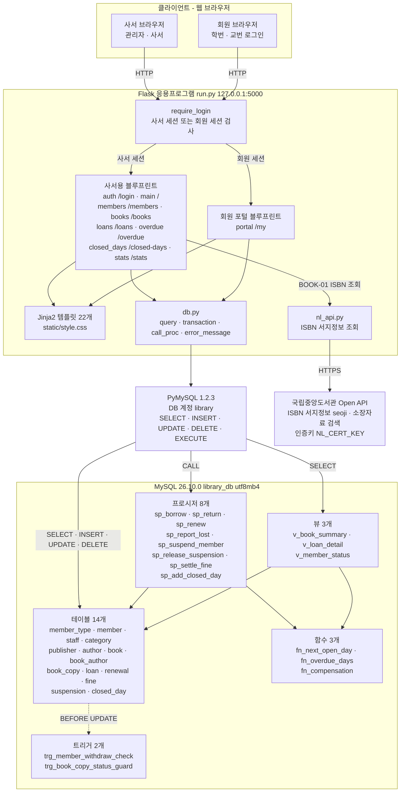
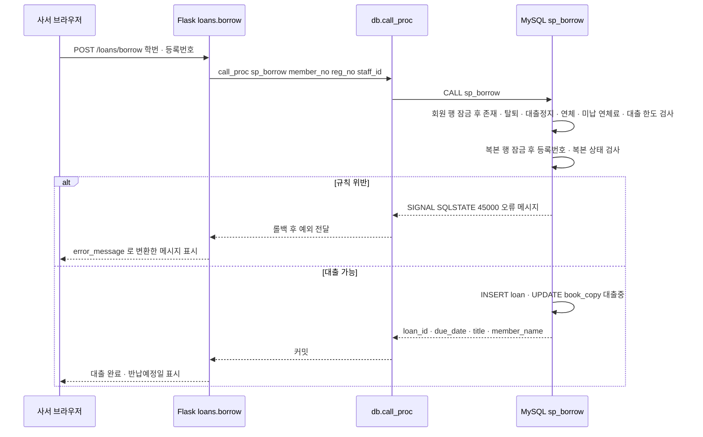
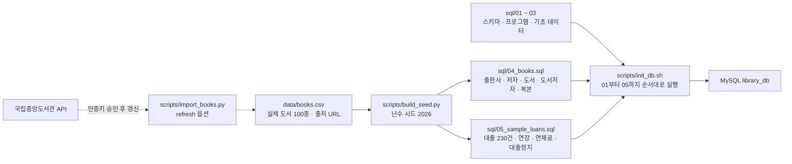

# 01. 프로젝트 개요서

> 도서관 대출·반납·연체 관리 시스템의 배경·목적·범위·사용자·업무 규칙·시스템 구성·개발 환경·데이터·팀·일정·산출물을 한 문서로 요약한다. 작성 기준일 2026-11-14 · 작성: 윤준서 (Claude 활용)

## 1. 프로젝트 개요

### 1.1 기본 정보

| 항목 | 내용 |
|---|---|
| 프로젝트명 | 도서관 대출·반납·연체 관리 시스템 |
| 과목 | 데이터베이스 팀 프로젝트 (자율 주제 3번: 도서관 대출·반납·연체 관리 시스템) |
| 기간 | 2026-10-29 ~ 2026-11-25 (최종 마감 11/25(수) 자정) |
| 팀 | 5명: 임채선, 함성준, 너세리투, 강권영, 윤준서 (역할은 9장) |
| 정기 회의 | 매주 목요일 12:00, 강의실 (Notion 팀 페이지 기준) |
| 기준 규정 | 숭실대학교 중앙도서관 대출 규정 (11.12 회의 결정: "숭실대학교 도서관과 동일하게") |
| 결과물 형태 | 웹 응용프로그램 2종 (사서용 관리 프로그램, 회원 포털 `/my`) + MySQL 데이터베이스 `library_db` |
| 최종 제출물 | 소프트웨어 · DB · 최종보고서 · PPT · 노션 링크 |
| 평가 비중 | 보고서 40% · 주제 발표 및 시연 40% · 매주 결과물 제출 10% · 팀원 평가 10% |

### 1.2 주제 선정 배경

교수님이 제시한 자율 주제 11개(수강신청·성적, 쇼핑몰, 도서관, 병원, 영화관 등, 11번은 '이외의 시스템 제안') 가운데 3번 「도서관 대출·반납·연체 관리 시스템」을 주제로 정했다. 이 주제는 다음 특성 때문에 데이터베이스 설계의 전 과정(요구 분석 → 개념·논리·물리 모델 → 구현 → 시연)을 고르게 다룰 수 있다.

| 주제의 특성 | 설계 과제와의 연결 |
|---|---|
| 업무 규칙이 공식 규정으로 존재한다 | 숭실대학교 중앙도서관 규정과 대조해 규칙을 확정하고, 제약조건·프로시저로 구현한 결과를 규정으로 검증할 수 있다 (5장) |
| 관계 유형이 다양하다 | 도서-저자 M:N(`book_author`), 도서-복본 1:N(`book_copy`), 대출-연장이력 1:N(`renewal`), 대출-연체료 1:0..1(`fine`) → 개념·논리 모델과 정규화를 모두 다룬다 |
| 시간에 따라 상태가 바뀐다 | 대출중 → 연체 → 반납, 대출정지 기간, 휴관일 → 뷰·함수·트리거·저장 프로시저를 활용할 근거가 된다 |
| 실제 데이터를 구할 수 있다 | 공개 서지정보(국립중앙도서관·알라딘 등)로 조사한 실제 도서 100종을 적재했고, 국립중앙도서관 API 키가 승인되면 갱신한다 (11.12 결정: "더미가 아닌 실제 도서관 API 로 실제 도서 목록. 100개", 8.2) |

## 2. 추진 배경 및 목적

### 2.1 수작업·스프레드시트 관리의 문제

대출 대장이나 스프레드시트로 대출·반납·연체를 관리하면 다음 문제가 생긴다.

| No | 문제 | 내용 | 결과 |
|---|---|---|---|
| 1 | 대출 자격 확인 누락 | 신분별 대출 한도, 연체 도서 보유, 미납 연체료, 대출정지 기간을 사람이 매번 대조해야 한다 | 규정을 어긴 대출이 발생한다 |
| 2 | 날짜·금액 계산 오류 | 반납예정일이 휴관일에 걸리는 경우, 연체일수에서 휴관일을 빼는 계산, "연장한 날부터" 다시 계산하는 연장 규칙 | 연체료가 과다·과소 부과된다 |
| 3 | 복본 단위 추적 불가 | 같은 책이 여러 권일 때 어느 권이 누구에게 있는지, 분실·폐기되었는지 구별하기 어렵다 | 대출 중인 책을 폐기하거나 한 권을 두 번 대출하는 일이 생긴다 |
| 4 | 처리 이력 부재 | 언제·어느 경로로 연장했는지, 연체료를 누가 납부·면제 처리했는지, 정지를 언제 해제했는지 남지 않는다 | 확인·통계가 불가능하다 |
| 5 | 중복 기록과 불일치 | 회원의 '정지' 여부를 별도 칸에 적고 연체 목록도 따로 관리한다 | 두 기록이 서로 어긋난다 |
| 6 | 동시 수정 충돌 | 여러 사서가 같은 파일을 동시에 고친다 | 같은 복본이 이중으로 대출된다 |
| 7 | 회원 불편 | 회원이 본인 대출 현황 확인이나 연장을 직접 할 수 없다 | 문의·방문이 늘어난다 |

### 2.2 목적

| No | 목적 | 본 시스템의 구현 |
|---|---|---|
| 1 | 대출·연장 자격의 자동 검사 | `sp_borrow` 가 탈퇴·대출정지·연체·미납 연체료·대출 한도·복본 상태를, `sp_renew` 가 대출 당일·연체·대출정지·미납 연체료·연장 횟수를 검사하고, 위반 시 `SIGNAL SQLSTATE '45000'` 으로 거부한다 |
| 2 | 날짜·금액 계산의 자동화 | 반납예정일 `fn_next_open_day`, 연체일수 `fn_overdue_days` (휴관일 제외), 변상금 기준액 `fn_compensation` |
| 3 | 복본 단위 관리와 무결성 보장 | `book_copy` 상태 4종(대출가능·대출중·분실·폐기), 생성 컬럼 `active_copy_id` + `uq_loan_active_copy` 로 복본당 미반납 대출 1건, 트리거 `trg_book_copy_status_guard` |
| 4 | 처리 이력 보존 | `renewal`(연장일시·신청경로·처리 사서), `fine`(부과일·처리일·처리 사서), `suspension`(적용·해제 사서) |
| 5 | 계산값의 중복 저장 배제 | 회원 대출상태는 뷰 `v_member_status` 에서 계산, 연장 횟수는 `renewal` 행 수로 계산 |
| 6 | 동시 처리 안전성 | 프로시저 안의 `FOR UPDATE` 행 잠금, 응용프로그램의 트랜잭션(`db.transaction`, 오류 시 롤백) |
| 7 | 회원 셀프서비스 | 회원 포털 `/my` 에서 도서 검색·본인 대출 내역 조회·연장 신청·연체료와 정지 내역 조회 |
| 8 | 정책 변경의 용이성 | 신분별 권수·기간·연장 횟수·연체료를 `member_type` 행 값으로 관리 → 코드 수정 없이 변경 |

## 3. 시스템 범위

### 3.1 포함 범위

Notion 「기능 정리표」의 기능 영역 5개(11.05 회의 확정), 11.12 회의 추가분(LOAN-04, OVD-04), 작업분에서 추가한 BOOK-03 복본 추가·RET-03 분실 처리, 공통 기능(SYS-01 ~ SYS-04)을 합한 24개 기능을 구현한다. BOOK-03·RET-03·SYS-01 ~ SYS-04 는 아직 기능 정리표에 없어 11.19 회의에서 확인한다 (12 문서 7장 No.8). 기능 ID 는 00 문서 4장을 따른다.

| 영역 | 기능 ID | 기능 | 사용자 | 주요 화면 | 주요 DB 객체 |
|---|---|---|---|---|---|
| 회원 관리 | MEM-01 | 회원 등록 | 사서 | `/members/new` | INSERT `member` |
| | MEM-02 | 회원 정보 수정 (비밀번호 재설정 포함) | 사서 | 회원 상세 → 수정 | UPDATE `member` |
| | MEM-03 | 탈퇴 처리 | 사서 | 회원 상세 → 탈퇴 | `trg_member_withdraw_check` |
| | MEM-04 | 회원 조회 | 사서 | `/members/` | `v_member_status` |
| 도서 관리 | BOOK-01 | 도서 등록 (국립중앙도서관 API 조회) | 사서 | `/books/new` | INSERT `book`·`book_author`·`book_copy` |
| | BOOK-02 | 도서 정보 수정 | 사서 | 도서 상세 → 수정 | UPDATE `book`, `book_author` 재작성 |
| | BOOK-03 | 복본 추가 | 사서 | 도서 상세 | INSERT `book_copy` |
| | BOOK-04 | 폐기 처리 (복본 상태 변경) | 사서 | 도서 상세 | `trg_book_copy_status_guard` |
| | BOOK-05 | 도서 검색 | 사서·회원 | `/books/`, `/my/books` | `v_book_summary` |
| 대출 관리 | LOAN-01 | 대출 가능 여부 검사 | 사서 | `/loans/borrow` | `v_member_status` (+ `sp_borrow` 가 최종 검사) |
| | LOAN-02 | 대출 처리 | 사서 | `/loans/borrow` | `sp_borrow` |
| | LOAN-03 | 대출 내역 조회 | 사서·회원(본인) | `/loans/`, `/my/` | `v_loan_detail` |
| | LOAN-04 | 대출 연장 (11.12 추가) | 회원(홈페이지)·사서 | `/my/`, 대출 목록의 연장 버튼 | `sp_renew` |
| 반납 관리 | RET-01 | 반납 처리 | 사서 | `/loans/return` | `sp_return` |
| | RET-02 | 연체일수 자동 계산 (휴관일 제외) | 시스템 | — | `fn_overdue_days`, `v_loan_detail.overdue_days` |
| | RET-03 | 분실 처리 | 사서 | 대출 목록의 분실 버튼 | `sp_report_lost` |
| 연체 관리 | OVD-01 | 연체자 조회 | 사서 | `/overdue/` | `v_loan_detail` |
| | OVD-02 | 대출정지 적용 | 사서 | `/overdue/` | `sp_suspend_member` |
| | OVD-03 | 대출정지 해제 | 사서 | `/overdue/`, 회원 상세 | `sp_release_suspension` |
| | OVD-04 | 연체료 부과·납부·면제 (11.12 추가) | 사서 (면제는 관리자) | `/overdue/fines` | `sp_return` 자동 부과, `sp_settle_fine` |
| 공통 | SYS-01 | 사서 로그인·권한 (관리자/사서) | 사서 | `/login` | `staff` |
| | SYS-02 | 회원 로그인·비밀번호 변경 | 회원 | `/my/login`, `/my/password` | `member` |
| | SYS-03 | 휴관일 관리 (등록 시 해당일 반납예정 대출 재계산) | 관리자 | `/closed-days/` | `sp_add_closed_day` |
| | SYS-04 | 대시보드·통계 | 사서 | `/`, `/stats/` | `v_loan_detail`, 집계 쿼리(`RANK()` 윈도우 함수) |

### 3.2 제외 범위

| 제외 항목 | 제외 이유 | 현재 대응 · 확장 방향 |
|---|---|---|
| 예약 | 숭실대 규정에는 있으나(전 복본 대출 중일 때) Notion 기능 정리표와 11.12 회의 결정에 없다 | 회의에서 추가 결정 시 예약 테이블을 추가해 확장 (00 문서 2장) |
| 전자책 | 11.12 결정은 실물 책을 BOOK_COPY 로 한 권씩 관리하는 것이고, 대출 대상은 등록번호(`EM000001` 형식)가 붙은 서가의 복본이다 | 도서 등록 시 국립중앙도서관 조회도 종이책만 요청한다 (`nl_api.fetch_by_isbn` 의 `ebook_yn="N"`) |
| 상호대차 | 다른 도서관과의 신청·발송·수령 연계가 필요하며, 기능 정리표에 없다. 범위를 한 도서관 내부의 대출·반납·연체 업무로 한정한다 | — |
| 온라인 결제 연동 | 외부 결제 서비스 연동이 필요하고, 시연 PC 에서 인터넷 없이 동작하도록 한 원칙(외부 CDN 미사용)과 맞지 않는다 | 연체료는 데스크에서 받은 뒤 사서가 '납부' 처리, 관리자가 '면제' 처리 (`sp_settle_fine`) |
| 문자·이메일 알림 | 외부 발송 서비스가 필요하다 | 대시보드의 '반납 예정 (오늘 ~ 2일 후)'·연체 목록, 회원 포털의 본인 반납예정일 표시로 대신한다. `member.phone`·`member.email` 은 연락처로만 저장 |
| 변상 이행 기록 | 동일 도서 수령·변상금 수납 등 이행 과정의 기록은 이번 범위에서 제외했다 (00 문서 3장 결정 7) | 분실 처리 시 대출 종료 + 복본 '분실' + 변상금 기준액 계산(`fn_compensation`)까지만 수행, 이행 기록은 향후 과제 |

참고: 11.12 회의록의 연장 경로 "홈페이지 또는 모바일 앱" 중 별도 모바일 앱은 만들지 않고, 웹 회원 포털로 대신한다. 연장 신청경로 값은 `renewal.channel` 의 '홈페이지'·'사서' 두 가지다.

## 4. 사용자 정의

### 4.1 사용자 구분

| 사용자 | 저장 위치 | 로그인 | 사용 화면 | 샘플 계정 |
|---|---|---|---|---|
| 관리자 | `staff.role` = '관리자' | `/login` (`login_id`) | 사서용 관리 프로그램 전체 + 관리자 전용 기능 | `admin` 1명 |
| 사서 | `staff.role` = '사서' | `/login` (`login_id`) | 사서용 관리 프로그램 (대시보드, 대출, 반납, 대출현황, 도서, 회원, 연체·정지, 연체료, 휴관일, 통계) | `lib01` 1명 |
| 회원 | `member` (계정상태 '정상') | `/my/login` (`member_no` = 학번·교번) | 회원 포털 (내 도서관·도서 검색·비밀번호 변경) | 27명 (탈퇴 1명은 로그인 불가) |
| 시스템 | — | — | 연체일수 자동 계산(RET-02), 반납·분실 처리 시 연체료 자동 부과 | — |

### 4.2 회원구분 5종 (`member_type`)

회원은 회원구분에 따라 대출 정책이 다르다. 값은 숭실대학교 중앙도서관 공식 안내 기준이며 `sql/03_base_data.sql` 에 있다 (DB 조회로 확인).

| `type_code` | `type_name` | 최대 대출 권수 `max_loan_count` | 대출 기간 `loan_days` | 최대 연장 횟수 `max_renew` | 1권 1일 연체료 `fine_per_day` | 샘플 회원 수 |
|---|---|---|---|---|---|---|
| UG | 학부생 | 10 | 14일 | 2회 | 100원 | 20 |
| UGL | 휴학생 | 5 | 14일 | 2회 | 100원 | 1 |
| GR | 대학원생 | 15 | 30일 | 2회 | 100원 | 2 |
| FAC | 전임교원 | 50 | 180일 | 1회 | 100원 | 2 |
| STF | 직원·비전임교원 | 15 | 30일 | 2회 | 100원 | 2 |

- STF 는 연구원·조교·비전임/초빙/명예교원을 포함한다 (`03_base_data.sql` 주석).
- 연장 1회의 기간은 `loan_days` 와 같다 ("연장한 날부터 대출기간만큼").

### 4.3 사용자별 권한

○ 가능, — 불가.

| 기능 ID | 기능 | 관리자 | 사서 | 회원 |
|---|---|---|---|---|
| MEM-01 ~ MEM-04 | 회원 등록·수정·탈퇴·조회 | ○ | ○ | — |
| BOOK-01 ~ BOOK-04 | 도서 등록·수정, 복본 추가, 폐기 처리 | ○ | ○ | — |
| BOOK-05 | 도서 검색 | ○ | ○ | ○ (대출자 정보는 숨기고 복본 상태·반납예정일만 표시) |
| LOAN-01 · LOAN-02 | 대출 가능 여부 검사, 대출 처리 | ○ | ○ | — |
| LOAN-03 | 대출 내역 조회 | ○ 전체 | ○ 전체 | ○ 본인만 |
| LOAN-04 | 대출 연장 | ○ (신청경로 '사서') | ○ (신청경로 '사서') | ○ 본인 대출만 (신청경로 '홈페이지') |
| RET-01 · RET-03 | 반납 처리, 분실 처리 | ○ | ○ | — |
| RET-02 | 연체일수 자동 계산 | 시스템 | 시스템 | 시스템 |
| OVD-01 ~ OVD-03 | 연체자 조회, 대출정지 적용·해제 | ○ | ○ | 본인 정지 내역 조회만 |
| OVD-04 | 연체료 부과(자동)·납부 처리 | ○ | ○ | 본인 연체료 조회만 |
| OVD-04 | 연체료 면제 | ○ | — | — |
| SYS-01 | 사서 로그인 | ○ | ○ | — |
| SYS-02 | 회원 로그인·비밀번호 변경 | — | — (MEM-02 로 재설정) | ○ |
| SYS-03 | 휴관일 등록·삭제 | ○ | 조회만 | — |
| SYS-04 | 대시보드·통계 | ○ | ○ | — |

### 4.4 접근 통제 구현

| 단계 | 구현 | 내용 |
|---|---|---|
| 1 | Flask `before_request` (`require_login`, `app/__init__.py`) | `portal.*` 화면은 회원 세션(`member_id`)이 없으면 `/my/login` 으로, 그 밖의 화면은 사서 세션(`staff_id`)이 없으면 `/login` 으로 보낸다. 예외는 `auth.login`, `portal.login`, `static` |
| 2 | `admin_required` 데코레이터 (`app/auth.py`) | `closed_days.new`·`closed_days.delete`(휴관일 등록·삭제), `overdue.waive`(연체료 면제)는 관리자만. 위반 시 "관리자만 처리할 수 있습니다." |
| 3 | 프로시저 본인 확인 | `sp_renew` 를 '홈페이지' 경로로 호출하면 대출의 `member_id` 와 로그인 회원이 다를 때 '연장할 수 있는 대출이 아닙니다.' 로 거부 |
| 4 | DB 계정 분리 | 응용프로그램은 `library` 계정으로 접속하며 `SELECT, INSERT, UPDATE, DELETE, EXECUTE` 권한만 가진다 (DDL 불가, `SHOW GRANTS` 확인) |
| 5 | 비밀번호 저장 | Werkzeug `generate_password_hash` 해시(scrypt)로 저장, 회원 비밀번호는 8자 이상 |
| 6 | `check_same_origin` (`app/__init__.py`), 세션 쿠키 `HttpOnly`·`SameSite=Lax` (`config.py`) | POST 요청의 `Origin`(없으면 `Referer`) 호스트가 요청 호스트와 다르면 403 으로 거부 (CSRF 방어) |
| 7 | `safe_next` (`app/auth.py`) | 사서 로그인·회원 포털 로그인 후 이동할 `next` 는 같은 사이트 경로만 허용 (오픈 리다이렉트 방지). 6·7 은 `test_72_csrf_and_open_redirect` 가 검증 |

## 5. 주요 업무 규칙 요약

### 5.1 규칙 대조표

구분 표시: **규정** = 숭실대학교 중앙도서관 공식 안내·「숭실대학교 중앙도서관 규정」과 같게 적용, **팀 정책** = 규정에 없거나 규정과 다르게 정한 것 (00 문서 2·3장). 인용한 오류 메시지는 `sql/02_programs.sql` 원문이다.

| No | 항목 | 숭실대 규정 | 본 시스템 적용 | 구분 | 구현 |
|---|---|---|---|---|---|
| 1 | 대출 권수 | 학부생 10권, 휴학생 5권, 대학원생 15권, 전임교원 50권, 직원·비전임교원 15권 | 회원구분별 `max_loan_count` 이상 대출 중이면 거부 | 규정 | `member_type`, `sp_borrow` |
| 2 | 대출 기간 | 학부생·휴학생 14일, 대학원생·직원 30일, 전임교원 180일 | 반납예정일 = `fn_next_open_day(대출일 + loan_days)` | 규정 (회의록 15일과 다름 → 5.2) | `sp_borrow` |
| 3 | 반납예정일이 휴관일 | 규정에 없음 | 다음 개관일로 자동 조정. 토요일은 개관 | 팀 정책 | `fn_next_open_day` |
| 4 | 연장 횟수 | 2회 (전임교원 1회) | `max_renew` 까지, 횟수는 `renewal` 행 수로 계산 | 규정 | `sp_renew`, `renewal` |
| 5 | 연장 기간 | 연장한 날부터 대출기간만큼 | 새 반납예정일 = `fn_next_open_day(연장일 + loan_days)`. 기존 반납예정일보다 늦어지지 않으면 '지금 연장해도 반납예정일이 늦어지지 않습니다.' | 규정 (거부 조건은 팀 정책) | `sp_renew` |
| 6 | 대출 당일 연장 | 불가 | '대출 당일에는 연장할 수 없습니다.' | 규정 | `sp_renew` |
| 7 | 연체 중 대출·연장 | 연체자는 추가 대출·예약·연장 불가 (제24조) | 미반납 연체 도서가 1권이라도 있으면 거부(다른 책이 연체여도 불가): '연체 중인 도서가 있어 대출할 수 없습니다. 연체 도서를 먼저 반납하세요.' · '연체 중인 도서가 있어 연장할 수 없습니다.' | 규정 | `sp_borrow`, `sp_renew`, `v_member_status` |
| 8 | 연체에 따른 정지 기간 | 고정 정지 기간 규정 없음 | 연체 도서를 반납할 때까지만 대출·연장 불가, 반납 후 추가 정지 없음 | 팀 정책 | `v_member_status.loan_state` |
| 9 | 연체료 | 1권 1일 100원, 휴관일 제외 | 연체일수(`fn_overdue_days`, 휴관일 제외) × `fine_per_day`. 반납·분실 처리 시 자동 부과, 대출 1건당 최대 1건(`uq_fine_loan`) | 규정 | `sp_return`, `sp_report_lost`, `fine` |
| 10 | 미납 연체료 | 연체 및 기타 제재사항이 있으면 연장 불가 | 미납이면 대출·연장 모두 거부: '미납 연체료가 있어 대출할 수 없습니다.' · '미납 연체료가 있어 연장할 수 없습니다.' | 팀 정책 (대출 차단은 규정에 없음) | `sp_borrow`, `sp_renew` |
| 11 | 연체료 처리 | — | '미납' → '납부'(사서) 또는 '면제'(관리자), 처리일·처리 사서 기록 | 팀 정책 | `sp_settle_fine` |
| 12 | 수동 대출정지 | 이용 제한 (제27조) | 사서가 사유(장기연체·자료훼손·규정위반·기타)와 기간(1 ~ 365일)을 정해 적용, 조기 해제 가능. 정지 중 연장 시 '대출정지 기간에는 연장할 수 없습니다.' | 규정 반영 (기간 범위는 팀 정책) | `sp_suspend_member`, `sp_release_suspension` |
| 13 | 휴관일 | 법정공휴일·개교기념일 (제18조), 대출실 일요일 휴무 | `closed_day` 에 일요일·공휴일·대체공휴일·개교기념일(10/10) 등록. 새 휴관일 등록 시 그날이 반납예정일인 미반납 대출을 다음 개관일로 재계산, 지난 날짜는 '지난 날짜는 휴관일로 등록할 수 없습니다.' | 규정 (재계산은 팀 정책) | `sp_add_closed_day` |
| 14 | 분실 | 동일 도서 또는 상위판 변상, 불가 시 정가 × (4년 미만 1.2 / 10년 미만 1.5 / 20년 미만 2 / 그 이상 3) (제26조) | 대출 종료(`return_type` '분실') + 연체분 연체료 부과 + 복본 '분실' + 변상금 기준액 계산. 정가·발행연도가 없으면 NULL (사서가 결정) | 규정 | `sp_report_lost`, `fn_compensation` |
| 15 | 회원 탈퇴 | 미반납 시 학사 제재 | 미반납 도서·미납 연체료가 있으면 거부: '반납하지 않은 도서가 있어 탈퇴 처리할 수 없습니다.' · '미납 연체료가 있어 탈퇴 처리할 수 없습니다.' | 팀 정책 | `trg_member_withdraw_check` |
| 16 | 대출 중 복본의 상태 변경 | — | 대출 중 복본은 분실·폐기·대출가능으로 바꿀 수 없음: '대출 중인 복본은 반납(또는 분실 처리) 후 상태를 변경할 수 있습니다.' | 팀 정책 | `trg_book_copy_status_guard` |
| 17 | 예약 | 있음 (전 복본 대출 중일 때) | 범위 제외 (3.2) | — | — |

출처: 00 문서 2장 (oasis.ssu.ac.kr 대출 안내, 「숭실대학교 중앙도서관 규정」 원문, 2026-11-14 확인).

### 5.2 회의록(15일)과 공식 규정(14일)의 차이

- 11.12 회의록: "대출 규정: 1인당 10권, 대출 기간 15일", 연장 "2회까지".
- 숭실대 공식 안내: 학부생·휴학생 **14일**, 권수·기간은 신분별로 다름.
- 본 시스템: 공식 규정을 따라 학부생·휴학생 14일을 적용했다 (`member_type.loan_days` = 14). **회의록과 다르므로 팀 확인이 필요하다.**
- 회의록의 추가 고려사항 6 "연장 시 원래 날짜+15일 vs 연장일+15일" 은 공식 규정대로 "연장한 날부터 대출기간만큼"으로 정했다 (00 문서 3장 No 6).
- 15일로 바꾸기로 결정하면 운영 중인 DB 에서는 아래 값 하나만 바꾸면 된다. 연장 기간도 `loan_days` 를 쓰므로 함께 바뀐다. 이미 저장된 대출의 `due_date` 는 그대로이고 이후 대출·연장부터 적용된다. 초기화 데이터까지 바꾸려면 `sql/03_base_data.sql` 의 UG·UGL 값, `scripts/build_seed.py` 의 `MEMBERS` 대출기간(14 → 15, 수정 후 `build_seed.py` 로 다시 생성), `tests/test_scenarios.py` `test_10_renew_from_member_portal` 의 기대값 `INTERVAL 14 DAY` 를 함께 고친다 (12 문서 7장 No.1).

```sql
UPDATE member_type SET loan_days = 15 WHERE type_code IN ('UG', 'UGL');
```

## 6. 시스템 구성도

### 6.1 구성도



### 6.2 계층별 구성

| 계층 | 구성 요소 | 역할 |
|---|---|---|
| 표현 | Jinja2 템플릿 22개(`app/templates/`), `app/static/style.css` | 사서용 메뉴 10개(대시보드, 대출, 반납, 대출현황, 도서, 회원, 연체·정지, 연체료, 휴관일, 통계), 회원 포털 메뉴 3개(내 도서관, 도서 검색, 비밀번호 변경). 외부 CDN 없이 동작 |
| 응용 | Flask 블루프린트 9개: `auth`, `main`, `members`, `books`, `loans`, `overdue`, `closed_days`, `stats`, `portal` | 화면 요청 처리, 입력 검증, 로그인·권한 검사 |
| 데이터 접근 | `app/db.py` (PyMySQL) | 연결 관리, 트랜잭션(오류 시 롤백), 프로시저 호출(`call_proc`), MySQL 오류를 한국어 메시지로 변환(`error_message`: 프로시저·트리거의 SIGNAL 은 메시지 그대로, 제약조건 위반은 제약조건 이름별 메시지) |
| 외부 연계 | `app/nl_api.py` (표준 라이브러리 `urllib`) | 국립중앙도서관 ISBN 서지정보 API 로 서지 조회, 소장자료 검색 API 로 KDC 분류기호 보강 |
| 데이터베이스 | MySQL `library_db`: 테이블 14 · 뷰 3 · 함수 3 · 프로시저 8 · 트리거 2 | 업무 규칙(대출·반납·연장·분실·정지·연체료·휴관일)을 프로시저와 트리거에서 일관되게 처리 |

### 6.3 처리 흐름 예시 (LOAN-02 대출 처리)

업무 규칙 검사는 화면이 아니라 DB 프로시저가 최종적으로 수행한다. 그래서 화면 검사(LOAN-01)를 건너뛰어도 규칙이 지켜지고, 연장(LOAN-04)처럼 사서 화면과 회원 포털 두 경로가 있는 기능도 같은 프로시저(`sp_renew`)로 같은 규칙이 적용된다. 대출 처리(LOAN-02)는 사서 화면(`/loans/borrow`)에서만 호출한다.



## 7. 개발 환경·도구

| 구분 | 항목 | 버전·설정 | 확인 근거 |
|---|---|---|---|
| 언어 | Python | 3.14.0 | `.venv/bin/python --version` |
| 웹 프레임워크 | Flask | 3.1.3 (요구: Flask>=3.0) | `requirements.txt`, `.venv` 의 `pip freeze` |
| | Werkzeug | 3.1.9 (비밀번호 해시 scrypt) | `pip freeze` |
| | Jinja2 | 3.1.6 (화면 템플릿) | `pip freeze` |
| | Flask 의존 패키지 | itsdangerous 2.2.0 · click 8.5.0 · blinker 1.9.0 · MarkupSafe 3.0.4 | `pip freeze` |
| DB 드라이버 | PyMySQL | 1.2.3 (요구: PyMySQL>=1.1) | `requirements.txt`, `pip freeze` |
| | cryptography | 50.0.2 (요구: cryptography>=42), MySQL 8 의 caching_sha2_password 인증 지원 | `requirements.txt`, `pip freeze` |
| | cryptography 의존 패키지 | cffi 2.1.1 · pycparser 3.12 | `pip freeze` |
| DBMS (개발) | MySQL (Homebrew `mysql 26.10.0_1`) | 26.10.0, 문자셋 `utf8mb4` / 콜레이션 `utf8mb4_0900_ai_ci` | `SELECT VERSION()`, `@@character_set_server` |
| DBMS (발표 PC) | MySQL Server 8.x (Windows, MySQL Installer) | MySQL 8.0.19 이상 필요: CHECK 제약 · 생성 컬럼(`active_copy_id`) · `FOR UPDATE OF`(`02_programs.sql` 의 `sp_borrow`·`sp_return`·`sp_renew`·`sp_report_lost`) · `03_base_data.sql` 의 `INSERT … AS new ON DUPLICATE KEY UPDATE` 행 별칭. 통계 화면(`app/stats.py`)은 `RANK()` 윈도우 함수 사용 | `README.md`, `sql/01_schema.sql` 머리말, 00 문서 1장, `app/stats.py` |
| 운영체제 (개발) | macOS | 27.2 (arm64) | `sw_vers` |
| 실행 서버 | Flask 개발 서버 | `127.0.0.1:5000`, `debug=True` | `run.py` |
| 설정 | 환경변수 | `SECRET_KEY`, `DB_HOST`(기본 127.0.0.1), `DB_PORT`(3306), `DB_USER`(library), `DB_PASSWORD`, `DB_NAME`(library_db), `NL_CERT_KEY`(국립중앙도서관 인증키) | `config.py`, `app/nl_api.py` |
| 외부 API | 국립중앙도서관 | ISBN 서지정보 API(`seoji/SearchApi.do`), 소장자료 검색 API(`NL/search/openApi/search.do`) | `app/nl_api.py` |
| 테스트 | Python `unittest` | 통합 테스트 25개 (`tests/test_scenarios.py`). 실행 결과 `docs/_test_output.txt`: Ran 25 tests, OK | `tests/test_scenarios.py`, `docs/_test_output.txt` |
| 모델링 | ERDCloud, Mermaid | ERDCloud 는 `sql/01_schema.sql` DDL Import 로 ERD 생성, 문서 안 ERD·흐름도는 Mermaid | 00 문서 1장, `README.md` |
| 문서 자동화 | `scripts/gen_docs.py` | `information_schema` → 09 용어 사전 · 10 도메인 정의서 · 11 테이블 기술서 · `_generated_physical_lists.md` | `README.md` |
| 협업 | Notion | 회의록 · 작업 트래커 · 기능 정리표 · 역할 분담 · 일정 | Notion 팀 페이지 |
| AI 도구 | Claude | 11.12 회의 결정(각자 AI 로 전체 작업 후 택1)에 따라 사용 | 11.12 회의록 |

개발 언어(Python)와 DBMS(MySQL)는 10.29 회의에서 정했다.

## 8. 데이터 개요

### 8.1 테이블별 건수

2026-11-14 `library_db` 조회 결과다. 대출 관련 날짜는 DB 를 초기화한 날 기준의 상대값이라 상태별 건수는 초기화 시점에 따라 달라질 수 있다.

| No | 테이블 | 한글명 | 건수 | 내역 |
|---|---|---|---|---|
| 1 | `member_type` | 회원구분 | 5 | 학부생·휴학생·대학원생·전임교원·직원·비전임교원 |
| 2 | `member` | 회원 | 27 | 계정상태 정상 26 · 탈퇴 1. 대출상태(`v_member_status`) 대출가능 21 · 대출정지 5 · 탈퇴 1 |
| 3 | `staff` | 사서 | 2 | 관리자 1 (`admin`) · 사서 1 (`lib01`) |
| 4 | `category` | 분류 | 10 | KDC 주류 000 ~ 900 |
| 5 | `publisher` | 출판사 | 56 | |
| 6 | `author` | 저자 | 155 | |
| 7 | `book` | 도서 | 100 | 실제 도서. 발행연도 1995 ~ 2025, 정가 100종 모두 있음, KDC 분류기호 99종 있음 |
| 8 | `book_author` | 도서저자 | 171 | 지은이 106 · 옮긴이 62 · 엮은이 2 · 그림 1 |
| 9 | `book_copy` | 도서복본 | 157 | 대출가능 131 · 대출중 24 · 분실 1 · 폐기 1. 등록번호 `EM000001` ~ `EM000157` |
| 10 | `loan` | 대출 | 230 | 대출상태(`v_loan_detail.loan_state`) 반납 205 · 대출중 19 · 연체 5 · 분실 1. 대출일 범위 최근 200일 |
| 11 | `renewal` | 연장이력 | 15 | 신청경로 홈페이지 14 · 사서 1 |
| 12 | `fine` | 연체료 | 22 | 납부 18건(11,000원) · 면제 3건(2,300원) · 미납 1건(700원) |
| 13 | `suspension` | 대출정지 | 3 | 진행 중 1(자료훼손) · 조기 해제 1(규정위반) · 기간 만료 1(장기연체) |
| 14 | `closed_day` | 휴관일 | 139 | 2026-01-01 ~ 2027-12-27. 사유 '일요일' 97일 + 공휴일·대체공휴일·선거일·개교기념일 42일 (일요일과 겹친 공휴일은 공휴일 이름으로 저장) |

### 8.2 도서 데이터

- 실제 도서 100종의 ISBN·서명·저자·출판사·발행연도·정가·KDC 를 `data/books.csv` 에 두고 `source` 열에 출처 URL 을 기록했다. 출처: 국립중앙도서관 65건 · 알라딘 31건 · 언론 기사 4건.
- 국립중앙도서관 API 인증키 승인 전이라 공개 서지 페이지로 조사한 목록을 사용했다. 키가 발급되면 `scripts/import_books.py --refresh` 로 국립중앙도서관 데이터로 갱신한다 (00 문서 6장).
- 복본은 도서 순번에 따라 1 ~ 3권: 1권 57종 · 2권 29종 · 3권 14종 = 157권.

| 분류코드 | 분류명 | 도서 수 |
|---|---|---|
| 000 | 총류 | 15 |
| 100 | 철학 | 10 |
| 200 | 종교 | 3 |
| 300 | 사회과학 | 15 |
| 400 | 자연과학 | 10 |
| 500 | 기술과학 | 7 |
| 600 | 예술 | 5 |
| 700 | 언어 | 5 |
| 800 | 문학 | 22 |
| 900 | 역사 | 8 |
| 합계 | | 100 |

### 8.3 대출 이력 데이터

- `scripts/build_seed.py` 가 `sql/05_sample_loans.sql` 을 만든다. 대출일·연장일·반납일은 '오늘로부터 며칠 전'으로 저장하고, 반납예정일·연체일수·연체료는 DB 함수(`fn_next_open_day`, `fn_overdue_days`)가 계산한다. 그래서 `init_db.sh` 를 다시 실행하면 연체·반납예정 상황이 초기화 날짜 기준으로 재현된다.
- 시연용 상황을 회원별로 고정 생성한다: 연장 가능한 정상 회원(10001), 대출 당일 연장 불가(10002), 연체 2권(10003), 연체 1권(10004), 연장 2회 소진(10006), 반납 임박(10008), 미납 연체료(10009), 대출정지 중(10011), 장기 연체(10012), 분실 처리 이력(10015), 탈퇴 회원 이력(10020) 등.
- 나머지는 난수 시드 2026 으로 만든 지난 대출 이력이며, 전체 230건이다 (현재 대출 중 24건).

### 8.4 데이터 적재 흐름



## 9. 팀 구성 및 역할

### 9.1 역할 분담 (Notion 「역할 분담」·「작업 트래커」 기준)

| 팀원 | 보고서 산출물 | 구현 범위 | 작업 트래커 담당 작업 (마감일) | 본 문서 세트 대응 |
|---|---|---|---|---|
| 임채선 | 프로젝트 개요서, 업무 기능도, PPT 취합·디자인 | PM, 개발 보조, UI/테스트 | 01 프로젝트 개요서 (11/12) · 02 업무 기능도 (11/12) · 발표 PPT (11/24) | 01, 02 |
| 함성준 | 단위 업무 기술서, 업무 흐름도, 시연 시나리오 | 최종 발표, 노션 구축 | 03 단위 업무 기술서 (11/12) · 04 업무 흐름도 (11/12) · 시연 시나리오 (11/22) · 12 최종 결과 보고서 (취합) (11/24) | 03, 04, 13 |
| 너세리투 | 업무 문서 리스트, 개념적·논리적 데이터 모델(ERD, 스키마, 정규화) | DDL 검토 | 05 업무 문서 리스트 (11/12) · 06 개념적 데이터 모델 (ERD) (11/12) · 07 논리적 데이터 모델 (스키마•정규화) (11/19) | 05, 06, 07 |
| 강권영 | 용어 사전, 도메인 정의서, 테이블 기술서 | 더미 데이터 구축 | 09 용어 사전 · 10 도메인 정의서 · 11 테이블 기술서 · 테스트 데이터 구축 (모두 11/19) | 09, 10, 11 |
| 윤준서 | 물리적 데이터 모델(DDL, 인덱스) | DB 통합, 핵심 기능·쿼리 개발 | 08 물리적 데이터 모델 (DDL•인덱스) (11/19) · 응용프로그램 (프로그램 + .DB) (11/24) | 08 |

- 11.05 회의 결정 사항은 기능 영역 5개 확정과 역할 A ~ E 분담이다 (Notion 회의록).
- 작업 트래커의 12번 항목은 '12 최종 결과 보고서 (취합)'이다. 본 문서 세트의 12번은 '회의록'이며 작업 트래커에는 담당자가 지정된 항목이 없다.

### 9.2 본 문서 세트의 작성 경위

11.12 회의에서 "각자 토요일까지 클로드를 돌려서 전체 프로젝트 작업 이후 가장 결과물이 좋은 작업물을 택1" 하고, 노션에 올린 뒤 모두가 리뷰해 결정하며, 프로젝트가 선택되면 태스크별로 다시 나누어 작성하기로 했다. 본 문서 세트(docs/00 ~ 13)와 코드는 이 결정에 따라 윤준서가 Claude 를 활용해 만든 결과물이다. 위 9.1 의 '본 문서 세트 대응'은 Notion 역할 분담을 문서 번호에 연결한 것이다.

## 10. 추진 일정

회의 기록(Notion 회의록)과 작업 트래커 마감일만으로 작성했다. 주차는 목요일 정기 회의를 기준으로 나눴다.

| 주차 | 기간 | 회의 (참석) | 회의 결정 사항 | 작업 트래커 마감 |
|---|---|---|---|---|
| 1주차 | 10/29(목) ~ 11/4(수) | 10.29 회의 (윤준서, 너세리투, 함성준) | 개발 언어 파이썬, DBMS MySQL | — |
| 2주차 | 11/5(목) ~ 11/11(수) | 11.05 회의 (강권영, 너세리투, 함성준) | 기능 영역 5개 확정, 역할 A ~ E 분담 | — |
| 3주차 | 11/12(목) ~ 11/18(수) | 11.12 회의 (윤준서, 강권영, 함성준, 임채선) | 숭실대학교 도서관과 동일한 기준(대출 1인당 10권·15일, 연장 2회, 연체 시 대출 자격 정지·매일 100원) · 실제 도서 100개를 실제 도서관 API 로 · 복본은 BOOK_COPY 로 개별 관리 · 연장·연체료 납부 기능 구현 · 각자 토요일(11/14)까지 AI 로 전체 작업 → 노션 업로드 → 리뷰 후 택1, 이후 태스크별 재분배 | 11/12(목): 01 프로젝트 개요서 · 02 업무 기능도 (임채선), 03 단위 업무 기술서 · 04 업무 흐름도 (함성준), 05 업무 문서 리스트 · 06 개념적 데이터 모델 (ERD) (너세리투) |
| 4주차 | 11/19(목) ~ 11/25(수) | 11/19(목) 12:00 정기 회의 예정 | — | 11/19(목): 07 논리적 데이터 모델 (너세리투), 08 물리적 데이터 모델 (윤준서), 09 용어 사전 · 10 도메인 정의서 · 11 테이블 기술서 · 테스트 데이터 구축 (강권영) · 11/22(일): 시연 시나리오 (함성준) · 11/24(화): 12 최종 결과 보고서 (취합) (함성준), 응용프로그램 (프로그램 + .DB) (윤준서), 발표 PPT (임채선) · 11/25(수) 자정: 최종 마감 (소프트웨어 · DB · 최종보고서 · PPT · 노션 링크) |

## 11. 기대 효과

| 관점 | 기대 효과 | 근거 (구현) |
|---|---|---|
| 사서 업무 | 대출 1건마다 회원 존재·탈퇴·대출정지·연체·미납 연체료·대출 한도·복본 존재·복본 상태 8가지를 자동으로 검사해 확인 누락이 없다 | `sp_borrow` |
| 계산 정확성 | 반납예정일·연장일·연체일수·연체료·변상금 기준액을 같은 함수로 계산해 사람마다 결과가 달라지지 않는다 | `fn_next_open_day`, `fn_overdue_days`, `fn_compensation`, 테스트 `test_21_overdue_days_exclude_closed_days` |
| 데이터 무결성 | 제약조건 70개(PRIMARY KEY 14 · FOREIGN KEY 18 · UNIQUE 10 · CHECK 28)와 트리거 2개가 잘못된 상태 저장, 이중 대출, 대출 중 탈퇴·폐기를 DB 에서 막는다 | `information_schema.TABLE_CONSTRAINTS` 조회, 테스트 `test_60_db_constraints` |
| 회원 편의 | 회원이 포털에서 직접 도서를 검색하고 본인 대출·연체료·정지 내역을 확인하며 연장을 신청한다 | 회원 포털 `/my`, `sp_renew` '홈페이지' 경로 |
| 정책 변경 대응 | 권수·기간·연장 횟수·연체료가 바뀌어도 `member_type` 값만 고치면 된다 (예: 5.2 의 15일 변경) | `member_type` |
| 장서 운영 | 월별 대출(최근 6개월), 인기 도서 TOP 10, 분류별 대출, 다독 회원 TOP 5, 연체 반납 비율을 제공해 장서 구입·배치 판단에 참고할 수 있다 | `/stats/` (`RANK()` 윈도우 함수) |
| 학습 | 실제 규정과 실제 도서 데이터로 요구 분석부터 개념·논리·물리 모델, 구현, 테스트까지 데이터베이스 설계 전 과정을 수행한다 | 산출물 00 ~ 13, 통합 테스트 25개 |

## 12. 산출물 목록

### 12.1 보고서 (docs/)

| No | 파일 | 문서명 | 보고서 요구 항목 | 작업 트래커 담당 |
|---|---|---|---|---|
| 00 | `docs/00_설계_결정사항.md` | 설계 결정 사항 | 모든 문서의 기준 (규칙·용어·기능 ID) | — |
| 01 | `docs/01_프로젝트_개요서.md` | 프로젝트 개요서 | 프로젝트 개요서 | 임채선 |
| 02 | `docs/02_업무_기능도.md` | 업무 기능도 | 업무 기능도 | 임채선 |
| 03 | `docs/03_단위_업무_기술서.md` | 단위 업무 기술서 | 단위 업무 기술서 | 함성준 |
| 04 | `docs/04_업무_흐름도.md` | 업무 흐름도 | 업무 흐름도 | 함성준 |
| 05 | `docs/05_업무_문서_리스트.md` | 업무 문서 리스트 | 업무 문서 리스트 | 너세리투 |
| 06 | `docs/06_개념적_데이터_모델.md` | 개념적 데이터 모델 | 개념적 데이터 모델 (ER 다이어그램) | 너세리투 |
| 07 | `docs/07_논리적_데이터_모델.md` | 논리적 데이터 모델 | 논리적 데이터 모델 (릴레이션 스키마, 정규화) | 너세리투 |
| 08 | `docs/08_물리적_데이터_모델.md` | 물리적 데이터 모델 | 물리적 데이터 모델 (DDL, 제약조건, 인덱스) | 윤준서 |
| 09 | `docs/09_용어_사전.md` | 용어 사전 | 용어 사전 · `gen_docs.py` 생성 | 강권영 |
| 10 | `docs/10_도메인_정의서.md` | 도메인 정의서 | 도메인 정의서 · `gen_docs.py` 생성 | 강권영 |
| 11 | `docs/11_테이블_기술서.md` | 테이블 기술서 | 테이블 기술서 · `gen_docs.py` 생성 | 강권영 |
| 12 | `docs/12_회의록.md` | 회의록 | 회의록 | — (9.1 참고) |
| 13 | `docs/13_시연_시나리오_및_테스트.md` | 시연 시나리오 및 테스트 | 주제 발표 및 시연 준비 | 함성준 (시연 시나리오) |
| 부록 | `docs/_generated_physical_lists.md` | 제약조건·인덱스 전체 목록 | 08 부록 · `gen_docs.py` 생성 | — |
| 부록 | `docs/_test_output.txt` | 통합 테스트 실행 결과 (25개 OK) | 13 근거 | — |

### 12.2 코드·데이터 산출물

| 경로 | 내용 |
|---|---|
| `sql/01_schema.sql` | DB `library_db` 와 앱 전용 계정 `library` 생성, 테이블 14개 (PK·FK·UNIQUE·CHECK·인덱스·생성 컬럼) |
| `sql/02_programs.sql` | 함수 3 · 뷰 3 · 트리거 2 · 저장 프로시저 8 |
| `sql/03_base_data.sql` | 회원구분 5 · 사서 2 · 분류 10 · 휴관일(2026 ~ 2027) · 회원 27 |
| `sql/04_books.sql` | 출판사 · 저자 · 도서 100종 · 도서저자 · 복본 157권 (`build_seed.py` 생성) |
| `sql/05_sample_loans.sql` | 대출 230건과 연장·연체료·대출정지 이력 (`build_seed.py` 생성) |
| `data/books.csv` | 실제 도서 100종 서지정보와 출처 URL |
| `scripts/init_db.sh` | DB 초기화 (`01_schema` → `05_sample_loans` 순서 실행) |
| `scripts/init_db.bat` | Windows(발표 PC)용 DB 초기화 (01 → 05 순서, PATH 에 mysql 이 없으면 MySQL Server 설치 폴더에서 찾음) |
| `scripts/build_seed.py` | `books.csv` → `04_books.sql`, 대출 이력 생성 규칙 → `05_sample_loans.sql` |
| `scripts/import_books.py` | 국립중앙도서관 API → `books.csv` |
| `scripts/gen_docs.py` | DB 메타데이터 → 09 · 10 · 11 문서, `_generated_physical_lists.md` |
| `scripts/build_report.py` | docs 01 ~ 13 + 00(부록) → `docs/최종_결과_보고서.md` 취합 |
| `app/` (Python 모듈 12개) | `__init__.py`(앱 생성·로그인 검사), `auth.py`, `main.py`, `members.py`, `books.py`, `loans.py`, `overdue.py`, `closed_days.py`, `stats.py`, `portal.py`, `db.py`, `nl_api.py` |
| `app/templates/` (22개), `app/static/style.css` | 사서용 화면과 회원 포털 화면 |
| `tests/test_scenarios.py` | 업무 규칙 통합 테스트 25개 (실행 시 DB 초기화) |
| `config.py` · `run.py` · `requirements.txt` · `README.md` | 설정 · 실행 진입점 · 의존 패키지 · 설치·실행 안내 |

### 12.3 최종 제출물 (11/25(수) 자정)

| 제출물 | 해당 산출물 |
|---|---|
| 소프트웨어 | `app/`, `scripts/`, `run.py`, `config.py`, `requirements.txt`, `README.md` |
| DB | `sql/01_schema.sql` ~ `sql/05_sample_loans.sql` (`init_db.sh` / `init_db.bat` 로 `library_db` 재현) |
| 최종보고서 | `docs/00` ~ `docs/13` 취합 (`scripts/build_report.py`, 작업 트래커 '12 최종 결과 보고서 (취합)', 11/24) |
| PPT | 발표 PPT (작업 트래커, 11/24) |
| 노션 링크 | Notion 팀 페이지 |
