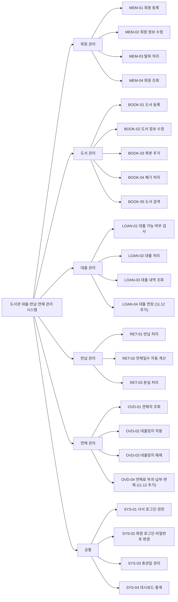
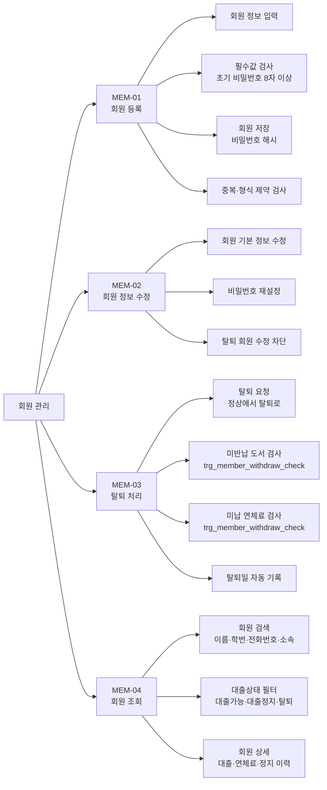
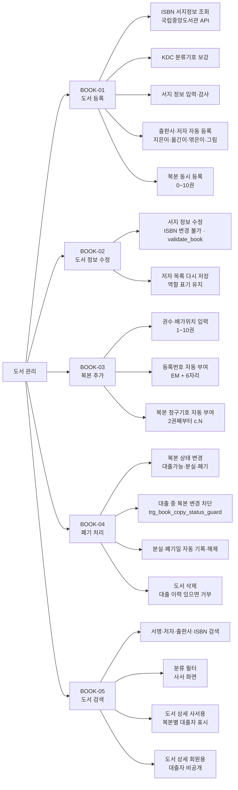
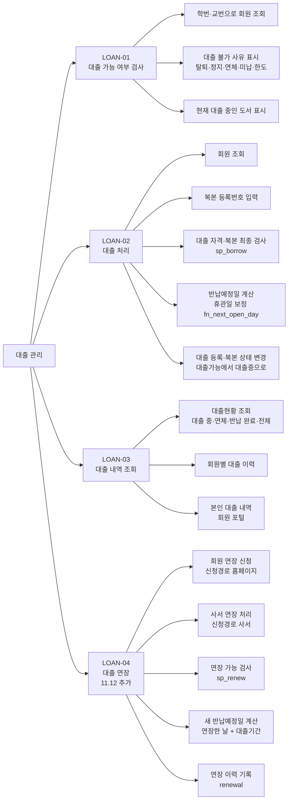
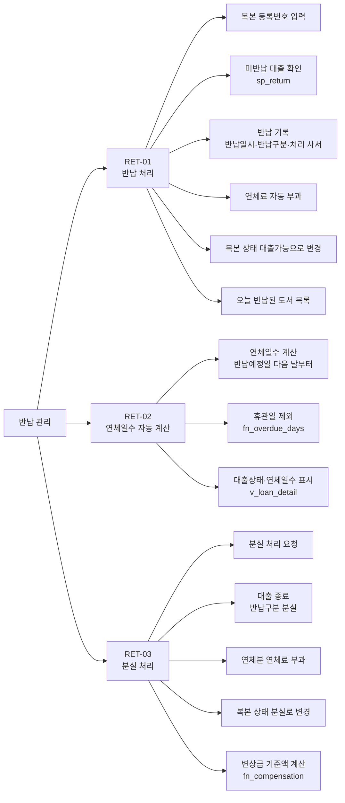
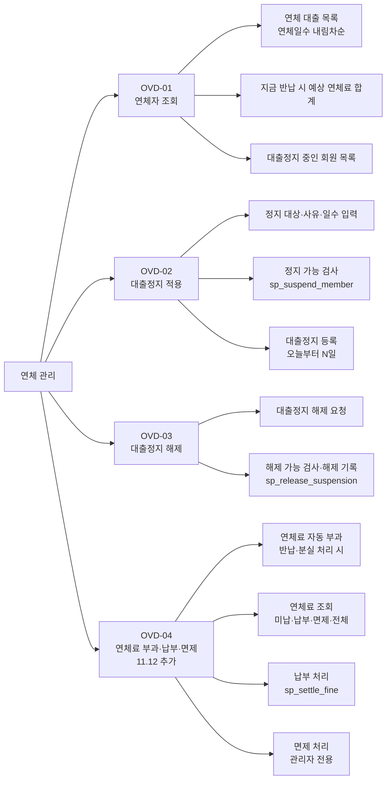
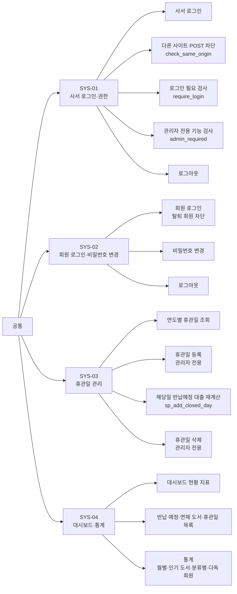
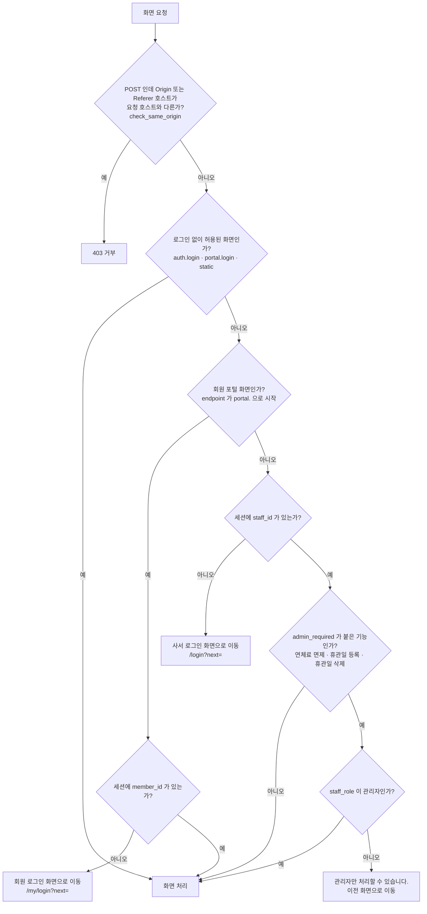

# 02. 업무 기능도

> 시스템 기능을 영역 → 기능(기능 ID) → 세부 기능의 3단계로 나누고, 사용자별 권한과 Notion 기능 정리표와의 대응을 정리한다. 작성 기준일 2026-11-14

작성 근거: 기능 ID·기능명은 `docs/00_설계_결정사항.md` 4장. 세부 기능·화면 URL·권한은 `app/*.py` 와 `app/templates/**`, DB 객체는 `sql/01_schema.sql`·`sql/02_programs.sql`, 검증은 `tests/test_scenarios.py`(28개)에서 확인했다. 실행 결과는 `docs/_test_output.txt` ("Ran 28 tests", OK). 세부 기능에는 코드에 실제로 있는 처리만 넣었다.

## 1. 기능 계층도

### 1.1 전체 기능 계층도

### 1.2 회원 관리 상세

### 1.3 도서 관리 상세

### 1.4 대출 관리 상세

### 1.5 반납 관리 상세

### 1.6 연체 관리 상세

### 1.7 공통 상세

### 1.8 영역별 기능 수

| 레벨1 영역 | 레벨2 기능 수 | 레벨3 세부 기능 수 | 기능 ID |
|---|---|---|---|
| 회원 관리 | 4 | 14 | MEM-01 ~ MEM-04 |
| 도서 관리 | 5 | 18 | BOOK-01 ~ BOOK-05 |
| 대출 관리 | 4 | 16 | LOAN-01 ~ LOAN-04 |
| 반납 관리 | 3 | 14 | RET-01 ~ RET-03 |
| 연체 관리 | 4 | 12 | OVD-01 ~ OVD-04 |
| 공통 | 4 | 15 | SYS-01 ~ SYS-04 |
| 합계 | 24 | 89 | |

세부 기능 수는 기능별로 나열한 행 수이며, 같은 처리를 여러 기능에서 다시 센 항목(RET01D·RET03C·OVD04A 연체료 부과, LOAN01A·LOAN02A 회원 조회, MEM04C·LOAN03B 회원 상세)이 포함된다.

## 2. 기능 분해표

사용자 표기: **사서** = 사서 프로그램 계정 전체(`staff.role` 이 '관리자' 또는 '사서'), **관리자** = `staff.role` = '관리자' 만, **회원** = 회원 포털(`/my`)에 로그인한 회원, **시스템** = 사용자 조작 없이 DB 함수·뷰·트리거·프로시저 또는 앱이 자동으로 수행. 화면 URL 의 `<...>` 는 Flask 라우트 변수다.

### 2.1 회원 관리

| 레벨1 영역 | 레벨2 기능 | 레벨3 세부 기능 | 사용자 | 화면 URL | DB 객체 |
|---|---|---|---|---|---|
| 회원 관리 | MEM-01 회원 등록 | 회원 정보 입력: 학번·교번, 이름, 회원구분(기본 학부생), 소속, 전화번호, 이메일, 초기 비밀번호 | 사서 | `GET /members/new` | `member_type` (회원구분 선택 목록) |
| 회원 관리 | MEM-01 회원 등록 | 필수값 검사: 학번(교번)·이름·전화번호 필수, 초기 비밀번호 8자 이상 | 시스템 | `POST /members/new` | — (앱 `members.py`) |
| 회원 관리 | MEM-01 회원 등록 | 회원 저장: 비밀번호는 해시로 저장, 회원번호(`member_id`)는 자동 증가 | 사서 | `POST /members/new` | `member` INSERT |
| 회원 관리 | MEM-01 회원 등록 | 중복·형식 제약 검사: 학번·전화번호·이메일 중복, 학번 영문·숫자 4~20자, 전화번호 형식, 회원구분 존재 | 시스템 | `POST /members/new` | `uq_member_no` · `uq_member_phone` · `uq_member_email` · `ck_member_no` · `ck_member_phone` · `fk_member_type` |
| 회원 관리 | MEM-02 회원 정보 수정 | 회원 기본 정보 수정: 학번·이름·회원구분·소속·전화번호·이메일 | 사서 | `GET·POST /members/<member_id>/edit` | `member` UPDATE · `member_type` |
| 회원 관리 | MEM-02 회원 정보 수정 | 비밀번호 재설정: 입력했을 때만 변경, 8자 미만이면 변경하지 않음 | 사서 | `POST /members/<member_id>/edit` | `member.password_hash` UPDATE |
| 회원 관리 | MEM-02 회원 정보 수정 | 탈퇴 회원 수정 차단: 탈퇴 회원은 수정 화면 진입 불가 | 시스템 | `GET·POST /members/<member_id>/edit` | `member.status` |
| 회원 관리 | MEM-03 탈퇴 처리 | 탈퇴 요청: 계정상태 정상 → 탈퇴 | 사서 | `POST /members/<member_id>/withdraw` | `member` UPDATE |
| 회원 관리 | MEM-03 탈퇴 처리 | 미반납 도서 검사: 반납하지 않은 대출이 있으면 거부 | 시스템 | `POST /members/<member_id>/withdraw` | `trg_member_withdraw_check` · `loan` |
| 회원 관리 | MEM-03 탈퇴 처리 | 미납 연체료 검사: 미납 연체료가 있으면 거부 | 시스템 | `POST /members/<member_id>/withdraw` | `trg_member_withdraw_check` · `fine` · `loan` |
| 회원 관리 | MEM-03 탈퇴 처리 | 탈퇴일 자동 기록: 탈퇴일 = 처리한 날 | 시스템 | `POST /members/<member_id>/withdraw` | `trg_member_withdraw_check` · `member.withdraw_date` · `ck_member_withdraw` |
| 회원 관리 | MEM-04 회원 조회 | 회원 검색: 이름·학번(교번)·전화번호·소속 부분 일치 | 사서 | `GET /members/?q=` | `v_member_status` |
| 회원 관리 | MEM-04 회원 조회 | 대출상태 필터: 대출가능·대출정지·탈퇴 (계산값) | 사서 | `GET /members/?state=` | `v_member_status.loan_state` |
| 회원 관리 | MEM-04 회원 조회 | 회원 상세: 회원 정보, 대출 중 도서, 연체료, 대출정지 이력, 최근 대출 이력 20건 | 사서 | `GET /members/<member_id>` | `v_member_status` · `v_loan_detail` · `fine` · `suspension` · `staff` |

### 2.2 도서 관리

| 레벨1 영역 | 레벨2 기능 | 레벨3 세부 기능 | 사용자 | 화면 URL | DB 객체 |
|---|---|---|---|---|---|
| 도서 관리 | BOOK-01 도서 등록 | ISBN 서지정보 조회: 국립중앙도서관 ISBN 서지정보 API 로 입력란 채움 (인증키 `NL_CERT_KEY` 설정 시에만 버튼 활성) | 사서 | `GET /books/new?lookup=ISBN` | — (외부 API, `app/nl_api.py` `fetch_by_isbn`) |
| 도서 관리 | BOOK-01 도서 등록 | KDC 분류기호 보강: 서지 API 결과에 KDC 가 없으면 소장자료 검색 API 로 보강 | 시스템 | `GET /books/new?lookup=ISBN` | — (`app/nl_api.py` `fetch_kdc`) |
| 도서 관리 | BOOK-01 도서 등록 | 서지 정보 입력·검사: 서명·출판사·지은이 필수, ISBN 형식(978·979로 시작하는 13자리)·중복, 발행연도는 숫자만('발행연도는 숫자로 입력하세요.')·올해 + 1 초과 거부('발행연도가 올바르지 않습니다. (내년 이후 불가)', 앱 `validate_book`)·1450~2100(`ck_book_pub_year`) | 사서 | `POST /books/new` | `category` · `ck_book_isbn` · `book` PRIMARY KEY · `ck_book_pub_year` |
| 도서 관리 | BOOK-01 도서 등록 | 출판사·저자 자동 등록: 없는 출판사·저자는 새로 등록, 지은이·옮긴이·엮은이·그림 역할('이름 (엮은이)' 표기)과 표기순서 저장 | 시스템 | `POST /books/new` | `book` INSERT · `publisher` · `author` · `book_author` INSERT |
| 도서 관리 | BOOK-01 도서 등록 | 복본 동시 등록: 0~10권, 배가위치(기본 종합자료실)·청구기호 입력 | 사서 | `POST /books/new` | `book_copy` INSERT |
| 도서 관리 | BOOK-02 도서 정보 수정 | 서지 정보 수정: 서명·출판사·분류·KDC·발행연도·정가 (ISBN 은 읽기 전용). 서명·출판사·지은이 필수, 발행연도 검사는 등록과 동일(`validate_book`) | 사서 | `GET·POST /books/<isbn>/edit` | `v_book_summary` · `book` UPDATE · `publisher` |
| 도서 관리 | BOOK-02 도서 정보 수정 | 저자 목록 다시 저장: 기존 도서저자를 지우고 지은이·옮긴이·엮은이·그림 재등록(수정 화면에 역할 표기 유지) | 시스템 | `POST /books/<isbn>/edit` | `book_author` DELETE·INSERT · `author` |
| 도서 관리 | BOOK-03 복본 추가 | 권수·배가위치 입력: 1~10권(숫자가 아니면 1), 배가위치 기본 종합자료실. 청구기호는 입력란 없이 첫 복본 청구기호를 이어 씀(복본이 없으면 KDC 분류기호 또는 분류코드) | 사서 | `POST /books/<isbn>/copies` | `book` |
| 도서 관리 | BOOK-03 복본 추가 | 등록번호 자동 부여: `EM` + 6자리, 전체 복본의 최대 번호 다음부터 | 시스템 | `POST /books/<isbn>/copies` | `book_copy` INSERT · `uq_book_copy_reg_no` · `ck_book_copy_reg_no` |
| 도서 관리 | BOOK-03 복본 추가 | 복본 청구기호 자동 부여: 첫 복본 청구기호 기준, 2권째부터 뒤에 `c.2`·`c.3` 처럼 복본 순번을 덧붙임 | 시스템 | `POST /books/<isbn>/copies` | `book_copy.call_no` |
| 도서 관리 | BOOK-04 폐기 처리 (복본 상태 변경) | 복본 상태 변경: 대출가능·분실·폐기 중 선택 (대출중 복본은 화면에 변경 버튼 없음) | 사서 | `POST /books/copies/<copy_id>/status` | `book_copy` UPDATE · `ck_book_copy_status` |
| 도서 관리 | BOOK-04 폐기 처리 (복본 상태 변경) | 대출 중 복본 변경 차단: 미반납 대출이 있는 복본은 대출가능·분실·폐기로 변경 거부 | 시스템 | `POST /books/copies/<copy_id>/status` | `trg_book_copy_status_guard` · `loan` |
| 도서 관리 | BOOK-04 폐기 처리 (복본 상태 변경) | 분실·폐기일 자동 기록·해제: 분실·폐기면 처리일 기록, 대출가능으로 되돌리면 비움 | 시스템 | `POST /books/copies/<copy_id>/status` | `trg_book_copy_status_guard` · `book_copy.removed_date` · `ck_book_copy_removed` |
| 도서 관리 | BOOK-04 폐기 처리 (복본 상태 변경) | 도서 삭제: 대출 이력이 있으면 거부(복본을 폐기 처리하도록 안내), 없으면 복본·도서저자 함께 삭제 | 사서 | `POST /books/<isbn>/delete` | `book` DELETE · `fk_loan_copy` · `fk_book_copy_book` · `fk_book_author_book` (ON DELETE CASCADE) |
| 도서 관리 | BOOK-05 도서 검색 | 서명·저자·출판사·ISBN 검색: 서명·저자·출판사는 부분 일치, ISBN 은 완전 일치 (회원 화면은 검색어 필수, 최대 100건) | 사서·회원 | `GET /books/?q=` · `GET /my/books?q=` | `v_book_summary` |
| 도서 관리 | BOOK-05 도서 검색 | 분류 필터: KDC 주류 10개 중 선택 (사서 화면만) | 사서 | `GET /books/?category=` | `category` · `v_book_summary.category_code` |
| 도서 관리 | BOOK-05 도서 검색 | 도서 상세(사서용): 서지, 소장 현황, 복본별 상태·대출자·반납예정일, 누적 대출 횟수 | 사서 | `GET /books/<isbn>` | `v_book_summary` · `book_copy` · `loan` · `member` |
| 도서 관리 | BOOK-05 도서 검색 | 도서 상세(회원용): 대출자를 숨기고 대출가능·대출중 복본의 등록번호·청구기호·위치·상태·반납예정일 표시 | 회원 | `GET /my/books/<isbn>` | `v_book_summary` · `book_copy` · `loan` |

`/books/<isbn>/delete`(도서 삭제)는 00 문서 기능 목록에 별도 ID 가 없다. 대출 이력이 있는 도서는 삭제 대신 복본 폐기로 처리하므로 이 문서에서는 BOOK-04 의 세부 기능으로 분류했다.

### 2.3 대출 관리

| 레벨1 영역 | 레벨2 기능 | 레벨3 세부 기능 | 사용자 | 화면 URL | DB 객체 |
|---|---|---|---|---|---|
| 대출 관리 | LOAN-01 대출 가능 여부 검사 | 학번·교번으로 회원 조회: 없는 학번이면 안내 | 사서 | `GET /loans/borrow?member_no=` | `v_member_status` |
| 대출 관리 | LOAN-01 대출 가능 여부 검사 | 대출 불가 사유 표시: 탈퇴, 대출정지(종료일), 연체 도서 권수, 미납 연체료, 대출 한도 도달 | 시스템 | `GET /loans/borrow?member_no=` | `v_member_status` (`status` · `suspend_until` · `overdue_loans` · `unpaid_fine` · `active_loans` · `max_loan_count`) |
| 대출 관리 | LOAN-01 대출 가능 여부 검사 | 현재 대출 중인 도서 표시 | 사서 | `GET /loans/borrow?member_no=` | `v_loan_detail` |
| 대출 관리 | LOAN-02 대출 처리 | 회원 조회: LOAN-01 화면에서 이어서 진행 (회원 목록·회원 상세의 대출 버튼도 이 화면으로 연결) | 사서 | `GET /loans/borrow?member_no=` | `v_member_status` |
| 대출 관리 | LOAN-02 대출 처리 | 복본 등록번호 입력: 바코드 등록번호, 소문자는 대문자로 변환 | 사서 | `POST /loans/borrow` | — |
| 대출 관리 | LOAN-02 대출 처리 | 대출 자격·복본 최종 검사: 학번 존재, 탈퇴, 대출정지, 연체 도서, 미납 연체료, 대출 한도, 등록번호 존재, 복본 대출가능 여부 (회원·복본 행 잠금) | 시스템 | `POST /loans/borrow` | `sp_borrow` · `member` · `member_type` · `suspension` · `loan` · `fine` · `book_copy` |
| 대출 관리 | LOAN-02 대출 처리 | 반납예정일 계산(휴관일 보정): 오늘 + 회원구분 대출기간, 휴관일이면 다음 개관일 | 시스템 | `POST /loans/borrow` | `fn_next_open_day` · `closed_day` · `member_type.loan_days` |
| 대출 관리 | LOAN-02 대출 처리 | 대출 등록·복본 상태 변경: 대출 1건 등록, 복본 대출가능 → 대출중 | 시스템 | `POST /loans/borrow` | `loan` INSERT · `book_copy` UPDATE · `uq_loan_active_copy` |
| 대출 관리 | LOAN-03 대출 내역 조회 | 대출현황 조회: 대출 중·연체·반납 완료·전체 탭, 회원명·학번·서명·등록번호 검색, 최대 300건 | 사서 | `GET /loans/?state=&q=` | `v_loan_detail` |
| 대출 관리 | LOAN-03 대출 내역 조회 | 회원별 대출 이력: 대출 중 도서, 최근 반납 20건 | 사서 | `GET /members/<member_id>` | `v_loan_detail` |
| 대출 관리 | LOAN-03 대출 내역 조회 | 본인 대출 내역: 대출 중 도서(연장 횟수 포함), 지난 대출 기록 30건, 본인 연체료, 대출정지 이력 최근 10건 | 회원 | `GET /my/` | `v_member_status` · `v_loan_detail` · `fine` · `suspension` |
| 대출 관리 | LOAN-04 대출 연장 | 회원 연장 신청: 신청경로 홈페이지, 본인 대출만 | 회원 | `POST /my/loans/<loan_id>/renew` | `sp_renew` (`p_channel` = '홈페이지') |
| 대출 관리 | LOAN-04 대출 연장 | 사서 연장 처리: 신청경로 사서, 처리 사서 기록 | 사서 | `POST /loans/<loan_id>/renew` | `sp_renew` (`p_channel` = '사서') |
| 대출 관리 | LOAN-04 대출 연장 | 연장 가능 검사: 반납 여부, 대출 당일, 연체 도서, 대출정지, 미납 연체료, 연장 횟수 한도 | 시스템 | `POST /my/loans/<loan_id>/renew` · `POST /loans/<loan_id>/renew` | `sp_renew` · `loan` · `suspension` · `fine` · `renewal` · `member_type.max_renew` |
| 대출 관리 | LOAN-04 대출 연장 | 새 반납예정일 계산: 연장한 날 + 대출기간, 휴관일이면 다음 개관일, 기존 반납예정일보다 늦어지지 않으면 거부 | 시스템 | `POST /my/loans/<loan_id>/renew` · `POST /loans/<loan_id>/renew` | `fn_next_open_day` · `member_type.loan_days` |
| 대출 관리 | LOAN-04 대출 연장 | 연장 이력 기록: 연장 전·후 반납예정일, 신청경로, 처리 사서 저장 후 반납예정일 갱신 | 시스템 | `POST /my/loans/<loan_id>/renew` · `POST /loans/<loan_id>/renew` | `renewal` INSERT · `loan.due_date` UPDATE · `ck_renewal_due` · `ck_renewal_channel` · `ck_renewal_staff` |

### 2.4 반납 관리

| 레벨1 영역 | 레벨2 기능 | 레벨3 세부 기능 | 사용자 | 화면 URL | DB 객체 |
|---|---|---|---|---|---|
| 반납 관리 | RET-01 반납 처리 | 복본 등록번호 입력: 소문자는 대문자로 변환 | 사서 | `POST /loans/return` | — |
| 반납 관리 | RET-01 반납 처리 | 미반납 대출 확인: 등록번호 존재, 대출 중인 복본인지 확인 | 시스템 | `POST /loans/return` | `sp_return` · `book_copy` · `loan` |
| 반납 관리 | RET-01 반납 처리 | 반납 기록: 반납일시, 반납구분 '반납', 반납 처리 사서 | 시스템 | `POST /loans/return` | `loan` UPDATE (`return_date` · `return_type` · `return_staff_id`) · `ck_loan_returned` |
| 반납 관리 | RET-01 반납 처리 | 연체료 자동 부과: 연체일수가 1일 이상이면 연체일수 × 1권 1일 연체료로 확정 저장 | 시스템 | `POST /loans/return` | `fn_overdue_days` · `member_type.fine_per_day` · `fine` INSERT |
| 반납 관리 | RET-01 반납 처리 | 복본 상태 변경: 대출중 → 대출가능 | 시스템 | `POST /loans/return` | `book_copy` UPDATE |
| 반납 관리 | RET-01 반납 처리 | 오늘 반납된 도서 목록: 반납시각·연체일수·반납구분·처리 사서 | 사서 | `GET /loans/return` | `v_loan_detail` |
| 반납 관리 | RET-02 연체일수 자동 계산 (휴관일 제외) | 연체일수 계산: 반납예정일 다음 날부터 기준일까지의 일수 | 시스템 | — (RET-01·RET-03 처리와 조회 화면에서 호출) | `fn_overdue_days` |
| 반납 관리 | RET-02 연체일수 자동 계산 (휴관일 제외) | 휴관일 제외: 반납예정일 초과 ~ 기준일 사이의 휴관일 수를 뺌 | 시스템 | — | `fn_overdue_days` · `closed_day` |
| 반납 관리 | RET-02 연체일수 자동 계산 (휴관일 제외) | 대출상태·연체일수 표시: 미반납은 오늘 기준, 반납·분실은 처리일 기준. 반납예정일이 지난 미반납은 대출상태 '연체' | 시스템 | `GET /loans/` · `GET /overdue/` · `GET /` · `GET /my/` 등 | `v_loan_detail` (`loan_state` · `overdue_days`) |
| 반납 관리 | RET-03 분실 처리 | 분실 처리 요청: 대출현황·대출(현재 대출 중인 도서)·회원 상세·연체자 목록의 분실 버튼 | 사서 | `POST /loans/<loan_id>/lost` | `sp_report_lost` |
| 반납 관리 | RET-03 분실 처리 | 대출 종료: 반납일시 기록, 반납구분 '분실' | 시스템 | `POST /loans/<loan_id>/lost` | `loan` UPDATE |
| 반납 관리 | RET-03 분실 처리 | 연체분 연체료 부과: 분실 처리일까지 연체되었으면 연체료 저장 | 시스템 | `POST /loans/<loan_id>/lost` | `fn_overdue_days` · `fine` INSERT |
| 반납 관리 | RET-03 분실 처리 | 복본 상태 분실로 변경: 분실일 자동 기록 | 시스템 | `POST /loans/<loan_id>/lost` | `book_copy` UPDATE · `trg_book_copy_status_guard` |
| 반납 관리 | RET-03 분실 처리 | 변상금 기준액 계산: 정가 × 발행 경과연수 배율(4년 미만 1.2 · 10년 미만 1.5 · 20년 미만 2 · 그 이상 3), 정가·발행연도가 없으면 NULL(사서 결정) | 시스템 | `POST /loans/<loan_id>/lost` | `fn_compensation` · `book.price` · `book.pub_year` |

### 2.5 연체 관리

| 레벨1 영역 | 레벨2 기능 | 레벨3 세부 기능 | 사용자 | 화면 URL | DB 객체 |
|---|---|---|---|---|---|
| 연체 관리 | OVD-01 연체자 조회 | 연체 대출 목록: 회원·연락처·도서·등록번호·반납예정일·연체일수, 연체일수 내림차순 | 사서 | `GET /overdue/` | `v_loan_detail` (`loan_state` = '연체') |
| 연체 관리 | OVD-01 연체자 조회 | 지금 반납 시 예상 연체료 합계 | 시스템 | `GET /overdue/` | `v_loan_detail` · `member` · `member_type.fine_per_day` |
| 연체 관리 | OVD-01 연체자 조회 | 대출정지 중인 회원 목록: 사유·정지 기간·비고·적용 사서 | 사서 | `GET /overdue/` | `suspension` · `member` · `staff` |
| 연체 관리 | OVD-02 대출정지 적용 | 정지 대상·사유·일수 입력: 학번·교번, 사유(장기연체·자료훼손·규정위반·기타), 일수(기본 7), 비고 | 사서 | `POST /overdue/suspend` | `member` (학번 확인) |
| 연체 관리 | OVD-02 대출정지 적용 | 정지 가능 검사: 존재하지 않는 회원, 탈퇴 회원, 정지 일수 1~365일, 사유 도메인 | 시스템 | `POST /overdue/suspend` | `sp_suspend_member` · `ck_suspension_reason` |
| 연체 관리 | OVD-02 대출정지 적용 | 대출정지 등록: 오늘부터 N일(종료일 = 오늘 + N − 1), 적용 사서 기록 | 시스템 | `POST /overdue/suspend` | `suspension` INSERT · `ck_suspension_period` |
| 연체 관리 | OVD-03 대출정지 해제 | 대출정지 해제 요청: 연체·정지 화면, 회원 상세의 해제 버튼 | 사서 | `POST /overdue/suspensions/<suspension_id>/release` | `sp_release_suspension` |
| 연체 관리 | OVD-03 대출정지 해제 | 해제 가능 검사·해제 기록: 이미 해제·이미 기간이 끝난 정지는 거부, 해제일·해제 사서 기록 | 시스템 | `POST /overdue/suspensions/<suspension_id>/release` | `suspension` UPDATE (`released_date` · `released_staff_id`) · `ck_suspension_release` |
| 연체 관리 | OVD-04 연체료 부과·납부·면제 | 연체료 자동 부과: 반납·분실 처리 시 대출 1건당 최대 1건, 금액은 부과 시점에 확정 | 시스템 | `POST /loans/return` · `POST /loans/<loan_id>/lost` | `sp_return` · `sp_report_lost` · `fine` INSERT · `uq_fine_loan` |
| 연체 관리 | OVD-04 연체료 부과·납부·면제 | 연체료 조회: 미납(기본)·납부·면제·전체 탭, 회원명·학번 검색, 조회 합계·건수 | 사서 | `GET /overdue/fines?status=&q=` | `fine` · `loan` · `member` · `book_copy` · `book` · `staff` |
| 연체 관리 | OVD-04 연체료 부과·납부·면제 | 납부 처리: 미납 → 납부, 처리일·처리 사서 기록 (연체료 화면, 회원 상세) | 사서 | `POST /overdue/fines/<fine_id>/pay` | `sp_settle_fine` (`p_status` = '납부') · `ck_fine_paid` |
| 연체 관리 | OVD-04 연체료 부과·납부·면제 | 면제 처리: 미납 → 면제, 처리일·처리 사서 기록 | 관리자 | `POST /overdue/fines/<fine_id>/waive` | `sp_settle_fine` (`p_status` = '면제') |

### 2.6 공통

| 레벨1 영역 | 레벨2 기능 | 레벨3 세부 기능 | 사용자 | 화면 URL | DB 객체 |
|---|---|---|---|---|---|
| 공통 | SYS-01 사서 로그인·권한 (관리자/사서) | 사서 로그인: 로그인 ID·비밀번호 해시 검증, 세션에 사서번호·이름·권한 저장, 로그인 후 `next` 는 같은 사이트 경로만 허용(`safe_next`) | 사서 | `GET·POST /login` | `staff` |
| 공통 | SYS-01 사서 로그인·권한 (관리자/사서) | 다른 사이트 POST 차단: POST 요청의 Origin(없으면 Referer) 호스트가 요청 호스트와 다르면 403, 세션 쿠키는 SameSite=Lax | 시스템 | 모든 POST 요청 (사서 화면·회원 포털) | — (`app/__init__.py` `check_same_origin` · `config.py`) |
| 공통 | SYS-01 사서 로그인·권한 (관리자/사서) | 로그인 필요 검사: 로그인하지 않으면 `/login?next=` 로 이동 | 시스템 | 사서용 전체 화면 | — (`app/__init__.py` `require_login`) |
| 공통 | SYS-01 사서 로그인·권한 (관리자/사서) | 관리자 전용 기능 검사: 권한이 관리자가 아니면 처리하지 않고 이전 화면으로 | 시스템 | `POST /overdue/fines/<fine_id>/waive` · `POST /closed-days/new` · `POST /closed-days/<closed_date>/delete` | `staff.role` (`app/auth.py` `admin_required`) |
| 공통 | SYS-01 사서 로그인·권한 (관리자/사서) | 로그아웃 | 사서 | `GET /logout` | — |
| 공통 | SYS-02 회원 로그인·비밀번호 변경 | 회원 로그인: 학번·교번 + 비밀번호, 탈퇴 회원은 로그인 거부, 로그인 후 `next` 는 같은 사이트 경로만 허용(`safe_next`) | 회원 | `GET·POST /my/login` | `member` |
| 공통 | SYS-02 회원 로그인·비밀번호 변경 | 비밀번호 변경: 현재 비밀번호 확인, 새 비밀번호 8자 이상, 확인 입력 일치 | 회원 | `GET·POST /my/password` | `member.password_hash` UPDATE |
| 공통 | SYS-02 회원 로그인·비밀번호 변경 | 로그아웃 | 회원 | `GET /my/logout` | — |
| 공통 | SYS-03 휴관일 관리 | 연도별 휴관일 조회 | 사서 | `GET /closed-days/?year=` | `closed_day` |
| 공통 | SYS-03 휴관일 관리 | 휴관일 등록: 지난 날짜·이미 등록된 날은 거부, 사유를 비우면 임시휴관 | 관리자 | `POST /closed-days/new` | `sp_add_closed_day` · `closed_day` INSERT |
| 공통 | SYS-03 휴관일 관리 | 해당일 반납예정 대출 재계산: 그날이 반납예정일인 미반납 대출을 다음 개관일로 옮기고 조정 건수 표시 | 시스템 | `POST /closed-days/new` | `sp_add_closed_day` · `fn_next_open_day` · `loan` UPDATE |
| 공통 | SYS-03 휴관일 관리 | 휴관일 삭제: 오늘 이후(오늘 포함) 날짜만 삭제, 이미 조정된 반납예정일은 유지 | 관리자 | `POST /closed-days/<closed_date>/delete` | `closed_day` DELETE |
| 공통 | SYS-04 대시보드·통계 | 대시보드 현황 지표: 소장 도서(종·권), 회원, 대출 중, 연체 중, 대출정지 회원, 미납 연체료 합계, 오늘 대출·반납 건수 | 사서 | `GET /` | `book` · `book_copy` · `member` · `loan` · `suspension` · `fine` |
| 공통 | SYS-04 대시보드·통계 | 반납 예정·연체 도서·휴관일 목록: 반납 예정(오늘~2일 후), 연체 도서 상위 10건, 이번 달·다음 달 휴관일 달력 | 사서 | `GET /` | `v_loan_detail` · `closed_day` |
| 공통 | SYS-04 대시보드·통계 | 통계: 월별 대출(최근 6개월), 인기 도서 TOP 10(`RANK()`), 분류별 대출, 다독 회원 TOP 5, 연체 반납률 | 사서 | `GET /stats/` | `loan` · `book_copy` · `book` · `category` · `member` · `member_type` · `fine` |

## 3. 사용자별 기능 권한 매트릭스

### 3.1 사용자 구분

| 사용자 | 계정 테이블 | 로그인 ID | 로그인 화면 | 시연 계정 (`sql/03_base_data.sql`) |
|---|---|---|---|---|
| 관리자 | `staff` (`role` = '관리자') | `login_id` | `/login` | admin |
| 사서 | `staff` (`role` = '사서') | `login_id` | `/login` | lib01 |
| 회원 | `member` (`status` = '정상') | `member_no` (학번·교번) | `/my/login` | 예: 20231234 |

`staff.role` 의 값은 '관리자'·'사서' 두 가지뿐이다(`ck_staff_role`). 관리자는 사서의 모든 기능에 더해 `admin_required` 가 붙은 기능을 쓸 수 있다. 사서 계정과 회원 계정은 테이블과 세션 키(`staff_id` / `member_id`)가 분리되어 있어, 사서 계정으로 회원 포털을 쓰거나 회원 계정으로 사서 화면을 쓸 수 없다.

### 3.2 권한 매트릭스

O = 사용 가능, X = 사용 불가. RET-02 는 사용자가 직접 실행하지 않고 처리·조회 시 자동으로 계산되므로 계산 결과(연체일수)를 볼 수 있는지로 표기했다.

| 기능 ID | 기능 (세부 구분) | 관리자 | 사서 | 회원 | 근거 (코드) |
|---|---|---|---|---|---|
| MEM-01 | 회원 등록 | O | O | X | `members.py` · 사서 로그인 필요 (`require_login`) |
| MEM-02 | 회원 정보 수정 (비밀번호 재설정 포함) | O | O | X | `members.py` `edit` |
| MEM-03 | 탈퇴 처리 | O | O | X | `members.py` `withdraw` · `trg_member_withdraw_check` |
| MEM-04 | 회원 조회 | O | O | X | `members.py` · 회원은 `/my/` 에서 본인 현황만 봄 (LOAN-03) |
| BOOK-01 | 도서 등록 | O | O | X | `books.py` `new` |
| BOOK-02 | 도서 정보 수정 | O | O | X | `books.py` `edit` |
| BOOK-03 | 복본 추가 | O | O | X | `books.py` `add_copy` |
| BOOK-04 | 폐기 처리 (복본 상태 변경 · 도서 삭제) | O | O | X | `books.py` `change_copy_status` · `delete` |
| BOOK-05 | 도서 검색 | O | O | O | 사서 `/books/`, 회원 `/my/books` (회원 화면은 대출자 비공개) |
| LOAN-01 | 대출 가능 여부 검사 | O | O | X | `loans.py` `borrow` (GET) |
| LOAN-02 | 대출 처리 | O | O | X | `loans.py` `borrow` (POST). 회원 화면에는 대출 버튼이 없다 (`portal/book_detail.html` 은 소장 정보만 표시) |
| LOAN-03 | 대출 내역 조회 | O | O | O | 사서 `/loans/` 전체, 회원 `/my/` 는 세션의 `member_id` 조건으로 본인 대출만 |
| LOAN-04 | 대출 연장 | O | O | O | 사서 `/loans/<loan_id>/renew` (신청경로 사서), 회원 `/my/loans/<loan_id>/renew` (신청경로 홈페이지, 본인 대출만) |
| RET-01 | 반납 처리 | O | O | X | `loans.py` `return_book` |
| RET-02 | 연체일수 자동 계산 (결과 조회) | O | O | O | `v_loan_detail.overdue_days` · 회원은 `/my/` 에서 본인 대출의 연체일수만 |
| RET-03 | 분실 처리 | O | O | X | `loans.py` `report_lost` |
| OVD-01 | 연체자 조회 | O | O | X | `overdue.py` `index` |
| OVD-02 | 대출정지 적용 | O | O | X | `overdue.py` `suspend` |
| OVD-03 | 대출정지 해제 | O | O | X | `overdue.py` `release` |
| OVD-04 | 연체료 부과 (반납·분실 처리 시 자동) | O | O | X | `sp_return` · `sp_report_lost` |
| OVD-04 | 연체료 조회 | O | O | O | 사서 `/overdue/fines` 전체 (`overdue.py` `fines`), 회원 `/my/` 본인 연체료만 (`portal.py` `index`) |
| OVD-04 | 연체료 납부 처리 | O | O | X | `overdue.py` `pay`. 회원 화면에는 납부 버튼이 없고 미납 안내만 나온다 (`portal/index.html`) |
| OVD-04 | 연체료 면제 | O | X | X | `overdue.py` `waive` 에 `@admin_required`. 면제 버튼도 관리자에게만 표시 (`overdue/fines.html`) |
| SYS-01 | 사서 로그인·권한 | O | O | X | `auth.py` `login` · `logout` · `admin_required` |
| SYS-02 | 회원 로그인·비밀번호 변경 | X | X | O | `portal.py` `login` · `password` · `logout` (사서는 MEM-02 로 회원 비밀번호 재설정만 가능) |
| SYS-03 | 휴관일 조회 | O | O | X | `closed_days.py` `index` (`admin_required` 없음) |
| SYS-03 | 휴관일 등록 (반납예정일 재계산) | O | X | X | `closed_days.py` `new` 에 `@admin_required`. 등록 양식도 관리자에게만 표시 (`closed_days/index.html`) |
| SYS-03 | 휴관일 삭제 | O | X | X | `closed_days.py` `delete` 에 `@admin_required`. 삭제 버튼도 관리자에게만 표시 |
| SYS-04 | 대시보드·통계 | O | O | X | `main.py` `index` · `stats.py` `index` |

`app/auth.py` 의 `admin_required` 를 쓰는 곳은 `overdue.py` 의 `waive`, `closed_days.py` 의 `new` 와 `delete` 세 곳뿐이다. 관리자가 아닌 사서가 이 URL 을 직접 POST 하면 화면에 "관리자만 처리할 수 있습니다." 가 표시되고 처리되지 않는다 (연체료 면제는 `test_22_waive_requires_admin`, 휴관일 등록은 `test_23_new_closed_day_moves_due_dates` 에서 검증. 휴관일 삭제는 테스트 없음).

00 문서 4장은 SYS-03 사용자를 '관리자'로 적지만, 코드상 휴관일 조회(`GET /closed-days/`)는 모든 사서가 쓸 수 있고(데코레이터 없음, 상단 메뉴 '휴관일'도 모든 사서에게 표시) 등록·삭제만 `admin_required` 다. 이 문서는 코드 기준으로 나눴다.

### 3.3 권한 판정 흐름

`app/__init__.py` 의 `check_same_origin`·`require_login`(모든 요청 전에 이 순서로 실행)과 `app/auth.py` 의 `admin_required` 가 판정하는 순서다.

### 3.4 데이터 범위 제한

| 대상 | 제한 내용 | 구현 위치 |
|---|---|---|
| 다른 사이트에서 온 POST | Origin(없으면 Referer) 호스트가 요청 호스트와 다르면 403, 세션 쿠키 SameSite=Lax | `app/__init__.py` `check_same_origin` · `config.py` (`test_72_csrf_and_open_redirect`) |
| 로그인 후 이동 주소 | `next` 는 같은 사이트 경로만 허용. scheme·호스트가 있거나 `//` 로 시작하거나 제어문자·역슬래시가 있으면 기본 화면으로 이동 | `app/auth.py` `safe_next` (사서 `/login`·회원 `/my/login` 공용, 사서 로그인은 `test_72_csrf_and_open_redirect` 로 검증) |
| 회원 포털 조회 | `/my/` 의 대출·연체료·대출정지 조회는 모두 세션의 `member_id` 로 조건을 건다 | `portal.py` `index` |
| 회원 연장 | 신청경로 '홈페이지' 이면 대출의 회원과 신청 회원이 같아야 하며, 다르면 '연장할 수 있는 대출이 아닙니다.' 로 거부 | `sp_renew` (`test_12_member_cannot_renew_others_loan`) |
| 회원용 도서 상세 | 대출자 이름을 조회하지 않고, 상태가 대출가능·대출중인 복본만 보여 준다 | `portal.py` `book_detail` |
| 회원의 사서 화면 접근 | 회원 세션으로 `/members/` 등에 접근하면 `/login` 으로 이동, `/my/` 에 다른 회원 학번이 나타나지 않음 | `require_login` (`test_70_access_control`) |
| DB 접속 계정 | 모든 사용자의 요청은 앱 전용 계정 `library` 로 실행되며 권한은 SELECT·INSERT·UPDATE·DELETE·EXECUTE 뿐이다(DDL 불가). 관리자/사서 구분은 DB 권한이 아니라 앱(`admin_required`)에서 한다 | `sql/01_schema.sql` GRANT · `config.py` (`test_61_app_account_has_no_ddl_privilege`) |

## 4. Notion 기능 정리표와의 대응

### 4.1 대응표

00 문서 4장의 기능 목록은 Notion 「기능 정리표」(11.05 회의 결과물, 원문은 12 문서 3.2) 의 16개 기능 ID, 11.12 회의 추가 2개, 작업분 추가 6개로 이루어진다. 정리표 항목명은 Notion 원문(12 문서 3.2)을, 기능명과 기능 ID 는 00 문서 4장을 따랐다. 정리표의 기능 영역은 회원·도서·대출·반납·연체 관리 5개이며 '공통' 영역은 정리표에 없다. '관련 고려사항 결정' 은 11.12 회의가 미결로 남긴 '추가적인 고려사항' 12개에 대해 작업분이 정한 결정(00 문서 3장 No)이며, 11.19 회의에서 팀 확인이 필요하다(12 문서 7장 No.11). 회의에서 실제로 결정된 사항은 출처 칸에 회의 결정 번호(12 문서 4.3)로 적었다.

| No | 영역 | 정리표 기능 (12 문서 3.2 원문) | 기능명 (00 문서) | 기능 ID | 출처 | 관련 고려사항 결정 (00 문서 3장 No · 작업분 결정, 팀 미확인) | 검증 테스트 (`tests/test_scenarios.py`) |
|---|---|---|---|---|---|---|---|
| 1 | 회원 관리 | 회원 등록 | 회원 등록 | MEM-01 | 기능 정리표 | No.9 신분별 대출 권수 → 등록 시 회원구분 선택 | `test_40_member_register_validation` |
| 2 | 회원 관리 | 정보 수정 | 회원 정보 수정 (비밀번호 재설정 포함) | MEM-02 | 기능 정리표 | No.1 회원도 로그인 → 비밀번호 재설정 | — |
| 3 | 회원 관리 | 탈퇴 처리 | 탈퇴 처리 | MEM-03 | 기능 정리표 | No.8 대출 중 탈퇴 차단 | `test_41_withdraw_rules` |
| 4 | 회원 관리 | 회원 조회 | 회원 조회 | MEM-04 | 기능 정리표 | No.12 대출상태는 계산값 | — |
| 5 | 도서 관리 | 도서 등록 | 도서 등록 (국립중앙도서관 API 조회) | BOOK-01 | 기능 정리표 | — | `test_33_book_form_keeps_author_roles_and_rejects_bad_input` |
| 6 | 도서 관리 | 정보 수정 | 도서 정보 수정 | BOOK-02 | 기능 정리표 | — | `test_33_book_form_keeps_author_roles_and_rejects_bad_input` |
| 7 | 도서 관리 | — (정리표에 없음) | 복본 추가 | BOOK-03 | 작업분 추가 (정리표에 없음, 12 문서 7장 No.8 확인 필요) | — | `test_33_book_form_keeps_author_roles_and_rejects_bad_input` (권수가 숫자가 아닌 요청 처리) |
| 8 | 도서 관리 | 폐기 처리 | 폐기 처리 (복본 상태 변경) | BOOK-04 | 기능 정리표 | No.7 분실·폐기 상태 · No.8 대출 중 폐기 차단 · No.12 복본 상태값 | `test_31_discard_guard` · `test_32_book_with_history_cannot_be_deleted` |
| 9 | 도서 관리 | 도서 검색 (사용자 원문 '사서 (회원은 검색만)') | 도서 검색 | BOOK-05 | 기능 정리표 | No.1 회원 포털 도서 검색 | — |
| 10 | 대출 관리 | 대출 가능 여부 검사 | 대출 가능 여부 검사 | LOAN-01 | 기능 정리표 | No.2 연체 중 대출 불가 · No.3 미납 시 대출 불가 · No.9 신분별 권수 | `test_01_borrow_blocked_for_overdue_member` · `test_02_borrow_blocked_for_unpaid_fine` · `test_03_borrow_blocked_for_suspended_and_withdrawn` · `test_05_borrow_limit` · `test_06_borrow_blocked_for_unavailable_copies` |
| 11 | 대출 관리 | 대출 처리 | 대출 처리 | LOAN-02 | 기능 정리표 | No.5 반납예정일이 휴관일이면 다음 개관일 | `test_04_borrow_success_sets_due_date_on_open_day` |
| 12 | 대출 관리 | 대출 내역 조회 (사용자 원문 '사서 (회원은 본인 내역 조회만)') | 대출 내역 조회 | LOAN-03 | 기능 정리표 | No.1 회원 본인 내역 조회 | `test_70_access_control` (다른 회원 정보 미노출) |
| 13 | 대출 관리 | — (정리표에 없음) | 대출 연장 | LOAN-04 | **11.12 회의 추가** (11.12-7 홈페이지 또는 모바일 앱 2회 · 11.12-11 연장 기능 구현) | No.1 홈페이지 연장 · No.4 연체 중 연장 불가 · No.6 연장한 날 + 대출기간 · No.11 연장 이력 테이블 | `test_10_renew_from_member_portal` · `test_11_renew_rules` · `test_12_member_cannot_renew_others_loan` |
| 14 | 반납 관리 | 반납 처리 | 반납 처리 | RET-01 | 기능 정리표 | No.10 연체료를 `fine` 에 확정 저장 | `test_20_overdue_return_creates_fine_then_pay_unblocks` |
| 15 | 반납 관리 | 연체일수 자동 계산 | 연체일수 자동 계산 (휴관일 제외) | RET-02 | 기능 정리표 | No.5 휴관일 정책과 일관 | `test_21_overdue_days_exclude_closed_days` |
| 16 | 반납 관리 | — (정리표에 없음) | 분실 처리 | RET-03 | 작업분 추가 (정리표에 없음, 12 문서 7장 No.8 확인 필요) | No.7 분실 처리 시 대출 종료 + 변상금 기준액 | `test_30_report_lost` |
| 17 | 연체 관리 | 연체자 조회 | 연체자 조회 | OVD-01 | 기능 정리표 | — | — |
| 18 | 연체 관리 | 대출 정지 적용·해제 (한 항목 → OVD-02·OVD-03) | 대출정지 적용 | OVD-02 | 기능 정리표 | No.2 사서가 기간을 정해 거는 대출정지 | `test_50_suspend_and_release` |
| 19 | 연체 관리 | 대출 정지 적용·해제 (한 항목 → OVD-02·OVD-03) | 대출정지 해제 | OVD-03 | 기능 정리표 | No.2 | `test_50_suspend_and_release` |
| 20 | 연체 관리 | — (정리표에 없음) | 연체료 부과·납부·면제 | OVD-04 | **11.12 회의 추가** (11.12-8 매일 100원 · 11.12-11 연체료 납부 기능 구현) | No.3 미납 시 대출·연장 불가 · No.10 FINE 테이블 분리 | `test_20_overdue_return_creates_fine_then_pay_unblocks` · `test_22_waive_requires_admin` |
| 21 | 공통 | — (정리표에 없음) | 사서 로그인·권한 (관리자/사서) | SYS-01 | 작업분 추가 (정리표에 없음, 12 문서 7장 No.8 확인 필요) | — | `test_70_access_control` · `test_22_waive_requires_admin` · `test_23_new_closed_day_moves_due_dates` · `test_72_csrf_and_open_redirect` |
| 22 | 공통 | — (정리표에 없음) | 회원 로그인·비밀번호 변경 | SYS-02 | 작업분 추가 (정리표에 없음, 12 문서 7장 No.8 확인 필요) | No.1 회원도 로그인 (학번·교번 ID, 비밀번호 해시) | `test_40_member_register_validation` · `test_41_withdraw_rules` · `test_70_access_control` |
| 23 | 공통 | — (정리표에 없음) | 휴관일 관리 (등록 시 해당일 반납예정 대출 재계산) | SYS-03 | 작업분 추가 (정리표에 없음, 12 문서 7장 No.8 확인 필요) | No.5 휴관일이면 다음 개관일 | `test_23_new_closed_day_moves_due_dates` |
| 24 | 공통 | — (정리표에 없음) | 대시보드·통계 | SYS-04 | 작업분 추가 (정리표에 없음, 12 문서 7장 No.8 확인 필요) | — | — |

출처별 기능 수: 기능 정리표 16개(원문 항목 15개 중 '대출 정지 적용·해제' 하나를 OVD-02·OVD-03 으로 나눔), 11.12 회의 추가 2개(LOAN-04, OVD-04), 정리표와 회의 결정에 없는 작업분 추가 6개(BOOK-03, RET-03, SYS-01~04). 기능 ID 가 없는 공통 검증은 `test_60_db_constraints`(중복 대출·ISBN 형식·반납구분 짝·회원 상태값 제약), `test_61_app_account_has_no_ddl_privilege`(앱 계정 DDL 불가), `test_71_pages_with_suspension_and_overdue_render`(대출정지·연체 회원의 회원 상세·회원 포털 화면과 잘못된 연도의 휴관일 화면 렌더링) 세 개다.

### 4.2 11.12 회의 추가 기능

'11.12 회의 원문' 은 12 문서 4.3 의 결정 원문이고, '구현 내용 (작업분)' 은 윤준서 작업분이 구현한 내용이다. 회의 원문에 없는 규칙은 근거 문서와 함께 '작업분 결정' 으로 표시했다.

| 기능 ID | 11.12 회의 원문 | 구현 내용 (작업분) | 추가로 생긴 DB 객체 | 화면 |
|---|---|---|---|---|
| LOAN-04 대출 연장 | 11.12-7 "홈페이지 또는 모바일 앱을 통해 2회까지" · 11.12-11 "연장 기능, 연체료 납부 기능: 실제 프로그램에 구현 예정" | 회원 포털(신청경로 홈페이지)로 연장 신청. 대출 데스크 연장(신청경로 사서, 00 문서 2장, 작업분 결정). 새 반납예정일 = 연장한 날 + 대출기간(00 문서 3장 No.6, 작업분 결정). 최대 연장 횟수는 회원구분별(전임교원 1회, 나머지 2회. 00 문서 2장 숭실대 규정, 작업분 결정). 모바일 앱 경로는 구현하지 않음(웹 회원 포털로 대신, 12 문서 7장 No.4 확인 필요) | `renewal` 테이블 · `sp_renew` · `member_type.max_renew` | `/my/` 연장 신청 버튼, 사서 화면의 대출 목록 연장 버튼 |
| OVD-04 연체료 부과·납부·면제 | 11.12-8 "연체 시 도서 대출 자격 정지 및 매일 100원의 연체료" · 11.12-11 "연장 기능, 연체료 납부 기능: 실제 프로그램에 구현 예정" | 반납·분실 처리 시 연체일수 × 1권 1일 100원(`fine_per_day`, 5개 회원구분 모두 100) 자동 부과, 사서 납부 처리. 관리자 면제 처리(00 문서 4장, 작업분 결정). 미납이 있으면 대출·연장 불가(00 문서 3장 No.3, 작업분 결정)·탈퇴 불가(00 문서 3장 No.8, 작업분 결정) | `fine` 테이블 · `sp_settle_fine` · `member_type.fine_per_day` (부과는 `sp_return`·`sp_report_lost`) | `/overdue/fines`, 회원 상세 연체료 목록, `/my/` 연체료 목록 |

### 4.3 정리표 대비 범위 조정

| 항목 | 처리 | 근거 |
|---|---|---|
| 예약 | 범위 제외 (기능 ID 없음) | 00 문서 2장: 기능 정리표에 없음 → 회의에서 추가 결정 시 확장 |
| 작업분 추가 기능 (BOOK-03 복본 추가 · RET-03 분실 처리 · SYS-01~04) | 정리표에 없음. 구현은 되어 있으나 팀 채택 여부 미정 | 12 문서 7장 No.8 (11.05 규칙: 기능 추가 시 정리표부터 수정) |
| 변상 이행 기록 (동일 도서 수령 등) | 범위 제외, 향후 과제. 분실 처리 시 변상금 기준액 안내까지만 구현 (RET-03) | 00 문서 3장 No.7 |
| 반납 후 추가 대출정지 기간 | 두지 않음. 연체 도서를 가진 동안만 대출·연장 불가이고, `sp_return` 은 연체료만 부과한다. 기간 정지는 사서가 OVD-02 로만 등록 | 00 문서 3장 No.2 |
| 도서 삭제 | 00 문서 기능 목록에 별도 ID 없음 → BOOK-04 의 세부 기능으로 분류 (`/books/<isbn>/delete`) | `books.py` `delete` · `fk_loan_copy` |
| 휴관일 삭제 | 00 문서 기능명에는 없음 → SYS-03 의 세부 기능으로 분류 (`/closed-days/<closed_date>/delete`, 관리자 전용) | `closed_days.py` `delete` |
