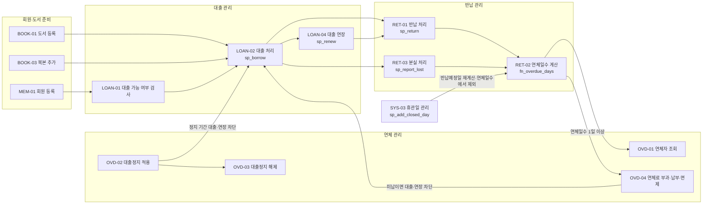

# 03. 단위 업무 기술서

> 00 문서의 기능 ID 24개를 단위 업무로 하나씩 정의하고, 실제 코드(`app/*.py`, `sql/02_programs.sql`)의 처리 순서와 메시지 원문, 테이블 CRUD 를 정리한다. 작성 기준일 2026-11-14

## 1. 작성 기준

### 1.1 범례

| 구분 | 표기 |
|---|---|
| 기능 ID | `00_설계_결정사항.md` §4 기능 목록 그대로 (MEM-01 … SYS-04) |
| 근거 표시 | (숭실대 규정 제NN조) = 「숭실대학교 중앙도서관 규정」 조항 · (숭실대 안내) = 중앙도서관 공식 대출 안내(oasis.ssu.ac.kr) · (팀 정책) = 규정에 없어 팀이 정한 규칙 · (결정 3-N) = 00 문서 §3 표의 No N 결정 |
| DB 메시지 | 프로시저·트리거의 `SIGNAL SQLSTATE '45000'` 메시지. `app/db.py` 의 `error_message()` 가 오류 코드 1644 를 받으면 메시지를 **그대로** 화면에 보여 준다 |
| 앱 메시지 | Flask `flash()` 메시지. `{ }` 는 실행 시 채워지는 값 (예: `{서명}`), 프로시저의 `CONCAT()` 메시지도 같은 방식으로 표기 |
| CRUD | C = INSERT, R = SELECT (뷰·함수를 통한 읽기, 트리거 안의 읽기 포함), U = UPDATE (트리거가 같은 행에 값을 쓰는 경우 포함), D = DELETE |
| 수행자 | 사서 = `staff.role` 이 '관리자' 또는 '사서', 관리자 = '관리자'만, 회원 = 회원 포털 `/my` 로그인 회원, 시스템 = DB 함수·뷰가 자동 계산 |

### 1.2 단위 업무 목록

| 기능 ID | 업무명 | 업무 영역 | 수행자 | 주요 화면 | 관련 DB 프로그램 |
|---|---|---|---|---|---|
| MEM-01 | 회원 등록 | 회원 관리 | 사서 | `/members/new` | (앱 SQL) |
| MEM-02 | 회원 정보 수정 (비밀번호 재설정 포함) | 회원 관리 | 사서 | `/members/<id>/edit` | (앱 SQL) |
| MEM-03 | 탈퇴 처리 | 회원 관리 | 사서 | `/members/<id>/withdraw` | `trg_member_withdraw_check` |
| MEM-04 | 회원 조회 | 회원 관리 | 사서 | `/members/`, `/members/<id>` | `v_member_status`, `v_loan_detail` |
| BOOK-01 | 도서 등록 (국립중앙도서관 API 조회) | 도서 관리 | 사서 | `/books/new?lookup=ISBN` | (앱 SQL) |
| BOOK-02 | 도서 정보 수정 | 도서 관리 | 사서 | `/books/<isbn>/edit` | `v_book_summary` |
| BOOK-03 | 복본 추가 | 도서 관리 | 사서 | `/books/<isbn>/copies` | (앱 SQL) |
| BOOK-04 | 폐기 처리 (복본 상태 변경) | 도서 관리 | 사서 | `/books/copies/<id>/status` | `trg_book_copy_status_guard` |
| BOOK-05 | 도서 검색 | 도서 관리 | 사서·회원 | `/books/`, `/my/books` | `v_book_summary` |
| LOAN-01 | 대출 가능 여부 검사 | 대출 관리 | 사서 | `/loans/borrow?member_no=` | `v_member_status` (+ `sp_borrow`) |
| LOAN-02 | 대출 처리 | 대출 관리 | 사서 | `/loans/borrow` (POST) | `sp_borrow`, `fn_next_open_day` |
| LOAN-03 | 대출 내역 조회 | 대출 관리 | 사서·회원(본인) | `/loans/`, `/my/` | `v_loan_detail`, `v_member_status` |
| LOAN-04 | 대출 연장 | 대출 관리 | 회원(홈페이지)·사서 | `/my/loans/<id>/renew`, `/loans/<id>/renew` | `sp_renew`, `fn_next_open_day` |
| RET-01 | 반납 처리 | 반납 관리 | 사서 | `/loans/return` | `sp_return`, `fn_overdue_days` |
| RET-02 | 연체일수 자동 계산 (휴관일 제외) | 반납 관리 | 시스템 | (모든 대출 목록) | `fn_overdue_days`, `v_loan_detail` |
| RET-03 | 분실 처리 | 반납 관리 | 사서 | `/loans/<id>/lost` | `sp_report_lost`, `fn_compensation` |
| OVD-01 | 연체자 조회 | 연체 관리 | 사서 | `/overdue/` | `v_loan_detail` |
| OVD-02 | 대출정지 적용 | 연체 관리 | 사서 | `/overdue/suspend` | `sp_suspend_member` |
| OVD-03 | 대출정지 해제 | 연체 관리 | 사서 | `/overdue/suspensions/<id>/release` | `sp_release_suspension` |
| OVD-04 | 연체료 부과·납부·면제 | 연체 관리 | 사서 (면제는 관리자) | `/overdue/fines` | `sp_return`, `sp_report_lost`, `sp_settle_fine` |
| SYS-01 | 사서 로그인·권한 (관리자/사서) | 공통 | 사서 | `/login` | (앱 SQL) |
| SYS-02 | 회원 로그인·비밀번호 변경 | 공통 | 회원 | `/my/login`, `/my/password` | (앱 SQL) |
| SYS-03 | 휴관일 관리 (등록 시 해당일 반납예정 대출 재계산) | 공통 | 관리자 | `/closed-days` | `sp_add_closed_day`, `fn_next_open_day` |
| SYS-04 | 대시보드·통계 | 공통 | 사서 | `/`, `/stats/` | `v_loan_detail` |

### 1.3 단위 업무 연계

### 1.4 모든 업무에 공통인 처리

| 항목 | 내용 |
|---|---|
| 동일 출처 검사 | `app/__init__.py` 의 `check_same_origin` 이 모든 POST 요청에서 `Origin`(없으면 `Referer`) 헤더의 호스트가 요청 호스트와 다르면 403 으로 거부한다 (CSRF 방어, `test_72`) |
| 로그인 검사 | `app/__init__.py` 의 `before_request` 가 `/my` 아래 화면(`portal.*`)은 세션의 `member_id`, 나머지 화면은 `staff_id` 를 요구한다. 없으면 `/my/login?next=…` 또는 `/login?next=…` 로 이동. 예외는 `static`, `auth.login`, `portal.login` |
| 트랜잭션 | `db.py` 의 연결은 `autocommit=False`. `execute()`·`call_proc()`·`transaction()` 은 성공 시 COMMIT, 예외 시 ROLLBACK. 프로시저 1회 호출 = 트랜잭션 1개 |
| 동시성 | 프로시저는 검사 대상 행을 `SELECT … FOR UPDATE` 로 잠근다 (`sp_borrow`: 회원·복본, `sp_return`: 복본·대출, `sp_renew`·`sp_report_lost`: 대출, `sp_suspend_member`: 회원, `sp_release_suspension`: 대출정지, `sp_settle_fine`: 연체료) |
| 오류 메시지 변환 | `error_message()` 순서: ① 오류 코드 1644(SIGNAL) → 메시지 원문; ② 오류 내용에 제약조건 이름이 있으면 `CONSTRAINT_MESSAGES` 문구; ③ 코드별 기본 문구 1048 "필수 항목이 비어 있습니다." · 1062 "중복된 값입니다." · 1406 "입력값이 너무 깁니다." · 1451 "다른 데이터에서 참조 중이라 삭제할 수 없습니다." · 1452 "참조하는 데이터가 존재하지 않습니다." · 3819 "입력값이 제약조건을 위반했습니다."; ④ 그 밖에는 서버 로그에 상세를 남기고 "처리 중 오류가 발생했습니다. (오류 코드 {code})" |
| 메시지 표시 | `base.html` 이 `flash` 메시지를 분류(success·error·warning·info)별 상자로 화면 상단에 표시 |
| DB 계정 | 앱은 `library` 계정으로 접속하며 SELECT·INSERT·UPDATE·DELETE·EXECUTE 권한만 가진다 (DDL 불가, `test_61` 로 확인) |

## 2. 회원 관리

### MEM-01 회원 등록

| 항목 | 내용 |
|---|---|
| 업무 ID | MEM-01 |
| 업무명 | 회원 등록 |
| 업무 영역 | 회원 관리 |
| 수행자 | 사서 |
| 업무 개요 | 학생·교직원을 도서관 회원으로 등록한다. 학번·교번(`member_no`)이 회원 포털 로그인 ID 가 되고, 회원구분(`type_code`)에 따라 대출 권수·기간·연장 횟수가 정해진다 |
| 수행 시점 | 신규 이용자가 대출 데스크에서 가입을 요청할 때 (회원 관리 화면의 '+ 회원 등록') |
| 선행 조건 | 사서 로그인 (SYS-01) · 회원구분 5종(`UG` 학부생, `UGL` 휴학생, `GR` 대학원생, `FAC` 전임교원, `STF` 직원·비전임교원)이 `member_type` 에 있음 (`03_base_data.sql`) |
| 입력 정보 | 학번·교번 (필수, 영문·숫자 4~20자) · 이름 (필수) · 회원구분 (선택 목록, 기본 `UG`) · 소속 (학과·부서) · 전화번호 (필수, 010-1234-5678 형식) · 이메일 · 초기 비밀번호 (필수, 8자 이상) |
| 처리 절차 | ① GET: `SELECT * FROM member_type ORDER BY max_loan_count, type_code` 로 회원구분 목록을 '학부생 (10권 · 14일 · 연장 2회)' 형식으로 표시; ② POST: 입력값 앞뒤 공백 제거, 소속·이메일이 빈 값이면 NULL; ③ 학번·이름·전화번호 빈 값 검사; ④ 비밀번호 8자 미만 검사; ⑤ `generate_password_hash()` 로 해시를 만든 뒤 `INSERT INTO member (member_no, password_hash, name, type_code, department, phone, email)` 실행 (status 기본값 '정상', join_date 기본값 오늘, member_id 는 AUTO_INCREMENT); ⑥ COMMIT 후 새 회원의 상세 화면 `/members/<id>` 로 이동 |
| 출력 정보 | 성공: "{이름} 회원을 등록했습니다. (회원번호 {member_id})" → 회원 상세 화면 (MEM-04) |
| 업무 규칙 | 학번·교번이 로그인 ID, 비밀번호는 해시로만 저장 (결정 3-1) · 신분별 대출 정책은 `member_type` 으로 관리 (결정 3-9, 숭실대 안내) · 학번·전화번호·이메일은 회원 간 중복 불가 (팀 정책, `uq_member_no`·`uq_member_phone`·`uq_member_email`) · 학번 형식 `^[0-9A-Za-z]{4,20}$`, 전화번호 형식 `^01[0-9]-[0-9]{3,4}-[0-9]{4}$` (팀 정책, CHECK) · 초기 비밀번호 8자 이상 (팀 정책, 앱 검사) · 계정상태는 '정상'으로 시작하며 대출정지 여부는 저장하지 않음 (결정 3-12) |
| 예외 처리 | 앱 검사: "학번(교번), 이름, 전화번호는 필수입니다." · "초기 비밀번호는 8자 이상이어야 합니다."; DB 제약 변환: `uq_member_no` "이미 등록된 학번(교번)입니다." · `uq_member_phone` "이미 등록된 전화번호입니다." · `uq_member_email` "이미 등록된 이메일입니다." · `ck_member_no` "학번(교번)은 영문·숫자 4~20자여야 합니다." · `ck_member_phone` "전화번호 형식이 올바르지 않습니다. (예: 010-1234-5678)" · `fk_member_type` "존재하지 않는 회원구분입니다."; 오류 시 입력값을 유지한 채 등록 화면을 다시 표시 |
| 관련 테이블 | `member_type` (R) · `member` (C) |
| 관련 화면 | `/members/new` (GET·POST) · 템플릿 `members/form.html` |
| 관련 DB 프로그램 | 없음 (앱 SQL). 제약조건 `uq_member_no`, `uq_member_phone`, `uq_member_email`, `ck_member_no`, `ck_member_phone`, `ck_member_status`, `ck_member_withdraw`, `fk_member_type` |

### MEM-02 회원 정보 수정 (비밀번호 재설정 포함)

| 항목 | 내용 |
|---|---|
| 업무 ID | MEM-02 |
| 업무명 | 회원 정보 수정 (비밀번호 재설정 포함) |
| 업무 영역 | 회원 관리 |
| 수행자 | 사서 |
| 업무 개요 | 회원의 학번·이름·회원구분·소속·전화번호·이메일을 고치고, 회원이 비밀번호를 잊었을 때 사서가 새 비밀번호로 재설정한다 |
| 수행 시점 | 회원의 신분(예: 학부생 → 대학원생)·연락처가 바뀌었거나 비밀번호 재설정을 요청받았을 때 (회원 상세 화면의 '정보 수정') |
| 선행 조건 | 사서 로그인 · 대상 회원이 존재하고 계정상태가 '정상' |
| 입력 정보 | 학번·교번 (필수) · 이름 (필수) · 회원구분 · 소속 · 전화번호 (필수) · 이메일 · 비밀번호 재설정 (비우면 변경하지 않음) |
| 처리 절차 | ① `SELECT * FROM member WHERE member_id = %s` (없으면 404); ② status 가 '탈퇴'이면 오류 메시지와 함께 회원 상세로 이동; ③ GET: 현재 값과 회원구분 목록(`member_type`)으로 폼 표시, 비밀번호 칸은 빈 칸; ④ POST: 입력값 정리 후 학번·이름·전화번호 빈 값 검사; ⑤ `UPDATE member SET member_no = %s, name = %s, type_code = %s, department = %s, phone = %s, email = %s WHERE member_id = %s` 실행 후 COMMIT (BEFORE UPDATE 트리거 `trg_member_withdraw_check` 가 실행되지만 status 가 바뀌지 않아 아무 처리도 하지 않음); ⑥ 비밀번호 칸에 값이 있으면 8자 미만은 경고만 남기고, 8자 이상이면 `UPDATE member SET password_hash = %s WHERE member_id = %s` 를 별도 트랜잭션으로 실행; ⑦ 회원 상세 화면으로 이동 |
| 출력 정보 | 성공: "회원 정보를 수정했습니다." · 비밀번호가 8자 미만이면 경고 "비밀번호는 8자 이상이어야 해서 변경하지 않았습니다." 가 함께 표시 |
| 업무 규칙 | 탈퇴한 회원은 수정 불가 (팀 정책) · 회원구분을 바꾸면 이후의 대출·연장부터 새 정책이 적용된다 (`sp_borrow`·`sp_renew` 가 호출 시점에 `member_type` 을 읽음, 이미 정해진 반납예정일은 그대로) · 비밀번호 칸이 비면 기존 해시 유지 · 형식·중복 규칙은 MEM-01 과 같음 |
| 예외 처리 | 앱 검사: "탈퇴한 회원의 정보는 수정할 수 없습니다." · "학번(교번), 이름, 전화번호는 필수입니다."; DB 제약 변환: "이미 등록된 학번(교번)입니다." · "이미 등록된 전화번호입니다." · "이미 등록된 이메일입니다." · "학번(교번)은 영문·숫자 4~20자여야 합니다." · "전화번호 형식이 올바르지 않습니다. (예: 010-1234-5678)" · "존재하지 않는 회원구분입니다."; 회원 없음 → 404 |
| 관련 테이블 | `member_type` (R) · `member` (R, U) |
| 관련 화면 | `/members/<id>/edit` (GET·POST) · 템플릿 `members/form.html` |
| 관련 DB 프로그램 | `trg_member_withdraw_check` (실행되지만 이 업무에서는 영향 없음) |

### MEM-03 탈퇴 처리

| 항목 | 내용 |
|---|---|
| 업무 ID | MEM-03 |
| 업무명 | 탈퇴 처리 |
| 업무 영역 | 회원 관리 |
| 수행자 | 사서 |
| 업무 개요 | 졸업·퇴직 등으로 이용을 끝내는 회원의 계정상태를 '탈퇴'로 바꾼다. 미반납 도서나 미납 연체료가 있으면 DB 트리거가 거부한다. 회원 행은 삭제하지 않는다 (대출 이력 보존, 앱에 회원 삭제 기능 없음) |
| 수행 시점 | 회원이 탈퇴를 요청하거나 자격을 잃었을 때 (회원 상세 화면의 '탈퇴 처리') |
| 선행 조건 | 사서 로그인 · 계정상태 '정상' (버튼은 '정상'일 때만 표시) |
| 입력 정보 | 없음 (대상 회원번호는 URL) · 확인창 "탈퇴 처리할까요? 되돌릴 수 없습니다." |
| 처리 절차 | ① POST `UPDATE member SET status = '탈퇴' WHERE member_id = %s AND status = '정상'`; ② BEFORE UPDATE 트리거 `trg_member_withdraw_check`: NEW.status = '탈퇴' 이고 OLD.status <> '탈퇴' 이면 ⓐ `loan` 에 `return_date IS NULL` 인 행이 있으면 SIGNAL, ⓑ `fine` JOIN `loan` 에 status = '미납' 인 행이 있으면 SIGNAL, ⓒ 통과하면 `NEW.withdraw_date = CURDATE()`; ③ COMMIT 후 회원 상세로 이동 (대출상태 '탈퇴', 탈퇴일 표시) |
| 출력 정보 | 성공: "탈퇴 처리했습니다." |
| 업무 규칙 | 대출 중인 회원은 탈퇴 불가, 미납 연체료가 있어도 탈퇴 불가 (결정 3-8, DB 트리거로 차단) · 탈퇴일은 트리거가 자동 기록하며 `ck_member_withdraw` 가 '탈퇴' ↔ 탈퇴일 존재를 보장 · 탈퇴 후에는 대출(`sp_borrow`), 대출정지 적용(`sp_suspend_member`), 정보 수정(MEM-02), 회원 포털 로그인(SYS-02)이 모두 막힌다 · 트리거에는 '탈퇴' → '정상' 복원 시 탈퇴일을 NULL 로 되돌리는 분기가 있으나 앱에 복원 화면은 없다 |
| 예외 처리 | DB 메시지 (`trg_member_withdraw_check`): "반납하지 않은 도서가 있어 탈퇴 처리할 수 없습니다." · "미납 연체료가 있어 탈퇴 처리할 수 없습니다."; 이미 탈퇴한 회원이면 UPDATE 영향 행이 0 이므로 "이미 탈퇴한 회원입니다." (`execute_rowcount`, 화면에는 탈퇴 버튼이 보이지 않음) |
| 관련 테이블 | `member` (U) · `loan` (R, 트리거) · `fine` (R, 트리거) |
| 관련 화면 | `/members/<id>/withdraw` (POST) · 회원 상세 `members/detail.html` 의 '탈퇴 처리' 버튼 |
| 관련 DB 프로그램 | 트리거 `trg_member_withdraw_check` (BEFORE UPDATE ON `member`) · 제약 `ck_member_withdraw` |

### MEM-04 회원 조회

| 항목 | 내용 |
|---|---|
| 업무 ID | MEM-04 |
| 업무명 | 회원 조회 |
| 업무 영역 | 회원 관리 |
| 수행자 | 사서 |
| 업무 개요 | 회원 목록을 검색하고, 회원 한 명의 대출 현황·연체료·대출정지 이력을 한 화면에서 본다. 대출상태(대출가능/대출정지/탈퇴)는 뷰 `v_member_status` 가 계산한다 |
| 수행 시점 | 대출·반납 데스크에서 회원 상태를 확인할 때, 다른 회원 업무(MEM-02·03, OVD-02~04)를 시작하기 전 |
| 선행 조건 | 사서 로그인 |
| 입력 정보 | 검색어 (이름·학번·전화번호·소속) · 상태 필터 (전체 상태 / 대출가능 / 대출정지 / 탈퇴) |
| 처리 절차 | ① 목록: `SELECT * FROM v_member_status WHERE (%s = '' OR name LIKE %s OR member_no LIKE %s OR phone LIKE %s OR department LIKE %s) AND (%s = '' OR loan_state = %s) ORDER BY member_id`; ② 상세 `/members/<id>`: `SELECT * FROM v_member_status WHERE member_id = %s` (없으면 404); ③ `v_loan_detail` 에서 미반납 대출(반납예정일 순)과 반납된 대출 최근 20건(반납일시 역순); ④ 연체료: `fine` JOIN `loan` JOIN `book_copy` JOIN `book` (부과일 역순); ⑤ 대출정지 이력: `suspension` LEFT JOIN `staff`(적용 사서) LEFT JOIN `staff`(해제 사서), 시작일 역순 |
| 출력 정보 | 목록: 학번·교번 · 이름 · 구분 · 소속 · 전화번호 · 대출상태(정지 종료일) · 대출 '{대출 중} / {최대 권수}' · 연체 · 미납 연체료 · '대출' 버튼(대출가능일 때), "{n}명", 결과 없음 "검색 결과가 없습니다."; 상세: 회원 정보(회원구분 '(최대 {n}권 · {n}일 · 연장 {n}회)', 소속, 전화번호, 이메일, 가입일, 탈퇴일) · 타일 4개(대출 중, 연체, 미납 연체료, 대출정지 종료일) · 대출 중인 도서 · 연체료 · 대출정지 이력(상태 해제/만료/예정/유효) · 최근 대출 이력 최근 20건; 빈 목록 "내역이 없습니다." · "연체료 내역이 없습니다." · "대출정지 이력이 없습니다." |
| 업무 규칙 | 대출상태 = '탈퇴'(계정상태 탈퇴) / '대출정지'(유효한 대출정지가 있거나 연체 도서 보유) / '대출가능' — 저장하지 않고 계산 (결정 3-12) · 유효한 대출정지 = `released_date IS NULL AND CURDATE() BETWEEN start_date AND end_date` · 미납 연체료와 대출 한도는 대출상태 표시에 반영되지 않는다 (대출 시 `sp_borrow` 가 별도로 검사) |
| 예외 처리 | 회원 없음 → 404 |
| 관련 테이블 | `member` · `member_type` · `loan` · `fine` · `suspension` (R, `v_member_status`) · `book_copy` · `book` · `staff` · `renewal` · `closed_day` (R, `v_loan_detail`·연체료·정지 조회) |
| 관련 화면 | `/members/` · `/members/<id>` · 템플릿 `members/list.html`, `members/detail.html` |
| 관련 DB 프로그램 | 뷰 `v_member_status`, `v_loan_detail` · 함수 `fn_overdue_days` (뷰 내부) |

## 3. 도서 관리

### BOOK-01 도서 등록 (국립중앙도서관 API 조회)

| 항목 | 내용 |
|---|---|
| 업무 ID | BOOK-01 |
| 업무명 | 도서 등록 (국립중앙도서관 API 조회) |
| 업무 영역 | 도서 관리 |
| 수행자 | 사서 |
| 업무 개요 | 새로 들어온 도서의 서지정보(ISBN 단위)와 실물 복본을 함께 등록한다. ISBN 을 입력하면 국립중앙도서관 ISBN 서지정보 API 로 입력란을 자동으로 채운다. 출판사·저자는 이름으로 찾아 없으면 자동 등록한다 |
| 수행 시점 | 신규 도서 입수 시 (도서 검색 화면의 '+ 도서 등록') |
| 선행 조건 | 사서 로그인 · 분류 10개(`category`)가 있음 · API 조회를 쓰려면 환경변수 `NL_CERT_KEY` 설정 (00 문서 §6: 키 승인 전) |
| 입력 정보 | (조회) ISBN 13자리; (등록) ISBN · 서명 (필수) · 지은이 (필수, 쉼표 구분) · 옮긴이 (쉼표 구분) · 출판사 (필수) · 분류 (KDC 주류 선택) · KDC 분류기호 · 발행연도 · 정가(원) · 복본 권수 (0~10, 기본 1) · 배가위치 (기본 '종합자료실') · 청구기호 |
| 처리 절차 | ① GET: `SELECT category_code, category_name FROM category ORDER BY category_code` 로 분류 목록 표시; ② (선택) `?lookup=ISBN`: 숫자만 남겨 `nl_api.fetch_by_isbn()` 호출 → seoji API 결과 중 EA_ISBN 이 정확히 같은 레코드에서 서명·저자(지음/옮김 등 역할 구분)·출판사·발행연도·정가·KDC 를 읽어 입력란을 채움, KDC 가 없으면 소장자료 검색 API 로 보강; ③ POST: ISBN 은 숫자만, 발행연도는 빈 값이면 NULL, 정가는 숫자가 아니면 NULL, 분류는 선택값(없으면 KDC 기호 첫 자리의 주류, 그것도 없으면 '000'), 복본 권수는 0~10 으로 보정, 청구기호가 비면 KDC 기호(없으면 분류코드); ④ `validate_book()`: 서명·출판사·지은이 빈 값, 발행연도 숫자 여부, 발행연도 ≤ 내년 검사; ⑤ 한 트랜잭션으로 `SELECT publisher_id FROM publisher WHERE publisher_name = %s` → 없으면 `INSERT INTO publisher (publisher_name)`; ⑥ `INSERT INTO book (isbn, title, publisher_id, category_code, kdc_no, pub_year, price)`; ⑦ `DELETE FROM book_author WHERE isbn = %s` 후 지은이 → 옮긴이 순으로 `SELECT author_id FROM author WHERE author_name = %s ORDER BY author_id LIMIT 1` → 없으면 `INSERT INTO author (author_name)` → `INSERT INTO book_author (isbn, author_id, author_role, author_order)` (표기순서 1부터, 지은이 칸의 '이름 (엮은이)'·'이름 (그림)'은 `parse_writer()` 가 역할로 읽음, 같은 저자가 두 번이면 처음 역할만); ⑧ `SELECT COALESCE(MAX(CAST(SUBSTRING(reg_no, 3) AS UNSIGNED)), 0)` 와 해당 ISBN 의 기존 복본 수를 읽고 `INSERT INTO book_copy (reg_no, isbn, call_no, location)` 을 권수만큼 실행 (등록번호 'EM' + 6자리 연번, 2권째부터 청구기호 뒤에 ' c.N'); ⑨ COMMIT 후 도서 상세로 이동 |
| 출력 정보 | 성공: "'{서명}' 도서를 등록했습니다." → 도서 상세; API 조회 성공(info): "국립중앙도서관에서 서지정보를 불러왔습니다. 확인 후 등록하세요."; 조회 결과 없음(warning): "국립중앙도서관에 해당 ISBN 의 서지정보가 없습니다."; 키가 없으면 'ISBN 조회' 버튼 비활성 (버튼 툴팁 "NL_CERT_KEY 설정 필요") |
| 업무 규칙 | ISBN 은 978/979 로 시작하는 13자리 (`ck_book_isbn`) · 발행연도 1450~2100 (`ck_book_pub_year`) · 등록번호 형식 `^EM[0-9]{6}$` (`ck_book_copy_reg_no`) · 발행연도는 내년 이후 불가 (팀 정책, 앱 검사) · 저자역할은 지은이·옮긴이·엮은이·그림 중 하나 (`ck_book_author_role`). 지은이 칸에 '이름 (엮은이)'·'이름 (그림)'으로 쓰면 해당 역할로 저장되며, API 조회 결과의 엮은이·그림도 이 형식으로 채워진다 · 같은 이름 저자가 여러 명이면 author_id 가 가장 작은 저자를 사용 · 신규 복본 상태는 '대출가능', 입수일은 오늘 (DDL 기본값) · 도서·저자·복본 등록은 `transaction()` 하나로 묶여 전부 성공하거나 전부 취소된다 |
| 예외 처리 | 앱 검사: "서명, 출판사, 지은이는 필수입니다." · "발행연도는 숫자로 입력하세요." · "발행연도가 올바르지 않습니다. (내년 이후 불가)"; API 오류: "국립중앙도서관 API 인증키(NL_CERT_KEY)가 설정되어 있지 않습니다." · "국립중앙도서관 API 호출 실패: {오류}" · "국립중앙도서관 API 오류 {ERR_CODE}: {ERR_MESSAGE}"; DB 제약 변환: `book.PRIMARY` "이미 등록된 ISBN입니다." · `ck_book_isbn` "ISBN은 978 또는 979로 시작하는 13자리 숫자여야 합니다." · `ck_book_pub_year` "발행연도가 올바르지 않습니다." · `uq_book_copy_reg_no` "이미 사용 중인 등록번호입니다."; 오류 시 출판사·저자 자동 등록까지 모두 ROLLBACK |
| 관련 테이블 | `category` (R) · `publisher` (C, R) · `author` (C, R) · `book` (C) · `book_author` (C) · `book_copy` (C, R) |
| 관련 화면 | `/books/new` (GET·POST) · `/books/new?lookup=ISBN` · 템플릿 `books/form.html` |
| 관련 DB 프로그램 | 없음 (앱 SQL). 외부 연동 `app/nl_api.py` (`fetch_by_isbn`, `fetch_kdc`) |

### BOOK-02 도서 정보 수정

| 항목 | 내용 |
|---|---|
| 업무 ID | BOOK-02 |
| 업무명 | 도서 정보 수정 |
| 업무 영역 | 도서 관리 |
| 수행자 | 사서 |
| 업무 개요 | 등록된 도서의 서명·저자·출판사·분류·KDC·발행연도·정가를 고친다. ISBN(기본키)은 바꿀 수 없다 |
| 수행 시점 | 서지정보 오류를 발견했거나 정가·분류를 보완할 때 (도서 상세의 '수정') |
| 선행 조건 | 사서 로그인 · 대상 도서 존재 |
| 입력 정보 | ISBN (읽기 전용) · 서명 (필수) · 지은이 (필수) · 옮긴이 · 출판사 (필수) · 분류 · KDC 분류기호 · 발행연도 · 정가(원) |
| 처리 절차 | ① `SELECT * FROM v_book_summary WHERE isbn = %s` (없으면 404); ② GET: `book_author` JOIN `author` 를 표기순서대로 읽어 지은이 칸에는 '지은이'는 이름만, '엮은이'·'그림'은 '이름 (역할)' 형식으로(`format_writers`), 옮긴이 칸에는 '옮긴이'를 쉼표로 채우고 분류 목록 표시; ③ POST: 입력값 정리 (ISBN 은 URL 값으로 고정) 후 `validate_book()` 으로 서명·출판사·지은이 빈 값, 발행연도 숫자 여부, 발행연도 ≤ 내년 검사; ④ 한 트랜잭션으로 출판사 조회(없으면 `INSERT INTO publisher`) → `UPDATE book SET title = %s, publisher_id = %s, category_code = %s, kdc_no = %s, pub_year = %s, price = %s WHERE isbn = %s` → `DELETE FROM book_author WHERE isbn = %s` → 저자 조회(없으면 `INSERT INTO author`) → `INSERT INTO book_author` (표기순서 다시 부여, 지은이 칸의 '이름 (엮은이)'·'이름 (그림)'은 `parse_writer()` 가 역할로 읽음, 같은 저자가 두 번이면 처음 역할만); ⑤ COMMIT 후 도서 상세로 이동 |
| 출력 정보 | 성공: "도서 정보를 수정했습니다." |
| 업무 규칙 | ISBN 변경 불가 (입력란 readonly, UPDATE 의 WHERE 조건) · 저자 목록은 지우고 다시 넣는다 (표기순서 재부여) · 복본은 이 화면에서 바뀌지 않음 (BOOK-03·04) · 엮은이·그림 역할은 '이름 (역할)' 표기로 수정 후에도 유지된다 (`test_33`) · 발행연도는 내년 이후 불가 (팀 정책, 앱 검사) |
| 예외 처리 | 앱 검사: "서명, 출판사, 지은이는 필수입니다." · "발행연도는 숫자로 입력하세요." · "발행연도가 올바르지 않습니다. (내년 이후 불가)"; DB 제약 변환: `ck_book_pub_year` "발행연도가 올바르지 않습니다."; 도서 없음 → 404 |
| 관련 테이블 | `category` (R) · `publisher` (C, R) · `author` (C, R) · `book` (R, U) · `book_author` (C, R, D) · `book_copy` (R, `v_book_summary`) |
| 관련 화면 | `/books/<isbn>/edit` (GET·POST) · 템플릿 `books/form.html` |
| 관련 DB 프로그램 | 뷰 `v_book_summary` |

### BOOK-03 복본 추가

| 항목 | 내용 |
|---|---|
| 업무 ID | BOOK-03 |
| 업무명 | 복본 추가 |
| 업무 영역 | 도서 관리 |
| 수행자 | 사서 |
| 업무 개요 | 이미 등록된 도서에 같은 책(복본)을 더 들여왔을 때 등록번호를 이어서 부여해 복본을 추가한다 |
| 수행 시점 | 추가 구입·기증으로 같은 ISBN 의 책이 더 들어왔을 때 (도서 상세 화면 하단 '복본 추가') |
| 선행 조건 | 사서 로그인 · 도서(`book`)가 등록되어 있음 |
| 입력 정보 | 권수 (1~10, 기본 1) · 배가위치 (비우면 '종합자료실') |
| 처리 절차 | ① `SELECT category_code, kdc_no FROM book WHERE isbn = %s` (없으면 404); ② 권수를 1~10 으로 보정; ③ `SELECT call_no FROM book_copy WHERE isbn = %s ORDER BY copy_id LIMIT 1` 로 첫 복본 청구기호의 ' c.' 앞부분을 기본 청구기호로 사용 (복본이 없으면 KDC 기호, 그것도 없으면 분류코드); ④ 트랜잭션: 마지막 등록번호와 해당 ISBN 복본 수를 읽고 `INSERT INTO book_copy (reg_no, isbn, call_no, location)` 를 권수만큼 실행; ⑤ COMMIT 후 도서 상세로 이동 |
| 출력 정보 | 성공: "복본 {권수}권을 추가했습니다." · 도서 상세의 복본 표에 새 등록번호 표시 |
| 업무 규칙 | 등록번호는 전체 복본의 마지막 번호 + 1 부터 (2026-11-14 DB 의 마지막 번호는 EM000157 이므로 다음은 EM000158) · 같은 도서의 N번째 복본 청구기호는 '{청구기호} c.N' · 등록번호 중복 불가 (`uq_book_copy_reg_no`) |
| 예외 처리 | DB 제약 변환: `uq_book_copy_reg_no` "이미 사용 중인 등록번호입니다." (동시에 등록할 때); 도서 없음 → 404 |
| 관련 테이블 | `book` (R) · `book_copy` (C, R) |
| 관련 화면 | `/books/<isbn>/copies` (POST) · 템플릿 `books/detail.html` |
| 관련 DB 프로그램 | 없음 (앱 SQL) |

### BOOK-04 폐기 처리 (복본 상태 변경)

| 항목 | 내용 |
|---|---|
| 업무 ID | BOOK-04 |
| 업무명 | 폐기 처리 (복본 상태 변경) |
| 업무 영역 | 도서 관리 |
| 수행자 | 사서 |
| 업무 개요 | 훼손·노후 복본을 '폐기', 서가에서 없어진 복본을 '분실'로 바꾸거나, 잘못 처리한 복본을 '대출가능'으로 되돌린다. 대출 중인 복본은 DB 트리거가 상태 변경을 막는다 |
| 수행 시점 | 장서 점검·파손 도서 변상 처리 후 (도서 상세의 복본 표 '상태 변경') |
| 선행 조건 | 사서 로그인 · 대상 복본이 대출 중이 아님 (대출 중이면 상태 변경 칸이 '-' 로 비어 있다) |
| 입력 정보 | 복본상태 선택 (대출가능 / 분실 / 폐기) · 다른 상태로 바꿀 때 확인창 "{상태} 처리할까요?" |
| 처리 절차 | ① `SELECT isbn, reg_no, status FROM book_copy WHERE copy_id = %s` (없으면 404); ② 상태값이 '대출가능'·'분실'·'폐기' 가 아니면 400; ③ `UPDATE book_copy SET status = %s WHERE copy_id = %s`; ④ BEFORE UPDATE 트리거 `trg_book_copy_status_guard`: 상태가 바뀌고 새 상태가 '대출가능'·'분실'·'폐기'인데 `loan` 에 그 복본의 미반납 대출이 있으면 SIGNAL, 새 상태가 '분실'·'폐기'면 `NEW.removed_date = CURDATE()`, 아니면 NULL; ⑤ COMMIT 후 도서 상세로 이동 |
| 출력 정보 | 성공: "{등록번호} 복본을 '{상태}' 상태로 변경했습니다." · 복본 표의 상태 칸에 바뀐 상태와 처리일 표시 |
| 업무 규칙 | '대출중'은 대출·반납 처리로만 바뀌며 사서가 직접 선택할 수 없다 · 대출 중 책 폐기 금지 (결정 3-8, DB 트리거) · 분실·폐기일 자동 기록, 상태와 처리일의 짝은 `ck_book_copy_removed` 가 보장 · 파손 도서는 변상 후 '폐기' (결정 3-7, 숭실대 규정 제26조) · 분실·폐기 복본은 `v_book_summary` 의 소장 수(`total_copies`)에서 빠진다 |
| 예외 처리 | DB 메시지 (`trg_book_copy_status_guard`): "대출 중인 복본은 반납(또는 분실 처리) 후 상태를 변경할 수 있습니다."; 복본 없음 → 404 · 허용되지 않은 상태값 → 400 |
| 관련 테이블 | `book_copy` (R, U) · `loan` (R, 트리거) |
| 관련 화면 | `/books/copies/<copy_id>/status` (POST) · 템플릿 `books/detail.html` |
| 관련 DB 프로그램 | 트리거 `trg_book_copy_status_guard` (BEFORE UPDATE ON `book_copy`) · 제약 `ck_book_copy_status`, `ck_book_copy_removed` |

### BOOK-05 도서 검색

| 항목 | 내용 |
|---|---|
| 업무 ID | BOOK-05 |
| 업무명 | 도서 검색 |
| 업무 영역 | 도서 관리 |
| 수행자 | 사서 · 회원 |
| 업무 개요 | 서명·저자·출판사·ISBN 으로 도서를 찾고, 복본별 상태와 대출가능 권수를 확인한다. 회원 포털에서는 대출자 정보를 숨긴다 |
| 수행 시점 | 이용자 문의·대출 전 소장 확인 (사서), 대출할 책을 찾을 때 (회원) |
| 선행 조건 | 사서 로그인 (`/books/`) 또는 회원 로그인 (`/my/books`) |
| 입력 정보 | 검색어 (서명·저자·출판사 부분일치, ISBN 완전일치) · 분류 (사서 화면만, 전체 분류 / KDC 주류 10개) |
| 처리 절차 | ① 사서 목록: `SELECT * FROM v_book_summary WHERE (%s = '' OR title LIKE %s OR authors LIKE %s OR publisher_name LIKE %s OR isbn = %s) AND (%s = '' OR category_code = %s) ORDER BY title` + 분류 목록(`category`); ② 사서 상세 `/books/<isbn>`: `v_book_summary` 1행, 복본 목록 `book_copy` LEFT JOIN `loan`(미반납) LEFT JOIN `member` (등록번호 순), 누적 대출 `SELECT COUNT(*) … FROM loan l JOIN book_copy bc … WHERE bc.isbn = %s`; ③ 회원 목록 `/my/books`: 검색어가 있을 때만 `v_book_summary` 를 같은 조건으로 조회 (`LIMIT 100`); ④ 회원 상세 `/my/books/<isbn>`: 상태가 '대출가능'·'대출중'인 복본만 `book_copy` LEFT JOIN `loan` 으로 반납예정일과 함께 조회 (`member` 는 조인하지 않음) |
| 출력 정보 | 사서 목록: 서명 · 저자 · 출판사 · 발행 · 분류 · '대출가능 / 소장', "{n}종", 결과 없음 "검색 결과가 없습니다."; 사서 상세: 서지 정보(ISBN, 분류·KDC, 정가, 누적 대출 {n}회) · 소장 현황(이용 가능 복본 {n}권 — 분실·폐기를 뺀 수, 대출가능 {n}권) · 복본 표(등록번호, 청구기호, 위치, 상태, 대출 정보 '{회원명} · 반납예정 {날짜}' 와 연체 표시, 입수일, 상태 변경), 복본 없음 "복본이 없습니다."; 회원 상세: 소장 정보(등록번호, 청구기호, 위치, 상태, 반납예정일), "이용할 수 있는 소장본이 없습니다." |
| 업무 규칙 | 회원은 검색만 하고 대출은 대출 데스크에서 (결정 3-1) · 회원 화면에는 누가 빌렸는지와 분실·폐기 복본을 보여 주지 않는다 (팀 정책) · 저자 표기는 표기순서대로, 지은이 외 역할은 '이름 (역할)' (`v_book_summary.authors`) · 예약 기능은 범위 제외 (00 문서 §2) |
| 예외 처리 | 상세 ISBN 없음 → 404 · 미로그인 → `/login` 또는 `/my/login` 으로 이동 |
| 관련 테이블 | `book` · `publisher` · `category` · `book_author` · `author` · `book_copy` (R, `v_book_summary`) · `loan` (R) · `member` (R, 사서 상세만) |
| 관련 화면 | `/books/` · `/books/<isbn>` · `/my/books` · `/my/books/<isbn>` · 템플릿 `books/list.html`, `books/detail.html`, `portal/books.html`, `portal/book_detail.html` |
| 관련 DB 프로그램 | 뷰 `v_book_summary` |

## 4. 대출 관리

### LOAN-01 대출 가능 여부 검사

| 항목 | 내용 |
|---|---|
| 업무 ID | LOAN-01 |
| 업무명 | 대출 가능 여부 검사 |
| 업무 영역 | 대출 관리 |
| 수행자 | 사서 |
| 업무 개요 | 학번(교번)으로 회원을 불러와 대출 중 권수·연체·미납 연체료·대출정지를 보여 주고, 대출할 수 없는 사유를 미리 안내한다. 최종 판정은 LOAN-02 의 `sp_borrow` 가 한다 |
| 수행 시점 | 대출 데스크에서 회원이 책을 가져왔을 때, 대출 처리 직전 (회원 목록의 '대출', 회원 상세의 '대출하기' 버튼도 이 화면으로 연결 — 대출상태가 '대출가능'일 때만 표시) |
| 선행 조건 | 사서 로그인 |
| 입력 정보 | 학번·교번 (예: 20231234) |
| 처리 절차 | ① GET `/loans/borrow?member_no=`: `SELECT * FROM v_member_status WHERE member_no = %s`; ② 회원이 있으면 `SELECT * FROM v_loan_detail WHERE member_id = %s AND return_date IS NULL ORDER BY due_date` 로 현재 대출 목록 조회; ③ 화면에서 대출 불가 사유를 모음 — 계정상태 '탈퇴', `suspend_until` 있음, `overdue_loans` > 0, `unpaid_fine` > 0, `active_loans` >= `max_loan_count`; ④ 사유가 있으면 경고 상자 표시, 등록번호 입력란은 그대로 둔다 (시도하면 `sp_borrow` 가 거부) |
| 출력 정보 | 회원 카드: '{이름} {학번} · {회원구분}' 과 대출상태 · 대출 중 '{n} / {최대}권 (대출기간 {n}일)' · 연체 · 미납 연체료 · 대출정지 ('{날짜}까지' 또는 '없음'); 사유 상자 "대출 불가: {사유 · 사유}" — 사유 문구는 '탈퇴한 회원' · '{YYYY-MM-DD}까지 대출정지' · '연체 도서 {n}권 반납 필요' · '미납 연체료 {n}원 납부 필요' · '대출 한도 도달'; 현재 대출 중인 도서 표 |
| 업무 규칙 | 검사 항목은 `sp_borrow` 와 같다: 탈퇴 불가, 대출정지 기간 불가 (숭실대 규정 제27조, 결정 3-2), 연체 도서 보유 시 불가 (숭실대 규정 제24조), 미납 연체료 보유 시 불가 (팀 정책, 결정 3-3), 신분별 대출 한도 (숭실대 안내) · 화면 검사는 안내용이고 DB 프로시저가 최종 판정 (00 문서 §4) · 대출상태는 `v_member_status.loan_state` 라 미납 연체료·한도 도달은 대출상태에 나타나지 않고 사유 상자에만 나타난다 (2026-11-14 DB 기준 예: 학번 20214410 은 미납 700원, 대출상태 '대출가능') |
| 예외 처리 | 앱 메시지: "존재하지 않는 학번(교번)입니다." (조회한 학번이 없을 때) |
| 관련 테이블 | `member` · `member_type` · `loan` · `fine` · `suspension` (R, `v_member_status`) · `book_copy` · `book` · `staff` · `renewal` · `closed_day` (R, `v_loan_detail`) |
| 관련 화면 | `/loans/borrow?member_no=` (GET) · 템플릿 `loans/borrow.html` |
| 관련 DB 프로그램 | 뷰 `v_member_status`, `v_loan_detail` · 최종 검사 `sp_borrow` (LOAN-02) |

### LOAN-02 대출 처리

| 항목 | 내용 |
|---|---|
| 업무 ID | LOAN-02 |
| 업무명 | 대출 처리 |
| 업무 영역 | 대출 관리 |
| 수행자 | 사서 |
| 업무 개요 | 회원과 복본 등록번호(바코드)로 대출을 등록한다. 저장 프로시저 `sp_borrow` 가 대출 가능 여부를 다시 검사하고, 대출 행 생성과 복본 상태 변경을 한 트랜잭션으로 처리한다 |
| 수행 시점 | LOAN-01 화면에서 복본 등록번호를 입력하고 '대출'을 누를 때 |
| 선행 조건 | 사서 로그인 · LOAN-01 로 회원 조회 (학번은 숨은 입력값으로 전달) · 복본이 등록되어 있음 |
| 입력 정보 | 학번·교번 (숨은 값) · 복본 등록번호 (예: EM000001, 앱이 대문자로 변환) |
| 처리 절차 | ① 앱: `CALL sp_borrow(학번, 등록번호, 세션 staff_id)`; ② `member` JOIN `member_type` 에서 회원 상태·최대 권수·대출 기간을 읽고 회원 행을 `FOR UPDATE OF m` 로 잠금 → 없으면 SIGNAL; ③ 계정상태 '탈퇴' 검사; ④ `suspension` 에서 유효한 정지의 `MAX(end_date)` 검사; ⑤ `loan` 에 `return_date IS NULL AND due_date < CURDATE()` 인 대출 검사; ⑥ `fine` JOIN `loan` 에 '미납' 검사; ⑦ 미반납 대출 수 `COUNT(*)` 가 `max_loan_count` 이상인지 검사; ⑧ `SELECT copy_id, status FROM book_copy WHERE reg_no = %s FOR UPDATE` → 없거나 '대출가능'이 아니면 SIGNAL; ⑨ `INSERT INTO loan (copy_id, member_id, staff_id, loan_date, due_date) VALUES (…, NOW(), fn_next_open_day(CURDATE() + INTERVAL v_loan_days DAY))`; ⑩ `UPDATE book_copy SET status = '대출중'` (트리거 `trg_book_copy_status_guard` 가 `removed_date` 를 NULL 로 둠); ⑪ 새 대출의 대출번호·반납예정일·서명·회원명을 SELECT 해 반환; ⑫ 앱이 COMMIT 후 `/loans/borrow?member_no={학번}` 로 돌아가 LOAN-01 화면을 갱신 |
| 출력 정보 | 성공: "'{서명}' 대출 완료 · {회원명} · 반납예정일 {YYYY-MM-DD}" |
| 업무 규칙 | 신분별 대출 권수·기간 — 학부생 10권·14일, 휴학생 5권·14일, 대학원생 15권·30일, 전임교원 50권·180일, 직원·비전임교원 15권·30일 (숭실대 안내, `member_type`) · 학부생 14일은 11.12 회의록의 15일과 다름 → 팀 확인 필요, `member_type.loan_days` 값만 바꾸면 변경 가능 (00 문서 §2) · 연체 도서가 있으면 대출 불가, 반납하면 해제 (숭실대 규정 제24조, 결정 3-2) · 미납 연체료가 있으면 대출 불가 (팀 정책, 결정 3-3) · 대출정지 기간 중 대출 불가 (숭실대 규정 제27조) · 반납예정일 = 오늘 + 대출 기간, 휴관일이면 다음 개관일 (팀 정책, 결정 3-5) · 복본당 미반납 대출은 1건 (`uq_loan_active_copy`, 생성 컬럼 `active_copy_id`) · 검사 순서는 회원 존재 → 탈퇴 → 대출정지 → 연체 → 미납 연체료 → 한도 → 복본 존재 → 복본 상태 (먼저 걸린 사유 하나만 표시) |
| 예외 처리 | DB 메시지 (`sp_borrow`): "존재하지 않는 학번(교번)입니다." · "탈퇴한 회원은 대출할 수 없습니다." · "대출정지 기간입니다. ({v_susp_end}까지)" · "연체 중인 도서가 있어 대출할 수 없습니다. 연체 도서를 먼저 반납하세요." · "미납 연체료가 있어 대출할 수 없습니다." · "대출 한도({v_max_loan}권)를 초과합니다. 현재 {v_active}권 대출 중입니다." · "존재하지 않는 등록번호입니다." · "대출할 수 없는 복본입니다. (현재 상태: {v_copy_status})"; DB 제약 변환: `uq_loan_active_copy` "이미 대출 중인 복본입니다."; 오류 시 ROLLBACK |
| 관련 테이블 | `member_type` (R) · `member` (R) · `suspension` (R) · `fine` (R) · `loan` (C, R) · `book_copy` (R, U) · `book` (R) · `closed_day` (R, `fn_next_open_day`) |
| 관련 화면 | `/loans/borrow` (POST) · 템플릿 `loans/borrow.html` |
| 관련 DB 프로그램 | 프로시저 `sp_borrow` · 함수 `fn_next_open_day` · 트리거 `trg_book_copy_status_guard` |

### LOAN-03 대출 내역 조회

| 항목 | 내용 |
|---|---|
| 업무 ID | LOAN-03 |
| 업무명 | 대출 내역 조회 |
| 업무 영역 | 대출 관리 |
| 수행자 | 사서 · 회원(본인) |
| 업무 개요 | 사서는 전체 대출을 상태별로 검색하고, 회원은 회원 포털에서 본인의 대출 중 도서·지난 대출·연체료·대출정지 이력을 본다 |
| 수행 시점 | 대출 현황 확인, 반납 독촉, 회원 문의 응대 (사서) · 반납예정일 확인과 연장 신청 전 (회원) |
| 선행 조건 | 사서 로그인 (`/loans/`) 또는 회원 로그인 (`/my/`) |
| 입력 정보 | (사서) 상태 탭 대출 중(`active`, 기본) / 연체(`overdue`) / 반납 완료(`returned`) / 전체(`all`) · 검색어 (회원명·서명 부분일치, 학번·등록번호 완전일치); (회원) 없음 — 세션의 `member_id` 사용 |
| 처리 절차 | ① 사서 `/loans/`: `SELECT * FROM v_loan_detail WHERE {상태 조건} AND (%s = '' OR member_name LIKE %s OR member_no = %s OR title LIKE %s OR reg_no = %s) ORDER BY (return_date IS NULL) DESC, due_date, loan_id DESC LIMIT 300` — 상태 조건은 `return_date IS NULL` / `loan_state = '연체'` / `return_date IS NOT NULL` / `1 = 1`; ② 회원 `/my/`: `v_member_status` 에서 본인 1행; ③ `v_loan_detail` 에서 본인 미반납 대출(반납예정일 순)과 반납 이력 최근 30건; ④ 본인 연체료 `fine` JOIN `loan` JOIN `book_copy` JOIN `book`; ⑤ 본인 대출정지 `SELECT * FROM suspension WHERE member_id = %s ORDER BY start_date DESC LIMIT 10` |
| 출력 정보 | 사서: 등록번호 · 도서 · 회원(이름·학번) · 대출일 · 반납예정일('(연장 {n})') · 상태(대출중/연체/반납/분실)와 연체일수 · 미반납이면 '연장'·'분실' 버튼, "{n}건", 없음 "내역이 없습니다."; 회원: 제목 "{이름}님의 도서관", 안내 상자는 조건마다 따로 표시되며 여러 개가 함께 나올 수 있다 — `suspend_until` 이 있으면 "{정지 종료일 YYYY년 MM월 DD일}까지 대출이 정지된 상태입니다." · `overdue_loans` > 0 이면 "연체 중인 도서가 {n}권 있습니다. 반납 전까지 대출·연장할 수 없습니다." · `unpaid_fine` > 0 이면 "미납 연체료 {n,nnn원}이 있습니다. 납부 전까지 대출·연장할 수 없습니다."; 타일(대출 중 '{n}/ {최대}권', 연체, 미납 연체료, 대출 상태) · 대출 중인 도서(도서, 청구기호, 대출일, 반납예정일, 연장 '{n} / {최대}', 상태, '연장 신청') · 연체료 · 대출정지 이력 · 지난 대출 기록 최근 30건; 빈 목록 "대출 중인 도서가 없습니다." · "연체료 내역이 없습니다." · "대출정지 이력이 없습니다." · "대출 기록이 없습니다." |
| 업무 규칙 | 회원은 본인 내역만 조회 (결정 3-1, 모든 조회가 세션 `member_id` 조건, `test_70` 에서 다른 회원 학번 비노출 확인) · 대출상태 = '분실'(반납구분 분실) / '반납'(반납일시 있음) / '연체'(미반납이고 반납예정일 < 오늘) / '대출중' (`v_loan_detail.loan_state`) · 연체일수는 RET-02 규칙으로 계산 · 사서 목록은 최대 300건 |
| 예외 처리 | 미로그인 → `/login?next=…` 또는 `/my/login?next=…`; 회원 세션으로 사서 화면 접근 시 `/login` 으로 이동 |
| 관련 테이블 | `loan` · `member` · `book_copy` · `book` · `staff` · `renewal` · `closed_day` (R, `v_loan_detail`) · `member_type` · `fine` · `suspension` (R, `v_member_status`·회원 포털) |
| 관련 화면 | `/loans/` · `/my/` · 템플릿 `loans/list.html`, `portal/index.html` |
| 관련 DB 프로그램 | 뷰 `v_loan_detail`, `v_member_status` · 함수 `fn_overdue_days` |

### LOAN-04 대출 연장

| 항목 | 내용 |
|---|---|
| 업무 ID | LOAN-04 |
| 업무명 | 대출 연장 |
| 업무 영역 | 대출 관리 |
| 수행자 | 회원(홈페이지) · 사서 |
| 업무 개요 | 반납예정일을 '연장한 날 + 대출 기간'으로 늦춘다. 회원은 회원 포털에서 본인 대출만, 사서는 대출 데스크에서 연장한다. 연장마다 연장이력(`renewal`) 1행을 남긴다 |
| 수행 시점 | 반납예정일 전에 계속 이용하고 싶을 때 (회원 포털 '연장 신청', 사서 화면의 대출 목록 '연장') |
| 선행 조건 | 회원 로그인(홈페이지) 또는 사서 로그인(사서) · 대상 대출이 미반납 |
| 입력 정보 | 대출번호 (URL) · 신청경로는 화면에 따라 '홈페이지' 또는 '사서'로 정해짐 |
| 처리 절차 | ① 앱: 회원 포털은 `CALL sp_renew(대출번호, '홈페이지', NULL, 세션 member_id)`, 사서 화면은 `CALL sp_renew(대출번호, '사서', 세션 staff_id, NULL)`; ② `loan` JOIN `member` JOIN `member_type` 에서 대출일시·반납예정일·반납일시·대출 기간·최대 연장 횟수를 읽고 대출 행을 `FOR UPDATE OF l` 로 잠금; ③ 대출이 없거나, 홈페이지 신청인데 본인 대출이 아니면 SIGNAL; ④ 이미 반납 검사; ⑤ `DATE(loan_date) = CURDATE()` 검사; ⑥ 회원의 미반납 연체 대출 검사; ⑦ 유효한 대출정지 검사; ⑧ 미납 연체료 검사; ⑨ `SELECT COUNT(*) FROM renewal WHERE loan_id = %s` 가 `max_renew` 이상인지 검사; ⑩ 새 반납예정일 = `fn_next_open_day(CURDATE() + INTERVAL v_loan_days DAY)`, 현재 반납예정일보다 늦지 않으면 SIGNAL; ⑪ `INSERT INTO renewal (loan_id, prev_due_date, new_due_date, channel, staff_id)` (staff_id 는 '사서'일 때만); ⑫ `UPDATE loan SET due_date = v_new_due`; ⑬ 대출번호·새 반납예정일·서명·연장 횟수(기존 + 1)를 반환; ⑭ COMMIT 후 회원은 `/my/`, 사서는 이전 화면으로 이동 |
| 출력 정보 | 성공: "'{서명}' 연장 완료 · 새 반납예정일 {YYYY-MM-DD} (연장 {n}회째)" |
| 업무 규칙 | 연장 횟수 학부생·휴학생·대학원생·직원·비전임교원 2회, 전임교원 1회 (숭실대 안내, `member_type.max_renew`) · 연장한 날부터 대출 기간만큼 연장, 원래 반납예정일 + 기간이 아님 (숭실대 안내, 결정 3-6) · 대출 당일 연장 불가 (숭실대 안내) · 본인의 어느 책이라도 연체 중이면 불가 (숭실대 규정 제24조, 결정 3-4) · 대출정지 기간 중 불가 (숭실대 안내: 제재 중 연장 불가) · 미납 연체료가 있으면 불가 (결정 3-3) · 새 반납예정일이 휴관일이면 다음 개관일 (팀 정책, 결정 3-5) · 새 반납예정일이 현재보다 늦어지지 않으면 연장하지 않음 (팀 정책, `ck_renewal_due`) · 연장 횟수는 `renewal` 행 수로 계산하고 따로 저장하지 않음 (결정 3-11) · 신청경로 '사서'면 처리 사서 필수, '홈페이지'면 NULL (`ck_renewal_staff`) · 예약 범위 제외로 예약자 검사는 없음 |
| 예외 처리 | DB 메시지 (`sp_renew`): "연장할 수 있는 대출이 아닙니다." · "이미 반납된 대출입니다." · "대출 당일에는 연장할 수 없습니다." · "연체 중인 도서가 있어 연장할 수 없습니다." · "대출정지 기간에는 연장할 수 없습니다." · "미납 연체료가 있어 연장할 수 없습니다." · "연장 가능 횟수({v_max_renew}회)를 모두 사용했습니다." · "지금 연장해도 반납예정일이 늦어지지 않습니다."; 오류 시 ROLLBACK |
| 관련 테이블 | `member_type` (R) · `member` (R) · `suspension` (R) · `fine` (R) · `renewal` (C, R) · `loan` (R, U) · `book_copy` (R) · `book` (R) · `closed_day` (R, `fn_next_open_day`) |
| 관련 화면 | `/my/loans/<loan_id>/renew` (POST, 회원) · `/loans/<loan_id>/renew` (POST, 사서) · 템플릿 `portal/index.html`, `_macros.html` 의 `loan_actions` (대출현황·대출·회원 상세·연체 화면에서 사용) |
| 관련 DB 프로그램 | 프로시저 `sp_renew` · 함수 `fn_next_open_day` |

## 5. 반납 관리

### RET-01 반납 처리

| 항목 | 내용 |
|---|---|
| 업무 ID | RET-01 |
| 업무명 | 반납 처리 |
| 업무 영역 | 반납 관리 |
| 수행자 | 사서 |
| 업무 개요 | 복본 등록번호만으로 미반납 대출을 찾아 반납을 기록하고, 연체일수(휴관일 제외)를 계산해 연체료를 부과한 뒤 복본을 '대출가능'으로 돌린다 |
| 수행 시점 | 대출 데스크·반납함에서 책을 받았을 때 |
| 선행 조건 | 사서 로그인 · 해당 복본의 미반납 대출이 있음 |
| 입력 정보 | 복본 등록번호 (예: EM000003, 대문자로 변환) |
| 처리 절차 | ① 앱: `CALL sp_return(등록번호, 세션 staff_id)`; ② `SELECT copy_id FROM book_copy WHERE reg_no = %s FOR UPDATE` → 없으면 SIGNAL; ③ `loan` JOIN `member` JOIN `member_type` 에서 그 복본의 미반납 대출과 회원의 `fine_per_day` 를 읽고 `FOR UPDATE OF l` → 없으면 SIGNAL; ④ `UPDATE loan SET return_date = NOW(), return_type = '반납', return_staff_id = %s`; ⑤ `v_overdue = fn_overdue_days(v_due, CURDATE())`; ⑥ 연체일수 > 0 이면 `INSERT INTO fine (loan_id, overdue_days, amount)` (금액 = 연체일수 × `fine_per_day`, status 기본값 '미납', 부과일 기본값 오늘); ⑦ `UPDATE book_copy SET status = '대출가능'` (대출을 먼저 종료했으므로 트리거 `trg_book_copy_status_guard` 를 통과); ⑧ 서명·회원명·연체일수·연체료를 반환; ⑨ COMMIT 후 반납 화면으로 돌아옴. GET 화면은 `SELECT * FROM v_loan_detail WHERE DATE(return_date) = CURDATE() ORDER BY return_date DESC` 로 오늘 반납 목록 표시 |
| 출력 정보 | 정상 반납(success): "'{서명}' 반납 완료 · {회원명}"; 연체 반납(warning): "'{서명}' 반납 완료 · {회원명} · 연체 {n}일 · 연체료 {n,nnn}원 부과"; 오늘 반납된 도서 표 (반납시각, 등록번호, 도서, 회원, 반납예정일, 연체, 구분, 처리 사서), 없음 "오늘 반납된 도서가 없습니다." |
| 업무 규칙 | 연체료 1권 1일 100원, 휴관일 제외 (숭실대 안내, 모든 회원구분 `fine_per_day` = 100) · 금액은 부과 시점에 확정 저장 (결정 3-10) · 대출 1건당 연체료는 최대 1건 (`uq_fine_loan`) · 반납 후 추가 대출정지 기간은 두지 않음 — 반납하면 연체로 인한 대출·연장 제한이 풀린다 (결정 3-2) · 반납 기록 3개 컬럼(반납일시·반납구분·반납 처리 사서)은 함께 채워진다 (`ck_loan_returned`) |
| 예외 처리 | DB 메시지 (`sp_return`): "존재하지 않는 등록번호입니다." · "대출 중인 복본이 아닙니다."; 오류 시 ROLLBACK |
| 관련 테이블 | `book_copy` (R, U) · `loan` (R, U) · `member` (R) · `member_type` (R) · `fine` (C) · `closed_day` (R, `fn_overdue_days`) · `book` (R) · `staff` · `renewal` (R, 오늘 반납 목록 `v_loan_detail`) |
| 관련 화면 | `/loans/return` (GET·POST) · 템플릿 `loans/return.html` |
| 관련 DB 프로그램 | 프로시저 `sp_return` · 함수 `fn_overdue_days` · 뷰 `v_loan_detail` · 트리거 `trg_book_copy_status_guard` |

### RET-02 연체일수 자동 계산 (휴관일 제외)

| 항목 | 내용 |
|---|---|
| 업무 ID | RET-02 |
| 업무명 | 연체일수 자동 계산 (휴관일 제외) |
| 업무 영역 | 반납 관리 |
| 수행자 | 시스템 (DB 함수·뷰) |
| 업무 개요 | 반납예정일 다음 날부터 기준일까지의 일수에서 휴관일을 뺀 연체일수를 계산한다. 화면에 보이는 연체일수와 연체료 부과에 쓰는 연체일수가 같은 함수 `fn_overdue_days` 를 쓴다 |
| 수행 시점 | `v_loan_detail` 을 조회할 때마다 (대출현황·회원 상세·연체자 조회·대시보드 등, 조회 시점 기준) · 반납(RET-01)·분실 처리(RET-03) 때 연체료 산정용으로 1회 |
| 선행 조건 | 휴관일이 `closed_day` 에 등록되어 있음 (2026~2027 일요일·법정공휴일·대체공휴일·개교기념일, 2026-11-14 조회 139일) |
| 입력 정보 | 없음 (반납예정일 `loan.due_date`, 기준일 = 반납일 또는 오늘) |
| 처리 절차 | ① 기준일이 NULL 이거나 반납예정일 이하이면 0; ② 아니면 `DATEDIFF(기준일, 반납예정일)`; ③ 같은 구간(반납예정일 초과 ~ 기준일 이하)의 `closed_day` 행 수를 빼서 반환; ④ `v_loan_detail.overdue_days` = `fn_overdue_days(l.due_date, COALESCE(DATE(l.return_date), CURDATE()))`; ⑤ `v_loan_detail.loan_state` = 분실 / 반납 / 연체(`due_date < CURDATE()`) / 대출중 |
| 출력 정보 | 대출 목록의 '연체' 상태와 '{n}일' · `fine.overdue_days` (반납·분실 시 저장) · 예: 반납예정일 2026-10-08, 반납 2026-10-12 → DATEDIFF 4일 − 휴관 3일(10/9 한글날, 10/10 개교기념일, 10/11 일요일) = 연체 1일 (`fn_overdue_days('2026-10-08', '2026-10-12')` = 1) |
| 업무 규칙 | 연체일수에서 휴관일 제외 (숭실대 안내) · 반납예정일은 대출·연장 때 다음 개관일로 잡히므로(결정 3-5) 휴관일이 반납예정일이 되지 않는다 · 반납된 대출은 반납일까지, 미반납 대출은 오늘까지 계산 · '연체' 판정(반납예정일 < 오늘)과 연체일수 계산은 따로 이루어진다 — 예: 토요일(2026-11-14) 반납예정 도서는 일요일(11-15)에 '연체' 상태지만 `fn_overdue_days('2026-11-14', '2026-11-15')` = 0 이라 그날 반납하면 연체료가 없다 |
| 예외 처리 | 없음 (함수는 오류를 내지 않고 0 이상의 정수를 반환) |
| 관련 테이블 | `loan` · `member` · `book_copy` · `book` · `staff` · `renewal` (R, `v_loan_detail`) · `closed_day` (R, `fn_overdue_days`) |
| 관련 화면 | 화면 없음 (`/loans/`, `/loans/return`, `/members/<id>`, `/overdue/`, `/`, `/my/` 의 연체 표시에 사용) |
| 관련 DB 프로그램 | 함수 `fn_overdue_days` · 뷰 `v_loan_detail` · 호출 프로시저 `sp_return`, `sp_report_lost` |

### RET-03 분실 처리

| 항목 | 내용 |
|---|---|
| 업무 ID | RET-03 |
| 업무명 | 분실 처리 |
| 업무 영역 | 반납 관리 |
| 수행자 | 사서 |
| 업무 개요 | 회원이 대출 중인 책을 잃어버렸을 때 대출을 '분실'로 종료하고, 연체분이 있으면 연체료를 부과하며, 복본을 '분실'로 바꾸고 변상금 기준액을 안내한다 |
| 수행 시점 | 회원이 분실을 신고했을 때 (대출 목록·연체자 목록·회원 상세의 '분실' 버튼) |
| 선행 조건 | 사서 로그인 · 대상 대출이 미반납 |
| 입력 정보 | 대출번호 (URL) · 확인창 "분실 처리할까요? 대출이 종료되고 복본은 분실 상태가 됩니다." |
| 처리 절차 | ① 앱: `CALL sp_report_lost(대출번호, 세션 staff_id)`; ② `loan` JOIN `member` JOIN `member_type` 에서 복본·회원·반납예정일·반납일시·`fine_per_day` 를 읽고 `FOR UPDATE OF l` → 없으면 SIGNAL; ③ 이미 반납 검사; ④ `UPDATE loan SET return_date = NOW(), return_type = '분실', return_staff_id = %s`; ⑤ `fn_overdue_days(v_due, CURDATE())` > 0 이면 `INSERT INTO fine (loan_id, overdue_days, amount)`; ⑥ `UPDATE book_copy SET status = '분실'` (트리거가 `removed_date = CURDATE()` 기록); ⑦ 서명·회원명·연체일수·연체료·`fn_compensation(isbn)` 을 반환; ⑧ COMMIT 후 이전 화면으로 이동 |
| 출력 정보 | (warning) "'{서명}' 분실 처리 완료 · {회원명} · 동일 도서로 변상 원칙 (불가 시 변상금 기준액 {n,nnn}원)" — 기준액이 NULL 이면 괄호 안이 "불가 시 정가 정보 없음", 연체분이 있으면 끝에 " · 연체 {n}일 · 연체료 {n,nnn}원 부과" · 예: 『데미안』 2000년 발행 정가 8,000원 → 경과 26년 → 8,000 × 3 = 24,000원 (`fn_compensation`, 2026-11-14 조회) |
| 업무 규칙 | 동일 도서 또는 상위판으로 변상, 불가 시 정가 × 경과연수별 배율 4년 미만 1.2 · 10년 미만 1.5 · 20년 미만 2 · 그 이상 3 (숭실대 규정 제26조, `fn_compensation`, 경과연수 = 올해 − 발행연도) · 정가나 발행연도를 모르면 NULL → 사서가 결정 (결정 3-7) · 연체 중 분실이면 오늘까지의 연체료도 부과 (팀 정책) · 변상 이행 기록(동일 도서 수령 등)은 범위 제외 (결정 3-7) · 분실 복본은 소장 수에서 빠짐 |
| 예외 처리 | DB 메시지 (`sp_report_lost`): "존재하지 않는 대출입니다." · "이미 반납된 대출입니다."; 오류 시 ROLLBACK |
| 관련 테이블 | `loan` (R, U) · `member` (R) · `member_type` (R) · `fine` (C) · `book_copy` (R, U) · `book` (R, `fn_compensation`) · `closed_day` (R, `fn_overdue_days`) |
| 관련 화면 | `/loans/<loan_id>/lost` (POST) · `_macros.html` 의 `loan_actions` '분실' 버튼 |
| 관련 DB 프로그램 | 프로시저 `sp_report_lost` · 함수 `fn_overdue_days`, `fn_compensation` · 트리거 `trg_book_copy_status_guard` |

## 6. 연체 관리

### OVD-01 연체자 조회

| 항목 | 내용 |
|---|---|
| 업무 ID | OVD-01 |
| 업무명 | 연체자 조회 |
| 업무 영역 | 연체 관리 |
| 수행자 | 사서 |
| 업무 개요 | 반납예정일이 지난 미반납 대출과 대출정지 중인 회원을 한 화면에서 보고, 지금 모두 반납되면 부과될 예상 연체료를 확인한다 |
| 수행 시점 | 반납 독촉 연락 전, 대출정지 적용 여부를 판단할 때 (메뉴 '연체·정지') |
| 선행 조건 | 사서 로그인 |
| 입력 정보 | 없음 |
| 처리 절차 | ① `SELECT * FROM v_loan_detail WHERE loan_state = '연체' ORDER BY overdue_days DESC`; ② 유효한 대출정지: `suspension` JOIN `member` JOIN `staff` WHERE `released_date IS NULL AND CURDATE() BETWEEN start_date AND end_date` ORDER BY end_date DESC; ③ 예상 연체료: `v_loan_detail` JOIN `member` JOIN `member_type` 에서 `COUNT(*)`, `SUM(overdue_days * fine_per_day)` (loan_state = '연체') |
| 출력 정보 | 타일: '연체 중인 대출 {n}건' · '지금 반납 시 예상 연체료 {n}원' · '대출정지 중인 회원 {n}명'; 연체자 목록: 회원(이름·학번) · 연락처 · 도서 · 등록번호 · 반납예정일 · 연체 '{n}일' · '연장'·'분실' 버튼, 없음 "연체 중인 대출이 없습니다."; 대출정지 중인 회원: 회원 · 사유('유효' 표시) · 정지 기간 · 비고 · 적용 사서 · '해제' 버튼, 없음 "대출정지 중인 회원이 없습니다." |
| 업무 규칙 | 연체 = 미반납이고 반납예정일 < 오늘 · 예상 연체료는 아직 부과되지 않은 금액이며 실제 금액은 반납 시 확정 (결정 3-10) · 연체 중인 회원은 대출정지를 걸지 않아도 반납 전까지 대출·연장이 자동으로 막힌다 (숭실대 규정 제24조, 결정 3-2) |
| 예외 처리 | 없음 (조회 전용) |
| 관련 테이블 | `loan` · `member` · `book_copy` · `book` · `staff` · `renewal` · `closed_day` (R, `v_loan_detail`) · `suspension` (R) · `member_type` (R) |
| 관련 화면 | `/overdue/` · 템플릿 `overdue/index.html` |
| 관련 DB 프로그램 | 뷰 `v_loan_detail` · 함수 `fn_overdue_days` |

### OVD-02 대출정지 적용

| 항목 | 내용 |
|---|---|
| 업무 ID | OVD-02 |
| 업무명 | 대출정지 적용 |
| 업무 영역 | 연체 관리 |
| 수행자 | 사서 |
| 업무 개요 | 장기연체·자료훼손·규정위반 등으로 사서가 기간을 정해 회원의 대출 자격을 정지한다. 정지 기간에는 대출과 연장이 모두 막힌다 |
| 수행 시점 | 이용 제재가 필요하다고 판단했을 때 (연체·정지 화면 하단 '대출정지 적용') |
| 선행 조건 | 사서 로그인 · 대상 회원 계정상태 '정상' |
| 입력 정보 | 학번·교번 (필수) · 정지사유 (장기연체 / 자료훼손 / 규정위반 / 기타) · 정지 일수 (1~365, 기본 7) · 비고 (예: 자료 훼손) |
| 처리 절차 | ① 앱: `SELECT member_id FROM member WHERE member_no = %s` → 없으면 오류 메시지; ② 정지 일수를 정수로 변환 (빈 값은 0); ③ `CALL sp_suspend_member(member_id, 사유, 일수, 비고 또는 NULL, 세션 staff_id)`; ④ `SELECT status FROM member WHERE member_id = %s FOR UPDATE` → 없거나 '탈퇴'면 SIGNAL; ⑤ 일수가 NULL 이거나 1~365 밖이면 SIGNAL; ⑥ `INSERT INTO suspension (member_id, reason, start_date, end_date, memo, staff_id) VALUES (…, CURDATE(), CURDATE() + INTERVAL (p_days - 1) DAY, …)`; ⑦ 새 정지의 번호·시작일·종료일을 반환; ⑧ COMMIT 후 이전 화면으로 이동 |
| 출력 정보 | 성공: "대출정지 적용 · {종료일 YYYY-MM-DD}까지" · 연체·정지 화면의 '대출정지 중인 회원' 표와 회원 상세의 대출정지 이력에 표시 |
| 업무 규칙 | 사서가 기간을 정하는 이용 제한 (숭실대 규정 제27조, 결정 3-2) · 정지 기간은 오늘 포함 N일 (7일이면 종료일 = 오늘 + 6일, `test_50` 확인) · 사유는 4종 중 하나 (`ck_suspension_reason`) · 연체 중 대출 금지는 이 테이블이 아니라 미반납 연체 대출로 판단 (정지를 걸지 않아도 반납 전까지 대출·연장이 막힌다) · 관련 대출(`loan_id`)은 이 화면에서 입력하지 않아 NULL 로 저장 · 탈퇴 회원에게는 적용 불가 |
| 예외 처리 | 앱 메시지: "존재하지 않는 학번(교번)입니다." · "정지 일수는 숫자로 입력하세요."; DB 메시지 (`sp_suspend_member`): "존재하지 않는 회원입니다." · "탈퇴한 회원입니다." · "정지 일수는 1~365일이어야 합니다."; DB 제약 변환: `ck_suspension_reason` "정지 사유가 올바르지 않습니다." |
| 관련 테이블 | `member` (R) · `suspension` (C, R) |
| 관련 화면 | `/overdue/suspend` (POST) · 템플릿 `overdue/index.html` |
| 관련 DB 프로그램 | 프로시저 `sp_suspend_member` |

### OVD-03 대출정지 해제

| 항목 | 내용 |
|---|---|
| 업무 ID | OVD-03 |
| 업무명 | 대출정지 해제 |
| 업무 영역 | 연체 관리 |
| 수행자 | 사서 |
| 업무 개요 | 진행 중이거나 시작 전인 대출정지를 기간 전에 해제한다. 행은 지우지 않고 해제일·해제 사서를 기록해 이력을 남긴다 |
| 수행 시점 | 제재 사유가 해소되었거나 잘못 적용했을 때 (연체·정지 화면 또는 회원 상세의 '해제') |
| 선행 조건 | 사서 로그인 · 대상 정지가 미해제이고 종료일이 오늘 또는 그 이후 |
| 입력 정보 | 정지번호 (URL) · 연체·정지 화면에서는 확인창 "대출정지를 해제할까요?" |
| 처리 절차 | ① 앱: `CALL sp_release_suspension(정지번호, 세션 staff_id)`; ② `SELECT suspension_id, end_date, released_date FROM suspension WHERE suspension_id = %s FOR UPDATE` → 없으면 SIGNAL; ③ 이미 해제 검사; ④ 종료일 < 오늘 검사; ⑤ `UPDATE suspension SET released_date = CURDATE(), released_staff_id = %s`; ⑥ COMMIT 후 이전 화면으로 이동 |
| 출력 정보 | 성공: "대출정지를 해제했습니다." · 회원 상세 대출정지 이력의 상태가 '해제'로 바뀌고 해제일·해제 사서 표시 |
| 업무 규칙 | 해제는 조기 해제만 의미하며 기간이 끝난 정지는 해제 대상이 아님 · 해제일과 해제 사서는 함께 기록 (`ck_suspension_release`) · 해제하면 그날부터 `v_member_status.suspend_until` 계산에서 빠진다 |
| 예외 처리 | DB 메시지 (`sp_release_suspension`): "존재하지 않는 대출정지입니다." · "이미 해제된 대출정지입니다." · "이미 기간이 끝난 대출정지입니다." |
| 관련 테이블 | `suspension` (R, U) |
| 관련 화면 | `/overdue/suspensions/<suspension_id>/release` (POST) · 템플릿 `overdue/index.html`, `members/detail.html` |
| 관련 DB 프로그램 | 프로시저 `sp_release_suspension` |

### OVD-04 연체료 부과·납부·면제

| 항목 | 내용 |
|---|---|
| 업무 ID | OVD-04 |
| 업무명 | 연체료 부과·납부·면제 |
| 업무 영역 | 연체 관리 |
| 수행자 | 시스템(부과) · 사서(납부) · 관리자(면제) |
| 업무 개요 | 연체 반납·분실 처리 때 연체료가 자동으로 부과(미납)되고, 사서가 납부를, 관리자가 면제를 처리한다. 미납 연체료가 있는 동안 대출·연장·탈퇴가 막힌다 |
| 수행 시점 | 부과: RET-01·RET-03 실행 시 · 납부: 회원이 대출 데스크에서 연체료를 낼 때 · 면제: 관리자가 면제를 결정했을 때 |
| 선행 조건 | 부과: 연체일수 1일 이상 · 납부·면제: 사서 로그인, 대상 연체료가 '미납' · 면제는 관리자 권한 |
| 입력 정보 | (조회) 상태 탭 미납(기본) / 납부 / 면제 / 전체 · 검색어 (회원명 부분일치, 학번 완전일치); (처리) 연체료번호 (URL, '납부'·'면제' 버튼) |
| 처리 절차 | ① 부과 (`sp_return`·`sp_report_lost` 안): `fn_overdue_days` 결과 × `member_type.fine_per_day` 로 `INSERT INTO fine (loan_id, overdue_days, amount)`; ② 조회 `/overdue/fines`: `fine` JOIN `loan` JOIN `member` JOIN `book_copy` JOIN `book` LEFT JOIN `staff` WHERE (상태 조건) AND (검색 조건) ORDER BY imposed_date DESC, fine_id DESC, 합계는 앱이 계산; ③ 납부: `CALL sp_settle_fine(연체료번호, '납부', 세션 staff_id)`; ④ 면제: `admin_required` 로 권한 검사 후 `CALL sp_settle_fine(연체료번호, '면제', 세션 staff_id)`; ⑤ 프로시저: 처리 구분이 '납부'·'면제'가 아니면 SIGNAL → `SELECT status FROM fine WHERE fine_id = %s FOR UPDATE` → 없거나 '미납'이 아니면 SIGNAL → `UPDATE fine SET status = p_status, paid_date = CURDATE(), staff_id = p_staff_id`; ⑥ COMMIT 후 이전 화면으로 이동 |
| 출력 정보 | 납부: "연체료 납부를 처리했습니다." · 면제: "연체료를 면제 처리했습니다."; 화면: 타일 '조회 합계 ({상태 또는 전체})' · '조회 건수', 표(부과일, 회원, 도서·등록번호·분실 표시, 반납예정일, 반납일, 연체, 금액, 상태·처리일·처리 사서, 버튼), 없음 "연체료 내역이 없습니다."; '면제' 버튼은 관리자 세션에만 표시, '납부' 버튼은 회원 상세 연체료 표에도 있음 |
| 업무 규칙 | 1권 1일 100원, 휴관일 제외 (숭실대 안내) · 대출 1건당 최대 1건, 금액은 부과 시점 정책으로 확정 (결정 3-10, `uq_fine_loan`) · 상태는 미납 → 납부 또는 면제로 한 번만 바뀜, 처리일은 미납이 아닐 때만 존재 (`ck_fine_paid`) · 면제는 관리자만 (00 문서 §4) · 미납 연체료가 있으면 대출·연장 불가 (결정 3-3), 탈퇴 불가 (결정 3-8) · 납부하면 바로 대출 가능 (`test_20` 확인) |
| 예외 처리 | 앱 메시지: "관리자만 처리할 수 있습니다." (사서 권한으로 면제 시도); DB 메시지 (`sp_settle_fine`): "처리 구분은 납부 또는 면제여야 합니다." · "존재하지 않는 연체료입니다." · "이미 처리된 연체료입니다." |
| 관련 테이블 | `fine` (R, U) · `loan` · `member` · `book_copy` · `book` · `staff` (R, 연체료 조회) · 부과 단계의 `fine` C 와 `member_type`·`closed_day` R 은 RET-01·RET-03 의 `sp_return`·`sp_report_lost` 안에서 실행되므로 8장 CRUD 매트릭스에서는 그 행에 표시 |
| 관련 화면 | `/overdue/fines` · `/overdue/fines/<fine_id>/pay` (POST) · `/overdue/fines/<fine_id>/waive` (POST, 관리자) · 템플릿 `overdue/fines.html`, `members/detail.html` |
| 관련 DB 프로그램 | 프로시저 `sp_settle_fine` · 부과 `sp_return`, `sp_report_lost` · 함수 `fn_overdue_days` |

## 7. 공통

### SYS-01 사서 로그인·권한 (관리자/사서)

| 항목 | 내용 |
|---|---|
| 업무 ID | SYS-01 |
| 업무명 | 사서 로그인·권한 (관리자/사서) |
| 업무 영역 | 공통 |
| 수행자 | 사서 |
| 업무 개요 | 사서가 로그인 ID·비밀번호로 관리 프로그램에 접속한다. 권한은 '관리자'와 '사서' 두 가지이며 연체료 면제와 휴관일 등록·삭제는 관리자만 할 수 있다 |
| 수행 시점 | 업무 시작 시 · 로그인하지 않은 상태로 사서 화면에 접근했을 때 |
| 선행 조건 | `staff` 에 계정이 있음 (기초 데이터: admin 김관리 '관리자', lib01 박사서 '사서') |
| 입력 정보 | 아이디 · 비밀번호 |
| 처리 절차 | ① `SELECT staff_id, name, role, password_hash FROM staff WHERE login_id = %s`; ② `check_password_hash()` 로 비밀번호 확인; ③ 성공 시 기존 사서 세션 값을 지우고 `staff_id`·`staff_name`·`staff_role` 저장; ④ `safe_next()`: `next` 가 스킴·호스트 없이 '/' 로 시작하고 '//' 로 시작하지 않으며 제어문자·역슬래시가 없을 때만 그 주소, 아니면 대시보드로 이동 (회원 로그인 SYS-02 도 같은 함수, 기본값 `/my/`); ⑤ 이후 모든 사서 화면 요청은 `before_request` 가 `staff_id` 를 확인; ⑥ 관리자 전용 기능(`overdue.waive`, `closed_days.new`, `closed_days.delete`)은 `admin_required` 가 `staff_role` = '관리자' 인지 확인; ⑦ `/logout` 은 사서 세션 값을 지우고 로그인 화면으로 이동 |
| 출력 정보 | 로그인 화면 "도서관 관리 시스템" · 아이디·비밀번호 입력란 · '로그인' 버튼 · '회원 로그인' 링크 (시연 계정은 README·13 문서 1.2절); 로그인 후 상단에 '{이름} ({권한})' 과 '로그아웃' |
| 업무 규칙 | 권한 값은 '관리자'·'사서' 중 하나 (`ck_staff_role`) · 비밀번호는 해시로만 저장 · 사서 계정 추가·변경 화면은 없음 (기초 데이터로 관리) · 회원 세션으로는 사서 화면에 들어갈 수 없음 (`test_70`) · 외부 주소로의 이동(open redirect)을 막기 위해 `next` 를 상대 경로로 제한 (`safe_next`) |
| 예외 처리 | 앱 메시지: "아이디 또는 비밀번호가 올바르지 않습니다." · "관리자만 처리할 수 있습니다." (관리자 전용 기능을 사서가 실행한 경우, 이전 화면으로 이동) |
| 관련 테이블 | `staff` (R) |
| 관련 화면 | `/login` (GET·POST) · `/logout` · 템플릿 `auth/login.html` |
| 관련 DB 프로그램 | 없음 (앱 SQL, `app/auth.py`, `app/__init__.py`) |

### SYS-02 회원 로그인·비밀번호 변경

| 항목 | 내용 |
|---|---|
| 업무 ID | SYS-02 |
| 업무명 | 회원 로그인·비밀번호 변경 |
| 업무 영역 | 공통 |
| 수행자 | 회원 |
| 업무 개요 | 회원이 학번(교번)과 비밀번호로 회원 포털에 로그인하고, 본인 비밀번호를 바꾼다 |
| 수행 시점 | 회원 포털 이용 시작 시 · 초기 비밀번호를 바꾸고 싶을 때 (메뉴 '비밀번호 변경') |
| 선행 조건 | 회원 등록 (MEM-01) · 계정상태 '정상' |
| 입력 정보 | (로그인) 학번·교번 · 비밀번호; (변경) 현재 비밀번호 · 새 비밀번호 (8자 이상) · 새 비밀번호 확인 |
| 처리 절차 | ① 로그인: `SELECT member_id, member_no, name, status, password_hash FROM member WHERE member_no = %s`; ② 회원이 없거나 비밀번호가 틀리면 오류, 계정상태 '탈퇴'면 오류; ③ 성공 시 `member_id`·`member_name`·`member_no` 를 세션에 저장하고 `next` 또는 `/my/` 로 이동; ④ 비밀번호 변경: `SELECT password_hash FROM member WHERE member_id = %s` 로 현재 비밀번호 확인 → 새 비밀번호 길이 → 확인 일치 검사; ⑤ `UPDATE member SET password_hash = %s WHERE member_id = %s` (트리거 `trg_member_withdraw_check` 는 status 변화가 없어 영향 없음); ⑥ `/my/logout` 은 회원 세션 값을 지우고 로그인 화면으로 이동 |
| 출력 정보 | 로그인 화면 "도서관 회원 서비스" · 학번·교번과 비밀번호 입력란 · '로그인' 버튼 · '사서 로그인' 링크 (시연 계정은 README·13 문서 1.2절); 변경 성공 "비밀번호를 변경했습니다." → `/my/` |
| 업무 규칙 | 회원도 로그인한다 — 학번·교번이 ID (결정 3-1) · 탈퇴 회원은 로그인 불가 (팀 정책) · 새 비밀번호 8자 이상 (팀 정책) · `/my` 아래 화면은 회원 로그인 필요 (`before_request`) |
| 예외 처리 | 앱 메시지: "학번(교번) 또는 비밀번호가 올바르지 않습니다." · "탈퇴한 회원입니다." · "현재 비밀번호가 올바르지 않습니다." · "새 비밀번호는 8자 이상이어야 합니다." · "새 비밀번호 확인이 일치하지 않습니다." |
| 관련 테이블 | `member` (R, U) |
| 관련 화면 | `/my/login` (GET·POST) · `/my/password` (GET·POST) · `/my/logout` · 템플릿 `portal/login.html`, `portal/password.html` |
| 관련 DB 프로그램 | 없음 (앱 SQL, `app/portal.py`) |

### SYS-03 휴관일 관리 (등록 시 해당일 반납예정 대출 재계산)

| 항목 | 내용 |
|---|---|
| 업무 ID | SYS-03 |
| 업무명 | 휴관일 관리 (등록 시 해당일 반납예정 대출 재계산) |
| 업무 영역 | 공통 |
| 수행자 | 관리자 (조회는 사서 모두) |
| 업무 개요 | 휴관일을 등록·삭제한다. 등록하면 그날이 반납예정일인 미반납 대출의 반납예정일을 다음 개관일로 옮긴다. 휴관일은 반납예정일 계산과 연체일수 계산에 쓰인다 |
| 수행 시점 | 임시휴관(정전 등)·공휴일 지정이 생겼을 때 · 연도별 휴관일 확인 |
| 선행 조건 | 등록·삭제는 관리자 로그인 (등록 폼과 삭제 버튼은 관리자 세션에만 표시) |
| 입력 정보 | 휴관일자 (오늘 또는 그 이후, 날짜 선택) · 사유 (최대 30자, 예: 임시휴관, 정전; 비우면 '임시휴관') · 조회 연도 (탭) |
| 처리 절차 | ① 조회 `/closed-days/?year=` (기본 올해): `closed_day` 의 해당 연도 행과 휴관일 다음 날이 반납예정일인 미반납 대출 수(`next_day_due`, `loan` 하위 질의 — 화면에는 표시하지 않음)를 읽고, 연도는 연도 입력란 하나로 선택 (바꾸면 바로 이동); ② 등록: `admin_required` 검사 후 `CALL sp_add_closed_day(날짜, 사유)`; ③ 지난 날짜·중복 검사 후 `INSERT INTO closed_day (closed_date, reason)`; ④ `UPDATE loan SET due_date = fn_next_open_day(due_date) WHERE return_date IS NULL AND due_date = p_date` (방금 넣은 휴관일 때문에 다음 개관일로 이동); ⑤ `SELECT ROW_COUNT() AS moved_loans` 반환; ⑥ 삭제: `admin_required` 검사 후 `DELETE FROM closed_day WHERE closed_date = %s AND closed_date >= CURDATE()`; ⑦ 해당 연도 탭으로 이동 |
| 출력 정보 | 등록: "휴관일을 등록했습니다. 반납예정일이 조정된 대출 {n}건" · 삭제: "휴관일을 삭제했습니다. (이미 조정된 반납예정일은 그대로 유지됩니다)" (지난 날짜·없는 날짜면 "오늘 이전의 휴관일이나 등록되지 않은 날짜는 삭제할 수 없습니다."); 연도별 12개월 달력 (일요일 시작, 휴관일은 회색 칸, 오늘은 테두리) · 달력 아래에 일요일이 아닌 휴관일의 날짜·사유와 삭제 버튼(오늘 또는 그 이후 날짜만, 관리자) |
| 업무 규칙 | 휴관일 = 일요일·법정공휴일·개교기념일 등 (숭실대 규정 제18조), 토요일은 개관 (결정 3-5) · 반납예정일이 휴관일이면 다음 개관일 (팀 정책, 결정 3-5) · 지난 날짜는 등록 불가, 같은 날짜 중복 불가 · 오늘 또는 그 이후의 휴관일만 삭제 가능하며 삭제해도 이미 옮긴 반납예정일은 되돌리지 않음 · 등록·삭제는 관리자만 (00 문서 §4) |
| 예외 처리 | DB 메시지 (`sp_add_closed_day`): "지난 날짜는 휴관일로 등록할 수 없습니다." · "이미 등록된 휴관일입니다."; 앱 메시지: "관리자만 처리할 수 있습니다."; 삭제는 조건에 맞는 행이 없어도(지난 날짜) 같은 성공 메시지가 표시됨 |
| 관련 테이블 | `closed_day` (C, R, D) · `loan` (R, U) |
| 관련 화면 | `/closed-days/` · `/closed-days/new` (POST, 관리자) · `/closed-days/<closed_date>/delete` (POST, 관리자) · 템플릿 `closed_days/index.html` |
| 관련 DB 프로그램 | 프로시저 `sp_add_closed_day` · 함수 `fn_next_open_day` (등록 시), `fn_overdue_days` (휴관일 제외 계산) |

### SYS-04 대시보드·통계

| 항목 | 내용 |
|---|---|
| 업무 ID | SYS-04 |
| 업무명 | 대시보드·통계 |
| 업무 영역 | 공통 |
| 수행자 | 사서 |
| 업무 개요 | 오늘의 대출·반납 현황, 반납 예정·연체 도서, 이번 달·다음 달 휴관일 달력을 대시보드로 보여 주고, 월별 대출·인기 도서·분류별 대출·다독 회원·연체 반납률을 통계로 보여 준다 |
| 수행 시점 | 로그인 직후 (대시보드가 첫 화면) · 운영 현황 보고 시 (메뉴 '통계') |
| 선행 조건 | 사서 로그인 |
| 입력 정보 | 없음 |
| 처리 절차 | ① 대시보드 요약 1행: 도서 종수(`book`), 이용 가능 복본 수(`book_copy` 대출가능·대출중), 정상 회원 수(`member`), 대출 중·연체 중 권수(`loan`), 유효한 대출정지가 있는 회원 수(`suspension`, `COUNT(DISTINCT member_id)`), 미납 연체료 합계(`fine`), 오늘 대출·반납 건수(`loan`); ② 반납 예정: `v_loan_detail` 미반납 중 반납예정일이 오늘 ~ 2일 후; ③ 연체 도서: `v_loan_detail` loan_state = '연체' 상위 10건 (연체일수 역순); ④ 휴관일 달력: `closed_day` 이번 달 1일 ~ 다음 달 말일; ⑤ 통계: 최근 6개월 월별 대출 건수 (`loan`, `DATE_FORMAT(loan_date, '%Y-%m')`); ⑥ 인기 도서 TOP 10 — `RANK() OVER (ORDER BY COUNT(*) DESC)` (`loan` JOIN `book_copy` JOIN `book`); ⑦ 분류별 대출 (`category` LEFT JOIN `book` LEFT JOIN `book_copy` LEFT JOIN `loan`); ⑧ 다독 회원 TOP 5 — `RANK()` (`loan` JOIN `member` JOIN `member_type`); ⑨ 누적 반납 건수와 그중 연체료가 있는 건수(`EXISTS fine`)로 연체 반납률을 앱이 계산 |
| 출력 정보 | 대시보드: 제목 '{YYYY년 MM월 DD일}' · '오늘 대출 {n}건 · 반납 {n}건', 타일(소장 도서 '{n}종 {n}권', 회원 '{n}명', 대출 중, 연체 중, 대출정지 회원, 미납 연체료), "반납 예정 (오늘 ~ 2일 후)" (없음 "반납 예정 도서가 없습니다."), "연체 도서" (없음 "연체 도서가 없습니다."), "휴관일" (이번 달·다음 달 달력); 통계: 타일(누적 반납, 연체 반납, 연체 반납률 %), 월별 대출 건수 막대, 인기 도서 TOP 10, 분류별 대출 건수, 다독 회원 TOP 5 |
| 업무 규칙 | 소장 수는 분실·폐기 제외 · 연체 반납 = 반납일시가 있는 대출 중 `fine` 행이 있는 건 (분실 처리 포함) · 순위는 동점 시 같은 순위 (`RANK()`) · 그래프는 외부 CDN 없이 CSS 막대로 표시 (00 문서 §1) |
| 예외 처리 | 없음 (조회 전용) |
| 관련 테이블 | `book` · `book_copy` · `member` · `loan` · `suspension` · `fine` · `closed_day` · `category` · `member_type` (R) · `staff` · `renewal` (R, `v_loan_detail`) |
| 관련 화면 | `/` · `/stats/` · 템플릿 `index.html`, `stats/index.html` |
| 관련 DB 프로그램 | 뷰 `v_loan_detail` · 함수 `fn_overdue_days` |

## 8. CRUD 매트릭스

행 = 기능 ID 24개, 열 = 테이블 14개 (`01_schema.sql` 정의 순서). 프로시저·트리거·함수·뷰가 하는 읽기와 쓰기를 모두 포함하고, 빈 칸은 접근하지 않음을 뜻한다.

| 기능 ID | member_type | member | staff | category | publisher | author | book | book_author | book_copy | loan | renewal | fine | suspension | closed_day |
|---|---|---|---|---|---|---|---|---|---|---|---|---|---|---|
| MEM-01 | R | C | | | | | | | | | | | | |
| MEM-02 | R | RU | | | | | | | | | | | | |
| MEM-03 | | U | | | | | | | | R | | R | | |
| MEM-04 | R | R | R | | | | R | | R | R | R | R | R | R |
| BOOK-01 | | | | R | CR | CR | C | C | CR | | | | | |
| BOOK-02 | | | | R | CR | CR | RU | CRD | R | | | | | |
| BOOK-03 | | | | | | | R | | CR | | | | | |
| BOOK-04 | | | | | | | | | RU | R | | | | |
| BOOK-05 | | R | | R | R | R | R | R | R | R | | | | |
| LOAN-01 | R | R | R | | | | R | | R | R | R | R | R | R |
| LOAN-02 | R | R | | | | | R | | RU | CR | | R | R | R |
| LOAN-03 | R | R | R | | | | R | | R | R | R | R | R | R |
| LOAN-04 | R | R | | | | | R | | R | RU | CR | R | R | R |
| RET-01 | R | R | R | | | | R | | RU | RU | R | C | | R |
| RET-02 | | R | R | | | | R | | R | R | R | | | R |
| RET-03 | R | R | | | | | R | | RU | RU | | C | | R |
| OVD-01 | R | R | R | | | | R | | R | R | R | | R | R |
| OVD-02 | | R | | | | | | | | | | | CR | |
| OVD-03 | | | | | | | | | | | | | RU | |
| OVD-04 | R | R | R | | | | R | | R | R | | CRU | | R |
| SYS-01 | | | R | | | | | | | | | | | |
| SYS-02 | | RU | | | | | | | | | | | | |
| SYS-03 | | | | | | | | | | RU | | | | CRD |
| SYS-04 | R | R | R | R | | | R | | R | R | R | R | R | R |

### 8.1 셀 판정 근거 (뷰·프로시저·트리거)

| 프로그램 | 읽는 테이블 (R) | 쓰는 테이블 | 사용 기능 ID |
|---|---|---|---|
| `v_book_summary` | book, publisher, category, book_author, author, book_copy | — | BOOK-02, BOOK-05 |
| `v_loan_detail` | loan, member, book_copy, book, staff, renewal, closed_day (`fn_overdue_days`) | — | MEM-04, LOAN-01, LOAN-03, RET-01, RET-02, OVD-01, SYS-04 |
| `v_member_status` | member, member_type, loan, fine, suspension | — | MEM-04, LOAN-01, LOAN-03 |
| `trg_member_withdraw_check` | loan, fine (탈퇴로 바뀔 때만) | member.withdraw_date (같은 행, U) | MEM-03 (MEM-02·SYS-02 의 UPDATE 에서도 실행되나 읽기·쓰기 없음) |
| `trg_book_copy_status_guard` | loan (새 상태가 대출가능·분실·폐기일 때) | book_copy.removed_date (같은 행, U) | BOOK-04, LOAN-02, RET-01, RET-03 |
| `sp_borrow` | member, member_type, suspension, loan, fine, book_copy, book, closed_day | loan (C), book_copy (U) | LOAN-02 |
| `sp_return` | book_copy, loan, member, member_type, closed_day, book | loan (U), fine (C), book_copy (U) | RET-01, OVD-04 |
| `sp_renew` | loan, member, member_type, suspension, fine, renewal, closed_day, book_copy, book | renewal (C), loan (U) | LOAN-04 |
| `sp_report_lost` | loan, member, member_type, closed_day, book_copy, book (`fn_compensation`) | loan (U), fine (C), book_copy (U) | RET-03, OVD-04 |
| `sp_suspend_member` | member, suspension | suspension (C) | OVD-02 |
| `sp_release_suspension` | suspension | suspension (U) | OVD-03 |
| `sp_settle_fine` | fine | fine (U) | OVD-04 |
| `sp_add_closed_day` | closed_day (`fn_next_open_day` 포함) | closed_day (C), loan (U) | SYS-03 |

판정 메모:

- BOOK-01 의 `save_authors()` 는 신규 도서에도 `DELETE FROM book_author WHERE isbn = %s` 를 실행하지만, 새 ISBN 이라 지울 행이 없으므로 C 만 표시했다. BOOK-02 는 기존 저자 행을 실제로 지우므로 D 를 표시했다.
- RET-01 의 `staff`·`renewal` R 은 반납 화면의 '오늘 반납된 도서' 목록(`v_loan_detail`)에서 생긴다.
- OVD-04 의 `fine` C 는 부과 단계(`sp_return`·`sp_report_lost`)에서, `member_type`·`closed_day` R 은 부과 금액 계산(`fine_per_day`, `fn_overdue_days`)에서 생긴다. RET-01·RET-03 의 `fine` C 와 같은 INSERT 이다. 판정 기준: 두 프로시저 안의 `loan` U(반납 기록)·`book_copy` U(상태 변경)는 반납·분실 업무이므로 RET-01·RET-03 에만 적고, OVD-04 에는 연체료 부과와 직접 관련된 읽기·쓰기(`fine` C, 금액 계산용 R)만 적는다.
- `SELECT … FOR UPDATE` (행 잠금 읽기)는 R 로, `UPDATE … WHERE` 의 조건 검사는 U 에 포함해 따로 R 을 붙이지 않았다 (예: MEM-03 의 `member`).

### 8.2 테이블별 생명주기 점검

| 테이블 | C (생성) | U (수정) | D (삭제) | 점검 결과 |
|---|---|---|---|---|
| `member_type` | — | — | — | 정책 값은 `03_base_data.sql` 로만 관리 (화면 없음). 앱에서는 R 만 |
| `member` | MEM-01 | MEM-02, MEM-03, SYS-02 | — | 탈퇴는 삭제가 아닌 상태 변경 (대출 이력 보존) |
| `staff` | — | — | — | 계정은 `03_base_data.sql` 로만 관리. 앱에서는 R 만 (로그인, 처리 사서·적용 사서 이름 표시) |
| `category` | — | — | — | KDC 주류 10개 고정 (`03_base_data.sql`) |
| `publisher` | BOOK-01, BOOK-02 | — | — | 도서 등록·수정 시 이름이 없으면 자동 생성 |
| `author` | BOOK-01, BOOK-02 | — | — | 도서 등록·수정 시 이름이 없으면 자동 생성 |
| `book` | BOOK-01 | BOOK-02 | (기능 ID 외) | 삭제는 아래 8.3 의 도서 삭제에서만 |
| `book_author` | BOOK-01, BOOK-02 | — | BOOK-02 | 수정 시 전체 삭제 후 재등록 |
| `book_copy` | BOOK-01, BOOK-03 | BOOK-04, LOAN-02, RET-01, RET-03 | (기능 ID 외) | 상태 '대출중'은 LOAN-02 만, '대출가능' 복귀는 RET-01·BOOK-04, '분실'은 RET-03·BOOK-04 |
| `loan` | LOAN-02 | LOAN-04, RET-01, RET-03, SYS-03 | — | 이력 보존 (삭제 없음). 반납·분실도 행을 지우지 않고 반납 컬럼을 채움 |
| `renewal` | LOAN-04 | — | — | 연장 이력은 추가만 |
| `fine` | RET-01, RET-03 (OVD-04 부과) | OVD-04 | — | 납부·면제도 상태 변경으로 이력 보존 |
| `suspension` | OVD-02 | OVD-03 | — | 해제도 해제일 기록으로 이력 보존 |
| `closed_day` | SYS-03 | — | SYS-03 | 오늘 또는 그 이후 날짜만 삭제 |

### 8.3 기능 ID 표에 없는 보조 처리

| 처리 | 화면 | SQL | CRUD | 메시지 |
|---|---|---|---|---|
| 도서 삭제 | `/books/<isbn>/delete` (POST, 도서 상세의 '삭제', 확인창 "도서를 삭제할까요? 복본도 함께 삭제됩니다. (대출 이력이 있으면 삭제되지 않습니다)") | `DELETE FROM book WHERE isbn = %s` → `fk_book_author_book`·`fk_book_copy_book` 의 ON DELETE CASCADE 로 `book_author`·`book_copy` 도 삭제, 복본에 대출 이력이 있으면 `fk_loan_copy` 가 거부 | book D · book_author D · book_copy D | 성공 "도서를 삭제했습니다." · 실패 "대출 이력이 있는 도서는 삭제할 수 없습니다. 복본을 폐기 처리하세요." (`test_32`) |

## 9. 참고: 문서 작성 중 발견해 수정한 화면 문구·처리

문서를 쓰면서 코드와 대조하다 발견한 차이를 2026-11-14 에 모두 코드에서 고쳤다. 아래 '수정 후' 가 현재 동작이며, 회귀 테스트로 확인한다.

| No | 위치 | 수정 전 | 수정 후 | 확인 |
|---|---|---|---|---|
| 1 | `loans/return.html` 부제 | "연체료와 대출정지를 부과합니다" | 틀린 문구 삭제 (반납 화면에 부제 없음) — `sp_return` 은 연체료만 부과 (결정 3-2) | 화면 문구 |
| 2 | `portal/index.html` 연체 안내 | "…반납일에 연체료와 대출정지가 부과됩니다." | "연체 중인 도서가 {n}권 있습니다. 반납 전까지 대출·연장할 수 없습니다." (대출정지 언급 삭제) | `test_71` |
| 3 | `portal/index.html` 상태 안내 | 연체만 있어도 "-까지 대출이 정지된 상태입니다." | 대출정지 기록이 있을 때만 정지 안내, 연체·미납 안내는 각각 따로 표시 | `test_71` |
| 4 | `portal/index.html` 연장 안내 | 없는 컬럼 `renew_days` 참조 → 일수 빈 칸 | 깨진 안내 문구 삭제. 연장 가능 여부는 `sp_renew` 가 판정하고 거부 사유를 메시지로 보여 준다 | 화면 문구 |
| 5 | `books/list.html` | 항상 빈 '예약대기' 열 | 열 삭제 (예약은 범위 제외) | 화면 |
| 6 | `books/form.html`·`books.py` (BOOK-02) | 저장하면 '엮은이'·'그림' 이 '지은이' 로 바뀜 | 지은이 칸에 "이름 (엮은이)" 처럼 역할을 표시하고 저장 시 그대로 보존 | `test_33` |
| 7 | `members/detail.html`·`portal/index.html` | 대출정지 이력이 있는 회원 화면이 오류(500) | 매크로를 `with context` 로 가져와 정상 표시 | `test_71` |
| 8 | `fn_compensation` | 발행연도가 올해보다 크면 범위 오류로 분실 처리 실패 | 연수를 SIGNED 로 계산, 발행연도·정가가 없으면 NULL (사서 결정) · 도서 등록 시 내년 이후 발행연도 거부 ("발행연도가 올바르지 않습니다. (내년 이후 불가)") | `test_33` |
| 9 | 로그인 후 이동(`next`) | `%09//외부주소` 로 외부 사이트 이동 가능 | 같은 사이트 경로만 허용 | `test_72` |
| 10 | 모든 POST | 다른 사이트에서 보낸 요청도 처리 | SameSite=Lax 쿠키 + Origin/Referer 가 다른 호스트면 403 | `test_72` |
| 11 | 숫자 입력 (복본 수, 휴관일 연도) | 숫자가 아니면 오류(500) | 기본값으로 처리 | `test_33`, `test_71` |
| 12 | 대시보드 '대출정지 회원' | 정지 건수를 셈 | 회원 수(`COUNT(DISTINCT member_id)`) | 화면 |
