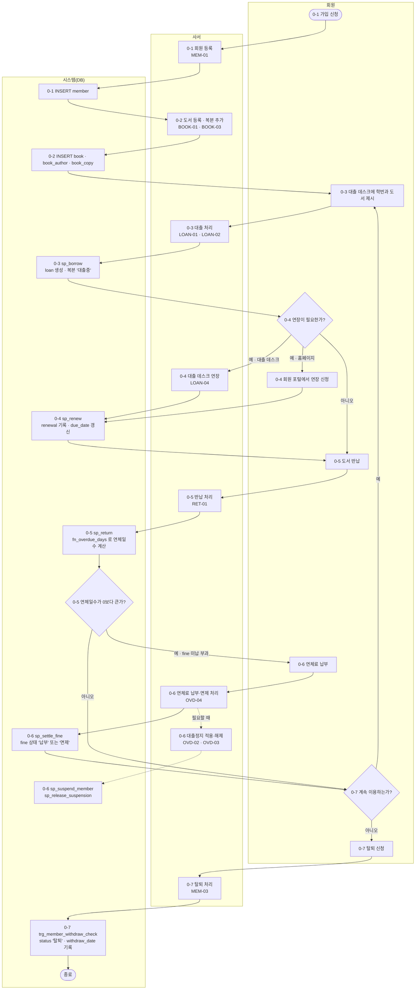
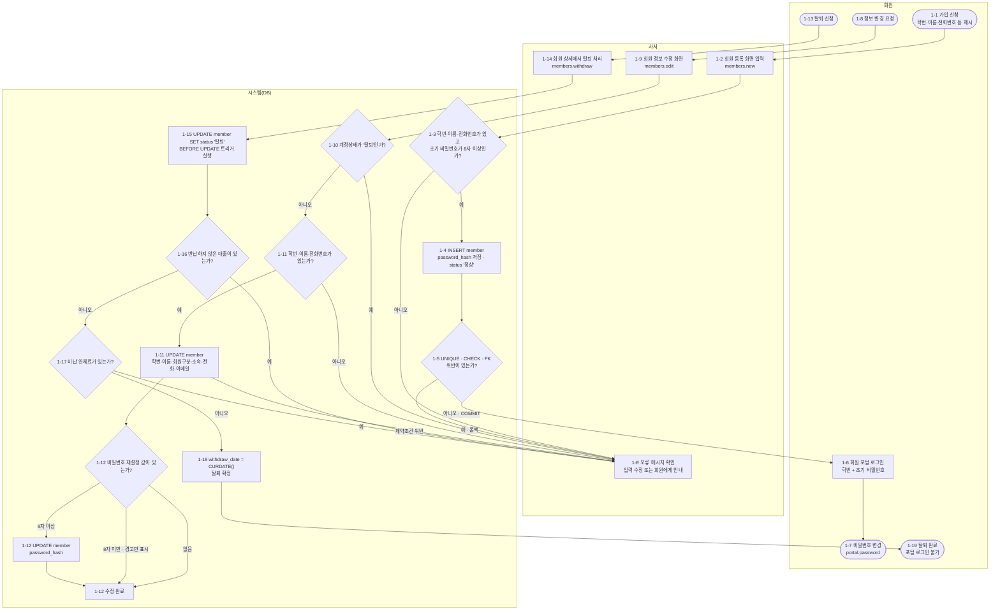
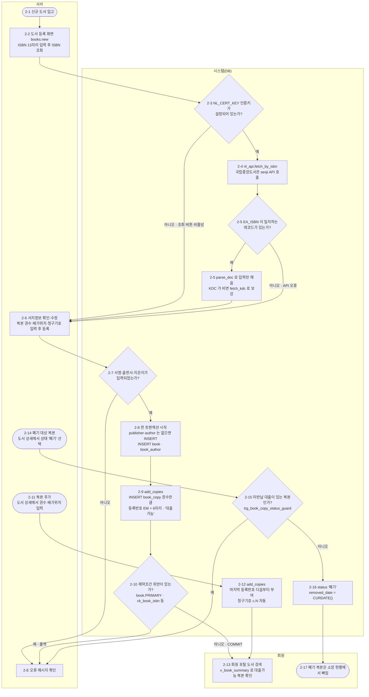
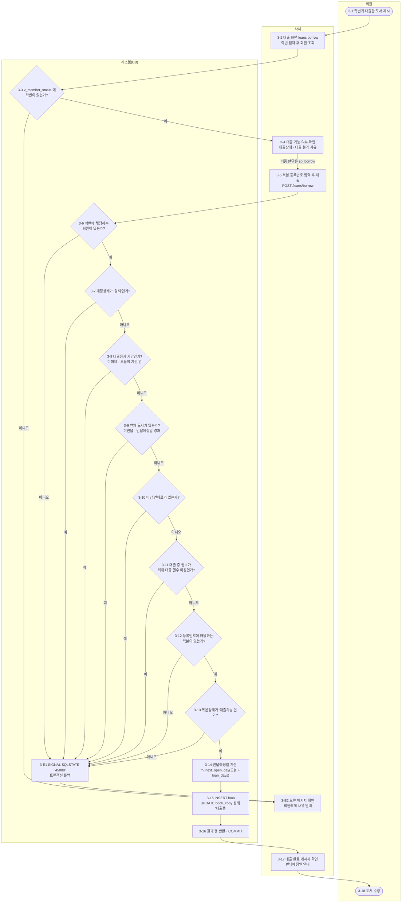
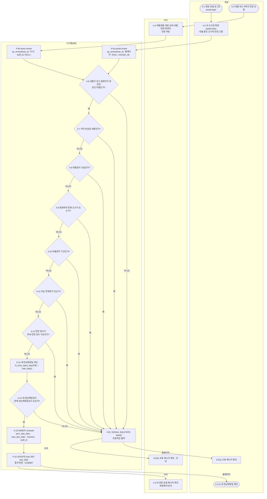
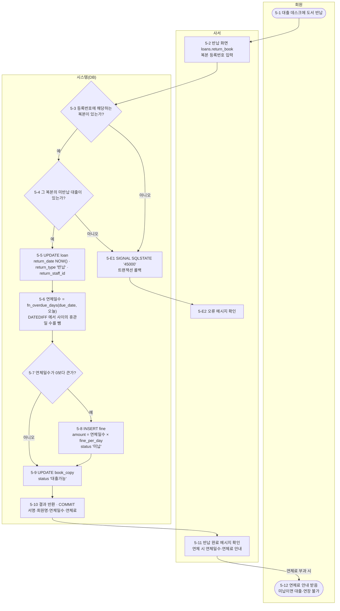
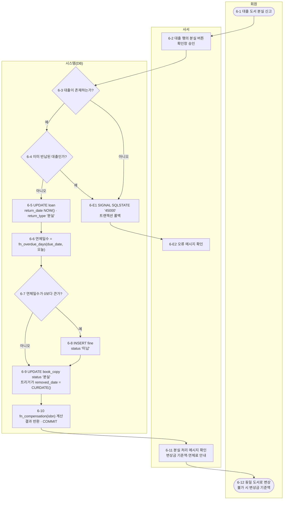
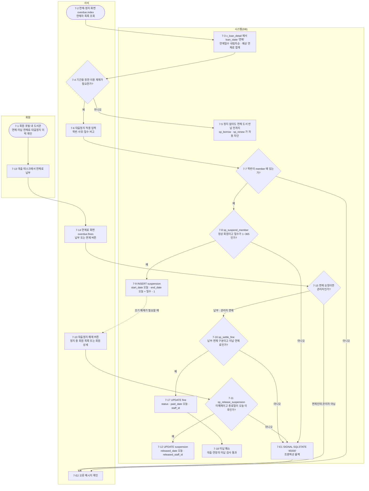
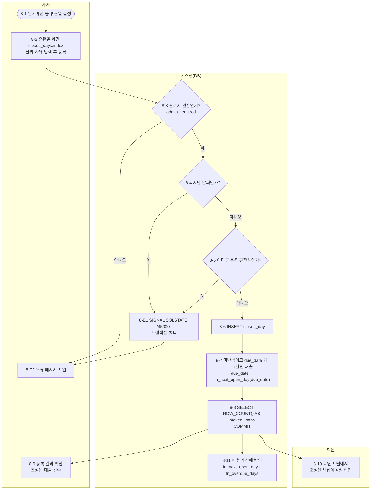
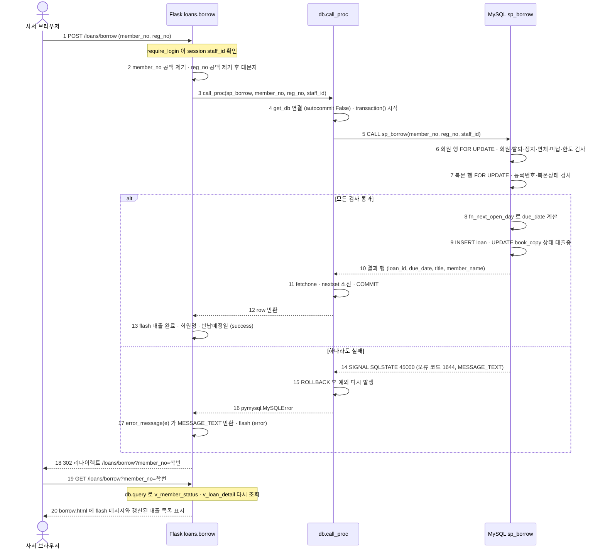

# 04. 업무 흐름도

> 회원·사서·시스템(DB)이 도서관 업무를 어떤 순서로 처리하는지 흐름도로 보이고, 각 단계를 실제 화면(URL)·테이블·프로그램과 연결한다. 작성 기준일 2026-11-14 · 작성: 윤준서 (Claude 활용)

## 작성 기준

| 항목 | 내용 |
|---|---|
| 근거 | `sql/02_programs.sql`(함수·뷰·트리거·프로시저), `sql/01_schema.sql`(제약조건), `app/*.py`·`app/templates/**`(화면·URL·SQL). 판단 순서는 프로시저 코드 순서, 오류 메시지는 `02_programs.sql` 원문 그대로 |
| 스윔레인 | `subgraph` 로 **회원 / 사서 / 시스템(DB)** 을 나눈다. 시스템(DB) 레인에는 Flask 앱의 입력 검사와 MySQL 프로그램을 함께 둔다. 관리자는 `staff.role = '관리자'` 인 사서이므로 사서 레인에 둔다 |
| 도형 | 둥근 사각형 = 흐름의 시작(일부 끝), 사각형 = 처리, 마름모 = 판단 |
| 단계 번호 | 그림의 노드 앞 번호(예: 3-9)가 표의 '단계'와 같다. `E` 가 붙은 번호는 오류 경로 |
| 공통 오류 처리 | 프로시저·트리거가 `SIGNAL SQLSTATE '45000'` 으로 거부 → MySQL 오류 1644 → `db.call_proc`·`db.execute` 의 `transaction()` 이 롤백 → `db.error_message` 가 MESSAGE_TEXT 를 그대로 돌려줌 → `flash(..., "error")`. UNIQUE·CHECK·FK 위반은 `db.CONSTRAINT_MESSAGES` 의 한국어 메시지로 바꾼다 |
| 로그인 검사 | 모든 요청 전에 `app/__init__.py` 의 `require_login` 이 검사한다. 회원 포털(`portal.*`, `/my`, 로그인 화면 제외)은 `session["member_id"]`, 나머지 화면은 `session["staff_id"]` 가 없으면 로그인 화면으로 보낸다 (SYS-01 · SYS-02) |

| 절 | 흐름 | 기능 ID | 핵심 프로그램 |
|---|---|---|---|
| 4.0 | 전체 업무 흐름 개요 | 전체 | — |
| 4.1 | 회원 등록·정보 수정·탈퇴 | MEM-01 · MEM-02 · MEM-03 · SYS-02 | `trg_member_withdraw_check` |
| 4.2 | 도서 등록·복본 추가·폐기 | BOOK-01 · BOOK-03 · BOOK-04 · BOOK-05 | `trg_book_copy_status_guard` |
| 4.3 | 대출 | LOAN-01 · LOAN-02 | `sp_borrow`, `fn_next_open_day` |
| 4.4 | 연장 | LOAN-04 · SYS-02 | `sp_renew`, `fn_next_open_day` |
| 4.5 | 반납 | RET-01 · RET-02 · OVD-04 | `sp_return`, `fn_overdue_days` |
| 4.6 | 분실 처리 | RET-03 | `sp_report_lost`, `fn_compensation` |
| 4.7 | 연체 관리 | OVD-01 · OVD-02 · OVD-03 · OVD-04 | `sp_suspend_member`, `sp_release_suspension`, `sp_settle_fine` |
| 4.8 | 휴관일 등록 | SYS-03 | `sp_add_closed_day` |
| 4.9 | 대출 처리 1건 시퀀스 | LOAN-02 | `loans.borrow` → `db.call_proc` → `sp_borrow` |

## 4.0 전체 업무 흐름 개요

| 단계 | 수행자 | 처리 내용 | 관련 테이블·프로그램 |
|---|---|---|---|
| 0-1 회원 가입 | 회원 → 사서 → 시스템(DB) | 회원이 학번·교번과 연락처로 가입을 신청하고, 사서가 초기 비밀번호를 넣어 회원을 등록한다. 등록 후 회원은 학번으로 회원 포털에 로그인한다 (4.1) | MEM-01 · SYS-02 · `member`, `member_type` |
| 0-2 도서 등록 | 사서 → 시스템(DB) | ISBN 으로 국립중앙도서관 서지정보를 불러와 도서·저자·복본을 등록하고, 필요하면 복본을 추가한다 (4.2) | BOOK-01 · BOOK-03 · `book`, `publisher`, `author`, `book_author`, `book_copy` |
| 0-3 대출 | 회원 → 사서 → 시스템(DB) | 사서가 학번으로 대출 가능 여부를 확인한 뒤 등록번호를 입력하면 `sp_borrow` 가 8가지를 검사하고 대출을 등록한다 (4.3) | LOAN-01 · LOAN-02 · `sp_borrow`, `fn_next_open_day`, `loan`, `book_copy` |
| 0-4 연장 | 회원(홈페이지) 또는 사서 → 시스템(DB) | 회원 포털 또는 대출 데스크에서 연장한다. 두 경로 모두 `sp_renew` 하나로 처리하고 `renewal.channel` 에 '홈페이지'·'사서'를 남긴다 (4.4) | LOAN-04 · `sp_renew`, `renewal`, `loan` |
| 0-5 반납·연체 | 회원 → 사서 → 시스템(DB) | 반납예정일이 지나도록 반납하지 않으면 `sp_borrow`·`sp_renew` 가 `loan` 의 `return_date IS NULL AND due_date < CURDATE()` 로 판단해 대출·연장을 막는다. 화면에는 `v_loan_detail.loan_state` = '연체' 로 표시된다. 반납하면 `sp_return` 이 휴관일을 뺀 연체일수를 계산하고, 0보다 크면 연체료를 '미납'으로 부과한다 (4.5). 분실은 `sp_report_lost` 로 대출을 끝낸다 (4.6) | RET-01 · RET-02 · RET-03 · `sp_borrow`, `sp_renew`, `loan`, `sp_return`, `fn_overdue_days`, `fine`, `v_loan_detail` |
| 0-6 연체료 납부·정지 | 회원 → 사서 → 시스템(DB) | 미납 연체료를 납부 처리한다(면제는 관리자만). 필요하면 사서가 기간을 정해 대출정지를 적용하거나 조기 해제한다 (4.7) | OVD-01 · OVD-02 · OVD-03 · OVD-04 · `sp_settle_fine`, `sp_suspend_member`, `sp_release_suspension`, `fine`, `suspension` |
| 0-7 탈퇴 | 회원 → 사서 → 시스템(DB) | 이용을 그만두면 탈퇴를 신청하고, 사서가 탈퇴 처리하면 트리거가 미반납 도서·미납 연체료를 검사한 뒤 탈퇴일을 기록한다 (4.1) | MEM-03 · `trg_member_withdraw_check`, `member` |

## 4.1 회원 등록·정보 수정·탈퇴

| 단계 | 수행자 | 처리 내용 | 관련 테이블·프로그램 |
|---|---|---|---|
| 1-1 | 회원 | 대출 데스크에서 가입을 신청하고 학번·교번, 이름, 회원구분, 소속, 휴대전화, 이메일을 알린다 | — |
| 1-2 | 사서 | `/members/new` 에서 입력한다. 회원구분 기본값은 `UG`(학부생)이고, 회원 포털용 초기 비밀번호를 정한다 | `members.new` · `member_type`(선택 목록) |
| 1-3 | 시스템(DB) | 앱 검사: 필수값이 없으면 `학번(교번), 이름, 전화번호는 필수입니다.`, 비밀번호가 8자 미만이면 `초기 비밀번호는 8자 이상이어야 합니다.` | `app/members.py` |
| 1-4 | 시스템(DB) | `generate_password_hash` 로 만든 해시를 저장한다. `status` 기본 '정상', `join_date` 기본 CURRENT_DATE, `member_id` 는 AUTO_INCREMENT(테이블 정의 시작값 10001) | `member` |
| 1-5 | 시스템(DB) | 위반 시 롤백하고 메시지로 바꾼다: `uq_member_no` 이미 등록된 학번(교번)입니다. · `uq_member_phone` 이미 등록된 전화번호입니다. · `uq_member_email` 이미 등록된 이메일입니다. · `ck_member_no` 학번(교번)은 영문·숫자 4~20자여야 합니다. · `ck_member_phone` 전화번호 형식이 올바르지 않습니다. (예: 010-1234-5678) · `fk_member_type` 존재하지 않는 회원구분입니다. 성공하면 `{name} 회원을 등록했습니다. (회원번호 {member_id})` 를 띄우고 회원 상세로 이동 | `db.CONSTRAINT_MESSAGES` · `uq_member_no`, `uq_member_phone`, `uq_member_email`, `ck_member_no`, `ck_member_phone`, `fk_member_type` |
| 1-6 | 회원 | `/my/login` 에서 학번(교번)·비밀번호로 로그인한다. 틀리면 `학번(교번) 또는 비밀번호가 올바르지 않습니다.` | `portal.login` · `member.password_hash` (SYS-02) |
| 1-7 | 회원 | `/my/password` 에서 현재 비밀번호 확인, 새 비밀번호 8자 이상, 확인값 일치를 검사한 뒤 `password_hash` 를 바꾼다. 성공 `비밀번호를 변경했습니다.` | `portal.password` · `member` (SYS-02) |
| 1-8 | 회원 | 연락처·소속 등의 변경을 요청한다 | — |
| 1-9 | 사서 | `/members/<id>/edit` 에서 수정한다. 비밀번호 칸은 '비우면 변경하지 않음' | `members.edit` (MEM-02) |
| 1-10 | 시스템(DB) | 탈퇴 회원이면 `탈퇴한 회원의 정보는 수정할 수 없습니다.` 회원 상세 화면도 `status = '정상'` 인 회원에게만 수정·탈퇴 버튼을 보인다 | `member.status` |
| 1-11 | 시스템(DB) | 앱이 먼저 필수값을 검사한다: `학번(교번), 이름, 전화번호는 필수입니다.` 통과하면 `UPDATE member SET member_no, name, type_code, department, phone, email` — 1-5 와 같은 제약조건으로 검사한다 | `app/members.py` · `member` |
| 1-12 | 시스템(DB) | 비밀번호 칸이 비면 그대로 둔다. 8자 미만이면 `비밀번호는 8자 이상이어야 해서 변경하지 않았습니다.`(경고), 8자 이상이면 별도 UPDATE 로 `password_hash` 를 재설정한다. 완료 `회원 정보를 수정했습니다.` | `member.password_hash` |
| 1-13 | 회원 | 탈퇴를 신청한다 | — |
| 1-14 | 사서 | 회원 상세의 '탈퇴 처리' → 확인창 `탈퇴 처리할까요? 되돌릴 수 없습니다.` → POST `/members/<id>/withdraw` | `members.withdraw` (MEM-03) |
| 1-15 | 시스템(DB) | `UPDATE member SET status = '탈퇴' WHERE member_id = %s AND status = '정상'` 을 실행하면 BEFORE UPDATE 트리거가 먼저 검사한다 | `trg_member_withdraw_check` |
| 1-16 | 시스템(DB) | 그 회원의 `loan` 중 `return_date IS NULL` 이 있으면 `반납하지 않은 도서가 있어 탈퇴 처리할 수 없습니다.` | `loan` |
| 1-17 | 시스템(DB) | 그 회원 대출의 `fine.status = '미납'` 이 있으면 `미납 연체료가 있어 탈퇴 처리할 수 없습니다.` | `fine`, `loan` |
| 1-18 | 시스템(DB) | 트리거가 `NEW.withdraw_date = CURDATE()` 를 기록하고 `ck_member_withdraw` 가 상태와 탈퇴일의 짝을 보장한다. 완료 `탈퇴 처리했습니다.` | `member` · `ck_member_withdraw` |
| 1-19 | 회원 | 이후 포털 로그인은 `탈퇴한 회원입니다.` 로 거부되고, 대출은 `sp_borrow` 가 거부한다 (3-7) | `portal.login`, `sp_borrow` |
| 1-E | 사서 | 오류 메시지를 보고 입력을 고치거나, 회원에게 미반납 도서 반납·연체료 납부 후 다시 탈퇴하도록 안내한다 | `db.error_message` |

## 4.2 도서 등록(국립중앙도서관 ISBN 조회)·복본 추가·폐기

| 단계 | 수행자 | 처리 내용 | 관련 테이블·프로그램 |
|---|---|---|---|
| 2-1 | 사서 | 신규 도서가 들어온다 | — |
| 2-2 | 사서 | `/books/new` 에서 ISBN 을 넣고 'ISBN 조회' → GET `/books/new?lookup=ISBN` (앱이 숫자만 남김) | `books.new` (BOOK-01) |
| 2-3 | 시스템(DB) | `nl_api.cert_key()` 가 환경변수 `NL_CERT_KEY` 를 읽는다. 없으면 조회 버튼이 비활성(툴팁 `NL_CERT_KEY 설정 필요`)이라 사서가 직접 입력한다. 현재 데이터는 키 승인 전이라 `data/books.csv` 로 적재했다 (00 문서 6절) | `app/nl_api.py`, `books/form.html` |
| 2-4 | 시스템(DB) | `https://www.nl.go.kr/seoji/SearchApi.do` 를 `isbn`, `ebook_yn=N` 으로 호출한다. 네트워크·응답 오류는 `NLApiError` 메시지로 flash(error) | `nl_api.call`, `nl_api.fetch_by_isbn` |
| 2-5 | 시스템(DB) | 검색 결과 중 `EA_ISBN` 이 정확히 일치하는 레코드를 고른다. 있으면 서명·저자(지은이·옮긴이·엮은이·그림 구분. 감수·기획·사진·해제·해설은 제외)·출판사·발행연도(`REAL_PUBLISH_DATE` 우선)·정가(`PRE_PRICE`)·KDC 를 채우고, KDC 가 비면 소장자료 검색 API(`fetch_kdc`)로 보강한다. 메시지 `국립중앙도서관에서 서지정보를 불러왔습니다. 확인 후 등록하세요.` · 없으면 `국립중앙도서관에 해당 ISBN 의 서지정보가 없습니다.` | `nl_api.parse_doc`, `nl_api.fetch_kdc`, `nl_api.kdc_main` |
| 2-6 | 사서 | 값을 확인·수정하고 분류(KDC 주류), 복본 권수(0~10), 배가위치(기본 '종합자료실'), 청구기호를 넣어 POST 한다 | `books/form.html` |
| 2-7 | 시스템(DB) | 앱 검사: `서명, 출판사, 지은이는 필수입니다.` 분류 값이 비어 오면 KDC 기호 첫 자리로 주류를 정하고, 그것도 없으면 '000' | `books.new`, `nl_api.kdc_main` |
| 2-8 | 시스템(DB) | `transaction()` 안에서 `save_book`: 출판사명으로 `publisher` 를 찾고 없으면 INSERT, `book` INSERT. `save_authors`: 저자명마다 `author` 를 찾고 없으면 INSERT 한 뒤, `book_author` 에 `author_role`('지은이'·'옮긴이'·'엮은이'·'그림')과 `author_order`(1부터)를 저장한다. 지은이 입력란의 `홍길동 (엮은이)` 표기는 `parse_writer` 가 이름과 역할로 나눈다 (`ck_book_author_role`) | `publisher`, `book`, `author`, `book_author` |
| 2-9 | 시스템(DB) | `add_copies`: 등록번호는 전체 `book_copy` 의 최대 번호 + 1 부터 `EM` + 6자리. 청구기호는 입력값(없으면 `kdc_no`, 그것도 없으면 `category_code`)이고 같은 도서 2권째부터 ` c.2`, ` c.3` 을 붙인다. `status` 기본 '대출가능', `acquired_date` 기본 오늘 | `book_copy` · `ck_book_copy_reg_no` |
| 2-10 | 시스템(DB) | 위반 시 2-8~2-9 전체를 롤백한다: `book.PRIMARY` 이미 등록된 ISBN입니다. · `ck_book_isbn` ISBN은 978 또는 979로 시작하는 13자리 숫자여야 합니다. · `ck_book_pub_year` 발행연도가 올바르지 않습니다. · `uq_book_copy_reg_no` 이미 사용 중인 등록번호입니다. 성공 `'{title}' 도서를 등록했습니다.` 후 도서 상세로 이동 | `db.CONSTRAINT_MESSAGES` |
| 2-11 | 사서 | 도서 상세의 '복본 추가'(권수 1~10, 배가위치) → POST `/books/<isbn>/copies` | `books.add_copy` (BOOK-03) |
| 2-12 | 시스템(DB) | 청구기호는 첫 복본 청구기호의 ` c.` 앞부분을 쓴다. 복본이 없으면(2-6 에서 0권 등록 가능) `kdc_no`, 그것도 없으면 `category_code` 를 쓴다. 이어서 `add_copies` 로 INSERT 한다. 완료 `복본 {count}권을 추가했습니다.` | `book_copy` |
| 2-13 | 회원 | `/my/books` 에서 서명·저자·출판사(LIKE) 또는 ISBN 으로 검색하고, 도서 상세에서 복본별 상태·반납예정일을 본다 (대출자는 숨김) | `portal.books`, `portal.book_detail`, `v_book_summary` (BOOK-05) |
| 2-14 | 사서 | 도서 상세의 상태 변경에서 '폐기'를 고른다. 대출중 복본은 상태 변경 칸이 `-` 로 비어 있다 → POST `/books/copies/<id>/status` | `books.change_copy_status` (BOOK-04) |
| 2-15 | 시스템(DB) | 앱이 상태값을 `COPY_STATUSES_MANUAL`('대출가능', '분실', '폐기')로 제한한다(그 밖은 400). `UPDATE book_copy SET status` 에서 BEFORE UPDATE 트리거가 미반납 대출이 있으면 `대출 중인 복본은 반납(또는 분실 처리) 후 상태를 변경할 수 있습니다.` | `trg_book_copy_status_guard`, `loan` |
| 2-16 | 시스템(DB) | 트리거가 '분실'·'폐기'면 `removed_date = CURDATE()`, '대출가능'으로 되돌리면 NULL 로 바꾸고, `ck_book_copy_removed` 가 짝을 보장한다. 완료 `{reg_no} 복본을 '{status}' 상태로 변경했습니다.` | `book_copy` · `ck_book_copy_removed` |
| 2-17 | 회원 | 폐기 복본은 `v_book_summary.total_copies`(상태 '대출가능'·'대출중'만 셈)와 포털 도서 상세 복본 목록에서 빠진다 | `v_book_summary`, `portal.book_detail` |
| 2-E | 사서 | 오류 메시지를 보고 입력을 고친다 | `db.error_message` |
| 참고 | 사서 | 도서 삭제(`/books/<isbn>/delete`)는 복본에 대출 이력이 있으면 `fk_loan_copy` 위반으로 `대출 이력이 있는 도서는 삭제할 수 없습니다. 복본을 폐기 처리하세요.` → 장서에서 빼는 일은 폐기(상태 변경)로 한다 | `books.delete`, `fk_loan_copy` |

## 4.3 대출

판단 순서는 `sp_borrow` 코드 순서와 같다. 대출 화면의 사전 표시(LOAN-01)는 안내일 뿐이고 최종 판단은 `sp_borrow` 가 한다.

| 단계 | 수행자 | 처리 내용 | 관련 테이블·프로그램 |
|---|---|---|---|
| 3-1 | 회원 | 대출 데스크에 학번·교번과 대출할 책을 낸다 | — |
| 3-2 | 사서 | `/loans/borrow` 에서 학번을 넣고 '회원 조회' → GET `/loans/borrow?member_no=` | `loans.borrow` (LOAN-01) |
| 3-3 | 시스템(DB) | `SELECT * FROM v_member_status WHERE member_no = %s`. 없으면 앱이 `존재하지 않는 학번(교번)입니다.` | `v_member_status` |
| 3-4 | 사서 | 대출상태(`loan_state`: 탈퇴 / 대출정지 / 대출가능)와 사유 목록(탈퇴한 회원 · 대출정지 종료일 · 연체 도서 권수 · 미납 연체료 · 대출 한도 도달)을 본다. 사유가 있어도 대출 버튼은 눌리며, 그때는 `sp_borrow` 가 거부한다. `loan_state` 의 '대출정지'는 `suspend_until IS NOT NULL OR overdue_loans > 0` 이라 미납 연체료만 있는 회원은 '대출가능'으로 보이지만 사유 목록에는 미납이 나온다 | `v_member_status`, `v_loan_detail`(현재 대출 목록), `loans/borrow.html` |
| 3-5 | 사서 | 등록번호(바코드)를 넣고 '대출' → POST. 앱이 등록번호를 대문자로 바꾸고 `call_proc("sp_borrow", member_no, reg_no, session["staff_id"])` 를 호출한다 (4.9) | `loans.borrow`, `db.call_proc` (LOAN-02) |
| 3-6 | 시스템(DB) | `member` 와 `member_type` 을 조인해 `member_no = p_member_no` 인 행을 `FOR UPDATE OF m` 으로 잠그며 읽는다(`max_loan_count`, `loan_days` 확보). 없으면 `존재하지 않는 학번(교번)입니다.` | `member`, `member_type` |
| 3-7 | 시스템(DB) | `v_status = '탈퇴'` 이면 `탈퇴한 회원은 대출할 수 없습니다.` | `member.status` |
| 3-8 | 시스템(DB) | `suspension` 에서 `released_date IS NULL AND CURDATE() BETWEEN start_date AND end_date` 인 `MAX(end_date)` 가 있으면 `CONCAT('대출정지 기간입니다. (', DATE_FORMAT(v_susp_end, '%Y-%m-%d'), '까지)')` | `suspension` |
| 3-9 | 시스템(DB) | 그 회원의 `loan` 중 `return_date IS NULL AND due_date < CURDATE()` 가 있으면 `연체 중인 도서가 있어 대출할 수 없습니다. 연체 도서를 먼저 반납하세요.` | `loan` |
| 3-10 | 시스템(DB) | `fine JOIN loan` 에서 그 회원의 `f.status = '미납'` 이 있으면 `미납 연체료가 있어 대출할 수 없습니다.` | `fine`, `loan` |
| 3-11 | 시스템(DB) | `COUNT(*)`(미반납 대출) `>= v_max_loan` 이면 `CONCAT('대출 한도(', v_max_loan, '권)를 초과합니다. 현재 ', v_active, '권 대출 중입니다.')` | `loan`, `member_type.max_loan_count` |
| 3-12 | 시스템(DB) | `SELECT copy_id, status FROM book_copy WHERE reg_no = p_reg_no FOR UPDATE`. 없으면 `존재하지 않는 등록번호입니다.` | `book_copy` |
| 3-13 | 시스템(DB) | `v_copy_status <> '대출가능'`(대출중·분실·폐기)이면 `CONCAT('대출할 수 없는 복본입니다. (현재 상태: ', v_copy_status, ')')` | `book_copy.status` |
| 3-14 | 시스템(DB) | `fn_next_open_day(CURDATE() + INTERVAL v_loan_days DAY)`: 그날이 `closed_day` 에 있으면 하루씩 미룬다. DB 조회 예: 2026-11-14(토) 학부생 14일 → 2026-11-28(토, 개관일) · 대학원생 30일 → 2026-12-14(월) · `fn_next_open_day('2026-12-25')` → 2026-12-26 | `fn_next_open_day`, `closed_day`, `member_type.loan_days` |
| 3-15 | 시스템(DB) | `INSERT INTO loan (copy_id, member_id, staff_id, loan_date, due_date)` — `loan_date` 는 NOW(). 이어서 `UPDATE book_copy SET status = '대출중'`. 생성 컬럼 `active_copy_id` 의 `uq_loan_active_copy` 가 복본당 미반납 대출 1건을 한 번 더 보장한다 | `loan`, `book_copy` · `uq_loan_active_copy` |
| 3-16 | 시스템(DB) | `loan_id`, `due_date`, `title`, `member_name` 한 행을 돌려주고, `call_proc` 가 결과를 읽은 뒤 COMMIT 한다 | `db.call_proc` |
| 3-17 | 사서 | `'{title}' 대출 완료 · {member_name} · 반납예정일 YYYY-MM-DD` (success) 를 보고 회원에게 반납예정일을 알린다 | `loans.borrow` |
| 3-18 | 회원 | 책을 받는다. 이후 회원 포털 `/my/` 에서 대출 내역을 볼 수 있다 | `portal.index`, `v_loan_detail` (LOAN-03) |
| 3-E1 | 시스템(DB) | 3-6~3-13 중 하나라도 걸리면 SIGNAL 로 중단되고, INSERT·UPDATE 없이 롤백된다 | `db.transaction` |
| 3-E2 | 사서 | `db.error_message` 가 돌려준 메시지를 flash(error) 로 보고 회원에게 사유(연체 도서 반납, 연체료 납부 등)를 안내한다 | `db.error_message` |

판단에 쓰이는 회원구분 정책값 (`member_type`, 2026-11-14 DB 조회):

| type_code | type_name | max_loan_count | loan_days | max_renew | fine_per_day |
|---|---|---|---|---|---|
| UG | 학부생 | 10 | 14 | 2 | 100 |
| UGL | 휴학생 | 5 | 14 | 2 | 100 |
| GR | 대학원생 | 15 | 30 | 2 | 100 |
| FAC | 전임교원 | 50 | 180 | 1 | 100 |
| STF | 직원·비전임교원 | 15 | 30 | 2 | 100 |

## 4.4 연장

회원 포털(홈페이지)과 대출 데스크(사서) 두 경로 모두 `sp_renew` 하나로 처리한다. `sp_borrow` 와 달리 **연체 도서 검사(4-9)가 대출정지 검사(4-10)보다 먼저** 온다.

| 단계 | 수행자 | 처리 내용 | 관련 테이블·프로그램 |
|---|---|---|---|
| 4-1 | 회원 | `/my/login` 에 학번·비밀번호로 로그인한다 (탈퇴 회원은 `탈퇴한 회원입니다.`) | `portal.login` (SYS-02) |
| 4-2 | 회원 | `/my/` 의 '대출 중인 도서' 표에서 '연장 신청' → POST `/my/loans/<id>/renew`. 표에는 연장 횟수(`renew_count` / `max_renew`)가 보이고, 버튼은 모든 대출 중 도서에 나오며 판단은 `sp_renew` 가 한다 | `portal.index`, `v_loan_detail` |
| 4-3 | 회원 | 대출 데스크에서 연장을 요청한다 | — |
| 4-4 | 사서 | 미반납 대출 행의 '연장' 버튼(`loan_actions` 매크로: 대출현황 `/loans/`, 회원 상세, 대출 화면, 연체 화면) → POST `/loans/<id>/renew` | `loans.renew`, `_macros.html` |
| 4-5a | 시스템(DB) | `call_proc("sp_renew", loan_id, "홈페이지", None, session["member_id"])` | `portal.renew` |
| 4-5b | 시스템(DB) | `call_proc("sp_renew", loan_id, "사서", session["staff_id"], None)` | `loans.renew` |
| 4-6 | 시스템(DB) | `loan`·`member`·`member_type` 조인으로 대출을 `FOR UPDATE OF l` 로 읽는다(`loan_days`, `max_renew` 확보). 대출이 없거나, 홈페이지 경로인데 `v_member_id <> p_member_id`(남의 대출)이면 `연장할 수 있는 대출이 아닙니다.` | `loan`, `member`, `member_type` |
| 4-7 | 시스템(DB) | `v_return_date IS NOT NULL` 이면 `이미 반납된 대출입니다.` | `loan.return_date` |
| 4-8 | 시스템(DB) | `DATE(v_loan_date) = CURDATE()` 이면 `대출 당일에는 연장할 수 없습니다.` | `loan.loan_date` |
| 4-9 | 시스템(DB) | 그 회원의 대출 중 `return_date IS NULL AND due_date < CURDATE()` 가 하나라도 있으면(연장하려는 책이 아니어도) `연체 중인 도서가 있어 연장할 수 없습니다.` | `loan` |
| 4-10 | 시스템(DB) | `suspension` 에 `released_date IS NULL AND CURDATE() BETWEEN start_date AND end_date` 가 있으면 `대출정지 기간에는 연장할 수 없습니다.` | `suspension` |
| 4-11 | 시스템(DB) | 그 회원의 `fine.status = '미납'` 이 있으면 `미납 연체료가 있어 연장할 수 없습니다.` | `fine`, `loan` |
| 4-12 | 시스템(DB) | `SELECT COUNT(*) FROM renewal WHERE loan_id = p_loan_id` 가 `v_max_renew` 이상이면 `CONCAT('연장 가능 횟수(', v_max_renew, '회)를 모두 사용했습니다.')` | `renewal`, `member_type.max_renew` |
| 4-13 | 시스템(DB) | 연장한 날 + 대출기간: `fn_next_open_day(CURDATE() + INTERVAL v_loan_days DAY)` (원래 반납예정일 기준이 아님 · 00 문서 결정 6) | `fn_next_open_day`, `member_type.loan_days` |
| 4-14 | 시스템(DB) | `v_new_due <= v_due` 이면 `지금 연장해도 반납예정일이 늦어지지 않습니다.` | `loan.due_date` |
| 4-15 | 시스템(DB) | `INSERT INTO renewal (loan_id, prev_due_date, new_due_date, channel, staff_id)` — `staff_id` 는 `IF(p_channel = '사서', p_staff_id, NULL)`. `ck_renewal_channel`, `ck_renewal_staff`, `ck_renewal_due` 가 값을 보장한다 | `renewal` |
| 4-16 | 시스템(DB) | `UPDATE loan SET due_date = v_new_due` 후 `loan_id`, `due_date`, `title`, `renew_count`(= 기존 횟수 + 1)를 돌려주고 COMMIT | `loan` |
| 4-17a | 회원 | `/my/` 로 돌아와 `'{title}' 연장 완료 · 새 반납예정일 YYYY-MM-DD (연장 {renew_count}회째)` 를 본다 | `portal.renew` |
| 4-17b | 사서 | 같은 메시지를 이전 화면에서 보고 회원에게 새 반납예정일을 알린다 | `loans.renew` |
| 4-E1 | 시스템(DB) | 4-6~4-14 중 하나라도 걸리면 SIGNAL 로 중단, 롤백 | `db.transaction` |
| 4-E2a · 4-E2b | 회원 · 사서 | 오류 메시지를 flash(error) 로 본다. 회원 경로는 `/my/`, 사서 경로는 이전 화면으로 돌아간다 | `db.error_message` |

## 4.5 반납 (연체일수 계산·연체료 부과)

| 단계 | 수행자 | 처리 내용 | 관련 테이블·프로그램 |
|---|---|---|---|
| 5-1 | 회원 | 대출 데스크에 책을 돌려준다 | — |
| 5-2 | 사서 | `/loans/return` 에서 등록번호를 넣고 '반납' → 앱이 대문자로 바꾸고 `call_proc("sp_return", reg_no, session["staff_id"])` | `loans.return_book` (RET-01) |
| 5-3 | 시스템(DB) | `SELECT copy_id FROM book_copy WHERE reg_no = p_reg_no FOR UPDATE`. 없으면 `존재하지 않는 등록번호입니다.` | `book_copy` |
| 5-4 | 시스템(DB) | 그 복본의 `return_date IS NULL` 대출을 `member`·`member_type` 과 조인해 `FOR UPDATE OF l` 로 읽는다(`due_date`, `fine_per_day` 확보). 없으면 `대출 중인 복본이 아닙니다.` | `loan`, `member_type.fine_per_day` |
| 5-5 | 시스템(DB) | `UPDATE loan SET return_date = NOW(), return_type = '반납', return_staff_id = p_staff_id`. `ck_loan_returned` 가 세 컬럼의 짝을, `active_copy_id` 가 NULL 이 되어 그 복본의 다음 대출을 허용한다 | `loan` · `ck_loan_returned`, `uq_loan_active_copy` |
| 5-6 | 시스템(DB) | `fn_overdue_days(v_due, CURDATE())` — 계산식은 아래 표 | `fn_overdue_days`, `closed_day` (RET-02) |
| 5-7 | 시스템(DB) | `v_overdue > 0` 인지 판단 | `sp_return` |
| 5-8 | 시스템(DB) | `v_fine = v_overdue * v_fine_per_day` 로 `INSERT INTO fine (loan_id, overdue_days, amount)`. `status` 기본 '미납', `imposed_date` 기본 오늘. `uq_fine_loan`(대출 1건당 1건), `ck_fine_days`(연체일수 > 0) | `fine` (OVD-04 부과) |
| 5-9 | 시스템(DB) | `UPDATE book_copy SET status = '대출가능'` | `book_copy` |
| 5-10 | 시스템(DB) | `title`, `member_name`, `overdue_days`, `fine_amount` 를 돌려주고 COMMIT | `db.call_proc` |
| 5-11 | 사서 | 연체가 없으면 `'{title}' 반납 완료 · {member_name}` (success), 연체면 뒤에 `연체 {overdue_days}일 · 연체료 {fine_amount}원 부과` 를 붙여 warning 으로 보인다. 화면 아래 '오늘 반납된 도서' 목록이 갱신된다 | `loans.return_book`, `penalty_message`, `v_loan_detail` |
| 5-12 | 회원 | 연체료가 '미납'인 동안 `sp_borrow`(3-10)·`sp_renew`(4-11)가 거부하므로 납부한다 (4.7). 반납 때 대출정지(`suspension`)는 자동으로 만들지 않는다 — `sp_return` 에 정지 처리가 없고, 00 문서 결정 2 가 '반납 후 추가 정지 기간은 두지 않음' | `fine`, `sp_return` |
| 5-E1 · 5-E2 | 시스템(DB) · 사서 | SIGNAL 로 중단·롤백, 사서는 오류 메시지를 본다 | `db.error_message` |

`fn_overdue_days` 계산 규칙 (RET-02)

| 구분 | 내용 |
|---|---|
| 정의 | `fn_overdue_days(p_due_date, p_until)`: `p_until` 이 NULL 이거나 `p_until <= p_due_date` 이면 0. 아니면 `DATEDIFF(p_until, p_due_date)` 에서 `closed_day` 중 `closed_date > p_due_date AND closed_date <= p_until` 인 날 수를 뺀다 |
| 예 1 (DB 조회) | 반납예정 2026-11-07(토) → 반납 2026-11-09(월): DATEDIFF 2 − 휴관일 1(11-08 일요일) = **1일** → 학부생 연체료 100원 |
| 예 2 (DB 조회) | 반납예정 2026-09-23(수) → 반납 2026-09-28(월): DATEDIFF 5 − 휴관일 4(09-24 추석 연휴, 09-25 추석, 09-26 추석 연휴, 09-27 일요일) = **1일** |
| 화면 표시 | `v_loan_detail.overdue_days` = `fn_overdue_days(l.due_date, COALESCE(DATE(l.return_date), CURDATE()))` — 미반납이면 오늘까지, 반납했으면 반납일까지. `loan_state` 는 `return_type = '분실'` → '분실', `return_date IS NOT NULL` → '반납', `due_date < CURDATE()` → '연체', 그 밖 '대출중' |

## 4.6 분실 처리

| 단계 | 수행자 | 처리 내용 | 관련 테이블·프로그램 |
|---|---|---|---|
| 6-1 | 회원 | 빌린 책을 잃어버렸다고 알린다 | — |
| 6-2 | 사서 | 미반납 대출 행의 '분실' 버튼(`loan_actions` 매크로) → 확인창 `분실 처리할까요? 대출이 종료되고 복본은 분실 상태가 됩니다.` → POST `/loans/<id>/lost` → `call_proc("sp_report_lost", loan_id, session["staff_id"])` | `loans.report_lost` (RET-03) |
| 6-3 | 시스템(DB) | `loan`·`member`·`member_type` 조인으로 `FOR UPDATE OF l`. 없으면 `존재하지 않는 대출입니다.` | `loan` |
| 6-4 | 시스템(DB) | `v_return_date IS NOT NULL` 이면 `이미 반납된 대출입니다.` | `loan.return_date` |
| 6-5 | 시스템(DB) | `UPDATE loan SET return_date = NOW(), return_type = '분실', return_staff_id = p_staff_id` — 대출을 먼저 끝낸다 | `loan` |
| 6-6 · 6-7 · 6-8 | 시스템(DB) | 반납과 같은 방식으로 반납예정일을 넘긴 날수만큼 연체료를 '미납'으로 부과한다 (5-6~5-8) | `fn_overdue_days`, `fine` |
| 6-9 | 시스템(DB) | `UPDATE book_copy SET status = '분실'`. 6-5 에서 대출이 끝났으므로 `trg_book_copy_status_guard` 검사를 통과하고, 트리거가 `removed_date = CURDATE()` 를 기록한다 | `book_copy`, `trg_book_copy_status_guard` |
| 6-10 | 시스템(DB) | `title`, `member_name`, `overdue_days`, `fine_amount`, `fn_compensation(b.isbn) AS compensation` 을 돌려주고 COMMIT. 기준액 규칙은 아래 표 | `fn_compensation`, `book.price`, `book.pub_year` |
| 6-11 | 사서 | `'{title}' 분실 처리 완료 · {member_name} · 동일 도서로 변상 원칙 (불가 시 변상금 기준액 {compensation}원)` — 분실 처리 메시지는 연체 여부와 관계없이 항상 warning 이다. 기준액이 없으면 괄호 안이 `불가 시 정가 정보 없음` 이 되고, 연체가 있으면 뒤에 ` · 연체 {overdue_days}일 · 연체료 {fine_amount}원 부과` 를 붙인다 | `loans.report_lost` |
| 6-12 | 회원 | 동일 도서로 변상하고, 불가하면 기준액을 안내받는다. 변상 이행 기록은 이번 범위에서 제외 (00 문서 결정 7). 연체료가 생겼으면 4.7 로 납부 | — |
| 6-E1 · 6-E2 | 시스템(DB) · 사서 | SIGNAL 로 중단·롤백, 사서는 오류 메시지를 본다 | `db.error_message` |

| 발행 경과연수 = `GREATEST(0, YEAR(CURDATE()) - CAST(pub_year AS SIGNED))` | `fn_compensation` 기준액 |
|---|---|
| 4년 미만 | `ROUND(price × 1.2)` |
| 10년 미만 | `ROUND(price × 1.5)` |
| 20년 미만 | `ROUND(price × 2.0)` |
| 20년 이상 | `ROUND(price × 3.0)` |
| `price` 또는 `pub_year` 가 NULL | NULL (사서가 결정, 화면 표시 '정가 정보 없음') |

## 4.7 연체 관리 (연체자 조회·대출정지 적용·해제·연체료 납부·면제)

| 단계 | 수행자 | 처리 내용 | 관련 테이블·프로그램 |
|---|---|---|---|
| 7-1 | 회원 | `/my/` 에서 대출상태, 연체 권수, 미납 연체료, 연체료 내역, 대출정지 이력을 본다. 미납이 있으면 `미납 연체료 {n}원이 있습니다. 납부 전까지 대출·연장할 수 없습니다.` 안내가 나온다 | `portal.index`, `v_member_status`, `fine`, `suspension` |
| 7-2 | 사서 | `/overdue/` 화면을 연다 | `overdue.index` (OVD-01) |
| 7-3 | 시스템(DB) | `SELECT * FROM v_loan_detail WHERE loan_state = '연체' ORDER BY overdue_days DESC`, 유효한 대출정지 목록(`released_date IS NULL AND CURDATE() BETWEEN start_date AND end_date`), 지금 반납 시 예상 연체료 `SUM(overdue_days × fine_per_day)` 를 보인다 | `v_loan_detail`, `suspension`, `member_type` |
| 7-4 | 사서 | 기간을 정한 제재(규정 제27조 이용 제한)가 필요한지 판단한다 | — |
| 7-5 | 시스템(DB) | 연체 도서를 가진 회원은 정지를 걸지 않아도 반납 전까지 대출(3-9)·연장(4-9)이 막히고, `v_member_status.loan_state` 가 '대출정지'로 보인다 | `sp_borrow`, `sp_renew`, `v_member_status` |
| 7-6 | 사서 | '대출정지 적용'에 학번, 사유(`장기연체`·`자료훼손`·`규정위반`·`기타`), 일수(기본 7), 비고를 넣어 POST `/overdue/suspend` | `overdue.suspend` (OVD-02) |
| 7-7 | 시스템(DB) | 앱이 `SELECT member_id FROM member WHERE member_no = %s`. 없으면 `존재하지 않는 학번(교번)입니다.`, 일수가 숫자가 아니면 `정지 일수는 숫자로 입력하세요.` | `member` |
| 7-8 | 시스템(DB) | `sp_suspend_member` 가 회원 행을 `FOR UPDATE` 로 읽고 순서대로 검사: `존재하지 않는 회원입니다.` → `탈퇴한 회원입니다.` → `정지 일수는 1~365일이어야 합니다.` 사유는 `ck_suspension_reason`(위반 시 `정지 사유가 올바르지 않습니다.`) | `sp_suspend_member`, `member` |
| 7-9 | 시스템(DB) | `INSERT INTO suspension (member_id, reason, start_date, end_date, memo, staff_id)` — `end_date = CURDATE() + INTERVAL (p_days - 1) DAY` 로 오늘 포함 p_days 일. 완료 `대출정지 적용 · YYYY-MM-DD까지`. 이후 `sp_borrow`(3-8)·`sp_renew`(4-10)가 거부 | `suspension` |
| 7-10 | 사서 | 정지 중 회원 목록 또는 회원 상세의 '해제' → POST `/overdue/suspensions/<id>/release` | `overdue.release` (OVD-03) |
| 7-11 | 시스템(DB) | `sp_release_suspension` 이 `FOR UPDATE` 로 읽고 순서대로 검사: `존재하지 않는 대출정지입니다.` → `이미 해제된 대출정지입니다.` → (`end_date < CURDATE()` 이면) `이미 기간이 끝난 대출정지입니다.` | `sp_release_suspension`, `suspension` |
| 7-12 | 시스템(DB) | `UPDATE suspension SET released_date = CURDATE(), released_staff_id = p_staff_id`. `ck_suspension_release` 가 짝을 보장. 완료 `대출정지를 해제했습니다.` | `suspension` |
| 7-13 | 회원 | 대출 데스크에서 연체료를 낸다 | — |
| 7-14 | 사서 | `/overdue/fines`(기본 '미납' 탭) 또는 회원 상세에서 '납부' → POST `/overdue/fines/<id>/pay`. '면제' 버튼은 관리자에게만 보이고 POST `/overdue/fines/<id>/waive` | `overdue.fines`, `overdue.pay`, `overdue.waive` (OVD-04) |
| 7-15 | 시스템(DB) | 면제 경로는 `admin_required` 가 `session.get("staff_role") != "관리자"` 이면 `관리자만 처리할 수 있습니다.` 로 막는다 | `app/auth.py` |
| 7-16 | 시스템(DB) | `sp_settle_fine` 이 순서대로 검사: `처리 구분은 납부 또는 면제여야 합니다.` → (`FOR UPDATE` 로 읽고) `존재하지 않는 연체료입니다.` → `이미 처리된 연체료입니다.` | `sp_settle_fine`, `fine` |
| 7-17 | 시스템(DB) | `UPDATE fine SET status = p_status, paid_date = CURDATE(), staff_id = p_staff_id`. `ck_fine_paid` 가 상태와 처리일의 짝을 보장. 완료 `연체료 납부를 처리했습니다.` 또는 `연체료를 면제 처리했습니다.` | `fine` |
| 7-18 | 시스템(DB) | 그 회원에게 다른 미납이 없으면 대출(3-10)·연장(4-11)·탈퇴(1-17)의 미납 검사를 통과한다 | `sp_borrow`, `sp_renew`, `trg_member_withdraw_check` |
| 7-E1 · 7-E2 | 시스템(DB) · 사서 | SIGNAL 로 중단·롤백, 사서는 오류 메시지를 본다 | `db.error_message` |

대출을 막는 세 가지 조건 비교

| 구분 | 판단 데이터 | 시작 | 끝 | 막는 처리 |
|---|---|---|---|---|
| 연체 중 | `loan` 의 `return_date IS NULL AND due_date < CURDATE()` | 반납예정일 다음 날 | 연체 도서 반납 또는 분실 처리 | 대출 3-9 · 연장 4-9 |
| 미납 연체료 | `fine.status = '미납'` | 연체 반납(5-8)·분실 처리(6-8) | 납부 또는 면제(7-17) | 대출 3-10 · 연장 4-11 · 탈퇴 1-17 |
| 대출정지 (사서 적용) | `suspension` 의 `released_date IS NULL AND CURDATE() BETWEEN start_date AND end_date` | `sp_suspend_member`(7-9) | `end_date` 경과 또는 조기 해제(7-12) | 대출 3-8 · 연장 4-10 |

## 4.8 휴관일 등록 (반납예정일 재계산)

| 단계 | 수행자 | 처리 내용 | 관련 테이블·프로그램 |
|---|---|---|---|
| 8-1 | 사서(관리자) | 공휴일 외에 임시휴관 등 문을 닫는 날을 정한다 | — |
| 8-2 | 사서(관리자) | `/closed-days/` 의 '휴관일 등록'(관리자에게만 보임)에 날짜와 사유를 넣어 POST `/closed-days/new`. 사유가 비면 앱이 '임시휴관'으로 채운다 | `closed_days.new` (SYS-03) |
| 8-3 | 시스템(DB) | `admin_required`: 관리자가 아니면 `관리자만 처리할 수 있습니다.` | `app/auth.py` |
| 8-4 | 시스템(DB) | `sp_add_closed_day`: `p_date < CURDATE()` 이면 `지난 날짜는 휴관일로 등록할 수 없습니다.` | `sp_add_closed_day` |
| 8-5 | 시스템(DB) | 같은 날이 있으면 `이미 등록된 휴관일입니다.` | `closed_day` |
| 8-6 | 시스템(DB) | `INSERT INTO closed_day (closed_date, reason)` | `closed_day` |
| 8-7 | 시스템(DB) | `UPDATE loan SET due_date = fn_next_open_day(due_date) WHERE return_date IS NULL AND due_date = p_date` — 새 휴관일이 반납예정일인 미반납 대출만 다음 개관일로 옮긴다(연속 휴관일은 모두 건너뜀). `renewal` 기록은 남기지 않는다 | `loan`, `fn_next_open_day` |
| 8-8 | 시스템(DB) | `SELECT ROW_COUNT() AS moved_loans` 로 옮긴 건수를 돌려주고 COMMIT | `sp_add_closed_day` |
| 8-9 | 사서(관리자) | `휴관일을 등록했습니다. 반납예정일이 조정된 대출 {moved_loans}건` 을 본다 | `closed_days.new` |
| 8-10 | 회원 | `/my/` 대출 목록에서 바뀐 반납예정일을 본다 | `portal.index`, `v_loan_detail` |
| 8-11 | 시스템(DB) | 이후 대출(3-14)·연장(4-13)의 반납예정일 계산은 그날을 건너뛰고, 연체일수(5-6)에서 그날을 뺀다 | `fn_next_open_day`, `fn_overdue_days` |
| 8-E1 · 8-E2 | 시스템(DB) · 사서 | SIGNAL 로 중단·롤백, 사서는 오류 메시지를 본다 | `db.error_message` |
| 참고 | 사서(관리자) | 휴관일 삭제 POST `/closed-days/<date>/delete` 는 `closed_date >= CURDATE()` 인 날만 지우고, 이미 옮긴 반납예정일은 되돌리지 않는다: `휴관일을 삭제했습니다. (이미 조정된 반납예정일은 그대로 유지됩니다)` (지운 행이 없으면 `오늘 이전의 휴관일이나 등록되지 않은 날짜는 삭제할 수 없습니다.`) | `closed_days.delete` |

## 4.9 대출 처리 1건의 시퀀스 다이어그램

| 단계 | 수행자 | 처리 내용 | 관련 테이블·프로그램 |
|---|---|---|---|
| 1 | 사서 | 대출 화면 폼에서 `member_no`(hidden)와 `reg_no` 를 POST. 그 전에 `require_login` 이 사서 로그인을 확인한다 | `loans/borrow.html`, `app/__init__.py` |
| 2~3 | 시스템(DB) | `loans.borrow` 가 입력을 다듬고 `call_proc("sp_borrow", member_no, reg_no, session["staff_id"])` 호출 | `app/loans.py` |
| 4~5 | 시스템(DB) | `get_db()` 는 PyMySQL `DictCursor`, `autocommit=False` 연결. `transaction()` 안에서 `CALL sp_borrow(%s, %s, %s)` 실행 | `app/db.py` |
| 6~7 | 시스템(DB) | 회원 행·복본 행을 잠그고 3-6~3-13 순서로 검사 | `sp_borrow`, `member`, `suspension`, `loan`, `fine`, `book_copy` |
| 8~13 | 시스템(DB) | 3-14~3-16: 반납예정일 계산, 대출 등록, 복본 '대출중', 결과 행 → `cur.fetchone()` 후 `cur.nextset()` 으로 남은 결과를 비우고 COMMIT → flash(success) | `fn_next_open_day`, `loan`, `book_copy` |
| 14~17 | 시스템(DB) | SIGNAL 은 PyMySQL 에서 오류 코드 1644 예외가 된다. `transaction()` 이 ROLLBACK 하고 예외를 다시 던지면 `loans.borrow` 가 `pymysql.MySQLError` 로 잡아 `error_message(e)` 의 원문 메시지를 flash(error) | `db.transaction`, `db.error_message` |
| 18~20 | 사서 | `redirect(url_for("loans.borrow", member_no=member_no))` 로 같은 회원 화면을 다시 열어 flash 메시지와 갱신된 대출 상태를 본다 | `loans.borrow`, `v_member_status`, `v_loan_detail` |
