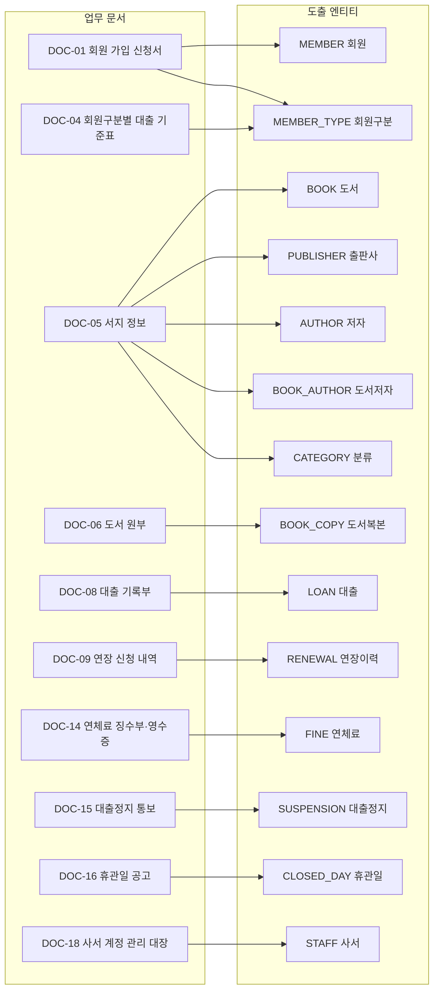

# 05. 업무 문서 리스트

> 도서관 대출 업무에서 쓰는 장부·서식·보고서 18종을 정리하고, 각 문서의 기재 항목에서 데이터 모델의 엔티티(테이블 14개)를 도출한 근거를 남긴다 · 작성 기준일 2026-11-14 · 작성: 윤준서 (Claude 활용)

- 대상 업무: 숭실대학교 중앙도서관 대출 규정을 따르는 본 시스템의 회원·도서·대출·반납·연체 업무 (00 문서 §2). 예약은 범위 제외라 예약 관련 문서는 넣지 않았다.
- 기능 ID 는 00 문서 §4 표, 테이블·컬럼명은 `sql/01_schema.sql`, 화면 URL 은 `app/*.py` 의 라우트를 그대로 썼다.
- 예시 값은 2026-11-14 에 초기화된 `library_db` 의 실제 행이다. 샘플 대출 날짜는 DB 초기화 시점 기준 상대값이므로(`scripts/build_seed.py`) 다시 초기화하면 날짜가 달라진다.

## 1. 업무 문서 목록

문서 구분은 다음 세 가지로 나눈다.

| 구분 | 정의 | 데이터 모델에서의 역할 |
|---|---|---|
| 입력 서식 | 업무가 시작될 때 작성·접수하는 양식 | 엔티티 인스턴스 1건을 새로 만드는 원천 (INSERT) |
| 대장·장부 | 같은 형식의 기록을 계속 쌓아 가는 장부 | 장부 1행이 테이블 1행이 되는 엔티티의 원형 |
| 출력 보고서 | 저장된 데이터를 조회·집계해 회원·사서·관리자에게 내보내는 문서 | 대부분 뷰·집계 쿼리로 대응. 통보·공고의 원본 내용(정지 결정, 휴관일)만 엔티티로 저장 |

| 문서 ID | 문서명 | 구분 | 작성·사용 주체 | 발생 주기 | 주요 기재 항목 | 관련 기능 ID | 시스템에서 대응하는 화면 |
|---|---|---|---|---|---|---|---|
| DOC-01 | 회원 가입 신청서 | 입력 서식 | 작성: 회원 · 접수·입력: 사서 | 수시 (가입 신청 시) | 학번·교번, 성명, 신분(회원구분), 소속, 휴대전화, 이메일, 초기 비밀번호 | MEM-01 | `/members/new` 회원 등록 |
| DOC-02 | 회원 명부 | 대장·장부 | 사서 | 상시 (등록·수정 시 갱신) | 학번·교번, 성명, 회원구분, 소속, 전화번호, 이메일, 가입일, 계정상태, 대출상태, 대출·연체 권수, 미납 연체료 | MEM-02, MEM-04 | `/members/` 회원 목록 · `/members/<id>` 회원 상세 · `/members/<id>/edit` 정보 수정 |
| DOC-03 | 회원 탈퇴 신청서 | 입력 서식 | 작성: 회원 · 처리: 사서 | 수시 (탈퇴 신청 시) | 학번·교번, 성명, 탈퇴일, 미반납 도서 유무, 미납 연체료 유무 | MEM-03 | `/members/<id>` 의 '탈퇴 처리' 버튼 → `/members/<id>/withdraw` |
| DOC-04 | 회원구분별 대출 기준표 | 대장·장부 | 관리: 관리자 · 참조: 사서·회원 | 규정 개정 시 | 회원구분, 최대 대출 권수, 대출 기간, 최대 연장 횟수, 1권 1일 연체료 | LOAN-01, LOAN-02, LOAN-04, OVD-04 | 편집 화면 없음 (`sql/03_base_data.sql` 로 입력) · `/members/new` 회원구분 선택 목록, `/members/<id>`, `/loans/borrow` 에 표시 |
| DOC-05 | 서지 정보 (국립중앙도서관 ISBN 서지정보 API) | 입력 서식 | 제공: 국립중앙도서관 · 조회·확인: 사서 | 신규 도서 입수 시 | ISBN, 서명, 저자·역할, 출판사, 발행연도, 정가, KDC 분류기호 | BOOK-01, BOOK-02, BOOK-05 | `/books/new?lookup=ISBN` 도서 등록 · `/books/<isbn>/edit` 수정 · 검색 `/books/`, `/my/books` |
| DOC-06 | 도서 원부 (등록 대장) | 대장·장부 | 사서 | 입수 시 (복본 1권마다 1행) | 등록번호, 입수일, ISBN·서명, 청구기호, 배가위치, 복본상태 | BOOK-01, BOOK-03 | `/books/<isbn>` 도서 상세의 복본 표 · `/books/<isbn>/copies` 복본 추가 |
| DOC-07 | 제적(폐기) 대장 | 대장·장부 | 사서 | 수시 (분실·폐기 처리 시) | 등록번호, 서명, 제적 구분(분실·폐기), 제적일 | BOOK-04, RET-03 | `/books/copies/<id>/status` 복본 상태 변경 · `/books/<isbn>` 에 상태·처리일 표시 (전체 제적 목록 화면은 없음) |
| DOC-08 | 대출 기록부 | 대장·장부 | 사서 (회원은 본인 기록 열람) | 대출 1건마다 | 대출일시, 회원(학번·성명), 등록번호·서명, 반납예정일, 대출 처리 사서, 반납일시, 반납구분, 반납 처리 사서 | LOAN-01, LOAN-02, LOAN-03 | `/loans/borrow` 대출 · `/loans/` 대출 내역 조회 · `/my/` 내 도서관 |
| DOC-09 | 연장 신청 내역 | 대장·장부 | 신청: 회원(홈페이지) 또는 사서(대출 데스크) | 연장 1회마다 | 대출번호, 연장일시, 연장 전·후 반납예정일, 신청경로, 처리 사서 | LOAN-04 | `/my/loans/<id>/renew` 회원 포털 '연장 신청' · `/loans/<id>/renew` 사서 '연장' (연장 이력 행 목록 화면은 없고 횟수만 표시) |
| DOC-10 | 반납 확인 (일일 반납 내역) | 출력 보고서 | 사서 → 회원 | 반납 1건마다 · 일 단위 | 반납시각, 등록번호, 서명, 회원, 반납예정일, 연체일수, 부과 연체료, 반납구분, 처리 사서 | RET-01, RET-02 | `/loans/return` 반납 (처리 결과 메시지, '오늘 반납된 도서' 표) |
| DOC-11 | 분실·훼손 변상 신청서 | 입력 서식 | 신고: 회원 · 처리: 사서 | 수시 (분실·훼손 신고 시) | 대출번호, 회원, 등록번호·서명, 정가·발행연도, 변상금 기준액, 연체분 연체료 | RET-03, BOOK-04 | `/loans/<id>/lost` 대출 목록의 '분실' 버튼 |
| DOC-12 | 연체자 명단 | 출력 보고서 | 사서 | 매일 (개관일) | 회원(학번·성명), 연락처, 서명, 등록번호, 반납예정일, 연체일수 | OVD-01, RET-02 | `/overdue/` 연체·정지 관리 · `/loans/?state=overdue` · 대시보드 `/` 연체 도서 |
| DOC-13 | 연체 독촉 통지 | 출력 보고서 | 사서 → 회원 | 연체 발생 시 | 회원 성명·휴대전화·이메일, 서명, 반납예정일, 연체일수, 1권 1일 연체료 | OVD-01 | 통지 발송 기능 없음 · `/overdue/` 연체자 목록의 연락처·연체일수로 대응, 회원 포털 `/my/` 대출 중인 도서 표에 '연체' 상태와 연체일수 표시 |
| DOC-14 | 연체료 징수부·영수증 | 대장·장부 | 부과: 시스템(반납·분실 처리 시) · 납부 처리: 사서 · 면제: 관리자 | 연체 반납·분실 처리 시 부과, 납부·면제 시 처리 | 부과일, 회원, 서명, 반납예정일→반납일, 연체일수, 금액, 납부상태, 처리일, 처리 사서 | OVD-04, RET-02 | `/overdue/fines` 연체료 관리 (미납·납부·면제·전체 탭) · `/members/<id>`, `/my/` 연체료 표 (영수증 출력 기능 없음) |
| DOC-15 | 대출정지 통보 | 출력 보고서 | 사서 → 회원 | 정지 적용·해제 시 | 회원, 정지사유, 정지 기간(시작일~종료일), 비고, 적용 사서, 조기 해제일·해제 사서 | OVD-02, OVD-03 | `/overdue/` 연체·정지 관리의 '대출정지 적용' 양식 → `/overdue/suspend` · '해제' 버튼(`/overdue/`, `/members/<id>`) → `/overdue/suspensions/<id>/release` · `/members/<id>`, `/my/` 대출정지 이력 |
| DOC-16 | 휴관일 공고 | 출력 보고서 | 작성: 관리자 · 참조: 사서·회원 | 연 1회 (연간 휴관일) + 임시휴관 시 수시 | 휴관일자, 요일, 휴관사유 | SYS-03, RET-02 | `/closed-days` 휴관일 관리 · 대시보드 `/` 다가오는 휴관일 (2주) |
| DOC-17 | 대출 통계 월보 | 출력 보고서 | 사서·관리자 | 월 1회 (화면은 상시 조회) | 월별 대출 건수(최근 6개월) · 누적 기준: 인기 도서 TOP 10, 분류별 대출 건수, 다독 회원 TOP 5, 연체 반납률 | SYS-04 | `/stats/` 통계 · 대시보드 `/` |
| DOC-18 | 사서 계정 관리 대장 | 대장·장부 | 관리자 | 채용·권한 변경 시 | 로그인 ID, 성명, 권한(관리자·사서), 입사일 | SYS-01 | 관리 화면 없음 (`sql/03_base_data.sql` 로 등록) · `/login` 사서 로그인 |

- 시스템에 전용 화면이 없는 문서: DOC-04(정책값은 SQL 로만 변경), DOC-18(사서 계정은 SQL 로만 등록).
- 대장 전체를 보여 주는 목록 화면이 없는 문서: DOC-07(제적 복본은 `/books/<isbn>` 복본 표에서 도서별로만 확인), DOC-09(연장 이력 행은 화면에 없고 `v_loan_detail.renew_count` 횟수만 표시).
- 시스템이 문서 자체를 출력·발송하지 않는 문서: DOC-13 연체 독촉 통지, DOC-14 의 영수증. 데이터는 화면에 있으므로 사서가 그 내용으로 통지·확인한다.

## 2. 주요 문서별 기재 항목 상세

### 2.1 DOC-01 회원 가입 신청서

예시: 회원번호 10001 김민준 (회원 포털 시연 계정, `sql/03_base_data.sql`)

| 항목명 | 예시 값 | 대응 테이블.컬럼 | 기재·검증 규칙 |
|---|---|---|---|
| 회원번호 | 10001 | `member.member_id` | 신청서 칸 아님. 등록 시 자동 부여 (AUTO_INCREMENT 10001부터) |
| 학번·교번 | 20231234 | `member.member_no` | 필수. 회원 포털 로그인 ID. 영문·숫자 4~20자 (`ck_member_no`), 중복 불가 (`uq_member_no`) |
| 성명 | 김민준 | `member.name` | 필수, 30자 이내 |
| 신분 (회원구분) | 학부생 (10권 · 14일 · 연장 2회) | `member.type_code` = 'UG' → `member_type` | 5개 회원구분 중 선택 (`fk_member_type`). 등록 화면의 선택 목록이 이 형식으로 대출 기준을 함께 보여 준다 |
| 소속 (학과·부서) | 컴퓨터학부 | `member.department` | 선택 |
| 휴대전화 | 010-2023-1234 | `member.phone` | 필수. 형식 `^01[0-9]-[0-9]{3,4}-[0-9]{4}$` (`ck_member_phone`), 중복 불가 (`uq_member_phone`) |
| 이메일 | minjun@example.com | `member.email` | 선택, 중복 불가 (`uq_member_email`) |
| 초기 비밀번호 | (8자 이상, 비공개) | `member.password_hash` | 평문은 저장하지 않고 해시(scrypt)로 저장 |
| 가입일 | 2023-03-02 | `member.join_date` | 기본값 오늘 (`CURRENT_DATE`) |
| 계정상태 | 정상 | `member.status` | 기본값 '정상'. '탈퇴' 로의 변경은 DOC-03 |

화면 필수값 검사(`app/members.py`): 학번·교번·이름·전화번호가 비면 "학번(교번), 이름, 전화번호는 필수입니다.", 비밀번호가 8자 미만이면 "초기 비밀번호는 8자 이상이어야 합니다." 를 표시한다.

### 2.2 DOC-04 회원구분별 대출 기준표

기준표의 한 행이 `member_type` 의 한 행이고, 열이 그대로 컬럼이 된다. 현재 값(`sql/03_base_data.sql`, DB 조회 확인):

| 회원구분코드 `type_code` | 회원구분명 `type_name` | 최대 대출 권수 `max_loan_count` | 대출 기간(일) `loan_days` | 최대 연장 횟수 `max_renew` | 1권 1일 연체료(원) `fine_per_day` |
|---|---|---|---|---|---|
| UG | 학부생 | 10 | 14 | 2 | 100 |
| UGL | 휴학생 | 5 | 14 | 2 | 100 |
| GR | 대학원생 | 15 | 30 | 2 | 100 |
| FAC | 전임교원 | 50 | 180 | 1 | 100 |
| STF | 직원·비전임교원 | 15 | 30 | 2 | 100 |

- 연장은 "연장한 날부터 대출기간만큼" 이므로 연장 1회 기간도 `loan_days` 를 쓴다 (별도 컬럼 없음).
- 11.12 회의록의 대출 기간 15일은 공식 규정 14일과 달라 시스템에는 14일을 적용했다 (팀 확인 필요). `member_type.loan_days` 값만 바꾸면 15일로 변경된다 (00 문서 §2).
- 제약: `ck_member_type_max_loan` (1~100), `ck_member_type_days` (1~180), `ck_member_type_renew` (10 이하), `uq_member_type_name`.

### 2.3 DOC-05 서지 정보 (국립중앙도서관 ISBN 서지정보 API)

응답 필드와 테이블의 대응은 `app/nl_api.py` 의 `parse_doc` 기준이다. 현재 DB 의 도서 100종은 API 키 승인 전이라 `data/books.csv` 에서 넣었다 (00 문서 §6).

예시: ISBN 9788932473901 이기적 유전자

| 항목명 | API 응답 필드 | 예시 값 | 대응 테이블.컬럼 | 규칙 |
|---|---|---|---|---|
| ISBN | `EA_ISBN` (숫자만) | 9788932473901 | `book.isbn` | PK. 978 또는 979 로 시작하는 13자리 (`ck_book_isbn`) |
| 서명 | `TITLE` | 이기적 유전자 | `book.title` | 200자 이내 |
| 저자 | `AUTHOR` (';'·'/' 로 나누고 '지음'·'옮김' 등 역할어를 인식) | 리처드 도킨스 (지은이, 1번째) · 홍영남 (옮긴이, 2번째) · 이상임 (옮긴이, 3번째) | `author.author_name`, `book_author.author_role`, `book_author.author_order` | 역할은 지은이·옮긴이·엮은이·그림 (`ck_book_author_role`). 등록 화면은 지은이·옮긴이 두 칸을 받는다 |
| 출판사 | `PUBLISHER` | 을유문화사 | `publisher.publisher_name` → `book.publisher_id` (= 32) | 없는 출판사는 등록 시 자동 추가 |
| 발행연도 | `REAL_PUBLISH_DATE` 앞 4자리 (없으면 `PUBLISH_PREDATE`) | 2018 | `book.pub_year` | 1450~2100 (`ck_book_pub_year`) |
| 정가 | `PRE_PRICE` (숫자만) | 20000 | `book.price` | 변상금 기준액(`fn_compensation`) 계산에 사용 |
| KDC 분류기호 | `KDC` (없으면 소장자료 검색 API 로 보강) | 491.51 | `book.kdc_no` | 청구기호의 앞부분이 된다 |
| 분류 (KDC 주류) | KDC 첫 자리 → `SUBJECT` → `EA_ADD_CODE` 3번째 자리 순으로 결정 | 400 자연과학 | `book.category_code` → `category.category_name` | `ck_category_code` (`'^[0-9]00$'`) |
| 등록일시 | (시스템) | 2026-11-14 15:54:28 | `book.created_at` | 기본값 `CURRENT_TIMESTAMP` |

### 2.4 DOC-06 도서 원부 (등록 대장)

원부는 실물 책 1권 = 1행이다. 예시 도서(이기적 유전자)는 복본 3권 EM000075 · EM000076 · EM000077 로 등록되어 있고, 아래는 EM000076 행이다.

| 항목명 | 예시 값 | 대응 테이블.컬럼 | 규칙 |
|---|---|---|---|
| 등록번호 | EM000076 | `book_copy.reg_no` | 'EM' + 숫자 6자리 (`ck_book_copy_reg_no`), 중복 불가 (`uq_book_copy_reg_no`). 마지막 번호 다음부터 자동 부여 |
| 복본번호 | 76 | `book_copy.copy_id` | 내부 식별자 (원부 칸 아님) |
| 입수일 | 2024-03-02 | `book_copy.acquired_date` | 기본값 오늘 |
| ISBN | 9788932473901 | `book_copy.isbn` → `book.isbn` | `fk_book_copy_book` |
| 서명 · 저자 · 출판사 · 발행연도 · 정가 | 이기적 유전자 · 리처드 도킨스, 홍영남 (옮긴이), 이상임 (옮긴이) · 을유문화사 · 2018 · 20,000원 | `book.title`, `v_book_summary.authors`, `publisher.publisher_name`, `book.pub_year`, `book.price` | 원부에는 권마다 적지만 DB 에는 ISBN 당 한 번만 저장 |
| 청구기호 | 491.51-리96ㅇ c.2 | `book_copy.call_no` | 분류기호-저자기호. 같은 도서 2권째부터 ' c.N' 자동 부여 |
| 배가위치 | 3층 과학기술자료실 | `book_copy.location` | 기본값 '종합자료실' |
| 복본상태 | 대출가능 | `book_copy.status` | 대출가능·대출중·분실·폐기 (`ck_book_copy_status`) |
| 제적일 | (없음) | `book_copy.removed_date` | 분실·폐기일 때만 값이 있다 (`ck_book_copy_removed`). 트리거 `trg_book_copy_status_guard` 가 자동 기록 |

현재 복본 157권의 상태: 대출가능 131 · 대출중 24 · 분실 1 · 폐기 1.

### 2.5 DOC-08 대출 기록부

예시: 대출번호 195 (연체 반납되어 DOC-14 의 연체료 22번이 생긴 건)

| 항목명 | 예시 값 | 대응 테이블.컬럼 | 규칙 |
|---|---|---|---|
| 대출번호 | 195 | `loan.loan_id` | AUTO_INCREMENT |
| 대출일시 | 2026-10-02 10:00:00 | `loan.loan_date` | 기본값 현재 시각 |
| 회원 (학번·성명) | 20214410 장서준 | `loan.member_id` (= 10009) → `member.member_no`, `member.name` | `fk_loan_member` |
| 등록번호 · 서명 | EM000076 · 이기적 유전자 | `loan.copy_id` (= 76) → `book_copy.reg_no` → `book.title` | 미반납 대출은 복본당 1건 (`active_copy_id` 의 `uq_loan_active_copy`) |
| 반납예정일 | 2026-10-16 | `loan.due_date` | `fn_next_open_day(대출일 + loan_days)`. 연장·휴관일 등록 시 갱신 |
| 대출 처리 사서 | 박사서 | `loan.staff_id` (= 2) → `staff.name` | `fk_loan_staff` |
| 반납일시 | 2026-10-24 16:00:00 | `loan.return_date` | 미반납이면 NULL |
| 반납구분 | 반납 | `loan.return_type` | 반납·분실 (`ck_loan_return_type`) |
| 반납 처리 사서 | 박사서 | `loan.return_staff_id` | 반납일시·반납구분과 함께 채워진다 (`ck_loan_returned`) |
| 연장 횟수 | 0 | (계산) `v_loan_detail.renew_count` | 저장하지 않고 `renewal` 행 수로 계산 |
| 대출상태 | 반납 | (계산) `v_loan_detail.loan_state` | 대출중·연체·반납·분실 |
| 연체일수 | 7 | (계산) `v_loan_detail.overdue_days` | `fn_overdue_days`, 휴관일 제외 |

대출 거부 사유는 `sp_borrow` 가 최종 판단한다. 원문 예: '탈퇴한 회원은 대출할 수 없습니다.' · '연체 중인 도서가 있어 대출할 수 없습니다. 연체 도서를 먼저 반납하세요.' · '미납 연체료가 있어 대출할 수 없습니다.' · '존재하지 않는 등록번호입니다.' (대출정지·한도 초과·복본 상태 메시지는 값이 들어가는 CONCAT 문장이다.)

### 2.6 DOC-09 연장 신청 내역

신청경로별 예시 2건을 나란히 적는다.

| 항목명 | 예시 값 (홈페이지 신청) | 예시 값 (사서 처리) | 대응 테이블.컬럼 |
|---|---|---|---|
| 연장번호 | 15 | 14 | `renewal.renewal_id` |
| 대출번호 | 226 (김민준 · 일반언어학 강의) | 222 (강하은 · 엄마를 부탁해) | `renewal.loan_id` |
| 연장일시 | 2026-11-10 12:00:00 | 2026-11-11 13:00:00 | `renewal.renewed_at` |
| 연장 전 반납예정일 | 2026-11-19 | 2026-11-19 | `renewal.prev_due_date` |
| 연장 후 반납예정일 | 2026-11-24 | 2026-11-25 | `renewal.new_due_date` |
| 신청경로 | 홈페이지 | 사서 | `renewal.channel` |
| 처리 사서 | (없음) | 박사서 | `renewal.staff_id` |

- 연장 후 반납예정일 = `fn_next_open_day(연장한 날 + loan_days)`. 예: 2026-11-10 + 14일 = 2026-11-24. 연장 후가 연장 전보다 늦어야 한다 (`ck_renewal_due`).
- 신청경로가 '사서' 일 때만 처리 사서가 있다 (`ck_renewal_staff`). 대출 222 는 홈페이지 1회(연장번호 13) + 사서 1회로 학부생 최대 2회를 모두 썼다.
- 연장 거부 원문(`sp_renew`): '대출 당일에는 연장할 수 없습니다.' · '연체 중인 도서가 있어 연장할 수 없습니다.' · '대출정지 기간에는 연장할 수 없습니다.' · '미납 연체료가 있어 연장할 수 없습니다.' · '지금 연장해도 반납예정일이 늦어지지 않습니다.'
- 현재 연장 이력 15건 (홈페이지 14, 사서 1).

### 2.7 DOC-11 분실·훼손 변상 신청서

예시: 대출번호 155 (샘플 데이터의 유일한 분실 처리 건)

| 항목명 | 예시 값 | 대응 테이블.컬럼 | 규칙 |
|---|---|---|---|
| 대출번호 | 155 | `loan.loan_id` | 미반납 대출만 분실 처리 가능 |
| 회원 | 20211234 권나연 | `loan.member_id` → `member` | |
| 분실 도서 | EM000085 · 백년 허리 | `loan.copy_id` → `book_copy.reg_no`, `book.title` | |
| 반납예정일 | 2026-09-19 | `loan.due_date` | |
| 분실 처리일시 | 2026-09-23 16:00:00 | `loan.return_date` + `loan.return_type` = '분실' | 분실 처리 = 대출 종료 (`sp_report_lost`) |
| 처리 사서 | 박사서 | `loan.return_staff_id` | |
| 복본상태 | 분실 (removed_date 2026-11-14) | `book_copy.status`, `book_copy.removed_date` | 운영 중에는 `sp_report_lost` 실행일을 트리거가 기록. 샘플 데이터는 초기화 때 상태를 일괄 변경해 초기화일(2026-11-14)이 들어가 `loan.return_date`(2026-09-23)와 다르다 |
| 정가 · 발행연도 | 17,500원 · 2015 | `book.price`, `book.pub_year` | |
| 변상금 기준액 | 35,000원 | (계산) `fn_compensation(isbn)` | 정가 × 경과연수 배율 (4년 미만 1.2 · 10년 미만 1.5 · 20년 미만 2.0 · 이상 3.0). 2026 − 2015 = 11년 → 2.0배. 정가·발행연도가 없으면 NULL (사서 결정). 저장하지 않고 처리 결과 메시지로만 안내 |
| 연체분 연체료 | 3일 · 300원 (납부) | `fine.overdue_days`, `fine.amount`, `fine.status` (연체료번호 15) | 분실 처리 시점까지 연체분을 `sp_report_lost` 가 부과 |
| 변상 방법 · 이행 내역 | (기록 없음) | 대응 컬럼 없음 | 동일 도서 변상 원칙. 이행 기록은 이번 범위에서 제외 (00 문서 §3 No.7) |

훼손 도서는 변상 후 복본을 '폐기' 로 바꾼다 (DOC-07). 대출 중인 복본은 `trg_book_copy_status_guard` 가 막는다: '대출 중인 복본은 반납(또는 분실 처리) 후 상태를 변경할 수 있습니다.'

### 2.8 DOC-14 연체료 징수부·영수증

미납 1건과 납부 1건을 나란히 적는다.

| 항목명 | 예시 값 (미납) | 예시 값 (납부) | 대응 테이블.컬럼 | 규칙 |
|---|---|---|---|---|
| 연체료번호 | 22 | 13 | `fine.fine_id` | |
| 대출번호 | 195 | 138 | `fine.loan_id` | 대출 1건당 최대 1건 (`uq_fine_loan`) |
| 회원 | 20214410 장서준 | 20231234 김민준 | `loan.member_id` → `member` | |
| 도서 | 이기적 유전자 (EM000076) | 연금술사 (EM000134) | `loan.copy_id` → `book_copy`, `book` | |
| 반납예정일 → 반납일 | 2026-10-16 → 2026-10-24 | 2026-09-05 → 2026-09-12 | `loan.due_date`, `loan.return_date` | |
| 연체일수 | 7일 | 6일 | `fine.overdue_days` | 휴관일 제외 (`fn_overdue_days`), 1 이상 (`ck_fine_days`) |
| 1권 1일 연체료 | 100원 | 100원 | `member_type.fine_per_day` | |
| 연체료 | 700원 | 600원 | `fine.amount` | 연체일수 × 1일 연체료. 부과 시점에 확정 저장 |
| 부과일 | 2026-10-24 | 2026-09-12 | `fine.imposed_date` | 기본값 오늘 |
| 납부상태 | 미납 | 납부 | `fine.status` | 미납·납부·면제 (`ck_fine_status`) |
| 처리일 (영수일) | (없음) | 2026-09-12 | `fine.paid_date` | 미납일 때만 NULL (`ck_fine_paid`) |
| 수납 사서 | (없음) | 박사서 | `fine.staff_id` | |

- 연체일수 계산 예: 2026-10-17 ~ 2026-10-24 의 8일 중 휴관일 2026-10-18(일요일)을 빼서 7일.
- 부과는 `sp_return`·`sp_report_lost` 가 자동으로 한다. 납부·면제는 `sp_settle_fine` 이며, 면제는 관리자만 할 수 있다 (`admin_required`). 원문: '처리 구분은 납부 또는 면제여야 합니다.' · '이미 처리된 연체료입니다.'
- 미납 연체료가 있으면 대출(`sp_borrow`)·연장(`sp_renew`)·탈퇴(`trg_member_withdraw_check`)가 모두 막힌다 (00 문서 §3 No.3·No.8).
- 현재 연체료 22건: 납부 18건 11,000원 · 면제 3건 2,300원 · 미납 1건 700원.

### 2.9 DOC-15 대출정지 통보

유효한 정지 1건과 조기 해제된 정지 1건을 나란히 적는다.

| 항목명 | 예시 값 (정지 중) | 예시 값 (조기 해제) | 대응 테이블.컬럼 | 규칙 |
|---|---|---|---|---|
| 정지번호 | 1 | 2 | `suspension.suspension_id` | |
| 대상 회원 | 20193321 한지민 | 20201764 정예준 | `suspension.member_id` | 탈퇴 회원에게는 적용 불가 |
| 정지사유 | 자료훼손 | 규정위반 | `suspension.reason` | 장기연체·자료훼손·규정위반·기타 (`ck_suspension_reason`) |
| 정지 기간 | 2026-11-11 ~ 2026-11-24 | 2026-10-05 ~ 2026-10-25 | `suspension.start_date`, `suspension.end_date` | 종료일 ≥ 시작일 (`ck_suspension_period`). 종료일까지 대출 불가 |
| 비고 | 대출 도서 낙서·훼손 (동일 도서 변상 완료) | 열람실 좌석 무단 점유 | `suspension.memo` | 200자 이내 |
| 관련 대출 | (없음) | (없음) | `suspension.loan_id` | 선택 항목. 현재 화면에서는 입력하지 않는다 |
| 적용 사서 | 박사서 | 박사서 | `suspension.staff_id` | |
| 조기 해제일 | (없음) | 2026-10-15 | `suspension.released_date` | 해제 사서와 함께 기록 (`ck_suspension_release`) |
| 해제 사서 | (없음) | 김관리 | `suspension.released_staff_id` | |

- 적용(`sp_suspend_member`): 시작일 = 오늘, 종료일 = 오늘 + (정지 일수 − 1). 화면 기본값 7일. 원문: '정지 일수는 1~365일이어야 합니다.' · '탈퇴한 회원입니다.'
- 해제(`sp_release_suspension`) 원문: '이미 해제된 대출정지입니다.' · '이미 기간이 끝난 대출정지입니다.'
- 유효 정지 = `released_date IS NULL AND CURDATE() BETWEEN start_date AND end_date`. 연체 도서를 가진 회원의 대출·연장 제한은 `suspension` 행을 만들지 않고 `sp_borrow`·`sp_renew` 가 미반납 연체 대출 여부로 직접 판단한다. 화면의 회원 대출상태는 `v_member_status.loan_state`(연체 권수·유효 정지로 계산, 미납 연체료는 반영 안 함)로 표시한다 (00 문서 §3 No.2).

### 2.10 DOC-16 휴관일 공고

예시: 2026-11-14 이후 2026년 휴관일 공고

| 휴관일자 | 요일 | 휴관사유 |
|---|---|---|
| 2026-11-15 | 일 | 일요일 |
| 2026-11-22 | 일 | 일요일 |
| 2026-11-29 | 일 | 일요일 |
| 2026-12-06 | 일 | 일요일 |
| 2026-12-13 | 일 | 일요일 |
| 2026-12-20 | 일 | 일요일 |
| 2026-12-25 | 금 | 성탄절 |
| 2026-12-27 | 일 | 일요일 |

| 항목명 | 예시 값 | 대응 테이블.컬럼 | 규칙 |
|---|---|---|---|
| 휴관일자 | 2026-12-25 | `closed_day.closed_date` | PK, 하루 1행. 지난 날짜는 등록 불가 |
| 요일 | 금 | (계산) 화면에서 날짜로 표시 | 저장하지 않음 |
| 휴관사유 | 성탄절 | `closed_day.reason` | 30자 이내. 화면 입력이 비면 '임시휴관' |
| 반납예정일 조정 건수 | (등록 시 결과) | (계산) `sp_add_closed_day` 결과 `moved_loans` | 저장하지 않음 |

- 등록 원문(`sp_add_closed_day`): '지난 날짜는 휴관일로 등록할 수 없습니다.' · '이미 등록된 휴관일입니다.' 등록·삭제는 관리자만 가능.
- 휴관일 등록 시 그날이 반납예정일인 미반납 대출을 다음 개관일로 옮긴다. 휴관일은 반납예정일 계산(`fn_next_open_day`)과 연체일수 계산(`fn_overdue_days`)에 쓰인다.
- 현재 139건 (2026-01-01 ~ 2027-12-27, 2026년 71건). 일요일과 겹치는 공휴일은 공휴일 이름으로 표시한다.

## 3. 문서 → 엔티티 도출표

### 3.1 도출표

| 문서 | 도출된 엔티티 | 근거 |
|---|---|---|
| DOC-01 회원 가입 신청서 | MEMBER (회원) | 신청서 1장 = 회원 1명. 학번·교번은 업무 식별자지만 수정 화면에서 바뀔 수 있어 대리키 `member_id` 를 PK 로, `member_no` 는 UNIQUE 로 둔다 |
| DOC-01 회원 가입 신청서 | MEMBER_TYPE (회원구분) | '신분' 칸이 대출 권수·기간·연장 횟수·연체료를 결정한다. 이 값을 회원마다 반복 저장하면 이행 종속이 생기므로 신분별 정책을 별도 엔티티로 분리 (00 문서 §3 No.9) |
| DOC-02 회원 명부 | MEMBER (속성 확정) | 명부 열 중 계정상태(정상·탈퇴)만 `member.status` 로 저장. '대출상태'(대출가능·대출정지·탈퇴)는 정지·연체 데이터에서 계산되므로 뷰 `v_member_status.loan_state` 로 계산 (00 문서 §3 No.12) |
| DOC-03 회원 탈퇴 신청서 | MEMBER (`status`, `withdraw_date`) | 탈퇴는 앱에서 되돌릴 수 없어(회원 상세의 확인 문구 '되돌릴 수 없습니다', 탈퇴 회원은 정보 수정 불가 `app/members.py`) 회원 1명에 1회로 보고 별도 엔티티 대신 회원 속성으로 둔다. (트리거는 '정상' 복원 시 `withdraw_date` 를 지우므로 복원 이력은 남지 않는다.) 미반납·미납 확인 칸은 LOAN·FINE 조회로 대체하고 트리거 `trg_member_withdraw_check` 가 검사. 원문: '반납하지 않은 도서가 있어 탈퇴 처리할 수 없습니다.' · '미납 연체료가 있어 탈퇴 처리할 수 없습니다.' |
| DOC-04 회원구분별 대출 기준표 | MEMBER_TYPE | 표 1행 = 회원구분 1개 (5행). 열이 그대로 `max_loan_count`, `loan_days`, `max_renew`, `fine_per_day` 가 된다. 정책이 바뀌면 이 테이블만 수정 |
| DOC-05 서지 정보 | BOOK (도서) | ISBN 1개 = 서지 1건. 같은 책을 여러 권 소장해도 서지는 한 번만 저장 |
| DOC-05 서지 정보 | PUBLISHER (출판사) | 출판사명이 여러 도서에 반복 기재된다. 표기 통일과 중복 제거를 위해 분리 (`uq_publisher_name`), 등록 시 없으면 자동 추가 |
| DOC-05 서지 정보 | AUTHOR (저자), BOOK_AUTHOR (도서저자) | 한 도서에 저자가 여럿(공저·번역)이고 한 저자가 여러 도서를 쓴다 → M:N. 교차 엔티티 BOOK_AUTHOR 로 해소하고 역할·표기순서는 관계의 속성으로 둔다. 동명이인 가능성 때문에 `author_name` 은 UNIQUE 로 두지 않았다. 단 현재 등록·수정 화면은 같은 이름의 기존 저자 행을 재사용하므로(`app/books.py` 의 `save_authors`) 동명이인 구분은 SQL 로만 가능 |
| DOC-05 서지 정보 | CATEGORY (분류) | KDC 분류기호의 주류(000~900) 10개는 고정 코드표. 분류명을 도서마다 반복하지 않도록 분리하고 분류별 통계(DOC-17)의 기준으로 쓴다 |
| DOC-06 도서 원부 | BOOK_COPY (도서복본) | 원부 1행 = 실물 1권, 등록번호로 식별. 같은 ISBN 의 서지 항목이 여러 행에 반복되므로 서지는 BOOK 으로 보내고 원부에는 복본 고유 항목(등록번호·청구기호·배가위치·상태·입수일)만 남긴다. 대출 단위가 복본이므로 필수 엔티티 |
| DOC-07 제적(폐기) 대장 | BOOK_COPY (`status`, `removed_date`) | 제적은 복본의 현재 상태로만 표현: 복본상태 '분실'·'폐기' + 처리일 (`ck_book_copy_removed`). 복본을 '대출가능' 으로 되돌리면 트리거가 `removed_date` 를 지워 제적 이력은 남지 않는다 (이력이 필요하면 별도 엔티티가 필요, 이번 범위 제외). 제적 사유 칸은 대응 컬럼이 없다 |
| DOC-08 대출 기록부 | LOAN (대출) | 기록부 1행 = 대출 1건 = 복본 1권. 회원·복본·처리 사서를 FK 로 참조. 반납 칸은 같은 행에 1:1 로 기록되므로 반납 엔티티를 따로 두지 않고 LOAN 의 `return_date`·`return_type`·`return_staff_id` 로 둔다 |
| DOC-09 연장 신청 내역 | RENEWAL (연장이력) | 대출 1건에 연장이 0~N회 반복되는 반복 그룹 → 별도 엔티티로 분리. 언제·어느 경로로 연장했는지 남기고 연장 횟수는 COUNT 로 계산 (00 문서 §3 No.11) |
| DOC-10 반납 확인 | 신규 엔티티 없음 (LOAN 속성) | 반납 정보는 대출 기록부의 같은 행에 기록된다. 연체일수는 `fn_overdue_days` 계산, 부과 연체료는 FINE |
| DOC-11 분실·훼손 변상 신청서 | LOAN, BOOK_COPY, FINE (기존 엔티티) | 분실 처리는 대출 종료의 한 방식이라 `loan.return_type` = '분실' 로 표현하고 복본은 '분실' 상태. 변상금 기준액은 `fn_compensation` 계산값. 변상 이행 기록은 범위 제외라 엔티티를 만들지 않았다 (향후 과제) |
| DOC-12 연체자 명단 | 신규 엔티티 없음 (뷰 `v_loan_detail`) | 연체는 '미반납 + 반납예정일 경과' 상태이므로 LOAN 에서 계산 (`loan_state` = '연체') |
| DOC-13 연체 독촉 통지 | 신규 엔티티 없음 | 통지 대상·내용은 LOAN·MEMBER 조회 결과. 통지 발송 이력 기능은 범위 밖 |
| DOC-14 연체료 징수부·영수증 | FINE (연체료) | 연체 상태로 반납되거나 분실 처리된 대출에만 생기는 대출 1건당 0..1건 데이터 (`sp_return`·`sp_report_lost` 가 부과). LOAN 에 두면 대부분 NULL 이므로 분리하고, 납부·면제 처리 이력과 처리 사서를 함께 저장. 금액은 부과 시점 정책으로 확정 저장 (00 문서 §3 No.10) |
| DOC-15 대출정지 통보 | SUSPENSION (대출정지) | 한 회원에게 정지가 여러 번 반복되고 해제 이력도 남겨야 하므로 별도 엔티티. 사서가 기간을 정해 거는 제재(규정 제27조)만 저장 |
| DOC-16 휴관일 공고 | CLOSED_DAY (휴관일) | 공고의 날짜 1개 = 1행. 반납예정일 조정과 연체일수 계산이 참조하는 기준 데이터 |
| DOC-17 대출 통계 월보 | 신규 엔티티 없음 | LOAN·BOOK_COPY·BOOK·CATEGORY·MEMBER·MEMBER_TYPE·FINE 집계 (윈도우 함수 `RANK()`). 집계값은 저장하지 않는다 |
| DOC-18 사서 계정 관리 대장 | STAFF (사서) | 대장 1행 = 사서 1명. 권한(관리자·사서)으로 면제·휴관일 관리를 제한하고, 대출·반납·연장·연체료·정지 처리자 기록을 위해 FK 6개(`fk_loan_staff`, `fk_loan_return_staff`, `fk_renewal_staff`, `fk_fine_staff`, `fk_suspension_staff`, `fk_suspension_released`)가 참조 |

### 3.2 도출 관계 요약

엔티티를 직접 만든 주 출처 문서를 그렸다 (DOC-01 → MEMBER_TYPE 은 3.1 의 정규화 근거로 함께 표시).

### 3.3 문서 항목 중 컬럼으로 저장하지 않는 항목

문서에는 적히지만 다른 데이터에서 계산할 수 있어 저장하지 않는 항목이다. 중복 저장으로 인한 불일치를 막기 위한 결정이다.

| 문서 항목 | 나오는 문서 | 계산 방법 | 구현 위치 |
|---|---|---|---|
| 연장 횟수 | DOC-08, DOC-09 | 대출별 `renewal` 행 수 | `v_loan_detail.renew_count` |
| 대출상태 (대출중·연체·반납·분실) | DOC-08, DOC-12 | `return_type`, `return_date`, `due_date` 와 오늘 비교 | `v_loan_detail.loan_state` |
| 연체일수 (미반납 포함) | DOC-10, DOC-12, DOC-13 | 반납예정일 다음 날 ~ 반납일(미반납이면 오늘), 휴관일 제외. 단, 연체료가 부과된 대출은 부과 시점 연체일수를 `fine.overdue_days` 에 확정 저장한다 (금액 근거 보존, DOC-14). 화면의 미반납·이력 연체일수는 `v_loan_detail.overdue_days` 로 계산 | `fn_overdue_days` → `v_loan_detail.overdue_days` |
| 회원 대출상태 (대출가능·대출정지·탈퇴) | DOC-02 | 계정상태, 유효 정지 여부, 연체 권수, 미납 연체료 (예: 10009 장서준 unpaid_fine 700원 → 대출정지) | `v_member_status.loan_state` |
| 대출 중·연체 권수, 미납 연체료 합계 | DOC-02 | 미반납 대출 COUNT, 미납 `fine.amount` 합 | `v_member_status.active_loans`, `overdue_loans`, `unpaid_fine` |
| 대출정지 종료일 | DOC-02, DOC-15 | 유효 정지의 MAX(`end_date`) | `v_member_status.suspend_until` |
| 소장·대출가능 권수 | DOC-05, DOC-06 | 복본상태별 COUNT (분실·폐기 제외) | `v_book_summary.total_copies`, `available_copies` |
| 변상금 기준액 | DOC-11 | 정가 × 경과연수 배율 | `fn_compensation` |
| 저자 표기 | DOC-06 | 표기순서대로 이름 + 역할 연결 | `v_book_summary.authors` |

반납예정일은 `fn_next_open_day` 로 계산하지만 연장한 날과 휴관일 등록 시점에 따라 값이 정해져 대출일만으로 다시 계산할 수 없으므로 `loan.due_date` 에 저장하고, 연장 전·후 값은 `renewal.prev_due_date`·`new_due_date` 에 남긴다.

## 4. 엔티티별 출처 문서 역추적

| No | 테이블 (엔티티) | 한글명 | 출처 문서 (주 · 보조) | 문서에서 온 주요 컬럼 | 현재 건수 |
|---|---|---|---|---|---|
| 1 | `member_type` | 회원구분 | 주: DOC-04 · 보조: DOC-01 (신분 칸) | `type_code`, `type_name`, `max_loan_count`, `loan_days`, `max_renew`, `fine_per_day` | 5 |
| 2 | `member` | 회원 | 주: DOC-01 · 보조: DOC-02, DOC-03 | `member_no`, `name`, `type_code`, `department`, `phone`, `email`, `password_hash`, `join_date`, `status`, `withdraw_date` | 27 |
| 3 | `staff` | 사서 | 주: DOC-18 · 보조: DOC-08·09·14·15 의 처리 사서 칸 | `login_id`, `password_hash`, `name`, `role`, `hire_date` | 2 |
| 4 | `category` | 분류 | 주: DOC-05 (KDC 주류) · 보조: DOC-17 (분류별 대출) | `category_code`, `category_name` | 10 |
| 5 | `publisher` | 출판사 | 주: DOC-05 | `publisher_name` | 56 |
| 6 | `author` | 저자 | 주: DOC-05 | `author_name` | 155 |
| 7 | `book` | 도서 | 주: DOC-05 · 보조: DOC-06 (원부의 서지 칸) | `isbn`, `title`, `publisher_id`, `category_code`, `kdc_no`, `pub_year`, `price` | 100 |
| 8 | `book_author` | 도서저자 | 주: DOC-05 (저자·역할) | `isbn`, `author_id`, `author_role`, `author_order` | 171 |
| 9 | `book_copy` | 도서복본 | 주: DOC-06 · 보조: DOC-07, DOC-11 | `reg_no`, `isbn`, `call_no`, `location`, `status`, `acquired_date`, `removed_date` | 157 |
| 10 | `loan` | 대출 | 주: DOC-08 · 보조: DOC-10, DOC-11 | `copy_id`, `member_id`, `staff_id`, `loan_date`, `due_date`, `return_date`, `return_type`, `return_staff_id` | 230 |
| 11 | `renewal` | 연장이력 | 주: DOC-09 | `loan_id`, `renewed_at`, `prev_due_date`, `new_due_date`, `channel`, `staff_id` | 15 |
| 12 | `fine` | 연체료 | 주: DOC-14 · 보조: DOC-10, DOC-11 (연체분) | `loan_id`, `overdue_days`, `amount`, `status`, `imposed_date`, `paid_date`, `staff_id` | 22 |
| 13 | `suspension` | 대출정지 | 주: DOC-15 | `member_id`, `loan_id`, `reason`, `start_date`, `end_date`, `memo`, `staff_id`, `released_date`, `released_staff_id` | 3 |
| 14 | `closed_day` | 휴관일 | 주: DOC-16 | `closed_date`, `reason` | 139 |

- 연결 점검: 14개 테이블 모두 주 출처 문서가 1개 이상 있다. 현재 건수는 2026-11-14 `library_db` 조회 값이다.
- 문서 항목에서 오지 않은 컬럼: 대리키(`member_id`, `staff_id`, `publisher_id`, `author_id`, `copy_id`, `loan_id`, `renewal_id`, `fine_id`, `suspension_id`), 시스템 기록 `book.created_at`, 무결성용 생성 컬럼 `loan.active_copy_id` (미반납이면 `copy_id`, 반납 후 NULL → UNIQUE 로 복본당 미반납 대출 1건 보장).
- 엔티티를 새로 만들지 않고 기존 엔티티의 조회·계산으로 대응하는 문서: DOC-10, DOC-12, DOC-13, DOC-17. 기존 엔티티의 속성만 정한 문서: DOC-02, DOC-03, DOC-07, DOC-11.
