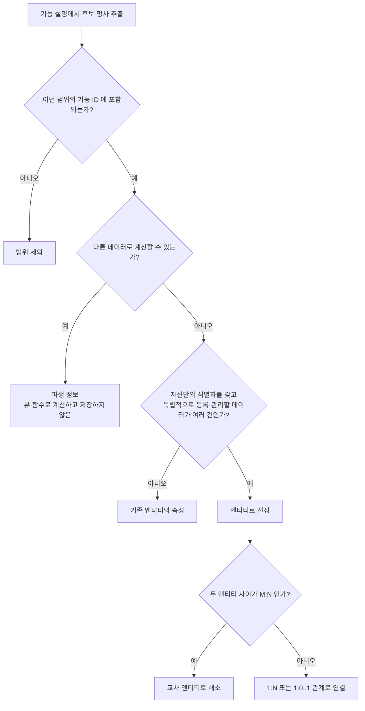
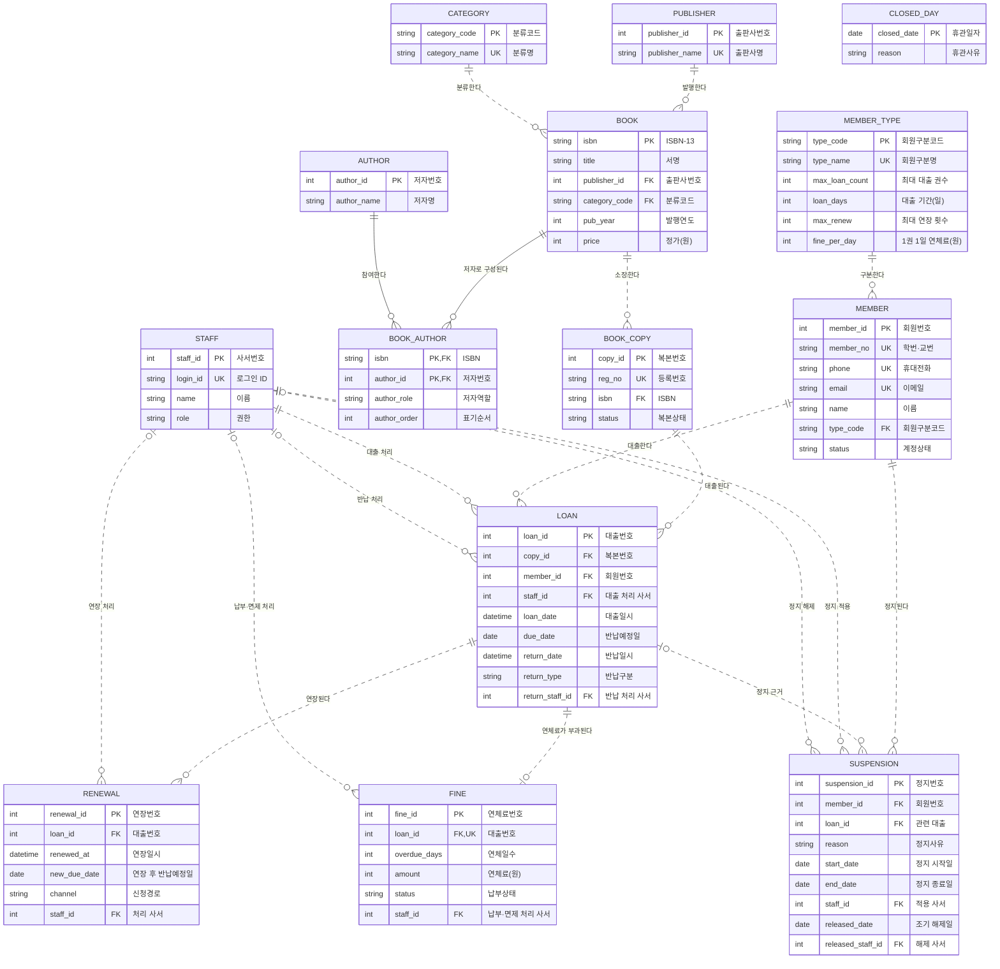
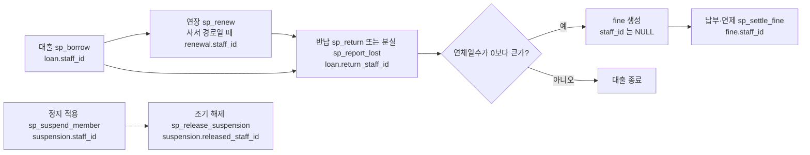

# 06. 개념적 데이터 모델 (ERD)

> 업무 문서와 기능 목록에서 엔티티를 도출하고, 엔티티·관계 정의서와 ERD 로 데이터 구조를 정리한다. 모든 이름·건수는 `sql/01_schema.sql` 과 실제 DB(`library_db`) 조회로 확인했다. 작성 기준일 2026-11-14 · 작성: 윤준서 (Claude 활용)

## 1. 엔티티 도출 과정

### 1.1 도출 근거와 방법

| 구분 | 내용 |
|---|---|
| 업무 문서 | 11.12 회의록과 '추가적인 고려사항' 결정 (00 문서 2·3절), 「숭실대학교 중앙도서관 규정」 대출·연체·변상 조항, Notion 「기능 정리표」 |
| 기능 목록 | 00 문서 4절 기능 ID 24개 (MEM-01~04, BOOK-01~05, LOAN-01~04, RET-01~03, OVD-01~04, SYS-01~04) |
| 방법 | ① 기능 설명에서 관리 대상이 되는 명사(후보)를 뽑는다 → ② 아래 기준으로 엔티티 · 속성 · 파생 정보 · 범위 제외로 나눈다 → ③ 엔티티 사이의 관계를 정하고 M:N 은 교차 엔티티로 해소한다 |

판단 기준은 다음과 같다.



### 1.2 후보 엔티티 선정 · 제외

| No | 후보 (업무 용어) | 관련 기능 ID | 판단 | 반영 위치 | 이유 |
|---|---|---|---|---|---|
| 1 | 회원 | MEM-01~04, LOAN-02, SYS-02 | 엔티티 | `member` | 대출·대출정지의 주체. 주식별자는 회원번호 `member_id`, 학번·교번 `member_no` 는 대체 식별자(UK)이자 로그인 ID |
| 2 | 회원 신분 · 대출 정책 | MEM-01, LOAN-01, LOAN-04, OVD-04 | 엔티티 | `member_type` | 학부생·대학원생·교원 등 신분별로 권수·기간·연장 횟수가 다름 (00 문서 3절 No 9) |
| 3 | 사서 | SYS-01, LOAN-02, RET-01 | 엔티티 | `staff` | 관리 프로그램 로그인 계정이자 대출·반납·연체료·정지의 처리자 |
| 4 | 관리자 | SYS-01, SYS-03, OVD-04 | 속성 | `staff.role` | 관리자와 사서는 권한만 다르고 속성이 같음 → `role` 값 '관리자'·'사서' |
| 5 | 도서 | BOOK-01, BOOK-02, BOOK-05 | 엔티티 | `book` | ISBN 단위 서지정보 (책의 종류) |
| 6 | 복본 (실물 책) | BOOK-03, BOOK-04, LOAN-02 | 엔티티 | `book_copy` | 대출·분실·폐기는 실물 1권 단위로 일어남 |
| 7 | 저자 | BOOK-01, BOOK-05 | 엔티티 | `author` | 공저·번역 때문에 도서와 M:N |
| 8 | 저자 역할 (지은이·옮긴이) | BOOK-01 | 교차 엔티티 | `book_author` | 도서-저자 M:N 해소. 역할·표기순서는 '도서와 저자의 조합'에 속하는 속성 |
| 9 | 출판사 | BOOK-01 | 엔티티 | `publisher` | 여러 도서가 같은 출판사를 공유 → 이름 중복 저장 방지. 도서 등록 시 없으면 자동 등록 |
| 10 | 분류 (KDC) | BOOK-01, BOOK-05, SYS-04 | 엔티티 | `category` | KDC 주류 10개 코드표. 검색·통계의 기준 |
| 11 | 대출 | LOAN-01~04 | 엔티티 | `loan` | 업무의 중심 사건. 회원 · 복본 · 사서를 잇는다 |
| 12 | 반납 | RET-01 | 속성 | `loan.return_date` · `loan.return_type` · `loan.return_staff_id` | 대출 1건은 반납(또는 분실 처리)으로 최대 한 번 끝남(1:0..1, 현재 미반납 24건) → 별도 엔티티로 나눠도 1:0..1 관계만 생기고, 230건 중 206건이 이미 반납·분실이라 NULL 도 적음 |
| 13 | 연장 | LOAN-04 | 엔티티 | `renewal` | 대출 1건에 여러 번 일어나고, 언제·어느 경로로 했는지 남겨야 함 (00 문서 3절 No 11) |
| 14 | 연장 횟수 | LOAN-04 | 파생 | `v_loan_detail.renew_count` | `renewal` 행 수(COUNT)로 계산. 중복 저장하지 않음 |
| 15 | 연체 | RET-02, OVD-01 | 파생 | `v_loan_detail.loan_state` | 미반납이면서 반납예정일이 오늘보다 앞이면 '연체'. 저장하면 매일 갱신해야 함 |
| 16 | 연체일수 | RET-02 | 파생 | `fn_overdue_days` | 휴관일을 빼고 계산. 연체료를 부과하는 시점의 값만 `fine.overdue_days` 에 확정 저장 |
| 17 | 연체료 | OVD-04 | 엔티티 | `fine` | 금액을 부과 시점에 확정하고 납부·면제 이력을 관리 (00 문서 3절 No 10) |
| 18 | 연체료 납부 · 면제 | OVD-04 | 속성 | `fine.status` · `fine.paid_date` · `fine.staff_id` | 연체료 1건은 `sp_settle_fine` 으로 한 번에 납부 또는 면제됨 (분할 납부 없음) |
| 19 | 대출정지 (회원 '정지') | OVD-02, OVD-03 | 엔티티 | `suspension` | 정지를 회원 상태 컬럼에 두지 않고 사유·기간·적용 사서를 가진 별도 엔티티로 분리 (00 문서 3절 No 2·12) |
| 20 | 대출정지 해제 | OVD-03 | 속성 | `suspension.released_date` · `suspension.released_staff_id` | 정지 1건당 조기 해제는 최대 한 번 |
| 21 | 회원의 대출 가능 여부 | LOAN-01, MEM-04 | 파생 | `v_member_status` (`loan_state` · `unpaid_fine` · `active_loans`/`max_loan_count`) | 대출상태 `loan_state`('대출가능'·'대출정지'·'탈퇴')는 정지·연체·미납 연체료 데이터로, 대출 권수는 `active_loans` 로 따로 계산하고, LOAN-01 화면이 이 값들을 함께 판단한다. 최종 검사는 `sp_borrow` 가 한다 |
| 22 | 연체자 | OVD-01 | 파생 | `v_loan_detail` (`loan_state = '연체'`) | 연체 중인 대출을 조회한 결과 |
| 23 | 휴관일 | SYS-03, RET-02 | 엔티티 | `closed_day` | 법정공휴일·대체공휴일·개교기념일은 규칙으로 계산할 수 없어 날짜 데이터로 관리. 다른 엔티티와 FK 관계는 없지만 SYS-03 으로 독립 등록·관리하는 날짜 목록이라 엔티티로 선정 |
| 24 | 분실 | RET-03 | 속성 | `loan.return_type` = '분실' · `book_copy.status` = '분실' | 대출 종료 방식의 하나 + 복본 상태값 |
| 25 | 폐기 | BOOK-04 | 속성 | `book_copy.status` = '폐기' · `book_copy.removed_date` | 복본의 상태 변화 |
| 26 | 변상금 | RET-03 | 파생 | `fn_compensation` | 기준액은 정가 × 발행 경과연수 배율로 계산. 변상 이행 기록(동일 도서 수령 등)은 범위 제외 (00 문서 3절 No 7) |
| 27 | 회원 탈퇴 | MEM-03 | 속성 | `member.status` = '탈퇴' · `member.withdraw_date` | 회원의 계정 상태 |
| 28 | 로그인 계정 | SYS-01, SYS-02 | 속성 | `member.member_no` · `member.password_hash`, `staff.login_id` · `staff.password_hash` | 사람 1명 = 계정 1개이므로 계정을 따로 두지 않음 |
| 29 | 통계 · 대시보드 | SYS-04 | 파생 | `app/stats.py`, `app/main.py` 조회 SQL | 대출·연체료 데이터의 집계 결과 |
| 30 | 예약 | — | 범위 제외 | — | 기능 정리표에 없음. 회의에서 추가 결정 시 확장 (00 문서 2절) |

결과: 후보 30개 → **엔티티 14개** (교차 엔티티 1개 포함) · 속성 8개 · 파생 정보 7개 · 범위 제외 1개.

### 1.3 '회원 정지'를 대출정지 엔티티로 분리한 근거

- 회원의 계정상태 `member.status` 는 '정상'·'탈퇴' 만 허용한다 (`ck_member_status`). 테스트 `test_60_db_constraints` 는 `UPDATE member SET status = '정지'` 가 이 CHECK 에 걸리는지 확인한다.
- 회원의 대출상태를 '대출정지'로 만드는 이유는 두 가지이고 성격이 다르다. (탈퇴·미납 연체료·대출 한도 초과는 `sp_borrow` 가 따로 검사한다.)
  - 연체 도서 보유 (규정 제24조): 반납하면 즉시 풀린다 → `loan` 에서 계산 (저장 안 함)
  - 사서가 기간을 정한 이용 제재 (규정 제27조): 사유·시작일·종료일·적용 사서·해제 이력이 필요하다 → `suspension` 엔티티
- 두 경우를 합친 '대출정지' 표시는 뷰 `v_member_status` 가 계산한다. 회원 컬럼에 '정지'를 저장하면 정지·연체 데이터와 어긋날 수 있다.

## 2. 엔티티 정의서

### 2.1 엔티티 유형 기준

| 유형 | 기준 | 해당 엔티티 |
|---|---|---|
| 기본 | 업무에 원래 존재하고 다른 엔티티의 관계로 생기지 않는다. 자신의 주식별자를 갖고 주로 부모 역할을 한다 | 회원구분, 회원, 사서, 분류, 출판사, 저자, 도서, 도서복본, 휴관일 |
| 중심 | 기본 엔티티들 사이에서 발생하는 업무의 중심 사건. 데이터가 계속 늘고 행위 엔티티의 부모가 된다 | 대출 |
| 행위 | 업무를 처리할 때마다 생기는 이력·사건 기록 | 연장이력, 연체료, 대출정지 |
| 교차 | M:N 관계를 해소하기 위해 두 엔티티의 식별자를 상속받는다 | 도서저자 |

도서복본은 도서에 속하지만 입수할 때 자체 식별자(복본번호·등록번호)를 받아 독립적으로 생기므로 기본 엔티티로 분류했다.

### 2.2 엔티티 정의서 (14개)

'예상 건수'는 2026-11-14 에 `library_db` 를 `SELECT COUNT(*)` 로 조회한 샘플 데이터 건수이다.

| No | 엔티티명 | 테이블명 | 유형 | 설명 | 주식별자 | 주요 속성 | 예상 건수 |
|---|---|---|---|---|---|---|---|
| 1 | 회원구분 | `member_type` | 기본 | 신분별 대출 정책 (숭실대 중앙도서관 규정). 정책이 바뀌면 이 엔티티 값만 바꾼다 | 회원구분코드 `type_code` | 회원구분명 `type_name` (UK) · 최대 대출 권수 `max_loan_count` · 대출 기간(일) `loan_days` · 최대 연장 횟수 `max_renew` · 1권 1일 연체료(원) `fine_per_day` | 5건 (UG · UGL · GR · FAC · STF). 신분이 추가될 때만 늘어남 |
| 2 | 회원 | `member` | 기본 | 도서를 대출하는 학생·교직원. 학번·교번으로 회원 포털에 로그인. 계정상태는 정상/탈퇴만 저장 | 회원번호 `member_id` | 학번·교번 `member_no` (UK) · 이름 `name` · 회원구분코드 `type_code` (FK) · 소속 `department` · 휴대전화 `phone` (UK) · 이메일 `email` (UK) · 계정상태 `status` · 가입일 `join_date` · 탈퇴일 `withdraw_date` | 27건 (학부생 20 · 휴학생 1 · 대학원생 2 · 전임교원 2 · 직원·비전임교원 2; 정상 26 · 탈퇴 1) |
| 3 | 사서 | `staff` | 기본 | 관리 프로그램 사용자. 대출·반납·연장·연체료·대출정지를 처리 | 사서번호 `staff_id` | 로그인 ID `login_id` (UK) · 이름 `name` · 권한 `role` ('관리자'·'사서') · 입사일 `hire_date` | 2건 (관리자 1 · 사서 1) |
| 4 | 분류 | `category` | 기본 | 한국십진분류법(KDC) 주류 코드표 | 분류코드 `category_code` | 분류명 `category_name` (UK) | 10건 ('000' 총류 ~ '900' 역사). 고정 |
| 5 | 출판사 | `publisher` | 기본 | 도서를 발행한 출판사. 도서 등록 시 없으면 자동 등록 | 출판사번호 `publisher_id` | 출판사명 `publisher_name` (UK) | 56건 |
| 6 | 저자 | `author` | 기본 | 지은이·옮긴이 등. 동명이인이 있을 수 있어 이름은 UNIQUE 가 아님 | 저자번호 `author_id` | 저자명 `author_name` | 155건 |
| 7 | 도서 | `book` | 기본 | ISBN 단위 서지정보 (책의 종류) | ISBN `isbn` | 서명 `title` · 출판사번호 `publisher_id` (FK) · 분류코드 `category_code` (FK) · KDC 분류기호 `kdc_no` · 발행연도 `pub_year` · 정가(원) `price` | 100건 (실제 도서 100종) |
| 8 | 도서저자 | `book_author` | 교차 | 도서-저자 M:N 해소. 도서별 저자의 역할과 표기 순서 | ISBN + 저자번호 (`isbn`, `author_id`) 복합키 | 저자역할 `author_role` ('지은이'·'옮긴이'·'엮은이'·'그림') · 표기순서 `author_order` | 171건 (지은이 106 · 옮긴이 62 · 엮은이 2 · 그림 1) |
| 9 | 도서복본 | `book_copy` | 기본 | 서가에 있는 실물 책 1권. 대출·분실·폐기의 단위 | 복본번호 `copy_id` | 등록번호 `reg_no` (UK, 'EM'+숫자 6자리) · ISBN `isbn` (FK) · 청구기호 `call_no` · 배가위치 `location` · 복본상태 `status` · 입수일 `acquired_date` · 분실·폐기 처리일 `removed_date` | 157건 (대출가능 131 · 대출중 24 · 분실 1 · 폐기 1) |
| 10 | 대출 | `loan` | 중심 | 회원이 복본 1권을 빌린 1건. 반납·분실 처리 시 반납 정보를 기록 | 대출번호 `loan_id` | 복본번호 `copy_id` (FK) · 회원번호 `member_id` (FK) · 대출 처리 사서 `staff_id` (FK) · 대출일시 `loan_date` · 반납예정일 `due_date` · 반납일시 `return_date` · 반납구분 `return_type` · 반납 처리 사서 `return_staff_id` (FK) | 230건 (미반납 24 · 반납 205 · 분실 1). 대출할 때마다 늘어남 |
| 11 | 연장이력 | `renewal` | 행위 | 연장 1회의 기록. 연장 횟수 = 이 엔티티의 행 수 | 연장번호 `renewal_id` | 대출번호 `loan_id` (FK) · 연장일시 `renewed_at` · 연장 전 반납예정일 `prev_due_date` · 연장 후 반납예정일 `new_due_date` · 신청경로 `channel` ('홈페이지'·'사서') · 처리 사서 `staff_id` (FK) | 24건 (홈페이지 23 · 사서 1; 대출 23건에 해당) |
| 12 | 연체료 | `fine` | 행위 | 연체 반납 또는 연체 중 분실 처리 때 부과. 대출 1건당 최대 1건 | 연체료번호 `fine_id` | 대출번호 `loan_id` (FK, UK) · 연체일수 `overdue_days` · 연체료(원) `amount` · 납부상태 `status` ('미납'·'납부'·'면제') · 부과일 `imposed_date` · 처리일 `paid_date` · 납부·면제 처리 사서 `staff_id` (FK) | 29건 (납부 21 · 면제 7 · 미납 1) |
| 13 | 대출정지 | `suspension` | 행위 | 사서가 기간을 정해 적용하는 이용 제재와 해제 이력 | 정지번호 `suspension_id` | 회원번호 `member_id` (FK) · 관련 대출 `loan_id` (FK, 선택) · 정지사유 `reason` · 정지 시작일 `start_date` · 정지 종료일 `end_date` · 비고 `memo` · 적용 사서 `staff_id` (FK) · 조기 해제일 `released_date` · 해제 사서 `released_staff_id` (FK) | 3건 (자료훼손 · 규정위반 · 장기연체 각 1, 그중 조기 해제 1) |
| 14 | 휴관일 | `closed_day` | 기본 | 일요일·법정공휴일·대체공휴일·개교기념일. 반납예정일 조정과 연체일수 계산에 사용 | 휴관일자 `closed_date` | 휴관사유 `reason` | 139건 (2026-01-01 ~ 2027-12-27; 사유 '일요일' 97 · 공휴일·개교기념일 등 42) |

## 3. 관계 정의서

`sql/01_schema.sql` 의 FOREIGN KEY 18개를 모두 관계로 정의했다 (DB 의 `information_schema.KEY_COLUMN_USAGE` 조회 결과도 18개).

표기 기준

- 카디널리티는 '부모 : 자식' 순서. FK 가 NOT NULL 이면 부모 쪽이 1, NULL 을 허용하면 0..1. 자식 쪽은 FK 에 UNIQUE 가 있으면 0..1, 없으면 0..N.
- 참여도의 '자식 필수'는 FK 가 NOT NULL 이라 자식 행이 반드시 부모를 가져야 한다는 뜻이고, '자식 선택'은 FK 가 NULL 일 수 있다는 뜻이다. 부모 쪽은 18개 관계 모두 '선택'이다 (자식이 0건인 부모 행을 DB 가 막지 않는다).
- 식별 관계는 부모의 PK 가 자식 PK 의 일부가 되는 경우이다.
- 참조 동작을 따로 적지 않은 관계는 MySQL 기본값(ON UPDATE · ON DELETE NO ACTION)으로, 자식이 있으면 부모 행의 삭제·키 변경을 거부한다.

| No | 관계명 | 부모 엔티티 | 자식 엔티티 | FK 컬럼 (제약조건명) | 카디널리티 | 참여도 | 식별/비식별 | 설명 |
|---|---|---|---|---|---|---|---|---|
| 1 | 회원 구분 | 회원구분 | 회원 | `member.type_code` (`fk_member_type`) | 1 : 0..N | 부모 선택 · 자식 필수 | 비식별 | 회원은 반드시 한 회원구분에 속하고 그 정책을 따른다. ON UPDATE CASCADE |
| 2 | 도서 발행 | 출판사 | 도서 | `book.publisher_id` (`fk_book_publisher`) | 1 : 0..N | 부모 선택 · 자식 필수 | 비식별 | 도서는 한 출판사에서 발행된다. ON UPDATE CASCADE |
| 3 | 도서 분류 | 분류 | 도서 | `book.category_code` (`fk_book_category`) | 1 : 0..N | 부모 선택 · 자식 필수 | 비식별 | 도서는 KDC 주류 하나에 속한다. ON UPDATE CASCADE |
| 4 | 도서의 저자 구성 | 도서 | 도서저자 | `book_author.isbn` (`fk_book_author_book`) | 1 : 0..N | 부모 선택 · 자식 필수 | 식별 | `isbn` 이 PK(`isbn`, `author_id`)의 일부. ON DELETE CASCADE · ON UPDATE CASCADE. 지은이 입력란에 1명 이상(역할 '지은이'·'엮은이'·'그림')을 입력해야 한다는 검사는 DB 가 아니라 도서 등록·수정 화면이 한다 (`app/books.py` 의 `validate_book`) |
| 5 | 저자의 도서 참여 | 저자 | 도서저자 | `book_author.author_id` (`fk_book_author_auth`) | 1 : 0..N | 부모 선택 · 자식 필수 | 식별 | `author_id` 가 PK 의 일부. 현재 데이터에서 도서당 저자 1~4명, 저자당 도서 1~4종 |
| 6 | 복본 소장 | 도서 | 도서복본 | `book_copy.isbn` (`fk_book_copy_book`) | 1 : 0..N | 부모 선택 · 자식 필수 | 비식별 | 복본은 자체 PK `copy_id` 를 가진다. ON DELETE CASCADE · ON UPDATE CASCADE. 도서 등록 시 복본 0권도 허용. 현재 도서당 복본 1~3권 |
| 7 | 복본 대출 | 도서복본 | 대출 | `loan.copy_id` (`fk_loan_copy`) | 1 : 0..N | 부모 선택 · 자식 필수 | 비식별 | 대출 1건 = 복본 1권. 같은 복본의 미반납 대출은 1건뿐 (`uq_loan_active_copy`). 대출 이력이 있으면 이 FK 때문에 복본·도서를 삭제할 수 없음 |
| 8 | 회원 대출 | 회원 | 대출 | `loan.member_id` (`fk_loan_member`) | 1 : 0..N | 부모 선택 · 자식 필수 | 비식별 | 동시 대출 권수 상한 `max_loan_count` 는 `sp_borrow` 가 검사 |
| 9 | 대출 처리 | 사서 | 대출 | `loan.staff_id` (`fk_loan_staff`) | 1 : 0..N | 부모 선택 · 자식 필수 | 비식별 | 대출을 처리한 사서 (`sp_borrow` 의 `p_staff_id`) |
| 10 | 반납 처리 | 사서 | 대출 | `loan.return_staff_id` (`fk_loan_return_staff`) | 0..1 : 0..N | 부모 선택 · 자식 선택 | 비식별 | 반납 전에는 NULL. `ck_loan_returned` 로 `return_date` · `return_type` 과 함께 채워짐 (`sp_return`, `sp_report_lost`) |
| 11 | 대출 연장 | 대출 | 연장이력 | `renewal.loan_id` (`fk_renewal_loan`) | 1 : 0..N | 부모 선택 · 자식 필수 | 비식별 | 연장 횟수 상한 `max_renew` (전임교원 1회, 그 외 2회)는 `sp_renew` 가 검사. 현재 대출당 최대 2건 |
| 12 | 연장 처리 | 사서 | 연장이력 | `renewal.staff_id` (`fk_renewal_staff`) | 0..1 : 0..N | 부모 선택 · 자식 선택 | 비식별 | 신청경로가 '사서' 일 때만 값이 있고 '홈페이지' 신청은 NULL (`ck_renewal_staff`) |
| 13 | 연체료 부과 | 대출 | 연체료 | `fine.loan_id` (`fk_fine_loan`, UNIQUE `uq_fine_loan`) | 1 : 0..1 | 부모 선택 · 자식 필수 | 비식별 | UNIQUE 로 대출 1건당 연체료 최대 1건. 연체 반납(`sp_return`)·연체 중 분실(`sp_report_lost`) 때 생성 |
| 14 | 연체료 처리 | 사서 | 연체료 | `fine.staff_id` (`fk_fine_staff`) | 0..1 : 0..N | 부모 선택 · 자식 선택 | 비식별 | 미납 상태에서는 NULL (DB 제약이 아니라 `sp_return` · `sp_report_lost` 가 비워 두고 `sp_settle_fine` 이 납부·면제 처리 사서를 기록). 면제는 관리자만 (화면 권한 검사) |
| 15 | 회원 대출정지 | 회원 | 대출정지 | `suspension.member_id` (`fk_suspension_member`) | 1 : 0..N | 부모 선택 · 자식 필수 | 비식별 | 한 회원이 여러 번 정지될 수 있다 (이력) |
| 16 | 정지 관련 대출 | 대출 | 대출정지 | `suspension.loan_id` (`fk_suspension_loan`) | 0..1 : 0..N | 부모 선택 · 자식 선택 | 비식별 | 정지를 특정 대출(장기연체 등)과 연결할 때 쓰는 선택 관계. `sp_suspend_member` 에는 이 값을 받는 매개변수가 없어 현재 3건 모두 NULL |
| 17 | 정지 적용 | 사서 | 대출정지 | `suspension.staff_id` (`fk_suspension_staff`) | 1 : 0..N | 부모 선택 · 자식 필수 | 비식별 | 정지를 적용한 사서 (`sp_suspend_member`) |
| 18 | 정지 해제 | 사서 | 대출정지 | `suspension.released_staff_id` (`fk_suspension_released`) | 0..1 : 0..N | 부모 선택 · 자식 선택 | 비식별 | 조기 해제한 경우에만 `released_date` 와 함께 기록 (`ck_suspension_release`, `sp_release_suspension`) |

요약: 관계 18개 = 식별 2개 (No 4·5) + 비식별 16개. 자식 필수 13개 · 자식 선택 5개. 사서가 부모인 관계가 6개(No 9·10·12·14·17·18)이다. 휴관일(`closed_day`)은 FK 관계가 없는 독립 엔티티로, 함수·프로시저가 날짜 값으로 참조한다 (5.5 참고).

## 4. ERD

표기: Mermaid erDiagram 의 crow's foot 표기. `||` 정확히 1, `|o` 0 또는 1, `o{` 0 이상, `o|` 0 또는 1. 실선(`--`)은 식별 관계, 점선(`..`)은 비식별 관계이다. 엔티티 안에는 PK · FK · UK 와 핵심 속성만 넣었다 (생성 컬럼 `loan.active_copy_id` 와 그 UNIQUE `uq_loan_active_copy` 는 물리 모델 구현이라 생략, 5.7 참고. 전체 컬럼은 11 테이블 기술서).



ERD 를 읽는 방법

- 자료 영역: `CATEGORY` · `PUBLISHER` → `BOOK` → `BOOK_COPY`, 그리고 `BOOK` - `BOOK_AUTHOR` - `AUTHOR` (M:N 해소).
- 사람 영역: `MEMBER_TYPE` → `MEMBER`, 그리고 처리자인 `STAFF`.
- 대출 영역: `MEMBER` 와 `BOOK_COPY` 가 만나는 `LOAN` 이 중심이고, 그 아래에 `RENEWAL` (0..N), `FINE` (0..1), `SUSPENSION` (선택 연결)이 붙는다.
- `STAFF` 는 `LOAN` 과 2개, `SUSPENSION` 과 2개, `RENEWAL` · `FINE` 과 각 1개의 관계를 갖는다.
- `CLOSED_DAY` 는 관계선이 없다.

## 5. 주요 설계 판단

### 5.1 도서와 도서복본의 분리

- 같은 ISBN 의 책을 여러 권 소장한다. 현재 도서 100종 · 복본 157권이며, 복본 수는 1권 57종 · 2권 29종 · 3권 14종이다.
- 서지정보(서명·출판사·발행연도·정가)는 종류 단위로 한 번만 저장하고, 대출·상태·배가위치·청구기호처럼 실물마다 다른 값은 `book_copy` 에 둔다. 한 테이블에 두면 서지정보가 복본 수만큼 중복된다.
- 복본은 등록번호 `reg_no` ('EM' + 숫자 6자리, `ck_book_copy_reg_no`)로 구별하고, 대출 처리(`sp_borrow`)와 반납 처리(`sp_return`)는 이 등록번호를 입력받는다.
- 상태는 복본 단위로 관리한다 (`ck_book_copy_status`: '대출가능'·'대출중'·'분실'·'폐기'). 대출 중인 복본을 다른 상태로 바꾸려 하면 트리거 `trg_book_copy_status_guard` 가 다음 메시지로 막는다: '대출 중인 복본은 반납(또는 분실 처리) 후 상태를 변경할 수 있습니다.'
- 도서별 소장 복본 수·대출가능 복본 수는 저장하지 않고 뷰 `v_book_summary` 의 `total_copies` · `available_copies` 로 계산한다.
- 도서를 삭제하면 `fk_book_copy_book` 의 ON DELETE CASCADE 로 복본이 함께 지워지지만, 대출 이력이 있는 복본은 `fk_loan_copy` 가 삭제를 막는다. 그래서 대출 이력이 있는 도서는 삭제되지 않고 복본 폐기로 처리한다 (`test_32_book_with_history_cannot_be_deleted`).

### 5.2 도서-저자 M:N 관계의 해소

- 한 도서에 지은이·옮긴이가 여러 명이고, 한 저자가 여러 도서를 쓴다. 현재 도서당 저자 1~4명, 저자당 도서 1~4종이다.
- 교차 엔티티 `book_author` 의 PK 는 (`isbn`, `author_id`) 이며 두 FK 가 모두 PK 에 포함된 **식별 관계**이다.
- 역할 `author_role` 과 표기순서 `author_order` 는 '어떤 도서에서의 어떤 저자'에 속하므로 교차 엔티티의 속성이다. 같은 사람이 어떤 책에서는 지은이, 다른 책에서는 옮긴이가 될 수 있다.
- 저자명은 동명이인 때문에 UNIQUE 가 아니다. 목록 화면의 저자 표기는 `v_book_summary.authors` 가 `author_order` 순으로 만든다. 예: 「넛지」 → '리처드 탈러, 캐스 선스타인, 안진환 (옮긴이)'.

### 5.3 회원구분의 분리

신분별 대출 정책을 회원마다 저장하지 않고 `member_type` 한 곳에서 관리한다. 현재 값 (DB 조회):

| `type_code` | `type_name` | `max_loan_count` | `loan_days` | `max_renew` | `fine_per_day` |
|---|---|---|---|---|---|
| UG | 학부생 | 10 | 14 | 2 | 100 |
| UGL | 휴학생 | 5 | 14 | 2 | 100 |
| GR | 대학원생 | 15 | 30 | 2 | 100 |
| FAC | 전임교원 | 50 | 180 | 1 | 100 |
| STF | 직원·비전임교원 | 15 | 30 | 2 | 100 |

- `sp_borrow` · `sp_renew` · `sp_return` · `sp_report_lost` 는 회원의 `type_code` 로 `member_type` 을 조인해 권수·기간·연장 횟수·연체료를 읽는다. 정책이 바뀌면 행 하나만 수정하면 된다. 예를 들어 회의록의 대출 기간 15일을 적용하려면 `member_type.loan_days` 값만 바꾸면 된다 (00 문서 2절, 팀 확인 필요 항목).
- 연장은 '연장한 날부터 대출기간만큼' 이므로 연장 일수를 따로 두지 않고 `loan_days` 를 그대로 쓴다.
- `fk_member_type` 은 ON UPDATE CASCADE 라 회원구분코드를 바꾸면 회원에게 전파되고, 회원이 있는 회원구분은 삭제할 수 없다.

### 5.4 연체료 · 연장이력 · 대출정지의 분리

세 가지 모두 대출 또는 회원에 컬럼으로 붙일 수 있었지만 별도 행위 엔티티로 나눴다.

| 엔티티 | 대출·회원에 컬럼으로 둘 때의 문제 | 분리한 구조 |
|---|---|---|
| 연체료 `fine` | 연체가 아닌 대출이 대부분이라 NULL 이 많다. 현재 대출 230건 중 연체료가 있는 대출은 29건이고 201건(약 87%)은 없다. 납부·면제 처리일과 처리 사서도 함께 비어 있게 된다 | 대출 1건당 0..1건 (`uq_fine_loan`). 금액 `amount` 는 부과 시점의 `fine_per_day` 로 확정 저장하므로 나중에 정책이 바뀌어도 과거 금액이 변하지 않는다 |
| 연장이력 `renewal` | 연장 횟수만 저장하면 언제·어느 경로로·누가 연장했는지 알 수 없고, 횟수 컬럼은 이력과 중복된다 | 연장 1회 = 1행. 연장 전·후 반납예정일과 신청경로를 남기고, 횟수는 `v_loan_detail.renew_count` 가 COUNT 로 계산 |
| 대출정지 `suspension` | 회원에 '정지' 상태를 저장하면 정지 기간이 끝나도 누군가 값을 되돌려야 하고, 연체로 인한 대출 불가와 섞인다 | 정지 1건 = 1행 (사유·시작일·종료일·적용 사서·해제 이력). 유효한 정지는 `released_date IS NULL AND CURDATE() BETWEEN start_date AND end_date` 로 판단 |

회원의 대출상태는 다음과 같이 뷰에서 계산한다 (`v_member_status`).

```sql
       CASE WHEN x.status = '탈퇴' THEN '탈퇴'
            WHEN x.suspend_until IS NOT NULL OR x.overdue_loans > 0 OR x.unpaid_fine > 0 THEN '대출정지'
            ELSE '대출가능' END AS loan_state
```

'대출정지' 의 세 조건(유효한 정지 · 연체 도서 · 미납 연체료)은 프로시저가 대출·연장을 거부하는 조건과 같다. 예를 들어 미납 회원은 대출상태가 '대출정지' 로 보이고, 실제로 `sp_borrow` 는 '미납 연체료가 있어 대출할 수 없습니다.' 로, `sp_renew` 는 '미납 연체료가 있어 연장할 수 없습니다.' 로 거부한다. 금액은 `unpaid_fine` 으로 따로 보여 준다.

### 5.5 휴관일 엔티티

- 반납예정일이 휴관일이면 다음 개관일로 미루고 (00 문서 3절 No 5), 연체일수에서 휴관일을 뺀다 (규정). 함수는 요일을 계산하지 않고 `closed_day` 만 조회하므로 일요일도 날짜 데이터로 저장한다 (2026~2027 일요일 104일: 사유 '일요일' 97 + 공휴일과 겹친 7). 법정공휴일·대체공휴일·선거일·개교기념일(10/10)은 계산 규칙이 없으므로 역시 날짜로 저장한다. 공휴일이 아닌 토요일은 개관일이므로 저장하지 않는다 (공휴일과 겹친 토요일은 저장됨. 예: 2026-06-06 현충일).
- 사용처: `fn_next_open_day` (휴관일이면 하루씩 넘김), `fn_overdue_days` (기간 안의 휴관일 수를 뺌), `sp_add_closed_day` (휴관일을 등록하면 그날이 반납예정일인 미반납 대출을 다음 개관일로 다시 계산).
- 다른 엔티티와 FK 로 연결하지 않았다. 반납예정일 `due_date` 는 `fn_next_open_day` 로 개관일이 되도록 계산되고(`sp_borrow` · `sp_renew`), 휴관일을 새로 등록하면 `sp_add_closed_day` 가 그날이 반납예정일인 미반납 대출을 다시 계산하므로(현재 230건 중 휴관일인 것 0건) `closed_day` 를 참조하는 FK 가 될 수 없고, 관계는 '날짜 값 비교'라는 규칙으로 함수 안에서 처리된다.
- 검증: `test_21_overdue_days_exclude_closed_days`, `test_23_new_closed_day_moves_due_dates` (`docs/_test_output.txt` 의 25개 테스트 실행에서 두 테스트 모두 통과).

### 5.6 사서와의 다중 관계 (역할별 FK)

사서는 한 대출에서도 처리 단계마다 다른 사람이 될 수 있으므로 역할마다 FK 를 따로 두었다. 컬럼명에 역할을 붙여 같은 `staff` 를 가리키는 FK 를 구별한다.

| 역할 | FK 컬럼 | NULL | 값이 채워지는 시점 | 관련 제약 |
|---|---|---|---|---|
| 대출 처리 | `loan.staff_id` | 불가 | 대출 (`sp_borrow`) | — |
| 반납 처리 | `loan.return_staff_id` | 허용 | 반납 (`sp_return`) 또는 분실 처리 (`sp_report_lost`) | `ck_loan_returned` |
| 연장 처리 | `renewal.staff_id` | 허용 | 대출 데스크 연장 (`sp_renew`, 신청경로 '사서') | `ck_renewal_staff` |
| 연체료 납부·면제 처리 | `fine.staff_id` | 허용 | 납부·면제 (`sp_settle_fine`) | — |
| 정지 적용 | `suspension.staff_id` | 불가 | 정지 적용 (`sp_suspend_member`) | — |
| 정지 해제 | `suspension.released_staff_id` | 허용 | 조기 해제 (`sp_release_suspension`) | `ck_suspension_release` |



- 처리자를 하나의 '처리이력' 엔티티로 모으는 방법도 있지만, 단계마다 시점과 함께 기록되는 값(반납일시, 신청경로, 처리일, 해제일)이 달라 각 엔티티에 두는 편이 단순하다. 뷰 `v_loan_detail` 은 `staff` 를 두 번 조인해 대출 사서(`staff_name`)와 반납 사서(`return_staff_name`)를 함께 보여 준다.
- `loan.return_staff_id`(`ck_loan_returned`), `renewal.staff_id`(`ck_renewal_staff`), `suspension.released_staff_id`(`ck_suspension_release`)는 CHECK 로 짝 컬럼과 함께 채워지도록 강제했다. `fine.staff_id` 에는 CHECK 가 없고, `sp_settle_fine` 이 `status` · `paid_date` 와 함께 채운다. `suspension.loan_id` 는 처리 단계와 무관한 선택 FK 로, 현재 앱·프로시저가 채우지 않는다.

### 5.7 반납을 대출에 통합하고 '복본당 미반납 대출 1건' 보장

- 반납은 대출 1건에 최대 한 번 일어나므로(1:0..1) 별도 엔티티로 나누지 않고 `loan` 의 `return_date` · `return_type` ('반납'·'분실') · `return_staff_id` 로 두었다. 세 컬럼은 `ck_loan_returned` 로 함께 NULL 이거나 함께 값이 있어야 한다.
- 같은 복본을 동시에 두 사람에게 대출하는 일을 DB 가 막도록 생성 컬럼과 UNIQUE 를 썼다 (`sql/01_schema.sql`).

```sql
  active_copy_id   INT UNSIGNED GENERATED ALWAYS AS (IF(return_date IS NULL, copy_id, NULL)) STORED
                   COMMENT '미반납 복본 (생성 컬럼)',
  CONSTRAINT uq_loan_active_copy  UNIQUE (active_copy_id),
```

- 반납 전에는 `active_copy_id` = `copy_id`, 반납 후에는 NULL 이 되고 UNIQUE 는 NULL 을 중복으로 보지 않는다. 그래서 복본 1권에 과거 대출은 여러 건 있어도 미반납 대출은 1건뿐이다 (`test_60_db_constraints` 가 `uq_loan_active_copy` 위반을 확인). 개념 모델의 '복본 1 : 대출 0..N' 은 그대로이고, 이 규칙은 물리 모델에서 구현한다.

## 6. ERDCloud 작성 방법 (DDL Import)

팀 모델링 도구는 ERDCloud 이고, ERD 는 손으로 그리지 않고 실제 DDL(`sql/01_schema.sql`)을 가져와(Import) 만든다 (00 문서 1절, README). 그래야 ERD 와 DB 가 어긋나지 않는다. ERDCloud 는 `CREATE TABLE` 문을 Import 하면 엔티티를 만든다.

### 6.1 절차

1. **Import 할 DDL 준비** — `sql/01_schema.sql` 에서 테이블 정의 14개만 가져온다. 파일 앞부분의 `DROP DATABASE` · `CREATE DATABASE` · `USE` · `DROP USER` · `CREATE USER` · `GRANT` 는 DB·계정 설정이라 ERD 와 관계가 없으므로 넣지 않는다. 프로젝트 루트에서 `sed -n '/^CREATE TABLE/,/^) /p' sql/01_schema.sql` 을 실행하면 `CREATE TABLE` 부터 테이블 COMMENT 로 끝나는 줄까지 14개 블록만 화면에 출력된다 (출력 결과를 복사해 붙여 넣는다).
2. **ERDCloud 에서 새 ERD 생성** — https://www.erdcloud.com 에 로그인해 프로젝트용 ERD 를 새로 만든다.
3. **Import 실행** — ERDCloud 의 Import(가져오기) 기능에 1번에서 복사한 DDL 을 붙여 넣고 실행한다. 테이블 14개가 엔티티로 생긴다. FK 관계선이 모두 그려졌는지는 7번에서 확인한다.
4. **Import 오류가 날 때** — 원본 `sql/01_schema.sql` 은 고치지 않는다. 붙여 넣는 사본에서만 오류가 난 구문(생성 컬럼 `active_copy_id`, CHECK 제약, `DEFAULT (CURRENT_DATE)` 같은 식 기본값 등 도구가 해석하지 못할 수 있는 구문)을 지우고 다시 Import 한다. 생성 컬럼 `active_copy_id` 를 지울 때는 이를 참조하는 `CONSTRAINT uq_loan_active_copy  UNIQUE (active_copy_id),` 줄도 함께 지운다. 이 구문들은 PK·FK 와 무관하므로 엔티티·관계 구조는 바뀌지 않는다. 지운 내용은 11 테이블 기술서와 `_generated_physical_lists.md` 에 남아 있다.
5. **배치 정리** — 4절 'ERD 를 읽는 방법'의 영역별로 모아 배치한다: 왼쪽 자료 영역(`category`·`publisher`·`author`·`book`·`book_author`·`book_copy`), 가운데 대출 영역(`loan` 과 그 아래 `renewal`·`fine`·`suspension`), 오른쪽 사람 영역(`member_type`·`member`·`staff`), 한쪽에 독립 엔티티 `closed_day`.
6. **논리 이름 확인** — ERDCloud 의 논리/물리 보기를 전환해 확인하고, 논리 보기에서 엔티티·속성의 한글명이 비어 있으면 2절 엔티티 정의서와 11 테이블 기술서의 한글명(DDL COMMENT 에서 뒤에 붙은 설명을 뺀 이름. 예: '회원번호 (내부 식별자)' → 회원번호, '대출 기간(일) - 연장 1회 기간과 같음' → 대출 기간(일))을 입력하고, COMMENT 가 설명까지 논리명으로 들어왔으면 2절 이름으로 고친다.
7. **관계선 확인 · 보완** — 6.2 체크리스트로 확인한다. 빠진 관계선은 왼쪽 도구 모음의 관계 도구로 부모 엔티티를 먼저 누르고 자식 엔티티를 누른 뒤 Identifying Relationship(식별) 또는 Non-Identifying Relationship(비식별)을 골라 추가한다.
8. **내보내기** — 하단 Export 에서 보고서용 이미지(Download PNG)를 받는다. Export 의 SQL Preview(MySQL 선택)로 생성 SQL 을 열어 테이블 14개와 FK 18개가 모두 있는지 `sql/01_schema.sql` 과 대조한다.

### 6.2 Import 후 체크리스트

| 확인 항목 | 기대값 (이 문서 기준) |
|---|---|
| 엔티티 수 | 14개 (2절) |
| 관계선 수 | 18개 (3절). `staff`-`loan` 2개, `staff`-`suspension` 2개가 각각 따로 그려졌는지 확인 |
| 식별 관계 | `book`-`book_author`, `author`-`book_author` 2개만 식별 |
| 비식별 관계 | 나머지 16개 |
| 부모 쪽 0..1 (NULL 허용 FK) | `loan.return_staff_id`, `renewal.staff_id`, `fine.staff_id`, `suspension.loan_id`, `suspension.released_staff_id` 5개 |
| 1:0..1 관계 | `loan`-`fine` (`fine.loan_id` UNIQUE) |
| 복합 PK | `book_author` (`isbn`, `author_id`) |
| 관계 없는 엔티티 | `closed_day` |

ERDCloud 화면의 표시가 이 문서와 다르면 DDL 과 DB 조회 결과로 만든 이 문서(2~4절)를 기준으로 ERDCloud 쪽을 고친다.
