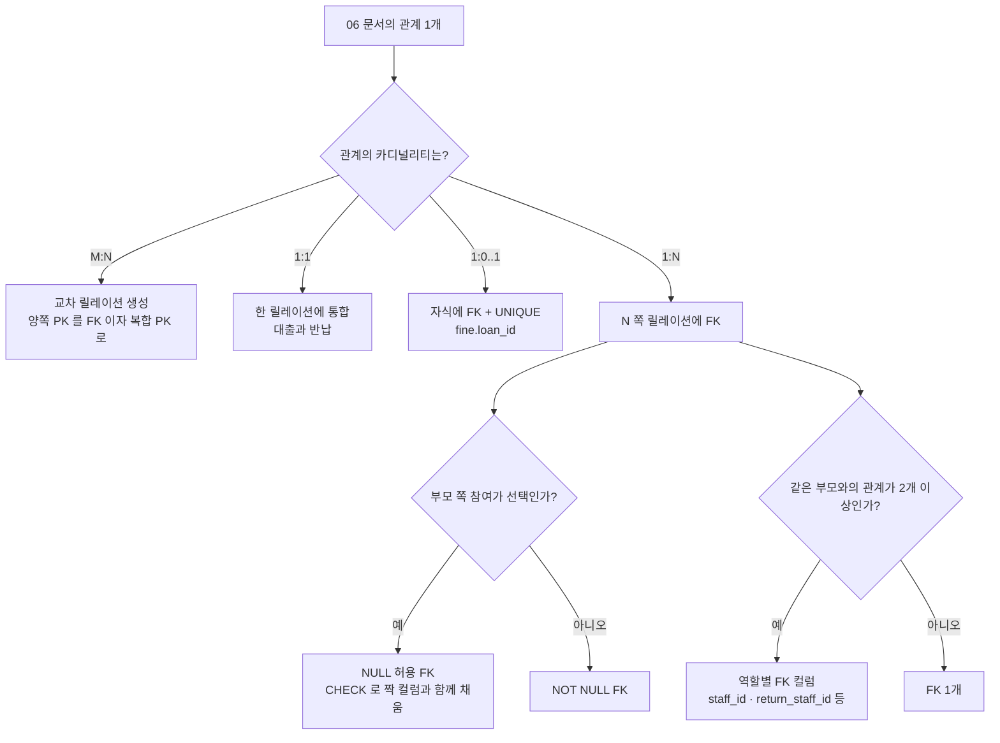
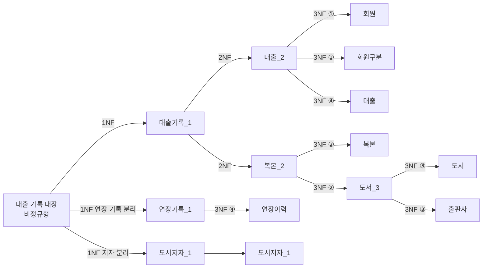
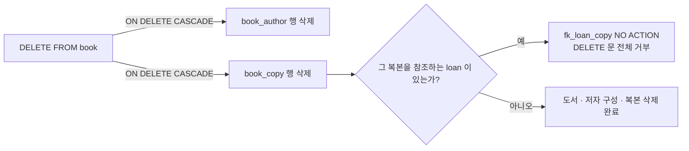

# 07. 논리적 데이터 모델 (릴레이션 스키마 · 정규화)

> 06 개념적 데이터 모델의 엔티티·관계를 릴레이션 스키마로 바꾸고, 함수적 종속성 분석과 정규화(비정규형 → BCNF)로 14개 릴레이션을 검증한다. 이름·건수는 `sql/01_schema.sql`, `sql/02_programs.sql`, `app/*.py` 와 실제 DB(`library_db`) 조회로 확인했다. 작성 기준일 2026-11-14 · 작성: 윤준서 (Claude 활용)

## 1. 개념 모델 → 논리 모델 변환 규칙

06 문서의 엔티티 14개와 관계 18개를 아래 규칙으로 릴레이션 14개와 외래키 18개로 바꿨다. 외래키 수는 DB 의 `information_schema.REFERENTIAL_CONSTRAINTS` 조회 결과(18개)와 같다.

### 1.1 변환 규칙

| No | 규칙 | 개념 모델 | 논리 모델로 바꾸는 방법 | 이 시스템 적용 |
|---|---|---|---|---|
| R1 | 엔티티 → 릴레이션 | 엔티티 14개 | 엔티티 1개 = 릴레이션 1개, 주식별자 = 기본키(PK) | `member_type` ~ `closed_day` 14개 |
| R2 | 기본키 선택 | 자연 식별자 · 대리 식별자 | 표준이거나 고정된 코드·값이면 자연키를 PK 로 쓴다. 바뀔 수 있거나 길거나 복합이면 AUTO_INCREMENT 대리키를 PK 로 두고 자연키는 UNIQUE 로 남긴다 | 자연키 PK 4개 (`type_code`, `category_code`, `isbn`, `closed_date`) · 대리키 PK 9개 · 복합 PK 1개 (`book_author`) |
| R3 | 속성 → 속성 | 단일값 속성 | 10 도메인 정의서의 도메인(타입·길이·허용값)을 지정. 다중값 속성은 별도 릴레이션으로 뺀다 (4.2) | 저자 → `book_author`, 연장 기록 → `renewal` |
| R4 | 1:N 관계 → FK | 부모 1 : 자식 0..N | 자식(N 쪽) 릴레이션에 부모의 PK 를 FK 로 넣는다 | 15개 (1.2) |
| R5 | M:N 관계 → 교차 릴레이션 | 도서 M : 저자 N | 양쪽 PK 를 FK 로 받아 그 조합을 PK 로 하는 교차 릴레이션을 만든다. 관계에 붙는 속성은 교차 릴레이션에 둔다 | `book_author` (PK `isbn` + `author_id`, 관계 속성 `author_role` · `author_order`) |
| R6 | 1:0..1 관계 → UNIQUE FK | 대출 1 : 연체료 0..1 | 자식에 FK 를 두고 UNIQUE 를 건다. 부모에 합치지 않는다 | `fine.loan_id` + `uq_fine_loan`. 대출 230건 중 201건은 연체료가 없어 `loan` 에 합치면 연체료 컬럼 6개(`overdue_days` ~ `staff_id`)가 대부분 NULL 이 된다 |
| R7 | 부모 쪽 선택 참여 → NULL 허용 FK | 부모 0..1 | FK 를 NULL 허용으로 두고, 짝이 되는 컬럼과 함께 채워지도록 CHECK 를 건다 | `loan.return_staff_id` (`ck_loan_returned`), `renewal.staff_id` (`ck_renewal_staff`), `fine.staff_id`, `suspension.loan_id`, `suspension.released_staff_id` (`ck_suspension_release`) |
| R8 | 다중 관계 → 역할별 FK | 같은 두 엔티티 사이의 관계 2개 이상 | 역할마다 FK 컬럼을 따로 두고 컬럼명에 역할을 붙인다 | `staff` 를 참조하는 FK 6개: `loan.staff_id` · `loan.return_staff_id` · `renewal.staff_id` · `fine.staff_id` · `suspension.staff_id` · `suspension.released_staff_id` |
| R9 | 1:1 관계 → 통합 | 대출 1 : 반납 1 | 한 릴레이션에 합친다 | 반납 → `loan.return_date` · `return_type` · `return_staff_id` |
| R10 | 파생 속성 → 저장하지 않음 | 연장 횟수, 연체 여부, 회원 대출상태, 복본 수 | 뷰·함수로 계산한다 (저장하는 예외는 6절) | `v_loan_detail.renew_count` · `loan_state` · `overdue_days`, `v_member_status.loan_state`, `v_book_summary.total_copies` · `available_copies` |
| R11 | 관계가 없는 엔티티 | 휴관일 | FK 없는 독립 릴레이션. 함수·프로시저가 날짜 값으로 비교한다 | `closed_day` ← `fn_next_open_day`, `fn_overdue_days`, `sp_add_closed_day` |



### 1.2 관계 18개의 변환 결과

| 변환 유형 | FK 수 | FK 제약조건 |
|---|---|---|
| 1:N, 자식 필수 (NOT NULL FK) | 10 | `fk_member_type`, `fk_book_publisher`, `fk_book_category`, `fk_book_copy_book`, `fk_loan_copy`, `fk_loan_member`, `fk_loan_staff`, `fk_renewal_loan`, `fk_suspension_member`, `fk_suspension_staff` |
| 1:N, 부모 선택 (NULL 허용 FK) | 5 | `fk_loan_return_staff`, `fk_renewal_staff`, `fk_fine_staff`, `fk_suspension_loan`, `fk_suspension_released` |
| M:N 해소 (교차 릴레이션의 식별 FK) | 2 | `fk_book_author_book`, `fk_book_author_auth` |
| 1:0..1 (UNIQUE FK) | 1 | `fk_fine_loan` (+ `uq_fine_loan`) |
| 합계 | 18 | |

## 2. 릴레이션 스키마 (14개)

### 2.1 표기법

| 표기 | 뜻 |
|---|---|
| **속성** | 기본키(PK)를 이루는 속성 |
| *속성→릴레이션* | 외래키(FK)와 참조하는 릴레이션 |
| ***속성→릴레이션*** | 기본키이면서 외래키 (식별 관계) |
| [UK] | UNIQUE 제약 (대체키) |
| 속성? | NULL 허용 |
| [생성] | 생성 컬럼 (`GENERATED ALWAYS AS (...) STORED`) |

### 2.2 스키마

사람 · 정책

1. `member_type`(**type_code**, type_name [UK], max_loan_count, loan_days, max_renew, fine_per_day)
2. `member`(**member_id**, member_no [UK], password_hash, name, *type_code→member_type*, department?, phone [UK], email? [UK], status, join_date, withdraw_date?)
3. `staff`(**staff_id**, login_id [UK], password_hash, name, role, hire_date)

자료

4. `category`(**category_code**, category_name [UK])
5. `publisher`(**publisher_id**, publisher_name [UK])
6. `author`(**author_id**, author_name)
7. `book`(**isbn**, title, *publisher_id→publisher*, *category_code→category*, kdc_no?, pub_year?, price?, created_at)
8. `book_author`(***isbn→book***, ***author_id→author***, author_role, author_order)
9. `book_copy`(**copy_id**, reg_no [UK], *isbn→book*, call_no, location, status, acquired_date, removed_date?)

대출 · 이력

10. `loan`(**loan_id**, *copy_id→book_copy*, *member_id→member*, *staff_id→staff*, loan_date, due_date, return_date?, return_type?, *return_staff_id?→staff*, active_copy_id? [UK] [생성])
11. `renewal`(**renewal_id**, *loan_id→loan*, renewed_at, prev_due_date, new_due_date, channel, *staff_id?→staff*)
12. `fine`(**fine_id**, *loan_id→loan* [UK], overdue_days, amount, status, imposed_date, paid_date?, *staff_id?→staff*)
13. `suspension`(**suspension_id**, *member_id→member*, *loan_id?→loan*, reason, start_date, end_date, memo?, *staff_id→staff*, released_date?, *released_staff_id?→staff*)

일정

14. `closed_day`(**closed_date**, reason)

### 2.3 릴레이션 요약

속성 수는 `information_schema.COLUMNS` 조회 결과이다 (전체 86개). 컬럼별 타입·기본값·CHECK 는 11 테이블 기술서에 있다.

| No | 릴레이션 | 한글명 | 속성 수 | 기본키 | 대체키 (UNIQUE) | 외래키 → 참조 |
|---|---|---|---|---|---|---|
| 1 | `member_type` | 회원구분 | 6 | `type_code` | `type_name` | — |
| 2 | `member` | 회원 | 11 | `member_id` | `member_no` · `phone` · `email` | `type_code` → `member_type` |
| 3 | `staff` | 사서 | 6 | `staff_id` | `login_id` | — |
| 4 | `category` | 분류 | 2 | `category_code` | `category_name` | — |
| 5 | `publisher` | 출판사 | 2 | `publisher_id` | `publisher_name` | — |
| 6 | `author` | 저자 | 2 | `author_id` | — | — |
| 7 | `book` | 도서 | 8 | `isbn` | — | `publisher_id` → `publisher` · `category_code` → `category` |
| 8 | `book_author` | 도서저자 | 4 | (`isbn`, `author_id`) | — | `isbn` → `book` · `author_id` → `author` |
| 9 | `book_copy` | 도서복본 | 8 | `copy_id` | `reg_no` | `isbn` → `book` |
| 10 | `loan` | 대출 | 10 | `loan_id` | `active_copy_id` | `copy_id` → `book_copy` · `member_id` → `member` · `staff_id` → `staff` · `return_staff_id` → `staff` |
| 11 | `renewal` | 연장이력 | 7 | `renewal_id` | — | `loan_id` → `loan` · `staff_id` → `staff` |
| 12 | `fine` | 연체료 | 8 | `fine_id` | `loan_id` | `loan_id` → `loan` · `staff_id` → `staff` |
| 13 | `suspension` | 대출정지 | 10 | `suspension_id` | — | `member_id` → `member` · `loan_id` → `loan` · `staff_id` → `staff` · `released_staff_id` → `staff` |
| 14 | `closed_day` | 휴관일 | 2 | `closed_date` | — | — |
| | 합계 | | 86 | 14 | 10 | 18 |

## 3. 함수적 종속성

### 3.1 표기와 기준

- `X → Y` 는 "X 값이 같은 두 행은 Y 값도 반드시 같다"는 뜻이다. 자명한 종속(Y 가 X 의 부분집합)은 적지 않았다.
- 현재 데이터에서 우연히 성립하는 것이 아니라 **모든 허용 상태에서 성립하는 종속**만 적었다. 근거는 PK·UNIQUE·CHECK·생성 컬럼(DB 가 강제) 또는 업무 규칙(앱이 지킴)이다.
- `E1`~`E4` 는 결정자가 후보키가 아닌 종속이다. 4.5 와 6.5 · 6.8 에서 다룬다.

### 3.2 릴레이션별 함수적 종속

| 릴레이션 | 함수적 종속 | 보장 방법 |
|---|---|---|
| `member_type` | `type_code` → `type_name`, `max_loan_count`, `loan_days`, `max_renew`, `fine_per_day` | PK |
| | `type_name` → `type_code` | UNIQUE `uq_member_type_name` |
| `member` | `member_id` → `member_no`, `password_hash`, `name`, `type_code`, `department`, `phone`, `email`, `status`, `join_date`, `withdraw_date` | PK |
| | `member_no` → `member_id` | UNIQUE `uq_member_no` |
| | `phone` → `member_id` | UNIQUE `uq_member_phone` |
| | `email` → `member_id` (email 이 NULL 이 아닌 행) | UNIQUE `uq_member_email` |
| | `E2` `withdraw_date` → `status` (탈퇴일이 있으면 '탈퇴', 없으면 '정상') | CHECK `ck_member_withdraw` |
| `staff` | `staff_id` → `login_id`, `password_hash`, `name`, `role`, `hire_date` | PK |
| | `login_id` → `staff_id` | UNIQUE `uq_staff_login` |
| `category` | `category_code` → `category_name` · `category_name` → `category_code` | PK · UNIQUE `uq_category_name` |
| `publisher` | `publisher_id` → `publisher_name` · `publisher_name` → `publisher_id` | PK · UNIQUE `uq_publisher_name` |
| `author` | `author_id` → `author_name` | PK |
| `book` | `isbn` → `title`, `publisher_id`, `category_code`, `kdc_no`, `pub_year`, `price`, `created_at` | PK |
| | `E1` `kdc_no` → `category_code` (KDC 주류 = 분류기호 첫 자리 + '00', kdc_no 가 있는 행) | DB 제약 없음. 앱 `nl_api.kdc_main` 이 기본값을 만든다 |
| `book_author` | (`isbn`, `author_id`) → `author_role`, `author_order` | PK |
| | (`isbn`, `author_order`) → `author_id` | 앱 `save_authors` 가 도서별로 1부터 차례로 부여. DB 에 UNIQUE 없음 (현재 171행 모두 서로 다름) |
| `book_copy` | `copy_id` → `reg_no`, `isbn`, `call_no`, `location`, `status`, `acquired_date`, `removed_date` | PK |
| | `reg_no` → `copy_id` | UNIQUE `uq_book_copy_reg_no` |
| `loan` | `loan_id` → `copy_id`, `member_id`, `staff_id`, `loan_date`, `due_date`, `return_date`, `return_type`, `return_staff_id`, `active_copy_id` | PK |
| | (`copy_id`, `loan_date`) → `loan_id` (한 복본을 같은 시각에 두 번 대출할 수 없음) | 업무 규칙. DB 에 UNIQUE 없음 (현재 230건 모두 서로 다름) |
| | `active_copy_id` → `loan_id` (NULL 이 아닌 행) | UNIQUE `uq_loan_active_copy` |
| | `E4` (`copy_id`, `return_date`) → `active_copy_id` | 생성 컬럼 `IF(return_date IS NULL, copy_id, NULL)` |
| `renewal` | `renewal_id` → `loan_id`, `renewed_at`, `prev_due_date`, `new_due_date`, `channel`, `staff_id` | PK |
| | (`loan_id`, `renewed_at`) → `renewal_id` | 업무 규칙. DB 에 UNIQUE 없음 (현재 24건 모두 서로 다름) |
| | `E3` `staff_id` → `channel` (처리 사서가 있으면 '사서', 없으면 '홈페이지') | CHECK `ck_renewal_staff` |
| `fine` | `fine_id` → `loan_id`, `overdue_days`, `amount`, `status`, `imposed_date`, `paid_date`, `staff_id` | PK |
| | `loan_id` → `fine_id` | UNIQUE `uq_fine_loan` |
| `suspension` | `suspension_id` → `member_id`, `loan_id`, `reason`, `start_date`, `end_date`, `memo`, `staff_id`, `released_date`, `released_staff_id` | PK |
| `closed_day` | `closed_date` → `reason` | PK |

### 3.3 성립하지 않는 종속 (결정자로 쓰지 않은 이유)

| 종속 | 성립하지 않는 이유 |
|---|---|
| `member.name` → `member_id` | 동명이인이 있을 수 있다. `idx_member_name` 은 검색용 일반 인덱스이다 |
| `author.author_name` → `author_id` | DB 는 동명이인을 허용한다 (UNIQUE 아님). 다만 앱의 도서 등록은 같은 이름의 기존 저자를 재사용하므로(`get_or_create`) 현재 155명의 이름은 모두 다르다 |
| `author_id` → `author_role` | 역할은 도서마다 다르다. 예: 김영하는 「위대한 개츠비」의 옮긴이, 「살인자의 기억법」의 지은이 |
| `loan.copy_id` → `member_id` | 같은 복본을 여러 회원이 차례로 빌린다. 예: EM000032 의 대출 기록은 4건 |
| `loan.loan_date` → `loan_id` | 같은 시각에 여러 건이 대출된다. 예: 2026-10-02 10:00 에 6건 |
| `fine.overdue_days` → `amount` | 금액은 부과 시점 회원구분의 `fine_per_day` 에 따른다. 현재는 5개 회원구분이 모두 100원이라 데이터상 우연히 성립할 뿐이다 (6.1) |
| `book_copy.removed_date` → `status` | 처리일이 있으면 '분실' 또는 '폐기' 중 하나라 하나로 정해지지 않는다 (`ck_book_copy_removed`) |
| `fine.paid_date` → `status` | 처리일이 있으면 '납부' 또는 '면제' 중 하나 (`ck_fine_paid`) |

### 3.4 릴레이션 사이의 파생 관계

한 릴레이션 안의 종속은 아니지만, 다른 릴레이션의 값으로 계산할 수 있는 컬럼이다. 저장 여부는 6절에서 정했다.

| 컬럼 | 계산 근거 | 결정 |
|---|---|---|
| 연장 횟수 | `renewal` 의 행 수 | 저장 안 함 (6.3) |
| 회원 대출상태 '대출정지' | 유효한 `suspension` 또는 연체 중인 `loan` | 저장 안 함 (6.4) |
| `loan.due_date` | `loan_date` + `member_type.loan_days` → `fn_next_open_day`, 연장 후에는 마지막 `renewal.new_due_date` | 현재값 저장 (6.2) |
| `fine.overdue_days`, `fine.amount` | `fn_overdue_days(due_date, 반납일)` × 부과 시점 `fine_per_day` | 부과 시점 값 저장 (6.1) |
| `book_copy.status` = '대출중' | 그 복본의 미반납 `loan` 이 있는가 | 저장 (6.8) |

## 4. 정규화 과정

### 4.1 예시 데이터와 비정규형 '대출 기록 대장'

05 업무 문서 리스트의 DOC-05 서지 정보 · DOC-08 대출 기록부 · DOC-09 연장 신청 내역을 회원별로 한 장에 적는 수기 '대출 기록 대장'을 가정하고, 여기서 정규화를 시작한다. 값은 2026-11-14 에 `library_db` 를 조회한 실제 데이터이다 (회원 3명의 대출 6건). 샘플 데이터의 날짜는 DB 초기화 시점 기준 상대값이므로 다시 초기화하면 날짜가 달라진다.

비정규형 릴레이션 (중괄호 = 반복 그룹·다중값)

- 대출기록대장(학번, 이름, 회원구분, 대출한도, 대출기간, {등록번호, ISBN, 서명, {저자}, 출판사, 대출일시, 반납예정일, 반납일시, 연장횟수, {연장기록}})

회원 1행 안에 대출 기록이 반복되므로, 빈칸은 바로 위 회원의 계속 줄이다.

| 학번 | 이름 | 회원구분 | 대출한도 | 대출기간 | 등록번호 | ISBN | 서명 | 저자 | 출판사 | 대출일시 | 반납예정일 | 반납일시 | 연장 횟수 | 연장 기록 |
|---|---|---|---|---|---|---|---|---|---|---|---|---|---|---|
| 20231234 | 김민준 | UG 학부생 | 10권 | 14일 | EM000109 | 9788937416194 | 일반언어학 강의 | 페르디낭 드 소쉬르(지은이), 샤를 바이(엮은이), 알베르 세슈에(엮은이), 최승언(옮긴이) | 12 민음사 | 2026-11-05 10:00 | 2026-11-24 | 미반납 | 1 | 2026-11-10 12:00 홈페이지 (11-19 → 11-24) |
| | | | | | EM000006 | 9791162242742 | 리팩터링 2판 | 마틴 파울러(지은이), 개앞맵시(이복연)(옮긴이), 남기혁(옮긴이) | 3 한빛미디어 | 2026-11-09 10:00 | 2026-11-23 | 미반납 | 0 | |
| 20232245 | 강하은 | UG 학부생 | 10권 | 14일 | EM000032 | 9788934939603 | 정의란 무엇인가 | 마이클 샌델(지은이), 이창신(옮긴이) | 10 김영사 | 2026-10-01 10:00 | 2026-10-15 | 2026-10-27 16:00 | 0 | |
| | | | | | EM000133 | 9788936433673 | 엄마를 부탁해 | 신경숙(지은이) | 23 창비 | 2026-10-31 10:00 | 2026-11-25 | 미반납 | 2 | 2026-11-05 12:00 홈페이지 (11-14 → 11-19); 2026-11-11 13:00 사서 박사서 (11-19 → 11-25) |
| 20257001 | 노현우 | GR 대학원생 | 15권 | 30일 | EM000031 | 9788934939603 | 정의란 무엇인가 | 마이클 샌델(지은이), 이창신(옮긴이) | 10 김영사 | 2026-07-02 10:00 | 2026-08-06 | 2026-08-05 16:00 | 1 | 2026-07-07 12:00 홈페이지 (08-01 → 08-06) |
| | | | | | EM000115 | 9788937463105 | 노르웨이의 숲 | 무라카미 하루키(지은이), 양억관(옮긴이) | 12 민음사 | 2026-11-03 10:00 | 2026-12-03 | 미반납 | 0 | |

이 대장의 문제 (이상 현상)

| 이상 | 대장에서 생기는 예 |
|---|---|
| 반복 그룹 | 회원 1명의 대출 건수만큼 칸이 늘어나 고정된 열 구조의 릴레이션이 될 수 없다. 저자·연장 기록은 한 칸에 값이 여러 개다 |
| 갱신 이상 | 학부생 대출기간을 회의록의 15일로 바꾸려면 학부생 회원의 모든 행을 고쳐야 한다 (실제 DB 의 학부생 20명). 하나라도 빠지면 같은 학부생인데 기간이 다르게 남는다. 「정의란 무엇인가」의 서명·저자·출판사도 강하은·노현우 두 행에 반복된다 |
| 삽입 이상 | 아직 아무도 빌리지 않은 도서는 대출 행이 없으므로 서지정보를 적을 곳이 없다 |
| 삭제 이상 | 노현우의 기록을 지우면 「노르웨이의 숲」의 서지정보도 대장에서 사라진다 |

### 4.2 제1정규형 (1NF) — 반복 그룹·다중값 제거

처리 내용

1. 반복 그룹 '대출 기록'을 펼쳐 **대출 1건 = 1행**으로 만든다. 회원 속성은 행마다 반복된다.
2. 다중값 '저자'는 도서(ISBN)에 대한 사실이므로 ISBN 과 함께 별도 릴레이션 `도서저자_1` 로 뺀다.
3. 다중값 '연장 기록'은 대출 1건에 대한 사실이므로 대출의 식별자(등록번호, 대출일시)와 함께 `연장기록_1` 로 뺀다.
4. 복합값을 원자값으로 나눈다: 'UG 학부생' → 회원구분코드 · 회원구분명, '12 민음사' → 출판사번호 · 출판사명, '10권' → 10.

기본키는 (등록번호, 대출일시)이다. 같은 복본은 반납 후 다시 대출되므로 등록번호만으로는 행이 정해지지 않고 (EM000032 의 대출 기록 4건), 같은 시각에 여러 건이 대출되므로 대출일시만으로도 안 된다 (2026-10-02 10:00 에 6건).

1NF 릴레이션

- 대출기록_1(**등록번호, 대출일시**, 학번, 이름, 회원구분코드, 회원구분명, 대출한도, 대출기간, ISBN, 서명, 출판사번호, 출판사명, 반납예정일, 반납일시, 연장횟수)
- 도서저자_1(**ISBN, 저자명**, 저자역할, 표기순서)
- 연장기록_1(**등록번호, 대출일시, 연장일시**, 연장전반납예정일, 연장후반납예정일, 신청경로, 처리사서)

대출기록_1

| 등록번호 | 대출일시 | 학번 | 이름 | 회원구분코드 | 회원구분명 | 대출한도 | 대출기간 | ISBN | 서명 | 출판사번호 | 출판사명 | 반납예정일 | 반납일시 | 연장횟수 |
|---|---|---|---|---|---|---|---|---|---|---|---|---|---|---|
| EM000109 | 2026-11-05 10:00 | 20231234 | 김민준 | UG | 학부생 | 10 | 14 | 9788937416194 | 일반언어학 강의 | 12 | 민음사 | 2026-11-24 | NULL | 1 |
| EM000006 | 2026-11-09 10:00 | 20231234 | 김민준 | UG | 학부생 | 10 | 14 | 9791162242742 | 리팩터링 2판 | 3 | 한빛미디어 | 2026-11-23 | NULL | 0 |
| EM000032 | 2026-10-01 10:00 | 20232245 | 강하은 | UG | 학부생 | 10 | 14 | 9788934939603 | 정의란 무엇인가 | 10 | 김영사 | 2026-10-15 | 2026-10-27 16:00 | 0 |
| EM000133 | 2026-10-31 10:00 | 20232245 | 강하은 | UG | 학부생 | 10 | 14 | 9788936433673 | 엄마를 부탁해 | 23 | 창비 | 2026-11-25 | NULL | 2 |
| EM000031 | 2026-07-02 10:00 | 20257001 | 노현우 | GR | 대학원생 | 15 | 30 | 9788934939603 | 정의란 무엇인가 | 10 | 김영사 | 2026-08-06 | 2026-08-05 16:00 | 1 |
| EM000115 | 2026-11-03 10:00 | 20257001 | 노현우 | GR | 대학원생 | 15 | 30 | 9788937463105 | 노르웨이의 숲 | 12 | 민음사 | 2026-12-03 | NULL | 0 |

도서저자_1 (대장에서 두 번 적힌 「정의란 무엇인가」의 저자는 한 번만 남는다)

| ISBN | 저자명 | 저자역할 | 표기순서 |
|---|---|---|---|
| 9788937416194 | 페르디낭 드 소쉬르 | 지은이 | 1 |
| 9788937416194 | 샤를 바이 | 엮은이 | 2 |
| 9788937416194 | 알베르 세슈에 | 엮은이 | 3 |
| 9788937416194 | 최승언 | 옮긴이 | 4 |
| 9791162242742 | 마틴 파울러 | 지은이 | 1 |
| 9791162242742 | 개앞맵시(이복연) | 옮긴이 | 2 |
| 9791162242742 | 남기혁 | 옮긴이 | 3 |
| 9788934939603 | 마이클 샌델 | 지은이 | 1 |
| 9788934939603 | 이창신 | 옮긴이 | 2 |
| 9788936433673 | 신경숙 | 지은이 | 1 |
| 9788937463105 | 무라카미 하루키 | 지은이 | 1 |
| 9788937463105 | 양억관 | 옮긴이 | 2 |

연장기록_1

| 등록번호 | 대출일시 | 연장일시 | 연장전반납예정일 | 연장후반납예정일 | 신청경로 | 처리사서 |
|---|---|---|---|---|---|---|
| EM000109 | 2026-11-05 10:00 | 2026-11-10 12:00 | 2026-11-19 | 2026-11-24 | 홈페이지 | NULL |
| EM000133 | 2026-10-31 10:00 | 2026-11-05 12:00 | 2026-11-14 | 2026-11-19 | 홈페이지 | NULL |
| EM000133 | 2026-10-31 10:00 | 2026-11-11 13:00 | 2026-11-19 | 2026-11-25 | 사서 | 박사서 |
| EM000031 | 2026-07-02 10:00 | 2026-07-07 12:00 | 2026-08-01 | 2026-08-06 | 홈페이지 | NULL |

남은 문제: 대출기록_1 에서 학부생의 10·14 가 4행, 「정의란 무엇인가」·김영사가 2행, 민음사가 2행에 반복된다.

### 4.3 제2정규형 (2NF) — 부분 함수 종속 제거

대출기록_1 의 함수적 종속

| No | 종속 | 종류 |
|---|---|---|
| FD1 | (등록번호, 대출일시) → 학번, 반납예정일, 반납일시, 연장횟수 | 완전 함수 종속 |
| FD2 | 등록번호 → ISBN, 서명, 출판사번호, 출판사명 | **부분 함수 종속** (키의 일부에만 종속) |
| FD3 | 학번 → 이름, 회원구분코드 | 이행 종속의 시작 (4.4) |
| FD4 | 회원구분코드 → 회원구분명, 대출한도, 대출기간 | 이행 종속 (4.4) |
| FD5 | ISBN → 서명, 출판사번호 | 이행 종속 (4.4) |
| FD6 | 출판사번호 → 출판사명 | 이행 종속 (4.4) |

FD2 가 2NF 위반이다. 복본 EM000031 의 서명은 언제 빌리든 「정의란 무엇인가」이므로, 서명은 키 (등록번호, 대출일시) 전체가 아니라 등록번호에만 종속된다. 부분 종속인 속성을 등록번호를 키로 하는 릴레이션으로 뺀다.

도서저자_1 과 연장기록_1 은 이미 2NF 이다. 도서저자_1 에서 저자명만으로는 역할이 정해지지 않고 (3.3 김영하 예), 연장기록_1 에서 (등록번호, 대출일시)만으로는 연장 전·후 반납예정일이 정해지지 않는다 (EM000133 대출은 연장 2건).

2NF 릴레이션

- 복본_2(**등록번호**, ISBN, 서명, 출판사번호, 출판사명)
- 대출_2(**등록번호, 대출일시**, 학번, 이름, 회원구분코드, 회원구분명, 대출한도, 대출기간, 반납예정일, 반납일시, 연장횟수)
- 도서저자_1, 연장기록_1 (변경 없음)

복본_2

| 등록번호 | ISBN | 서명 | 출판사번호 | 출판사명 |
|---|---|---|---|---|
| EM000109 | 9788937416194 | 일반언어학 강의 | 12 | 민음사 |
| EM000006 | 9791162242742 | 리팩터링 2판 | 3 | 한빛미디어 |
| EM000032 | 9788934939603 | 정의란 무엇인가 | 10 | 김영사 |
| EM000133 | 9788936433673 | 엄마를 부탁해 | 23 | 창비 |
| EM000031 | 9788934939603 | 정의란 무엇인가 | 10 | 김영사 |
| EM000115 | 9788937463105 | 노르웨이의 숲 | 12 | 민음사 |

대출_2

| 등록번호 | 대출일시 | 학번 | 이름 | 회원구분코드 | 회원구분명 | 대출한도 | 대출기간 | 반납예정일 | 반납일시 | 연장횟수 |
|---|---|---|---|---|---|---|---|---|---|---|
| EM000109 | 2026-11-05 10:00 | 20231234 | 김민준 | UG | 학부생 | 10 | 14 | 2026-11-24 | NULL | 1 |
| EM000006 | 2026-11-09 10:00 | 20231234 | 김민준 | UG | 학부생 | 10 | 14 | 2026-11-23 | NULL | 0 |
| EM000032 | 2026-10-01 10:00 | 20232245 | 강하은 | UG | 학부생 | 10 | 14 | 2026-10-15 | 2026-10-27 16:00 | 0 |
| EM000133 | 2026-10-31 10:00 | 20232245 | 강하은 | UG | 학부생 | 10 | 14 | 2026-11-25 | NULL | 2 |
| EM000031 | 2026-07-02 10:00 | 20257001 | 노현우 | GR | 대학원생 | 15 | 30 | 2026-08-06 | 2026-08-05 16:00 | 1 |
| EM000115 | 2026-11-03 10:00 | 20257001 | 노현우 | GR | 대학원생 | 15 | 30 | 2026-12-03 | NULL | 0 |

남은 문제: 복본_2 에서 「정의란 무엇인가」·김영사가 복본 수만큼 반복되고, 대출_2 에서 회원 정보와 학부생 정책값이 대출 건수만큼 반복된다.

### 4.4 제3정규형 (3NF) — 이행 함수 종속 제거

이행 종속 X → Y → Z 는 Y 가 키가 아니고 Y → X 가 성립하지 않을 때 생긴다. 아래 네 가지를 차례로 분리한다.

#### ① 회원 → 회원구분 → 대출한도 · 대출기간

- 대출_2: (등록번호, 대출일시) → 학번 → 이름, 회원구분코드 이고, 학번 → 회원구분코드 → 회원구분명, 대출한도, 대출기간 이다.
- 학번 → (등록번호, 대출일시) 는 성립하지 않고 (한 회원이 여러 건 대출), 회원구분코드 → 학번 도 성립하지 않는다 (학부생은 20명). 따라서 두 단계의 이행 종속이다.
- 분리 결과: 대출이 학번을, 회원이 회원구분코드를 참조한다. 학부생 대출기간을 15일로 바꾸는 일은 회원구분 1행 수정으로 끝난다 (00 문서 2절의 `member_type.loan_days`).

- 회원구분(**회원구분코드**, 회원구분명, 대출한도, 대출기간)
- 회원(**학번**, 이름, *회원구분코드→회원구분*)
- 대출_3(**등록번호, 대출일시**, *학번→회원*, 반납예정일, 반납일시, 연장횟수)

| 회원구분코드 | 회원구분명 | 대출한도 | 대출기간 |
|---|---|---|---|
| UG | 학부생 | 10 | 14 |
| GR | 대학원생 | 15 | 30 |

| 학번 | 이름 | 회원구분코드 |
|---|---|---|
| 20231234 | 김민준 | UG |
| 20232245 | 강하은 | UG |
| 20257001 | 노현우 | GR |

#### ② 복본 → ISBN → 서명 · 출판사

- 복본_2: 등록번호 → ISBN → 서명, 출판사번호, 출판사명. ISBN → 등록번호 는 성립하지 않는다 (「정의란 무엇인가」의 복본은 EM000031 ~ EM000033 3권).
- 분리 결과: 복본은 ISBN 만 참조하고, 서지정보는 도서에 한 번만 저장된다.

- 복본(**등록번호**, *ISBN→도서*)
- 도서_3(**ISBN**, 서명, 출판사번호, 출판사명)

| 등록번호 | ISBN |
|---|---|
| EM000109 | 9788937416194 |
| EM000006 | 9791162242742 |
| EM000032 | 9788934939603 |
| EM000133 | 9788936433673 |
| EM000031 | 9788934939603 |
| EM000115 | 9788937463105 |

#### ③ ISBN → 출판사번호 → 출판사명

- 도서_3: ISBN → 출판사번호 → 출판사명. 출판사번호 → ISBN 은 성립하지 않는다 (민음사는 「일반언어학 강의」와 「노르웨이의 숲」을 냈고, 실제 DB 에는 민음사 도서가 7종).
- 분리 결과: 출판사명은 출판사에 한 번만 저장된다.

- 도서(**ISBN**, 서명, *출판사번호→출판사*)
- 출판사(**출판사번호**, 출판사명)

| ISBN | 서명 | 출판사번호 |
|---|---|---|
| 9788937416194 | 일반언어학 강의 | 12 |
| 9791162242742 | 리팩터링 2판 | 3 |
| 9788934939603 | 정의란 무엇인가 | 10 |
| 9788936433673 | 엄마를 부탁해 | 23 |
| 9788937463105 | 노르웨이의 숲 | 12 |

| 출판사번호 | 출판사명 |
|---|---|
| 3 | 한빛미디어 |
| 10 | 김영사 |
| 12 | 민음사 |
| 23 | 창비 |

#### ④ 대출 → 연장 이력 분리

- 대출 1건에 0~2회 일어나는 연장 사건은 1NF 에서 이미 연장기록_1 로 떼어 냈지만, 대출_3 에는 대장의 요약값 '연장횟수'가 남아 있다.
- 연장횟수는 대출_3 안의 이행 종속이 아니라 다른 릴레이션(연장기록_1)의 행 수로 계산되는 파생 속성이다. 예: EM000133 (2026-10-31 대출)의 연장횟수 2 = 연장기록_1 의 해당 행 2개. 그래도 같은 사실을 두 곳에 두면 연장 행만 추가하고 횟수를 고치지 않는 갱신 이상이 생기므로, 3NF 정리에서 함께 없앤다.
- 결과: 연장에 관한 사실은 연장이력에만 있고 대출은 연장 정보를 갖지 않는다. 반납예정일은 '현재 유효한 반납예정일'로 대출에 남긴다 (6.2).

- 대출(**등록번호, 대출일시**, *학번→회원*, 반납예정일, 반납일시)
- 연장이력(***등록번호, 대출일시→대출***, **연장일시**, 연장전반납예정일, 연장후반납예정일, 신청경로, 처리사서?)

| 등록번호 | 대출일시 | 학번 | 반납예정일 | 반납일시 |
|---|---|---|---|---|
| EM000109 | 2026-11-05 10:00 | 20231234 | 2026-11-24 | NULL |
| EM000006 | 2026-11-09 10:00 | 20231234 | 2026-11-23 | NULL |
| EM000032 | 2026-10-01 10:00 | 20232245 | 2026-10-15 | 2026-10-27 16:00 |
| EM000133 | 2026-10-31 10:00 | 20232245 | 2026-11-25 | NULL |
| EM000031 | 2026-07-02 10:00 | 20257001 | 2026-08-06 | 2026-08-05 16:00 |
| EM000115 | 2026-11-03 10:00 | 20257001 | 2026-12-03 | NULL |

3NF 결과: 회원구분 · 회원 · 출판사 · 도서 · 도서저자_1 · 복본 · 대출 · 연장이력 8개 릴레이션.

### 4.5 BCNF 확인

BCNF 는 "모든 비자명 함수적 종속의 결정자가 후보키"인 상태이다. 3NF 인데 BCNF 가 아니려면 서로 겹치는 복합 후보키가 있어야 한다는 성질을 이용해, 겹치는 복합 후보키가 있는 릴레이션은 결정자를 직접 검사했다.

| 3NF 결과 릴레이션 | 후보키 | 결정자 검사 | 판정 |
|---|---|---|---|
| 회원구분 | {회원구분코드}, {회원구분명} | 두 결정자 모두 후보키 | BCNF |
| 회원 | {학번} | 학번만 결정자 | BCNF |
| 출판사 | {출판사번호}, {출판사명} | 두 결정자 모두 후보키 | BCNF |
| 도서 | {ISBN} | ISBN 만 결정자 | BCNF |
| 도서저자_1 | {ISBN, 저자명}, {ISBN, 표기순서} | 후보키 2개가 ISBN 을 공유한다. 저자명 → 저자역할 (김영하 예), 표기순서 → 저자명 은 성립하지 않으므로 키가 아닌 결정자가 없다 | BCNF |
| 복본 | {등록번호} | 등록번호만 결정자 | BCNF |
| 대출 | {등록번호, 대출일시} | 복합 후보키가 1개뿐 | BCNF |
| 연장이력 | {등록번호, 대출일시, 연장일시} | 복합 후보키가 1개뿐 | BCNF |

실제 14개 테이블에서 결정자가 후보키가 아닌 종속 (3.2 의 E1~E4)

정의를 엄격히 적용하면 아래 4개 종속 때문에 해당 릴레이션은 3NF 조건도 만족하지 않는다 (결정자가 후보키가 아니고 종속자는 키 속성이 아니다). 모두 기본 사실이 아니라 다른 컬럼에서 정해지는 표시·파생 컬럼을 의도적으로 둔 결과이다. E2~E4 는 DB 가 일치를 강제하므로 어긋나는 갱신은 거부되고, E1 은 앱만 맞춰 준다.

| ID | 릴레이션 | 종속 | 일치를 지키는 장치 | 설명 |
|---|---|---|---|---|
| E1 | `book` | `kdc_no` → `category_code` | 없음 (앱이 기본값 생성) | 6.8 |
| E2 | `member` | `withdraw_date` → `status` | `ck_member_withdraw`, `trg_member_withdraw_check` | 6.8 |
| E3 | `renewal` | `staff_id` → `channel` | `ck_renewal_staff` | 6.8 |
| E4 | `loan` | (`copy_id`, `return_date`) → `active_copy_id` | 생성 컬럼 (직접 쓸 수 없음) | 6.5 |

### 4.6 정규화 결과와 실제 테이블의 대응



정규화 결과를 실제 테이블로 옮기면서 대리키를 넣고, 다른 업무 문서의 속성을 더했다.

| 정규화 결과 | 실제 테이블 | 키 변경 · 추가 |
|---|---|---|
| 회원구분(회원구분코드, 회원구분명, 대출한도, 대출기간) | `member_type` | `type_code` 자연키 그대로. DOC-04 회원구분별 대출 기준표의 최대 연장 횟수 `max_renew` · 1권 1일 연체료 `fine_per_day` 추가 |
| 회원(학번, 이름, 회원구분코드) | `member` | 대리키 `member_id` 를 PK 로, 학번은 `member_no` UNIQUE (6.6) |
| 출판사(출판사번호, 출판사명) | `publisher` | `publisher_id` (AUTO_INCREMENT), `publisher_name` UNIQUE |
| 도서(ISBN, 서명, 출판사번호) | `book` | `isbn` 그대로. DOC-05 의 `category_code` · `kdc_no` · `pub_year` · `price` 추가 |
| 도서저자_1(ISBN, 저자명, 저자역할, 표기순서) | `author` + `book_author` | 같은 사람이 여러 도서에 나오고 (김영하 2종, 한강 4종) 동명이인을 이름으로 구별할 수 없으므로 `author`(`author_id`, `author_name`)를 분리하고 `book_author` 의 PK 를 (`isbn`, `author_id`) 로 |
| 복본(등록번호, ISBN) | `book_copy` | 대리키 `copy_id`, 등록번호는 `reg_no` UNIQUE. DOC-06 의 청구기호·배가위치·상태 추가 |
| 대출(등록번호, 대출일시, 학번, 반납예정일, 반납일시) | `loan` | 대리키 `loan_id`. 등록번호 → FK `copy_id`, 학번 → FK `member_id`. DOC-08 의 반납구분·대출/반납 처리 사서 추가 |
| 연장이력(등록번호, 대출일시, 연장일시, …) | `renewal` | 대리키 `renewal_id`. 대출 참조는 복합키 대신 `loan_id` 하나로 |
| 처리 사서 (이름) | `staff` | 이름 대신 `staff_id` 로 참조 |
| (대장 밖의 업무 문서) | `category`, `fine`, `suspension`, `closed_day` | DOC-05 서지 정보의 KDC 분류기호, DOC-14 연체료 징수부·영수증, DOC-15 대출정지 통보, DOC-16 휴관일 공고에서 도출. 5절에서 같은 기준으로 검증 |

## 5. 정규화 검증표

후보키의 '(논리)'는 업무상 유일하지만 DB 에 UNIQUE 를 선언하지 않은 키이다. NULL 을 허용하는 UNIQUE 컬럼(`member.email`, `loan.active_copy_id`)은 후보키에서 뺐다.

| 릴레이션 | 후보키 | 정규형 | 근거 |
|---|---|---|---|
| `member_type` | {`type_code`}, {`type_name`} | BCNF | 정책값 4개가 회원구분코드에만 종속. 결정자 2개 모두 후보키 (4.4 ①) |
| `member` | {`member_id`}, {`member_no`}, {`phone`} | BCNF (E2 제외) | 회원구분 정책값을 `member_type` 으로 분리 (4.4 ①). 후보키가 모두 단일 속성 |
| `staff` | {`staff_id`}, {`login_id`} | BCNF | 결정자 2개 모두 후보키. 이름은 결정자 아님 |
| `category` | {`category_code`}, {`category_name`} | BCNF | 속성 2개, 서로 후보키 |
| `publisher` | {`publisher_id`}, {`publisher_name`} | BCNF | 출판사명을 도서에서 분리 (4.4 ③) |
| `author` | {`author_id`} | BCNF | `author_name` 은 결정자가 아님 (3.3) |
| `book` | {`isbn`} | BCNF (E1 제외) | 서지 속성이 ISBN 에만 종속, 출판사명 분리 (4.4 ②③) |
| `book_author` | {`isbn`, `author_id`}, {`isbn`, `author_order`} (논리) | BCNF | 겹치는 복합 후보키가 있는 유일한 테이블. 키가 아닌 결정자 없음 (4.5) |
| `book_copy` | {`copy_id`}, {`reg_no`} | BCNF | 복본마다 다른 값(청구기호·배가위치·상태·입수일)만 가짐. 서지정보 분리 (4.3, 4.4 ②) |
| `loan` | {`loan_id`}, {`copy_id`, `loan_date`} (논리) | BCNF (E4 제외) | 회원·도서 속성 없이 FK 만 가짐. 연장횟수 저장 안 함 (4.4 ④) |
| `renewal` | {`renewal_id`}, {`loan_id`, `renewed_at`} (논리) | BCNF (E3 제외) | 연장 1회 = 1행. 대출 속성 없이 `loan_id` 만 참조 |
| `fine` | {`fine_id`}, {`loan_id`} | BCNF | `uq_fine_loan` 으로 `loan_id` 도 후보키. 금액·연체일수는 부과 시점 값 (6.1) |
| `suspension` | {`suspension_id`} | BCNF | 정지 1건의 사실만 가짐. 회원·사서 속성은 FK 로만 참조 |
| `closed_day` | {`closed_date`} | BCNF | 속성 2개 |

'BCNF (Ex 제외)' 는 4.5 의 예외 종속을 뺀 기본 속성 기준으로 BCNF 라는 뜻이다. 예외는 6절에서 의도적인 결정으로 설명한다.

## 6. 의도적 설계 결정 (정규화와 성능 · 이력의 균형)

| No | 결정 | 정규화만 따르면 | 실제 선택 | 핵심 이유 |
|---|---|---|---|---|
| 6.1 | `fine.amount` 저장 | 연체일수 × 연체료 단가로 계산 | 부과 시점 금액 저장 | 정책이 바뀌어도 과거 부과액 유지 |
| 6.2 | `loan.due_date` 현재값 + `renewal` 이력 | 대출일·연장 이력으로 계산 | 현재값 저장 + 변경 이력 | 연체 판단 성능, 휴관일 재계산 반영 |
| 6.3 | 연장 횟수 | (저장하면 중복) | 저장 안 함, COUNT | 이력과 횟수의 불일치 제거 |
| 6.4 | 회원 '정지' | (저장하면 중복) | 저장 안 함, 뷰에서 계산 | 정지·연체 데이터와의 불일치 제거 |
| 6.5 | `loan.active_copy_id` | 파생 컬럼이라 두지 않음 | 생성 컬럼 + UNIQUE | 복본당 미반납 대출 1건을 DB 가 강제 |
| 6.6 | `member_id` + `member_no` | 학번을 PK 로 | 대리키 PK + 학번 UNIQUE | 학번 변경이 자식 테이블에 영향 없음 |
| 6.7 | `member_type.loan_days` 하나 | — | 대출·연장 기간을 한 컬럼으로 | 숭실대 규정상 두 값이 항상 같음 |
| 6.8 | 표시 컬럼 (E1~E3, 복본 '대출중') | 두지 않음 | 저장 + 제약·프로시저로 일치 | 조회·조건 검사를 단순하게 |

### 6.1 연체료 금액 `fine.amount` 저장 — 부과 당시 정책 보존

- 계산할 수 있는 값이다: 금액 = 연체일수 × 회원구분의 `fine_per_day`. 그러나 `fine_per_day` 는 정책값이라 바뀔 수 있고, 회원의 회원구분도 회원 정보 수정(MEM-02, `UPDATE member SET ... type_code = %s`)으로 바뀐다. 계산으로 두면 이미 납부·면제한 연체료의 금액이 나중에 달라진다.
- 그래서 반납·분실 처리 시점에 금액을 확정해 저장한다 (00 문서 3절 No 10). `sp_return` 과 `sp_report_lost` 가 같은 식으로 부과한다.

```sql
  SET v_overdue = fn_overdue_days(v_due, CURDATE());
  IF v_overdue > 0 THEN
    SET v_fine = v_overdue * v_fine_per_day;
    INSERT INTO fine (loan_id, overdue_days, amount) VALUES (v_loan_id, v_overdue, v_fine);
  END IF;
```

- 연체일수 `overdue_days` 도 부과 근거로 함께 저장한다. 부과 뒤 금액을 바꾸는 SQL 은 없다 (`sp_settle_fine` 은 `status` · `paid_date` · `staff_id` 만 갱신).
- 확인 (2026-11-14 DB 조회): 연체료 29건 모두 `amount` = `overdue_days` × 현재 `fine_per_day`.

### 6.2 반납예정일 `loan.due_date` 현재값 저장 + `renewal` 이력

- 반납예정일은 처음에는 `fn_next_open_day(대출일 + loan_days)`, 연장 후에는 마지막 연장의 `new_due_date` 이므로 계산할 수 있어 보인다. 그래도 현재값을 저장한다.
  - 연체 판단 `due_date < CURDATE()` 를 `sp_borrow`, `sp_renew`, `v_member_status`, `v_loan_detail` 이 매번 쓴다. 저장값이면 컬럼 비교 한 번이고 인덱스(`idx_loan_due_date`)도 쓸 수 있지만, 계산이면 `member_type` · `renewal` · `closed_day` 를 매번 조인해야 한다.
  - `loan_days` 정책이 바뀌어도 이미 대출된 건의 반납예정일은 그대로여야 한다.
  - 휴관일을 새로 등록하면 `sp_add_closed_day` 가 `UPDATE loan SET due_date = fn_next_open_day(due_date)` 로 그날이 반납예정일인 미반납 대출을 옮기는데, 이때 연장 행은 만들지 않는다. 즉 `due_date` 는 연장 이력에서 항상 계산되는 값이 아니라 '지금 유효한 반납예정일'이라는 독립된 사실이다.
- 변경 이력은 `renewal` 이 갖는다: 연장 1회마다 `prev_due_date` → `new_due_date` 를 남긴다. `sp_renew` 는 한 번의 호출 안에서 `INSERT INTO renewal` 과 `UPDATE loan SET due_date = v_new_due` 를 함께 실행하고, 앱은 프로시저 호출을 한 트랜잭션으로 커밋한다 (`app/db.py` 의 `call_proc`).
- 예: 강하은의 「엄마를 부탁해」(2026-10-31 대출) — 11-05 연장 11-14 → 11-19, 11-11 연장 11-19 → 11-25, `loan.due_date` = 2026-11-25.
- 확인 (DB 조회): 연장 이력이 있는 대출 23건 모두 `loan.due_date` = 마지막 `new_due_date`.

### 6.3 연장 횟수는 저장하지 않고 COUNT

- 연장 횟수는 `renewal` 의 행 수이므로 `loan` 에 컬럼으로 두지 않는다 (4.4 ④, 00 문서 3절 No 11). 화면은 `v_loan_detail.renew_count` 를 쓴다.

```sql
       (SELECT COUNT(*) FROM renewal r WHERE r.loan_id = l.loan_id) AS renew_count,
```

- 한도 검사도 같은 방식이다. `sp_renew` 는 `SELECT COUNT(*) INTO v_count FROM renewal WHERE loan_id = p_loan_id;` 로 센 뒤 `max_renew` 이상이면 `CONCAT('연장 가능 횟수(', v_max_renew, '회)를 모두 사용했습니다.')` 로 거부한다.
- 비용: 대출 1건의 연장 행은 최대 2개(`max_renew` 최댓값 2, 전임교원 1)이고 `idx_renewal_loan` 인덱스가 있어 COUNT 부담이 작다.

### 6.4 회원에 '정지'를 저장하지 않음 (계산)

- `member.status` 는 계정 상태 '정상' · '탈퇴' 만 허용한다 (`ck_member_status`). 테스트 `test_60_db_constraints` 가 `UPDATE member SET status = '정지'` 가 이 CHECK 에 걸리는지 확인한다.
- 대출할 수 없는 상태는 (1) 유효한 대출정지(`suspension`) 또는 (2) 연체 중인 미반납 대출(`loan`)에서 정해진다. 이를 회원 컬럼에 저장하면 정지 종료일이 지나거나 연체 도서를 반납했을 때 누군가 값을 되돌려야 하고, 놓치면 원천 데이터와 어긋난다. 그래서 뷰 `v_member_status` 가 계산한다.

```sql
       CASE WHEN x.status = '탈퇴' THEN '탈퇴'
            WHEN x.suspend_until IS NOT NULL OR x.overdue_loans > 0 THEN '대출정지'
            ELSE '대출가능' END AS loan_state
```

- 실제 차단은 프로시저가 원천 데이터로 다시 검사한다. 예: `sp_borrow` 는 '연체 중인 도서가 있어 대출할 수 없습니다. 연체 도서를 먼저 반납하세요.', `sp_renew` 는 '대출정지 기간에는 연장할 수 없습니다.' 로 거부한다.

### 6.5 `loan.active_copy_id` 생성 컬럼

```sql
  active_copy_id   INT UNSIGNED GENERATED ALWAYS AS (IF(return_date IS NULL, copy_id, NULL)) STORED
                   COMMENT '미반납 복본 (생성 컬럼)',
  CONSTRAINT uq_loan_active_copy  UNIQUE (active_copy_id),
```

- 정규화 관점에서는 `copy_id` 와 `return_date` 로 정해지는 파생 컬럼이다 (E4).
- 두는 이유: '한 복본의 미반납 대출은 1건'이라는 규칙을 DB 선언으로 강제하기 위해서이다. MySQL 에는 조건부 UNIQUE 인덱스(미반납 행에만 적용)가 없으므로, 미반납이면 `copy_id`, 반납 후면 NULL 이 되는 생성 컬럼에 UNIQUE 를 건다. UNIQUE 는 NULL 을 중복으로 보지 않으므로 과거 대출은 여러 건이어도 된다.
- 갱신 이상이 없다: `GENERATED ALWAYS` 라 직접 쓸 수 없고, `return_date` 가 바뀌면 DBMS 가 다시 계산한다.
- 검증: `test_60_db_constraints` 가 같은 복본의 이중 대출 INSERT 가 `uq_loan_active_copy` 위반으로 거부되는지 확인한다. 앱은 이 오류를 '이미 대출 중인 복본입니다.' 로 보여 준다 (`app/db.py`).

### 6.6 `member_id` (대리키) + `member_no` (자연키, UNIQUE)

- 학번·교번 `member_no` 는 회원 포털 로그인 ID이고 대출 처리의 입력값이다 (`sp_borrow(p_member_no, ...)` 가 `WHERE m.member_no = p_member_no` 로 `member_id` 를 찾는다). 형식은 `ck_member_no` (영문·숫자 4~20자).
- 그래도 PK 는 대리키 `member_id` (INT UNSIGNED AUTO_INCREMENT, 10001 부터)로 두었다.
  - 회원 정보 수정(MEM-02)은 학번을 바꿀 수 있다 (`app/members.py` 의 `UPDATE member SET member_no = %s, ...`). `loan` · `suspension` 은 `member_id` 를 참조하므로 학번이 바뀌어도 자식 행을 고칠 필요가 없다.
  - FK 컬럼이 4바이트 정수라 VARCHAR(20) 학번보다 조인·인덱스가 가볍다.
- 같은 원칙을 다른 테이블에도 적용했다.

| 테이블 | PK | 자연키 (UNIQUE) | PK 를 자연키로 하지 않은 이유 |
|---|---|---|---|
| `member` | `member_id` | `member_no`, `phone` | 학번·전화번호는 바뀔 수 있음 |
| `staff` | `staff_id` | `login_id` | 로그인 계정 값을 처리 이력 FK 6개에 복제하지 않음 |
| `publisher` | `publisher_id` | `publisher_name` | 이름(최대 50자)을 FK 로 복제하지 않음 |
| `book_copy` | `copy_id` | `reg_no` | 등록번호 체계와 분리, 대출 FK 를 정수로 |
| `loan` | `loan_id` | (`copy_id`, `loan_date`) 논리 | 복합키를 `renewal` · `fine` · `suspension` 에 복제하지 않음 |
| `author`, `renewal`, `fine`, `suspension` | `*_id` | — (`fine.loan_id` 는 UNIQUE) | 자연 식별자가 없거나 복합 |

자연키를 PK 로 둔 4개(`member_type.type_code`, `category.category_code`, `book.isbn`, `closed_day.closed_date`)는 표준이거나 의미가 고정된 값이다. 이 중 FK 로 참조되는 코드에는 ON UPDATE CASCADE 를 걸었다 (7절).

### 6.7 `member_type.loan_days` 하나로 대출 · 연장 기간

- 숭실대학교 중앙도서관은 "연장한 날부터 대출기간만큼" 연장한다 (00 문서 2절, 3절 No 6). 연장 1회 기간이 항상 대출 기간과 같으므로 연장 일수 컬럼을 따로 두지 않았다. 따로 두면 두 컬럼이 늘 같은 값인 중복이 되고, 대출 기간을 15일로 바꿀 때 한쪽만 바꾸는 실수가 생길 수 있다.
- DDL 주석: `loan_days ... COMMENT '대출 기간(일) - 연장 1회 기간과 같음'`. 두 프로시저가 같은 컬럼을 쓴다.

| 프로시저 | 반납예정일 계산 |
|---|---|
| `sp_borrow` | `fn_next_open_day(CURDATE() + INTERVAL v_loan_days DAY)` |
| `sp_renew` | `SET v_new_due = fn_next_open_day(CURDATE() + INTERVAL v_loan_days DAY);` |

- 예: 노현우(대학원생, `loan_days` 30)의 「정의란 무엇인가」는 2026-07-07 연장 → 2026-08-06. 강하은(학부생, 14)의 「엄마를 부탁해」는 2026-11-11 연장 → 2026-11-25.
- 연장한 날 기준이라 일찍 연장하면 새 반납예정일이 지금보다 늦지 않을 수 있다. 이때 `sp_renew` 는 '지금 연장해도 반납예정일이 늦어지지 않습니다.' 로 거부한다.

### 6.8 제약으로 일치를 강제하는 표시 컬럼

| 컬럼 | 다른 값에서 정해지는 방식 | 저장하는 이유 | 일치 보장 |
|---|---|---|---|
| `member.status` (E2) | `withdraw_date` 가 있으면 '탈퇴' | 계정 상태를 조건으로 바로 쓴다 (`sp_borrow` 의 탈퇴 검사, `v_member_status`, 트리거) | `ck_member_withdraw` · `trg_member_withdraw_check` 가 탈퇴 시 탈퇴일을 자동 기록 |
| `renewal.channel` (E3) | `staff_id` 가 있으면 '사서' | 신청경로를 값으로 남긴다. 회의록의 '홈페이지·모바일 앱'처럼 경로가 늘어나면 NULL 여부로는 구분할 수 없다 | `ck_renewal_staff` |
| `book.category_code` (E1) | `kdc_no` 의 첫 자리 + '00' | `kdc_no` 는 NULL 일 수 있지만 분류는 필수(검색·통계가 `category` 와 조인). 현재 `kdc_no` 가 없는 도서 1종(「백종원이 추천하는 집밥 메뉴 52」)은 `category_code` '500' | DB 제약 없음. 앱 `nl_api.kdc_main` 이 기본값을 만들고, 화면에서 고른 값이 우선. 현재 `kdc_no` 가 있는 99종 모두 일치. 개선 과제: 도서 등록·수정 시 두 값의 일치 검사 추가 검토 |
| `book_copy.status` = '대출중' | 그 복본의 미반납 `loan` 이 있는가 | 대출 가능 여부와 복본 수를 `loan` 조인 없이 판단 (`sp_borrow` 의 복본 상태 검사, `v_book_summary.available_copies`) | `sp_borrow` · `sp_return` · `sp_report_lost` 가 대출 행과 같은 프로시저 호출 안에서 변경. `trg_book_copy_status_guard` 가 대출 중인 복본의 상태 변경을 거부. 화면의 수동 변경 목록(`COPY_STATUSES_MANUAL`)에 '대출중' 없음. 현재 '대출중' 24권 = 미반납 대출 24건 |

## 7. 참조 무결성 규칙

### 7.1 FK 18개의 참조 동작

DDL 에 참조 동작을 적지 않은 FK 는 MySQL 기본값 NO ACTION 이다 (InnoDB 에서는 RESTRICT 와 같이 즉시 검사해 거부). 아래 값은 `information_schema.REFERENTIAL_CONSTRAINTS` 의 `UPDATE_RULE` · `DELETE_RULE` 조회 결과와 같다.

| No | 제약조건 | 자식 컬럼 → 부모 키 | FK NULL | ON UPDATE | ON DELETE | 이유 |
|---|---|---|---|---|---|---|
| 1 | `fk_member_type` | `member.type_code` → `member_type.type_code` | 불가 | CASCADE | NO ACTION | 자연키 코드를 바꾸면 회원에게 전파. 회원이 있는 회원구분을 지우면 그 회원의 대출 정책이 사라지므로 거부 |
| 2 | `fk_book_publisher` | `book.publisher_id` → `publisher.publisher_id` | 불가 | CASCADE | NO ACTION | 도서가 있는 출판사는 삭제 거부. `publisher_id` 는 대리키라 CASCADE 가 실제로 동작할 일은 드묾 |
| 3 | `fk_book_category` | `book.category_code` → `category.category_code` | 불가 | CASCADE | NO ACTION | KDC 주류 코드표(10건). 도서가 있는 분류는 삭제 거부 |
| 4 | `fk_book_author_book` | `book_author.isbn` → `book.isbn` | 불가 (PK) | CASCADE | CASCADE | 교차 행은 도서 없이는 의미가 없어 도서와 함께 삭제. ISBN 정정 시 전파 |
| 5 | `fk_book_author_auth` | `book_author.author_id` → `author.author_id` | 불가 (PK) | NO ACTION | NO ACTION | 도서에 참여 중인 저자는 삭제 거부 |
| 6 | `fk_book_copy_book` | `book_copy.isbn` → `book.isbn` | 불가 | CASCADE | CASCADE | 도서를 지우면 복본도 지움. 단 대출 이력이 있는 복본은 7번이 막아 문장 전체가 거부됨 (7.2) |
| 7 | `fk_loan_copy` | `loan.copy_id` → `book_copy.copy_id` | 불가 | NO ACTION | NO ACTION | 대출 이력 보존. 이력이 있는 복본은 삭제 대신 '폐기' (BOOK-04) |
| 8 | `fk_loan_member` | `loan.member_id` → `member.member_id` | 불가 | NO ACTION | NO ACTION | 회원은 삭제하지 않고 '탈퇴'로 처리 (MEM-03) → 대출 이력 유지 |
| 9 | `fk_loan_staff` | `loan.staff_id` → `staff.staff_id` | 불가 | NO ACTION | NO ACTION | 대출 처리자 기록 보존 |
| 10 | `fk_loan_return_staff` | `loan.return_staff_id` → `staff.staff_id` | 허용 | NO ACTION | NO ACTION | 반납 전 NULL. `ck_loan_returned` 로 반납일시·반납구분과 함께 채워지므로 SET NULL 을 쓰지 않음 |
| 11 | `fk_renewal_loan` | `renewal.loan_id` → `loan.loan_id` | 불가 | NO ACTION | NO ACTION | 연장 이력은 대출과 함께 영구 보존 |
| 12 | `fk_renewal_staff` | `renewal.staff_id` → `staff.staff_id` | 허용 | NO ACTION | NO ACTION | 홈페이지 연장은 NULL (`ck_renewal_staff`) |
| 13 | `fk_fine_loan` | `fine.loan_id` → `loan.loan_id` | 불가 (UNIQUE) | NO ACTION | NO ACTION | 대출 1건당 연체료 0..1건. 부과·납부 기록 보존 |
| 14 | `fk_fine_staff` | `fine.staff_id` → `staff.staff_id` | 허용 | NO ACTION | NO ACTION | 미납 동안 NULL, `sp_settle_fine` 이 처리 사서 기록 |
| 15 | `fk_suspension_member` | `suspension.member_id` → `member.member_id` | 불가 | NO ACTION | NO ACTION | 정지 이력 보존 |
| 16 | `fk_suspension_loan` | `suspension.loan_id` → `loan.loan_id` | 허용 | NO ACTION | NO ACTION | 관련 대출이 있을 때만 연결하는 선택 관계 (현재 3건 모두 NULL) |
| 17 | `fk_suspension_staff` | `suspension.staff_id` → `staff.staff_id` | 불가 | NO ACTION | NO ACTION | 정지를 적용한 사서 기록 |
| 18 | `fk_suspension_released` | `suspension.released_staff_id` → `staff.staff_id` | 허용 | NO ACTION | NO ACTION | 조기 해제 때만 `released_date` 와 함께 기록 (`ck_suspension_release`) |

요약: ON UPDATE CASCADE 5개 (1~4, 6), ON DELETE CASCADE 2개 (4, 6), 나머지는 NO ACTION. 18개 모두 부모의 PK 를 참조한다.

규칙을 정한 기준

- **이력 테이블과 처리자는 지우지 않는다.** 앱에는 `member` · `staff` · `loan` · `renewal` · `fine` · `suspension` 을 DELETE 하는 SQL 이 없다 (`app/*.py` 의 DELETE 는 `book_author`, `book`, `closed_day` 3곳뿐). 회원은 탈퇴, 복본은 폐기·분실로 상태만 바꾸므로 이들을 참조하는 FK 는 NO ACTION 이다.
- **종속 데이터만 연쇄 삭제한다.** CASCADE 삭제는 도서에 딸린 `book_author` · `book_copy` 두 곳뿐이다.
- **자연키 코드는 연쇄 갱신한다.** 코드 값을 PK 로 쓰는 부모(`member_type`, `category`, `book`)의 키 변경이 자식에 전파되도록 ON UPDATE CASCADE 를 걸었다. 앱의 도서 수정(BOOK-02)은 ISBN 을 바꾸지 않으므로, 이 설정은 DB 에서 직접 정정할 때를 위한 것이다.
- **ON DELETE SET NULL 은 쓰지 않는다.** NULL 허용 FK 의 NULL 은 '아직 그 단계가 일어나지 않음' 또는 '사서가 처리하지 않음(홈페이지 연장)'이라는 뜻이라, 부모 삭제로 NULL 이 되면 의미가 바뀐다.

### 7.2 도서 삭제 시 연쇄 동작



- 대출 이력이 있는 도서를 삭제하면 `fk_loan_copy` 위반으로 문장 전체가 롤백된다. 앱은 이 오류를 '대출 이력이 있는 도서는 삭제할 수 없습니다. 복본을 폐기 처리하세요.' 로 보여 주고 (`app/db.py` 의 `CONSTRAINT_MESSAGES`), 테스트 `test_32_book_with_history_cannot_be_deleted` 가 이를 확인한다 (`docs/_test_output.txt` 에서 25개 테스트 모두 통과).

### 7.3 입력 · 수정 시 검사

- 자식 행을 넣거나 FK 값을 바꿀 때 부모 행이 없으면 MySQL 오류 1452 로 거부되고, 앱은 '참조하는 데이터가 존재하지 않습니다.' 로 보여 준다. 회원구분은 따로 '존재하지 않는 회원구분입니다.' (`fk_member_type`) 로 안내한다.
- 참조 동작이 NO ACTION 인 FK 에서 자식이 있는 부모 행을 지우거나 키를 바꾸면 오류 1451 로 거부되고, 앱은 '다른 데이터에서 참조 중이라 삭제할 수 없습니다.' 로 보여 준다.
