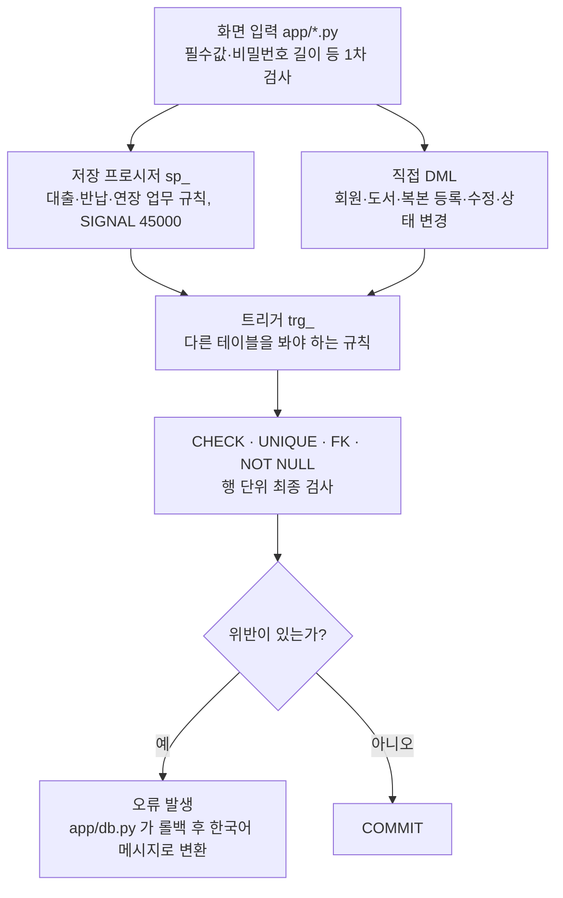
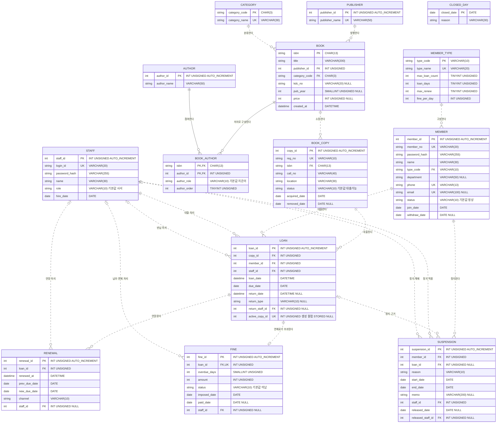
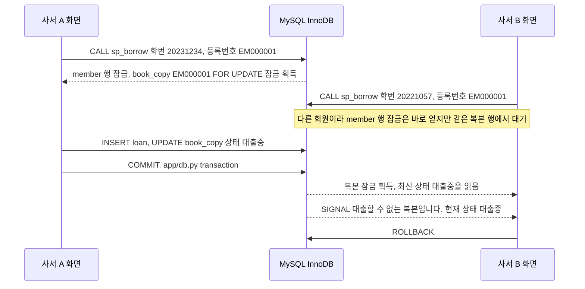
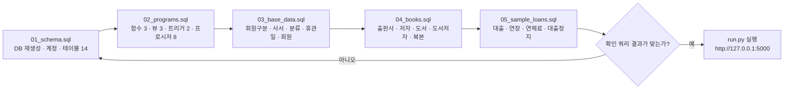

# 08. 물리적 데이터 모델 (DDL · 제약조건 · 인덱스)

> 논리 모델을 MySQL 에 구현한 물리 설계(DDL, 데이터 타입, 제약조건, 인덱스, 함수·뷰·트리거·프로시저, 트랜잭션·동시성, 보안, 설치·백업)를 실제 코드(`sql/`, `app/`)와 DB(`library_db`) 조회·EXPLAIN 결과로 기술한다. 작성 기준일 2026-11-14 · 작성: 윤준서 (Claude 활용)

## 1. 물리 설계 개요

### 1.1 대상 DBMS 와 서버 설정

아래 값은 개발 PC 의 DB 에서 직접 조회했다 (2026-11-14, `init_db.sh` 로 초기화한 상태).

| 항목 | 값 | 확인 방법 |
|---|---|---|
| DBMS 버전 | MySQL `26.10.0` (개발 PC, Homebrew) | `SELECT VERSION();` |
| 지원 대상 | MySQL 8.0.19 이상 (발표 PC 는 Windows MySQL Server 8.x) | 1.3 사용 기능표 |
| 스토리지 엔진 | InnoDB — 14개 테이블 모두 | `information_schema.TABLES.ENGINE`, `@@default_storage_engine` = InnoDB |
| 문자셋 · 콜레이션 | `utf8mb4` / `utf8mb4_0900_ai_ci` — DB 기본값이며 14개 테이블 모두 같음 | `CREATE DATABASE library_db DEFAULT CHARACTER SET utf8mb4 DEFAULT COLLATE utf8mb4_0900_ai_ci`, `information_schema.SCHEMATA` |
| 행 형식 | DYNAMIC | `@@innodb_default_row_format` = dynamic |
| 트랜잭션 격리 수준 | REPEATABLE-READ (서버 기본값, 앱에서 바꾸지 않음) | `@@transaction_isolation` |
| 잠금 대기 제한 | 50초 | `@@innodb_lock_wait_timeout` = 50 |
| sql_mode | ONLY_FULL_GROUP_BY, STRICT_TRANS_TABLES, NO_ZERO_IN_DATE, NO_ZERO_DATE, ERROR_FOR_DIVISION_BY_ZERO, NO_ENGINE_SUBSTITUTION | `@@sql_mode` — STRICT 모드라 길이 초과(1406)·NOT NULL 위반(1048)은 경고가 아니라 오류가 된다 |
| 테이블명 대소문자 | `lower_case_table_names` = 2 (macOS). 모든 객체 이름이 소문자라 Windows(기본값 1)로 옮겨도 이름이 같다 | `@@lower_case_table_names` |

- **utf8mb4** 는 한글(3바이트)과 4바이트 문자까지 모두 저장한다. `VARCHAR(n)` 의 n 은 바이트가 아니라 문자 수라 `title VARCHAR(200)` 에 한글 200자가 들어간다.
- **utf8mb4_0900_ai_ci** 는 대소문자·악센트를 구분하지 않는 비교다. 영문 서명 검색이 대소문자를 가리지 않는 장점이 있고, CHECK 의 REGEXP 도 대소문자를 가리지 않게 되는 부작용이 있다 (6.8).

### 1.2 물리 객체 구성

| 구분 | 수 | 내용 |
|---|---|---|
| 테이블 | 14 | `member_type` `member` `staff` `category` `publisher` `author` `book` `book_author` `book_copy` `loan` `renewal` `fine` `suspension` `closed_day` |
| 컬럼 | 86 | NOT NULL 68 · NULL 허용 18 · 저장 생성 컬럼 1 (`loan.active_copy_id`) |
| 제약조건 | 70 | PRIMARY KEY 14 · UNIQUE 10 · FOREIGN KEY 18 · CHECK 28 (6장) |
| 인덱스 | 46 | PK 14 · UNIQUE 10 · FK 자동 생성 12 · 보조(`idx_`) 10 (7장) |
| 함수 | 3 | `fn_next_open_day`, `fn_overdue_days`, `fn_compensation` |
| 뷰 | 3 | `v_book_summary`, `v_loan_detail`, `v_member_status` |
| 트리거 | 2 | `trg_member_withdraw_check`, `trg_book_copy_status_guard` |
| 프로시저 | 8 | `sp_borrow`, `sp_return`, `sp_renew`, `sp_report_lost`, `sp_suspend_member`, `sp_release_suspension`, `sp_settle_fine`, `sp_add_closed_day` |
| 이벤트 | 0 | 정기 작업 없음. 연체 여부는 저장하지 않고 뷰가 조회 시점에 계산 |
| DB 계정 | 2 | `'library'@'localhost'`, `'library'@'127.0.0.1'` (같은 권한, 10장) |

### 1.3 사용한 MySQL 기능과 최소 버전

| 기능 | 사용 위치 | 최소 버전 |
|---|---|---|
| CHECK 제약 (실제 검사) | `ck_` 28개 | 8.0.16 (그 전 버전은 구문만 받고 검사하지 않는다) |
| 식 기본값 `DEFAULT (CURRENT_DATE)` | `member.join_date`, `staff.hire_date`, `book_copy.acquired_date`, `fine.imposed_date` | 8.0.13 |
| ICU 정규식 `REGEXP` (`regexp_like`) | `ck_member_no` 등 5개 | 8.0.4 |
| 저장 생성 컬럼 `GENERATED ALWAYS AS (…) STORED` | `loan.active_copy_id` | 5.7.6 |
| 잠금 읽기 `FOR UPDATE OF 별칭` | `sp_borrow`, `sp_return`, `sp_renew`, `sp_report_lost` | 8.0.1 |
| 재귀 CTE `WITH RECURSIVE` | `sql/03_base_data.sql` 일요일 휴관일 생성 | 8.0.1 |
| 윈도우 함수 `RANK() OVER` | `app/stats.py` 인기 도서·다독 회원 | 8.0.2 |
| `INSERT … AS new ON DUPLICATE KEY UPDATE` (행 별칭) | `sql/03_base_data.sql` 공휴일 등록 | 8.0.19 |

가장 높은 요구 버전이 8.0.19 이므로 설치 대상은 **MySQL 8.0.19 이상**이다.

### 1.4 무결성을 지키는 계층

업무 규칙을 한 곳에만 두지 않고, 위 계층이 놓친 것을 아래 계층이 다시 막도록 배치했다. 회원·도서 등록처럼 앱이 직접 DML 을 실행하는 경로도 트리거·제약조건을 반드시 거친다.



## 2. 명명 규칙

### 2.1 객체 이름 규칙

모든 이름은 영문 소문자 **snake_case** 이다.

| 대상 | 규칙 | 예 | 개수 |
|---|---|---|---|
| 데이터베이스 | snake_case | `library_db` | 1 |
| 테이블 | 단수형 영문 명사. 교차 테이블은 두 테이블 이름을 잇는다 | `member`, `book_copy`, `book_author` | 14 |
| 컬럼 | 09 용어 사전 표준 단어의 영문 약어 조합 | `member_no`, `due_date`, `fine_per_day` | 86 |
| 기본키 | `pk_<테이블>` | `pk_loan`, `pk_book_author` | 14 |
| 외래키 | `fk_<자식 테이블>_<참조 대상 또는 역할>` | `fk_loan_member`, `fk_loan_return_staff` | 18 |
| 고유 | `uq_<테이블>_<컬럼 핵심어>` (테이블명과 겹치는 부분·`_id` 는 줄임) | `uq_member_no`, `uq_fine_loan`, `uq_loan_active_copy` | 10 |
| 검사 | `ck_<테이블>_<컬럼 또는 규칙 의미>` | `ck_book_isbn`, `ck_loan_returned` | 28 |
| 보조 인덱스 | `idx_<테이블>_<컬럼…>` | `idx_loan_member_return` | 10 |
| 뷰 | `v_<대상>` | `v_loan_detail` | 3 |
| 함수 | `fn_<돌려주는 값>` | `fn_overdue_days` | 3 |
| 프로시저 | `sp_<동사>[_<대상>]` | `sp_borrow`, `sp_report_lost` | 8 |
| 트리거 | `trg_<테이블>_<의미>` | `trg_book_copy_status_guard` | 2 |
| 프로시저 변수 | 매개변수 `p_`, 지역 변수 `v_` | `p_member_no`, `v_due` | — |

축약·역할 이름을 쓴 예외: `fk_member_type` (member → member_type, 중복되는 member 생략), `fk_book_author_auth` (author → auth), `fk_suspension_released` (해제 사서 `released_staff_id`), `ck_member_type_days` (`loan_days`), `idx_suspension_member_end` (`end_date`).

### 2.2 MySQL 이 이름을 바꾸거나 만드는 경우

- **기본키 이름**: MySQL 은 PRIMARY KEY 의 이름을 항상 `PRIMARY` 로 저장한다. DDL 의 `pk_member` 등은 DDL 을 읽는 사람을 위한 이름이고, `information_schema`·`SHOW CREATE TABLE`·오류 메시지에는 `PRIMARY` 로 나온다 (6.10 목록, `app/db.py` 의 `"book.PRIMARY"` 매핑).
- **FK 지원 인덱스**: FK 컬럼을 맨 앞에 가진 인덱스가 없으면 InnoDB 가 FK 제약조건명과 같은 이름의 인덱스를 자동으로 만든다. 그래서 인덱스 목록에 `fk_member_type`, `fk_loan_copy` 등 12개가 인덱스로도 나온다 (7.1).
- **CHECK 식 정규화**: 저장할 때 `REGEXP` 는 `regexp_like(…)`, `DATE(loan_date)` 는 `cast(loan_date as date)` 로 바뀐다 (6.10 목록).

### 2.3 표준 단어 (09 용어 사전)

- 컬럼명은 09 용어 사전 §9.1 의 표준 단어 65개를 조합해 만들었다. 예: `max_loan_count` = 최대(`max`) + 대출(`loan`) + 수(`count`), `prev_due_date` = 이전(`prev`) + 반납예정(`due`) + 일자(`date`). `scripts/gen_docs.py` 가 실제 DB 의 모든 컬럼명이 표준 단어로만 이루어졌는지 검사한다 (09 문서 머리말).
- 접미어: `_id` 시스템이 부여하는 내부 번호(대리키), `_no` 업무에서 쓰는 번호(학번 `member_no`, 등록번호 `reg_no`, 청구기호 `call_no`, KDC 분류기호 `kdc_no`), `_code` 코드, `_name` 명칭, `_date` 일자, `_at` 일시, `_days` 일수, `_count` 개수.
- 예외: `loan.loan_date`·`loan.return_date` 는 DATETIME 이지만 `_date` 접미어를 쓴다. 09 §9.2 에 '대출 + 일자'·'반납 + 일자'(도메인 '일시')로 등록되어 있다. 같은 DATETIME 인 `renewal.renewed_at`, `book.created_at` 은 `_at` 이다.

## 3. 데이터 타입 결정 기준

| No | 데이터 성격 | 선택 타입 | 적용 컬럼 | 결정 근거 |
|---|---|---|---|---|
| 1 | 내부 식별자(대리키)와 이를 참조하는 FK | `INT UNSIGNED` (+ `AUTO_INCREMENT`) | `member_id` `staff_id` `publisher_id` `author_id` `copy_id` `loan_id` `renewal_id` `fine_id` `suspension_id` 와 이를 참조하는 FK, 생성 컬럼 — 24개 (10 도메인 'ID번호') | 4바이트, 0 이상 4,294,967,295 이하. 음수가 없으므로 UNSIGNED. FK 컬럼은 부모와 타입·부호가 같아야 하므로 모두 `INT UNSIGNED`. `member` 는 `AUTO_INCREMENT = 10001` 로 회원번호가 10001 부터 시작 |
| 2 | 길이가 고정된 업무 코드 | `CHAR(n)` | `isbn CHAR(13)` 3개, `category_code CHAR(3)` 2개 | ISBN-13 은 항상 13자, KDC 주류 코드는 항상 3자. 숫자로 보여도 계산하지 않고 '000'(총류)처럼 앞자리 0 이 있으므로 문자형. 형식은 CHECK REGEXP 로 강제 |
| 3 | 길이가 변하는 업무 번호·코드 | `VARCHAR(n)` | `member_no(20)`, `login_id(20)`, `reg_no(10)`, `call_no(40)`, `kdc_no(20)`, `type_code(10)`, `phone(13)` | 교번은 `F2008011` 처럼 영문이 섞여 문자형. `phone` 13 = `010-0000-0000` 하이픈 포함 길이 |
| 4 | 이름 · 명칭 · 자유 입력 | `VARCHAR(n)` | `name(30)`, `author_name`·`publisher_name`·`department(50)`, `title(200)`, `email(100)`, `memo(200)`, `category_name`·`location`·`closed_day.reason(30)`, `type_name(20)` | 10 도메인 정의서의 길이 그대로. utf8mb4 에서 n 은 문자 수 |
| 5 | 상태 · 구분 값 | `VARCHAR(10)` + `CHECK (… IN (…))` | `member.status`, `staff.role`, `book_author.author_role`, `book_copy.status`, `loan.return_type`, `renewal.channel`, `fine.status`, `suspension.reason` — 8개 | 한글 값('대출가능', '미납' 등)을 그대로 저장해 화면에서 변환 없이 쓴다. ENUM 대신 SQL 표준인 CHECK 를 썼고, 위반 시 오류 3819 메시지에 제약조건 이름이 들어가 `app/db.py` 가 이름으로 안내 문구를 고른다 (예: `ck_suspension_reason` → `정지 사유가 올바르지 않습니다.`) |
| 6 | 작은 정수 (정책값 · 순서) | `TINYINT UNSIGNED` | `max_loan_count`, `loan_days`, `max_renew`, `author_order` — 4개 | 0 이상 255 이하. 가장 큰 정책값(전임교원 50권·180일)도 범위 안. 업무 범위는 CHECK 로 더 좁힘 |
| 7 | 중간 정수 | `SMALLINT UNSIGNED` | `book.pub_year`, `fine.overdue_days` — 2개 | 0 이상 65,535 이하. YEAR 타입(1901 이상 2155 이하) 대신 SMALLINT + `ck_book_pub_year`(1450 이상 2100 이하)로 1901년 이전 발행 도서도 표현 |
| 8 | 금액 (원) | `INT UNSIGNED` | `member_type.fine_per_day`, `book.price`, `fine.amount` — 3개 | 원 단위 정수라 소수가 없어 DECIMAL 이 필요 없다. `fn_compensation` 도 ROUND 후 INT 로 돌려준다 |
| 9 | 날짜 | `DATE` | `due_date`, `join_date`, `withdraw_date`, `hire_date`, `acquired_date`, `removed_date`, `prev_due_date`, `new_due_date`, `imposed_date`, `paid_date`, `start_date`, `end_date`, `released_date`, `closed_date` — 14개 | 반납예정일·휴관일·정지 기간 등 규칙이 '일' 단위. `DATEDIFF`·`INTERVAL` 계산이 단순 |
| 10 | 일시 | `DATETIME` | `loan.loan_date`, `loan.return_date`, `renewal.renewed_at`, `book.created_at` — 4개 | 처리 시각까지 기록. TIMESTAMP 와 달리 시간대 변환 없이 저장한 값 그대로이고 2038년 이후도 표현 |
| 11 | 비밀번호 해시 | `VARCHAR(255)` | `member.password_hash`, `staff.password_hash` | 현재 scrypt 해시 문자열은 162자 (DB 조회, 29건 모두). 알고리즘·매개변수가 바뀌어 길어져도 수용 |
| 12 | 생성 컬럼 | `INT UNSIGNED GENERATED ALWAYS AS (…) STORED` | `loan.active_copy_id` | `copy_id` 와 같은 타입. 6.5 |
| 13 | 기본값 | 상수, `DEFAULT CURRENT_TIMESTAMP`, `DEFAULT (CURRENT_DATE)` | 상수: `member.status`('정상'), `staff.role`('사서'), `book_copy.status`('대출가능'), `book_copy.location`('종합자료실'), `fine.status`('미납'), `book_author.author_role`('지은이'), `book_author.author_order`(1) · 일시: `loan_date`, `renewed_at`, `created_at` · 날짜: `join_date`, `hire_date`, `acquired_date`, `imposed_date` | INSERT 에서 생략하면 처리 시점 값이 들어간다. 예: `sp_return` 은 `INSERT INTO fine (loan_id, overdue_days, amount)` 만 지정하고 `status`('미납')·`imposed_date`(오늘)는 기본값 |

타입별 컬럼 수 (`information_schema.COLUMNS` 조회): `INT UNSIGNED` 27 · `VARCHAR` 30 · `DATE` 14 · `CHAR` 5 · `DATETIME` 4 · `TINYINT UNSIGNED` 4 · `SMALLINT UNSIGNED` 2 = 86.

**utf8mb4 와 인덱스 키 길이.** EXPLAIN 의 `key_len` 은 문자 컬럼을 문자당 4바이트로 계산한다. `idx_member_name`(VARCHAR(30)) 122 = 30 × 4 + 2(길이 정보), `idx_book_title`(VARCHAR(200)) 802, `uq_member_no`(VARCHAR(20)) 82, ISBN(CHAR(13)) 52 = 13 × 4. InnoDB DYNAMIC 행 형식의 인덱스 키 한도(3072바이트) 안이다.

## 4. 테이블 목록

### 4.1 테이블 · 현재 건수 · 예상 연간 증가

현재 건수는 2026-11-14 에 각 테이블을 `COUNT(*)` 로 조회한 값이다 (같은 날 `init_db.sh` 로 초기화한 상태. `information_schema.TABLES.TABLE_ROWS` 는 추정치라 쓰지 않았다).

| No | 테이블 | 한글명 | 컬럼 수 | 성격 | 현재 건수 | 예상 연간 증가 | 근거 |
|---|---|---|---|---|---|---|---|
| 1 | `member_type` | 회원구분 | 6 | 코드 · 정책 | 5 | 거의 없음 | 신분 5종 (학부생·휴학생·대학원생·전임교원·직원·비전임교원). 정책이 바뀌면 값만 UPDATE |
| 2 | `member` | 회원 | 11 | 기본 | 27 | 신규 가입 인원만큼 | 탈퇴해도 행은 남는다 (`status` = '탈퇴'). 샘플 데이터에는 가입 추세가 없어 수치는 산정하지 않음 |
| 3 | `staff` | 사서 | 6 | 기본 | 2 | 거의 없음 | 직원 채용 시 |
| 4 | `category` | 분류 | 2 | 코드 | 10 | 없음 | KDC 주류 10개 고정 |
| 5 | `publisher` | 출판사 | 2 | 기본 | 56 | 새 출판사의 도서를 등록할 때만 | `books.py` 가 이름으로 찾고 없을 때만 INSERT |
| 6 | `author` | 저자 | 2 | 기본 | 155 | 새 저자의 도서를 등록할 때만 | `books.py` `save_authors` 가 이름으로 찾고 없을 때만 INSERT |
| 7 | `book` | 도서 | 8 | 기본 | 100 | 구입 종수만큼 | 실제 도서 100종 (`data/books.csv`) |
| 8 | `book_author` | 도서저자 | 4 | 교차 | 171 | 도서 1종당 평균 1.71건 | 171 / 100 (현재 비율) |
| 9 | `book_copy` | 도서복본 | 8 | 기본 | 157 | 도서 1종당 평균 1.57권 | 157 / 100. 분실·폐기 복본도 행은 남는다 |
| 10 | `loan` | 대출 | 10 | 이력 | 230 | 약 420건 | 230건이 최근 200일(대출일시 2026-05-01 ~ 2026-11-14)에 분포 → 230 × 365 / 200 |
| 11 | `renewal` | 연장이력 | 7 | 이력 | 15 | 약 27건 | 15 × 365 / 200 (대출의 약 7%) |
| 12 | `fine` | 연체료 | 8 | 이력 | 22 | 약 40건 | 22 × 365 / 200 (대출의 약 10%) |
| 13 | `suspension` | 대출정지 | 10 | 이력 | 3 | 사서가 정지를 적용한 건수만큼 | 샘플 3건은 시연용으로 고정 생성(진행 중·조기 해제·기간 만료 각 1건)이라 발생률 산정 불가 |
| 14 | `closed_day` | 휴관일 | 2 | 달력 | 139 | 약 70건 (연 1회 일괄 등록) | 2026년 71건, 2027년 68건 등록 |

- 이력 테이블의 연간 증가는 **샘플 데이터의 발생률을 1년으로 환산한 값**이다. 샘플은 `scripts/build_seed.py` 가 목표 230건으로 만든 것이라 실제 이용량이 아니다. 운영 규모에서는 회원 수 × 1인당 연간 대출 권수로 다시 추정해야 한다. 이 규모에서는 저장 공간·인덱스 크기가 문제가 되지 않는다.
- 현재 상태 (DB 조회): 미반납 대출 24건(그중 연체 5건), 반납구분 반납 205 · 분실 1, 복본 상태 대출가능 131 · 대출중 24 · 분실 1 · 폐기 1, 연체료 미납 1 · 납부 18 · 면제 3, 연장 신청경로 홈페이지 14 · 사서 1, 회원 정상 26 · 탈퇴 1.

### 4.2 물리 ERD

전체 86개 컬럼과 키를 표시했다. 따옴표 안은 실제 타입이며, NULL 허용 컬럼에만 NULL 을 적었다. 실선은 식별 관계(자식 PK 에 부모 키 포함), 점선은 비식별 관계이고 관계 이름은 06 개념적 데이터 모델과 같다.



## 5. 전체 DDL

아래는 `sql/01_schema.sql` 전체(301줄)이다. 데이터베이스 재생성 → 앱 전용 계정 생성·권한 부여 → 테이블 14개 순서이며, 부모 테이블이 자식보다 먼저 나오도록 배치해 FK 가 생성 즉시 만들어진다 (`member_type` → `member`, `publisher`·`category` → `book` → `book_author`·`book_copy` → `loan` → `renewal`·`fine`·`suspension`).

```sql
-- =====================================================================
-- 도서관 대출·반납·연체 관리 시스템 : 물리적 데이터 모델 (DDL)  v2
-- DBMS : MySQL 8.0.19 이상 (CHECK 제약, 생성 컬럼, FOR UPDATE OF, INSERT 행 별칭 사용)
-- 실행 : mysql -u root --default-character-set=utf8mb4 < sql/01_schema.sql
-- 테이블 14개
--   회원구분 member_type · 회원 member · 사서 staff
--   분류 category · 출판사 publisher · 저자 author · 도서 book · 도서저자 book_author · 도서복본 book_copy
--   대출 loan · 연장이력 renewal · 연체료 fine · 대출정지 suspension · 휴관일 closed_day
-- =====================================================================

DROP DATABASE IF EXISTS library_db;
CREATE DATABASE library_db
  DEFAULT CHARACTER SET utf8mb4
  DEFAULT COLLATE utf8mb4_0900_ai_ci;
USE library_db;

-- 응용프로그램 전용 계정 (DML + 프로시저 실행 권한만 부여)
DROP USER IF EXISTS 'library'@'localhost', 'library'@'127.0.0.1';
CREATE USER 'library'@'localhost' IDENTIFIED BY 'library1234';
CREATE USER 'library'@'127.0.0.1' IDENTIFIED BY 'library1234';
GRANT SELECT, INSERT, UPDATE, DELETE, EXECUTE ON library_db.* TO 'library'@'localhost';
GRANT SELECT, INSERT, UPDATE, DELETE, EXECUTE ON library_db.* TO 'library'@'127.0.0.1';


-- ---------------------------------------------------------------------
-- 1. 회원구분 : 신분별 대출 정책 (숭실대학교 중앙도서관 대출 규정 기준)
--    연장 시 "연장한 날부터 대출기간만큼" 늘어나므로 연장 일수는 loan_days 를 그대로 쓴다.
-- ---------------------------------------------------------------------
CREATE TABLE member_type (
  type_code       VARCHAR(10)      NOT NULL COMMENT '회원구분코드',
  type_name       VARCHAR(20)      NOT NULL COMMENT '회원구분명',
  max_loan_count  TINYINT UNSIGNED NOT NULL COMMENT '최대 대출 권수',
  loan_days       TINYINT UNSIGNED NOT NULL COMMENT '대출 기간(일) - 연장 1회 기간과 같음',
  max_renew       TINYINT UNSIGNED NOT NULL COMMENT '최대 연장 횟수',
  fine_per_day    INT UNSIGNED     NOT NULL COMMENT '1권 1일 연체료(원)',
  CONSTRAINT pk_member_type          PRIMARY KEY (type_code),
  CONSTRAINT uq_member_type_name     UNIQUE (type_name),
  CONSTRAINT ck_member_type_max_loan CHECK (max_loan_count BETWEEN 1 AND 100),
  CONSTRAINT ck_member_type_days     CHECK (loan_days BETWEEN 1 AND 180),
  CONSTRAINT ck_member_type_renew    CHECK (max_renew <= 10)
) COMMENT = '회원구분';


-- ---------------------------------------------------------------------
-- 2. 회원 : 학번/교번(member_no)으로 회원 포털에 로그인
--    status 는 계정 상태(정상/탈퇴)만 저장. 대출정지 여부는 suspension 에서 계산한다.
-- ---------------------------------------------------------------------
CREATE TABLE member (
  member_id      INT UNSIGNED NOT NULL AUTO_INCREMENT COMMENT '회원번호 (내부 식별자)',
  member_no      VARCHAR(20)  NOT NULL COMMENT '학번·교번 (로그인 ID)',
  password_hash  VARCHAR(255) NOT NULL COMMENT '비밀번호 해시',
  name           VARCHAR(30)  NOT NULL COMMENT '이름',
  type_code      VARCHAR(10)  NOT NULL COMMENT '회원구분코드',
  department     VARCHAR(50)      NULL COMMENT '소속 (학과·부서)',
  phone          VARCHAR(13)  NOT NULL COMMENT '휴대전화 (010-0000-0000)',
  email          VARCHAR(100)     NULL COMMENT '이메일',
  status         VARCHAR(10)  NOT NULL DEFAULT '정상' COMMENT '계정상태',
  join_date      DATE         NOT NULL DEFAULT (CURRENT_DATE) COMMENT '가입일',
  withdraw_date  DATE             NULL COMMENT '탈퇴일',
  CONSTRAINT pk_member           PRIMARY KEY (member_id),
  CONSTRAINT uq_member_no        UNIQUE (member_no),
  CONSTRAINT uq_member_phone     UNIQUE (phone),
  CONSTRAINT uq_member_email     UNIQUE (email),
  CONSTRAINT fk_member_type      FOREIGN KEY (type_code)
    REFERENCES member_type (type_code) ON UPDATE CASCADE,
  CONSTRAINT ck_member_status    CHECK (status IN ('정상', '탈퇴')),
  CONSTRAINT ck_member_withdraw  CHECK ((status = '탈퇴') = (withdraw_date IS NOT NULL)),
  CONSTRAINT ck_member_no        CHECK (member_no REGEXP '^[0-9A-Za-z]{4,20}$'),
  CONSTRAINT ck_member_phone     CHECK (phone REGEXP '^01[0-9]-[0-9]{3,4}-[0-9]{4}$'),
  INDEX idx_member_name (name)
) AUTO_INCREMENT = 10001 COMMENT = '회원';


-- ---------------------------------------------------------------------
-- 3. 사서 : 관리 프로그램 로그인 계정, 대출·반납 처리자
-- ---------------------------------------------------------------------
CREATE TABLE staff (
  staff_id       INT UNSIGNED NOT NULL AUTO_INCREMENT COMMENT '사서번호',
  login_id       VARCHAR(20)  NOT NULL COMMENT '로그인 ID',
  password_hash  VARCHAR(255) NOT NULL COMMENT '비밀번호 해시',
  name           VARCHAR(30)  NOT NULL COMMENT '이름',
  role           VARCHAR(10)  NOT NULL DEFAULT '사서' COMMENT '권한',
  hire_date      DATE         NOT NULL DEFAULT (CURRENT_DATE) COMMENT '입사일',
  CONSTRAINT pk_staff       PRIMARY KEY (staff_id),
  CONSTRAINT uq_staff_login UNIQUE (login_id),
  CONSTRAINT ck_staff_role  CHECK (role IN ('관리자', '사서'))
) COMMENT = '사서';


-- ---------------------------------------------------------------------
-- 4. 분류 (한국십진분류법 KDC 주류 10개)
-- ---------------------------------------------------------------------
CREATE TABLE category (
  category_code  CHAR(3)     NOT NULL COMMENT '분류코드 (KDC 주류)',
  category_name  VARCHAR(30) NOT NULL COMMENT '분류명',
  CONSTRAINT pk_category      PRIMARY KEY (category_code),
  CONSTRAINT uq_category_name UNIQUE (category_name),
  CONSTRAINT ck_category_code CHECK (category_code REGEXP '^[0-9]00$')
) COMMENT = '분류';


-- ---------------------------------------------------------------------
-- 5. 출판사
-- ---------------------------------------------------------------------
CREATE TABLE publisher (
  publisher_id    INT UNSIGNED NOT NULL AUTO_INCREMENT COMMENT '출판사번호',
  publisher_name  VARCHAR(50)  NOT NULL COMMENT '출판사명',
  CONSTRAINT pk_publisher      PRIMARY KEY (publisher_id),
  CONSTRAINT uq_publisher_name UNIQUE (publisher_name)
) COMMENT = '출판사';


-- ---------------------------------------------------------------------
-- 6. 저자
-- ---------------------------------------------------------------------
CREATE TABLE author (
  author_id    INT UNSIGNED NOT NULL AUTO_INCREMENT COMMENT '저자번호',
  author_name  VARCHAR(50)  NOT NULL COMMENT '저자명',
  CONSTRAINT pk_author PRIMARY KEY (author_id),
  INDEX idx_author_name (author_name)
) COMMENT = '저자';


-- ---------------------------------------------------------------------
-- 7. 도서 (서지정보 : ISBN 단위, 국립중앙도서관 API 에서 수집)
-- ---------------------------------------------------------------------
CREATE TABLE book (
  isbn           CHAR(13)          NOT NULL COMMENT 'ISBN-13',
  title          VARCHAR(200)      NOT NULL COMMENT '서명',
  publisher_id   INT UNSIGNED      NOT NULL COMMENT '출판사번호',
  category_code  CHAR(3)           NOT NULL COMMENT '분류코드 (KDC 주류)',
  kdc_no         VARCHAR(20)           NULL COMMENT 'KDC 분류기호 (예: 813.7)',
  pub_year       SMALLINT UNSIGNED     NULL COMMENT '발행연도',
  price          INT UNSIGNED          NULL COMMENT '정가(원)',
  created_at     DATETIME          NOT NULL DEFAULT CURRENT_TIMESTAMP COMMENT '등록일시',
  CONSTRAINT pk_book           PRIMARY KEY (isbn),
  CONSTRAINT fk_book_publisher FOREIGN KEY (publisher_id)
    REFERENCES publisher (publisher_id) ON UPDATE CASCADE,
  CONSTRAINT fk_book_category  FOREIGN KEY (category_code)
    REFERENCES category (category_code) ON UPDATE CASCADE,
  CONSTRAINT ck_book_isbn      CHECK (isbn REGEXP '^97[89][0-9]{10}$'),
  CONSTRAINT ck_book_pub_year  CHECK (pub_year BETWEEN 1450 AND 2100),
  INDEX idx_book_title (title)
) COMMENT = '도서';


-- ---------------------------------------------------------------------
-- 8. 도서저자 : 도서-저자 M:N 관계 해소 (공저·번역)
-- ---------------------------------------------------------------------
CREATE TABLE book_author (
  isbn          CHAR(13)         NOT NULL COMMENT 'ISBN',
  author_id     INT UNSIGNED     NOT NULL COMMENT '저자번호',
  author_role   VARCHAR(10)      NOT NULL DEFAULT '지은이' COMMENT '저자역할',
  author_order  TINYINT UNSIGNED NOT NULL DEFAULT 1 COMMENT '표기순서',
  CONSTRAINT pk_book_author      PRIMARY KEY (isbn, author_id),
  CONSTRAINT fk_book_author_book FOREIGN KEY (isbn)
    REFERENCES book (isbn) ON DELETE CASCADE ON UPDATE CASCADE,
  CONSTRAINT fk_book_author_auth FOREIGN KEY (author_id)
    REFERENCES author (author_id),
  CONSTRAINT ck_book_author_role CHECK (author_role IN ('지은이', '옮긴이', '엮은이', '그림'))
) COMMENT = '도서저자';


-- ---------------------------------------------------------------------
-- 9. 도서복본 : 서가에 있는 실물 책 1권 (등록번호 단위)
-- ---------------------------------------------------------------------
CREATE TABLE book_copy (
  copy_id        INT UNSIGNED NOT NULL AUTO_INCREMENT COMMENT '복본번호',
  reg_no         VARCHAR(10)  NOT NULL COMMENT '등록번호 (바코드)',
  isbn           CHAR(13)     NOT NULL COMMENT 'ISBN',
  call_no        VARCHAR(40)  NOT NULL COMMENT '청구기호',
  location       VARCHAR(30)  NOT NULL DEFAULT '종합자료실' COMMENT '배가위치',
  status         VARCHAR(10)  NOT NULL DEFAULT '대출가능' COMMENT '복본상태',
  acquired_date  DATE         NOT NULL DEFAULT (CURRENT_DATE) COMMENT '입수일',
  removed_date   DATE             NULL COMMENT '분실·폐기 처리일',
  CONSTRAINT pk_book_copy         PRIMARY KEY (copy_id),
  CONSTRAINT uq_book_copy_reg_no  UNIQUE (reg_no),
  CONSTRAINT fk_book_copy_book    FOREIGN KEY (isbn)
    REFERENCES book (isbn) ON DELETE CASCADE ON UPDATE CASCADE,
  CONSTRAINT ck_book_copy_status  CHECK (status IN ('대출가능', '대출중', '분실', '폐기')),
  CONSTRAINT ck_book_copy_removed CHECK ((status IN ('분실', '폐기')) = (removed_date IS NOT NULL)),
  CONSTRAINT ck_book_copy_reg_no  CHECK (reg_no REGEXP '^EM[0-9]{6}$'),
  INDEX idx_book_copy_isbn_status (isbn, status)
) COMMENT = '도서복본';


-- ---------------------------------------------------------------------
-- 10. 대출 : 대출 1건 = 복본 1권. 반납(또는 분실 처리) 시 return_date 기록
-- ---------------------------------------------------------------------
CREATE TABLE loan (
  loan_id          INT UNSIGNED NOT NULL AUTO_INCREMENT COMMENT '대출번호',
  copy_id          INT UNSIGNED NOT NULL COMMENT '복본번호',
  member_id        INT UNSIGNED NOT NULL COMMENT '회원번호',
  staff_id         INT UNSIGNED NOT NULL COMMENT '대출 처리 사서',
  loan_date        DATETIME     NOT NULL DEFAULT CURRENT_TIMESTAMP COMMENT '대출일시',
  due_date         DATE         NOT NULL COMMENT '반납예정일 (연장 시 갱신)',
  return_date      DATETIME         NULL COMMENT '반납일시',
  return_type      VARCHAR(10)      NULL COMMENT '반납구분 (반납/분실)',
  return_staff_id  INT UNSIGNED     NULL COMMENT '반납 처리 사서',
  -- 반납 전이면 copy_id, 반납 후면 NULL → UNIQUE 로 "복본당 미반납 대출 1건" 보장
  active_copy_id   INT UNSIGNED GENERATED ALWAYS AS (IF(return_date IS NULL, copy_id, NULL)) STORED
                   COMMENT '미반납 복본 (생성 컬럼)',
  CONSTRAINT pk_loan              PRIMARY KEY (loan_id),
  CONSTRAINT uq_loan_active_copy  UNIQUE (active_copy_id),
  CONSTRAINT fk_loan_copy         FOREIGN KEY (copy_id)   REFERENCES book_copy (copy_id),
  CONSTRAINT fk_loan_member       FOREIGN KEY (member_id) REFERENCES member (member_id),
  CONSTRAINT fk_loan_staff        FOREIGN KEY (staff_id)  REFERENCES staff (staff_id),
  CONSTRAINT fk_loan_return_staff FOREIGN KEY (return_staff_id) REFERENCES staff (staff_id),
  CONSTRAINT ck_loan_due_date     CHECK (due_date >= DATE(loan_date)),
  CONSTRAINT ck_loan_return_date  CHECK (return_date IS NULL OR return_date >= loan_date),
  CONSTRAINT ck_loan_return_type  CHECK (return_type IN ('반납', '분실')),
  CONSTRAINT ck_loan_returned     CHECK ((return_date IS NULL) = (return_type IS NULL)
                                     AND (return_date IS NULL) = (return_staff_id IS NULL)),
  INDEX idx_loan_member_return (member_id, return_date),
  INDEX idx_loan_due_date (due_date),
  INDEX idx_loan_loan_date (loan_date)
) COMMENT = '대출';


-- ---------------------------------------------------------------------
-- 11. 연장이력 : 연장 1회 = 1행. 연장 횟수는 COUNT 로 계산 (중복 저장 안 함)
-- ---------------------------------------------------------------------
CREATE TABLE renewal (
  renewal_id     INT UNSIGNED NOT NULL AUTO_INCREMENT COMMENT '연장번호',
  loan_id        INT UNSIGNED NOT NULL COMMENT '대출번호',
  renewed_at     DATETIME     NOT NULL DEFAULT CURRENT_TIMESTAMP COMMENT '연장일시',
  prev_due_date  DATE         NOT NULL COMMENT '연장 전 반납예정일',
  new_due_date   DATE         NOT NULL COMMENT '연장 후 반납예정일',
  channel        VARCHAR(10)  NOT NULL COMMENT '신청경로',
  staff_id       INT UNSIGNED     NULL COMMENT '처리 사서 (홈페이지 신청은 NULL)',
  CONSTRAINT pk_renewal         PRIMARY KEY (renewal_id),
  CONSTRAINT fk_renewal_loan    FOREIGN KEY (loan_id)  REFERENCES loan (loan_id),
  CONSTRAINT fk_renewal_staff   FOREIGN KEY (staff_id) REFERENCES staff (staff_id),
  CONSTRAINT ck_renewal_due     CHECK (new_due_date > prev_due_date),
  CONSTRAINT ck_renewal_channel CHECK (channel IN ('홈페이지', '사서')),
  CONSTRAINT ck_renewal_staff   CHECK ((channel = '사서') = (staff_id IS NOT NULL)),
  INDEX idx_renewal_loan (loan_id)
) COMMENT = '연장이력';


-- ---------------------------------------------------------------------
-- 12. 연체료 : 연체 반납 시 대출 1건당 최대 1건 (1:0..1)
--     금액 = 연체일수(휴관일 제외) × 1권 1일 연체료
-- ---------------------------------------------------------------------
CREATE TABLE fine (
  fine_id       INT UNSIGNED      NOT NULL AUTO_INCREMENT COMMENT '연체료번호',
  loan_id       INT UNSIGNED      NOT NULL COMMENT '대출번호',
  overdue_days  SMALLINT UNSIGNED NOT NULL COMMENT '연체일수 (휴관일 제외)',
  amount        INT UNSIGNED      NOT NULL COMMENT '연체료(원) - 부과 시점 정책으로 확정',
  status        VARCHAR(10)       NOT NULL DEFAULT '미납' COMMENT '납부상태',
  imposed_date  DATE              NOT NULL DEFAULT (CURRENT_DATE) COMMENT '부과일',
  paid_date     DATE                  NULL COMMENT '처리일 (납부/면제)',
  staff_id      INT UNSIGNED          NULL COMMENT '납부·면제 처리 사서',
  CONSTRAINT pk_fine        PRIMARY KEY (fine_id),
  CONSTRAINT uq_fine_loan   UNIQUE (loan_id),
  CONSTRAINT fk_fine_loan   FOREIGN KEY (loan_id)  REFERENCES loan (loan_id),
  CONSTRAINT fk_fine_staff  FOREIGN KEY (staff_id) REFERENCES staff (staff_id),
  CONSTRAINT ck_fine_status CHECK (status IN ('미납', '납부', '면제')),
  CONSTRAINT ck_fine_days   CHECK (overdue_days > 0),
  CONSTRAINT ck_fine_paid   CHECK ((status = '미납') = (paid_date IS NULL)),
  INDEX idx_fine_status (status)
) COMMENT = '연체료';


-- ---------------------------------------------------------------------
-- 13. 대출정지 : 사서가 기간을 정해 적용하는 이용 제재 (규정 제27조) 와 해제 이력
--     ※ 연체 중인 회원의 대출·연장 금지(규정 제24조)는 이 테이블이 아니라 미반납 연체 대출로 판단한다.
--     유효 정지 = released_date IS NULL AND CURDATE() BETWEEN start_date AND end_date
-- ---------------------------------------------------------------------
CREATE TABLE suspension (
  suspension_id      INT UNSIGNED NOT NULL AUTO_INCREMENT COMMENT '정지번호',
  member_id          INT UNSIGNED NOT NULL COMMENT '회원번호',
  loan_id            INT UNSIGNED     NULL COMMENT '관련 대출 (선택)',
  reason             VARCHAR(10)  NOT NULL COMMENT '정지사유',
  start_date         DATE         NOT NULL COMMENT '정지 시작일',
  end_date           DATE         NOT NULL COMMENT '정지 종료일 (이 날까지 대출 불가)',
  memo               VARCHAR(200)     NULL COMMENT '비고',
  staff_id           INT UNSIGNED NOT NULL COMMENT '적용 사서',
  released_date      DATE             NULL COMMENT '조기 해제일',
  released_staff_id  INT UNSIGNED     NULL COMMENT '해제 사서',
  CONSTRAINT pk_suspension          PRIMARY KEY (suspension_id),
  CONSTRAINT fk_suspension_member   FOREIGN KEY (member_id) REFERENCES member (member_id),
  CONSTRAINT fk_suspension_loan     FOREIGN KEY (loan_id)   REFERENCES loan (loan_id),
  CONSTRAINT fk_suspension_staff    FOREIGN KEY (staff_id)  REFERENCES staff (staff_id),
  CONSTRAINT fk_suspension_released FOREIGN KEY (released_staff_id) REFERENCES staff (staff_id),
  CONSTRAINT ck_suspension_reason   CHECK (reason IN ('장기연체', '자료훼손', '규정위반', '기타')),
  CONSTRAINT ck_suspension_period   CHECK (end_date >= start_date),
  CONSTRAINT ck_suspension_release  CHECK ((released_date IS NULL) = (released_staff_id IS NULL)),
  INDEX idx_suspension_member_end (member_id, end_date)
) COMMENT = '대출정지';


-- ---------------------------------------------------------------------
-- 14. 휴관일 : 일요일·법정공휴일·개교기념일 등 (규정 제18조)
--     반납예정일이 휴관일이면 다음 개관일로 미루고, 연체일수에서 휴관일을 뺀다.
-- ---------------------------------------------------------------------
CREATE TABLE closed_day (
  closed_date  DATE        NOT NULL COMMENT '휴관일자',
  reason       VARCHAR(30) NOT NULL COMMENT '휴관사유',
  CONSTRAINT pk_closed_day PRIMARY KEY (closed_date)
) COMMENT = '휴관일';
```

## 6. 제약조건 설계

### 6.1 유형별 개수와 설계 의도

`information_schema.TABLE_CONSTRAINTS` 조회 결과 70개다.

| 유형 | 개수 | 설계 의도 |
|---|---|---|
| PRIMARY KEY | 14 | 테이블마다 1개. 대리키 9개(`INT UNSIGNED AUTO_INCREMENT`), 업무에서 이미 유일한 자연키 4개(`member_type.type_code`, `category.category_code`, `book.isbn`, `closed_day.closed_date`), 복합키 1개(`book_author` 의 `isbn` + `author_id`) |
| UNIQUE | 10 | 업무 식별자·명칭의 중복 방지 8개(`uq_member_type_name`, `uq_member_no`, `uq_member_phone`, `uq_member_email`, `uq_staff_login`, `uq_category_name`, `uq_publisher_name`, `uq_book_copy_reg_no`), 1:0..1 관계 강제 1개(`uq_fine_loan`), 일부 행에만 걸리는 유일성 1개(`uq_loan_active_copy`) |
| FOREIGN KEY | 18 | 모든 관계를 DB 가 검사. 참조 동작은 6.3 |
| CHECK | 28 | 값 목록 8 · 형식(REGEXP) 5 · 범위 5 · 컬럼 간 순서 4 · 짝 검사 6 (6.6) |
| NOT NULL | 68개 컬럼 | 제약조건 목록에는 나오지 않지만 필수 속성을 강제. NULL 허용 18개는 '아직 일어나지 않음'(`loan` 의 반납 3컬럼, `member.withdraw_date`, `book_copy.removed_date`, `fine.paid_date`·`fine.staff_id`, `suspension.released_date`·`released_staff_id`), '해당 없음'(홈페이지 연장의 `renewal.staff_id`, 반납 후의 `loan.active_copy_id`), '선택 입력'(`member.department`·`email`, `book.kdc_no`·`pub_year`·`price`, `suspension.loan_id`·`memo`) |

### 6.2 기본키

- 사건·사람·자료처럼 행이 계속 늘고 다른 테이블이 많이 참조하는 대상은 대리키를 쓴다. 학번(`member_no`)·등록번호(`reg_no`)·로그인 ID(`login_id`)는 업무 식별자이므로 UNIQUE 로 따로 보장한다. 학번이 바뀌어도(`members.py` `edit` 에서 수정 가능) 대출 이력의 FK 는 `member_id` 를 가리키므로 영향이 없다.
- ISBN·KDC 주류 코드·회원구분 코드·휴관일자는 그 자체로 유일하고 형식이 정해진 값이라 자연키로 썼다. 대신 값 정정에 대비해 이를 참조하는 FK 에 `ON UPDATE CASCADE` 를 걸었다 (6.3).
- `book_author` 의 PK (`isbn`, `author_id`) 는 같은 도서에 같은 저자가 두 번 연결되는 것을 막는다. `books.py` 의 `save_authors` 도 `seen` 집합으로 같은 저자를 건너뛴다.

### 6.3 외래키 참조 동작

`information_schema.REFERENTIAL_CONSTRAINTS` 조회 결과다.

| 참조 동작 | 외래키 | 의도 |
|---|---|---|
| ON UPDATE CASCADE · ON DELETE CASCADE | `fk_book_author_book`, `fk_book_copy_book` | 도서(ISBN)를 정정하면 저자 연결·복본에 전파되고, 도서를 지우면 저자 연결·복본도 함께 지워진다. 단 복본에 대출 이력이 있으면 `fk_loan_copy`(NO ACTION)가 막아 DELETE 전체가 실패한다 → `books.py` `delete` 가 `대출 이력이 있는 도서는 삭제할 수 없습니다. 복본을 폐기 처리하세요.` 를 보여 준다 (`test_32_book_with_history_cannot_be_deleted`) |
| ON UPDATE CASCADE (삭제는 NO ACTION) | `fk_member_type`, `fk_book_publisher`, `fk_book_category` | 코드 값 정정은 자식으로 전파하고, 자식이 있는 코드·출판사는 지울 수 없다 |
| NO ACTION (기본값) | 나머지 13개 (`fk_book_author_auth`, `fk_loan_copy`, `fk_loan_member`, `fk_loan_staff`, `fk_loan_return_staff`, `fk_renewal_loan`, `fk_renewal_staff`, `fk_fine_loan`, `fk_fine_staff`, `fk_suspension_member`, `fk_suspension_loan`, `fk_suspension_staff`, `fk_suspension_released`) | 대출·연장·연체료·정지 이력이 가리키는 회원·복본·사서·대출은 지울 수 없다. 그래서 회원은 삭제 대신 탈퇴(`status`), 복본은 삭제 대신 '폐기'(`status`)로 처리한다. InnoDB 의 NO ACTION 은 RESTRICT 와 같이 즉시 검사한다 |

### 6.4 UNIQUE

- `uq_member_email`: `email` 은 NULL 을 허용하고, UNIQUE 는 NULL 을 서로 같은 값으로 보지 않으므로 이메일이 없는 회원이 여러 명이어도 된다 (현재 NULL 1명, 회원번호 10020).
- `uq_fine_loan`: `fine.loan_id` 를 UNIQUE 로 두어 '대출 1건당 연체료 0 또는 1건'(00 문서 결정 10)을 DB 가 보장한다.
- `author.author_name` 은 동명이인이 있을 수 있어 UNIQUE 가 아닌 일반 인덱스(`idx_author_name`)다. 반대로 출판사명은 `uq_publisher_name` 으로 유일하다.

### 6.5 생성 컬럼 + UNIQUE : `uq_loan_active_copy`

'같은 복본에 미반납 대출은 1건만'은 `loan` 의 일부 행(미반납)에만 걸리는 유일성이다. MySQL 은 조건이 붙은 부분 인덱스(예: `WHERE return_date IS NULL`)를 지원하지 않으므로, 반납 전에만 값이 있는 생성 컬럼을 만들고 그 컬럼에 UNIQUE 를 걸었다.

```sql
  -- 반납 전이면 copy_id, 반납 후면 NULL → UNIQUE 로 "복본당 미반납 대출 1건" 보장
  active_copy_id   INT UNSIGNED GENERATED ALWAYS AS (IF(return_date IS NULL, copy_id, NULL)) STORED
                   COMMENT '미반납 복본 (생성 컬럼)',
  CONSTRAINT uq_loan_active_copy  UNIQUE (active_copy_id),
```

| 대출 상태 | `return_date` | `active_copy_id` | UNIQUE 검사 결과 |
|---|---|---|---|
| 미반납 (대출중·연체) | NULL | `copy_id` 와 같은 값 | 같은 복본의 미반납 대출이 이미 있으면 오류 1062 |
| 반납 · 분실 처리 | 값 있음 | NULL | NULL 끼리는 중복이 아니므로 과거 이력은 몇 건이든 허용 |

- 반납·분실 처리 UPDATE 로 `return_date` 가 채워지면 `active_copy_id` 가 자동으로 NULL 이 되어 그 복본의 다음 대출이 가능해진다. `GENERATED ALWAYS` 라 앱이 값을 직접 넣을 수 없다.
- `sp_borrow` 의 복본 상태 검사와 별개로 동작하므로, 프로시저를 거치지 않는 INSERT 도 막는다. `test_60_db_constraints` 가 이미 대출 중인 복본으로 `INSERT INTO loan` 을 시도해 `IntegrityError` 에 `uq_loan_active_copy` 가 담기는 것을 확인한다. 화면에는 `app/db.py` 가 `이미 대출 중인 복본입니다.` 로 바꿔 보여 준다.
- 현재 DB: `loan` 230건 중 `active_copy_id` 가 NULL 이 아닌 행 24건(= 미반납 24건), 서로 다른 값 24개.

### 6.6 CHECK 분류

| 분류 | 개수 | 제약조건 | 목적 |
|---|---|---|---|
| 값 목록 (IN) | 8 | `ck_member_status`, `ck_staff_role`, `ck_book_author_role`, `ck_book_copy_status`, `ck_loan_return_type`, `ck_renewal_channel`, `ck_fine_status`, `ck_suspension_reason` | 10 도메인 정의서의 허용값 |
| 형식 (REGEXP) | 5 | `ck_member_no`, `ck_member_phone`, `ck_category_code`, `ck_book_isbn`, `ck_book_copy_reg_no` | 6.8 |
| 범위 | 5 | `ck_member_type_max_loan`(1 이상 100 이하), `ck_member_type_days`(1 이상 180 이하), `ck_member_type_renew`(10 이하), `ck_book_pub_year`(1450 이상 2100 이하), `ck_fine_days`(0 초과) | 정책값·연도·연체일수의 업무 범위 |
| 컬럼 간 순서 | 4 | `ck_loan_due_date`(반납예정일 ≥ 대출일), `ck_loan_return_date`(반납일시 ≥ 대출일시), `ck_renewal_due`(연장 후 > 연장 전), `ck_suspension_period`(종료일 ≥ 시작일) | 날짜의 앞뒤 관계 |
| 짝 검사 | 6 | `ck_loan_returned`, `ck_member_withdraw`, `ck_book_copy_removed`, `ck_fine_paid`, `ck_renewal_staff`, `ck_suspension_release` | 6.7 |

CHECK 를 설계할 때 고려한 MySQL 규칙:

- **결과가 NULL(UNKNOWN)이면 통과로 본다.** `ck_loan_return_type` 의 `return_type IN ('반납', '분실')` 은 `return_type` 이 NULL 이면 통과하므로 '미반납인데 반납구분만 있는' 행이나 그 반대를 막지 못한다. 이것을 짝 검사(`ck_loan_returned`)가 보완한다. `ck_book_pub_year` 도 `pub_year` 가 NULL 이면 통과해 발행연도 미상을 허용한다.
- **CHECK 에는 서브쿼리와 `CURDATE()` 같은 비결정적 함수를 쓸 수 없다.** 그래서 다른 테이블을 봐야 하는 '대출 중 탈퇴 금지'·'대출 중 복본 폐기 금지'는 트리거로, 오늘 날짜가 기준인 '지난 날짜는 휴관일 등록 불가'는 `sp_add_closed_day` 에서 검사한다.
- 짝 검사의 `(조건A) = (조건B)` 는 양쪽이 `IS NULL`·`IS NOT NULL` 이거나 NOT NULL 컬럼 비교라 항상 TRUE 또는 FALSE 가 나온다 (UNKNOWN 이 되지 않음).

### 6.7 짝 검사 CHECK 6개

'한 사건이 일어나면 함께 기록되어야 하는 컬럼'을 묶어, 둘 다 비어 있거나 둘 다 채워진 상태만 허용한다.

| 제약조건 | 식 (`sql/01_schema.sql`) | 보장하는 것 | 값을 채우는 주체 |
|---|---|---|---|
| `ck_loan_returned` | `(return_date IS NULL) = (return_type IS NULL) AND (return_date IS NULL) = (return_staff_id IS NULL)` | 반납일시·반납구분·반납 처리 사서는 셋 다 NULL(미반납)이거나 셋 다 값이 있음(반납·분실) | `sp_return`, `sp_report_lost` 가 한 UPDATE 로 세 컬럼을 함께 기록 |
| `ck_member_withdraw` | `(status = '탈퇴') = (withdraw_date IS NOT NULL)` | 탈퇴 회원만 탈퇴일을 가짐 | `trg_member_withdraw_check` 가 탈퇴 시 `CURDATE()`, 정상 복구 시 NULL 로 설정 |
| `ck_book_copy_removed` | `(status IN ('분실', '폐기')) = (removed_date IS NOT NULL)` | 분실·폐기 복본만 처리일을 가짐 | `trg_book_copy_status_guard` 가 상태 변경 시 설정·해제 |
| `ck_fine_paid` | `(status = '미납') = (paid_date IS NULL)` | 미납이면 처리일 없음, 납부·면제면 처리일 있음 | `sp_settle_fine` |
| `ck_renewal_staff` | `(channel = '사서') = (staff_id IS NOT NULL)` | 사서 경로 연장만 처리 사서를 가지고, 홈페이지 연장은 NULL | `sp_renew` 의 `IF(p_channel = '사서', p_staff_id, NULL)` |
| `ck_suspension_release` | `(released_date IS NULL) = (released_staff_id IS NULL)` | 조기 해제일과 해제 사서는 함께 기록 | `sp_release_suspension` |

- 앱은 탈퇴·폐기 때 `status` 만 바꾼다 (`UPDATE member SET status = '탈퇴' …`, `UPDATE book_copy SET status = %s …`). BEFORE UPDATE 트리거가 `NEW.withdraw_date`·`NEW.removed_date` 를 채운 뒤의 행에 CHECK 가 적용되므로 통과한다. `test_41_withdraw_rules`(탈퇴일 기록)와 `test_31_discard_guard`(처리일 기록·해제)가 이를 확인한다.
- `test_60_db_constraints` 는 `UPDATE loan SET return_type = '반납' WHERE return_date IS NULL LIMIT 1` 이 `ck_loan_returned` 위반으로 거부되는 것을 확인한다.
- `fine.staff_id`(처리 사서)는 `ck_fine_paid` 에 포함되지 않는다. 납부·면제 시 사서 기록은 `sp_settle_fine` 이 맡는다.

### 6.8 CHECK 의 REGEXP

| 제약조건 | 패턴 | 의미 | 예 | 위반 시 화면 메시지 (`app/db.py`) |
|---|---|---|---|---|
| `ck_member_no` | `^[0-9A-Za-z]{4,20}$` | 영문·숫자 4자 이상 20자 이하 | `20231234`, `F2008011` | `학번(교번)은 영문·숫자 4~20자여야 합니다.` |
| `ck_member_phone` | `^01[0-9]-[0-9]{3,4}-[0-9]{4}$` | 하이픈이 있는 휴대전화 형식 | `010-2023-1234` | `전화번호 형식이 올바르지 않습니다. (예: 010-1234-5678)` |
| `ck_category_code` | `^[0-9]00$` | KDC 주류 '000' 부터 '900' 까지 | `800` | (매핑 없음 → `입력값이 제약조건을 위반했습니다.`) |
| `ck_book_isbn` | `^97[89][0-9]{10}$` | 978 또는 979 로 시작하는 13자리 숫자 | `9788936434120` | `ISBN은 978 또는 979로 시작하는 13자리 숫자여야 합니다.` |
| `ck_book_copy_reg_no` | `^EM[0-9]{6}$` | 'EM' + 숫자 6자리 | `EM000124` | (매핑 없음 → `입력값이 제약조건을 위반했습니다.`) |

- MySQL 은 `REGEXP` 를 `regexp_like()` 로 바꿔 저장한다 (6.10 목록). `test_60_db_constraints` 가 ISBN `1234567890123` 이 `ck_book_isbn` 으로 거부되는 것을 확인한다.
- 한계 1: 형식만 검사하고 ISBN-13 의 체크 숫자(마지막 자리)는 검증하지 않는다.
- 한계 2: 비교가 컬럼 콜레이션 `utf8mb4_0900_ai_ci` 를 따라 **대소문자를 구분하지 않는다**. 실제로 `SELECT 'em000001' REGEXP '^EM[0-9]{6}$'` 는 1, `REGEXP_LIKE('em000001', '^EM[0-9]{6}$', 'c')`(대소문자 구분)는 0 이었다. 소문자 등록번호도 `ck_book_copy_reg_no` 를 통과하므로, 앱이 입력을 대문자로 바꾼다 (`loans.py`: `request.form.get("reg_no", "").strip().upper()`, `books.py` `add_copies`: `f"EM{next_no + i:06d}"` 로 생성). DB 에서까지 강제하려면 `'c'` 옵션을 쓴 `REGEXP_LIKE` 로 바꾸면 된다 (미적용).

### 6.9 제약조건 위반 → 화면 메시지

`app/db.py` 의 `error_message()` 가 PyMySQL 예외를 다음 순서로 바꾼다: ① 오류 1644(프로시저·트리거의 `SIGNAL SQLSTATE '45000'`)는 `MESSAGE_TEXT` 를 그대로 표시 → ② 오류 문구에 제약조건 이름이 있으면 `CONSTRAINT_MESSAGES` 의 문구 → ③ 오류 코드별 `ERROR_MESSAGES` → ④ 그 밖에는 오류를 앱 로그에 남기고(`current_app.logger.warning`) 화면에는 `처리 중 오류가 발생했습니다. (오류 코드 {code})` 만 보여 준다 (DB 내부 오류 문구를 사용자에게 노출하지 않음).

| 제약조건 이름 | 화면 메시지 |
|---|---|
| `uq_member_no` | `이미 등록된 학번(교번)입니다.` |
| `uq_member_phone` | `이미 등록된 전화번호입니다.` |
| `uq_member_email` | `이미 등록된 이메일입니다.` |
| `ck_member_no` | `학번(교번)은 영문·숫자 4~20자여야 합니다.` |
| `ck_member_phone` | `전화번호 형식이 올바르지 않습니다. (예: 010-1234-5678)` |
| `book.PRIMARY` | `이미 등록된 ISBN입니다.` |
| `ck_book_isbn` | `ISBN은 978 또는 979로 시작하는 13자리 숫자여야 합니다.` |
| `ck_book_pub_year` | `발행연도가 올바르지 않습니다.` |
| `uq_book_copy_reg_no` | `이미 사용 중인 등록번호입니다.` |
| `uq_loan_active_copy` | `이미 대출 중인 복본입니다.` |
| `ck_suspension_reason` | `정지 사유가 올바르지 않습니다.` |
| `fk_loan_copy` | `대출 이력이 있는 도서는 삭제할 수 없습니다. 복본을 폐기 처리하세요.` |
| `fk_member_type` | `존재하지 않는 회원구분입니다.` |

| 오류 코드 | 의미 | 화면 메시지 |
|---|---|---|
| 1048 | NOT NULL 컬럼에 NULL | `필수 항목이 비어 있습니다.` |
| 1062 | UNIQUE·PK 중복 | `중복된 값입니다.` |
| 1406 | 길이 초과 | `입력값이 너무 깁니다.` |
| 1451 | 자식이 참조 중인 부모 삭제 | `다른 데이터에서 참조 중이라 삭제할 수 없습니다.` |
| 1452 | 없는 부모를 참조 | `참조하는 데이터가 존재하지 않습니다.` |
| 3819 | CHECK 위반 | `입력값이 제약조건을 위반했습니다.` |

### 6.10 제약조건 전체 목록

`docs/_generated_physical_lists.md`(`scripts/gen_docs.py` 가 DB 메타데이터에서 생성)의 '제약조건 전체 목록' 표를 그대로 옮겼다. CHECK 의 '내용'은 MySQL 이 정규화해 저장한 식이다 (2.2). PK 는 MySQL 이 이름을 `PRIMARY` 로 저장한다.

| 테이블 | 제약조건명 | 유형 | 컬럼 | 내용 |
|---|---|---|---|---|
| `member_type` | `PRIMARY` | PRIMARY KEY | type_code |  |
| `member_type` | `uq_member_type_name` | UNIQUE | type_name |  |
| `member_type` | `ck_member_type_days` | CHECK |  | `(loan_days between 1 and 180)` |
| `member_type` | `ck_member_type_max_loan` | CHECK |  | `(max_loan_count between 1 and 100)` |
| `member_type` | `ck_member_type_renew` | CHECK |  | `(max_renew <= 10)` |
| `member` | `PRIMARY` | PRIMARY KEY | member_id |  |
| `member` | `uq_member_email` | UNIQUE | email |  |
| `member` | `uq_member_no` | UNIQUE | member_no |  |
| `member` | `uq_member_phone` | UNIQUE | phone |  |
| `member` | `fk_member_type` | FOREIGN KEY | type_code | → member_type(type_code) |
| `member` | `ck_member_no` | CHECK |  | `regexp_like(member_no,'^[0-9A-Za-z]{4,20}$')` |
| `member` | `ck_member_phone` | CHECK |  | `regexp_like(phone,'^01[0-9]-[0-9]{3,4}-[0-9]{4}$')` |
| `member` | `ck_member_status` | CHECK |  | `(status in ('정상','탈퇴'))` |
| `member` | `ck_member_withdraw` | CHECK |  | `((status = '탈퇴') = (withdraw_date is not null))` |
| `staff` | `PRIMARY` | PRIMARY KEY | staff_id |  |
| `staff` | `uq_staff_login` | UNIQUE | login_id |  |
| `staff` | `ck_staff_role` | CHECK |  | `(role in ('관리자','사서'))` |
| `category` | `PRIMARY` | PRIMARY KEY | category_code |  |
| `category` | `uq_category_name` | UNIQUE | category_name |  |
| `category` | `ck_category_code` | CHECK |  | `regexp_like(category_code,'^[0-9]00$')` |
| `publisher` | `PRIMARY` | PRIMARY KEY | publisher_id |  |
| `publisher` | `uq_publisher_name` | UNIQUE | publisher_name |  |
| `author` | `PRIMARY` | PRIMARY KEY | author_id |  |
| `book` | `PRIMARY` | PRIMARY KEY | isbn |  |
| `book` | `fk_book_category` | FOREIGN KEY | category_code | → category(category_code) |
| `book` | `fk_book_publisher` | FOREIGN KEY | publisher_id | → publisher(publisher_id) |
| `book` | `ck_book_isbn` | CHECK |  | `regexp_like(isbn,'^97[89][0-9]{10}$')` |
| `book` | `ck_book_pub_year` | CHECK |  | `(pub_year between 1450 and 2100)` |
| `book_author` | `PRIMARY` | PRIMARY KEY | isbn,author_id |  |
| `book_author` | `fk_book_author_auth` | FOREIGN KEY | author_id | → author(author_id) |
| `book_author` | `fk_book_author_book` | FOREIGN KEY | isbn | → book(isbn) |
| `book_author` | `ck_book_author_role` | CHECK |  | `(author_role in ('지은이','옮긴이','엮은이','그림'))` |
| `book_copy` | `PRIMARY` | PRIMARY KEY | copy_id |  |
| `book_copy` | `uq_book_copy_reg_no` | UNIQUE | reg_no |  |
| `book_copy` | `fk_book_copy_book` | FOREIGN KEY | isbn | → book(isbn) |
| `book_copy` | `ck_book_copy_reg_no` | CHECK |  | `regexp_like(reg_no,'^EM[0-9]{6}$')` |
| `book_copy` | `ck_book_copy_removed` | CHECK |  | `((status in ('분실','폐기')) = (removed_date is not null))` |
| `book_copy` | `ck_book_copy_status` | CHECK |  | `(status in ('대출가능','대출중','분실','폐기'))` |
| `loan` | `PRIMARY` | PRIMARY KEY | loan_id |  |
| `loan` | `uq_loan_active_copy` | UNIQUE | active_copy_id |  |
| `loan` | `fk_loan_copy` | FOREIGN KEY | copy_id | → book_copy(copy_id) |
| `loan` | `fk_loan_member` | FOREIGN KEY | member_id | → member(member_id) |
| `loan` | `fk_loan_return_staff` | FOREIGN KEY | return_staff_id | → staff(staff_id) |
| `loan` | `fk_loan_staff` | FOREIGN KEY | staff_id | → staff(staff_id) |
| `loan` | `ck_loan_due_date` | CHECK |  | `(due_date >= cast(loan_date as date))` |
| `loan` | `ck_loan_return_date` | CHECK |  | `((return_date is null) or (return_date >= loan_date))` |
| `loan` | `ck_loan_return_type` | CHECK |  | `(return_type in ('반납','분실'))` |
| `loan` | `ck_loan_returned` | CHECK |  | `(((return_date is null) = (return_type is null)) and ((return_date is null) = (return_staff_id is null)))` |
| `renewal` | `PRIMARY` | PRIMARY KEY | renewal_id |  |
| `renewal` | `fk_renewal_loan` | FOREIGN KEY | loan_id | → loan(loan_id) |
| `renewal` | `fk_renewal_staff` | FOREIGN KEY | staff_id | → staff(staff_id) |
| `renewal` | `ck_renewal_channel` | CHECK |  | `(channel in ('홈페이지','사서'))` |
| `renewal` | `ck_renewal_due` | CHECK |  | `(new_due_date > prev_due_date)` |
| `renewal` | `ck_renewal_staff` | CHECK |  | `((channel = '사서') = (staff_id is not null))` |
| `fine` | `PRIMARY` | PRIMARY KEY | fine_id |  |
| `fine` | `uq_fine_loan` | UNIQUE | loan_id |  |
| `fine` | `fk_fine_loan` | FOREIGN KEY | loan_id | → loan(loan_id) |
| `fine` | `fk_fine_staff` | FOREIGN KEY | staff_id | → staff(staff_id) |
| `fine` | `ck_fine_days` | CHECK |  | `(overdue_days > 0)` |
| `fine` | `ck_fine_paid` | CHECK |  | `((status = '미납') = (paid_date is null))` |
| `fine` | `ck_fine_status` | CHECK |  | `(status in ('미납','납부','면제'))` |
| `suspension` | `PRIMARY` | PRIMARY KEY | suspension_id |  |
| `suspension` | `fk_suspension_loan` | FOREIGN KEY | loan_id | → loan(loan_id) |
| `suspension` | `fk_suspension_member` | FOREIGN KEY | member_id | → member(member_id) |
| `suspension` | `fk_suspension_released` | FOREIGN KEY | released_staff_id | → staff(staff_id) |
| `suspension` | `fk_suspension_staff` | FOREIGN KEY | staff_id | → staff(staff_id) |
| `suspension` | `ck_suspension_period` | CHECK |  | `(end_date >= start_date)` |
| `suspension` | `ck_suspension_reason` | CHECK |  | `(reason in ('장기연체','자료훼손','규정위반','기타'))` |
| `suspension` | `ck_suspension_release` | CHECK |  | `((released_date is null) = (released_staff_id is null))` |
| `closed_day` | `PRIMARY` | PRIMARY KEY | closed_date |  |

제약조건 수: PRIMARY KEY 14개, UNIQUE 10개, CHECK 28개, FOREIGN KEY 18개

## 7. 인덱스 설계

### 7.1 인덱스 구성

인덱스는 46개다 (`information_schema.STATISTICS` 조회): PK 14 + UNIQUE 10 + FK 지원용 자동 생성 12 + 보조 인덱스(`idx_`) 10.

FK 18개 중 12개는 InnoDB 가 FK 이름으로 인덱스를 자동 생성했고, 나머지 6개는 그 컬럼을 맨 앞에 가진 인덱스가 이미 있어 그것을 쓴다. 보조 인덱스를 설계할 때 FK 컬럼을 맨 앞에 두어 FK 검사용 인덱스를 따로 만들지 않도록 했다.

| 외래키 (컬럼) | 함께 쓰는 인덱스 |
|---|---|
| `fk_loan_member` (`member_id`) | `idx_loan_member_return` (`member_id`, `return_date`) |
| `fk_book_copy_book` (`isbn`) | `idx_book_copy_isbn_status` (`isbn`, `status`) |
| `fk_book_author_book` (`isbn`) | `PRIMARY` (`isbn`, `author_id`) |
| `fk_renewal_loan` (`loan_id`) | `idx_renewal_loan` (`loan_id`) |
| `fk_fine_loan` (`loan_id`) | `uq_fine_loan` (`loan_id`) |
| `fk_suspension_member` (`member_id`) | `idx_suspension_member_end` (`member_id`, `end_date`) |

자동 생성 FK 인덱스 12개: `fk_member_type`, `fk_book_category`, `fk_book_publisher`, `fk_book_author_auth`, `fk_loan_copy`, `fk_loan_staff`, `fk_loan_return_staff`, `fk_renewal_staff`, `fk_fine_staff`, `fk_suspension_loan`, `fk_suspension_staff`, `fk_suspension_released`.

### 7.2 EXPLAIN 실행 방법

- 이 서버의 기본 EXPLAIN 형식은 TREE(`@@explain_format`)라 `EXPLAIN FORMAT=TRADITIONAL` 로 실행해 `type`·`key`·`rows` 를 확인했다 (2026-11-14, 초기화 직후 데이터).
- 앱 쿼리의 `%s` 자리에는 실제 데이터 값을 넣었다 (학번 `20211388`, 회원번호 10003, 등록번호 `EM000124`, ISBN `9788936434120` 등). 프로시저·트리거 안의 쿼리는 같은 WHERE 절의 SELECT 로, `sp_add_closed_day` 의 UPDATE 는 `EXPLAIN UPDATE`(실행하지 않고 계획만 출력)로 확인했다.
- `type` 은 좋은 순서로 `const`(유일 인덱스로 1행) · `eq_ref`(조인마다 1행) · `ref`(비유일 인덱스 동등 조건) · `range`(범위) · `index`(인덱스 전체 스캔) · `ALL`(테이블 전체 스캔)이다. `rows` 는 옵티마이저의 추정 행 수다.
- 데이터가 작아(대출 230건) `rows` 가 작고, 몇 행뿐인 테이블은 옵티마이저가 인덱스보다 전체 스캔을 고르기도 한다. `ALL` 이 나왔다고 곧 설계 결함은 아니다.
- `v_book_summary`·`v_loan_detail` 은 SELECT 목록에 스칼라 서브쿼리가 있어 바깥 쿼리와 병합되지 않고 파생 테이블로 만들어진다 (`select_type` = DERIVED). `v_member_status` 는 뷰 자체는 병합되지만, 안쪽의 서브쿼리 4개를 가진 파생 테이블 `x` 가 같은 이유로 만들어진다. 바깥 WHERE 조건은 파생 테이블 안으로 밀려 들어가 인덱스를 쓰지만, 바깥 `ORDER BY` 는 파생 결과에 대한 `Using filesort` 가 된다.

### 7.3 보조 인덱스 ① `idx_loan_member_return` (`loan`: `member_id`, `return_date`)

대상 쿼리 — 대출 업무의 거의 모든 검사가 '이 회원의 미반납 대출'이다.

```sql
-- sp_borrow : 대출 한도 검사
SELECT COUNT(*) INTO v_active FROM loan WHERE member_id = v_member_id AND return_date IS NULL;
-- sp_borrow · sp_renew : 연체 도서 보유 검사
IF EXISTS (SELECT 1 FROM loan WHERE member_id = v_member_id AND return_date IS NULL AND due_date < CURDATE()) THEN
-- trg_member_withdraw_check : 미반납 도서 검사
IF EXISTS (SELECT 1 FROM loan WHERE member_id = OLD.member_id AND return_date IS NULL) THEN
-- v_member_status : 회원마다 실행되는 서브쿼리
(SELECT COUNT(*) FROM loan l
  WHERE l.member_id = m.member_id AND l.return_date IS NULL) AS active_loans,
```

```python
# app/members.py detail · app/portal.py index · app/loans.py borrow
"SELECT * FROM v_loan_detail WHERE member_id = %s AND return_date IS NULL ORDER BY due_date"
```

선정 근거: 동등 조건 `member_id = ?` 와 `return_date IS NULL` 을 한 번에 찾도록 `member_id` 를 앞에 두었다. `IS NULL` 도 인덱스의 동등 탐색(`ref`)이 가능하다. `fk_loan_member` 의 FK 인덱스 역할도 겸한다.

| 쿼리 (값) | type | key | rows | Extra 요약 |
|---|---|---|---|---|
| `sp_borrow` 한도 COUNT (회원 10003) | ref (`const,const`) | `idx_loan_member_return` | 2 | Using where; Using index (인덱스만 읽음) |
| 연체 도서 보유 EXISTS (회원 10003) | ref | `idx_loan_member_return` | 2 | Using index condition |
| 탈퇴 트리거 검사 (회원 10022) | ref | `idx_loan_member_return` | 3 | Using where; Using index |
| `v_loan_detail` 회원별 미반납 (10003) | ref (파생 테이블 안 `l`) | `idx_loan_member_return` | 2 | Using index condition |
| `v_loan_detail` 회원별 반납 이력 (10001, `return_date IS NOT NULL ORDER BY return_date DESC LIMIT 20`) | range | `idx_loan_member_return` | 7 | Using index condition |
| `v_member_status` 의 `active_loans`·`overdue_loans` 서브쿼리 | ref (`m.member_id,const`) | `idx_loan_member_return` | 1 | DEPENDENT SUBQUERY |

### 7.4 보조 인덱스 ② `idx_loan_due_date` (`loan`: `due_date`)

```sql
-- app/main.py 대시보드 '반납 예정 임박'
SELECT * FROM v_loan_detail
 WHERE return_date IS NULL AND due_date BETWEEN CURDATE() AND CURDATE() + INTERVAL 2 DAY
-- sp_add_closed_day : 휴관일로 지정된 날이 반납예정일인 대출을 다음 개관일로
UPDATE loan SET due_date = fn_next_open_day(due_date)
 WHERE return_date IS NULL AND due_date = p_date;
-- app/closed_days.py : 휴관일 다음 날이 반납예정일인 대출 수
(SELECT COUNT(*) FROM loan l WHERE l.return_date IS NULL
    AND l.due_date = c.closed_date + INTERVAL 1 DAY) AS next_day_due
```

선정 근거: 특정 날짜·짧은 기간의 반납예정 대출을 찾는 조회(SYS-03 휴관일 재계산, SYS-04 대시보드).

| 쿼리 | type | key | rows | Extra 요약 |
|---|---|---|---|---|
| 대시보드 반납 예정 임박 | range (파생 테이블 안 `l`) | `idx_loan_due_date` | 1 | Using index condition; Using where |
| `sp_add_closed_day` UPDATE (`EXPLAIN UPDATE`, 날짜 2026-11-16) | range | `idx_loan_due_date` | 1 | Using where; Using temporary |
| 휴관일 다음 날 반납예정 COUNT | ref (`func`) | `idx_loan_due_date` | 1 | DEPENDENT SUBQUERY |

한계: 대시보드의 연체 건수 `(SELECT COUNT(*) FROM loan WHERE return_date IS NULL AND due_date < CURDATE()) AS overdue_loans` 는 `possible_keys` 에 `idx_loan_due_date` 가 있지만 `key` 가 NULL, `type` = ALL, `rows` = 230 이다. 전체 230건 중 211건의 반납예정일이 오늘 이전(이미 반납된 이력 포함)이라 범위 탐색보다 전체 스캔이 싸다고 판단한 것이다. 미반납 조건이 인덱스 앞에 없기 때문이며, 데이터가 커지면 (`return_date`, `due_date`) 복합 인덱스를 검토할 수 있다 (미적용).

### 7.5 보조 인덱스 ③ `idx_loan_loan_date` (`loan`: `loan_date`)

```sql
-- app/stats.py 월별 대출 (최근 6개월)
SELECT DATE_FORMAT(loan_date, '%Y-%m') AS ym, COUNT(*) AS cnt
  FROM loan
 WHERE loan_date >= DATE_FORMAT(CURDATE() - INTERVAL 5 MONTH, '%Y-%m-01')
 GROUP BY ym
```

선정 근거: 기간별 통계(SYS-04)는 대출일시 범위로 자른다.

| 쿼리 | type | key | rows | Extra 요약 |
|---|---|---|---|---|
| 월별 대출 통계 | range | `idx_loan_loan_date` | 198 | Using where; Using index; Using temporary |
| 대시보드 오늘 대출 `WHERE DATE(loan_date) = CURDATE()` | index | `idx_loan_loan_date` | 230 | possible_keys NULL — 인덱스 전체 스캔 |
| (비교) `WHERE loan_date >= CURDATE() AND loan_date < CURDATE() + INTERVAL 1 DAY` | range | `idx_loan_loan_date` | 1 | Using where; Using index |

한계: `app/main.py` 의 `(SELECT COUNT(*) FROM loan WHERE DATE(loan_date) = CURDATE()) AS loans_today` 처럼 컬럼을 함수로 감싸면 인덱스로 시작 위치를 찾지 못한다. 위 비교처럼 범위 조건으로 쓰면 `range` 1행이 된다 (미적용). `DATE(return_date) = CURDATE()`(대시보드 오늘 반납, `loans.py` 반납 화면)도 같은 형태이고 `return_date` 를 맨 앞에 둔 인덱스는 없다.

### 7.6 보조 인덱스 ④ `idx_book_copy_isbn_status` (`book_copy`: `isbn`, `status`)

```sql
-- v_book_summary : 도서마다 실행되는 복본 수 서브쿼리
(SELECT COUNT(*) FROM book_copy bc
  WHERE bc.isbn = b.isbn AND bc.status IN ('대출가능', '대출중')) AS total_copies,
(SELECT COUNT(*) FROM book_copy bc
  WHERE bc.isbn = b.isbn AND bc.status = '대출가능') AS available_copies
-- app/portal.py book_detail
WHERE bc.isbn = %s AND bc.status IN ('대출가능', '대출중')
-- app/books.py detail
WHERE bc.isbn = %s
```

선정 근거: 도서 목록(BOOK-05)은 도서 1종마다 복본 수를 두 번 센다. (`isbn`, `status`) 로 두 컬럼을 모두 인덱스에서 읽어 테이블을 보지 않고 센다(커버링). `fk_book_copy_book` 의 FK 인덱스 역할도 겸한다.

| 쿼리 | type | key (key_len) | rows | Extra 요약 |
|---|---|---|---|---|
| `available_copies` 서브쿼리 | ref (`b.isbn,const`) | `idx_book_copy_isbn_status` (94 = isbn 52 + status 42) | 1 | Using index |
| `total_copies` 서브쿼리 (IN 목록) | ref (`b.isbn`) | `idx_book_copy_isbn_status` (52) | 1 | Using where; Using index |
| 회원 포털 도서 상세 | range | `idx_book_copy_isbn_status` (94) | 2 | Using index condition; Using filesort |
| 사서 도서 상세 | ref (`const`) | `idx_book_copy_isbn_status` (52) | 1 | Using index condition; Using filesort |

### 7.7 보조 인덱스 ⑤ `idx_renewal_loan` (`renewal`: `loan_id`)

```sql
-- v_loan_detail : 대출 행마다 실행
(SELECT COUNT(*) FROM renewal r WHERE r.loan_id = l.loan_id) AS renew_count,
-- sp_renew : 연장 횟수 검사
SELECT COUNT(*) INTO v_count FROM renewal WHERE loan_id = p_loan_id;
```

선정 근거: 연장 횟수를 저장하지 않고 `renewal` 행 수로 계산하기로 했으므로(00 문서 결정 11), 대출 목록을 볼 때마다 대출 행 수만큼 COUNT 가 실행된다. 인덱스만 읽고 센다. `fk_renewal_loan` 의 FK 인덱스 역할도 겸한다.

| 쿼리 | type | key | rows | Extra 요약 |
|---|---|---|---|---|
| `v_loan_detail` 의 `renew_count` | ref (`l.loan_id`) | `idx_renewal_loan` | 1 | Using index |
| `sp_renew` COUNT (대출 28) | ref (`const`) | `idx_renewal_loan` | 1 | Using index |

### 7.8 보조 인덱스 ⑥ `idx_fine_status` (`fine`: `status`)

```sql
-- app/main.py 대시보드 미납 총액
(SELECT COALESCE(SUM(amount), 0) FROM fine WHERE status = '미납') AS unpaid_total,
-- sp_borrow · sp_renew · trg_member_withdraw_check · v_member_status : 미납 연체료 검사
SELECT 1 FROM fine f JOIN loan l ON l.loan_id = f.loan_id
 WHERE l.member_id = v_member_id AND f.status = '미납'
-- app/overdue.py fines (연체료 화면, 기본값 '미납')
WHERE (%s = '' OR f.status = %s)
```

선정 근거: '미납 연체료가 있으면 대출·연장·탈퇴 불가'(00 문서 결정 3·8)가 세 업무의 공통 검사다. 미납은 소수(현재 29건 중 1건)라 선택도가 높다.

| 쿼리 | type | key | rows | Extra 요약 |
|---|---|---|---|---|
| 대시보드 미납 총액 | ref (`const`) | `idx_fine_status` | 1 | — |
| 미납 연체료 검사 (회원 10009) | `f` ref → `l` eq_ref | `idx_fine_status` → `PRIMARY` | 1 → 1 | 미납 연체료를 먼저 좁히고 대출 PK 로 회원 확인 |
| 연체료 화면 (상태 '미납') | ref (`const`) | `idx_fine_status` | 1 | Using filesort (부과일 정렬) |

### 7.9 보조 인덱스 ⑦ `idx_suspension_member_end` (`suspension`: `member_id`, `end_date`)

```sql
-- sp_borrow : 유효한 대출정지 검사 (v_member_status 의 suspend_until, sp_renew 도 같은 조건)
SELECT MAX(end_date) INTO v_susp_end FROM suspension
 WHERE member_id = v_member_id AND released_date IS NULL AND CURDATE() BETWEEN start_date AND end_date;
```

선정 근거: '이 회원의 오늘 유효한 정지'는 `member_id` 동등 + `end_date >= 오늘` 범위다. 동등 조건 컬럼을 앞, 범위 조건 컬럼을 뒤에 두었다. `fk_suspension_member` 의 FK 인덱스 역할도 겸한다.

| 쿼리 | type | key (key_len) | rows | Extra 요약 |
|---|---|---|---|---|
| `sp_borrow` 정지 검사 (회원 10011) | range | `idx_suspension_member_end` (7 = member_id 4 + end_date 3, 두 컬럼 모두 사용) | 1 | Using index condition; Using where |
| `v_member_status` 의 `suspend_until` | range | `idx_suspension_member_end` | 1 | DEPENDENT SUBQUERY |

한계: `app/overdue.py` 의 정지 회원 목록(`WHERE s.released_date IS NULL AND CURDATE() BETWEEN s.start_date AND s.end_date`, 회원 조건 없음)은 `type` = ALL, `rows` = 3 이다. 3행 테이블이라 전체 스캔이 맞는 선택이다.

### 7.10 보조 인덱스 ⑧ `idx_author_name` (`author`: `author_name`)

```sql
-- app/books.py save_authors : 도서 등록·수정 때 저자마다 실행 (없으면 INSERT)
SELECT author_id FROM author WHERE author_name = %s ORDER BY author_id LIMIT 1
```

선정 근거: 저자명은 동명이인이 있어 UNIQUE 로 만들 수 없지만 이름 동등 조회가 도서 등록(BOOK-01)·수정(BOOK-02)마다 저자 수만큼 일어난다.

| 쿼리 | type | key | rows | Extra 요약 |
|---|---|---|---|---|
| 저자명 동등 조회 ('박응용') | ref (`const`) | `idx_author_name` | 1 | Using index — 보조 인덱스에 PK `author_id` 가 붙어 있어 커버링, `ORDER BY author_id` 도 정렬 없이 처리 |

출판사는 같은 방식의 `SELECT publisher_id FROM publisher WHERE publisher_name = %s` 가 `uq_publisher_name` 으로 `const` 1행이다.

### 7.11 보조 인덱스 ⑨ `idx_member_name` (`member`: `name`)

```sql
-- app/members.py list_members (MEM-04 회원 조회), like = f"%{q}%"
SELECT * FROM v_member_status
 WHERE (%s = '' OR name LIKE %s OR member_no LIKE %s OR phone LIKE %s OR department LIKE %s)
   AND (%s = '' OR loan_state = %s)
 ORDER BY member_id
```

선정 근거: 사서가 회원을 이름으로 찾는 업무(MEM-04).

| 쿼리 | type | key | rows | Extra 요약 |
|---|---|---|---|---|
| 현재 화면 쿼리 (검색어 '김') | ALL (파생 테이블 안 `m`) | NULL | 27 | Using where — 인덱스 미사용 |
| (비교) `WHERE name LIKE '김%'` | range | `idx_member_name` | 1 | Using where; Using index |
| (비교) `WHERE name = '김민준'` | ref | `idx_member_name` | 1 | Using index |

결론: **현재 화면 쿼리는 이 인덱스를 쓰지 못한다.** 검색어 앞에 `%` 가 붙고 여러 컬럼이 OR 로 묶여 있기 때문이다. 앞부분 일치·정확 일치로 검색하면 `range`·`ref` 가 된다 (7.14).

### 7.12 보조 인덱스 ⑩ `idx_book_title` (`book`: `title`)

```sql
-- app/books.py list_books (BOOK-05 도서 검색), like = f"%{q}%"
SELECT * FROM v_book_summary
 WHERE (%s = '' OR title LIKE %s OR authors LIKE %s OR publisher_name LIKE %s OR isbn = %s)
   AND (%s = '' OR category_code = %s)
 ORDER BY title
-- app/portal.py books (회원 포털 검색)
SELECT * FROM v_book_summary
 WHERE title LIKE %s OR authors LIKE %s OR publisher_name LIKE %s OR isbn = %s
 ORDER BY title LIMIT 100
```

선정 근거: 서명 검색과 서명순 정렬(BOOK-05).

| 쿼리 | type | key | rows | Extra 요약 |
|---|---|---|---|---|
| 현재 화면 쿼리 (검색어 '데이터') | ALL (`<derived2>`, 뷰 결과) | NULL | 100 | Using where; Using filesort — 뷰 안에서는 `fk_book_category`·PK 로 조인 |
| (비교) `SELECT isbn, title FROM book WHERE title LIKE '%데이터%'` | index | `idx_book_title` | 100 | possible_keys NULL — 인덱스 전체를 훑을 뿐 탐색이 아님 |
| (비교) `SELECT * FROM book WHERE title LIKE '%데이터%'` | ALL | NULL | 100 | Using where |
| (비교) `SELECT isbn, title FROM book WHERE title LIKE '데이터%'` | range | `idx_book_title` | 1 | Using where; Using index |

결론: **현재 화면 쿼리는 이 인덱스를 쓰지 못한다.** 검색은 `LIKE '%검색어%'` 이고, 정렬은 뷰(파생 테이블) 결과에 대해 filesort 로 처리된다. 같은 뷰의 복본 수 서브쿼리는 ④ `idx_book_copy_isbn_status` 를 쓴다.

### 7.13 PK · UNIQUE · FK 인덱스가 맡는 핵심 조회

| 쿼리 (출처) | type | key | rows |
|---|---|---|---|
| `sp_borrow` 회원 조회 `WHERE m.member_no = p_member_no` (+ `member_type` PK 조인) | const | `uq_member_no` · `PRIMARY` | 1 |
| `portal.py` login `WHERE member_no = %s` | const | `uq_member_no` | 1 |
| `loans.py` borrow `SELECT * FROM v_member_status WHERE member_no = %s` | const (파생 테이블 안) | `uq_member_no` | 1 |
| `sp_borrow`·`sp_return` 복본 조회 `WHERE reg_no = p_reg_no` | const | `uq_book_copy_reg_no` | 1 |
| `auth.py` login `WHERE login_id = %s` | const | `uq_staff_login` | 1 |
| `books.py` 출판사 조회 `WHERE publisher_name = %s` | const | `uq_publisher_name` | 1 |
| `sp_renew`·`sp_report_lost` 대출 조회 `WHERE l.loan_id = p_loan_id` | const | `PRIMARY` | 1 |
| `sp_return` 미반납 대출 `WHERE l.copy_id = v_copy_id AND l.return_date IS NULL` | ref | `fk_loan_copy` | 1 |
| `trg_book_copy_status_guard` `WHERE copy_id = OLD.copy_id AND return_date IS NULL` | ref | `fk_loan_copy` | 1 |
| `fn_next_open_day` `WHERE closed_date = v_date` | const | `PRIMARY` (`closed_day`) | 1 |
| `fn_overdue_days` `WHERE closed_date > p_due_date AND closed_date <= p_until` (2026-10-01 부터 2026-11-14 까지) | range | `PRIMARY` (`closed_day`) | 10 |

- `sp_return` 의 미반납 대출 조회는 `uq_loan_active_copy` 가 아니라 `fk_loan_copy` 로 찾고 `return_date IS NULL` 을 걸러 낸다. 옵티마이저는 `copy_id = ? AND return_date IS NULL` 을 생성 컬럼 식으로 바꿔 주지 않는다. `WHERE active_copy_id = 124` 로 쓰면 `const`(`uq_loan_active_copy`) 이지만, 복본 1권의 대출 이력이 몇 건 되지 않아 현재 방식도 1행 추정이다.
- `fn_next_open_day`·`fn_overdue_days` 는 대출·반납·연장과 `v_loan_detail` 의 행마다 호출되므로 `closed_day` 의 PK(날짜)가 사실상 가장 자주 쓰이는 인덱스다.

### 7.14 인덱스를 쓰지 못하는 쿼리 (한계)

| 쿼리 형태 | 위치 | EXPLAIN | 이유 | 대안 (모두 미적용) |
|---|---|---|---|---|
| `LIKE '%검색어%'` | `books.py` list_books, `portal.py` books, `members.py` list_members, `loans.py` list_loans, `overdue.py` fines | ALL, 또는 index(전체 스캔) | B-tree 인덱스는 값의 앞부분부터 정렬되어 있어 앞이 와일드카드면 탐색 시작 위치를 정할 수 없다 | 앞부분 일치 `LIKE '검색어%'`(range 확인), 또는 FULLTEXT 인덱스 + ngram 파서와 `MATCH … AGAINST` |
| 컬럼을 함수로 감쌈 `DATE(col) = CURDATE()` | `main.py` loans_today·returns_today, `loans.py` return_book | index 230행 / 뷰 전체 | 함수 결과는 인덱스에 없다 | 범위 조건으로 재작성 (range 1행 확인) |
| `YEAR(c.closed_date) = %s` | `closed_days.py` index | index (`PRIMARY`) 139행 | 같은 이유 | `closed_date BETWEEN '2026-01-01' AND '2026-12-31'` 형태 |
| 계산 컬럼 조건 `loan_state = '연체'` | `overdue.py` index, `main.py` overdue, `loans.py` list_loans(state=overdue) | 파생 테이블 전체(추정 459행) + filesort | 뷰의 CASE 로 계산되는 값 | `return_date IS NULL AND due_date < CURDATE()` 를 직접 조건으로 |
| 대부분의 행이 해당하는 범위 `due_date < CURDATE()` | `main.py` overdue_loans | ALL 230행 | 211/230 행이 조건을 만족 | (`return_date`, `due_date`) 복합 인덱스 |
| 아주 작은 테이블 | `suspension`(3행), `staff`(2행) 조인 | ALL, hash join | 전체 스캔이 더 싸다 | 불필요 |
| 뷰 바깥 `ORDER BY` | `v_book_summary ORDER BY title` 등 | Using filesort | 뷰가 파생 테이블로 만들어짐 | 현재 규모(100종, 230건)에서는 문제 없음 |

현재 데이터 규모에서는 모든 화면이 위 계획으로도 충분히 빠르다. 위 대안은 데이터가 늘었을 때 적용할 후보로 남긴다.

### 7.15 인덱스 전체 목록

`docs/_generated_physical_lists.md` 의 '인덱스 전체 목록' 표에 구분 열을 덧붙였다.

| 테이블 | 인덱스명 | 컬럼 | 고유 | 구분 |
|---|---|---|---|---|
| `member_type` | `PRIMARY` | type_code | Y | PK |
| `member_type` | `uq_member_type_name` | type_name | Y | UNIQUE |
| `member` | `fk_member_type` | type_code | N | FK 자동 |
| `member` | `idx_member_name` | name | N | 보조 |
| `member` | `PRIMARY` | member_id | Y | PK |
| `member` | `uq_member_email` | email | Y | UNIQUE |
| `member` | `uq_member_no` | member_no | Y | UNIQUE |
| `member` | `uq_member_phone` | phone | Y | UNIQUE |
| `staff` | `PRIMARY` | staff_id | Y | PK |
| `staff` | `uq_staff_login` | login_id | Y | UNIQUE |
| `category` | `PRIMARY` | category_code | Y | PK |
| `category` | `uq_category_name` | category_name | Y | UNIQUE |
| `publisher` | `PRIMARY` | publisher_id | Y | PK |
| `publisher` | `uq_publisher_name` | publisher_name | Y | UNIQUE |
| `author` | `idx_author_name` | author_name | N | 보조 |
| `author` | `PRIMARY` | author_id | Y | PK |
| `book` | `fk_book_category` | category_code | N | FK 자동 |
| `book` | `fk_book_publisher` | publisher_id | N | FK 자동 |
| `book` | `idx_book_title` | title | N | 보조 |
| `book` | `PRIMARY` | isbn | Y | PK |
| `book_author` | `fk_book_author_auth` | author_id | N | FK 자동 |
| `book_author` | `PRIMARY` | isbn,author_id | Y | PK |
| `book_copy` | `idx_book_copy_isbn_status` | isbn,status | N | 보조 |
| `book_copy` | `PRIMARY` | copy_id | Y | PK |
| `book_copy` | `uq_book_copy_reg_no` | reg_no | Y | UNIQUE |
| `loan` | `fk_loan_copy` | copy_id | N | FK 자동 |
| `loan` | `fk_loan_return_staff` | return_staff_id | N | FK 자동 |
| `loan` | `fk_loan_staff` | staff_id | N | FK 자동 |
| `loan` | `idx_loan_due_date` | due_date | N | 보조 |
| `loan` | `idx_loan_loan_date` | loan_date | N | 보조 |
| `loan` | `idx_loan_member_return` | member_id,return_date | N | 보조 |
| `loan` | `PRIMARY` | loan_id | Y | PK |
| `loan` | `uq_loan_active_copy` | active_copy_id | Y | UNIQUE |
| `renewal` | `fk_renewal_staff` | staff_id | N | FK 자동 |
| `renewal` | `idx_renewal_loan` | loan_id | N | 보조 |
| `renewal` | `PRIMARY` | renewal_id | Y | PK |
| `fine` | `fk_fine_staff` | staff_id | N | FK 자동 |
| `fine` | `idx_fine_status` | status | N | 보조 |
| `fine` | `PRIMARY` | fine_id | Y | PK |
| `fine` | `uq_fine_loan` | loan_id | Y | UNIQUE |
| `suspension` | `fk_suspension_loan` | loan_id | N | FK 자동 |
| `suspension` | `fk_suspension_released` | released_staff_id | N | FK 자동 |
| `suspension` | `fk_suspension_staff` | staff_id | N | FK 자동 |
| `suspension` | `idx_suspension_member_end` | member_id,end_date | N | 보조 |
| `suspension` | `PRIMARY` | suspension_id | Y | PK |
| `closed_day` | `PRIMARY` | closed_date | Y | PK |

## 8. 함수 · 뷰 · 트리거 · 프로시저

### 8.1 개요

모두 `sql/02_programs.sql` 에 있다. `information_schema` 조회 결과 16개 모두 DEFINER 가 `root@localhost`, SQL SECURITY 가 DEFINER 이다. 프로시저·트리거의 업무 오류는 `SIGNAL SQLSTATE '45000' SET MESSAGE_TEXT = '…'` 로 내고, 앱에서는 오류 코드 1644 로 받아 메시지를 그대로 보여 준다 (6.9).

| 종류 | 이름 | 목적 | 호출하는 곳 | 기능 ID |
|---|---|---|---|---|
| 함수 | `fn_next_open_day` | 휴관일이면 다음 개관일 | `sp_borrow`, `sp_renew`, `sp_add_closed_day`, `sql/05_sample_loans.sql` | LOAN-02, LOAN-04, SYS-03 |
| 함수 | `fn_overdue_days` | 연체일수 (휴관일 제외) | `v_loan_detail`, `sp_return`, `sp_report_lost`, `sql/05_sample_loans.sql` | RET-02 |
| 함수 | `fn_compensation` | 분실 변상금 기준액 | `sp_report_lost` | RET-03 |
| 뷰 | `v_book_summary` | 도서 + 저자 표기 + 복본 수 | `books.py`, `portal.py` | BOOK-05 |
| 뷰 | `v_loan_detail` | 대출 + 대출상태·연체일수·연장횟수 | `loans.py`, `members.py`, `portal.py`, `overdue.py`, `main.py` | LOAN-03, OVD-01, SYS-04 |
| 뷰 | `v_member_status` | 회원 + 정책 + 대출 현황·대출상태 | `members.py`, `loans.py`, `portal.py` | MEM-04, LOAN-01 |
| 트리거 | `trg_member_withdraw_check` | 미반납·미납 회원 탈퇴 차단, 탈퇴일 기록 | `UPDATE member` (`members.py` withdraw) | MEM-03 |
| 트리거 | `trg_book_copy_status_guard` | 대출 중 복본 상태 변경 차단, 처리일 기록 | `UPDATE book_copy` (`books.py` change_copy_status, 대출·반납·분실 프로시저) | BOOK-04 |
| 프로시저 | `sp_borrow` | 대출 처리 | `loans.py` borrow | LOAN-01, LOAN-02 |
| 프로시저 | `sp_return` | 반납 처리 + 연체료 부과 | `loans.py` return_book | RET-01, RET-02, OVD-04 |
| 프로시저 | `sp_renew` | 연장 (홈페이지·사서) | `portal.py` renew, `loans.py` renew | LOAN-04 |
| 프로시저 | `sp_report_lost` | 분실 처리 | `loans.py` report_lost | RET-03 |
| 프로시저 | `sp_suspend_member` | 대출정지 적용 | `overdue.py` suspend | OVD-02 |
| 프로시저 | `sp_release_suspension` | 대출정지 해제 | `overdue.py` release | OVD-03 |
| 프로시저 | `sp_settle_fine` | 연체료 납부·면제 | `overdue.py` pay, waive | OVD-04 |
| 프로시저 | `sp_add_closed_day` | 휴관일 등록 + 반납예정일 재계산 | `closed_days.py` new | SYS-03 |

### 8.2 함수 `fn_next_open_day`

| 항목 | 내용 |
|---|---|
| 목적 | 주어진 날이 휴관일이면 다음 개관일을 돌려준다 (반납예정일이 휴관일이면 다음 개관일, 00 문서 결정 5) |
| 입력 | `p_date DATE` |
| 출력 | `DATE` |
| 선언 | `READS SQL DATA` |
| 오류 메시지 | 없음 |

```sql
  DECLARE v_date DATE DEFAULT p_date;
  WHILE EXISTS (SELECT 1 FROM closed_day WHERE closed_date = v_date) DO
    SET v_date = v_date + INTERVAL 1 DAY;
  END WHILE;
  RETURN v_date;
```

- 연속 휴관(예: 추석 연휴 + 일요일)도 개관일이 나올 때까지 하루씩 넘긴다. 반복마다 `closed_day` PK 로 1행을 찾는다 (7.13).
- 휴관일은 2026-01-01 부터 2027-12-27 까지 등록되어 있다. 그 뒤의 날짜는 휴관일 데이터가 없으므로 모두 개관일로 계산된다 → 매년 휴관일을 등록해야 한다.

### 8.3 함수 `fn_overdue_days`

| 항목 | 내용 |
|---|---|
| 목적 | 반납예정일 다음 날부터 기준일까지의 연체일수 (휴관일 제외, 숭실대 규정) |
| 입력 | `p_due_date DATE`(반납예정일), `p_until DATE`(기준일: 반납일 또는 오늘) |
| 출력 | `INT` (연체가 아니면 0) |
| 선언 | `READS SQL DATA` |
| 오류 메시지 | 없음 |

```sql
  IF p_until IS NULL OR p_until <= p_due_date THEN
    RETURN 0;
  END IF;
  RETURN DATEDIFF(p_until, p_due_date)
       - (SELECT COUNT(*) FROM closed_day WHERE closed_date > p_due_date AND closed_date <= p_until);
```

- 기간은 반납예정일 다음 날부터 기준일까지(`closed_date > p_due_date AND closed_date <= p_until`)이고, 그 사이 휴관일 수를 뺀다. `test_21_overdue_days_exclude_closed_days` 가 '토요일 반납예정 → 월요일 반납'이 일요일을 빼고 1일인 것을 확인한다.
- `v_loan_detail` 은 `fn_overdue_days(l.due_date, COALESCE(DATE(l.return_date), CURDATE()))` 로 미반납이면 오늘까지, 반납했으면 반납일까지 계산한다.

### 8.4 함수 `fn_compensation`

| 항목 | 내용 |
|---|---|
| 목적 | 분실·훼손 변상금 기준액 = 정가 × 발행 경과연수별 배율 (숭실대 규정 제26조) |
| 입력 | `p_isbn CHAR(13)` |
| 출력 | `INT` — 정가나 발행연도를 모르면 NULL (사서가 결정) |
| 선언 | `READS SQL DATA` |
| 오류 메시지 | 없음 |

```sql
  -- pub_year 가 UNSIGNED 라 그대로 빼면 미래 연도에서 범위 오류가 나므로 SIGNED 로 변환
  SELECT price, GREATEST(0, YEAR(CURDATE()) - CAST(pub_year AS SIGNED)) INTO v_price, v_age FROM book WHERE isbn = p_isbn;
  IF v_price IS NULL OR v_age IS NULL THEN
    RETURN NULL;
  END IF;
  RETURN ROUND(v_price * CASE WHEN v_age < 4 THEN 1.2
                              WHEN v_age < 10 THEN 1.5
                              WHEN v_age < 20 THEN 2.0
                              ELSE 3.0 END);
```

- 경과연수는 올해 연도 − 발행연도의 연 단위 차이다. `pub_year` 가 `SMALLINT UNSIGNED` 라 UNSIGNED 끼리 빼면 결과가 음수일 때(발행연도가 올해보다 뒤) 범위 오류가 나므로 `CAST(… AS SIGNED)` 로 바꾸고, `GREATEST(0, …)` 로 0 미만을 0(배율 1.2)으로 맞춘다. 발행연도가 NULL 이면 식 전체가 NULL 이 되어 NULL 을 돌려준다.
- `sp_report_lost` 결과의 `compensation` 이 NULL 이면 `loans.py` 가 `정가 정보 없음` 으로 표시한다.

### 8.5 뷰 `v_book_summary`

| 항목 | 내용 |
|---|---|
| 목적 | 도서 목록·상세에 필요한 서지정보 + 저자 표기 + 복본 수를 한 행으로 |
| 출력 컬럼 | `isbn`, `title`, `pub_year`, `price`, `kdc_no`, `category_code`, `category_name`, `publisher_id`, `publisher_name`, `authors`, `total_copies`, `available_copies` |
| 계산 컬럼 | `authors`: 표기순서대로 '이름 (역할)' 을 쉼표로 연결 (지은이는 역할 생략) · `total_copies`: 분실·폐기를 뺀 이용 가능 복본 수 · `available_copies`: '대출가능' 복본 수 |
| 사용 | `books.py` list_books·detail·edit, `portal.py` books·book_detail |

```sql
       (SELECT GROUP_CONCAT(CONCAT(a.author_name,
                                   IF(ba.author_role = '지은이', '', CONCAT(' (', ba.author_role, ')')))
                            ORDER BY ba.author_order SEPARATOR ', ')
          FROM book_author ba JOIN author a ON a.author_id = ba.author_id
         WHERE ba.isbn = b.isbn) AS authors,
       (SELECT COUNT(*) FROM book_copy bc
         WHERE bc.isbn = b.isbn AND bc.status IN ('대출가능', '대출중')) AS total_copies,
```

### 8.6 뷰 `v_loan_detail`

| 항목 | 내용 |
|---|---|
| 목적 | 대출 1건을 회원·복본·도서·처리 사서와 함께 보여 주고, 저장하지 않는 값(대출상태·연체일수·연장횟수)을 계산 |
| 출력 컬럼 | `loan_id`, `member_id`, `member_no`, `member_name`, `phone`, `copy_id`, `reg_no`, `call_no`, `isbn`, `title`, `loan_date`, `due_date`, `return_date`, `return_type`, `renew_count`, `loan_state`, `overdue_days`, `staff_name`, `return_staff_name` |
| 사용 | 대출 현황(`loans.py`), 회원 상세(`members.py`), 회원 포털(`portal.py`), 연체자 조회(`overdue.py`), 대시보드(`main.py`) |

```sql
       (SELECT COUNT(*) FROM renewal r WHERE r.loan_id = l.loan_id) AS renew_count,
       CASE WHEN l.return_type = '분실'      THEN '분실'
            WHEN l.return_date IS NOT NULL   THEN '반납'
            WHEN l.due_date < CURDATE()      THEN '연체'
            ELSE '대출중' END AS loan_state,
       fn_overdue_days(l.due_date, COALESCE(DATE(l.return_date), CURDATE())) AS overdue_days,
```

- 연체는 날짜가 지나면 저절로 바뀌는 상태라 저장하지 않고 조회 시점의 `CURDATE()` 로 계산한다. 그래서 매일 상태를 갱신하는 이벤트가 필요 없다.
- `staff` 를 두 번 조인한다: 대출 사서(`JOIN staff s`), 반납 사서(`LEFT JOIN staff rs`, 미반납이면 NULL).

### 8.7 뷰 `v_member_status`

| 항목 | 내용 |
|---|---|
| 목적 | 회원별 대출 정책과 현재 대출 현황, 대출 가능 여부(대출상태)를 계산 |
| 출력 컬럼 | `member_id`, `member_no`, `name`, `type_code`, `type_name`, `department`, `phone`, `email`, `status`, `join_date`, `withdraw_date`, `max_loan_count`, `loan_days`, `max_renew`, `fine_per_day`, `active_loans`, `overdue_loans`, `unpaid_fine`, `suspend_until`, `loan_state` |
| 사용 | 회원 조회(`members.py`), 대출 가능 여부 검사 화면(`loans.py` borrow), 회원 포털(`portal.py`) |

```sql
       CASE WHEN x.status = '탈퇴' THEN '탈퇴'
            WHEN x.suspend_until IS NOT NULL OR x.overdue_loans > 0 THEN '대출정지'
            ELSE '대출가능' END AS loan_state
```

- 회원 '정지' 를 컬럼에 저장하지 않고 정지·연체 데이터로 계산한다 (00 문서 결정 12). `password_hash` 는 출력 컬럼에 없다.
- `loan_state` 에는 미납 연체료가 반영되지 않는다. 화면은 `unpaid_fine` 을 따로 보여 주고(`loans/borrow.html`, `portal/index.html`), 최종 판단은 `sp_borrow`·`sp_renew` 가 한다.

### 8.8 트리거 `trg_member_withdraw_check`

| 항목 | 내용 |
|---|---|
| 시점 · 대상 | `BEFORE UPDATE ON member FOR EACH ROW` |
| 목적 | 반납하지 않은 도서나 미납 연체료가 있으면 탈퇴를 거부하고, 탈퇴일을 자동 기록 (00 문서 결정 8) |
| 동작 | '정상' → '탈퇴' 이면 검사 후 `NEW.withdraw_date = CURDATE()` · '탈퇴' → '정상' 이면 `NEW.withdraw_date = NULL` |

```sql
  IF NEW.status = '탈퇴' AND OLD.status <> '탈퇴' THEN
    IF EXISTS (SELECT 1 FROM loan WHERE member_id = OLD.member_id AND return_date IS NULL) THEN
      SIGNAL SQLSTATE '45000' SET MESSAGE_TEXT = '반납하지 않은 도서가 있어 탈퇴 처리할 수 없습니다.';
    END IF;
```

오류 메시지 (검사 순서):

1. `반납하지 않은 도서가 있어 탈퇴 처리할 수 없습니다.`
2. `미납 연체료가 있어 탈퇴 처리할 수 없습니다.`

### 8.9 트리거 `trg_book_copy_status_guard`

| 항목 | 내용 |
|---|---|
| 시점 · 대상 | `BEFORE UPDATE ON book_copy FOR EACH ROW` |
| 목적 | 대출 중인 복본은 분실·폐기·대출가능으로 바꿀 수 없게 막고, 분실·폐기일을 자동 기록 (00 문서 결정 8) |
| 동작 | 상태가 바뀔 때만 실행. 새 상태가 '대출가능'·'분실'·'폐기' 인데 미반납 대출이 있으면 거부. '분실'·'폐기' 면 `NEW.removed_date = CURDATE()`, 그 밖에는 NULL |

```sql
  IF NEW.status <> OLD.status THEN
    IF NEW.status IN ('대출가능', '분실', '폐기')
       AND EXISTS (SELECT 1 FROM loan WHERE copy_id = OLD.copy_id AND return_date IS NULL) THEN
      SIGNAL SQLSTATE '45000' SET MESSAGE_TEXT = '대출 중인 복본은 반납(또는 분실 처리) 후 상태를 변경할 수 있습니다.';
    END IF;
```

오류 메시지:

1. `대출 중인 복본은 반납(또는 분실 처리) 후 상태를 변경할 수 있습니다.`

- 프로시저도 이 트리거를 거친다. `sp_borrow` 는 대출을 INSERT 한 뒤 '대출중'(검사 대상 아님)으로, `sp_return`·`sp_report_lost` 는 대출을 먼저 종료(UPDATE `return_date`)한 뒤 '대출가능'·'분실'로 바꾸므로 통과한다.

### 8.10 프로시저 `sp_borrow`

| 항목 | 내용 |
|---|---|
| 목적 | 대출 가능 여부 검사 → 대출 등록 → 복본 상태 '대출중' |
| 입력 | `p_member_no VARCHAR(20)`(학번·교번), `p_reg_no VARCHAR(10)`(등록번호), `p_staff_id INT UNSIGNED`(처리 사서, 앱은 세션 `staff_id`) |
| 출력 (결과 행) | `loan_id`, `due_date`, `title`, `member_name` |
| 잠금 | `member` 행 `FOR UPDATE OF m` → `book_copy` 행 `FOR UPDATE` |
| 검사 순서 | 회원 존재 → 탈퇴 → 대출정지 → 연체 도서 → 미납 연체료 → 대출 한도 → 복본 존재 → 복본 상태 |

```sql
  INSERT INTO loan (copy_id, member_id, staff_id, loan_date, due_date)
  VALUES (v_copy_id, v_member_id, p_staff_id, NOW(), fn_next_open_day(CURDATE() + INTERVAL v_loan_days DAY));
  SET v_loan_id = LAST_INSERT_ID();

  UPDATE book_copy SET status = '대출중' WHERE copy_id = v_copy_id;
```

오류 메시지 (검사 순서, 먼저 걸린 하나만 표시):

1. `존재하지 않는 학번(교번)입니다.`
2. `탈퇴한 회원은 대출할 수 없습니다.`
3. `CONCAT('대출정지 기간입니다. (', DATE_FORMAT(v_susp_end, '%Y-%m-%d'), '까지)')` → 예: `대출정지 기간입니다. (2026-11-24까지)`
4. `연체 중인 도서가 있어 대출할 수 없습니다. 연체 도서를 먼저 반납하세요.`
5. `미납 연체료가 있어 대출할 수 없습니다.`
6. `CONCAT('대출 한도(', v_max_loan, '권)를 초과합니다. 현재 ', v_active, '권 대출 중입니다.')` → 예: `대출 한도(10권)를 초과합니다. 현재 10권 대출 중입니다.`
7. `존재하지 않는 등록번호입니다.`
8. `CONCAT('대출할 수 없는 복본입니다. (현재 상태: ', v_copy_status, ')')` → 예: `대출할 수 없는 복본입니다. (현재 상태: 대출중)`

### 8.11 프로시저 `sp_return`

| 항목 | 내용 |
|---|---|
| 목적 | 반납 기록 → 연체일수 자동 계산(휴관일 제외) → 연체료 부과 → 복본 '대출가능' |
| 입력 | `p_reg_no VARCHAR(10)`, `p_staff_id INT UNSIGNED` |
| 출력 (결과 행) | `title`, `member_name`, `overdue_days`, `fine_amount` |
| 잠금 | `book_copy` 행 `FOR UPDATE` → `loan` 행 `FOR UPDATE OF l` |

```sql
  UPDATE loan SET return_date = NOW(), return_type = '반납', return_staff_id = p_staff_id
   WHERE loan_id = v_loan_id;

  SET v_overdue = fn_overdue_days(v_due, CURDATE());
  IF v_overdue > 0 THEN
    SET v_fine = v_overdue * v_fine_per_day;
    INSERT INTO fine (loan_id, overdue_days, amount) VALUES (v_loan_id, v_overdue, v_fine);
  END IF;
```

- 금액은 반납 시점의 `member_type.fine_per_day` 로 확정해 `fine.amount` 에 저장한다 (00 문서 결정 10). 정책이 나중에 바뀌어도 이미 부과된 금액은 그대로다.

오류 메시지:

1. `존재하지 않는 등록번호입니다.`
2. `대출 중인 복본이 아닙니다.`

### 8.12 프로시저 `sp_renew`

| 항목 | 내용 |
|---|---|
| 목적 | 대출 연장. 새 반납예정일 = 연장한 날 + 대출기간 (휴관일이면 다음 개관일, 00 문서 결정 6). 연장 이력 기록 |
| 입력 | `p_loan_id INT UNSIGNED`, `p_channel VARCHAR(10)`('홈페이지' 또는 '사서'), `p_staff_id INT UNSIGNED`(사서 경로), `p_member_id INT UNSIGNED`(홈페이지 경로의 본인 확인) |
| 출력 (결과 행) | `loan_id`, `due_date`(새 반납예정일), `title`, `renew_count`(이번 연장 포함 횟수) |
| 잠금 | `loan` 행 `FOR UPDATE OF l` |
| 호출 | 회원 포털 `call_proc("sp_renew", loan_id, "홈페이지", None, session["member_id"])`, 사서 화면 `call_proc("sp_renew", loan_id, "사서", session["staff_id"], None)` |

```sql
  SET v_new_due = fn_next_open_day(CURDATE() + INTERVAL v_loan_days DAY);
  IF v_new_due <= v_due THEN
    SIGNAL SQLSTATE '45000' SET MESSAGE_TEXT = '지금 연장해도 반납예정일이 늦어지지 않습니다.';
  END IF;

  INSERT INTO renewal (loan_id, prev_due_date, new_due_date, channel, staff_id)
  VALUES (p_loan_id, v_due, v_new_due, p_channel, IF(p_channel = '사서', p_staff_id, NULL));
  UPDATE loan SET due_date = v_new_due WHERE loan_id = p_loan_id;
```

오류 메시지 (검사 순서):

1. `연장할 수 있는 대출이 아닙니다.` (대출이 없거나, 홈페이지 경로인데 본인 대출이 아님)
2. `이미 반납된 대출입니다.`
3. `대출 당일에는 연장할 수 없습니다.`
4. `연체 중인 도서가 있어 연장할 수 없습니다.`
5. `대출정지 기간에는 연장할 수 없습니다.`
6. `미납 연체료가 있어 연장할 수 없습니다.`
7. `CONCAT('연장 가능 횟수(', v_max_renew, '회)를 모두 사용했습니다.')` → 예: `연장 가능 횟수(2회)를 모두 사용했습니다.`
8. `지금 연장해도 반납예정일이 늦어지지 않습니다.`

### 8.13 프로시저 `sp_report_lost`

| 항목 | 내용 |
|---|---|
| 목적 | 대출 중 분실 처리: 대출 종료(반납구분 '분실') → 연체분 연체료 부과 → 복본 '분실' → 변상금 기준액 안내 (00 문서 결정 7) |
| 입력 | `p_loan_id INT UNSIGNED`, `p_staff_id INT UNSIGNED` |
| 출력 (결과 행) | `title`, `member_name`, `overdue_days`, `fine_amount`, `compensation`(`fn_compensation(b.isbn)`) |
| 잠금 | `loan` 행 `FOR UPDATE OF l` |

```sql
  UPDATE loan SET return_date = NOW(), return_type = '분실', return_staff_id = p_staff_id
   WHERE loan_id = v_loan_id;
  ...
  UPDATE book_copy SET status = '분실' WHERE copy_id = v_copy_id;
```

오류 메시지:

1. `존재하지 않는 대출입니다.`
2. `이미 반납된 대출입니다.`

### 8.14 프로시저 `sp_suspend_member`

| 항목 | 내용 |
|---|---|
| 목적 | 사서가 기간을 정해 대출정지 적용 (숭실대 규정 제27조, 00 문서 결정 2) |
| 입력 | `p_member_id INT UNSIGNED`, `p_reason VARCHAR(10)`, `p_days INT`, `p_memo VARCHAR(200)`, `p_staff_id INT UNSIGNED` |
| 출력 (결과 행) | `suspension_id`, `start_date`, `end_date` |
| 잠금 | `member` 행 `FOR UPDATE` |

```sql
  INSERT INTO suspension (member_id, reason, start_date, end_date, memo, staff_id)
  VALUES (p_member_id, p_reason, CURDATE(), CURDATE() + INTERVAL (p_days - 1) DAY, p_memo, p_staff_id);
```

- 오늘을 포함해 `p_days` 일간이다 (`end_date` = 오늘 + `p_days` - 1). `test_50_suspend_and_release` 가 7일 정지의 시작일·종료일 차이가 6일인 것을 확인한다.
- 사유가 허용값이 아니면 프로시저가 아니라 `ck_suspension_reason` 이 막고, 화면에는 `정지 사유가 올바르지 않습니다.` 가 나온다.

오류 메시지:

1. `존재하지 않는 회원입니다.`
2. `탈퇴한 회원입니다.`
3. `정지 일수는 1~365일이어야 합니다.`

### 8.15 프로시저 `sp_release_suspension`

| 항목 | 내용 |
|---|---|
| 목적 | 진행 중이거나 예정된 대출정지를 조기 해제 |
| 입력 | `p_suspension_id INT UNSIGNED`, `p_staff_id INT UNSIGNED` |
| 출력 | 결과 행 없음 |
| 잠금 | `suspension` 행 `FOR UPDATE` |

```sql
  UPDATE suspension SET released_date = CURDATE(), released_staff_id = p_staff_id
   WHERE suspension_id = p_suspension_id;
```

오류 메시지:

1. `존재하지 않는 대출정지입니다.`
2. `이미 해제된 대출정지입니다.`
3. `이미 기간이 끝난 대출정지입니다.`

### 8.16 프로시저 `sp_settle_fine`

| 항목 | 내용 |
|---|---|
| 목적 | 연체료 미납 → 납부 또는 면제 |
| 입력 | `p_fine_id INT UNSIGNED`, `p_status VARCHAR(10)`('납부' 또는 '면제'), `p_staff_id INT UNSIGNED` |
| 출력 | 결과 행 없음 |
| 잠금 | `fine` 행 `FOR UPDATE` |
| 권한 | 면제는 관리자만: 프로시저가 아니라 앱의 `@admin_required`(`overdue.py` waive)가 검사 (`test_22_waive_requires_admin`) |

```sql
  UPDATE fine SET status = p_status, paid_date = CURDATE(), staff_id = p_staff_id WHERE fine_id = p_fine_id;
```

오류 메시지:

1. `처리 구분은 납부 또는 면제여야 합니다.`
2. `존재하지 않는 연체료입니다.`
3. `이미 처리된 연체료입니다.`

### 8.17 프로시저 `sp_add_closed_day`

| 항목 | 내용 |
|---|---|
| 목적 | 휴관일 등록 + 그날이 반납예정일인 미반납 대출을 다음 개관일로 재계산 (SYS-03) |
| 입력 | `p_date DATE`, `p_reason VARCHAR(30)` (앱은 비어 있으면 '임시휴관') |
| 출력 (결과 행) | `moved_loans` (`ROW_COUNT()`, 반납예정일이 바뀐 대출 수) |
| 잠금 | 잠금 읽기 없음. 같은 날짜의 동시 등록은 `closed_day` PK 가 막는다 |
| 권한 | 관리자만: 앱의 `@admin_required`(`closed_days.py` new) |

```sql
  INSERT INTO closed_day (closed_date, reason) VALUES (p_date, p_reason);
  UPDATE loan SET due_date = fn_next_open_day(due_date)
   WHERE return_date IS NULL AND due_date = p_date;

  SELECT ROW_COUNT() AS moved_loans;
```

- 휴관일 삭제(`closed_days.py` delete)는 프로시저 없이 `DELETE FROM closed_day WHERE closed_date = %s AND closed_date >= CURDATE()` 로 처리하고, 이미 조정된 반납예정일은 되돌리지 않는다 (화면 안내 문구).

오류 메시지:

1. `지난 날짜는 휴관일로 등록할 수 없습니다.`
2. `이미 등록된 휴관일입니다.`

## 9. 트랜잭션과 동시성

### 9.1 트랜잭션 경계: `app/db.py`

```python
@contextmanager
def transaction():
    """여러 SQL을 하나의 트랜잭션으로 묶는다. 예외 발생 시 롤백."""
    db = get_db()
    try:
        with db.cursor() as cur:
            yield cur
        db.commit()
    except Exception:
        db.rollback()
        raise


def call_proc(name, *args):
    """저장 프로시저를 호출하고 첫 번째 결과 행을 반환한다."""
    placeholders = ", ".join(["%s"] * len(args))
    with transaction() as cur:
        cur.execute(f"CALL {name}({placeholders})", args)
        row = cur.fetchone()
        while cur.nextset():
            pass
    return row
```

- 연결은 `autocommit=False` 로 연다 (`get_db`). 따라서 COMMIT 또는 ROLLBACK 전까지의 SQL 은 하나의 트랜잭션이다.
- 프로시저 안에는 `START TRANSACTION`·`COMMIT` 이 없다. 트랜잭션 경계는 앱의 `transaction()` 이 정한다. 프로시저가 `SIGNAL` 하거나 제약조건 위반이 나면 PyMySQL 이 예외를 올리고 `transaction()` 이 ROLLBACK 하므로, 그때까지 실행된 INSERT·UPDATE 도 모두 취소된다. 예: `sp_return` 에서 `UPDATE loan` 뒤 `INSERT INTO fine` 이 실패하면 반납 기록도 남지 않는다.
- `while cur.nextset()` 으로 프로시저가 돌려준 결과 집합을 끝까지 읽은 뒤 COMMIT 한다.
- 여러 SQL 을 묶는 직접 DML 도 같은 함수를 쓴다. 도서 등록(`books.py` new)은 출판사·도서·저자·도서저자·복본 INSERT 를 한 `transaction()` 안에서 실행해, 중간에 하나라도 실패하면(예: ISBN 형식 위반) 아무것도 남지 않는다.

### 9.2 프로시저별 행 잠금

| 프로시저 | 잠그는 행 (순서) | 막는 경합 |
|---|---|---|
| `sp_borrow` | `member` (`FOR UPDATE OF m`) → `book_copy` (`FOR UPDATE`) | 같은 회원의 동시 대출(한도 초과), 같은 복본의 동시 대출 |
| `sp_return` | `book_copy` (`FOR UPDATE`) → `loan` (`FOR UPDATE OF l`) | 같은 복본의 이중 반납 |
| `sp_renew` | `loan` (`FOR UPDATE OF l`) | 같은 대출의 동시 연장(연장 횟수 초과) |
| `sp_report_lost` | `loan` (`FOR UPDATE OF l`) | 분실 처리와 반납의 경합 |
| `sp_suspend_member` | `member` (`FOR UPDATE`) | 정지 적용과 탈퇴 처리의 경합 |
| `sp_release_suspension` | `suspension` (`FOR UPDATE`) | 이중 해제 |
| `sp_settle_fine` | `fine` (`FOR UPDATE`) | 이중 납부, 납부와 면제의 경합 |
| `sp_add_closed_day` | 없음 | 같은 날짜 동시 등록은 `closed_day` PK 가 오류 1062(`중복된 값입니다.`)로 막음 |

- `SELECT … FOR UPDATE` 는 읽은 행에 배타 잠금을 걸어, 다른 트랜잭션이 같은 행을 잠그거나 고치려면 앞 트랜잭션이 COMMIT·ROLLBACK 할 때까지 기다리게 한다. 잠금 읽기는 REPEATABLE READ 에서도 스냅숏이 아니라 최신 커밋 값을 읽으므로, 기다린 쪽은 앞 트랜잭션이 바꾼 복본 상태('대출중')를 보고 거부된다.
- `sp_borrow` 의 주석: `-- 같은 회원·같은 복본에 대한 동시 처리를 막기 위해 행 잠금`.

### 9.3 `FOR UPDATE OF m` 을 쓴 이유

`sp_borrow` 의 회원 조회는 `member` 와 `member_type` 을 조인한다.

```sql
  SELECT m.member_id, m.status, t.max_loan_count, t.loan_days
    INTO v_member_id, v_status, v_max_loan, v_loan_days
    FROM member m JOIN member_type t ON t.type_code = m.type_code
   WHERE m.member_no = p_member_no
     FOR UPDATE OF m;
```

`OF` 없이 `FOR UPDATE` 만 쓰면 조인한 `member_type` 행(예: 'UG' 학부생)에도 배타 잠금이 걸린다. 그러면 같은 회원구분의 **다른 회원** 대출까지 모두 한 줄로 기다리게 된다. `OF m` 으로 `member` 행만 잠가 같은 회원의 처리만 직렬화한다. `sp_return`·`sp_renew`·`sp_report_lost` 의 `FOR UPDATE OF l` 도 같은 이유로 `loan` 행만 잠그고 `member`·`member_type` 은 잠그지 않는다.

### 9.4 같은 복본을 두 사서가 동시에 대출할 때



### 9.5 최후 방어선: `uq_loan_active_copy`

행 잠금은 프로시저를 거칠 때만 동작한다. 앞으로 다른 경로(직접 INSERT, 새 기능, 잘못된 스크립트)가 생겨 잠금 없이 같은 복본의 대출을 두 번 넣더라도, 두 번째 INSERT 는 `uq_loan_active_copy` 위반(오류 1062)으로 실패한다. 즉 '복본당 미반납 대출 1건'은 애플리케이션이나 프로시저의 정확성과 무관하게 DB 가 보장한다 (6.5, `test_60_db_constraints`). 같은 방식으로 '대출 1건당 연체료 1건'은 `uq_fine_loan` 이, 반납 3컬럼의 일관성은 `ck_loan_returned` 가 마지막에 지킨다.

### 9.6 한계

- **교착 상태 가능성**: 두 사서가 같은 대출을 동시에 '반납'(`sp_return`: 복본 → 대출 순서로 잠금)과 '분실 처리'(`sp_report_lost`: 대출 잠금 후 마지막에 복본 UPDATE)하면 서로 상대가 가진 행을 기다리는 교착 상태가 될 수 있다. InnoDB 는 이를 감지해 한쪽을 롤백한다(오류 1213). 다른 한쪽은 정상 처리되므로 데이터는 일관되지만, 1213·1205(잠금 대기 50초 초과)는 `ERROR_MESSAGES` 에 없어 화면에는 `처리 중 오류가 발생했습니다. (오류 코드 1213)` 처럼 코드만 나오며, 롤백된 쪽의 처리는 반영되지 않는다.
- 일반 조회(`query()`)도 같은 연결을 쓰므로 한 요청 안에서 앞선 SELECT 와 프로시저 호출이 하나의 트랜잭션으로 묶인다 (예: `overdue.py` suspend 는 회원 조회 후 `sp_suspend_member` 호출). 읽기만 하는 요청의 트랜잭션은 요청이 끝날 때 연결을 닫으며(`close_db`) 정리된다.

## 10. 보안

### 10.1 앱 전용 DB 계정과 최소 권한

`sql/01_schema.sql` 원문:

```sql
-- 응용프로그램 전용 계정 (DML + 프로시저 실행 권한만 부여)
DROP USER IF EXISTS 'library'@'localhost', 'library'@'127.0.0.1';
CREATE USER 'library'@'localhost' IDENTIFIED BY 'library1234';
CREATE USER 'library'@'127.0.0.1' IDENTIFIED BY 'library1234';
GRANT SELECT, INSERT, UPDATE, DELETE, EXECUTE ON library_db.* TO 'library'@'localhost';
GRANT SELECT, INSERT, UPDATE, DELETE, EXECUTE ON library_db.* TO 'library'@'127.0.0.1';
```

`SHOW GRANTS FOR 'library'@'localhost';` 실행 결과 (127.0.0.1 도 같음):

```sql
GRANT USAGE ON *.* TO `library`@`localhost`
GRANT SELECT, INSERT, UPDATE, DELETE, EXECUTE ON `library_db`.* TO `library`@`localhost`
```

- 앱(`config.py`: `DB_USER` 기본값 `library`)은 데이터 조회·변경과 프로시저·함수 실행만 할 수 있다. CREATE·DROP·ALTER·INDEX·TRIGGER·CREATE ROUTINE·GRANT 권한이 없어, 앱이 뚫리더라도 테이블 구조를 바꾸거나 지울 수 없다. `test_61_app_account_has_no_ddl_privilege` 가 `library` 계정의 `DROP TABLE closed_day` 가 거부되는 것을 확인한다.
- 권한 범위는 `library_db.*` 뿐이고(`*.*` 는 USAGE = 접속만), 호스트는 `localhost`·`127.0.0.1` 뿐이라 다른 PC 에서는 이 계정으로 접속할 수 없다. 앱 기본 접속 주소는 `DB_HOST` = `127.0.0.1` 이다.
- 함수·프로시저·뷰·트리거는 DEFINER `root@localhost`, SQL SECURITY DEFINER 로 만들어져 있어 앱 계정은 EXECUTE 권한만으로 프로시저를 실행한다. 다만 앱 계정에는 테이블 DML 권한도 있으므로(회원·도서 등록은 직접 DML) 프로시저가 유일한 쓰기 경로는 아니다. 그래서 반드시 지켜야 하는 규칙은 트리거·CHECK·UNIQUE·FK 에 두었다 (1.4).

### 10.2 비밀번호 해시 (scrypt)

- 회원·사서 비밀번호는 평문이 아니라 Werkzeug 의 `generate_password_hash()` 결과만 `password_hash` 에 저장한다 (`members.py` new·edit, `portal.py` password). 설치된 Werkzeug 3.1.9 의 기본 방식은 `scrypt` (매개변수 `scrypt:32768:8:1`, 솔트 16자)이고, 저장 형식은 `scrypt:32768:8:1$<솔트>$<해시>` 다. DB 의 29개 해시(회원 27, 사서 2)가 모두 이 형식이며 길이는 162자다.
- 로그인은 `check_password_hash()` 로 비교한다 (`auth.py` login, `portal.py` login·password). 아이디가 없을 때와 비밀번호가 틀릴 때 같은 메시지(`아이디 또는 비밀번호가 올바르지 않습니다.`, `학번(교번) 또는 비밀번호가 올바르지 않습니다.`)를 보여 어느 쪽이 틀렸는지 알려 주지 않는다.
- 비밀번호는 8자 이상이어야 한다 (회원 등록·수정, 포털 비밀번호 변경). `sql/03_base_data.sql` 의 해시는 시연용 비밀번호(README 의 계정 표)를 미리 계산한 값이다.

### 10.3 파라미터 바인딩 (SQL 주입 방지)

- 모든 사용자 입력은 SQL 문자열에 이어 붙이지 않고 `%s` 자리표시자 + 인자 튜플로 `cur.execute(sql, args)` 에 넘긴다. PyMySQL 이 값을 이스케이프해 보낸다. 예: `query_one("SELECT * FROM v_member_status WHERE member_no = %s", (member_no,))`.
- f-string 으로 SQL 을 만드는 곳은 두 군데이며 둘 다 사용자 입력이 SQL 구조에 들어가지 않는다.
  - `loans.py` list_loans 의 `WHERE {where}`: `where = LOAN_FILTERS.get(state, LOAN_FILTERS["active"])` 로 코드에 고정된 4개 조건 중 하나만 들어간다. 검색어는 `%s` 로 바인딩한다.
  - `db.py` call_proc 의 `CALL {name}({placeholders})`: `name` 은 코드에 적힌 프로시저 이름, 값은 `%s` 로 바인딩한다.
- 검색어의 `%`·`_` 는 이스케이프하지 않아 LIKE 와일드카드로 동작한다. 주입이 아니라 검색 결과가 넓어지는 정도의 영향이다.

### 10.4 회원 포털 본인 확인 (`sp_renew` 의 `p_member_id`)

```python
# app/portal.py renew
row = call_proc("sp_renew", loan_id, "홈페이지", None, session["member_id"])
```

```sql
  IF v_loan_id IS NULL OR (p_channel = '홈페이지' AND v_member_id <> p_member_id) THEN
    SIGNAL SQLSTATE '45000' SET MESSAGE_TEXT = '연장할 수 있는 대출이 아닙니다.';
  END IF;
```

- 회원번호는 폼이 아니라 로그인 세션(`session["member_id"]`)에서 넘긴다. URL 의 대출번호를 남의 것으로 바꿔도 프로시저가 대출의 `member_id` 와 비교해 거부한다 (`test_12_member_cannot_renew_others_loan`).
- 없는 대출과 남의 대출에 같은 메시지를 내 대출번호가 존재하는지 알려 주지 않는다.
- 포털 조회는 모두 세션 회원번호를 조건으로 쓴다 (`WHERE member_id = %s`). 도서 상세(`portal.py` book_detail)는 복본 상태·반납예정일만 보여 주고 빌린 사람은 조회하지 않는다. `test_70_access_control` 이 포털 화면에 다른 회원 학번이 나오지 않는 것을 확인한다.
- 사서 경로인데 `p_staff_id` 가 NULL 이면 `renewal` INSERT 가 `ck_renewal_staff` 위반으로 거부된다 (CHECK 가 최후 방어).
- 한계: `p_member_id` 가 NULL 이면 `v_member_id <> NULL` 이 NULL 이 되어 IF 조건이 참이 아니므로 본인 확인을 통과한다. 포털 화면은 로그인한 회원만 들어올 수 있어(10.5) 항상 값이 있지만, 프로시저 단독으로도 막으려면 `NOT (v_member_id <=> p_member_id)` 로 바꾸는 것이 안전하다 (미적용).

### 10.5 화면 접근 제어

- `app/__init__.py` 의 `before_request` `require_login`: 로그인 화면·정적 파일(`PUBLIC_ENDPOINTS = {None, "static", "auth.login", "portal.login"}`)을 빼면, `/my`(포털) 화면은 회원 세션, 나머지는 사서 세션이 없으면 로그인 화면으로 보낸다. 회원 세션으로는 사서 화면에 들어갈 수 없다 (`test_70_access_control`).
- 관리자 전용 기능은 `@admin_required`(`auth.py`)로 막는다: 연체료 면제(`overdue.py` waive), 휴관일 등록·삭제(`closed_days.py` new·delete).
- 요청 위조(CSRF) 방어: `app/__init__.py` 의 `check_same_origin` 이 모든 POST 요청의 `Origin`(없으면 `Referer`) 호스트가 이 사이트와 다르면 403 으로 거부한다. `config.py` 는 세션 쿠키를 `SESSION_COOKIE_HTTPONLY = True`, `SESSION_COOKIE_SAMESITE = "Lax"` 로 둔다.
- 로그인 후 이동 주소(`next`)는 `auth.py` `safe_next` 가 같은 사이트의 경로(`/` 로 시작하고 `//`·스킴·호스트·제어 문자·역슬래시가 없는 값)만 허용한다 (오픈 리다이렉트 방지). 두 항목은 `test_72_csrf_and_open_redirect` 로 검증하도록 작성되어 있다.

### 10.6 시연용 값 (운영 시 변경 대상)

다음 값은 시연·개발 편의를 위한 기본값이다: DB 계정 비밀번호 `library1234`(`01_schema.sql`, `config.py` 의 `DB_PASSWORD` 기본값), Flask `SECRET_KEY` 기본값 `library-dev-secret`(`config.py`), 시연 계정 비밀번호(README). `config.py` 는 환경 변수(`DB_PASSWORD`, `SECRET_KEY` 등)가 있으면 그 값을 쓰므로, 실제 운영 시에는 환경 변수로 바꾸고 `CREATE USER … IDENTIFIED BY` 의 비밀번호도 바꿔야 한다.

## 11. 설치 · 초기화 절차

### 11.1 실행 순서



| 순서 | 파일 | 내용 | 순서가 필요한 이유 |
|---|---|---|---|
| 1 | `sql/01_schema.sql` | `DROP DATABASE IF EXISTS library_db` 후 재생성, 앱 계정·권한, 테이블 14개 | 모든 객체의 기반 |
| 2 | `sql/02_programs.sql` | 함수 3, 뷰 3, 트리거 2, 프로시저 8 (`DELIMITER $$` 사용) | 05 가 `fn_next_open_day`·`fn_overdue_days` 와 트리거를 쓴다 |
| 3 | `sql/03_base_data.sql` | 회원구분 5, 사서 2, 분류 10, 휴관일 139, 회원 27 | 04 의 도서가 분류를, 05 의 대출이 회원·사서·휴관일을 참조 |
| 4 | `sql/04_books.sql` | 출판사 56, 저자 155, 도서 100, 도서저자 171, 복본 157 (`build_seed.py` 생성) | 05 의 대출이 복본을 참조 |
| 5 | `sql/05_sample_loans.sql` | 대출 230 (현재 DB 기준 연장 15, 연체료 22, 대출정지 3), 복본 상태 동기화 (임시 `fn_seed_open_day`·`sp_seed_loans` 를 만들어 실행 후 삭제) | 마지막 |

`DELIMITER` 는 mysql 명령줄 클라이언트·MySQL Workbench 가 처리하는 구문이므로 02 는 이 도구로 실행한다.

### 11.2 macOS (개발 PC)

`scripts/init_db.sh` 원문:

```bash
#!/usr/bin/env bash
# DB 초기화 : 스키마 → 함수·뷰·트리거·프로시저 → 기초 데이터 → 도서 → 대출 이력
# 사용법 : ./scripts/init_db.sh            (root 비밀번호 없음)
#          MYSQL_PWD=비밀번호 ./scripts/init_db.sh
set -euo pipefail
cd "$(dirname "$0")/.."

for f in sql/01_schema.sql sql/02_programs.sql sql/03_base_data.sql sql/04_books.sql sql/05_sample_loans.sql; do
  echo ">> $f"
  mysql -u "${MYSQL_USER:-root}" --default-character-set=utf8mb4 < "$f"
done
echo "완료: library_db 초기화"
```

README 의 실행 순서:

```bash
brew install mysql && brew services start mysql
python3 -m venv .venv && .venv/bin/pip install -r requirements.txt
./scripts/init_db.sh                      # DB 생성 + 데이터
.venv/bin/python run.py                   # http://127.0.0.1:5000
```

`set -euo pipefail` 이라 한 파일이라도 오류가 나면 거기서 멈춘다.

### 11.3 Windows (발표 PC)

1. MySQL Installer 로 MySQL Server 8.x(8.0.19 이상)를 설치하고 root 비밀번호를 정한다.
2. Python 3 을 설치한다 (설치 화면에서 "Add python.exe to PATH" 체크, README).
3. **명령 프롬프트(cmd)** 에서 프로젝트 폴더로 이동한 뒤 README 의 명령을 실행한다.

```bat
scripts\init_db.bat
python -m venv .venv
.venv\Scripts\pip install -r requirements.txt
.venv\Scripts\python run.py
```

`scripts/init_db.bat` 원문:

```bat
@echo off
rem DB 초기화 (Windows) : 스키마 -> 함수·뷰·트리거·프로시저 -> 기초 데이터 -> 도서 -> 대출 이력
rem 사용법 : scripts\init_db.bat            (프로젝트 폴더에서 실행, root 비밀번호를 한 번 입력)
rem mysql.exe 를 찾지 못하면 아래 MYSQL 경로를 설치 위치에 맞게 고친다.
chcp 65001 > nul
setlocal
cd /d "%~dp0.."

set "MYSQL=mysql"
where mysql > nul 2> nul
if errorlevel 1 (
  for /d %%d in ("C:\Program Files\MySQL\MySQL Server *") do set "MYSQL=%%d\bin\mysql.exe"
)

if not defined MYSQL_PWD set /p "MYSQL_PWD=MySQL root 비밀번호: "

for %%f in (01_schema 02_programs 03_base_data 04_books 05_sample_loans) do (
  echo ^>^> sql\%%f.sql
  "%MYSQL%" -u root --default-character-set=utf8mb4 < "sql\%%f.sql"
  if errorlevel 1 (
    echo 실패: sql\%%f.sql
    exit /b 1
  )
)
echo 완료: library_db 초기화
endlocal
```

- `init_db.sh` 와 같은 01 → 05 순서로 실행하고, 한 파일이라도 실패하면 `exit /b 1` 로 멈춘다.
- root 비밀번호는 한 번만 입력받아 `MYSQL_PWD` 환경 변수로 다섯 번의 mysql 실행에 넘긴다.
- PATH 에 `mysql` 이 없으면 `C:\Program Files\MySQL\MySQL Server *\bin\mysql.exe` 를 찾는다. `chcp 65001` 로 콘솔을 UTF-8 코드 페이지로 바꾼다.
- SQL 파일이 UTF-8 이므로 `--default-character-set=utf8mb4` 를 빼지 않는다. PowerShell 에서는 `<` 리디렉션을 쓸 수 없으므로 배치 파일을 cmd 에서 실행한다.
- MySQL Workbench 에서 `sql/` 의 다섯 파일을 01 → 05 순서로 열어 실행해도 된다 (README).

### 11.4 설치 확인 쿼리

```sql
SELECT VERSION();                                            -- 8.0.19 이상
SELECT COUNT(*) FROM information_schema.TABLES
 WHERE TABLE_SCHEMA = 'library_db' AND TABLE_TYPE = 'BASE TABLE';   -- 14
SELECT COUNT(*) FROM information_schema.TABLES
 WHERE TABLE_SCHEMA = 'library_db' AND TABLE_TYPE = 'VIEW';         -- 3
SELECT ROUTINE_TYPE, COUNT(*) FROM information_schema.ROUTINES
 WHERE ROUTINE_SCHEMA = 'library_db' GROUP BY ROUTINE_TYPE;          -- FUNCTION 3, PROCEDURE 8
SHOW TRIGGERS FROM library_db;                                       -- 2행
SELECT COUNT(*) FROM loan;                                           -- 230
SHOW GRANTS FOR 'library'@'localhost';
```

### 11.5 주의 사항

- `01_schema.sql` 은 `DROP DATABASE IF EXISTS library_db` 로 시작하므로 **다시 실행하면 모든 데이터가 초기화된다**. 지켜야 할 데이터가 있으면 먼저 12장대로 백업한다.
- 대출 날짜는 초기화한 날을 기준으로 '며칠 전'으로 만들어진다 (`build_seed.py`). 발표 직전에 다시 초기화하면 연체·반납 예정 상황이 그대로 재현된다 (README).
- 통합 테스트(`.venv/bin/python -m unittest -v tests.test_scenarios`)는 시작할 때와 끝날 때 `init_db.sh` 를 실행해 DB 를 초기화한다.
- 계정 생성·GRANT 가 있으므로 root(또는 CREATE USER·GRANT 권한이 있는 계정)로 실행한다.
- 개발 PC 는 바이너리 로그가 켜져 있고(`log_bin` = 1, `log_bin_trust_function_creators` = 0), 함수 3개는 `READS SQL DATA` 로 선언되어 있어 이 설정에서도 생성된다.

## 12. 백업 · 복구

### 12.1 백업

macOS 터미널:

```bash
mysqldump -u root -p --default-character-set=utf8mb4 \
  --single-transaction --routines --triggers --events \
  --databases library_db > library_db_20261114.sql
```

Windows 명령 프롬프트 (한 줄):

```bat
mysqldump -u root -p --default-character-set=utf8mb4 --single-transaction --routines --triggers --events --databases library_db > library_db_20261114.sql
```

| 옵션 | 의미 |
|---|---|
| `--single-transaction` | InnoDB 의 일관된 스냅숏으로 덤프한다. 테이블을 잠그지 않아 덤프 중에도 대출·반납을 처리할 수 있다 |
| `--routines` | 함수 3·프로시저 8 을 포함한다 (기본값은 제외) |
| `--triggers` | 트리거 2 를 포함한다 (기본값이 포함이지만 명시) |
| `--events` | 이벤트를 포함한다 (현재 0개, 앞으로 추가될 때 대비) |
| `--databases library_db` | `CREATE DATABASE`·`USE` 문이 덤프에 들어가 빈 서버에도 그대로 복구된다 |
| `--default-character-set=utf8mb4` | 한글 데이터를 그대로 보존 |

뷰는 별도 옵션 없이 덤프된다. 개발 PC 의 `mysqldump` 도 `Ver 26.10.0` 으로 설치되어 있다.

### 12.2 복구

```bash
mysql -u root -p --default-character-set=utf8mb4 < library_db_20261114.sql
```

- **앱 계정은 덤프에 들어가지 않는다** (계정·권한은 `library_db` 가 아니라 시스템 DB 에 있다). 새 서버에 복구할 때는 `sql/01_schema.sql` 의 계정 부분(`DROP USER IF EXISTS …` 부터 `GRANT … TO 'library'@'127.0.0.1';` 까지, 10.1 원문)을 root 로 따로 실행한다.
- 덤프 안의 함수·프로시저·뷰·트리거에는 `DEFINER=root@localhost` 가 기록되어 있으므로 root 로 복구한다.
- 덤프를 복구하면 기존 `library_db` 의 같은 테이블은 덤프 내용으로 바뀐다.

### 12.3 복구 확인

11.4 의 확인 쿼리를 그대로 실행하고, 백업 직전에 기록해 둔 테이블별 `COUNT(*)`(4.1 표 형식)와 비교한다.

### 12.4 재초기화와 백업 복구의 차이

| 방법 | 결과 | 쓰는 때 |
|---|---|---|
| `init_db.sh`(Windows 는 `init_db.bat`) 재실행 | 시연용 초기 상태(대출 230건, 날짜는 실행일 기준)로 돌아가고, 그 뒤 처리한 내용은 모두 사라진다 | 발표 리허설·테스트 전 |
| `mysqldump` 백업 → 복구 | 백업한 시점의 데이터 그대로. 날짜도 그때의 값이라 복구한 날 기준으로는 연체 상황이 달라진다 | 실제로 처리한 대출·반납 기록을 보존해야 할 때 |

개발 PC 는 바이너리 로그가 켜져 있어(`log_bin` = 1) `mysqlbinlog` 로 백업 이후의 변경을 다시 적용하는 시점 복구도 가능하지만, 이번 범위에서는 사용하지 않는다.
