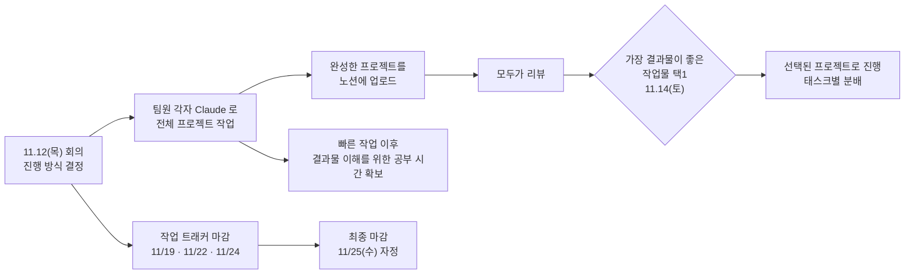

# 12. 회의록

> 10.29 · 11.05 · 11.12 팀 회의 기록을 정식 회의록 양식으로 정리하고, 11.12 결정 사항의 이행 결과와 다음 회의(11.19) 확인 안건을 정리한 문서 · 작성 기준일 2026-11-14

## 1. 개요

### 1.1 작성 기준

| 항목 | 내용 |
|---|---|
| 근거 자료 | Notion 팀 페이지의 회의 기록 원문 (회의록 · 기능 정리표 · 역할 분담 · 작업 트래커 마감일) |
| 작성 원칙 | 원문에 있는 내용만 옮긴다. 원문에 없는 발언·논의는 쓰지 않으며, 원문에 없는 칸은 '기록 없음' 으로 둔다 |
| 정리 | 윤준서 (Claude 활용), 2026-11-14 |
| 정기 회의 | 매주 목요일 12:00 · 강의실 (호실은 기록 없음) |
| 최종 마감 | 11/25(수) 자정 — 소프트웨어 · DB · 최종보고서 · PPT · 노션 링크 |
| 2~4장과 5~7장의 구분 | 2~4장은 회의 기록이다. 5~7장은 회의 기록이 아니라 윤준서 작업분(본 문서 세트와 코드)에서 11.12 결정을 어떻게 반영했는지와, 팀이 확인해야 할 사항을 정리한 것이다 |

### 1.2 회의 목록

| No | 회의명 | 일시 | 장소 | 참석 | 결정 사항 (요약) |
|---|---|---|---|---|---|
| 1 | 10.29 정기 회의 | 2026-10-29(목) 12:00 | 강의실 | 3명 | 개발 언어 파이썬, DBMS MySQL |
| 2 | 11.05 정기 회의 | 2026-11-05(목) 12:00 | 강의실 | 3명 | 기능 영역 5개 확정, 역할 A~E 분담 |
| 3 | 11.12 정기 회의 | 2026-11-12(목) 12:00 | 강의실 | 4명 | 각자 Claude 로 전체 작업 후 택1 · 숭실대학교 도서관과 동일한 규정 · 실제 도서 100개 · BOOK_COPY 개별 관리 · 연장·연체료 납부 기능 구현 |
| 4 | 11.19 정기 회의 (예정) | 2026-11-19(목) 12:00 | 강의실 | — | 7장 안건 |

### 1.3 참석 현황

| 팀원 | 10.29 | 11.05 | 11.12 |
|---|---|---|---|
| 임채선 | 명단에 없음 | 명단에 없음 | 참석 |
| 함성준 | 참석 | 참석 | 참석 |
| 너세리투 | 참석 | 참석 | 명단에 없음 |
| 강권영 | 명단에 없음 | 참석 | 참석 |
| 윤준서 | 참석 | 명단에 없음 | 참석 |

'명단에 없음' 은 원문 참석자 명단에 이름이 없다는 뜻이다. 불참 사유는 기록 없음.

## 2. 회의록 ① 10.29 정기 회의

| 항목 | 내용 |
|---|---|
| 회의명 | 10.29 정기 회의 |
| 일시 | 2026-10-29(목) 12:00 (종료 시각 기록 없음) |
| 장소 | 강의실 |
| 참석자 | 윤준서, 너세리투, 함성준 (3명) |
| 참석 명단에 없는 팀원 | 임채선, 강권영 |
| 원 기록 작성자 | 기록 없음 |
| 안건 | 기록 없음 (결정 사항으로 확인되는 주제: 개발 언어·DBMS 선정) |
| 논의 내용 | 기록 없음 |

### 2.1 결정 사항

| No | 결정 내용 (원문) |
|---|---|
| 1 | 개발 언어 - 파이썬 |
| 2 | DBMS - MySQL |

### 2.2 후속 조치

| 할 일 | 담당 | 기한 |
|---|---|---|
| 기록 없음 | 기록 없음 | 기록 없음 |

참고 (회의 기록 아님, 반영 현황): Python 3 · Flask 3 · PyMySQL (`requirements.txt`: Flask>=3.0, PyMySQL>=1.1, cryptography>=42), MySQL 8.0.19 이상 (`sql/01_schema.sql` 머리말).

## 3. 회의록 ② 11.05 정기 회의

| 항목 | 내용 |
|---|---|
| 회의명 | 11.05 정기 회의 |
| 일시 | 2026-11-05(목) 12:00 (종료 시각 기록 없음) |
| 장소 | 강의실 |
| 참석자 | 강권영, 너세리투, 함성준 (3명) |
| 참석 명단에 없는 팀원 | 임채선, 윤준서 |
| 원 기록 작성자 | 기록 없음 |
| 안건 | 기록 없음 (결정 사항으로 확인되는 주제: 기능 영역 확정, 역할 분담) |
| 논의 내용 | 기록 없음 (발언 기록 없음. 결과물로 기능 정리표와 역할 분담표가 남아 있음) |

### 3.1 결정 사항

| No | 결정 내용 (원문) | 결과물 |
|---|---|---|
| 1 | 기능 영역 5개 확정 | Notion 「기능 정리표」 (3.2) |
| 2 | 역할 A~E분담 | Notion 「역할 분담」 (3.3) |

### 3.2 기능 정리표 (Notion 원문)

기능 정리표의 운영 규칙 (원문): "이 표가 기능의 기준. 단위 업무 기술서 · 업무 흐름도 · ERD · 화면 설계는 전부 여기 기준으로 작성하고, 기능을 추가/삭제할 땐 회의에서 정한 뒤 이 표부터 고친다."

| 기능 영역 | 세부 기능 (원문) | 사용자 (원문) | 기능 ID (00 문서 4장 대응, 회의 기록 아님) |
|---|---|---|---|
| 회원 관리 | 회원 등록, 정보 수정, 탈퇴 처리, 회원 조회 | 사서 | MEM-01 · MEM-02 · MEM-03 · MEM-04 |
| 도서 관리 | 도서 등록, 정보 수정, 폐기 처리, 도서 검색 | 사서 (회원은 검색만) | BOOK-01 · BOOK-02 · BOOK-04 · BOOK-05 |
| 대출 관리 | 대출 가능 여부 검사, 대출 처리, 대출 내역 조회 | 사서 (회원은 본인 내역 조회만) | LOAN-01 · LOAN-02 · LOAN-03 |
| 반납 관리 | 반납 처리, 연체일수 자동 계산 | 사서 | RET-01 · RET-02 |
| 연체 관리 | 연체자 조회, 대출 정지 적용·해제 | 사서 | OVD-01 · OVD-02 · OVD-03 |

### 3.3 역할 분담 (Notion 원문)

원문에는 'A~E' 와 팀원의 대응이 적혀 있지 않다. 아래는 원문에 적힌 순서다.

| 팀원 | 보고서 산출물 | 구현 범위 |
|---|---|---|
| 임채선 | 프로젝트 개요서, 업무 기능도, PPT 취합·디자인 | PM, 개발 보조, UI/테스트 |
| 함성준 | 단위 업무 기술서, 업무 흐름도, 시연 시나리오 | 최종 발표, 노션 구축 |
| 너세리투 | 업무 문서 리스트, 개념적·논리적 데이터 모델(ERD, 스키마, 정규화) | DDL 검토 |
| 강권영 | 용어 사전, 도메인 정의서, 테이블 기술서 | 더미 데이터 구축 |
| 윤준서 | 물리적 데이터 모델(DDL, 인덱스) | DB 통합, 핵심 기능·쿼리 개발 |

### 3.4 후속 조치

작업 트래커 원문에는 번호와 마감일만 있다 (01~06 → 11/12, 07~11 → 11/19, 테스트 데이터 → 11/19, 시연 시나리오 → 11/22, 12 최종 결과 보고서(취합)·응용프로그램·발표 PPT → 11/24). 아래 표의 번호별 문서명은 본 문서 세트 번호(docs/01~11)에 맞춘 것이고, 담당은 3.3 역할 분담을 대응시킨 것이다 (회의 기록 아님). 11.05 회의에서 기한을 정했는지는 기록 없음.

| No | 할 일 (작업 트래커 항목) | 담당 (역할 분담 기준) | 기한 (작업 트래커) |
|---|---|---|---|
| 1 | 01 프로젝트 개요서 · 02 업무 기능도 | 임채선 | 11/12(목) |
| 2 | 03 단위 업무 기술서 · 04 업무 흐름도 | 함성준 | 11/12(목) |
| 3 | 05 업무 문서 리스트 · 06 개념적 데이터 모델 (ERD) | 너세리투 | 11/12(목) |
| 4 | 07 논리적 데이터 모델 (스키마·정규화) | 너세리투 | 11/19(목) |
| 5 | 08 물리적 데이터 모델 (DDL·인덱스) | 윤준서 | 11/19(목) |
| 6 | 09 용어 사전 · 10 도메인 정의서 · 11 테이블 기술서 | 강권영 | 11/19(목) |
| 7 | 테스트 데이터 구축 | 강권영 (더미 데이터 구축) | 11/19(목) |
| 8 | 시연 시나리오 | 함성준 | 11/22(일) |
| 9 | 응용프로그램 | 윤준서 (DB 통합, 핵심 기능·쿼리 개발) | 11/24(화) |
| 10 | 발표 PPT | 임채선 (PPT 취합·디자인) | 11/24(화) |
| 11 | 12 최종 결과 보고서 (취합) | 회의 기록의 역할 분담에 명시 없음 (01 프로젝트 개요서 9.1 은 작업 트래커 기준 함성준으로 적음 → 7장 No.10 에서 확인) | 11/24(화) |
| 12 | 최종 제출 (소프트웨어 · DB · 최종보고서 · PPT · 노션 링크) | 기록 없음 (팀 공통 최종 마감) | 11/25(수) 자정 |

## 4. 회의록 ③ 11.12 정기 회의

| 항목 | 내용 |
|---|---|
| 회의명 | 11.12 정기 회의 |
| 일시 | 2026-11-12(목) 12:00 (종료 시각 기록 없음) |
| 장소 | 강의실 |
| 참석자 | 윤준서, 강권영, 함성준, 임채선 (4명) |
| 참석 명단에 없는 팀원 | 너세리투 |
| 원 기록 작성자 | 기록 없음 |

### 4.1 안건 (원문 단락 기준)

1. (필독) 중요 결정사항 — 프로젝트 진행 방식 (명칭은 정리자가 붙임)
2. 도서 관리 방식 · 대출 권수 및 기간 · 연체 시 대출 정지 기준
3. 실제 도서 데이터
4. 도서 복본 관리
5. 연장 기능, 연체료 납부 기능
6. 추가 고려사항 (각자 생각해보고 의견 공유)

### 4.2 논의 내용

발언자별 논의 내용은 기록 없음. 원문에 남아 있는 진행 상황 공유와 미결 질문은 다음과 같다.

- 실제 도서 데이터: "국립중앙도서관 API 요청함 → 하루 뒤 승인 예정."
- 추가 고려사항: 아래 12개 질문을 "각자 생각해보고 의견 공유" 하기로 했다. 회의에서 결론을 낸 기록은 없다 (미결).

| No | 추가 고려사항 (원문) |
|---|---|
| 1 | 회원 계정 필수 여부 |
| 2 | 대출 정지 기간 기준 (연체일수만큼 vs 반납할 때까지) |
| 3 | 연체료 미납 시 대출 차단 여부 |
| 4 | 연체 중인 책 연장 가능 여부 |
| 5 | 반납예정일이 주말·휴관일이면? |
| 6 | 연장 시 원래 날짜+15일 vs 연장일+15일 |
| 7 | 분실·파손 처리 (복본 상태 '분실') |
| 8 | 대출 중 회원 탈퇴 · 대출 중 책 폐기 차단 여부 |
| 9 | 학생·교직원 대출 권수 차이 (회원 구분 속성) |
| 10 | 연체료 저장 위치 (LOAN 컬럼 vs FINE 테이블) |
| 11 | 연장 기록 (횟수만 vs 이력) |
| 12 | 상태값 목록 (도서복본: 대출 가능·대출 중·폐기·분실, 회원: 정상·정지·탈퇴) |

### 4.3 결정 사항

| No | 안건 | 결정 내용 (원문) |
|---|---|---|
| 11.12-1 | 진행 방식 | 각자 토요일까지 클로드를 돌려서 전체 프로젝트 작업 이후 가장 결과물이 좋은 작업물을 택1 하여 해당 프로젝트로 진행 |
| 11.12-2 | 진행 방식 | 각자 완성한 프로젝트는 노션에 올리고 모두가 리뷰해서 결정 |
| 11.12-3 | 진행 방식 | 가장 중요한 것은 결과물에 대한 이해이므로 빠른 작업 이후 공부하는 시간 확보 |
| 11.12-4 | 진행 방식 | 노션은 일단 유지 후 토요일에 프로젝트가 선택되면 태스크별로 분배 |
| 11.12-5 | 규정 기준 | 도서 관리 방식·대출 권수 및 기간·연체 시 대출 정지 기준: 숭실대학교 도서관과 동일하게 |
| 11.12-6 | 대출 규정 | 1인당 10권, 대출 기간 15일 |
| 11.12-7 | 연장 | 홈페이지 또는 모바일 앱을 통해 2회까지 |
| 11.12-8 | 연체 페널티 | 연체 시 도서 대출 자격 정지 및 매일 100원의 연체료 |
| 11.12-9 | 실제 도서 데이터 | 더미가 아닌 실제 도서관 API 로 실제 도서 목록. 100개. ISBN, 제목, 저자, 출판사, 출판연도 등 |
| 11.12-10 | 도서 복본 관리 | 현재 ERD 처럼 동일 도서의 각 실물 책을 BOOK_COPY 로 개별 관리 |
| 11.12-11 | 연장·연체료 납부 | 연장 기능, 연체료 납부 기능: 실제 프로그램에 구현 예정 |

11.12-1 ~ 11.12-4 의 진행 절차는 다음과 같다 (원문 내용을 정리자가 순서대로 배치).

### 4.4 후속 조치

| No | 할 일 | 담당 | 기한 | 근거 |
|---|---|---|---|---|
| 1 | Claude 로 전체 프로젝트 작업 | 팀원 각자 | 토요일 (11/14) | 11.12-1 |
| 2 | 완성한 프로젝트를 노션에 업로드 | 팀원 각자 | 기록 없음 (리뷰·선택이 토요일이므로 그 전) | 11.12-2 |
| 3 | 업로드된 작업물 리뷰 후 택1 | 전원 | 토요일 (11/14) | 11.12-2, 11.12-4 |
| 4 | 선택된 프로젝트 기준으로 태스크별 분배 | 기록 없음 | 프로젝트 선택 후 | 11.12-4 |
| 5 | 결과물 공부 시간 확보 | 전원 | 기록 없음 | 11.12-3 |
| 6 | 추가 고려사항 12개 의견 공유 | 팀원 각자 | 기록 없음 | 4.2 |
| 7 | 국립중앙도서관 API 승인 확인 | 기록 없음 (요청자 기록 없음) | 기록 없음 (원문 '하루 뒤 승인 예정' · 요청일 기록 없음) | 4.2 |
| 8 | 07 논리적 데이터 모델 · 08 물리적 데이터 모델 · 09 용어 사전 · 10 도메인 정의서 · 11 테이블 기술서 | 너세리투 (07) · 윤준서 (08) · 강권영 (09~11) | 11/19(목) | 작업 트래커 |
| 9 | 테스트 데이터 | 강권영 | 11/19(목) | 작업 트래커 |
| 10 | 시연 시나리오 | 함성준 | 11/22(일) | 작업 트래커 |
| 11 | 12 최종 결과 보고서 (취합) · 응용프로그램 · 발표 PPT | 취합: 회의 기록에 명시 없음 · 응용프로그램: 윤준서 · PPT: 임채선 | 11/24(화) | 작업 트래커 |

작업 트래커상 01~06 의 마감은 11/12 로, 이 회의 당일이다. 담당은 11.05 역할 분담 기준이며, 11.12-4 에 따라 프로젝트 선택 후 다시 나눌 수 있다.

## 5. 11.12 결정 사항 이행 결과 (윤준서 작업분, 11.14)

이 장은 회의 기록이 아니다. 11.12-1 에 따라 윤준서가 Claude 를 활용해 만든 작업분(`docs/`, `sql/`, `app/`, `scripts/`, `tests/`)에서 각 결정과 추가 고려사항을 어떻게 정하고 구현했는지 정리했다. 결정 내용은 00 설계 결정 사항 문서 3장을 따른다. 팀 합의를 거친 내용이 아니므로 7장 안건으로 확인한다. 데이터 건수는 2026-11-14 `library_db` 조회 값이다.

판정 표기: **반영** = 회의 결정대로 구현 · **변경 반영** = 숭실대 공식 규정에 맞춰 회의 결정과 다르게 구현 (팀 확인 필요) · **부분 반영** = 일부만 구현 · **진행 중** = 팀 절차가 남음.

### 5.1 11.12 결정 사항 이행

| No | 결정 | 판정 | 이행 내용 | 구현 위치 · 검증 |
|---|---|---|---|---|
| 11.12-1 · 2 | 각자 Claude 작업 후 노션 업로드·리뷰·택1 | 진행 중 | 본 문서 세트와 코드가 윤준서 작업분이다. 노션 업로드·리뷰·택1 결과는 이 문서 작성 시점에 기록 없음 | 전체 산출물 · 7장 No.9 |
| 11.12-3 | 결과물 이해·공부 시간 확보 | 진행 중 | 결정 근거와 구현 위치를 문서마다 함께 적어 학습 자료로 쓸 수 있게 했다 | 00 문서 (결정·근거), 각 문서의 구현 위치 표기 |
| 11.12-4 | 프로젝트 선택 후 태스크별 분배 | 진행 중 | 기록 없음 (이 문서 작성 시점) | 7장 No.9 |
| 11.12-5 | 숭실대학교 도서관과 동일하게 | 반영 | 숭실대 중앙도서관 공식 안내와 「숭실대학교 중앙도서관 규정」을 확인해 정책값과 업무 규칙에 반영 (6장) | `member_type` (`sql/03_base_data.sql`), `sql/02_programs.sql` 머리말 규칙 |
| 11.12-6 | 1인당 10권 | 변경 반영 | 학부생 10권은 같다. 숭실대 신분별 기준에 따라 휴학생 5 · 대학원생 15 · 전임교원 50 · 직원·비전임교원 15권을 함께 둔다 | `member_type.max_loan_count`, `sp_borrow` 한도 검사 · `test_05_borrow_limit` |
| 11.12-6 | 대출 기간 15일 | 변경 반영 | 공식 규정에 따라 학부생·휴학생 **14일** (대학원생·직원·비전임교원 30일, 전임교원 180일). 반납예정일 = `fn_next_open_day(CURDATE() + INTERVAL v_loan_days DAY)` | `member_type.loan_days`, `sp_borrow` · `test_04_borrow_success_sets_due_date_on_open_day` (계산식·휴관일 보정, 대학원생 30일 기준) · `test_10_renew_from_member_portal` (학부생 14일, 연장 기준) |
| 11.12-7 | 홈페이지 또는 모바일 앱으로 2회 | 부분 반영 | 연장 2회 (전임교원 1회). 홈페이지 경로는 웹 회원 포털로 구현, 사서 데스크 연장도 둔다. 별도 모바일 앱은 만들지 않았다 | `member_type.max_renew`, `sp_renew`, `renewal.channel` ('홈페이지'·'사서'), `/my/loans/<id>/renew`, `/loans/<id>/renew` · `test_10_renew_from_member_portal`, `test_11_renew_rules` |
| 11.12-8 | 연체 시 대출 자격 정지 | 반영 | 연체 도서를 가진 동안 대출·연장 불가. 반납하면 연체 차단은 풀리지만, 반납 때 부과된 연체료가 미납이면 납부·면제 전까지 계속 대출·연장 불가 (`test_20_overdue_return_creates_fine_then_pay_unblocks`). 회원 대출상태는 '대출정지' 로 계산. 사서가 기간을 정해 거는 대출정지도 둔다 | `sp_borrow` · `sp_renew` 연체 검사, `v_member_status.loan_state`, `suspension` · `sp_suspend_member` · `sp_release_suspension` · `test_01_borrow_blocked_for_overdue_member`, `test_50_suspend_and_release` |
| 11.12-8 | 매일 100원의 연체료 | 변경 반영 | 1권 1일 100원, 휴관일 제외 (회의록 '매일' → 공식 규정에 따라 휴관일 제외). 반납·분실 처리 때 연체일수 × `fine_per_day` 를 `fine` 에 확정 저장 | `member_type.fine_per_day` = 100 (5개 회원구분 모두), `fn_overdue_days`, `sp_return`, `sp_report_lost` · `test_20_overdue_return_creates_fine_then_pay_unblocks`, `test_21_overdue_days_exclude_closed_days` |
| 11.12-9 | 실제 도서관 API 로 실제 도서 100개 | 부분 반영 | 실제 도서 100종 (ISBN·서명·저자·출판사·발행연도·정가 100종, KDC 분류기호 99종 · 1종은 주류 분류만 있음). 국립중앙도서관 API 키 승인 전이라 행마다 출처 URL 을 남겨 조사했다 (`source` 열: 국립중앙도서관 페이지 65건, 알라딘 31건, 언론사 페이지 4건). API 클라이언트와 갱신 스크립트는 구현 완료 | `data/books.csv`, `book` 100건, `app/nl_api.py`, `scripts/import_books.py --refresh`, 도서 등록 ISBN 조회 `/books/new?lookup=ISBN` (BOOK-01) |
| 11.12-10 | BOOK_COPY 로 실물 책 개별 관리 | 반영 | 실물 1권 = `book_copy` 1행, 등록번호 `reg_no` (EM + 6자리, UNIQUE). 복본 157권 (1권 57종 · 2권 29종 · 3권 14종, EM000001 ~ EM000157). 복본당 미반납 대출 1건은 생성 컬럼 `active_copy_id` + `uq_loan_active_copy` 로 보장 | `book_copy`, `loan.active_copy_id` · `test_60_db_constraints` |
| 11.12-11 | 연장 기능 구현 | 반영 | LOAN-04 대출 연장 (회원 홈페이지·사서) | `sp_renew`, `renewal` (24건: 홈페이지 23 · 사서 1) |
| 11.12-11 | 연체료 납부 기능 구현 | 반영 | OVD-04 연체료 부과·납부·면제. 반납 시 자동 부과, 납부는 사서, 면제는 관리자만 | `fine`, `sp_settle_fine`, `/overdue/fines`, `/overdue/fines/<id>/pay`, `/overdue/fines/<id>/waive` (`admin_required`) · `test_20_overdue_return_creates_fine_then_pay_unblocks`, `test_22_waive_requires_admin` |

### 5.2 추가 고려사항 12개의 결정과 구현

| No | 고려사항 (원문 요약) | 결정 (00 문서 3장) | 구현 위치 | 검증 테스트 |
|---|---|---|---|---|
| 1 | 회원 계정 필수 여부 | 회원도 로그인한다. 학번·교번 `member_no` 가 로그인 ID, 비밀번호는 해시 저장. 회원 포털에서 도서 검색·본인 대출 내역 조회·연장 신청 | `member.member_no` · `member.password_hash`, `app/portal.py` (`/my/login`, `/my/`, `/my/books`, `/my/password`), SYS-02 | `test_70_access_control`, `test_10_renew_from_member_portal` |
| 2 | 대출 정지 기간 기준 | 반납할 때까지만 (연체 도서를 가진 동안 대출·연장 불가). 반납 후 추가 정지 기간 없음. 별도로 사서가 기간을 정해 거는 대출정지 (사유: 장기연체·자료훼손·규정위반·기타) | `v_member_status.overdue_loans` · `loan_state`, `suspension`, `sp_suspend_member` (1~365일), `sp_release_suspension` | `test_01_borrow_blocked_for_overdue_member`, `test_50_suspend_and_release` |
| 3 | 연체료 미납 시 대출 차단 | 미납 연체료가 있으면 대출·연장 불가 (팀 정책) | `sp_borrow`: '미납 연체료가 있어 대출할 수 없습니다.' · `sp_renew`: '미납 연체료가 있어 연장할 수 없습니다.' | `test_02_borrow_blocked_for_unpaid_fine`, `test_20_overdue_return_creates_fine_then_pay_unblocks` |
| 4 | 연체 중인 책 연장 | 불가. 본인의 다른 책이 연체여도 불가 | `sp_renew`: '연체 중인 도서가 있어 연장할 수 없습니다.' | `test_11_renew_rules` |
| 5 | 반납예정일이 주말·휴관일 | 휴관일(일요일·공휴일·개교기념일)이면 다음 개관일로 자동 조정. 토요일은 개관 (팀 정책) | `fn_next_open_day`, `closed_day` (139일, 사유 기준 '일요일' 97 · 공휴일·개교기념일 등 42, 2026-01-01 ~ 2027-12-27), 휴관일 추가 시 `sp_add_closed_day` 가 해당일 반납예정 대출 재계산 (SYS-03) | `test_04_borrow_success_sets_due_date_on_open_day`, `test_21_overdue_days_exclude_closed_days`, `test_23_new_closed_day_moves_due_dates` |
| 6 | 연장 시 원래 날짜+15일 vs 연장일+15일 | 연장한 날 + 대출기간 (숭실대 공식). 대출 당일 연장 불가. 늦어지지 않으면 거부 | `sp_renew`: `fn_next_open_day(CURDATE() + INTERVAL v_loan_days DAY)` · '대출 당일에는 연장할 수 없습니다.' · '지금 연장해도 반납예정일이 늦어지지 않습니다.' | `test_10_renew_from_member_portal`, `test_11_renew_rules` |
| 7 | 분실·파손 처리 | 복본 상태에 '분실'·'폐기'. 대출 중 분실은 분실 처리로 대출 종료 + 연체분 연체료 + 변상금 기준액 안내 (정가·발행연도를 모르면 사서가 결정). 파손 도서는 변상 후 '폐기'. 변상 이행 기록은 범위 제외 | `sp_report_lost` (`loan.return_type` = '분실', `book_copy.status` = '분실'), `fn_compensation` (정가 × 1.2 / 1.5 / 2.0 / 3.0), `book_copy.removed_date`, RET-03 | `test_30_report_lost` |
| 8 | 대출 중 회원 탈퇴 · 대출 중 책 폐기 | 둘 다 DB 트리거로 차단. 미납 연체료가 있어도 탈퇴 불가 | `trg_member_withdraw_check`: '반납하지 않은 도서가 있어 탈퇴 처리할 수 없습니다.' · '미납 연체료가 있어 탈퇴 처리할 수 없습니다.' / `trg_book_copy_status_guard`: '대출 중인 복본은 반납(또는 분실 처리) 후 상태를 변경할 수 있습니다.' | `test_41_withdraw_rules`, `test_31_discard_guard` |
| 9 | 학생·교직원 대출 권수 차이 | 다르다. 회원구분 테이블로 신분별 정책 관리 | `member_type` 5행 (UG 학부생 · UGL 휴학생 · GR 대학원생 · FAC 전임교원 · STF 직원·비전임교원), `member.type_code` → `fk_member_type` | `test_05_borrow_limit`, `test_11_renew_rules` (전임교원 1회) |
| 10 | 연체료 저장 위치 | FINE 테이블 분리 (대출 1건당 0..1건). 금액은 부과 시점에 확정 저장 | `fine` (`uq_fine_loan`, `status` 미납·납부·면제, `ck_fine_paid`) | `test_20_overdue_return_creates_fine_then_pay_unblocks` |
| 11 | 연장 기록 (횟수만 vs 이력) | 연장 이력 테이블. 횟수는 COUNT 로 계산 (중복 저장 안 함) | `renewal` (`prev_due_date`, `new_due_date`, `channel`, `staff_id`), `v_loan_detail.renew_count` | `test_10_renew_from_member_portal` |
| 12 | 상태값 목록 | 도서복본: 대출가능 / 대출중 / 분실 / 폐기. 회원: 정상 / 탈퇴 (계정 상태) + 대출상태는 계산값 (대출가능 / 대출정지 / 탈퇴). 회원 '정지' 는 저장하지 않음. 대출상태는 연체·대출정지만 반영하고 미납 연체료는 따로 표시한다 (미납 회원의 대출 거부는 `sp_borrow`) | `ck_book_copy_status`, `ck_member_status`, `v_member_status.loan_state` | `test_60_db_constraints` |

회의 원문과 표기가 다른 점: 원문의 '대출 가능·대출 중' 은 코드에서 띄어쓰기 없이 '대출가능'·'대출중' 이다. 원문의 회원 상태 '정지' 는 컬럼 값이 아니라 `v_member_status` 의 계산값 '대출정지' 로 바뀌었다.

### 5.3 검증 결과

`tests/test_scenarios.py` 통합 테스트 25개를 실행한 결과가 `docs/_test_output.txt` 에 있다: "Ran 25 tests" · "OK". 위 표의 테스트 이름은 모두 이 25개에 들어 있다.

## 6. 숭실대 공식 규정 확인 결과

11.12-5 ("숭실대학교 도서관과 동일하게") 에 따라 00 문서 2장에서 공식 안내와 규정 원문을 확인한 결과(2026-11-14)를 옮긴다. 회의 결정과 다른 항목은 7장에서 팀이 확인한다.

| 항목 | 11.12 회의록 | 숭실대 공식 규정 | 본 시스템 적용 | 판정 |
|---|---|---|---|---|
| 대출 권수 | 1인당 10권 | 학부생 10권, 휴학생 5권, 대학원생 15권, 전임교원 50권, 직원·비전임교원 15권 | 신분별 적용 (`member_type.max_loan_count`) | 학부생 기준 일치 · 신분별 차등은 회의록에 없음 |
| 대출 기간 | **15일** | 학부생·휴학생 **14일**, 대학원생·직원 30일, 전임교원 180일 | 14일 (학부생·휴학생) | **차이** → 7장 No.1 |
| 연장 횟수 | 2회까지 | 2회 (전임교원 1회) | 2회 (전임교원 1회) (`member_type.max_renew`) | 일치 · 전임교원 1회는 회의록에 없음 |
| 연장 기간 계산 | 질문으로 남음 (고려사항 6) | 연장한 날부터 대출기간만큼 연장 | 연장한 날 + 대출기간 (`sp_renew`) | 공식 규정 적용 |
| 연장 제한 | 고려사항 4 (연체 중인 책 연장 가능 여부) | 대출 당일 연장 불가 · 연체·제재 중 연장 불가 | 동일 + 미납 연체료가 있어도 불가 (팀 정책) | 공식 규정 적용 + 팀 정책 |
| 연체 시 정지 | 대출 자격 정지 (기간 기준은 고려사항 2 로 남음) | 연체자는 추가 대출·예약·연장 불가 (제24조). 고정 정지 기간 규정 없음 | 반납할 때까지 대출·연장 불가 + 사서 수동 대출정지 (제27조 이용 제한) | 공식 규정 적용 |
| 연체료 | 매일 100원 | 1권 1일 100원, 휴관일 제외 | 1권 1일 100원, 휴관일 제외 (`fn_overdue_days`) | 일치 · 휴관일 제외는 회의록에 없음 |
| 분실·훼손 | 고려사항 7 | 동일 도서 또는 상위판 변상. 불가 시 정가 × (4년 미만 1.2 / 10년 미만 1.5 / 20년 미만 2 / 이상 3) (제26조) | 분실 처리 + 변상금 기준액 계산 (`fn_compensation`) · 변상 이행 기록 제외 | 계산은 공식 규정 적용 · 이행 기록 범위 제외 |
| 휴관일 | 고려사항 5 | 법정공휴일·개교기념일 (제18조), 대출실은 일요일 휴무. 반납예정일이 휴관일일 때의 처리는 규정에 없음 | 다음 개관일로 조정 (`fn_next_open_day`) | 규정 없음 → 팀 정책 |
| 예약 | 기록 없음 | 있음 (전 복본 대출 중일 때) | 범위 제외 (기능 정리표에 없음) | 범위 제외 → 7장 No.3 |

출처 (00 문서 2장): https://oasis.ssu.ac.kr/library-services/circulation (대출/연장·예약·반납/연체/변상 탭), https://oasis.ssu.ac.kr/library-services/user01 ~ user05, https://rule.ssu.ac.kr/lmxsrv/law/lawFullContent.do?SEQ=163&SEQ_HISTORY=1160

## 7. 다음 회의(11.19) 확인 필요 안건

일시: 2026-11-19(목) 12:00 · 장소: 강의실. 아래 '현재 상태' 는 윤준서 작업분 기준이다.

| No | 안건 | 현재 상태 | 회의에서 정할 것 | 바꿀 경우 수정 위치 |
|---|---|---|---|---|
| 1 | 대출 기간 15일 (회의록) ↔ 14일 (숭실대 공식) | 학부생·휴학생 `loan_days` = 14 | 14일 유지 또는 15일로 변경. 연장 1회 기간도 `loan_days` 를 그대로 쓰므로 함께 바뀐다 | `sql/03_base_data.sql` 의 `member_type` 값 (UG·UGL) · `scripts/build_seed.py` 의 `MEMBERS` 대출기간 → `sql/05_sample_loans.sql` 재생성 · `tests/test_scenarios.py` `test_10_renew_from_member_portal` 의 기대값 `INTERVAL 14 DAY` · README 대출 규정 표 · 14일을 적은 문서 (00·01·03·04·05 등) |
| 2 | 대출 권수: 1인당 10권 (회의록) ↔ 신분별 차등 | 회원구분 5개, 학부생 10권 | 신분별 차등 유지 여부 (고려사항 9 와 연결) | `sql/03_base_data.sql` `member_type` 행 · `scripts/build_seed.py` `MEMBERS` 최대권수 → `sql/05_sample_loans.sql` 재생성 · README 대출 규정 표 |
| 3 | 예약 기능 범위 제외 | 구현 안 함 (기능 정리표에 없음) | 범위 제외 유지 또는 추가. 추가하면 11.05 규칙대로 기능 정리표부터 고친다 | 기능 정리표 · 예약 테이블·프로시저·화면 신규 (설계 없음) |
| 4 | 회원 로그인 채택 (고려사항 1) | 회원 포털 `/my` 구현 (샘플 회원 비밀번호 member1234), 웹 포털이 '홈페이지' 연장 경로 | 회원 로그인 채택 여부 · 모바일 앱 없이 웹 포털로 대신하는 것 승인 | 채택하지 않으면 SYS-02 와 회원 포털(`app/portal.py`) 제거. 이때 BOOK-05 회원 검색(`/my/books`)과 LOAN-03 회원 본인 조회(`/my/`)도 없어지므로 기능 정리표의 '회원은 검색만 / 본인 내역 조회만'을 다른 방식으로 충족해야 함. LOAN-04 는 사서 경로만 남음 |
| 5 | 국립중앙도서관 API 키 적용 | 11.12 에 "하루 뒤 승인 예정". 11.14 작업분은 키 없이 조사한 100종 사용 | 승인 여부 확인, 키 공유 방법, 데이터 갱신 담당 | `NL_CERT_KEY` 설정 → `scripts/import_books.py --refresh` → `scripts/build_seed.py` → `scripts/init_db.sh` |
| 6 | 변상 이행 기록 | 범위 제외 (변상금 기준액 계산·안내까지만, 00 문서 3장 No 7) | 이번 범위에 넣을지 향후 과제로 둘지 | 넣으면 변상 내역 저장 구조 신규 설계 필요 (현재 테이블 없음) |
| 7 | 규정에 없는 팀 정책 2건 승인 + 규정 해석 1건 확인 | 팀 정책: 미납 연체료 시 대출·연장 불가 · 반납예정일이 휴관일이면 다음 개관일 (`sql/02_programs.sql` 머리말 '우리 팀 정책'). 규정 해석: 연체 정지는 반납할 때까지(제24조) + 사서 수동 정지(제27조) | 각 정책 승인 여부 (고려사항 2·3·5) | `sp_borrow`, `sp_renew`, `fn_next_open_day`, `suspension` |
| 8 | 기능 정리표 갱신 | 11.12 결정분(연장 LOAN-04, 연체료 OVD-04) 과 작업분에서 추가한 기능(BOOK-03 복본 추가, RET-03 분실 처리, SYS-01~04) 이 Notion 기능 정리표에 없음 (2026-11-14 Notion 페이지 확인 기준) | 추가 기능 채택 여부를 정하고 11.05 규칙대로 기능 정리표부터 수정 | Notion 「기능 정리표」 · 00 문서 4장 |
| 9 | 프로젝트 택1 결과 확정 및 역할 재분배 | 11.12-4 의 "토요일에 프로젝트가 선택되면 태스크별로 분배" 결과는 이 문서 작성 시점에 기록 없음 | 선정 결과 기록 · 남은 작업 재분배 (11/19: 07~11 · 테스트 데이터, 11/22: 시연 시나리오, 11/24: 12 취합 · 응용프로그램 · PPT) · 결과물 이해를 위한 공부 분담 (11.12-3) | 작업 트래커 · 01 문서 9장 |
| 10 | '12' 번호와 최종 결과 보고서 취합 담당 | 작업 트래커의 12 는 '최종 결과 보고서 (취합)', 본 문서 세트의 12 는 '회의록'. 취합 담당은 회의 기록에 없음 | 번호 체계 정리, 취합 담당 확정 | 작업 트래커 · 01 문서 12장 산출물 목록 |
| 11 | 추가 고려사항 12개 의견 공유 (11.12 후속 조치) | 팀원 의견 공유 기록 없음. 작업분은 5.2 표대로 결정 | 5.2 표를 기준안으로 채택할지, 항목별로 바꿀지 | 00 문서 3장과 각 구현 위치 (5.2 표) |

## 8. 회의록 템플릿 (11.19 회의부터 사용)

작성 규칙

- 원문에 있는 발언·결정만 적는다. 쓸 내용이 없는 칸은 '기록 없음' 으로 둔다.
- 기능이 바뀌는 결정은 기능 ID (MEM-01 … SYS-04) 를 적고, 11.05 규칙대로 기능 정리표부터 고친다.
- 후속 조치는 담당·기한을 반드시 적고, 다음 회의 첫 안건에서 상태를 확인한다.
- 11.19 회의는 7장 표의 안건을 안건 칸에 옮겨 쓴다.

### 8.1 기본 정보

| 항목 | 내용 |
|---|---|
| 회의명 | MM.DD 정기 회의 |
| 일시 | 2026-MM-DD(목) 12:00 ~ 종료 시각 |
| 장소 | 강의실 (호실) |
| 참석자 | |
| 불참자 (사유) | |
| 작성자 | |
| 관련 문서 | Notion 페이지 · docs 문서 번호 |

### 8.2 지난 회의 후속 조치 점검

| No | 할 일 | 담당 | 기한 | 상태 (완료 · 진행 중 · 미착수) | 비고 |
|---|---|---|---|---|---|
| 1 | | | | | |

### 8.3 안건

| No | 안건 | 제안자 | 관련 기능 ID · 문서 |
|---|---|---|---|
| 1 | | | |

### 8.4 논의 내용

| 안건 No | 논의 내용 (발언자) | 미결 사항 |
|---|---|---|
| 1 | | |

### 8.5 결정 사항

| No | 결정 내용 | 관련 기능 ID | 기능 정리표 수정 필요 (예 · 아니오) | 영향 받는 문서·코드 |
|---|---|---|---|---|
| MM.DD-1 | | | | |

### 8.6 후속 조치

| No | 할 일 | 담당 | 기한 | 근거 (결정 No) |
|---|---|---|---|---|
| 1 | | | | |

### 8.7 다음 회의

| 일시 | 장소 | 예정 안건 |
|---|---|---|
| 2026-MM-DD(목) 12:00 | 강의실 | |
