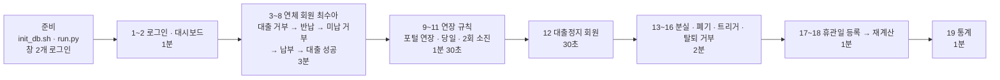
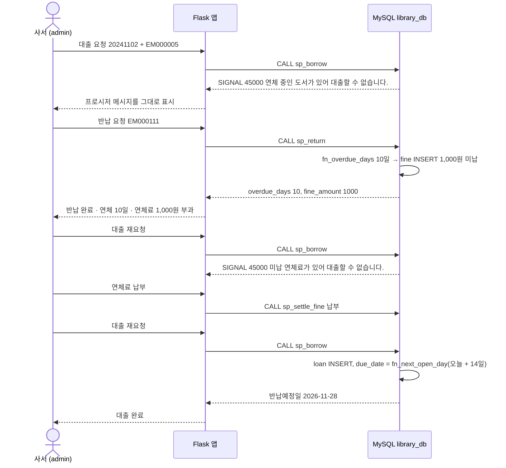
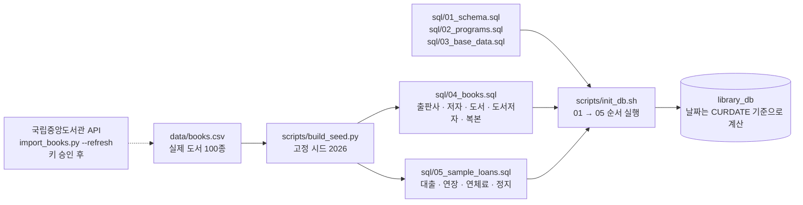

# 13. 시연 시나리오 · 테스트 데이터 · 테스트 결과

> 발표 시연의 준비 절차(DB 서버 분리 구성 포함), 발표용 5분 시연 순서와 전체 시나리오(리허설용 약 10분), 시연용 데이터 제어 SQL, 테스트 데이터 구축 방법과 건수, 자동 테스트 28개의 결과, 발표 예상 질문과 답변을 정리한다. 작성 기준일 2026-11-14 · 작성: 윤준서 (Claude 활용)

이 문서의 기준은 다음과 같다.

- 학번·등록번호·대출번호(`loan_id`)는 `sql/03_base_data.sql`·`sql/04_books.sql`·`sql/05_sample_loans.sql` 에 고정되어 있어 언제 초기화해도 같다.
- 날짜·연체일수·연체료·대출정지 종료일은 **DB 를 초기화한 날 기준 상대값**이다. 이 문서의 값은 2026-11-14(토)에 `scripts/init_db.sh` 로 초기화한 `library_db` 를 직접 조회한 값이다. 다른 날 초기화하면 1.3 의 확인 쿼리로 그날 값을 다시 본다.
- 화면 메시지는 `sql/02_programs.sql` 의 `SIGNAL ... MESSAGE_TEXT` 와 `app/*.py` 의 `flash(...)` 문자열 원문이다.

## 1. 시연 PC 준비 체크리스트

### 1.1 설치·실행 점검

| No | 항목 | 방법 | 확인 기준 |
|---|---|---|---|
| 1 | DB 서버 실행 확인 | DB 서버 `delboy-metal` 의 MySQL 8.4 컨테이너 (재부팅 시 systemd 가 자동 시작). 노트북에서 `tailscale status` 로 delboy-metal 이 보이는지, `tailscale ping 100.77.2.39` 로 응답이 오는지 확인 | `ssh delboy@100.77.2.39 'docker ps'` 에 `library-mysql … Up`. 비상용으로 노트북에 로컬 MySQL 8.x 도 설치해 둔다 (README '비상: 한 PC 에서 실행') |
| 2 | Python 가상환경·패키지 | `python3 -m venv .venv` → `.venv/bin/pip install -r requirements.txt` (Windows: `.venv\Scripts\pip install -r requirements.txt`) | Flask>=3.0 · PyMySQL>=1.1 · cryptography>=42 설치 완료. 설치에는 인터넷이 필요하므로 **발표 전에** 끝낸다 |
| 3 | 시연 당일 데이터 재생성 | 노트북에서 `ssh delboy@100.77.2.39 '~/library-system/deploy/db-server/init.sh'` (DB 서버에서 sql/01~05 실행). 비상 로컬 DB 는 `scripts\init_db.bat` | 마지막 줄 `완료: library_db 초기화`. 01~05 를 순서대로 실행하며 `01_schema.sql` 이 DB 를 지우고 다시 만든다 |
| 4 | 초기화하는 요일 | 가능하면 개관일(월~토, 공휴일·개교기념일 아님)에 초기화 | 이서연(20221057)의 '오늘 대출'은 휴관일에 초기화해도 오늘 날짜로 들어가므로(시드 생성기가 `loan_ago = 0` 을 예외 처리) 10단계(대출 당일 연장 불가)는 항상 시연된다. 다른 대출은 휴관일이면 직전 개관일로 앞당겨진다 |
| 5 | DB 날짜·시각 | `SELECT NOW(), @@time_zone;` | 연체·대출정지·대출 당일 판단이 모두 DB 서버의 MySQL `CURDATE()` 기준. DB 서버 PC 는 UTC 지만 MySQL 은 `+09:00` 으로 실행되므로 한국 날짜가 나와야 한다 |
| 6 | 시연 데이터 상태 | 1.3 의 SQL 실행 | 1.3 의 기대값과 일치 |
| 7 | 웹 서버 실행 | `set DB_HOST=100.77.2.39` 후 `.venv\Scripts\python run.py` (폰으로 회원 포털을 보이려면 `set APP_HOST=0.0.0.0` 도) | 시작 줄 ` * DB 서버 연결 OK : 100.77.2.39:3306 (호스트 delboy-metal, MySQL 8.4.13, …)`. 사서 화면 맨 아래 '시스템 구성' 줄에 DB 서버 delboy-metal 과 'DB 가 본 접속 계정 library@<노트북 IP>' 표시. 5000 포트를 다른 프로그램이 쓰고 있으면 실행되지 않으므로 미리 확인 |
| 8 | 브라우저 창 2개 | 사서 창 `http://127.0.0.1:5000/login` → admin · 회원 창 `http://127.0.0.1:5000/my/login` → 20231234 | 같은 브라우저의 창 2개여도 된다. 세션에 사서 키(`staff_id`)와 회원 키(`member_id`)를 따로 저장하고 로그아웃도 자기 키만 지운다 (`app/auth.py`, `app/portal.py`) |
| 9 | 사서 창은 admin 으로 | 휴관일 등록(17단계)·연체료 면제는 관리자만 가능 (`admin_required`) | 상단에 '김관리 (관리자)' 표시 |
| 10 | SQL 창 (MySQL Workbench) | 연결 2개를 만들어 둔다: ① Hostname 100.77.2.39 · root (비밀번호는 DB 서버의 `~/.library-db/root_password`) → `sql/demo_control.sql` 열기 ② 같은 주소 · library / library1234 → `sql/demo_app_account.sql` 열기 | 두 연결 모두 접속 성공, `demo_control.sql` 0절의 `@@hostname` 이 delboy-metal |
| 11 | 네트워크 리허설 | 발표 장소(교내 Wi-Fi)에서 전 단계 실행, 휴대폰 핫스팟으로도 한 번 | DB 서버까지는 Tailscale 이 필요하다 (11.19 교내 Wi-Fi 측정: 왕복 10~70ms, 페이지 0.04~0.11초). 화면은 외부 URL 이 없다 (CDN·웹폰트 미사용). DB 서버에 닿지 못하면 화면에 'DB 서버에 연결할 수 없습니다' 와 점검 순서가 나온다 → 핫스팟 → 그래도 안 되면 로컬 DB 로 `DB_HOST=127.0.0.1` |
| 12 | 테스트는 시연 전에만 | `tests/test_scenarios.py` 는 시작·종료 시 DB 를 초기화한다 | 시연 도중 실행 금지. 리허설·시연 뒤에는 3번 명령으로 원상 복구 |

발표 노트북 준비 명령 (`README.md`, 프로젝트 폴더의 명령 프롬프트, Tailscale 로그인 상태):

```
ssh delboy@100.77.2.39 "~/library-system/deploy/db-server/init.sh"
python -m venv .venv
.venv\Scripts\pip install -r requirements.txt
set DB_HOST=100.77.2.39
.venv\Scripts\python run.py
```

비상용 로컬 DB 로 전환할 때는 `scripts\init_db.bat` 으로 노트북 MySQL 을 초기화하고 `set DB_HOST=127.0.0.1` 로 다시 실행한다.

### 1.2 계정

| 용도 | 아이디 | 비밀번호 | 비고 |
|---|---|---|---|
| 사서 (관리자) | admin | admin1234 | `staff_id` 1 김관리. 시연은 이 계정으로 진행 |
| 사서 | lib01 | lib1234 | `staff_id` 2 박사서. 샘플 대출 이력의 처리 사서 |
| 회원 포털 | 학번·교번 (예: 20231234) | member1234 | 회원 27명 공통. 탈퇴 회원(20193579)은 "탈퇴한 회원입니다." 로 로그인 거부 |
| 앱 → DB | library | library1234 | `library_db` 에 SELECT · INSERT · UPDATE · DELETE · EXECUTE 만 부여 (DDL 불가). 호스트 `%` (웹 서버가 다른 PC) |
| DB 관리자 | root | DB 서버의 `~/.library-db/root_password` | 시연용 SQL(`sql/demo_control.sql`) 실행용. DB 서버가 Tailscale 주소에서만 접속을 받으므로 tailnet 안에서만 접속 가능 |

### 1.3 시연 직전 상태 확인 쿼리

```sql
-- 시연에 쓰는 회원의 대출상태 (v_member_status 가 조회 시점에 계산)
SELECT member_no, name, active_loans, overdue_loans, unpaid_fine, suspend_until, loan_state
  FROM v_member_status
 WHERE member_no IN ('20231234','20221057','20211388','20241102','20232245','20214410','20193321','20257001')
 ORDER BY member_id;

-- 시연에 쓰는 미반납 대출
SELECT member_no, member_name, loan_id, reg_no, title, DATE(loan_date) AS loan_day, due_date,
       renew_count, loan_state, overdue_days
  FROM v_loan_detail
 WHERE return_date IS NULL
   AND member_no IN ('20211388','20221057','20231234','20232245','20241102')
 ORDER BY member_no, loan_id;
```

2026-11-14 초기화 직후 조회 결과:

| 학번 | 이름 | 대출 중 | 연체 | 미납 연체료 | 대출정지 종료일 | 대출상태 |
|---|---|---|---|---|---|---|
| 20231234 | 김민준 | 2 | 0 | 0 | - | 대출가능 |
| 20221057 | 이서연 | 1 | 0 | 0 | - | 대출가능 |
| 20211388 | 박지훈 | 2 | 2 | 0 | - | 대출정지 |
| 20241102 | 최수아 | 1 | 1 | 0 | - | 대출정지 |
| 20232245 | 강하은 | 1 | 0 | 0 | - | 대출가능 |
| 20214410 | 장서준 | 0 | 0 | 700 | - | 대출정지 |
| 20193321 | 한지민 | 0 | 0 | 0 | 2026-11-24 | 대출정지 |
| 20257001 | 노현우 | 3 | 0 | 0 | - | 대출가능 |

| 학번 | loan_id | 등록번호 | 서명 | 대출일 | 반납예정일 | 연장 | 상태 |
|---|---|---|---|---|---|---|---|
| 20211388 | 217 | EM000128 | 아버지의 해방일지 | 2026-10-21 | 2026-11-04 | 0 | 연체 9일 |
| 20211388 | 220 | EM000007 | 모던 자바스크립트 Deep Dive | 2026-10-24 | 2026-11-07 | 0 | 연체 6일 |
| 20221057 | 230 | EM000134 | 연금술사 | 2026-11-14 | 2026-11-28 | 0 | 대출중 |
| 20231234 | 226 | EM000109 | 일반언어학 강의 | 2026-11-05 | 2026-11-24 | 1 | 대출중 |
| 20231234 | 228 | EM000006 | 리팩터링 2판 | 2026-11-09 | 2026-11-23 | 0 | 대출중 |
| 20232245 | 222 | EM000133 | 엄마를 부탁해 | 2026-10-31 | 2026-11-25 | 2 | 대출중 |
| 20241102 | 215 | EM000111 | 1984 | 2026-10-20 | 2026-11-03 | 0 | 연체 10일 |

시연에서 새로 대출·폐기할 복본은 모두 '대출가능' 상태다: EM000003 (SQL 첫걸음), EM000005 (데이터베이스 개론 (제3판)), EM000011 (밑바닥부터 시작하는 딥러닝, 같은 도서 3권 중 1권).

## 2. 시연 시나리오

### 2.0 발표용 시연 순서 (약 5~6분)

발표는 15분이고 기획 → 설계 → 구현 → 검증 스토리가 먼저이므로, 시연은 아래 6개 장면만 보여 준다. 단계 번호는 2.2 전체 시나리오의 번호다. 화면은 사서 창 · 회원 창(가능하면 폰) · MySQL Workbench 세 개를 띄워 둔다.

| 순서 | 시간 | 장면 | 보여 주는 것 | 화면 / SQL |
|---|---|---|---|---|
| A | 30초 | 분리된 구성 | 사서 화면 맨 아래 '브라우저 → 웹 서버 delboy → DB 서버 delboy-metal', Workbench 에서 `demo_control.sql` 0절 → `PROCESSLIST` 에 노트북 IP | 물리적 분리 (발표 기준) |
| B | 2분 | 연체 회원 대출 흐름 (3~8단계) | 대출 거부 → 반납 시 연체료 자동 부과(휴관일 제외) → 미납이라 거부 → 납부 → 대출 성공 | `sp_borrow`·`sp_return`·`fn_overdue_days`·`sp_settle_fine` |
| C | 40초 | 회원 포털 연장 (9단계) | 회원 창(폰)에서 연장 → 새 반납예정일 = 연장한 날 + 14일 | `sp_renew` 본인 확인 |
| D | 1분 | SQL 로 상태 바꾸기 | `demo_control.sql` 2-1: 김민준 대출을 SQL 로 연체로 → 사서 창 새로고침하면 '대출정지' → 되돌리기 | 데이터가 하나(DB 서버)라 즉시 반영 |
| E | 1분 | DB 가 막는 예외 | 3-1 이중 대출(UNIQUE 생성 컬럼), 3-6 대출 중 폐기(트리거), 3-8 연체 회원 대출(프로시저) | 규칙이 앱이 아니라 DB 에 있다 |
| F | 1분 | 권한 검증 | 4-2 `REVOKE EXECUTE` → 사서 창 대출 시 '프로시저 실행(EXECUTE) 권한이 없습니다', 조회는 정상 → `GRANT` 로 복구. 시간이 되면 `demo_app_account.sql` 의 `DROP TABLE` 거부 | 앱 전용 계정 최소 권한 |

시연용 SQL 파일:

| 파일 | 접속 | 절 |
|---|---|---|
| `sql/demo_control.sql` | root @ 100.77.2.39 | 0 분리 확인 · 1 시연 회원 상태 · 2 상태 변경 3개(연체 만들기, 대출 한도 변경, 대출정지) · 3 예외 10개(UNIQUE·CHECK 3·FK·트리거 2·프로시저 3) · 4 권한(SHOW GRANTS, REVOKE/GRANT EXECUTE, 사서 역할) · 5 끝난 뒤 확인. 상태를 바꾸는 절마다 '되돌리기' 가 있다 |
| `sql/demo_app_account.sql` | library @ 100.77.2.39 | 되는 것(SELECT·뷰·CALL) / 안 되는 것(DROP·CREATE·ALTER TABLE, DROP TRIGGER·PROCEDURE, CREATE USER, GRANT, mysql.user 조회, DROP DATABASE) |

11.19 실제 실행 결과 (노트북 → DB 서버 원격 접속): `demo_control.sql` 의 예외 10개가 각각 1062 · 3819 · 3819 · 3819 · 1452 · 1644 × 5 로 거부되고, 5절 결과가 1절과 같아 원래 상태로 돌아왔다. `REVOKE EXECUTE` 직후 실행 중인 웹 서버의 대출이 바로 막히고 `GRANT` 후 바로 풀렸다. `demo_app_account.sql` 은 1142 × 5 · 1370 · 1227 · 1044 × 2 로 거부되었다.

### 2.0.1 전체 시나리오 (리허설용 약 10분)

2.1~2.4 는 전체 기능을 확인하는 리허설용 시나리오다. 날짜는 2026-11-14 초기화 기준이므로 다른 날 초기화하면 날짜만 그날 기준으로 바뀐다 (1.3 확인 쿼리).

### 2.1 흐름과 시간 배분



### 2.2 단계별 시나리오

사서 창은 admin 으로, 회원 창은 20231234 로 로그인한 상태에서 시작한다. 메시지는 화면 위쪽의 알림 상자(flash)에 표시된다.

| 순서 | 화면(URL) | 입력 | 기대 결과(화면 메시지 원문) | 설명 포인트(동작하는 DB 객체) |
|---|---|---|---|---|
| 1 | 사서 창 `/login` · 회원 창 `/my/login` | admin / admin1234 · 20231234 / member1234 | 사서 창 상단 '김관리 (관리자)', 회원 창 제목 '김민준님의 도서관' | SYS-01·SYS-02. `staff`·`member` 의 `password_hash` (werkzeug scrypt 해시)로 확인. 회원은 학번(`member_no`)이 로그인 ID |
| 2 | 사서 창 `/` 대시보드 | 없음 | 제목 '2026년 11월 14일' · '오늘 대출 1건 · 반납 0건', 타일: 소장 도서 100종 155권 · 회원 26명 · 대출 중 24권 · 연체 중 5권 · 대출정지 회원 1명 · 미납 연체료 700원. '반납 예정 (오늘 ~ 2일 후)' 에 쇼코의 미소 (윤지우, 2026-11-16) | SYS-04. 모든 숫자는 저장값이 아니라 조회 시점 계산 (`loan.due_date < CURDATE()`, `suspension` 유효 기간, `fine.status = '미납'`). 155권 = 157권 중 분실·폐기 제외 |
| 3 | `/loans/borrow` | 학번 20241102 → 회원 조회 | 최수아 20241102 · 학부생, 대출상태 '대출정지', 연체 1권, "대출 불가: 연체 도서 1권 반납 필요" | LOAN-01. `v_member_status` 가 미반납·반납예정일 경과 대출 수(`overdue_loans`)로 대출상태를 계산. 회원 '정지'는 저장하지 않는다 |
| 4 | 같은 화면 | 등록번호 EM000005 → 대출 | "연체 중인 도서가 있어 대출할 수 없습니다. 연체 도서를 먼저 반납하세요." | LOAN-02. `sp_borrow` 의 `SIGNAL SQLSTATE '45000'` 메시지를 `app/db.py` 의 `error_message` 가 그대로 표시. 화면 안내와 별개로 프로시저가 최종 검사 (규정 제24조) |
| 5 | `/loans/return` | EM000111 → 반납 | "'1984' 반납 완료 · 최수아 · 연체 10일 · 연체료 1,000원 부과" | RET-01·RET-02·OVD-04. `sp_return` → `fn_overdue_days('2026-11-03', CURDATE())` = 11일 − 휴관일 1일(11-08 일요일) = 10일 × `fine_per_day` 100원 → `fine` INSERT (미납, 금액 확정 저장) → `book_copy` '대출가능' |
| 6 | `/loans/borrow?member_no=20241102` | EM000005 → 대출 | 화면 안내 "대출 불가: 미납 연체료 1,000원 납부 필요" → 대출 시 "미납 연체료가 있어 대출할 수 없습니다." | 연체 도서가 없어져 대출상태는 '대출가능'으로 바뀐다 (`v_member_status.loan_state` 는 정지·연체만 반영). 미납 차단은 `sp_borrow` 의 `fine.status = '미납'` 검사가 담당 (팀 정책, 00 문서 결정 3) |
| 7 | `/overdue/fines?q=20241102` | 미납 탭의 1984 · 1,000원 행 → 납부 | "연체료 납부를 처리했습니다." | OVD-04. `sp_settle_fine(fine_id, '납부', 1)` → `status`·`paid_date`·`staff_id` 기록 (`ck_fine_paid`: 미납 ⇔ `paid_date` NULL). 면제 버튼은 관리자에게만 보인다 |
| 8 | `/loans/borrow?member_no=20241102` | EM000005 → 대출 | "'데이터베이스 개론 (제3판)' 대출 완료 · 최수아 · 반납예정일 2026-11-28" | `sp_borrow`: 회원·복본 행 `FOR UPDATE` 잠금 → `loan` INSERT (`due_date = fn_next_open_day(CURDATE() + INTERVAL 14 DAY)`) → `book_copy` '대출중'. 학부생 14일은 `member_type.loan_days` |
| 9 | 회원 창 `/my/` | '리팩터링 2판' 행의 연장 신청 | "'리팩터링 2판' 연장 완료 · 새 반납예정일 2026-11-28 (연장 1회째)" | LOAN-04. `sp_renew(228, '홈페이지', NULL, 10001)` — 본인 대출인지 프로시저가 확인. 연장한 날(11-14) + 14일 = 11-28 (원래 반납예정일 11-23 + 14일이 아님, 00 문서 결정 6). `renewal` 행 추가 (`channel` 홈페이지, `staff_id` NULL) |
| 10 | 사서 창 `/loans/?q=20221057` | 이서연 '연금술사'(EM000134) 행의 연장 | "대출 당일에는 연장할 수 없습니다." | `sp_renew`: `DATE(loan_date) = CURDATE()` 검사. 사서 경로는 `channel` '사서' |
| 11 | `/loans/?q=20232245` | 강하은 '엄마를 부탁해'(EM000133, 연장 2) 행의 연장 | "연장 가능 횟수(2회)를 모두 사용했습니다." | 연장 횟수는 저장하지 않고 `renewal` COUNT 로 계산 (`v_loan_detail.renew_count`). 한도는 `member_type.max_renew` (학부생 2회, 전임교원 1회) |
| 12 | `/loans/borrow?member_no=20193321` | 회원 조회 → EM000003 → 대출 | 화면 안내 "대출 불가: 2026-11-24까지 대출정지" → 대출 시 "대출정지 기간입니다. (2026-11-24까지)" | OVD-02. `suspension` (자료훼손, `released_date IS NULL AND CURDATE() BETWEEN start_date AND end_date`). 종료일이 지나면 저장값을 바꾸지 않아도 자동으로 풀린다 |
| 13 | `/loans/?q=20211388` | 박지훈 '모던 자바스크립트 Deep Dive'(EM000007) 행의 분실 → 확인창 '분실 처리할까요? 대출이 종료되고 복본은 분실 상태가 됩니다.' 확인 | "'모던 자바스크립트 Deep Dive' 분실 처리 완료 · 박지훈 · 동일 도서로 변상 원칙 (불가 시 변상금 기준액 67,500원) · 연체 6일 · 연체료 600원 부과" | RET-03. `sp_report_lost`: `loan.return_type` '분실' → 연체분 `fine` → `book_copy` '분실' (`trg_book_copy_status_guard` 가 `removed_date` 기록). `fn_compensation` = 정가 45,000원 × 1.5 (2020년 발행, 경과 6년 → 10년 미만, 규정 제26조) |
| 14 | `/books/9788968484636` (밑바닥부터 시작하는 딥러닝) | EM000011 행 상태 '폐기' 선택 → 변경 → 확인창 '폐기 처리할까요?' 확인 | "EM000011 복본을 '폐기' 상태로 변경했습니다." 소장 현황 '이용 가능 복본' 3권 → 2권 | BOOK-04. 앱은 `UPDATE book_copy SET status` 만 실행하고 `trg_book_copy_status_guard` 가 `removed_date = CURDATE()` 기록 (`ck_book_copy_removed`). `v_book_summary` 는 분실·폐기 복본을 빼고 집계 |
| 15 (선택) | MySQL 클라이언트 | `UPDATE book_copy SET status = '폐기' WHERE reg_no = 'EM000005';` (8단계에서 대출된 복본) | 오류 1644 (SQLSTATE 45000) "대출 중인 복본은 반납(또는 분실 처리) 후 상태를 변경할 수 있습니다." | 화면은 대출중 복본의 상태 변경 칸을 '-' 로 비워 둔다. 화면을 거치지 않는 UPDATE 도 트리거가 DB 에서 막는다 (00 문서 결정 8) |
| 16 | `/members/10022` (노현우) | 탈퇴 처리 → 확인창 '탈퇴 처리할까요? 되돌릴 수 없습니다.' 확인 | "반납하지 않은 도서가 있어 탈퇴 처리할 수 없습니다." (선택: `/members/10009` 장서준 → "미납 연체료가 있어 탈퇴 처리할 수 없습니다.") | MEM-03. 앱은 `UPDATE member SET status = '탈퇴'` 만 실행하고 `trg_member_withdraw_check` 가 미반납·미납을 검사해 거부. 통과하면 `withdraw_date` 를 자동 기록 (`ck_member_withdraw`) |
| 17 | `/closed-days/` | 날짜 2026-11-28, 사유 임시휴관 → 등록 | "휴관일을 등록했습니다. 반납예정일이 조정된 대출 3건" | SYS-03. `sp_add_closed_day`: `closed_day` INSERT 후 반납예정일이 그날인 미반납 대출을 `fn_next_open_day` 로 재계산 → 11-28(임시휴관)·11-29(일요일)를 건너뛰어 2026-11-30. 3건 = 이서연 연금술사, 8단계 최수아 대출, 9단계 김민준 연장 |
| 18 | 회원 창 `/my/` 새로고침 | 없음 | '리팩터링 2판' 반납예정일 2026-11-30 | 회원 포털도 같은 `v_loan_detail` 을 읽으므로 즉시 반영된다 |
| 19 | 사서 창 `/stats/` | 없음 | 누적 반납 208건 · 연체 반납 31건 · 연체 반납률 14.9%, 인기 도서 TOP 10 1위 '정의란 무엇인가' 13회, 다독 회원 1위 최영수 16권 | SYS-04. `RANK() OVER (ORDER BY COUNT(*) DESC)` 윈도우 함수, 분류별 `LEFT JOIN` 집계. 초기값 206건·29건·14.1% 에 5단계 반납·13단계 분실이 더해진 값 |

### 2.3 핵심 구간 (3~8단계) 처리 순서



### 2.4 진행 시 주의

- 순서를 바꾸면 결과가 달라지는 단계가 있다. 17단계의 '3건'은 8·9단계를 먼저 했을 때의 값이고, 19단계 통계는 5·13단계를 했을 때의 값이다.
- 날짜는 2026-11-14 초기화 기준이다. 다른 날 초기화하면 8·9단계 반납예정일은 그날의 `fn_next_open_day(CURDATE() + 14일)`, 5단계 연체일수는 `fn_overdue_days` 결과로 바뀐다. 17단계에는 '오늘 대출·연장한 책의 반납예정일'(8·9단계 메시지의 날짜)을 입력하면 같은 시연이 된다.
- 6단계에서 회원 대출상태가 '대출가능'인데도 대출이 거부되는 점을 질문받을 수 있다. 대출상태는 정지·연체만 보는 `v_member_status.loan_state`, 미납 차단은 `sp_borrow` 가 따로 검사한다고 답한다.
- 15단계는 화면 시연이 아니므로 시간이 부족하면 생략한다.
- 시연이 끝나면 `./scripts/init_db.sh` 로 처음 상태로 되돌린다.

## 3. 테스트 데이터 구축

### 3.1 데이터 출처

| 구분 | 내용 |
|---|---|
| 도서 | **실제 도서 100종** (`data/books.csv`). 열: `isbn`, `title`, `authors`(이름:역할;…), `publisher`, `pub_year`, `price`, `kdc_no`, `category_code`, `source` |
| 출처 URL (`source` 열) | 국립중앙도서관 65종 (통합검색 결과 페이지 60, ISBN 서지정보 페이지 5) · 알라딘 상품 페이지 31종 · 언론 기사 4종 (머니투데이 2, 경향신문 1, 서울신문 1). 한 행에 출처 URL 1개 |
| 수집·검증 방법 | 국립중앙도서관 API 인증키 승인 전이라 알라딘·교보문고·국립중앙도서관 페이지로 ISBN 을 조사하고, 다른 에이전트가 독립 재검증한 목록을 사용 (00 문서 6장) |
| 값 채움 | 정가·발행연도 100종 모두 있음 (발행연도 1995~2025). KDC 분류기호는 99종에 있고 1종(백종원이 추천하는 집밥 메뉴 52)은 없어 분류코드 500 만 지정 |
| 분류 분포 (KDC 주류) | 800 문학 22 · 000 총류 15 · 300 사회과학 15 · 100 철학 10 · 400 자연과학 10 · 900 역사 8 · 500 기술과학 7 · 600 예술 5 · 700 언어 5 · 200 종교 3 |
| API 로 갱신 | 키가 나오면 `scripts/import_books.py --refresh` 가 같은 ISBN 을 국립중앙도서관 ISBN 서지정보 API 데이터로 갱신 (출처 열은 '국립중앙도서관 ISBN 서지정보 API'). 이후 `build_seed.py` → `init_db.sh` |
| 회원·사서·정책값 | `sql/03_base_data.sql` 에 직접 작성: 회원구분 5종 (숭실대 대출 안내 기준), 회원 27명, 사서 2명, KDC 주류 10개, 휴관일 |
| 휴관일 | 2026-01-04 부터 2027-12-26 까지의 일요일 + 법정공휴일·대체공휴일·전국동시지방선거(2026-06-03)·개교기념일(10/10)·성탄절. 일요일과 겹치는 공휴일은 공휴일 이름으로 저장 (`ON DUPLICATE KEY UPDATE`) |

### 3.2 생성 절차



`build_seed.py` 는 SQL 파일만 만들고 DB 에 접속하지 않는다. 실제 날짜 계산은 `init_db.sh` 가 05 파일을 실행할 때 DB 함수가 한다.

### 3.3 생성 규칙 (`scripts/build_seed.py`)

도서·복본 (`04_books.sql`)

| 규칙 | 내용 |
|---|---|
| 출판사·저자 번호 | CSV 에 처음 나오는 순서대로 1부터 부여 (출판사 56, 저자 155). `book_author.author_order` 는 `authors` 열의 순서 |
| 복본 수 | `copies_for(순번)`: 도서 순번이 7의 배수면 3권, 아니고 3의 배수면 2권, 나머지 1권 → 1권 57종 · 2권 29종 · 3권 14종 = 157권 |
| 등록번호 | 'EM' + `copy_id` 6자리 (EM000001 ~ EM000157). `ck_book_copy_reg_no` (`^EM[0-9]{6}$`) 와 일치 |
| 청구기호 | KDC 분류기호(없으면 분류코드) + '-' + 간이 저자기호 (저자명 첫 글자 + 둘째 글자 문자코드로 만든 두 자리 수 + 서명 첫 글자의 초성). 2번째 복본부터 ' c.2', ' c.3' |
| 배가위치 | KDC 주류별: 000·400·500 → 3층 과학기술자료실, 100·200·300·900 → 2층 인문사회자료실, 600·700·800 → 4층 어문예술자료실 |
| 입수일 | 발행연도 2024년 이전 → 2024-03-02, 2024~2025년 → 그 해 03-02, 2026년 이후 → 2026-03-02 |

대출 이력 (`05_sample_loans.sql`)

| 규칙 | 내용 |
|---|---|
| 상대 날짜 | 대출·연장·반납 시점을 날짜가 아니라 '오늘로부터 며칠 전' 정수(`loan_ago`, `return_ago`, `renew1_ago`, `renew2_ago`)로 저장. 초기화할 때 `CURDATE()` 기준으로 날짜를 만든다 → 언제 초기화해도 연체·반납 임박·당일 대출 상황이 재현된다. 대출정지 기간(`CURDATE()` 기준 ± 일수)과 `03_base_data.sql` 의 탈퇴 회원 탈퇴일(`CURDATE() - INTERVAL 90 DAY`)도 상대값 |
| 휴관일 보정 | 임시 함수 `fn_seed_open_day` 가 대출일·연장일·반납일이 휴관일이면 **그 전** 개관일로 앞당긴다 (휴관일에는 대출·반납 업무가 없으므로). 반납예정일은 실제 함수 `fn_next_open_day(대출일 + loan_days)`, 연장 후 반납예정일은 `fn_next_open_day(연장일 + loan_days)`. 예: 장서준의 '40일 전'(2026-10-05 대체공휴일) 대출은 10-04 일요일 · 10-03 개천절을 건너 2026-10-02 로 저장됐다 |
| 연장 생성 조건 | 연장일이 대출 다음 날 이후 · 반납예정일 이전 · 새 반납예정일이 기존보다 늦을 때만 `renewal` 생성 (`sp_renew` 규칙과 같음). 1차는 '홈페이지', 2차는 '사서'(lib01) |
| 연체료 생성 | 반납된 대출은 `fn_overdue_days(반납예정일, 반납일)` 이 0보다 크면 `fine` 생성 (금액 = 연체일수 × `fine_per_day`). 상태는 계획값(납부·면제·미납)대로, 납부 처리자는 lib01, 면제 처리자는 admin |
| 구간 겹침 방지 | `Planner` 클래스가 모든 대출을 배치 전에 검사. 같은 복본은 앞 대출 반납과 다음 대출 사이에 최소 `GAP` = 6일 (휴관일 보정으로 날짜가 앞당겨져도 겹치지 않도록), 분실된 복본은 이후 사용하지 않음. 같은 회원의 동시 대출 권수는 회원구분 최대 권수 이하. 위반하면 `assert` 로 생성 중단 |
| 규칙 위반 방지 | 회원마다 '대출·연장을 시작할 수 없는 기간'을 기록한다: 연체 중(반납예정일 ~ 반납일), 미납 연체료가 있는 동안(반납일 ~ 오늘), 대출정지 기간. 이 기간(휴관일 보정 여유 `BUFFER` = 5일 포함)에 시작하는 대출·연장은 만들지 않는다. 그래서 샘플 이력에도 '연체 중 대출', '정지 중 대출', '미납 중 연장'이 한 건도 없다 |
| 오늘 대출 | `loan_ago = 0` 인 시나리오 대출(이서연)은 휴관일에 초기화해도 오늘 날짜로 넣는다 (대출 당일 연장 불가 시연용) |
| 고정 시나리오 | 시연용 현재 상태를 먼저 배치 (아래 목록) |
| 무작위 이력 | `random.Random(2026)` 고정 시드로 전체 230건이 될 때까지 (최대 20,000회 시도) 추가. 대출일 = (대출기간 + 8)일 전 ~ 200일 전, 15% 는 연체 반납 (대출기간 + 4~12일 보유), 나머지는 3 ~ (대출기간 − 1)일 보유, 연체가 아닌 대출의 15% 는 대출 2~5일 뒤 연장, 50% 는 인기 복본(도서 순번 % 4 = 1) 중에서 선택, 연체료는 85% 납부 · 15% 면제. 전임교원(10024·10025)과 탈퇴 회원(10020)은 무작위 이력에서 제외 |
| 결정성 | `loan_id` 는 오래된 대출부터 1~230 순서로 부여. 같은 `books.csv` 로 다시 실행하면 같은 SQL 이 나온다 → 학번·등록번호·`loan_id` 가 고정 |
| 마무리 | 임시 테이블·프로시저·함수를 삭제하고, `book_copy` 상태를 대출 데이터와 맞춘다 (미반납 → 대출중, 분실 반납 → 분실). 대출 이력이 없는 대출가능 복본 중 `copy_id` 가 가장 큰 1권(EM000157 한국사신론)을 폐기. 대출정지 3건 (진행 중 1, 조기 해제 1, 기간 만료 1) |

고정 시나리오 (일수는 초기화 날로부터 며칠 전)

- 10001 김민준: 5일 전 대출 1권, 9일 전 대출 1권(4일 전 연장) — 포털 연장 시연
- 10002 이서연: 오늘 대출 1권 — 대출 당일 연장 불가
- 10003 박지훈: 24일·20일 전 대출 — 연체 2권
- 10004 최수아: 25일 전 대출 — 연체 1권 (대출 거부 → 반납 시 연체료)
- 10006 강하은: 13일 전 대출, 9일·3일 전 연장 — 연장 2회 소진
- 10008 윤지우: 12일 전 대출 — 반납 예정 임박
- 10009 장서준: 40일 전 대출, 20일 전 연체 반납, 연체료 미납
- 10011 한지민: 대출정지 진행 중 (3일 전 ~ 10일 후, 자료훼손)
- 10012 오태양: 60일 전 대출 — 장기 연체
- 10015 권나연: 70일 전 대출, 50일 전 분실 처리 (연체료 납부)
- 10020 문성훈: 150·125·100일 전 대출, 각 10일 뒤 반납 — 탈퇴 전 이력
- 10022 노현우(대학원생): 3·11·22일 전 대출 / 10023 유가은(대학원생): 38일 전 대출 — 연체
- 10024 이정훈(전임교원): 15·40·75·100·130일 전 대출 + 170일 전 대출(150일 전 연장 1회) / 10025 박미경: 8·33·61일 전
- 10026 최영수: 12일 전 / 10027 정다은: 26일 전
- 대출정지 이력: 10005 정예준 (규정위반, 조기 해제), 10013 서유진 (장기연체, 기간 만료)

### 3.4 테이블별 건수 (2026-11-14 초기화 직후 DB 조회)

| No | 테이블 | 한글명 | 건수 | 구성 |
|---|---|---|---|---|
| 1 | `member_type` | 회원구분 | 5 | UG 학부생 10권·14일·2회 · UGL 휴학생 5권·14일·2회 · GR 대학원생 15권·30일·2회 · FAC 전임교원 50권·180일·1회 · STF 직원·비전임교원 15권·30일·2회. 연체료 모두 1일 100원 |
| 2 | `member` | 회원 | 27 | 학부생 20 (탈퇴 1) · 휴학생 1 · 대학원생 2 · 전임교원 2 · 직원·비전임교원 2 |
| 3 | `staff` | 사서 | 2 | admin (관리자) · lib01 (사서) |
| 4 | `category` | 분류 | 10 | KDC 주류 000~900 |
| 5 | `publisher` | 출판사 | 56 | |
| 6 | `author` | 저자 | 155 | |
| 7 | `book` | 도서 | 100 | 실제 도서 |
| 8 | `book_author` | 도서저자 | 171 | 지은이 106 · 옮긴이 62 · 엮은이 2 · 그림 1 |
| 9 | `book_copy` | 도서복본 | 157 | 대출가능 131 · 대출중 24 · 분실 1 · 폐기 1 |
| 10 | `loan` | 대출 | 230 | 미반납 24 (그중 연체 5) · 반납 205 · 분실 1. 대출일 2026-05-01 ~ 2026-11-14 |
| 11 | `renewal` | 연장이력 | 15 | 홈페이지 14 · 사서 1 |
| 12 | `fine` | 연체료 | 22 | 납부 18건 11,000원 · 면제 3건 2,300원 · 미납 1건 700원 |
| 13 | `suspension` | 대출정지 | 3 | 진행 중 1 (한지민) · 조기 해제 1 (정예준) · 기간 만료 1 (서유진) |
| 14 | `closed_day` | 휴관일 | 139 | 2026년 71 · 2027년 68. 사유 '일요일' 97 · 공휴일 등 42 |

확인 쿼리:

```sql
SELECT 'member_type' AS t, COUNT(*) AS n FROM member_type UNION ALL
SELECT 'member', COUNT(*) FROM member UNION ALL
SELECT 'staff', COUNT(*) FROM staff UNION ALL
SELECT 'category', COUNT(*) FROM category UNION ALL
SELECT 'publisher', COUNT(*) FROM publisher UNION ALL
SELECT 'author', COUNT(*) FROM author UNION ALL
SELECT 'book', COUNT(*) FROM book UNION ALL
SELECT 'book_author', COUNT(*) FROM book_author UNION ALL
SELECT 'book_copy', COUNT(*) FROM book_copy UNION ALL
SELECT 'loan', COUNT(*) FROM loan UNION ALL
SELECT 'renewal', COUNT(*) FROM renewal UNION ALL
SELECT 'fine', COUNT(*) FROM fine UNION ALL
SELECT 'suspension', COUNT(*) FROM suspension UNION ALL
SELECT 'closed_day', COUNT(*) FROM closed_day;
```

### 3.5 시연·테스트용 회원

현재 상태는 2026-11-14 초기화 직후 `v_member_status`·`v_loan_detail` 조회 결과다.

| 학번 | 이름 | 회원구분 | 현재 상태 | 시연 용도 |
|---|---|---|---|---|
| 20231234 | 김민준 | 학부생 | 대출가능 · 2권 대출 중 (일반언어학 강의 연장 1회, 리팩터링 2판) | 회원 포털 시연 계정, 9·18단계 · test_05·10·12·70 |
| 20221057 | 이서연 | 학부생 | 대출가능 · 오늘 대출 1권 (연금술사 EM000134) | 10단계 대출 당일 연장 불가 · test_11 |
| 20211388 | 박지훈 | 학부생 | 대출정지 · 연체 2권 (9일, 6일) | 13단계 분실 처리 · test_11 (연체 중 연장 불가)·test_30 |
| 20241102 | 최수아 | 학부생 | 대출정지 · 연체 1권 (1984 EM000111, 10일) | 3~8단계 · test_01·20 |
| 20232245 | 강하은 | 학부생 | 대출가능 · 1권, 연장 2회 사용 (엄마를 부탁해 EM000133) | 11단계 · test_11 |
| 20221543 | 윤지우 | 학부생 | 대출가능 · 1권, 반납예정 2026-11-16 | 2단계 대시보드 '반납 예정' |
| 20214410 | 장서준 | 학부생 | 대출정지 · 미납 연체료 700원 (이기적 유전자 7일 연체 반납) | 16단계(선택) 미납 탈퇴 거부 · test_02·41·42 |
| 20193321 | 한지민 | 학부생 | 대출정지 · 자료훼손 2026-11-11 ~ 2026-11-24 | 12단계 · test_03 |
| 20233678 | 오태양 | 학부생 | 대출정지 · 장기 연체 36일 (침묵의 봄 EM000093) | 연체자 목록 1위 · test_22 |
| 20211234 | 권나연 | 학부생 | 대출가능 · 분실 처리 이력 (백년 허리 EM000085, 연체료 300원 납부) | 분실 이력 예시 |
| 20193579 | 문성훈 | 학부생 | 탈퇴 (탈퇴일 2026-08-16) | test_03 (탈퇴 회원 대출 거부) |
| 20201764 | 정예준 | 학부생 | 대출가능 · 정지 이력 (규정위반, 2026-10-15 조기 해제) | 정지 해제 이력 예시 |
| 20221999 | 서유진 | 학부생 | 대출가능 · 장기 연체 반납 이력(31일) 뒤 정지 이력 (장기연체, 기간 만료) | test_06 |
| 20243150 | 신동현 | 학부생 | 대출가능 · 대출 중 없음 | test_50 (정지 적용·해제) |
| 20224680 | 홍예린 | 학부생 | 대출가능 · 대출 중 없음 | test_41 (탈퇴 성공 후 포털 로그인 거부) |
| 20257001 | 노현우 | 대학원생 | 대출가능 · 30일 대출 3권 | 16단계 탈퇴 거부 · test_04·12·41 |
| 20247012 | 유가은 | 대학원생 | 대출정지 · 연체 7일 (교감완역 난중일기 EM000147) | 대학원생 연체 예시 |
| F2008011 | 이정훈 | 전임교원 | 대출가능 · 180일 대출 6권, 소년이 온다 연장 1회 (최대) | test_11 (연장 1회 한도) |

## 4. 테스트 결과

### 4.1 실행 방법

```bash
.venv/bin/python -m unittest -v tests.test_scenarios
```

- `tests/test_scenarios.py` 는 시작(`setUpClass`)과 종료(`tearDownClass`) 때 `scripts/init_db.sh` 로 DB 를 초기화하므로, 테스트 후 DB 는 시연 시작 상태로 돌아간다.
- 화면 검증은 Flask `test_client()` 로 실제 URL 에 요청하고 응답 HTML 에서 flash 알림 상자의 문구를 뽑아 비교한다 (`flashes()` 헬퍼). 사서 요청은 기본 lib01(사서), 관리자 검증만 admin 을 쓴다.
- DB 검증은 앱 계정 `library` 로 직접 접속해 조회한다 (`test_60`·`test_61` 은 이 계정으로 규칙 위반 SQL 을 직접 실행).
- `DB_HOST` 를 주면 그 DB 서버를 대상으로 테스트한다. 원격 DB 서버는 초기화 명령을 `MYSQL_BIN` 으로 지정한다 (README '테스트'). 11.19 에 로컬 MySQL 8.4 와 DB 서버 delboy-metal(교내 Wi-Fi → Tailscale) 양쪽에서 28개 모두 통과했다. 아래 4.3 원문은 DB 서버 대상 실행 결과다.

### 4.2 결과 표

| 테스트 ID | 검증 내용 | 관련 규칙·DB 객체 | 결과 |
|---|---|---|---|
| test_01_borrow_blocked_for_overdue_member | 연체 회원 20241102 대출 시 "연체 중인 도서가 있어 대출할 수 없습니다" | LOAN-02 · 규정 제24조 · `sp_borrow` | ok |
| test_02_borrow_blocked_for_unpaid_fine | 미납 연체료 회원 20214410 대출 시 "미납 연체료" 메시지 | 00 결정 3 · `sp_borrow` | ok |
| test_03_borrow_blocked_for_suspended_and_withdrawn | 대출정지 회원 20193321 → "대출정지 기간입니다. (YYYY-MM-DD까지)" 형식, 탈퇴 회원 20193579 → "탈퇴한 회원" | OVD-02 · `sp_borrow` · `suspension` | ok |
| test_04_borrow_success_sets_due_date_on_open_day | 대학원생 20257001 대출 성공 (등록번호 소문자 입력도 대문자로 처리), 반납예정일 = `fn_next_open_day(CURDATE() + 30일)` 이고 휴관일이 아님, 복본 '대출중' | LOAN-02 · `sp_borrow` · `fn_next_open_day` · `member_type.loan_days` | ok |
| test_05_borrow_limit | 20231234 를 학부생 한도 10권까지 대출한 뒤 11번째에 "대출 한도(10권)를 초과합니다" | `sp_borrow` · `member_type.max_loan_count` | ok |
| test_06_borrow_blocked_for_unavailable_copies | 대출중·분실 복본 → "현재 상태: 대출중" / "현재 상태: 분실", 없는 등록번호 EM999999 → "존재하지 않는 등록번호" | `sp_borrow` · `book_copy.status` | ok |
| test_10_renew_from_member_portal | 회원 포털에서 20231234 연장 → "연장 완료", 새 반납예정일 = `fn_next_open_day(CURDATE() + 14일)`, `renewal` 행 (`channel` 홈페이지, `prev_due_date` = 기존 반납예정일, `staff_id` NULL) | LOAN-04 · 00 결정 6·11 · `sp_renew` · `renewal` | ok |
| test_11_renew_rules | 당일 대출(20221057) → "대출 당일에는 연장할 수 없습니다", 2회 사용(20232245) → "연장 가능 횟수(2회)", 연체 회원(20211388) → "연체 중인 도서가 있어 연장할 수 없습니다", 전임교원 1회 사용(F2008011) → "연장 가능 횟수(1회)" | 00 문서 2장 연장 규정 (대출 당일 불가, 연체 시 불가, 전임교원 1회) · 00 결정 4 · `sp_renew` · `member_type.max_renew` | ok |
| test_12_member_cannot_renew_others_loan | 20231234 가 포털에서 20257001 의 대출을 연장 → "연장할 수 있는 대출이 아닙니다" | `sp_renew` 의 `p_member_id` 본인 확인 | ok |
| test_20_overdue_return_creates_fine_then_pay_unblocks | 20241102 연체 반납 → "연체 N일"·"연체료 (N×100)원 부과" (N = `fn_overdue_days`), `fine` (연체일수·금액·미납) 생성, 복본 '대출가능' → 대출 시 "미납 연체료" 거부 → 납부 "납부를 처리했습니다" → "대출 완료" | RET-01·RET-02·OVD-04 · `sp_return` · `fn_overdue_days` · `sp_settle_fine` · `sp_borrow` | ok |
| test_21_overdue_days_exclude_closed_days | 앞뒤가 개관일인 일요일 S 에 대해 `fn_next_open_day(S)` = 월요일, `fn_overdue_days(토요일, 월요일)` = 1 (일요일 제외) | RET-02 · 00 결정 5 · `fn_next_open_day` · `fn_overdue_days` · `closed_day` | ok |
| test_22_waive_requires_admin | 장기 연체(20233678) 반납으로 생긴 연체료를 사서(lib01)가 면제 → "관리자만", 관리자 면제 → "면제 처리", 이후 납부 → "이미 처리된" | OVD-04 · `admin_required` · `sp_settle_fine` | ok |
| test_23_new_closed_day_moves_due_dates | 가장 가까운 미래 반납예정일을 사서가 휴관일 등록 → "관리자만", 관리자 등록 → "휴관일을 등록했습니다", 해당 대출 반납예정일이 뒤로 밀리고 휴관일이 아님, 2020-01-01 등록 → "지난 날짜" | SYS-03 · `sp_add_closed_day` · `fn_next_open_day` | ok |
| test_30_report_lost | 연체 중인 20211388 대출 분실 처리 → "분실 처리 완료"·"변상금 기준액", `return_type`·복본 상태 '분실', `removed_date` 기록, 연체료 생성 | RET-03 · `sp_report_lost` · `fn_compensation` · `trg_book_copy_status_guard` | ok |
| test_31_discard_guard | 대출중 복본을 폐기 요청(화면 우회 POST) → "반납(또는 분실 처리) 후", 대출가능 복본 폐기 → `removed_date` 기록, 다시 '대출가능' → `removed_date` NULL | BOOK-04 · 00 결정 8 · `trg_book_copy_status_guard` · `ck_book_copy_removed` | ok |
| test_32_book_with_history_cannot_be_deleted | 대출 이력이 있는 도서 삭제 → "대출 이력이 있는 도서는 삭제할 수 없습니다" | `fk_loan_copy` (도서 삭제 → 복본 CASCADE → 대출이 참조 중이라 거부) | ok |
| test_33_book_form_keeps_author_roles_and_rejects_bad_input | 발행연도 2999 → "발행연도가 올바르지 않습니다", 지은이 "홍길동, 김철수 (엮은이)" 로 등록하면 역할이 지은이·엮은이로 저장되고 수정 화면·수정 저장 후에도 엮은이 유지, 복본 수가 숫자가 아니어도 오류 없이 처리 | BOOK-01·BOOK-02 · `book_author.author_role` · `ck_book_author_role` | ok |
| test_40_member_register_validation | 전화번호 01099990000 → "전화번호 형식", 학번 중복 20231234 → "이미 등록된 학번", 비밀번호 5자 → "8자 이상", 정상 입력 → "회원을 등록했습니다", 새 회원 포털 로그인 → `/my/` | MEM-01 · `ck_member_phone` · `uq_member_no` · SYS-02 | ok |
| test_41_withdraw_rules | 대출 중인 10022 → "반납하지 않은 도서", 미납 10009 → "미납 연체료", 10019 → "탈퇴 처리했습니다" 후 `status` 탈퇴·`withdraw_date` 기록, 탈퇴 회원 20224680 포털 로그인 → "탈퇴한 회원" | MEM-03 · 00 결정 8 · `trg_member_withdraw_check` · `ck_member_withdraw` | ok |
| test_42_member_state_matches_borrow_rules | 미납 연체료만 있는 20214410 의 `loan_state` 가 '대출정지', 회원 목록 '대출정지' 필터에 나오고 '대출가능' 필터에는 없음 | `v_member_status` (11.19 수정: 정지·연체·미납 = `sp_borrow` 거부 조건) | ok |
| test_50_suspend_and_release | 20243150 규정위반 7일 정지 → "대출정지 적용", 대출 → "대출정지 기간", 기간 = 오늘 포함 7일 (`DATEDIFF` 6), 해제 → "해제했습니다", 재해제 → "이미 해제된", 대출 → "대출 완료" | OVD-02·OVD-03 · `sp_suspend_member` · `sp_release_suspension` · `sp_borrow` | ok |
| test_60_db_constraints | 같은 복본 이중 대출 INSERT → `uq_loan_active_copy`, ISBN '1234567890123' → `ck_book_isbn`, 미반납 대출에 반납구분만 설정 → `ck_loan_returned`, 회원 상태 '정지' → `ck_member_status` | 무결성 제약 · 00 결정 12 · `active_copy_id` 생성 컬럼 | ok |
| test_61_app_account_has_no_ddl_privilege | 앱 계정 `library` 로 `DROP TABLE closed_day` → 권한 오류 | 앱 전용 계정 권한 (SELECT·INSERT·UPDATE·DELETE·EXECUTE) | ok |
| test_70_access_control | 비로그인 `/loans/` → `/login?next=/loans/?`, 비로그인 `/my/` → `/my/login?next=/my/?`, 회원 세션으로 `/members/` → 사서 로그인으로 이동, 포털 `/my/` 에 다른 회원 학번(20257001) 없음 | SYS-01·SYS-02 · `require_login` (`app/__init__.py`) | ok |
| test_71_pages_with_suspension_and_overdue_render | 대출정지 이력이 있는 회원(10011) 상세 화면과 포털 정상 표시, 연체만 있는 회원(20211388) 포털에 "연체 중인 도서가" 안내가 나오고 "-까지 대출이 정지" 문구는 없음, 휴관일 화면 `?year=abc` 도 정상 | MEM-04 · LOAN-03 · `v_member_status` · SYS-03 | ok |
| test_72_csrf_and_open_redirect | 다른 사이트 Origin 으로 보낸 POST → 403, 로그인 `next` 에 `//외부`·`%09//외부`·`https://외부` 를 넣어도 `/` 로 이동 | 보안 (`check_same_origin`, `safe_next`) | ok |
| test_80_system_info_shows_db_server | 사서 화면 맨 아래 'DB 서버' 와 DB 가 본 접속 계정 `library@<웹 서버 IP>` 표시, 회원 포털에는 표시 안 함 | `db.server_info()` (`SELECT @@hostname, @@version, USER()`) · 00 문서 7장 | ok |
| test_81_db_server_unreachable_shows_guide | 아무도 받지 않는 포트(127.0.0.1:1)로 설정한 앱에 로그인 → 503 'DB 서버에 연결할 수 없습니다' 와 점검 순서, 오류 로그 기록 | `app/__init__.py` `database_unavailable`, `db_error.html` | ok |

### 4.3 실행 결과 원문 (`docs/_test_output.txt`)

```text
test_01_borrow_blocked_for_overdue_member (tests.test_scenarios.LibraryScenarioTest.test_01_borrow_blocked_for_overdue_member) ... ok
test_02_borrow_blocked_for_unpaid_fine (tests.test_scenarios.LibraryScenarioTest.test_02_borrow_blocked_for_unpaid_fine) ... ok
test_03_borrow_blocked_for_suspended_and_withdrawn (tests.test_scenarios.LibraryScenarioTest.test_03_borrow_blocked_for_suspended_and_withdrawn) ... ok
test_04_borrow_success_sets_due_date_on_open_day (tests.test_scenarios.LibraryScenarioTest.test_04_borrow_success_sets_due_date_on_open_day) ... ok
test_05_borrow_limit (tests.test_scenarios.LibraryScenarioTest.test_05_borrow_limit) ... ok
test_06_borrow_blocked_for_unavailable_copies (tests.test_scenarios.LibraryScenarioTest.test_06_borrow_blocked_for_unavailable_copies) ... ok
test_10_renew_from_member_portal (tests.test_scenarios.LibraryScenarioTest.test_10_renew_from_member_portal) ... ok
test_11_renew_rules (tests.test_scenarios.LibraryScenarioTest.test_11_renew_rules) ... ok
test_12_member_cannot_renew_others_loan (tests.test_scenarios.LibraryScenarioTest.test_12_member_cannot_renew_others_loan) ... ok
test_20_overdue_return_creates_fine_then_pay_unblocks (tests.test_scenarios.LibraryScenarioTest.test_20_overdue_return_creates_fine_then_pay_unblocks) ... ok
test_21_overdue_days_exclude_closed_days (tests.test_scenarios.LibraryScenarioTest.test_21_overdue_days_exclude_closed_days) ... ok
test_22_waive_requires_admin (tests.test_scenarios.LibraryScenarioTest.test_22_waive_requires_admin) ... ok
test_23_new_closed_day_moves_due_dates (tests.test_scenarios.LibraryScenarioTest.test_23_new_closed_day_moves_due_dates) ... ok
test_30_report_lost (tests.test_scenarios.LibraryScenarioTest.test_30_report_lost) ... ok
test_31_discard_guard (tests.test_scenarios.LibraryScenarioTest.test_31_discard_guard) ... ok
test_32_book_with_history_cannot_be_deleted (tests.test_scenarios.LibraryScenarioTest.test_32_book_with_history_cannot_be_deleted) ... ok
test_33_book_form_keeps_author_roles_and_rejects_bad_input (tests.test_scenarios.LibraryScenarioTest.test_33_book_form_keeps_author_roles_and_rejects_bad_input) ... ok
test_40_member_register_validation (tests.test_scenarios.LibraryScenarioTest.test_40_member_register_validation) ... ok
test_41_withdraw_rules (tests.test_scenarios.LibraryScenarioTest.test_41_withdraw_rules) ... ok
test_42_member_state_matches_borrow_rules (tests.test_scenarios.LibraryScenarioTest.test_42_member_state_matches_borrow_rules) ... ok
test_50_suspend_and_release (tests.test_scenarios.LibraryScenarioTest.test_50_suspend_and_release) ... ok
test_60_db_constraints (tests.test_scenarios.LibraryScenarioTest.test_60_db_constraints) ... ok
test_61_app_account_has_no_ddl_privilege (tests.test_scenarios.LibraryScenarioTest.test_61_app_account_has_no_ddl_privilege) ... ok
test_70_access_control (tests.test_scenarios.LibraryScenarioTest.test_70_access_control) ... ok
test_71_pages_with_suspension_and_overdue_render (tests.test_scenarios.LibraryScenarioTest.test_71_pages_with_suspension_and_overdue_render) ... ok
test_72_csrf_and_open_redirect (tests.test_scenarios.LibraryScenarioTest.test_72_csrf_and_open_redirect) ... ok
test_80_system_info_shows_db_server (tests.test_scenarios.LibraryScenarioTest.test_80_system_info_shows_db_server) ... ok
test_81_db_server_unreachable_shows_guide (tests.test_scenarios.LibraryScenarioTest.test_81_db_server_unreachable_shows_guide) ... ok

----------------------------------------------------------------------
Ran 28 tests in 104.091s

OK
```

결과: **28개 모두 통과** (실패 0, 오류 0). 기능 영역별로 대출 6 · 연장 3 · 반납·연체료·휴관일 4 · 분실·폐기·삭제·도서 등록 4 · 회원 3 · 대출정지 1 · DB 제약·권한 2 · 접근 권한·화면·보안 3 · DB 서버 분리 2 개다.

## 5. 발표 예상 질문과 답변

### Q1. 업무 규칙을 왜 응용프로그램이 아니라 저장 프로시저에 두었나?

- **여러 화면이 같은 규칙을 쓴다.** 연장은 회원 포털(`/my/loans/228/renew` 형식)과 사서 화면(`/loans/228/renew` 형식) 두 경로가 모두 `sp_renew` 를 호출하고 `p_channel`('홈페이지'/'사서')만 다르다. 회원 경로는 `p_member_id` 로 본인 대출인지 프로시저가 확인한다 (test_12).
- **검사와 기록이 한 트랜잭션이다.** `sp_borrow` 는 회원 행과 복본 행을 `FOR UPDATE` 로 잠근 뒤 정지·연체·미납·한도·복본 상태를 검사하고 곧바로 `loan` INSERT 와 `book_copy` UPDATE 를 한다. 검사와 기록 사이에 다른 요청이 끼어들 수 없다.
- **오류 메시지가 한 곳에 있다.** 규칙 위반은 `SIGNAL SQLSTATE '45000'` 으로 알리고, `app/db.py` 의 `error_message` 가 오류 코드 1644 이면 `MESSAGE_TEXT` 를 그대로 화면에 보여 준다. 대출 화면의 '대출 불가' 안내는 `v_member_status` 로 미리 보여 주는 것이고 최종 판단은 프로시저다 (사유가 떠 있어도 대출 버튼은 눌리고, `sp_borrow` 가 거부한다).
- 한계: 앱 계정 `library` 에 DML 권한이 있어 프로시저를 거치지 않는 SQL 도 실행할 수 있다. 그래서 반드시 지켜야 하는 불변식(복본당 미반납 대출 1건, 상태값 도메인, 대출 중 복본 폐기·대출 중 회원 탈퇴 금지)은 제약조건과 트리거로 한 번 더 막았다 (test_31·41·60).

### Q2. 회원의 '대출정지' 상태를 왜 `member` 테이블에 저장하지 않나?

대출정지는 세 원인에서 생긴다. 사서가 기간을 정해 거는 `suspension`(규정 제27조), 반납예정일이 지난 미반납 대출(규정 제24조), 미납 연체료(팀 정책, 00 문서 결정 3)다. 앞의 둘은 날짜가 지나면 저절로 바뀌고 (정지 종료일이 지나면 해제, 반납예정일이 지나면 연체), 미납은 납부·면제하는 순간 풀린다. 세 조건은 `sp_borrow`·`sp_renew` 가 거부하는 조건과 같다 (test_42). 이를 컬럼에 저장하면 매일 상태를 갱신하는 작업과 반납·해제 때마다 동기화가 필요하고, 하나라도 빠지면 데이터가 어긋난다 (00 문서 결정 12). 그래서 `member.status` 에는 계정 상태(정상/탈퇴)만 저장하고 (`ck_member_status`), 대출상태(대출가능/대출정지/탈퇴)는 `v_member_status.loan_state` 가 조회할 때 계산한다. test_60 에서 `UPDATE member SET status = '정지'` 가 `ck_member_status` 로 거부되는 것을 확인했다. 시연 12단계의 한지민은 정지 종료일 2026-11-24 이 지나면 아무 UPDATE 없이 대출가능이 된다.

### Q3. 도서(`book`)와 도서복본(`book_copy`)을 왜 나눴나?

`book` 은 ISBN 단위 서지정보(서명·출판사·저자·발행연도·정가·KDC), `book_copy` 는 등록번호(바코드) 단위 실물(청구기호·배가위치·상태·입수일·분실·폐기일)이다. 같은 책을 여러 권 소장하고 (샘플 100종 157권), 대출·분실·폐기는 실물 1권 단위로 일어난다. 하나로 합치면 서지정보가 복본 수만큼 반복되어 ISBN 에 종속된 속성이 중복되고 갱신 이상이 생긴다. 그래서 `loan.copy_id` 는 복본을 참조하고, 도서별 이용 가능·대출가능 권수는 `v_book_summary` 가 계산한다. 시연 13단계에서 EM000007 이 분실돼도 같은 도서의 EM000008 은 계속 대출할 수 있다.

### Q4. 휴관일은 어떻게 계산하나?

- `closed_day` 테이블에 2026~2027년 휴관일 139일(일요일, 법정공휴일·대체공휴일, 개교기념일 10/10 등)을 저장한다. 토요일은 개관이다.
- 반납예정일 = `fn_next_open_day(대출일 + 대출기간)`: 그날이 휴관일이면 하루씩 넘겨 다음 개관일을 돌려준다. 반납예정일이 휴관일일 때의 처리는 숭실대 규정에 없어 팀 정책으로 정했다 (00 문서 결정 5).
- 연체일수 = `fn_overdue_days(반납예정일, 기준일)` = `DATEDIFF` − (반납예정일 다음 날 ~ 기준일 사이 휴관일 수). 규정의 '휴관일 제외'를 그대로 옮겼다. 예: 최수아 반납예정일 2026-11-03, 11-14 반납 → 11일 − 11-08(일) = 10일 → 1,000원.
- 휴관일을 새로 등록하면 `sp_add_closed_day` 가 그날이 반납예정일인 미반납 대출을 다시 계산한다 (시연 17단계: 11-28 → 11-29 일요일도 넘겨 11-30). test_21·23 에서 검증했다.

### Q5. 회의록은 대출기간 15일인데 왜 14일인가?

11.12 회의에서 "숭실대학교 도서관과 동일하게" 하기로 했고, 숭실대 공식 안내와 규정의 학부생·휴학생 대출기간은 14일이다 (대학원생·직원 30일, 전임교원 180일). 회의록의 15일과 달라 공식 규정 값인 14일을 적용했고, 팀 확인이 필요한 항목으로 00 문서에 표시해 두었다. 대출기간은 코드가 아니라 `member_type.loan_days` 값이므로 그 값만 바꾸면 15일이 되고, 연장 기간도 같은 값을 쓴다. 이미 대출된 건의 반납예정일은 대출 시점에 `loan.due_date` 로 저장되어 있어 바뀌지 않는다.

### Q6. 국립중앙도서관 API 는 어떻게 쓰나?

`app/nl_api.py` 가 국립중앙도서관 ISBN 서지정보 API(`https://www.nl.go.kr/seoji/SearchApi.do`)를 호출하고, KDC 분류기호가 비어 있으면 소장자료 검색 API 로 보강한다. 인증키는 환경변수 `NL_CERT_KEY` 로 넣는다. 도서 등록 화면(`/books/new`)의 'ISBN 조회' 버튼이 서지정보를 입력란에 채워 주고 사서가 확인 후 등록한다 (BOOK-01). 키 승인 전이라 샘플 100종은 국립중앙도서관·알라딘 등 페이지로 조사해 출처 URL 과 함께 `data/books.csv` 에 저장했고, 키가 나오면 `scripts/import_books.py --refresh` 로 같은 ISBN 을 API 데이터로 갱신한다. 시연은 API 없이 동작한다.

### Q7. 두 사서가 같은 책을 동시에 대출 처리하면?

두 겹으로 막는다.

1. `sp_borrow` 가 회원 행(`FOR UPDATE OF m`)과 복본 행(`book_copy ... FOR UPDATE`)을 잠그고 상태를 검사한다. 먼저 잠근 트랜잭션이 복본을 '대출중'으로 바꾸고 커밋할 때까지 다른 트랜잭션은 기다리고, 그 뒤 "대출할 수 없는 복본입니다. (현재 상태: 대출중)" 을 받는다. 회원 행도 잠그므로 같은 회원의 동시 대출로 한도를 넘는 일도 없다.
2. 프로시저를 거치지 않더라도 `loan` 의 생성 컬럼 `active_copy_id`(미반납이면 `copy_id`, 반납 후 NULL)에 UNIQUE 제약 `uq_loan_active_copy` 가 있어 복본당 미반납 대출은 1건만 존재할 수 있다. test_60 에서 이중 대출 INSERT 가 이 제약으로 거부되는 것을 확인했다.

앱은 `app/db.py` 의 `transaction()` 으로 커밋하고 예외가 나면 롤백한다.

### Q8. 연장하면 반납예정일은 어떻게 정해지고, 연장 횟수는 왜 저장하지 않나?

숭실대 방식대로 "연장한 날부터 대출기간만큼" 늘린다: `fn_next_open_day(CURDATE() + loan_days)`. 시연 9단계에서 '리팩터링 2판'의 반납예정일 2026-11-23 은 11-14 연장으로 2026-11-28 이 된다 (11-23 + 14일 = 12-07 이 아니다, 00 문서 결정 6). 너무 일찍 연장하면 오히려 짧아질 수 있으므로 새 날짜가 기존보다 늦지 않으면 "지금 연장해도 반납예정일이 늦어지지 않습니다." 로 거부한다. 연장 1회는 `renewal` 1행(연장 전·후 반납예정일, 신청경로, 처리 사서)으로 남기고, 횟수는 `COUNT` 로 계산한다 (`v_loan_detail.renew_count`). 횟수를 따로 저장하면 이력과 어긋날 수 있어서다 (00 문서 결정 11).

### Q9. 연체료를 왜 별도 테이블(`fine`)로 두었고, 미납이면 왜 대출을 막나?

대부분의 대출은 연체가 없어 `loan` 에 연체료 컬럼을 두면 NULL 이 대부분이다 (샘플 230건 중 연체료 29건). `fine` 은 대출 1건당 0..1건(`uq_fine_loan`)이고, 금액은 부과 시점에 확정 저장해 나중에 `member_type.fine_per_day` 가 바뀌어도 과거 금액이 유지된다. 미납·납부·면제 상태와 처리일·처리 사서를 남기며, 면제는 관리자만 할 수 있다 (`admin_required`, test_22) (00 문서 결정 10). 미납 연체료가 있으면 대출·연장을 막는 것은 숭실대의 "연체 및 기타 제재사항이 있는 경우 연장 불가"를 대출에도 적용한 팀 정책이다 (00 문서 결정 3).

### Q10. 탈퇴와 폐기는 왜 프로시저가 아니라 트리거로 막나?

탈퇴(`/members/10022/withdraw` 형식)와 복본 상태 변경(`/books/copies/11/status` 형식)은 앱이 일반 `UPDATE` 로 처리한다. 어떤 경로의 UPDATE 든 검사되도록 `BEFORE UPDATE` 트리거를 걸었다. `trg_member_withdraw_check` 는 미반납 도서나 미납 연체료가 있으면 거부하고, 통과하면 `withdraw_date` 를 자동 기록한다. `trg_book_copy_status_guard` 는 미반납 대출이 있는 복본을 대출가능·분실·폐기로 바꾸지 못하게 하고, 분실·폐기면 `removed_date` 를 기록한다. 화면도 대출중 복본에는 상태 변경 칸을 숨기지만, test_31 처럼 화면을 거치지 않고 요청해도 트리거가 막는다. 대출 이력이 있는 도서 삭제는 외래키 `fk_loan_copy` 가 막는다 (test_32).

### Q11. DB 서버와 클라이언트는 어떻게 분리했나? 정말 다른 PC 인가?

DB 는 집에 있는 Ubuntu 서버 `delboy-metal` 의 Docker 컨테이너(MySQL 8.4)에서 돌고, 발표 노트북은 브라우저와 웹 서버(Flask)만 실행한다. 웹 서버는 `DB_HOST=100.77.2.39` 로 Tailscale 을 거쳐 접속한다. 확인 방법은 세 가지다. ① 사서 화면 맨 아래 줄: 'DB 서버 100.77.2.39:3306 · 호스트 delboy-metal', 'DB 가 본 접속 계정 library@100.113.213.25'(노트북 IP). ② DB 에서 `SELECT @@hostname` = delboy-metal, `information_schema.PROCESSLIST` 의 host 가 노트북 IP. ③ Tailscale 을 끊으면 화면이 'DB 서버에 연결할 수 없습니다' 로 바뀐다. 논리적으로도 화면·응용·데이터 3계층이고, 업무 규칙은 DB 프로시저·트리거에 있어 앱 계정의 EXECUTE 를 빼면 대출이 바로 막힌다 (`demo_control.sql` 4-2).

### Q12. 왜 Tailscale 을 썼나? 포트포워딩이나 학교 서버는?

공유기 포트포워딩으로 3306 을 인터넷에 열면 누구나 접속을 시도할 수 있다. Tailscale 은 팀 기기끼리만 WireGuard 로 암호화된 사설망을 만들어 주고, 교내 Wi-Fi 처럼 서로 직접 접속이 막힌 네트워크에서도 동작한다. MySQL 은 `--bind-address=100.77.2.39` 로 Tailscale 주소에서만 접속을 받으므로 같은 집 공유기(192.168.0.x)에서도 3306 에 닿지 않는다 (`ss -ltn` 으로 확인). 학교 서버는 쓸 수 있는 것이 없었다.

### Q13. DB 가 원격이면 느리지 않나? 네트워크가 끊기면?

처음에는 요청마다 새로 연결해 교내 Wi-Fi 에서 페이지당 0.5~1초가 걸렸다 (연결 한 번에 네트워크 왕복이 여러 번). `app/db.py` 에 연결 풀(8개)을 넣어 요청이 끝난 연결을 다시 쓰게 했고 0.04~0.11초로 줄었다. 끊긴 연결은 풀에서 꺼낼 때 `USE library_db` 로 걸러 새로 연결한다. 네트워크가 끊기면 오류 화면 대신 원인과 점검 순서가 나오고(503), 핫스팟 → 노트북 로컬 MySQL(`DB_HOST=127.0.0.1`) 순서로 대비했다.

### Q14. DB 서버 PC 가 UTC 인데 날짜 계산은 괜찮나?

MySQL 을 `--default-time-zone=+09:00` 으로 실행해 `CURDATE()`·`NOW()` 가 한국 시각이다. 그대로 두면 오전 9시 전에는 `CURDATE()` 가 전날이 되어 반납예정일·연체일수·'대출 당일 연장 불가' 판단이 하루 어긋난다. 연체·정지 판단은 모두 DB 의 `CURDATE()` 기준이라 DB 서버 시간대 하나만 맞추면 된다.
