# 도서관 대출·반납·연체 관리 시스템 — 최종 결과 보고서

> 데이터베이스 팀 프로젝트 · Python Flask + MySQL · 취합일 2026-11-19

| 항목 | 내용 |
|---|---|
| 팀원 | 임채선, 함성준, 너세리투, 강권영, 윤준서 |
| 기준 규정 | 숭실대학교 중앙도서관 대출 규정 |
| 소스 코드 | library-system (sql/ · app/ · scripts/ · tests/) |

## 목차

- 01. 프로젝트 개요서
- 02. 업무 기능도
- 03. 단위 업무 기술서
- 04. 업무 흐름도
- 05. 업무 문서 리스트
- 06. 개념적 데이터 모델 (ERD)
- 07. 논리적 데이터 모델 (릴레이션 스키마 · 정규화)
- 08. 물리적 데이터 모델 (DDL · 제약조건 · 인덱스)
- 09. 용어 사전
- 10. 도메인 정의서
- 11. 테이블 기술서
- 12. 회의록
- 13. 시연 시나리오 · 테스트 데이터 · 테스트 결과
- 부록. 설계 결정 사항 (모든 문서의 기준)

---

# 01. 프로젝트 개요서

> 도서관 대출·반납·연체 관리 시스템의 배경·목적·범위·사용자·업무 규칙·시스템 구성·개발 환경·데이터·팀·일정·산출물을 한 문서로 요약한다. 작성 기준일 2026-11-14 · 작성: 윤준서 (Claude 활용)

## 1. 프로젝트 개요

### 1.1 기본 정보

| 항목 | 내용 |
|---|---|
| 프로젝트명 | 도서관 대출·반납·연체 관리 시스템 |
| 과목 | 데이터베이스 팀 프로젝트 (자율 주제 3번: 도서관 대출·반납·연체 관리 시스템) |
| 기간 | 2026-10-29 ~ 2026-11-25 (최종 마감 11/25(수) 자정) |
| 팀 | 5명: 임채선, 함성준, 너세리투, 강권영, 윤준서 (역할은 9장) |
| 정기 회의 | 매주 목요일 12:00, 강의실 (Notion 팀 페이지 기준) |
| 기준 규정 | 숭실대학교 중앙도서관 대출 규정 (11.12 회의 결정: "숭실대학교 도서관과 동일하게") |
| 결과물 형태 | 웹 응용프로그램 2종 (사서용 관리 프로그램, 회원 포털 `/my`) + MySQL 데이터베이스 `library_db` |
| 최종 제출물 | 소프트웨어 · DB · 최종보고서 · PPT · 노션 링크 |
| 평가 비중 | 보고서 40% · 주제 발표 및 시연 40% · 매주 결과물 제출 10% · 팀원 평가 10% |

### 1.2 주제 선정 배경

교수님이 제시한 자율 주제 11개(수강신청·성적, 쇼핑몰, 도서관, 병원, 영화관 등, 11번은 '이외의 시스템 제안') 가운데 3번 「도서관 대출·반납·연체 관리 시스템」을 주제로 정했다. 이 주제는 다음 특성 때문에 데이터베이스 설계의 전 과정(요구 분석 → 개념·논리·물리 모델 → 구현 → 시연)을 고르게 다룰 수 있다.

| 주제의 특성 | 설계 과제와의 연결 |
|---|---|
| 업무 규칙이 공식 규정으로 존재한다 | 숭실대학교 중앙도서관 규정과 대조해 규칙을 확정하고, 제약조건·프로시저로 구현한 결과를 규정으로 검증할 수 있다 (5장) |
| 관계 유형이 다양하다 | 도서-저자 M:N(`book_author`), 도서-복본 1:N(`book_copy`), 대출-연장이력 1:N(`renewal`), 대출-연체료 1:0..1(`fine`) → 개념·논리 모델과 정규화를 모두 다룬다 |
| 시간에 따라 상태가 바뀐다 | 대출중 → 연체 → 반납, 대출정지 기간, 휴관일 → 뷰·함수·트리거·저장 프로시저를 활용할 근거가 된다 |
| 실제 데이터를 구할 수 있다 | 공개 서지정보(국립중앙도서관·알라딘 등)로 조사한 실제 도서 100종을 적재했고, 국립중앙도서관 API 키가 승인되면 갱신한다 (11.12 결정: "더미가 아닌 실제 도서관 API 로 실제 도서 목록. 100개", 8.2) |

## 2. 추진 배경 및 목적

### 2.1 수작업·스프레드시트 관리의 문제

대출 대장이나 스프레드시트로 대출·반납·연체를 관리하면 다음 문제가 생긴다.

| No | 문제 | 내용 | 결과 |
|---|---|---|---|
| 1 | 대출 자격 확인 누락 | 신분별 대출 한도, 연체 도서 보유, 미납 연체료, 대출정지 기간을 사람이 매번 대조해야 한다 | 규정을 어긴 대출이 발생한다 |
| 2 | 날짜·금액 계산 오류 | 반납예정일이 휴관일에 걸리는 경우, 연체일수에서 휴관일을 빼는 계산, "연장한 날부터" 다시 계산하는 연장 규칙 | 연체료가 과다·과소 부과된다 |
| 3 | 복본 단위 추적 불가 | 같은 책이 여러 권일 때 어느 권이 누구에게 있는지, 분실·폐기되었는지 구별하기 어렵다 | 대출 중인 책을 폐기하거나 한 권을 두 번 대출하는 일이 생긴다 |
| 4 | 처리 이력 부재 | 언제·어느 경로로 연장했는지, 연체료를 누가 납부·면제 처리했는지, 정지를 언제 해제했는지 남지 않는다 | 확인·통계가 불가능하다 |
| 5 | 중복 기록과 불일치 | 회원의 '정지' 여부를 별도 칸에 적고 연체 목록도 따로 관리한다 | 두 기록이 서로 어긋난다 |
| 6 | 동시 수정 충돌 | 여러 사서가 같은 파일을 동시에 고친다 | 같은 복본이 이중으로 대출된다 |
| 7 | 회원 불편 | 회원이 본인 대출 현황 확인이나 연장을 직접 할 수 없다 | 문의·방문이 늘어난다 |

### 2.2 목적

| No | 목적 | 본 시스템의 구현 |
|---|---|---|
| 1 | 대출·연장 자격의 자동 검사 | `sp_borrow` 가 탈퇴·대출정지·연체·미납 연체료·대출 한도·복본 상태를, `sp_renew` 가 대출 당일·연체·대출정지·미납 연체료·연장 횟수를 검사하고, 위반 시 `SIGNAL SQLSTATE '45000'` 으로 거부한다 |
| 2 | 날짜·금액 계산의 자동화 | 반납예정일 `fn_next_open_day`, 연체일수 `fn_overdue_days` (휴관일 제외), 변상금 기준액 `fn_compensation` |
| 3 | 복본 단위 관리와 무결성 보장 | `book_copy` 상태 4종(대출가능·대출중·분실·폐기), 생성 컬럼 `active_copy_id` + `uq_loan_active_copy` 로 복본당 미반납 대출 1건, 트리거 `trg_book_copy_status_guard` |
| 4 | 처리 이력 보존 | `renewal`(연장일시·신청경로·처리 사서), `fine`(부과일·처리일·처리 사서), `suspension`(적용·해제 사서) |
| 5 | 계산값의 중복 저장 배제 | 회원 대출상태는 뷰 `v_member_status` 에서 계산, 연장 횟수는 `renewal` 행 수로 계산 |
| 6 | 동시 처리 안전성 | 프로시저 안의 `FOR UPDATE` 행 잠금, 응용프로그램의 트랜잭션(`db.transaction`, 오류 시 롤백) |
| 7 | 회원 셀프서비스 | 회원 포털 `/my` 에서 도서 검색·본인 대출 내역 조회·연장 신청·연체료와 정지 내역 조회 |
| 8 | 정책 변경의 용이성 | 신분별 권수·기간·연장 횟수·연체료를 `member_type` 행 값으로 관리 → 코드 수정 없이 변경 |

## 3. 시스템 범위

### 3.1 포함 범위

Notion 「기능 정리표」의 기능 영역 5개(11.05 회의 확정), 11.12 회의 추가분(LOAN-04, OVD-04), 작업분에서 추가한 BOOK-03 복본 추가·RET-03 분실 처리, 공통 기능(SYS-01 ~ SYS-04)을 합한 24개 기능을 구현한다. BOOK-03·RET-03·SYS-01 ~ SYS-04 는 아직 기능 정리표에 없어 11.19 회의에서 확인한다 (12 문서 7장 No.8). 기능 ID 는 00 문서 4장을 따른다.

| 영역 | 기능 ID | 기능 | 사용자 | 주요 화면 | 주요 DB 객체 |
|---|---|---|---|---|---|
| 회원 관리 | MEM-01 | 회원 등록 | 사서 | `/members/new` | INSERT `member` |
| | MEM-02 | 회원 정보 수정 (비밀번호 재설정 포함) | 사서 | 회원 상세 → 수정 | UPDATE `member` |
| | MEM-03 | 탈퇴 처리 | 사서 | 회원 상세 → 탈퇴 | `trg_member_withdraw_check` |
| | MEM-04 | 회원 조회 | 사서 | `/members/` | `v_member_status` |
| 도서 관리 | BOOK-01 | 도서 등록 (국립중앙도서관 API 조회) | 사서 | `/books/new` | INSERT `book`·`book_author`·`book_copy` |
| | BOOK-02 | 도서 정보 수정 | 사서 | 도서 상세 → 수정 | UPDATE `book`, `book_author` 재작성 |
| | BOOK-03 | 복본 추가 | 사서 | 도서 상세 | INSERT `book_copy` |
| | BOOK-04 | 폐기 처리 (복본 상태 변경) | 사서 | 도서 상세 | `trg_book_copy_status_guard` |
| | BOOK-05 | 도서 검색 | 사서·회원 | `/books/`, `/my/books` | `v_book_summary` |
| 대출 관리 | LOAN-01 | 대출 가능 여부 검사 | 사서 | `/loans/borrow` | `v_member_status` (+ `sp_borrow` 가 최종 검사) |
| | LOAN-02 | 대출 처리 | 사서 | `/loans/borrow` | `sp_borrow` |
| | LOAN-03 | 대출 내역 조회 | 사서·회원(본인) | `/loans/`, `/my/` | `v_loan_detail` |
| | LOAN-04 | 대출 연장 (11.12 추가) | 회원(홈페이지)·사서 | `/my/`, 대출 목록의 연장 버튼 | `sp_renew` |
| 반납 관리 | RET-01 | 반납 처리 | 사서 | `/loans/return` | `sp_return` |
| | RET-02 | 연체일수 자동 계산 (휴관일 제외) | 시스템 | — | `fn_overdue_days`, `v_loan_detail.overdue_days` |
| | RET-03 | 분실 처리 | 사서 | 대출 목록의 분실 버튼 | `sp_report_lost` |
| 연체 관리 | OVD-01 | 연체자 조회 | 사서 | `/overdue/` | `v_loan_detail` |
| | OVD-02 | 대출정지 적용 | 사서 | `/overdue/` | `sp_suspend_member` |
| | OVD-03 | 대출정지 해제 | 사서 | `/overdue/`, 회원 상세 | `sp_release_suspension` |
| | OVD-04 | 연체료 부과·납부·면제 (11.12 추가) | 사서 (면제는 관리자) | `/overdue/fines` | `sp_return` 자동 부과, `sp_settle_fine` |
| 공통 | SYS-01 | 사서 로그인·권한 (관리자/사서) | 사서 | `/login` | `staff` |
| | SYS-02 | 회원 로그인·비밀번호 변경 | 회원 | `/my/login`, `/my/password` | `member` |
| | SYS-03 | 휴관일 관리 (등록 시 해당일 반납예정 대출 재계산) | 관리자 | `/closed-days/` | `sp_add_closed_day` |
| | SYS-04 | 대시보드·통계 | 사서 | `/`, `/stats/` | `v_loan_detail`, 집계 쿼리(`RANK()` 윈도우 함수) |

### 3.2 제외 범위

| 제외 항목 | 제외 이유 | 현재 대응 · 확장 방향 |
|---|---|---|
| 예약 | 숭실대 규정에는 있으나(전 복본 대출 중일 때) Notion 기능 정리표와 11.12 회의 결정에 없다 | 회의에서 추가 결정 시 예약 테이블을 추가해 확장 (00 문서 2장) |
| 전자책 | 11.12 결정은 실물 책을 BOOK_COPY 로 한 권씩 관리하는 것이고, 대출 대상은 등록번호(`EM000001` 형식)가 붙은 서가의 복본이다 | 도서 등록 시 국립중앙도서관 조회도 종이책만 요청한다 (`nl_api.fetch_by_isbn` 의 `ebook_yn="N"`) |
| 상호대차 | 다른 도서관과의 신청·발송·수령 연계가 필요하며, 기능 정리표에 없다. 범위를 한 도서관 내부의 대출·반납·연체 업무로 한정한다 | — |
| 온라인 결제 연동 | 외부 결제 서비스 연동이 필요하고, 시연 PC 에서 인터넷 없이 동작하도록 한 원칙(외부 CDN 미사용)과 맞지 않는다 | 연체료는 데스크에서 받은 뒤 사서가 '납부' 처리, 관리자가 '면제' 처리 (`sp_settle_fine`) |
| 문자·이메일 알림 | 외부 발송 서비스가 필요하다 | 대시보드의 '반납 예정 (오늘 ~ 2일 후)'·연체 목록, 회원 포털의 본인 반납예정일 표시로 대신한다. `member.phone`·`member.email` 은 연락처로만 저장 |
| 변상 이행 기록 | 동일 도서 수령·변상금 수납 등 이행 과정의 기록은 이번 범위에서 제외했다 (00 문서 3장 결정 7) | 분실 처리 시 대출 종료 + 복본 '분실' + 변상금 기준액 계산(`fn_compensation`)까지만 수행, 이행 기록은 향후 과제 |

참고: 11.12 회의록의 연장 경로 "홈페이지 또는 모바일 앱" 중 별도 모바일 앱은 만들지 않고, 웹 회원 포털로 대신한다. 연장 신청경로 값은 `renewal.channel` 의 '홈페이지'·'사서' 두 가지다.

## 4. 사용자 정의

### 4.1 사용자 구분

| 사용자 | 저장 위치 | 로그인 | 사용 화면 | 샘플 계정 |
|---|---|---|---|---|
| 관리자 | `staff.role` = '관리자' | `/login` (`login_id`) | 사서용 관리 프로그램 전체 + 관리자 전용 기능 | `admin` 1명 |
| 사서 | `staff.role` = '사서' | `/login` (`login_id`) | 사서용 관리 프로그램 (대시보드, 대출, 반납, 대출현황, 도서, 회원, 연체·정지, 연체료, 휴관일, 통계) | `lib01` 1명 |
| 회원 | `member` (계정상태 '정상') | `/my/login` (`member_no` = 학번·교번) | 회원 포털 (내 도서관·도서 검색·비밀번호 변경) | 27명 (탈퇴 1명은 로그인 불가) |
| 시스템 | — | — | 연체일수 자동 계산(RET-02), 반납·분실 처리 시 연체료 자동 부과 | — |

### 4.2 회원구분 5종 (`member_type`)

회원은 회원구분에 따라 대출 정책이 다르다. 값은 숭실대학교 중앙도서관 공식 안내 기준이며 `sql/03_base_data.sql` 에 있다 (DB 조회로 확인).

| `type_code` | `type_name` | 최대 대출 권수 `max_loan_count` | 대출 기간 `loan_days` | 최대 연장 횟수 `max_renew` | 1권 1일 연체료 `fine_per_day` | 샘플 회원 수 |
|---|---|---|---|---|---|---|
| UG | 학부생 | 10 | 14일 | 2회 | 100원 | 20 |
| UGL | 휴학생 | 5 | 14일 | 2회 | 100원 | 1 |
| GR | 대학원생 | 15 | 30일 | 2회 | 100원 | 2 |
| FAC | 전임교원 | 50 | 180일 | 1회 | 100원 | 2 |
| STF | 직원·비전임교원 | 15 | 30일 | 2회 | 100원 | 2 |

- STF 는 연구원·조교·비전임/초빙/명예교원을 포함한다 (`03_base_data.sql` 주석).
- 연장 1회의 기간은 `loan_days` 와 같다 ("연장한 날부터 대출기간만큼").

### 4.3 사용자별 권한

○ 가능, — 불가.

| 기능 ID | 기능 | 관리자 | 사서 | 회원 |
|---|---|---|---|---|
| MEM-01 ~ MEM-04 | 회원 등록·수정·탈퇴·조회 | ○ | ○ | — |
| BOOK-01 ~ BOOK-04 | 도서 등록·수정, 복본 추가, 폐기 처리 | ○ | ○ | — |
| BOOK-05 | 도서 검색 | ○ | ○ | ○ (대출자 정보는 숨기고 복본 상태·반납예정일만 표시) |
| LOAN-01 · LOAN-02 | 대출 가능 여부 검사, 대출 처리 | ○ | ○ | — |
| LOAN-03 | 대출 내역 조회 | ○ 전체 | ○ 전체 | ○ 본인만 |
| LOAN-04 | 대출 연장 | ○ (신청경로 '사서') | ○ (신청경로 '사서') | ○ 본인 대출만 (신청경로 '홈페이지') |
| RET-01 · RET-03 | 반납 처리, 분실 처리 | ○ | ○ | — |
| RET-02 | 연체일수 자동 계산 | 시스템 | 시스템 | 시스템 |
| OVD-01 ~ OVD-03 | 연체자 조회, 대출정지 적용·해제 | ○ | ○ | 본인 정지 내역 조회만 |
| OVD-04 | 연체료 부과(자동)·납부 처리 | ○ | ○ | 본인 연체료 조회만 |
| OVD-04 | 연체료 면제 | ○ | — | — |
| SYS-01 | 사서 로그인 | ○ | ○ | — |
| SYS-02 | 회원 로그인·비밀번호 변경 | — | — (MEM-02 로 재설정) | ○ |
| SYS-03 | 휴관일 등록·삭제 | ○ | 조회만 | — |
| SYS-04 | 대시보드·통계 | ○ | ○ | — |

### 4.4 접근 통제 구현

| 단계 | 구현 | 내용 |
|---|---|---|
| 1 | Flask `before_request` (`require_login`, `app/__init__.py`) | `portal.*` 화면은 회원 세션(`member_id`)이 없으면 `/my/login` 으로, 그 밖의 화면은 사서 세션(`staff_id`)이 없으면 `/login` 으로 보낸다. 예외는 `auth.login`, `portal.login`, `static` |
| 2 | `admin_required` 데코레이터 (`app/auth.py`) | `closed_days.new`·`closed_days.delete`(휴관일 등록·삭제), `overdue.waive`(연체료 면제)는 관리자만. 위반 시 "관리자만 처리할 수 있습니다." |
| 3 | 프로시저 본인 확인 | `sp_renew` 를 '홈페이지' 경로로 호출하면 대출의 `member_id` 와 로그인 회원이 다를 때 '연장할 수 있는 대출이 아닙니다.' 로 거부 |
| 4 | DB 계정 분리 | 응용프로그램은 `library` 계정으로 접속하며 `SELECT, INSERT, UPDATE, DELETE, EXECUTE` 권한만 가진다 (DDL 불가, `SHOW GRANTS` 확인) |
| 5 | 비밀번호 저장 | Werkzeug `generate_password_hash` 해시(scrypt)로 저장, 회원 비밀번호는 8자 이상 |
| 6 | `check_same_origin` (`app/__init__.py`), 세션 쿠키 `HttpOnly`·`SameSite=Lax` (`config.py`) | POST 요청의 `Origin`(없으면 `Referer`) 호스트가 요청 호스트와 다르면 403 으로 거부 (CSRF 방어) |
| 7 | `safe_next` (`app/auth.py`) | 사서 로그인·회원 포털 로그인 후 이동할 `next` 는 같은 사이트 경로만 허용 (오픈 리다이렉트 방지). 6·7 은 `test_72_csrf_and_open_redirect` 가 검증 |

## 5. 주요 업무 규칙 요약

### 5.1 규칙 대조표

구분 표시: **규정** = 숭실대학교 중앙도서관 공식 안내·「숭실대학교 중앙도서관 규정」과 같게 적용, **팀 정책** = 규정에 없거나 규정과 다르게 정한 것 (00 문서 2·3장). 인용한 오류 메시지는 `sql/02_programs.sql` 원문이다.

| No | 항목 | 숭실대 규정 | 본 시스템 적용 | 구분 | 구현 |
|---|---|---|---|---|---|
| 1 | 대출 권수 | 학부생 10권, 휴학생 5권, 대학원생 15권, 전임교원 50권, 직원·비전임교원 15권 | 회원구분별 `max_loan_count` 이상 대출 중이면 거부 | 규정 | `member_type`, `sp_borrow` |
| 2 | 대출 기간 | 학부생·휴학생 14일, 대학원생·직원 30일, 전임교원 180일 | 반납예정일 = `fn_next_open_day(대출일 + loan_days)` | 규정 (회의록 15일과 다름 → 5.2) | `sp_borrow` |
| 3 | 반납예정일이 휴관일 | 규정에 없음 | 다음 개관일로 자동 조정. 토요일은 개관 | 팀 정책 | `fn_next_open_day` |
| 4 | 연장 횟수 | 2회 (전임교원 1회) | `max_renew` 까지, 횟수는 `renewal` 행 수로 계산 | 규정 | `sp_renew`, `renewal` |
| 5 | 연장 기간 | 연장한 날부터 대출기간만큼 | 새 반납예정일 = `fn_next_open_day(연장일 + loan_days)`. 기존 반납예정일보다 늦어지지 않으면 '지금 연장해도 반납예정일이 늦어지지 않습니다.' | 규정 (거부 조건은 팀 정책) | `sp_renew` |
| 6 | 대출 당일 연장 | 불가 | '대출 당일에는 연장할 수 없습니다.' | 규정 | `sp_renew` |
| 7 | 연체 중 대출·연장 | 연체자는 추가 대출·예약·연장 불가 (제24조) | 미반납 연체 도서가 1권이라도 있으면 거부(다른 책이 연체여도 불가): '연체 중인 도서가 있어 대출할 수 없습니다. 연체 도서를 먼저 반납하세요.' · '연체 중인 도서가 있어 연장할 수 없습니다.' | 규정 | `sp_borrow`, `sp_renew`, `v_member_status` |
| 8 | 연체에 따른 정지 기간 | 고정 정지 기간 규정 없음 | 연체 도서를 반납할 때까지만 대출·연장 불가, 반납 후 추가 정지 없음 | 팀 정책 | `v_member_status.loan_state` |
| 9 | 연체료 | 1권 1일 100원, 휴관일 제외 | 연체일수(`fn_overdue_days`, 휴관일 제외) × `fine_per_day`. 반납·분실 처리 시 자동 부과, 대출 1건당 최대 1건(`uq_fine_loan`) | 규정 | `sp_return`, `sp_report_lost`, `fine` |
| 10 | 미납 연체료 | 연체 및 기타 제재사항이 있으면 연장 불가 | 미납이면 대출·연장 모두 거부: '미납 연체료가 있어 대출할 수 없습니다.' · '미납 연체료가 있어 연장할 수 없습니다.' | 팀 정책 (대출 차단은 규정에 없음) | `sp_borrow`, `sp_renew` |
| 11 | 연체료 처리 | — | '미납' → '납부'(사서) 또는 '면제'(관리자), 처리일·처리 사서 기록 | 팀 정책 | `sp_settle_fine` |
| 12 | 수동 대출정지 | 이용 제한 (제27조) | 사서가 사유(장기연체·자료훼손·규정위반·기타)와 기간(1 ~ 365일)을 정해 적용, 조기 해제 가능. 정지 중 연장 시 '대출정지 기간에는 연장할 수 없습니다.' | 규정 반영 (기간 범위는 팀 정책) | `sp_suspend_member`, `sp_release_suspension` |
| 13 | 휴관일 | 법정공휴일·개교기념일 (제18조), 대출실 일요일 휴무 | `closed_day` 에 일요일·공휴일·대체공휴일·개교기념일(10/10) 등록. 새 휴관일 등록 시 그날이 반납예정일인 미반납 대출을 다음 개관일로 재계산, 지난 날짜는 '지난 날짜는 휴관일로 등록할 수 없습니다.' | 규정 (재계산은 팀 정책) | `sp_add_closed_day` |
| 14 | 분실 | 동일 도서 또는 상위판 변상, 불가 시 정가 × (4년 미만 1.2 / 10년 미만 1.5 / 20년 미만 2 / 그 이상 3) (제26조) | 대출 종료(`return_type` '분실') + 연체분 연체료 부과 + 복본 '분실' + 변상금 기준액 계산. 정가·발행연도가 없으면 NULL (사서가 결정) | 규정 | `sp_report_lost`, `fn_compensation` |
| 15 | 회원 탈퇴 | 미반납 시 학사 제재 | 미반납 도서·미납 연체료가 있으면 거부: '반납하지 않은 도서가 있어 탈퇴 처리할 수 없습니다.' · '미납 연체료가 있어 탈퇴 처리할 수 없습니다.' | 팀 정책 | `trg_member_withdraw_check` |
| 16 | 대출 중 복본의 상태 변경 | — | 대출 중 복본은 분실·폐기·대출가능으로 바꿀 수 없음: '대출 중인 복본은 반납(또는 분실 처리) 후 상태를 변경할 수 있습니다.' | 팀 정책 | `trg_book_copy_status_guard` |
| 17 | 예약 | 있음 (전 복본 대출 중일 때) | 범위 제외 (3.2) | — | — |

출처: 00 문서 2장 (oasis.ssu.ac.kr 대출 안내, 「숭실대학교 중앙도서관 규정」 원문, 2026-11-14 확인).

### 5.2 회의록(15일)과 공식 규정(14일)의 차이

- 11.12 회의록: "대출 규정: 1인당 10권, 대출 기간 15일", 연장 "2회까지".
- 숭실대 공식 안내: 학부생·휴학생 **14일**, 권수·기간은 신분별로 다름.
- 본 시스템: 공식 규정을 따라 학부생·휴학생 14일을 적용했다 (`member_type.loan_days` = 14). **회의록과 다르므로 팀 확인이 필요하다.**
- 회의록의 추가 고려사항 6 "연장 시 원래 날짜+15일 vs 연장일+15일" 은 공식 규정대로 "연장한 날부터 대출기간만큼"으로 정했다 (00 문서 3장 No 6).
- 15일로 바꾸기로 결정하면 운영 중인 DB 에서는 아래 값 하나만 바꾸면 된다. 연장 기간도 `loan_days` 를 쓰므로 함께 바뀐다. 이미 저장된 대출의 `due_date` 는 그대로이고 이후 대출·연장부터 적용된다. 초기화 데이터까지 바꾸려면 `sql/03_base_data.sql` 의 UG·UGL 값, `scripts/build_seed.py` 의 `MEMBERS` 대출기간(14 → 15, 수정 후 `build_seed.py` 로 다시 생성), `tests/test_scenarios.py` `test_10_renew_from_member_portal` 의 기대값 `INTERVAL 14 DAY` 를 함께 고친다 (12 문서 7장 No.1).

```sql
UPDATE member_type SET loan_days = 15 WHERE type_code IN ('UG', 'UGL');
```

## 6. 시스템 구성도

### 6.1 구성도

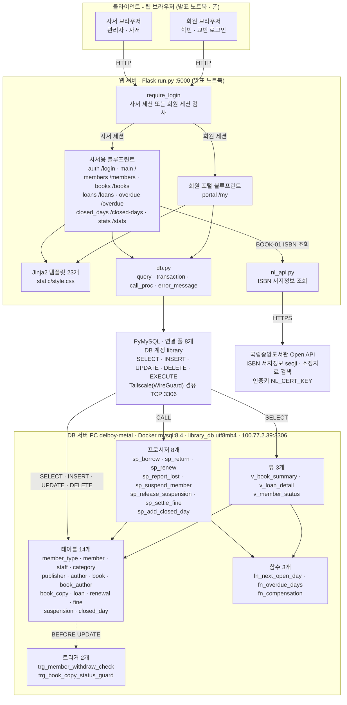

### 6.2 계층별 구성

| 계층 | 구성 요소 | 역할 |
|---|---|---|
| 표현 | Jinja2 템플릿 23개(`app/templates/`), `app/static/style.css` | 사서용 메뉴 10개(대시보드, 대출, 반납, 대출현황, 도서, 회원, 연체·정지, 연체료, 휴관일, 통계), 회원 포털 메뉴 3개(내 도서관, 도서 검색, 비밀번호 변경). 외부 CDN 없이 동작 |
| 응용 | Flask 블루프린트 9개: `auth`, `main`, `members`, `books`, `loans`, `overdue`, `closed_days`, `stats`, `portal` | 화면 요청 처리, 입력 검증, 로그인·권한 검사 |
| 데이터 접근 | `app/db.py` (PyMySQL) | 연결 관리(요청이 끝난 연결을 풀 8개에 보관해 재사용, 원격 DB 왕복 절약), 트랜잭션(오류 시 롤백), 프로시저 호출(`call_proc`), MySQL 오류를 한국어 메시지로 변환(`error_message`: 프로시저·트리거의 SIGNAL 은 메시지 그대로, 제약조건 위반은 제약조건 이름별 메시지) |
| 외부 연계 | `app/nl_api.py` (표준 라이브러리 `urllib`) | 국립중앙도서관 ISBN 서지정보 API 로 서지 조회, 소장자료 검색 API 로 KDC 분류기호 보강 |
| 데이터베이스 | MySQL `library_db`: 테이블 14 · 뷰 3 · 함수 3 · 프로시저 8 · 트리거 2 | 업무 규칙(대출·반납·연장·분실·정지·연체료·휴관일)을 프로시저와 트리거에서 일관되게 처리 |
| 물리 배치 | 발표 노트북 = 브라우저 + 웹 서버(Flask) · DB 서버 PC `delboy-metal`(Ubuntu 24.04) = MySQL 8.4 Docker 컨테이너 · 연결 = Tailscale `100.77.2.39:3306` | 발표 기준(DB 서버와 클라이언트의 논리적·물리적 분리). 결정 이유는 00 문서 7장. 화면 아래 '시스템 구성' 줄에 브라우저 → 웹 서버 → DB 서버와 DB 가 본 접속 IP 가 표시된다 |

### 6.3 처리 흐름 예시 (LOAN-02 대출 처리)

업무 규칙 검사는 화면이 아니라 DB 프로시저가 최종적으로 수행한다. 그래서 화면 검사(LOAN-01)를 건너뛰어도 규칙이 지켜지고, 연장(LOAN-04)처럼 사서 화면과 회원 포털 두 경로가 있는 기능도 같은 프로시저(`sp_renew`)로 같은 규칙이 적용된다. 대출 처리(LOAN-02)는 사서 화면(`/loans/borrow`)에서만 호출한다.

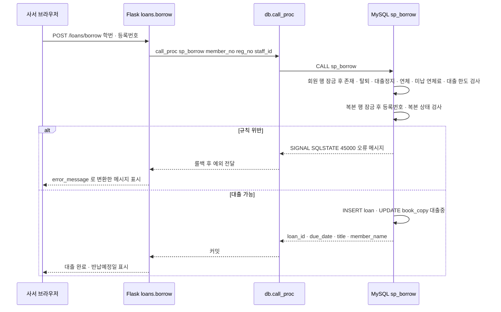

## 7. 개발 환경·도구

| 구분 | 항목 | 버전·설정 | 확인 근거 |
|---|---|---|---|
| 언어 | Python | 3.14.0 | `.venv/bin/python --version` |
| 웹 프레임워크 | Flask | 3.1.3 (요구: Flask>=3.0) | `requirements.txt`, `.venv` 의 `pip freeze` |
| | Werkzeug | 3.1.9 (비밀번호 해시 scrypt) | `pip freeze` |
| | Jinja2 | 3.1.6 (화면 템플릿) | `pip freeze` |
| | Flask 의존 패키지 | itsdangerous 2.2.0 · click 8.5.0 · blinker 1.9.0 · MarkupSafe 3.0.4 | `pip freeze` |
| DB 드라이버 | PyMySQL | 1.2.3 (요구: PyMySQL>=1.1) | `requirements.txt`, `pip freeze` |
| | cryptography | 50.0.2 (요구: cryptography>=42), MySQL 8 의 caching_sha2_password 인증 지원 | `requirements.txt`, `pip freeze` |
| | cryptography 의존 패키지 | cffi 2.1.1 · pycparser 3.12 | `pip freeze` |
| DBMS (개발) | MySQL (Homebrew `mysql 26.10.0_1`) | 26.10.0, 문자셋 `utf8mb4` / 콜레이션 `utf8mb4_0900_ai_ci` | `SELECT VERSION()`, `@@character_set_server` |
| DBMS (DB 서버) | MySQL 8.4.13 (Docker `mysql:8.4` 공식 이미지) on `delboy-metal` (Ubuntu 24.04, x86_64) | `100.77.2.39:3306` (Tailscale 주소에서만 수신), `--default-time-zone=+09:00`, 데이터 볼륨 `library-mysql-data`, systemd `library-mysql.service` 로 부팅 시 자동 시작 | `deploy/db-server/start.sh`, `SELECT @@hostname, @@version, @@bind_address` |
| 컨테이너 | Docker 29.x · Docker Compose v2 | DB 서버의 MySQL 을 컨테이너로 실행 (`--network host`, 재시작 정책 unless-stopped). 한 PC 재현은 Compose 로 db(MySQL 8.4) · web(Flask, `python:3.12-slim`) 두 컨테이너 | `deploy/db-server/`, `docker-compose.yml`, `Dockerfile` |
| 네트워크 | Tailscale (WireGuard VPN) | 발표 노트북 ↔ DB 서버. 교내 Wi-Fi 에서 측정한 왕복 10~70ms | `tailscale status`, `tailscale ping` |
| DBMS (한 PC 재현 · 비상용) | MySQL 8.4 — Docker Compose(`docker compose up -d --build`) 또는 직접 설치(Windows MSI) | 누구나 한 PC 에서 재현, 네트워크 장애 시 발표 노트북도 이 구성으로 전환(`DB_HOST` 미지정). MySQL 8.0.19 이상 필요: CHECK 제약 · 생성 컬럼(`active_copy_id`) · `FOR UPDATE OF`(`02_programs.sql` 의 `sp_borrow`·`sp_return`·`sp_renew`·`sp_report_lost`) · `03_base_data.sql` 의 `INSERT … AS new ON DUPLICATE KEY UPDATE` 행 별칭. 통계 화면(`app/stats.py`)은 `RANK()` 윈도우 함수 사용 | `README.md`, `sql/01_schema.sql` 머리말, 00 문서 1장, `app/stats.py` |
| 운영체제 (개발) | macOS | 27.2 (arm64) | `sw_vers` |
| 실행 서버 | Flask 개발 서버 | 기본 `127.0.0.1:5000`, `debug=True`. `APP_HOST=0.0.0.0` 이면 폰 등 다른 기기에서 접속 가능(이때 debug 끔). 시작할 때 DB 서버 접속을 점검해 한 줄로 보여 줌 | `run.py` |
| 설정 | 환경변수 | `DB_HOST`(DB 서버 주소, 발표 구성 100.77.2.39 · 기본 127.0.0.1), `DB_PORT`(3306), `DB_USER`(library), `DB_PASSWORD`, `DB_NAME`(library_db), `APP_HOST`·`APP_PORT`(웹 서버), `SECRET_KEY`, `NL_CERT_KEY`(국립중앙도서관 인증키) | `config.py`, `run.py`, `app/nl_api.py` |
| 외부 API | 국립중앙도서관 | ISBN 서지정보 API(`seoji/SearchApi.do`), 소장자료 검색 API(`NL/search/openApi/search.do`) | `app/nl_api.py` |
| 테스트 | Python `unittest` | 통합 테스트 28개 (`tests/test_scenarios.py`). 로컬 MySQL 과 원격 DB 서버(`DB_HOST=100.77.2.39`) 양쪽에서 Ran 28 tests, OK (`docs/_test_output.txt`) | `tests/test_scenarios.py`, `docs/_test_output.txt` |
| 시연용 SQL | `sql/demo_control.sql`, `sql/demo_app_account.sql` | 데이터 상태 변경 · 예외 상황 · 권한 검증을 시연 중 바로 실행 (발표 기준) | 13 문서 |
| 모델링 | ERDCloud, Mermaid | ERDCloud 는 `sql/01_schema.sql` DDL Import 로 ERD 생성, 문서 안 ERD·흐름도는 Mermaid | 00 문서 1장, `README.md` |
| 문서 자동화 | `scripts/gen_docs.py` | `information_schema` → 09 용어 사전 · 10 도메인 정의서 · 11 테이블 기술서 · `_generated_physical_lists.md` | `README.md` |
| 협업 | Notion | 회의록 · 작업 트래커 · 기능 정리표 · 역할 분담 · 일정 | Notion 팀 페이지 |
| AI 도구 | Claude | 11.12 회의 결정(각자 AI 로 전체 작업 후 택1)에 따라 사용 | 11.12 회의록 |

개발 언어(Python)와 DBMS(MySQL)는 10.29 회의에서 정했다.

## 8. 데이터 개요

### 8.1 테이블별 건수

2026-11-14 `library_db` 조회 결과다. 대출 관련 날짜는 DB 를 초기화한 날 기준의 상대값이라 상태별 건수는 초기화 시점에 따라 달라질 수 있다.

| No | 테이블 | 한글명 | 건수 | 내역 |
|---|---|---|---|---|
| 1 | `member_type` | 회원구분 | 5 | 학부생·휴학생·대학원생·전임교원·직원·비전임교원 |
| 2 | `member` | 회원 | 27 | 계정상태 정상 26 · 탈퇴 1. 대출상태(`v_member_status`) 대출가능 21 · 대출정지 5 · 탈퇴 1 |
| 3 | `staff` | 사서 | 2 | 관리자 1 (`admin`) · 사서 1 (`lib01`) |
| 4 | `category` | 분류 | 10 | KDC 주류 000 ~ 900 |
| 5 | `publisher` | 출판사 | 56 | |
| 6 | `author` | 저자 | 155 | |
| 7 | `book` | 도서 | 100 | 실제 도서. 발행연도 1995 ~ 2025, 정가 100종 모두 있음, KDC 분류기호 99종 있음 |
| 8 | `book_author` | 도서저자 | 171 | 지은이 106 · 옮긴이 62 · 엮은이 2 · 그림 1 |
| 9 | `book_copy` | 도서복본 | 157 | 대출가능 131 · 대출중 24 · 분실 1 · 폐기 1. 등록번호 `EM000001` ~ `EM000157` |
| 10 | `loan` | 대출 | 230 | 대출상태(`v_loan_detail.loan_state`) 반납 205 · 대출중 19 · 연체 5 · 분실 1. 대출일 범위 최근 200일 |
| 11 | `renewal` | 연장이력 | 15 | 신청경로 홈페이지 14 · 사서 1 |
| 12 | `fine` | 연체료 | 22 | 납부 18건(11,000원) · 면제 3건(2,300원) · 미납 1건(700원) |
| 13 | `suspension` | 대출정지 | 3 | 진행 중 1(자료훼손) · 조기 해제 1(규정위반) · 기간 만료 1(장기연체) |
| 14 | `closed_day` | 휴관일 | 139 | 2026-01-01 ~ 2027-12-27. 사유 '일요일' 97일 + 공휴일·대체공휴일·선거일·개교기념일 42일 (일요일과 겹친 공휴일은 공휴일 이름으로 저장) |

### 8.2 도서 데이터

- 실제 도서 100종의 ISBN·서명·저자·출판사·발행연도·정가·KDC 를 `data/books.csv` 에 두고 `source` 열에 출처 URL 을 기록했다. 출처: 국립중앙도서관 65건 · 알라딘 31건 · 언론 기사 4건.
- 국립중앙도서관 API 인증키 승인 전이라 공개 서지 페이지로 조사한 목록을 사용했다. 키가 발급되면 `scripts/import_books.py --refresh` 로 국립중앙도서관 데이터로 갱신한다 (00 문서 6장).
- 복본은 도서 순번에 따라 1 ~ 3권: 1권 57종 · 2권 29종 · 3권 14종 = 157권.

| 분류코드 | 분류명 | 도서 수 |
|---|---|---|
| 000 | 총류 | 15 |
| 100 | 철학 | 10 |
| 200 | 종교 | 3 |
| 300 | 사회과학 | 15 |
| 400 | 자연과학 | 10 |
| 500 | 기술과학 | 7 |
| 600 | 예술 | 5 |
| 700 | 언어 | 5 |
| 800 | 문학 | 22 |
| 900 | 역사 | 8 |
| 합계 | | 100 |

### 8.3 대출 이력 데이터

- `scripts/build_seed.py` 가 `sql/05_sample_loans.sql` 을 만든다. 대출일·연장일·반납일은 '오늘로부터 며칠 전'으로 저장하고, 반납예정일·연체일수·연체료는 DB 함수(`fn_next_open_day`, `fn_overdue_days`)가 계산한다. 그래서 `init_db.sh` 를 다시 실행하면 연체·반납예정 상황이 초기화 날짜 기준으로 재현된다.
- 시연용 상황을 회원별로 고정 생성한다: 연장 가능한 정상 회원(10001), 대출 당일 연장 불가(10002), 연체 2권(10003), 연체 1권(10004), 연장 2회 소진(10006), 반납 임박(10008), 미납 연체료(10009), 대출정지 중(10011), 장기 연체(10012), 분실 처리 이력(10015), 탈퇴 회원 이력(10020) 등.
- 나머지는 난수 시드 2026 으로 만든 지난 대출 이력이며, 전체 230건이다 (현재 대출 중 24건).

### 8.4 데이터 적재 흐름

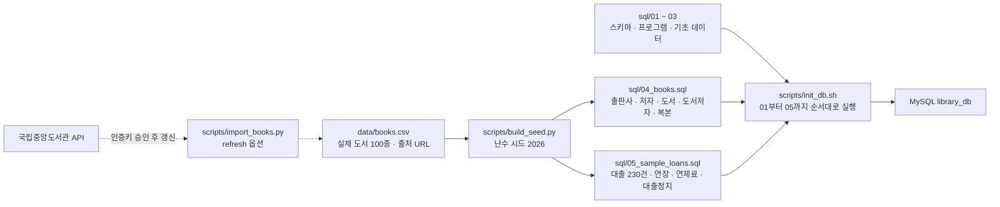

## 9. 팀 구성 및 역할

### 9.1 역할 분담 (Notion 「역할 분담」·「작업 트래커」 기준)

| 팀원 | 보고서 산출물 | 구현 범위 | 작업 트래커 담당 작업 (마감일) | 본 문서 세트 대응 |
|---|---|---|---|---|
| 임채선 | 프로젝트 개요서, 업무 기능도, PPT 취합·디자인 | PM, 개발 보조, UI/테스트 | 01 프로젝트 개요서 (11/12) · 02 업무 기능도 (11/12) · 발표 PPT (11/24) | 01, 02 |
| 함성준 | 단위 업무 기술서, 업무 흐름도, 시연 시나리오 | 최종 발표, 노션 구축 | 03 단위 업무 기술서 (11/12) · 04 업무 흐름도 (11/12) · 시연 시나리오 (11/22) · 12 최종 결과 보고서 (취합) (11/24) | 03, 04, 13 |
| 너세리투 | 업무 문서 리스트, 개념적·논리적 데이터 모델(ERD, 스키마, 정규화) | DDL 검토 | 05 업무 문서 리스트 (11/12) · 06 개념적 데이터 모델 (ERD) (11/12) · 07 논리적 데이터 모델 (스키마•정규화) (11/19) | 05, 06, 07 |
| 강권영 | 용어 사전, 도메인 정의서, 테이블 기술서 | 더미 데이터 구축 | 09 용어 사전 · 10 도메인 정의서 · 11 테이블 기술서 · 테스트 데이터 구축 (모두 11/19) | 09, 10, 11 |
| 윤준서 | 물리적 데이터 모델(DDL, 인덱스) | DB 통합, 핵심 기능·쿼리 개발 | 08 물리적 데이터 모델 (DDL•인덱스) (11/19) · 응용프로그램 (프로그램 + .DB) (11/24) | 08 |

- 11.05 회의 결정 사항은 기능 영역 5개 확정과 역할 A ~ E 분담이다 (Notion 회의록).
- 작업 트래커의 12번 항목은 '12 최종 결과 보고서 (취합)'이다. 본 문서 세트의 12번은 '회의록'이며 작업 트래커에는 담당자가 지정된 항목이 없다.

### 9.2 본 문서 세트의 작성 경위

11.12 회의에서 "각자 토요일까지 클로드를 돌려서 전체 프로젝트 작업 이후 가장 결과물이 좋은 작업물을 택1" 하고, 노션에 올린 뒤 모두가 리뷰해 결정하며, 프로젝트가 선택되면 태스크별로 다시 나누어 작성하기로 했다. 본 문서 세트(docs/00 ~ 13)와 코드는 이 결정에 따라 윤준서가 Claude 를 활용해 만든 결과물이다. 위 9.1 의 '본 문서 세트 대응'은 Notion 역할 분담을 문서 번호에 연결한 것이다.

## 10. 추진 일정

회의 기록(Notion 회의록)과 작업 트래커 마감일만으로 작성했다. 주차는 목요일 정기 회의를 기준으로 나눴다.

| 주차 | 기간 | 회의 (참석) | 회의 결정 사항 | 작업 트래커 마감 |
|---|---|---|---|---|
| 1주차 | 10/29(목) ~ 11/4(수) | 10.29 회의 (윤준서, 너세리투, 함성준) | 개발 언어 파이썬, DBMS MySQL | — |
| 2주차 | 11/5(목) ~ 11/11(수) | 11.05 회의 (강권영, 너세리투, 함성준) | 기능 영역 5개 확정, 역할 A ~ E 분담 | — |
| 3주차 | 11/12(목) ~ 11/18(수) | 11.12 회의 (윤준서, 강권영, 함성준, 임채선) | 숭실대학교 도서관과 동일한 기준(대출 1인당 10권·15일, 연장 2회, 연체 시 대출 자격 정지·매일 100원) · 실제 도서 100개를 실제 도서관 API 로 · 복본은 BOOK_COPY 로 개별 관리 · 연장·연체료 납부 기능 구현 · 각자 토요일(11/14)까지 AI 로 전체 작업 → 노션 업로드 → 리뷰 후 택1, 이후 태스크별 재분배 | 11/12(목): 01 프로젝트 개요서 · 02 업무 기능도 (임채선), 03 단위 업무 기술서 · 04 업무 흐름도 (함성준), 05 업무 문서 리스트 · 06 개념적 데이터 모델 (ERD) (너세리투) |
| 4주차 | 11/19(목) ~ 11/25(수) | 11/19(목) 12:00 정기 회의 예정 | — | 11/19(목): 07 논리적 데이터 모델 (너세리투), 08 물리적 데이터 모델 (윤준서), 09 용어 사전 · 10 도메인 정의서 · 11 테이블 기술서 · 테스트 데이터 구축 (강권영) · 11/22(일): 시연 시나리오 (함성준) · 11/24(화): 12 최종 결과 보고서 (취합) (함성준), 응용프로그램 (프로그램 + .DB) (윤준서), 발표 PPT (임채선) · 11/25(수) 자정: 최종 마감 (소프트웨어 · DB · 최종보고서 · PPT · 노션 링크) |

## 11. 기대 효과

| 관점 | 기대 효과 | 근거 (구현) |
|---|---|---|
| 사서 업무 | 대출 1건마다 회원 존재·탈퇴·대출정지·연체·미납 연체료·대출 한도·복본 존재·복본 상태 8가지를 자동으로 검사해 확인 누락이 없다 | `sp_borrow` |
| 계산 정확성 | 반납예정일·연장일·연체일수·연체료·변상금 기준액을 같은 함수로 계산해 사람마다 결과가 달라지지 않는다 | `fn_next_open_day`, `fn_overdue_days`, `fn_compensation`, 테스트 `test_21_overdue_days_exclude_closed_days` |
| 데이터 무결성 | 제약조건 70개(PRIMARY KEY 14 · FOREIGN KEY 18 · UNIQUE 10 · CHECK 28)와 트리거 2개가 잘못된 상태 저장, 이중 대출, 대출 중 탈퇴·폐기를 DB 에서 막는다 | `information_schema.TABLE_CONSTRAINTS` 조회, 테스트 `test_60_db_constraints` |
| 회원 편의 | 회원이 포털에서 직접 도서를 검색하고 본인 대출·연체료·정지 내역을 확인하며 연장을 신청한다 | 회원 포털 `/my`, `sp_renew` '홈페이지' 경로 |
| 정책 변경 대응 | 권수·기간·연장 횟수·연체료가 바뀌어도 `member_type` 값만 고치면 된다 (예: 5.2 의 15일 변경) | `member_type` |
| 장서 운영 | 월별 대출(최근 6개월), 인기 도서 TOP 10, 분류별 대출, 다독 회원 TOP 5, 연체 반납 비율을 제공해 장서 구입·배치 판단에 참고할 수 있다 | `/stats/` (`RANK()` 윈도우 함수) |
| 학습 | 실제 규정과 실제 도서 데이터로 요구 분석부터 개념·논리·물리 모델, 구현, 테스트까지 데이터베이스 설계 전 과정을 수행한다 | 산출물 00 ~ 13, 통합 테스트 28개 |

## 12. 산출물 목록

### 12.1 보고서 (docs/)

| No | 파일 | 문서명 | 보고서 요구 항목 | 작업 트래커 담당 |
|---|---|---|---|---|
| 00 | `docs/00_설계_결정사항.md` | 설계 결정 사항 | 모든 문서의 기준 (규칙·용어·기능 ID) | — |
| 01 | `docs/01_프로젝트_개요서.md` | 프로젝트 개요서 | 프로젝트 개요서 | 임채선 |
| 02 | `docs/02_업무_기능도.md` | 업무 기능도 | 업무 기능도 | 임채선 |
| 03 | `docs/03_단위_업무_기술서.md` | 단위 업무 기술서 | 단위 업무 기술서 | 함성준 |
| 04 | `docs/04_업무_흐름도.md` | 업무 흐름도 | 업무 흐름도 | 함성준 |
| 05 | `docs/05_업무_문서_리스트.md` | 업무 문서 리스트 | 업무 문서 리스트 | 너세리투 |
| 06 | `docs/06_개념적_데이터_모델.md` | 개념적 데이터 모델 | 개념적 데이터 모델 (ER 다이어그램) | 너세리투 |
| 07 | `docs/07_논리적_데이터_모델.md` | 논리적 데이터 모델 | 논리적 데이터 모델 (릴레이션 스키마, 정규화) | 너세리투 |
| 08 | `docs/08_물리적_데이터_모델.md` | 물리적 데이터 모델 | 물리적 데이터 모델 (DDL, 제약조건, 인덱스) | 윤준서 |
| 09 | `docs/09_용어_사전.md` | 용어 사전 | 용어 사전 · `gen_docs.py` 생성 | 강권영 |
| 10 | `docs/10_도메인_정의서.md` | 도메인 정의서 | 도메인 정의서 · `gen_docs.py` 생성 | 강권영 |
| 11 | `docs/11_테이블_기술서.md` | 테이블 기술서 | 테이블 기술서 · `gen_docs.py` 생성 | 강권영 |
| 12 | `docs/12_회의록.md` | 회의록 | 회의록 | — (9.1 참고) |
| 13 | `docs/13_시연_시나리오_및_테스트.md` | 시연 시나리오 및 테스트 | 주제 발표 및 시연 준비 | 함성준 (시연 시나리오) |
| 부록 | `docs/_generated_physical_lists.md` | 제약조건·인덱스 전체 목록 | 08 부록 · `gen_docs.py` 생성 | — |
| 부록 | `docs/_test_output.txt` | 통합 테스트 실행 결과 (25개 OK) | 13 근거 | — |

### 12.2 코드·데이터 산출물

| 경로 | 내용 |
|---|---|
| `sql/01_schema.sql` | DB `library_db` 와 앱 전용 계정 `library` 생성, 테이블 14개 (PK·FK·UNIQUE·CHECK·인덱스·생성 컬럼) |
| `sql/02_programs.sql` | 함수 3 · 뷰 3 · 트리거 2 · 저장 프로시저 8 |
| `sql/03_base_data.sql` | 회원구분 5 · 사서 2 · 분류 10 · 휴관일(2026 ~ 2027) · 회원 27 |
| `sql/04_books.sql` | 출판사 · 저자 · 도서 100종 · 도서저자 · 복본 157권 (`build_seed.py` 생성) |
| `sql/05_sample_loans.sql` | 대출 230건과 연장·연체료·대출정지 이력 (`build_seed.py` 생성) |
| `data/books.csv` | 실제 도서 100종 서지정보와 출처 URL |
| `scripts/init_db.sh` | DB 초기화 (`01_schema` → `05_sample_loans` 순서 실행) |
| `scripts/init_db.bat` | Windows(발표 PC)용 DB 초기화 (01 → 05 순서, PATH 에 mysql 이 없으면 MySQL Server 설치 폴더에서 찾음) |
| `scripts/build_seed.py` | `books.csv` → `04_books.sql`, 대출 이력 생성 규칙 → `05_sample_loans.sql` |
| `scripts/import_books.py` | 국립중앙도서관 API → `books.csv` |
| `scripts/gen_docs.py` | DB 메타데이터 → 09 · 10 · 11 문서, `_generated_physical_lists.md` |
| `scripts/build_report.py` | docs 01 ~ 13 + 00(부록) → `docs/최종_결과_보고서.md` 취합 |
| `app/` (Python 모듈 12개) | `__init__.py`(앱 생성·로그인 검사), `auth.py`, `main.py`, `members.py`, `books.py`, `loans.py`, `overdue.py`, `closed_days.py`, `stats.py`, `portal.py`, `db.py`, `nl_api.py` |
| `app/templates/` (22개), `app/static/style.css` | 사서용 화면과 회원 포털 화면 |
| `tests/test_scenarios.py` | 업무 규칙 통합 테스트 28개 (실행 시 DB 초기화) |
| `config.py` · `run.py` · `requirements.txt` · `README.md` | 설정 · 실행 진입점 · 의존 패키지 · 설치·실행 안내 |

### 12.3 최종 제출물 (11/25(수) 자정)

| 제출물 | 해당 산출물 |
|---|---|
| 소프트웨어 | `app/`, `scripts/`, `run.py`, `config.py`, `requirements.txt`, `README.md` |
| DB | `sql/01_schema.sql` ~ `sql/05_sample_loans.sql` (`init_db.sh` / `init_db.bat` 로 `library_db` 재현) |
| 최종보고서 | `docs/00` ~ `docs/13` 취합 (`scripts/build_report.py`, 작업 트래커 '12 최종 결과 보고서 (취합)', 11/24) |
| PPT | 발표 PPT (작업 트래커, 11/24) |
| 노션 링크 | Notion 팀 페이지 |

---

# 02. 업무 기능도

> 시스템 기능을 영역 → 기능(기능 ID) → 세부 기능의 3단계로 나누고, 사용자별 권한과 Notion 기능 정리표와의 대응을 정리한다. 작성 기준일 2026-11-14

작성 근거: 기능 ID·기능명은 `docs/00_설계_결정사항.md` 4장. 세부 기능·화면 URL·권한은 `app/*.py` 와 `app/templates/**`, DB 객체는 `sql/01_schema.sql`·`sql/02_programs.sql`, 검증은 `tests/test_scenarios.py`(28개)에서 확인했다. 실행 결과는 `docs/_test_output.txt` ("Ran 28 tests", OK). 세부 기능에는 코드에 실제로 있는 처리만 넣었다.

## 1. 기능 계층도

### 1.1 전체 기능 계층도

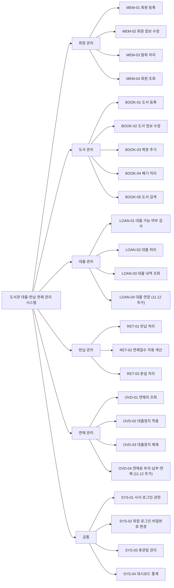

### 1.2 회원 관리 상세

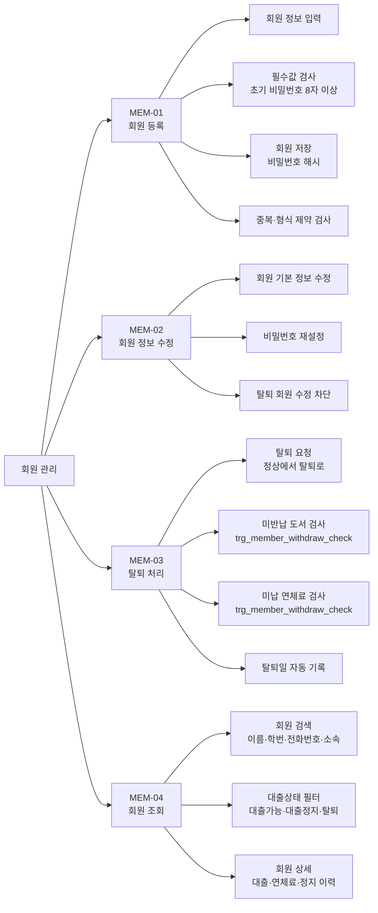

### 1.3 도서 관리 상세

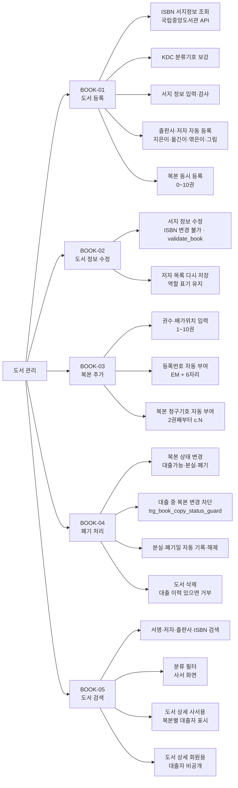

### 1.4 대출 관리 상세

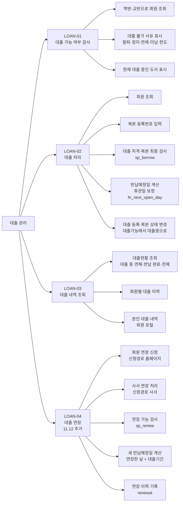

### 1.5 반납 관리 상세

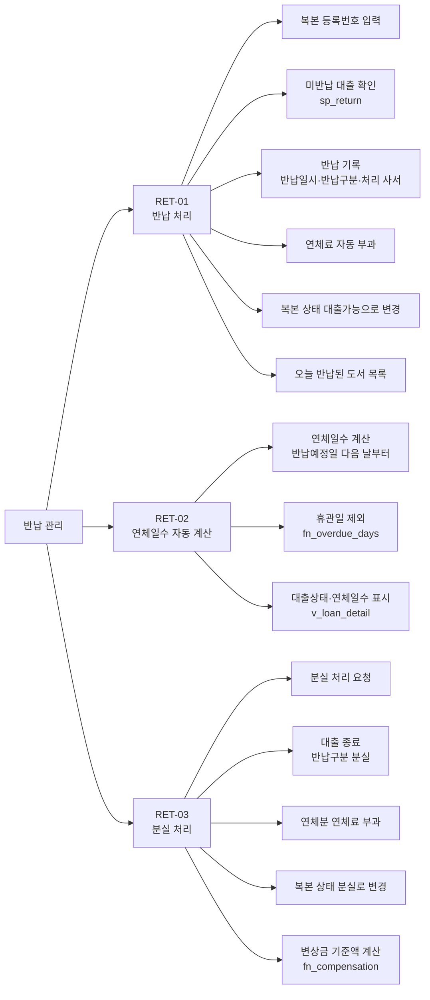

### 1.6 연체 관리 상세

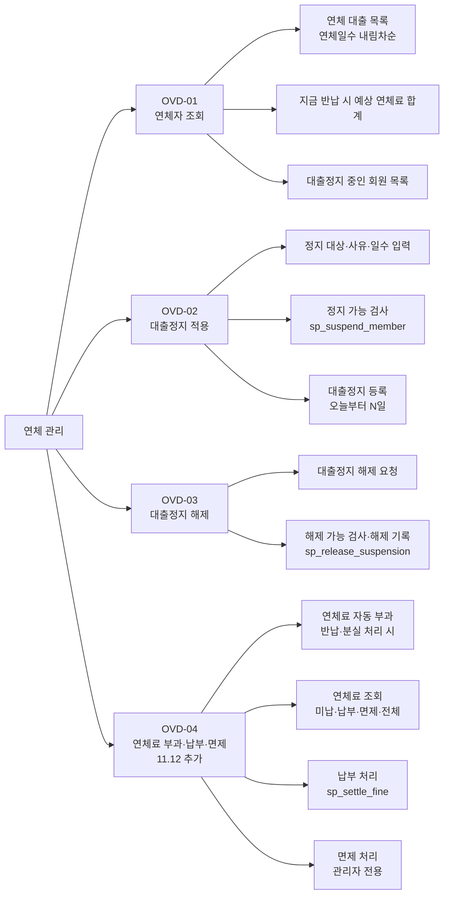

### 1.7 공통 상세

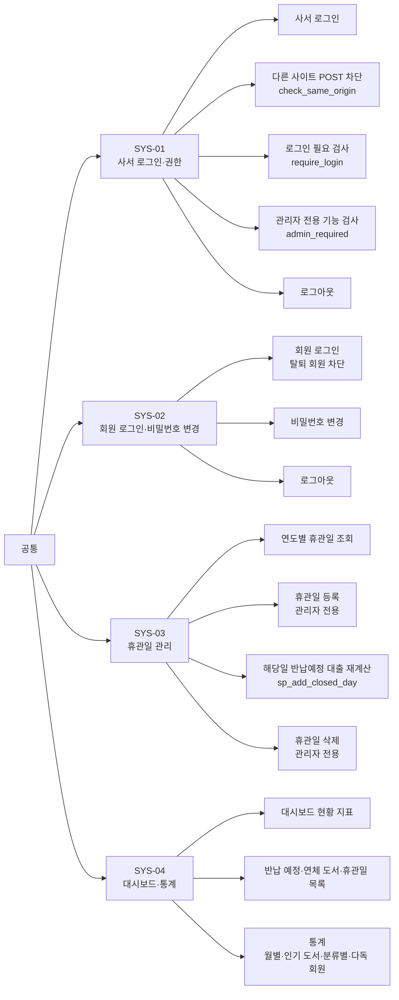

### 1.8 영역별 기능 수

| 레벨1 영역 | 레벨2 기능 수 | 레벨3 세부 기능 수 | 기능 ID |
|---|---|---|---|
| 회원 관리 | 4 | 14 | MEM-01 ~ MEM-04 |
| 도서 관리 | 5 | 18 | BOOK-01 ~ BOOK-05 |
| 대출 관리 | 4 | 16 | LOAN-01 ~ LOAN-04 |
| 반납 관리 | 3 | 14 | RET-01 ~ RET-03 |
| 연체 관리 | 4 | 12 | OVD-01 ~ OVD-04 |
| 공통 | 4 | 15 | SYS-01 ~ SYS-04 |
| 합계 | 24 | 89 | |

세부 기능 수는 기능별로 나열한 행 수이며, 같은 처리를 여러 기능에서 다시 센 항목(RET01D·RET03C·OVD04A 연체료 부과, LOAN01A·LOAN02A 회원 조회, MEM04C·LOAN03B 회원 상세)이 포함된다.

## 2. 기능 분해표

사용자 표기: **사서** = 사서 프로그램 계정 전체(`staff.role` 이 '관리자' 또는 '사서'), **관리자** = `staff.role` = '관리자' 만, **회원** = 회원 포털(`/my`)에 로그인한 회원, **시스템** = 사용자 조작 없이 DB 함수·뷰·트리거·프로시저 또는 앱이 자동으로 수행. 화면 URL 의 `<...>` 는 Flask 라우트 변수다.

### 2.1 회원 관리

| 레벨1 영역 | 레벨2 기능 | 레벨3 세부 기능 | 사용자 | 화면 URL | DB 객체 |
|---|---|---|---|---|---|
| 회원 관리 | MEM-01 회원 등록 | 회원 정보 입력: 학번·교번, 이름, 회원구분(기본 학부생), 소속, 전화번호, 이메일, 초기 비밀번호 | 사서 | `GET /members/new` | `member_type` (회원구분 선택 목록) |
| 회원 관리 | MEM-01 회원 등록 | 필수값 검사: 학번(교번)·이름·전화번호 필수, 초기 비밀번호 8자 이상 | 시스템 | `POST /members/new` | — (앱 `members.py`) |
| 회원 관리 | MEM-01 회원 등록 | 회원 저장: 비밀번호는 해시로 저장, 회원번호(`member_id`)는 자동 증가 | 사서 | `POST /members/new` | `member` INSERT |
| 회원 관리 | MEM-01 회원 등록 | 중복·형식 제약 검사: 학번·전화번호·이메일 중복, 학번 영문·숫자 4~20자, 전화번호 형식, 회원구분 존재 | 시스템 | `POST /members/new` | `uq_member_no` · `uq_member_phone` · `uq_member_email` · `ck_member_no` · `ck_member_phone` · `fk_member_type` |
| 회원 관리 | MEM-02 회원 정보 수정 | 회원 기본 정보 수정: 학번·이름·회원구분·소속·전화번호·이메일 | 사서 | `GET·POST /members/<member_id>/edit` | `member` UPDATE · `member_type` |
| 회원 관리 | MEM-02 회원 정보 수정 | 비밀번호 재설정: 입력했을 때만 변경, 8자 미만이면 변경하지 않음 | 사서 | `POST /members/<member_id>/edit` | `member.password_hash` UPDATE |
| 회원 관리 | MEM-02 회원 정보 수정 | 탈퇴 회원 수정 차단: 탈퇴 회원은 수정 화면 진입 불가 | 시스템 | `GET·POST /members/<member_id>/edit` | `member.status` |
| 회원 관리 | MEM-03 탈퇴 처리 | 탈퇴 요청: 계정상태 정상 → 탈퇴 | 사서 | `POST /members/<member_id>/withdraw` | `member` UPDATE |
| 회원 관리 | MEM-03 탈퇴 처리 | 미반납 도서 검사: 반납하지 않은 대출이 있으면 거부 | 시스템 | `POST /members/<member_id>/withdraw` | `trg_member_withdraw_check` · `loan` |
| 회원 관리 | MEM-03 탈퇴 처리 | 미납 연체료 검사: 미납 연체료가 있으면 거부 | 시스템 | `POST /members/<member_id>/withdraw` | `trg_member_withdraw_check` · `fine` · `loan` |
| 회원 관리 | MEM-03 탈퇴 처리 | 탈퇴일 자동 기록: 탈퇴일 = 처리한 날 | 시스템 | `POST /members/<member_id>/withdraw` | `trg_member_withdraw_check` · `member.withdraw_date` · `ck_member_withdraw` |
| 회원 관리 | MEM-04 회원 조회 | 회원 검색: 이름·학번(교번)·전화번호·소속 부분 일치 | 사서 | `GET /members/?q=` | `v_member_status` |
| 회원 관리 | MEM-04 회원 조회 | 대출상태 필터: 대출가능·대출정지·탈퇴 (계산값) | 사서 | `GET /members/?state=` | `v_member_status.loan_state` |
| 회원 관리 | MEM-04 회원 조회 | 회원 상세: 회원 정보, 대출 중 도서, 연체료, 대출정지 이력, 최근 대출 이력 20건 | 사서 | `GET /members/<member_id>` | `v_member_status` · `v_loan_detail` · `fine` · `suspension` · `staff` |

### 2.2 도서 관리

| 레벨1 영역 | 레벨2 기능 | 레벨3 세부 기능 | 사용자 | 화면 URL | DB 객체 |
|---|---|---|---|---|---|
| 도서 관리 | BOOK-01 도서 등록 | ISBN 서지정보 조회: 국립중앙도서관 ISBN 서지정보 API 로 입력란 채움 (인증키 `NL_CERT_KEY` 설정 시에만 버튼 활성) | 사서 | `GET /books/new?lookup=ISBN` | — (외부 API, `app/nl_api.py` `fetch_by_isbn`) |
| 도서 관리 | BOOK-01 도서 등록 | KDC 분류기호 보강: 서지 API 결과에 KDC 가 없으면 소장자료 검색 API 로 보강 | 시스템 | `GET /books/new?lookup=ISBN` | — (`app/nl_api.py` `fetch_kdc`) |
| 도서 관리 | BOOK-01 도서 등록 | 서지 정보 입력·검사: 서명·출판사·지은이 필수, ISBN 형식(978·979로 시작하는 13자리)·중복, 발행연도는 숫자만('발행연도는 숫자로 입력하세요.')·올해 + 1 초과 거부('발행연도가 올바르지 않습니다. (내년 이후 불가)', 앱 `validate_book`)·1450~2100(`ck_book_pub_year`) | 사서 | `POST /books/new` | `category` · `ck_book_isbn` · `book` PRIMARY KEY · `ck_book_pub_year` |
| 도서 관리 | BOOK-01 도서 등록 | 출판사·저자 자동 등록: 없는 출판사·저자는 새로 등록, 지은이·옮긴이·엮은이·그림 역할('이름 (엮은이)' 표기)과 표기순서 저장 | 시스템 | `POST /books/new` | `book` INSERT · `publisher` · `author` · `book_author` INSERT |
| 도서 관리 | BOOK-01 도서 등록 | 복본 동시 등록: 0~10권, 배가위치(기본 종합자료실)·청구기호 입력 | 사서 | `POST /books/new` | `book_copy` INSERT |
| 도서 관리 | BOOK-02 도서 정보 수정 | 서지 정보 수정: 서명·출판사·분류·KDC·발행연도·정가 (ISBN 은 읽기 전용). 서명·출판사·지은이 필수, 발행연도 검사는 등록과 동일(`validate_book`) | 사서 | `GET·POST /books/<isbn>/edit` | `v_book_summary` · `book` UPDATE · `publisher` |
| 도서 관리 | BOOK-02 도서 정보 수정 | 저자 목록 다시 저장: 기존 도서저자를 지우고 지은이·옮긴이·엮은이·그림 재등록(수정 화면에 역할 표기 유지) | 시스템 | `POST /books/<isbn>/edit` | `book_author` DELETE·INSERT · `author` |
| 도서 관리 | BOOK-03 복본 추가 | 권수·배가위치 입력: 1~10권(숫자가 아니면 1), 배가위치 기본 종합자료실. 청구기호는 입력란 없이 첫 복본 청구기호를 이어 씀(복본이 없으면 KDC 분류기호 또는 분류코드) | 사서 | `POST /books/<isbn>/copies` | `book` |
| 도서 관리 | BOOK-03 복본 추가 | 등록번호 자동 부여: `EM` + 6자리, 전체 복본의 최대 번호 다음부터 | 시스템 | `POST /books/<isbn>/copies` | `book_copy` INSERT · `uq_book_copy_reg_no` · `ck_book_copy_reg_no` |
| 도서 관리 | BOOK-03 복본 추가 | 복본 청구기호 자동 부여: 첫 복본 청구기호 기준, 2권째부터 뒤에 `c.2`·`c.3` 처럼 복본 순번을 덧붙임 | 시스템 | `POST /books/<isbn>/copies` | `book_copy.call_no` |
| 도서 관리 | BOOK-04 폐기 처리 (복본 상태 변경) | 복본 상태 변경: 대출가능·분실·폐기 중 선택 (대출중 복본은 화면에 변경 버튼 없음) | 사서 | `POST /books/copies/<copy_id>/status` | `book_copy` UPDATE · `ck_book_copy_status` |
| 도서 관리 | BOOK-04 폐기 처리 (복본 상태 변경) | 대출 중 복본 변경 차단: 미반납 대출이 있는 복본은 대출가능·분실·폐기로 변경 거부 | 시스템 | `POST /books/copies/<copy_id>/status` | `trg_book_copy_status_guard` · `loan` |
| 도서 관리 | BOOK-04 폐기 처리 (복본 상태 변경) | 분실·폐기일 자동 기록·해제: 분실·폐기면 처리일 기록, 대출가능으로 되돌리면 비움 | 시스템 | `POST /books/copies/<copy_id>/status` | `trg_book_copy_status_guard` · `book_copy.removed_date` · `ck_book_copy_removed` |
| 도서 관리 | BOOK-04 폐기 처리 (복본 상태 변경) | 도서 삭제: 대출 이력이 있으면 거부(복본을 폐기 처리하도록 안내), 없으면 복본·도서저자 함께 삭제 | 사서 | `POST /books/<isbn>/delete` | `book` DELETE · `fk_loan_copy` · `fk_book_copy_book` · `fk_book_author_book` (ON DELETE CASCADE) |
| 도서 관리 | BOOK-05 도서 검색 | 서명·저자·출판사·ISBN 검색: 서명·저자·출판사는 부분 일치, ISBN 은 완전 일치 (회원 화면은 검색어 필수, 최대 100건) | 사서·회원 | `GET /books/?q=` · `GET /my/books?q=` | `v_book_summary` |
| 도서 관리 | BOOK-05 도서 검색 | 분류 필터: KDC 주류 10개 중 선택 (사서 화면만) | 사서 | `GET /books/?category=` | `category` · `v_book_summary.category_code` |
| 도서 관리 | BOOK-05 도서 검색 | 도서 상세(사서용): 서지, 소장 현황, 복본별 상태·대출자·반납예정일, 누적 대출 횟수 | 사서 | `GET /books/<isbn>` | `v_book_summary` · `book_copy` · `loan` · `member` |
| 도서 관리 | BOOK-05 도서 검색 | 도서 상세(회원용): 대출자를 숨기고 대출가능·대출중 복본의 등록번호·청구기호·위치·상태·반납예정일 표시 | 회원 | `GET /my/books/<isbn>` | `v_book_summary` · `book_copy` · `loan` |

`/books/<isbn>/delete`(도서 삭제)는 00 문서 기능 목록에 별도 ID 가 없다. 대출 이력이 있는 도서는 삭제 대신 복본 폐기로 처리하므로 이 문서에서는 BOOK-04 의 세부 기능으로 분류했다.

### 2.3 대출 관리

| 레벨1 영역 | 레벨2 기능 | 레벨3 세부 기능 | 사용자 | 화면 URL | DB 객체 |
|---|---|---|---|---|---|
| 대출 관리 | LOAN-01 대출 가능 여부 검사 | 학번·교번으로 회원 조회: 없는 학번이면 안내 | 사서 | `GET /loans/borrow?member_no=` | `v_member_status` |
| 대출 관리 | LOAN-01 대출 가능 여부 검사 | 대출 불가 사유 표시: 탈퇴, 대출정지(종료일), 연체 도서 권수, 미납 연체료, 대출 한도 도달 | 시스템 | `GET /loans/borrow?member_no=` | `v_member_status` (`status` · `suspend_until` · `overdue_loans` · `unpaid_fine` · `active_loans` · `max_loan_count`) |
| 대출 관리 | LOAN-01 대출 가능 여부 검사 | 현재 대출 중인 도서 표시 | 사서 | `GET /loans/borrow?member_no=` | `v_loan_detail` |
| 대출 관리 | LOAN-02 대출 처리 | 회원 조회: LOAN-01 화면에서 이어서 진행 (회원 목록·회원 상세의 대출 버튼도 이 화면으로 연결) | 사서 | `GET /loans/borrow?member_no=` | `v_member_status` |
| 대출 관리 | LOAN-02 대출 처리 | 복본 등록번호 입력: 바코드 등록번호, 소문자는 대문자로 변환 | 사서 | `POST /loans/borrow` | — |
| 대출 관리 | LOAN-02 대출 처리 | 대출 자격·복본 최종 검사: 학번 존재, 탈퇴, 대출정지, 연체 도서, 미납 연체료, 대출 한도, 등록번호 존재, 복본 대출가능 여부 (회원·복본 행 잠금) | 시스템 | `POST /loans/borrow` | `sp_borrow` · `member` · `member_type` · `suspension` · `loan` · `fine` · `book_copy` |
| 대출 관리 | LOAN-02 대출 처리 | 반납예정일 계산(휴관일 보정): 오늘 + 회원구분 대출기간, 휴관일이면 다음 개관일 | 시스템 | `POST /loans/borrow` | `fn_next_open_day` · `closed_day` · `member_type.loan_days` |
| 대출 관리 | LOAN-02 대출 처리 | 대출 등록·복본 상태 변경: 대출 1건 등록, 복본 대출가능 → 대출중 | 시스템 | `POST /loans/borrow` | `loan` INSERT · `book_copy` UPDATE · `uq_loan_active_copy` |
| 대출 관리 | LOAN-03 대출 내역 조회 | 대출현황 조회: 대출 중·연체·반납 완료·전체 탭, 회원명·학번·서명·등록번호 검색, 최대 300건 | 사서 | `GET /loans/?state=&q=` | `v_loan_detail` |
| 대출 관리 | LOAN-03 대출 내역 조회 | 회원별 대출 이력: 대출 중 도서, 최근 반납 20건 | 사서 | `GET /members/<member_id>` | `v_loan_detail` |
| 대출 관리 | LOAN-03 대출 내역 조회 | 본인 대출 내역: 대출 중 도서(연장 횟수 포함), 지난 대출 기록 30건, 본인 연체료, 대출정지 이력 최근 10건 | 회원 | `GET /my/` | `v_member_status` · `v_loan_detail` · `fine` · `suspension` |
| 대출 관리 | LOAN-04 대출 연장 | 회원 연장 신청: 신청경로 홈페이지, 본인 대출만 | 회원 | `POST /my/loans/<loan_id>/renew` | `sp_renew` (`p_channel` = '홈페이지') |
| 대출 관리 | LOAN-04 대출 연장 | 사서 연장 처리: 신청경로 사서, 처리 사서 기록 | 사서 | `POST /loans/<loan_id>/renew` | `sp_renew` (`p_channel` = '사서') |
| 대출 관리 | LOAN-04 대출 연장 | 연장 가능 검사: 반납 여부, 대출 당일, 연체 도서, 대출정지, 미납 연체료, 연장 횟수 한도 | 시스템 | `POST /my/loans/<loan_id>/renew` · `POST /loans/<loan_id>/renew` | `sp_renew` · `loan` · `suspension` · `fine` · `renewal` · `member_type.max_renew` |
| 대출 관리 | LOAN-04 대출 연장 | 새 반납예정일 계산: 연장한 날 + 대출기간, 휴관일이면 다음 개관일, 기존 반납예정일보다 늦어지지 않으면 거부 | 시스템 | `POST /my/loans/<loan_id>/renew` · `POST /loans/<loan_id>/renew` | `fn_next_open_day` · `member_type.loan_days` |
| 대출 관리 | LOAN-04 대출 연장 | 연장 이력 기록: 연장 전·후 반납예정일, 신청경로, 처리 사서 저장 후 반납예정일 갱신 | 시스템 | `POST /my/loans/<loan_id>/renew` · `POST /loans/<loan_id>/renew` | `renewal` INSERT · `loan.due_date` UPDATE · `ck_renewal_due` · `ck_renewal_channel` · `ck_renewal_staff` |

### 2.4 반납 관리

| 레벨1 영역 | 레벨2 기능 | 레벨3 세부 기능 | 사용자 | 화면 URL | DB 객체 |
|---|---|---|---|---|---|
| 반납 관리 | RET-01 반납 처리 | 복본 등록번호 입력: 소문자는 대문자로 변환 | 사서 | `POST /loans/return` | — |
| 반납 관리 | RET-01 반납 처리 | 미반납 대출 확인: 등록번호 존재, 대출 중인 복본인지 확인 | 시스템 | `POST /loans/return` | `sp_return` · `book_copy` · `loan` |
| 반납 관리 | RET-01 반납 처리 | 반납 기록: 반납일시, 반납구분 '반납', 반납 처리 사서 | 시스템 | `POST /loans/return` | `loan` UPDATE (`return_date` · `return_type` · `return_staff_id`) · `ck_loan_returned` |
| 반납 관리 | RET-01 반납 처리 | 연체료 자동 부과: 연체일수가 1일 이상이면 연체일수 × 1권 1일 연체료로 확정 저장 | 시스템 | `POST /loans/return` | `fn_overdue_days` · `member_type.fine_per_day` · `fine` INSERT |
| 반납 관리 | RET-01 반납 처리 | 복본 상태 변경: 대출중 → 대출가능 | 시스템 | `POST /loans/return` | `book_copy` UPDATE |
| 반납 관리 | RET-01 반납 처리 | 오늘 반납된 도서 목록: 반납시각·연체일수·반납구분·처리 사서 | 사서 | `GET /loans/return` | `v_loan_detail` |
| 반납 관리 | RET-02 연체일수 자동 계산 (휴관일 제외) | 연체일수 계산: 반납예정일 다음 날부터 기준일까지의 일수 | 시스템 | — (RET-01·RET-03 처리와 조회 화면에서 호출) | `fn_overdue_days` |
| 반납 관리 | RET-02 연체일수 자동 계산 (휴관일 제외) | 휴관일 제외: 반납예정일 초과 ~ 기준일 사이의 휴관일 수를 뺌 | 시스템 | — | `fn_overdue_days` · `closed_day` |
| 반납 관리 | RET-02 연체일수 자동 계산 (휴관일 제외) | 대출상태·연체일수 표시: 미반납은 오늘 기준, 반납·분실은 처리일 기준. 반납예정일이 지난 미반납은 대출상태 '연체' | 시스템 | `GET /loans/` · `GET /overdue/` · `GET /` · `GET /my/` 등 | `v_loan_detail` (`loan_state` · `overdue_days`) |
| 반납 관리 | RET-03 분실 처리 | 분실 처리 요청: 대출현황·대출(현재 대출 중인 도서)·회원 상세·연체자 목록의 분실 버튼 | 사서 | `POST /loans/<loan_id>/lost` | `sp_report_lost` |
| 반납 관리 | RET-03 분실 처리 | 대출 종료: 반납일시 기록, 반납구분 '분실' | 시스템 | `POST /loans/<loan_id>/lost` | `loan` UPDATE |
| 반납 관리 | RET-03 분실 처리 | 연체분 연체료 부과: 분실 처리일까지 연체되었으면 연체료 저장 | 시스템 | `POST /loans/<loan_id>/lost` | `fn_overdue_days` · `fine` INSERT |
| 반납 관리 | RET-03 분실 처리 | 복본 상태 분실로 변경: 분실일 자동 기록 | 시스템 | `POST /loans/<loan_id>/lost` | `book_copy` UPDATE · `trg_book_copy_status_guard` |
| 반납 관리 | RET-03 분실 처리 | 변상금 기준액 계산: 정가 × 발행 경과연수 배율(4년 미만 1.2 · 10년 미만 1.5 · 20년 미만 2 · 그 이상 3), 정가·발행연도가 없으면 NULL(사서 결정) | 시스템 | `POST /loans/<loan_id>/lost` | `fn_compensation` · `book.price` · `book.pub_year` |

### 2.5 연체 관리

| 레벨1 영역 | 레벨2 기능 | 레벨3 세부 기능 | 사용자 | 화면 URL | DB 객체 |
|---|---|---|---|---|---|
| 연체 관리 | OVD-01 연체자 조회 | 연체 대출 목록: 회원·연락처·도서·등록번호·반납예정일·연체일수, 연체일수 내림차순 | 사서 | `GET /overdue/` | `v_loan_detail` (`loan_state` = '연체') |
| 연체 관리 | OVD-01 연체자 조회 | 지금 반납 시 예상 연체료 합계 | 시스템 | `GET /overdue/` | `v_loan_detail` · `member` · `member_type.fine_per_day` |
| 연체 관리 | OVD-01 연체자 조회 | 대출정지 중인 회원 목록: 사유·정지 기간·비고·적용 사서 | 사서 | `GET /overdue/` | `suspension` · `member` · `staff` |
| 연체 관리 | OVD-02 대출정지 적용 | 정지 대상·사유·일수 입력: 학번·교번, 사유(장기연체·자료훼손·규정위반·기타), 일수(기본 7), 비고 | 사서 | `POST /overdue/suspend` | `member` (학번 확인) |
| 연체 관리 | OVD-02 대출정지 적용 | 정지 가능 검사: 존재하지 않는 회원, 탈퇴 회원, 정지 일수 1~365일, 사유 도메인 | 시스템 | `POST /overdue/suspend` | `sp_suspend_member` · `ck_suspension_reason` |
| 연체 관리 | OVD-02 대출정지 적용 | 대출정지 등록: 오늘부터 N일(종료일 = 오늘 + N − 1), 적용 사서 기록 | 시스템 | `POST /overdue/suspend` | `suspension` INSERT · `ck_suspension_period` |
| 연체 관리 | OVD-03 대출정지 해제 | 대출정지 해제 요청: 연체·정지 화면, 회원 상세의 해제 버튼 | 사서 | `POST /overdue/suspensions/<suspension_id>/release` | `sp_release_suspension` |
| 연체 관리 | OVD-03 대출정지 해제 | 해제 가능 검사·해제 기록: 이미 해제·이미 기간이 끝난 정지는 거부, 해제일·해제 사서 기록 | 시스템 | `POST /overdue/suspensions/<suspension_id>/release` | `suspension` UPDATE (`released_date` · `released_staff_id`) · `ck_suspension_release` |
| 연체 관리 | OVD-04 연체료 부과·납부·면제 | 연체료 자동 부과: 반납·분실 처리 시 대출 1건당 최대 1건, 금액은 부과 시점에 확정 | 시스템 | `POST /loans/return` · `POST /loans/<loan_id>/lost` | `sp_return` · `sp_report_lost` · `fine` INSERT · `uq_fine_loan` |
| 연체 관리 | OVD-04 연체료 부과·납부·면제 | 연체료 조회: 미납(기본)·납부·면제·전체 탭, 회원명·학번 검색, 조회 합계·건수 | 사서 | `GET /overdue/fines?status=&q=` | `fine` · `loan` · `member` · `book_copy` · `book` · `staff` |
| 연체 관리 | OVD-04 연체료 부과·납부·면제 | 납부 처리: 미납 → 납부, 처리일·처리 사서 기록 (연체료 화면, 회원 상세) | 사서 | `POST /overdue/fines/<fine_id>/pay` | `sp_settle_fine` (`p_status` = '납부') · `ck_fine_paid` |
| 연체 관리 | OVD-04 연체료 부과·납부·면제 | 면제 처리: 미납 → 면제, 처리일·처리 사서 기록 | 관리자 | `POST /overdue/fines/<fine_id>/waive` | `sp_settle_fine` (`p_status` = '면제') |

### 2.6 공통

| 레벨1 영역 | 레벨2 기능 | 레벨3 세부 기능 | 사용자 | 화면 URL | DB 객체 |
|---|---|---|---|---|---|
| 공통 | SYS-01 사서 로그인·권한 (관리자/사서) | 사서 로그인: 로그인 ID·비밀번호 해시 검증, 세션에 사서번호·이름·권한 저장, 로그인 후 `next` 는 같은 사이트 경로만 허용(`safe_next`) | 사서 | `GET·POST /login` | `staff` |
| 공통 | SYS-01 사서 로그인·권한 (관리자/사서) | 다른 사이트 POST 차단: POST 요청의 Origin(없으면 Referer) 호스트가 요청 호스트와 다르면 403, 세션 쿠키는 SameSite=Lax | 시스템 | 모든 POST 요청 (사서 화면·회원 포털) | — (`app/__init__.py` `check_same_origin` · `config.py`) |
| 공통 | SYS-01 사서 로그인·권한 (관리자/사서) | 로그인 필요 검사: 로그인하지 않으면 `/login?next=` 로 이동 | 시스템 | 사서용 전체 화면 | — (`app/__init__.py` `require_login`) |
| 공통 | SYS-01 사서 로그인·권한 (관리자/사서) | 관리자 전용 기능 검사: 권한이 관리자가 아니면 처리하지 않고 이전 화면으로 | 시스템 | `POST /overdue/fines/<fine_id>/waive` · `POST /closed-days/new` · `POST /closed-days/<closed_date>/delete` | `staff.role` (`app/auth.py` `admin_required`) |
| 공통 | SYS-01 사서 로그인·권한 (관리자/사서) | 로그아웃 | 사서 | `GET /logout` | — |
| 공통 | SYS-02 회원 로그인·비밀번호 변경 | 회원 로그인: 학번·교번 + 비밀번호, 탈퇴 회원은 로그인 거부, 로그인 후 `next` 는 같은 사이트 경로만 허용(`safe_next`) | 회원 | `GET·POST /my/login` | `member` |
| 공통 | SYS-02 회원 로그인·비밀번호 변경 | 비밀번호 변경: 현재 비밀번호 확인, 새 비밀번호 8자 이상, 확인 입력 일치 | 회원 | `GET·POST /my/password` | `member.password_hash` UPDATE |
| 공통 | SYS-02 회원 로그인·비밀번호 변경 | 로그아웃 | 회원 | `GET /my/logout` | — |
| 공통 | SYS-03 휴관일 관리 | 연도별 휴관일 조회 | 사서 | `GET /closed-days/?year=` | `closed_day` |
| 공통 | SYS-03 휴관일 관리 | 휴관일 등록: 지난 날짜·이미 등록된 날은 거부, 사유를 비우면 임시휴관 | 관리자 | `POST /closed-days/new` | `sp_add_closed_day` · `closed_day` INSERT |
| 공통 | SYS-03 휴관일 관리 | 해당일 반납예정 대출 재계산: 그날이 반납예정일인 미반납 대출을 다음 개관일로 옮기고 조정 건수 표시 | 시스템 | `POST /closed-days/new` | `sp_add_closed_day` · `fn_next_open_day` · `loan` UPDATE |
| 공통 | SYS-03 휴관일 관리 | 휴관일 삭제: 오늘 이후(오늘 포함) 날짜만 삭제, 이미 조정된 반납예정일은 유지 | 관리자 | `POST /closed-days/<closed_date>/delete` | `closed_day` DELETE |
| 공통 | SYS-04 대시보드·통계 | 대시보드 현황 지표: 소장 도서(종·권), 회원, 대출 중, 연체 중, 대출정지 회원, 미납 연체료 합계, 오늘 대출·반납 건수 | 사서 | `GET /` | `book` · `book_copy` · `member` · `loan` · `suspension` · `fine` |
| 공통 | SYS-04 대시보드·통계 | 반납 예정·연체 도서·휴관일 목록: 반납 예정(오늘~2일 후), 연체 도서 상위 10건, 이번 달·다음 달 휴관일 달력 | 사서 | `GET /` | `v_loan_detail` · `closed_day` |
| 공통 | SYS-04 대시보드·통계 | 통계: 월별 대출(최근 6개월), 인기 도서 TOP 10(`RANK()`), 분류별 대출, 다독 회원 TOP 5, 연체 반납률 | 사서 | `GET /stats/` | `loan` · `book_copy` · `book` · `category` · `member` · `member_type` · `fine` |

## 3. 사용자별 기능 권한 매트릭스

### 3.1 사용자 구분

| 사용자 | 계정 테이블 | 로그인 ID | 로그인 화면 | 시연 계정 (`sql/03_base_data.sql`) |
|---|---|---|---|---|
| 관리자 | `staff` (`role` = '관리자') | `login_id` | `/login` | admin |
| 사서 | `staff` (`role` = '사서') | `login_id` | `/login` | lib01 |
| 회원 | `member` (`status` = '정상') | `member_no` (학번·교번) | `/my/login` | 예: 20231234 |

`staff.role` 의 값은 '관리자'·'사서' 두 가지뿐이다(`ck_staff_role`). 관리자는 사서의 모든 기능에 더해 `admin_required` 가 붙은 기능을 쓸 수 있다. 사서 계정과 회원 계정은 테이블과 세션 키(`staff_id` / `member_id`)가 분리되어 있어, 사서 계정으로 회원 포털을 쓰거나 회원 계정으로 사서 화면을 쓸 수 없다.

### 3.2 권한 매트릭스

O = 사용 가능, X = 사용 불가. RET-02 는 사용자가 직접 실행하지 않고 처리·조회 시 자동으로 계산되므로 계산 결과(연체일수)를 볼 수 있는지로 표기했다.

| 기능 ID | 기능 (세부 구분) | 관리자 | 사서 | 회원 | 근거 (코드) |
|---|---|---|---|---|---|
| MEM-01 | 회원 등록 | O | O | X | `members.py` · 사서 로그인 필요 (`require_login`) |
| MEM-02 | 회원 정보 수정 (비밀번호 재설정 포함) | O | O | X | `members.py` `edit` |
| MEM-03 | 탈퇴 처리 | O | O | X | `members.py` `withdraw` · `trg_member_withdraw_check` |
| MEM-04 | 회원 조회 | O | O | X | `members.py` · 회원은 `/my/` 에서 본인 현황만 봄 (LOAN-03) |
| BOOK-01 | 도서 등록 | O | O | X | `books.py` `new` |
| BOOK-02 | 도서 정보 수정 | O | O | X | `books.py` `edit` |
| BOOK-03 | 복본 추가 | O | O | X | `books.py` `add_copy` |
| BOOK-04 | 폐기 처리 (복본 상태 변경 · 도서 삭제) | O | O | X | `books.py` `change_copy_status` · `delete` |
| BOOK-05 | 도서 검색 | O | O | O | 사서 `/books/`, 회원 `/my/books` (회원 화면은 대출자 비공개) |
| LOAN-01 | 대출 가능 여부 검사 | O | O | X | `loans.py` `borrow` (GET) |
| LOAN-02 | 대출 처리 | O | O | X | `loans.py` `borrow` (POST). 회원 화면에는 대출 버튼이 없다 (`portal/book_detail.html` 은 소장 정보만 표시) |
| LOAN-03 | 대출 내역 조회 | O | O | O | 사서 `/loans/` 전체, 회원 `/my/` 는 세션의 `member_id` 조건으로 본인 대출만 |
| LOAN-04 | 대출 연장 | O | O | O | 사서 `/loans/<loan_id>/renew` (신청경로 사서), 회원 `/my/loans/<loan_id>/renew` (신청경로 홈페이지, 본인 대출만) |
| RET-01 | 반납 처리 | O | O | X | `loans.py` `return_book` |
| RET-02 | 연체일수 자동 계산 (결과 조회) | O | O | O | `v_loan_detail.overdue_days` · 회원은 `/my/` 에서 본인 대출의 연체일수만 |
| RET-03 | 분실 처리 | O | O | X | `loans.py` `report_lost` |
| OVD-01 | 연체자 조회 | O | O | X | `overdue.py` `index` |
| OVD-02 | 대출정지 적용 | O | O | X | `overdue.py` `suspend` |
| OVD-03 | 대출정지 해제 | O | O | X | `overdue.py` `release` |
| OVD-04 | 연체료 부과 (반납·분실 처리 시 자동) | O | O | X | `sp_return` · `sp_report_lost` |
| OVD-04 | 연체료 조회 | O | O | O | 사서 `/overdue/fines` 전체 (`overdue.py` `fines`), 회원 `/my/` 본인 연체료만 (`portal.py` `index`) |
| OVD-04 | 연체료 납부 처리 | O | O | X | `overdue.py` `pay`. 회원 화면에는 납부 버튼이 없고 미납 안내만 나온다 (`portal/index.html`) |
| OVD-04 | 연체료 면제 | O | X | X | `overdue.py` `waive` 에 `@admin_required`. 면제 버튼도 관리자에게만 표시 (`overdue/fines.html`) |
| SYS-01 | 사서 로그인·권한 | O | O | X | `auth.py` `login` · `logout` · `admin_required` |
| SYS-02 | 회원 로그인·비밀번호 변경 | X | X | O | `portal.py` `login` · `password` · `logout` (사서는 MEM-02 로 회원 비밀번호 재설정만 가능) |
| SYS-03 | 휴관일 조회 | O | O | X | `closed_days.py` `index` (`admin_required` 없음) |
| SYS-03 | 휴관일 등록 (반납예정일 재계산) | O | X | X | `closed_days.py` `new` 에 `@admin_required`. 등록 양식도 관리자에게만 표시 (`closed_days/index.html`) |
| SYS-03 | 휴관일 삭제 | O | X | X | `closed_days.py` `delete` 에 `@admin_required`. 삭제 버튼도 관리자에게만 표시 |
| SYS-04 | 대시보드·통계 | O | O | X | `main.py` `index` · `stats.py` `index` |

`app/auth.py` 의 `admin_required` 를 쓰는 곳은 `overdue.py` 의 `waive`, `closed_days.py` 의 `new` 와 `delete` 세 곳뿐이다. 관리자가 아닌 사서가 이 URL 을 직접 POST 하면 화면에 "관리자만 처리할 수 있습니다." 가 표시되고 처리되지 않는다 (연체료 면제는 `test_22_waive_requires_admin`, 휴관일 등록은 `test_23_new_closed_day_moves_due_dates` 에서 검증. 휴관일 삭제는 테스트 없음).

00 문서 4장은 SYS-03 사용자를 '관리자'로 적지만, 코드상 휴관일 조회(`GET /closed-days/`)는 모든 사서가 쓸 수 있고(데코레이터 없음, 상단 메뉴 '휴관일'도 모든 사서에게 표시) 등록·삭제만 `admin_required` 다. 이 문서는 코드 기준으로 나눴다.

### 3.3 권한 판정 흐름

`app/__init__.py` 의 `check_same_origin`·`require_login`(모든 요청 전에 이 순서로 실행)과 `app/auth.py` 의 `admin_required` 가 판정하는 순서다.

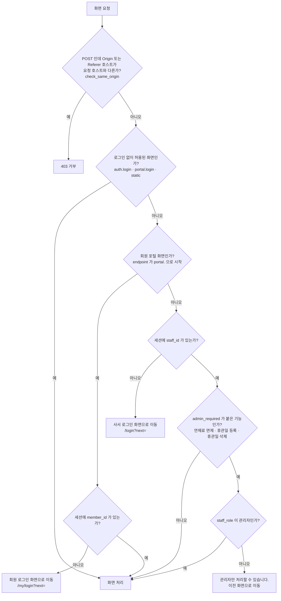

### 3.4 데이터 범위 제한

| 대상 | 제한 내용 | 구현 위치 |
|---|---|---|
| 다른 사이트에서 온 POST | Origin(없으면 Referer) 호스트가 요청 호스트와 다르면 403, 세션 쿠키 SameSite=Lax | `app/__init__.py` `check_same_origin` · `config.py` (`test_72_csrf_and_open_redirect`) |
| 로그인 후 이동 주소 | `next` 는 같은 사이트 경로만 허용. scheme·호스트가 있거나 `//` 로 시작하거나 제어문자·역슬래시가 있으면 기본 화면으로 이동 | `app/auth.py` `safe_next` (사서 `/login`·회원 `/my/login` 공용, 사서 로그인은 `test_72_csrf_and_open_redirect` 로 검증) |
| 회원 포털 조회 | `/my/` 의 대출·연체료·대출정지 조회는 모두 세션의 `member_id` 로 조건을 건다 | `portal.py` `index` |
| 회원 연장 | 신청경로 '홈페이지' 이면 대출의 회원과 신청 회원이 같아야 하며, 다르면 '연장할 수 있는 대출이 아닙니다.' 로 거부 | `sp_renew` (`test_12_member_cannot_renew_others_loan`) |
| 회원용 도서 상세 | 대출자 이름을 조회하지 않고, 상태가 대출가능·대출중인 복본만 보여 준다 | `portal.py` `book_detail` |
| 회원의 사서 화면 접근 | 회원 세션으로 `/members/` 등에 접근하면 `/login` 으로 이동, `/my/` 에 다른 회원 학번이 나타나지 않음 | `require_login` (`test_70_access_control`) |
| DB 접속 계정 | 모든 사용자의 요청은 앱 전용 계정 `library` 로 실행되며 권한은 SELECT·INSERT·UPDATE·DELETE·EXECUTE 뿐이다(DDL 불가). 관리자/사서 구분은 DB 권한이 아니라 앱(`admin_required`)에서 한다 | `sql/01_schema.sql` GRANT · `config.py` (`test_61_app_account_has_no_ddl_privilege`) |

## 4. Notion 기능 정리표와의 대응

### 4.1 대응표

00 문서 4장의 기능 목록은 Notion 「기능 정리표」(11.05 회의 결과물, 원문은 12 문서 3.2) 의 16개 기능 ID, 11.12 회의 추가 2개, 작업분 추가 6개로 이루어진다. 정리표 항목명은 Notion 원문(12 문서 3.2)을, 기능명과 기능 ID 는 00 문서 4장을 따랐다. 정리표의 기능 영역은 회원·도서·대출·반납·연체 관리 5개이며 '공통' 영역은 정리표에 없다. '관련 고려사항 결정' 은 11.12 회의가 미결로 남긴 '추가적인 고려사항' 12개에 대해 작업분이 정한 결정(00 문서 3장 No)이며, 11.19 회의에서 팀 확인이 필요하다(12 문서 7장 No.11). 회의에서 실제로 결정된 사항은 출처 칸에 회의 결정 번호(12 문서 4.3)로 적었다.

| No | 영역 | 정리표 기능 (12 문서 3.2 원문) | 기능명 (00 문서) | 기능 ID | 출처 | 관련 고려사항 결정 (00 문서 3장 No · 작업분 결정, 팀 미확인) | 검증 테스트 (`tests/test_scenarios.py`) |
|---|---|---|---|---|---|---|---|
| 1 | 회원 관리 | 회원 등록 | 회원 등록 | MEM-01 | 기능 정리표 | No.9 신분별 대출 권수 → 등록 시 회원구분 선택 | `test_40_member_register_validation` |
| 2 | 회원 관리 | 정보 수정 | 회원 정보 수정 (비밀번호 재설정 포함) | MEM-02 | 기능 정리표 | No.1 회원도 로그인 → 비밀번호 재설정 | — |
| 3 | 회원 관리 | 탈퇴 처리 | 탈퇴 처리 | MEM-03 | 기능 정리표 | No.8 대출 중 탈퇴 차단 | `test_41_withdraw_rules` |
| 4 | 회원 관리 | 회원 조회 | 회원 조회 | MEM-04 | 기능 정리표 | No.12 대출상태는 계산값 | — |
| 5 | 도서 관리 | 도서 등록 | 도서 등록 (국립중앙도서관 API 조회) | BOOK-01 | 기능 정리표 | — | `test_33_book_form_keeps_author_roles_and_rejects_bad_input` |
| 6 | 도서 관리 | 정보 수정 | 도서 정보 수정 | BOOK-02 | 기능 정리표 | — | `test_33_book_form_keeps_author_roles_and_rejects_bad_input` |
| 7 | 도서 관리 | — (정리표에 없음) | 복본 추가 | BOOK-03 | 작업분 추가 (정리표에 없음, 12 문서 7장 No.8 확인 필요) | — | `test_33_book_form_keeps_author_roles_and_rejects_bad_input` (권수가 숫자가 아닌 요청 처리) |
| 8 | 도서 관리 | 폐기 처리 | 폐기 처리 (복본 상태 변경) | BOOK-04 | 기능 정리표 | No.7 분실·폐기 상태 · No.8 대출 중 폐기 차단 · No.12 복본 상태값 | `test_31_discard_guard` · `test_32_book_with_history_cannot_be_deleted` |
| 9 | 도서 관리 | 도서 검색 (사용자 원문 '사서 (회원은 검색만)') | 도서 검색 | BOOK-05 | 기능 정리표 | No.1 회원 포털 도서 검색 | — |
| 10 | 대출 관리 | 대출 가능 여부 검사 | 대출 가능 여부 검사 | LOAN-01 | 기능 정리표 | No.2 연체 중 대출 불가 · No.3 미납 시 대출 불가 · No.9 신분별 권수 | `test_01_borrow_blocked_for_overdue_member` · `test_02_borrow_blocked_for_unpaid_fine` · `test_03_borrow_blocked_for_suspended_and_withdrawn` · `test_05_borrow_limit` · `test_06_borrow_blocked_for_unavailable_copies` |
| 11 | 대출 관리 | 대출 처리 | 대출 처리 | LOAN-02 | 기능 정리표 | No.5 반납예정일이 휴관일이면 다음 개관일 | `test_04_borrow_success_sets_due_date_on_open_day` |
| 12 | 대출 관리 | 대출 내역 조회 (사용자 원문 '사서 (회원은 본인 내역 조회만)') | 대출 내역 조회 | LOAN-03 | 기능 정리표 | No.1 회원 본인 내역 조회 | `test_70_access_control` (다른 회원 정보 미노출) |
| 13 | 대출 관리 | — (정리표에 없음) | 대출 연장 | LOAN-04 | **11.12 회의 추가** (11.12-7 홈페이지 또는 모바일 앱 2회 · 11.12-11 연장 기능 구현) | No.1 홈페이지 연장 · No.4 연체 중 연장 불가 · No.6 연장한 날 + 대출기간 · No.11 연장 이력 테이블 | `test_10_renew_from_member_portal` · `test_11_renew_rules` · `test_12_member_cannot_renew_others_loan` |
| 14 | 반납 관리 | 반납 처리 | 반납 처리 | RET-01 | 기능 정리표 | No.10 연체료를 `fine` 에 확정 저장 | `test_20_overdue_return_creates_fine_then_pay_unblocks` |
| 15 | 반납 관리 | 연체일수 자동 계산 | 연체일수 자동 계산 (휴관일 제외) | RET-02 | 기능 정리표 | No.5 휴관일 정책과 일관 | `test_21_overdue_days_exclude_closed_days` |
| 16 | 반납 관리 | — (정리표에 없음) | 분실 처리 | RET-03 | 작업분 추가 (정리표에 없음, 12 문서 7장 No.8 확인 필요) | No.7 분실 처리 시 대출 종료 + 변상금 기준액 | `test_30_report_lost` |
| 17 | 연체 관리 | 연체자 조회 | 연체자 조회 | OVD-01 | 기능 정리표 | — | — |
| 18 | 연체 관리 | 대출 정지 적용·해제 (한 항목 → OVD-02·OVD-03) | 대출정지 적용 | OVD-02 | 기능 정리표 | No.2 사서가 기간을 정해 거는 대출정지 | `test_50_suspend_and_release` |
| 19 | 연체 관리 | 대출 정지 적용·해제 (한 항목 → OVD-02·OVD-03) | 대출정지 해제 | OVD-03 | 기능 정리표 | No.2 | `test_50_suspend_and_release` |
| 20 | 연체 관리 | — (정리표에 없음) | 연체료 부과·납부·면제 | OVD-04 | **11.12 회의 추가** (11.12-8 매일 100원 · 11.12-11 연체료 납부 기능 구현) | No.3 미납 시 대출·연장 불가 · No.10 FINE 테이블 분리 | `test_20_overdue_return_creates_fine_then_pay_unblocks` · `test_22_waive_requires_admin` |
| 21 | 공통 | — (정리표에 없음) | 사서 로그인·권한 (관리자/사서) | SYS-01 | 작업분 추가 (정리표에 없음, 12 문서 7장 No.8 확인 필요) | — | `test_70_access_control` · `test_22_waive_requires_admin` · `test_23_new_closed_day_moves_due_dates` · `test_72_csrf_and_open_redirect` |
| 22 | 공통 | — (정리표에 없음) | 회원 로그인·비밀번호 변경 | SYS-02 | 작업분 추가 (정리표에 없음, 12 문서 7장 No.8 확인 필요) | No.1 회원도 로그인 (학번·교번 ID, 비밀번호 해시) | `test_40_member_register_validation` · `test_41_withdraw_rules` · `test_70_access_control` |
| 23 | 공통 | — (정리표에 없음) | 휴관일 관리 (등록 시 해당일 반납예정 대출 재계산) | SYS-03 | 작업분 추가 (정리표에 없음, 12 문서 7장 No.8 확인 필요) | No.5 휴관일이면 다음 개관일 | `test_23_new_closed_day_moves_due_dates` |
| 24 | 공통 | — (정리표에 없음) | 대시보드·통계 | SYS-04 | 작업분 추가 (정리표에 없음, 12 문서 7장 No.8 확인 필요) | — | — |

출처별 기능 수: 기능 정리표 16개(원문 항목 15개 중 '대출 정지 적용·해제' 하나를 OVD-02·OVD-03 으로 나눔), 11.12 회의 추가 2개(LOAN-04, OVD-04), 정리표와 회의 결정에 없는 작업분 추가 6개(BOOK-03, RET-03, SYS-01~04). 기능 ID 가 없는 공통 검증은 `test_60_db_constraints`(중복 대출·ISBN 형식·반납구분 짝·회원 상태값 제약), `test_61_app_account_has_no_ddl_privilege`(앱 계정 DDL 불가), `test_71_pages_with_suspension_and_overdue_render`(대출정지·연체 회원의 회원 상세·회원 포털 화면과 잘못된 연도의 휴관일 화면 렌더링) 세 개다.

### 4.2 11.12 회의 추가 기능

'11.12 회의 원문' 은 12 문서 4.3 의 결정 원문이고, '구현 내용 (작업분)' 은 윤준서 작업분이 구현한 내용이다. 회의 원문에 없는 규칙은 근거 문서와 함께 '작업분 결정' 으로 표시했다.

| 기능 ID | 11.12 회의 원문 | 구현 내용 (작업분) | 추가로 생긴 DB 객체 | 화면 |
|---|---|---|---|---|
| LOAN-04 대출 연장 | 11.12-7 "홈페이지 또는 모바일 앱을 통해 2회까지" · 11.12-11 "연장 기능, 연체료 납부 기능: 실제 프로그램에 구현 예정" | 회원 포털(신청경로 홈페이지)로 연장 신청. 대출 데스크 연장(신청경로 사서, 00 문서 2장, 작업분 결정). 새 반납예정일 = 연장한 날 + 대출기간(00 문서 3장 No.6, 작업분 결정). 최대 연장 횟수는 회원구분별(전임교원 1회, 나머지 2회. 00 문서 2장 숭실대 규정, 작업분 결정). 모바일 앱 경로는 구현하지 않음(웹 회원 포털로 대신, 12 문서 7장 No.4 확인 필요) | `renewal` 테이블 · `sp_renew` · `member_type.max_renew` | `/my/` 연장 신청 버튼, 사서 화면의 대출 목록 연장 버튼 |
| OVD-04 연체료 부과·납부·면제 | 11.12-8 "연체 시 도서 대출 자격 정지 및 매일 100원의 연체료" · 11.12-11 "연장 기능, 연체료 납부 기능: 실제 프로그램에 구현 예정" | 반납·분실 처리 시 연체일수 × 1권 1일 100원(`fine_per_day`, 5개 회원구분 모두 100) 자동 부과, 사서 납부 처리. 관리자 면제 처리(00 문서 4장, 작업분 결정). 미납이 있으면 대출·연장 불가(00 문서 3장 No.3, 작업분 결정)·탈퇴 불가(00 문서 3장 No.8, 작업분 결정) | `fine` 테이블 · `sp_settle_fine` · `member_type.fine_per_day` (부과는 `sp_return`·`sp_report_lost`) | `/overdue/fines`, 회원 상세 연체료 목록, `/my/` 연체료 목록 |

### 4.3 정리표 대비 범위 조정

| 항목 | 처리 | 근거 |
|---|---|---|
| 예약 | 범위 제외 (기능 ID 없음) | 00 문서 2장: 기능 정리표에 없음 → 회의에서 추가 결정 시 확장 |
| 작업분 추가 기능 (BOOK-03 복본 추가 · RET-03 분실 처리 · SYS-01~04) | 정리표에 없음. 구현은 되어 있으나 팀 채택 여부 미정 | 12 문서 7장 No.8 (11.05 규칙: 기능 추가 시 정리표부터 수정) |
| 변상 이행 기록 (동일 도서 수령 등) | 범위 제외, 향후 과제. 분실 처리 시 변상금 기준액 안내까지만 구현 (RET-03) | 00 문서 3장 No.7 |
| 반납 후 추가 대출정지 기간 | 두지 않음. 연체 도서를 가진 동안만 대출·연장 불가이고, `sp_return` 은 연체료만 부과한다. 기간 정지는 사서가 OVD-02 로만 등록 | 00 문서 3장 No.2 |
| 도서 삭제 | 00 문서 기능 목록에 별도 ID 없음 → BOOK-04 의 세부 기능으로 분류 (`/books/<isbn>/delete`) | `books.py` `delete` · `fk_loan_copy` |
| 휴관일 삭제 | 00 문서 기능명에는 없음 → SYS-03 의 세부 기능으로 분류 (`/closed-days/<closed_date>/delete`, 관리자 전용) | `closed_days.py` `delete` |

---

# 03. 단위 업무 기술서

> 00 문서의 기능 ID 24개를 단위 업무로 하나씩 정의하고, 실제 코드(`app/*.py`, `sql/02_programs.sql`)의 처리 순서와 메시지 원문, 테이블 CRUD 를 정리한다. 작성 기준일 2026-11-14

## 1. 작성 기준

### 1.1 범례

| 구분 | 표기 |
|---|---|
| 기능 ID | `00_설계_결정사항.md` §4 기능 목록 그대로 (MEM-01 … SYS-04) |
| 근거 표시 | (숭실대 규정 제NN조) = 「숭실대학교 중앙도서관 규정」 조항 · (숭실대 안내) = 중앙도서관 공식 대출 안내(oasis.ssu.ac.kr) · (팀 정책) = 규정에 없어 팀이 정한 규칙 · (결정 3-N) = 00 문서 §3 표의 No N 결정 |
| DB 메시지 | 프로시저·트리거의 `SIGNAL SQLSTATE '45000'` 메시지. `app/db.py` 의 `error_message()` 가 오류 코드 1644 를 받으면 메시지를 **그대로** 화면에 보여 준다 |
| 앱 메시지 | Flask `flash()` 메시지. `{ }` 는 실행 시 채워지는 값 (예: `{서명}`), 프로시저의 `CONCAT()` 메시지도 같은 방식으로 표기 |
| CRUD | C = INSERT, R = SELECT (뷰·함수를 통한 읽기, 트리거 안의 읽기 포함), U = UPDATE (트리거가 같은 행에 값을 쓰는 경우 포함), D = DELETE |
| 수행자 | 사서 = `staff.role` 이 '관리자' 또는 '사서', 관리자 = '관리자'만, 회원 = 회원 포털 `/my` 로그인 회원, 시스템 = DB 함수·뷰가 자동 계산 |

### 1.2 단위 업무 목록

| 기능 ID | 업무명 | 업무 영역 | 수행자 | 주요 화면 | 관련 DB 프로그램 |
|---|---|---|---|---|---|
| MEM-01 | 회원 등록 | 회원 관리 | 사서 | `/members/new` | (앱 SQL) |
| MEM-02 | 회원 정보 수정 (비밀번호 재설정 포함) | 회원 관리 | 사서 | `/members/<id>/edit` | (앱 SQL) |
| MEM-03 | 탈퇴 처리 | 회원 관리 | 사서 | `/members/<id>/withdraw` | `trg_member_withdraw_check` |
| MEM-04 | 회원 조회 | 회원 관리 | 사서 | `/members/`, `/members/<id>` | `v_member_status`, `v_loan_detail` |
| BOOK-01 | 도서 등록 (국립중앙도서관 API 조회) | 도서 관리 | 사서 | `/books/new?lookup=ISBN` | (앱 SQL) |
| BOOK-02 | 도서 정보 수정 | 도서 관리 | 사서 | `/books/<isbn>/edit` | `v_book_summary` |
| BOOK-03 | 복본 추가 | 도서 관리 | 사서 | `/books/<isbn>/copies` | (앱 SQL) |
| BOOK-04 | 폐기 처리 (복본 상태 변경) | 도서 관리 | 사서 | `/books/copies/<id>/status` | `trg_book_copy_status_guard` |
| BOOK-05 | 도서 검색 | 도서 관리 | 사서·회원 | `/books/`, `/my/books` | `v_book_summary` |
| LOAN-01 | 대출 가능 여부 검사 | 대출 관리 | 사서 | `/loans/borrow?member_no=` | `v_member_status` (+ `sp_borrow`) |
| LOAN-02 | 대출 처리 | 대출 관리 | 사서 | `/loans/borrow` (POST) | `sp_borrow`, `fn_next_open_day` |
| LOAN-03 | 대출 내역 조회 | 대출 관리 | 사서·회원(본인) | `/loans/`, `/my/` | `v_loan_detail`, `v_member_status` |
| LOAN-04 | 대출 연장 | 대출 관리 | 회원(홈페이지)·사서 | `/my/loans/<id>/renew`, `/loans/<id>/renew` | `sp_renew`, `fn_next_open_day` |
| RET-01 | 반납 처리 | 반납 관리 | 사서 | `/loans/return` | `sp_return`, `fn_overdue_days` |
| RET-02 | 연체일수 자동 계산 (휴관일 제외) | 반납 관리 | 시스템 | (모든 대출 목록) | `fn_overdue_days`, `v_loan_detail` |
| RET-03 | 분실 처리 | 반납 관리 | 사서 | `/loans/<id>/lost` | `sp_report_lost`, `fn_compensation` |
| OVD-01 | 연체자 조회 | 연체 관리 | 사서 | `/overdue/` | `v_loan_detail` |
| OVD-02 | 대출정지 적용 | 연체 관리 | 사서 | `/overdue/suspend` | `sp_suspend_member` |
| OVD-03 | 대출정지 해제 | 연체 관리 | 사서 | `/overdue/suspensions/<id>/release` | `sp_release_suspension` |
| OVD-04 | 연체료 부과·납부·면제 | 연체 관리 | 사서 (면제는 관리자) | `/overdue/fines` | `sp_return`, `sp_report_lost`, `sp_settle_fine` |
| SYS-01 | 사서 로그인·권한 (관리자/사서) | 공통 | 사서 | `/login` | (앱 SQL) |
| SYS-02 | 회원 로그인·비밀번호 변경 | 공통 | 회원 | `/my/login`, `/my/password` | (앱 SQL) |
| SYS-03 | 휴관일 관리 (등록 시 해당일 반납예정 대출 재계산) | 공통 | 관리자 | `/closed-days` | `sp_add_closed_day`, `fn_next_open_day` |
| SYS-04 | 대시보드·통계 | 공통 | 사서 | `/`, `/stats/` | `v_loan_detail` |

### 1.3 단위 업무 연계

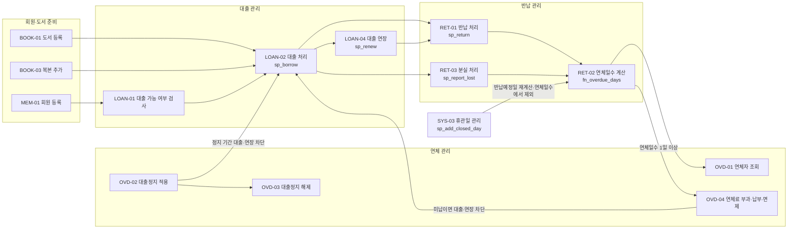

### 1.4 모든 업무에 공통인 처리

| 항목 | 내용 |
|---|---|
| 동일 출처 검사 | `app/__init__.py` 의 `check_same_origin` 이 모든 POST 요청에서 `Origin`(없으면 `Referer`) 헤더의 호스트가 요청 호스트와 다르면 403 으로 거부한다 (CSRF 방어, `test_72`) |
| 로그인 검사 | `app/__init__.py` 의 `before_request` 가 `/my` 아래 화면(`portal.*`)은 세션의 `member_id`, 나머지 화면은 `staff_id` 를 요구한다. 없으면 `/my/login?next=…` 또는 `/login?next=…` 로 이동. 예외는 `static`, `auth.login`, `portal.login` |
| 트랜잭션 | `db.py` 의 연결은 `autocommit=False`. `execute()`·`call_proc()`·`transaction()` 은 성공 시 COMMIT, 예외 시 ROLLBACK. 프로시저 1회 호출 = 트랜잭션 1개 |
| 동시성 | 프로시저는 검사 대상 행을 `SELECT … FOR UPDATE` 로 잠근다 (`sp_borrow`: 회원·복본, `sp_return`: 복본·대출, `sp_renew`·`sp_report_lost`: 대출, `sp_suspend_member`: 회원, `sp_release_suspension`: 대출정지, `sp_settle_fine`: 연체료) |
| 오류 메시지 변환 | `error_message()` 순서: ① 오류 코드 1644(SIGNAL) → 메시지 원문; ② 오류 내용에 제약조건 이름이 있으면 `CONSTRAINT_MESSAGES` 문구; ③ 코드별 기본 문구 1048 "필수 항목이 비어 있습니다." · 1062 "중복된 값입니다." · 1406 "입력값이 너무 깁니다." · 1451 "다른 데이터에서 참조 중이라 삭제할 수 없습니다." · 1452 "참조하는 데이터가 존재하지 않습니다." · 3819 "입력값이 제약조건을 위반했습니다."; ④ 그 밖에는 서버 로그에 상세를 남기고 "처리 중 오류가 발생했습니다. (오류 코드 {code})" |
| 메시지 표시 | `base.html` 이 `flash` 메시지를 분류(success·error·warning·info)별 상자로 화면 상단에 표시 |
| DB 계정 | 앱은 `library` 계정으로 접속하며 SELECT·INSERT·UPDATE·DELETE·EXECUTE 권한만 가진다 (DDL 불가, `test_61` 로 확인) |

## 2. 회원 관리

### MEM-01 회원 등록

| 항목 | 내용 |
|---|---|
| 업무 ID | MEM-01 |
| 업무명 | 회원 등록 |
| 업무 영역 | 회원 관리 |
| 수행자 | 사서 |
| 업무 개요 | 학생·교직원을 도서관 회원으로 등록한다. 학번·교번(`member_no`)이 회원 포털 로그인 ID 가 되고, 회원구분(`type_code`)에 따라 대출 권수·기간·연장 횟수가 정해진다 |
| 수행 시점 | 신규 이용자가 대출 데스크에서 가입을 요청할 때 (회원 관리 화면의 '+ 회원 등록') |
| 선행 조건 | 사서 로그인 (SYS-01) · 회원구분 5종(`UG` 학부생, `UGL` 휴학생, `GR` 대학원생, `FAC` 전임교원, `STF` 직원·비전임교원)이 `member_type` 에 있음 (`03_base_data.sql`) |
| 입력 정보 | 학번·교번 (필수, 영문·숫자 4~20자) · 이름 (필수) · 회원구분 (선택 목록, 기본 `UG`) · 소속 (학과·부서) · 전화번호 (필수, 010-1234-5678 형식) · 이메일 · 초기 비밀번호 (필수, 8자 이상) |
| 처리 절차 | ① GET: `SELECT * FROM member_type ORDER BY max_loan_count, type_code` 로 회원구분 목록을 '학부생 (10권 · 14일 · 연장 2회)' 형식으로 표시; ② POST: 입력값 앞뒤 공백 제거, 소속·이메일이 빈 값이면 NULL; ③ 학번·이름·전화번호 빈 값 검사; ④ 비밀번호 8자 미만 검사; ⑤ `generate_password_hash()` 로 해시를 만든 뒤 `INSERT INTO member (member_no, password_hash, name, type_code, department, phone, email)` 실행 (status 기본값 '정상', join_date 기본값 오늘, member_id 는 AUTO_INCREMENT); ⑥ COMMIT 후 새 회원의 상세 화면 `/members/<id>` 로 이동 |
| 출력 정보 | 성공: "{이름} 회원을 등록했습니다. (회원번호 {member_id})" → 회원 상세 화면 (MEM-04) |
| 업무 규칙 | 학번·교번이 로그인 ID, 비밀번호는 해시로만 저장 (결정 3-1) · 신분별 대출 정책은 `member_type` 으로 관리 (결정 3-9, 숭실대 안내) · 학번·전화번호·이메일은 회원 간 중복 불가 (팀 정책, `uq_member_no`·`uq_member_phone`·`uq_member_email`) · 학번 형식 `^[0-9A-Za-z]{4,20}$`, 전화번호 형식 `^01[0-9]-[0-9]{3,4}-[0-9]{4}$` (팀 정책, CHECK) · 초기 비밀번호 8자 이상 (팀 정책, 앱 검사) · 계정상태는 '정상'으로 시작하며 대출정지 여부는 저장하지 않음 (결정 3-12) |
| 예외 처리 | 앱 검사: "학번(교번), 이름, 전화번호는 필수입니다." · "초기 비밀번호는 8자 이상이어야 합니다."; DB 제약 변환: `uq_member_no` "이미 등록된 학번(교번)입니다." · `uq_member_phone` "이미 등록된 전화번호입니다." · `uq_member_email` "이미 등록된 이메일입니다." · `ck_member_no` "학번(교번)은 영문·숫자 4~20자여야 합니다." · `ck_member_phone` "전화번호 형식이 올바르지 않습니다. (예: 010-1234-5678)" · `fk_member_type` "존재하지 않는 회원구분입니다."; 오류 시 입력값을 유지한 채 등록 화면을 다시 표시 |
| 관련 테이블 | `member_type` (R) · `member` (C) |
| 관련 화면 | `/members/new` (GET·POST) · 템플릿 `members/form.html` |
| 관련 DB 프로그램 | 없음 (앱 SQL). 제약조건 `uq_member_no`, `uq_member_phone`, `uq_member_email`, `ck_member_no`, `ck_member_phone`, `ck_member_status`, `ck_member_withdraw`, `fk_member_type` |

### MEM-02 회원 정보 수정 (비밀번호 재설정 포함)

| 항목 | 내용 |
|---|---|
| 업무 ID | MEM-02 |
| 업무명 | 회원 정보 수정 (비밀번호 재설정 포함) |
| 업무 영역 | 회원 관리 |
| 수행자 | 사서 |
| 업무 개요 | 회원의 학번·이름·회원구분·소속·전화번호·이메일을 고치고, 회원이 비밀번호를 잊었을 때 사서가 새 비밀번호로 재설정한다 |
| 수행 시점 | 회원의 신분(예: 학부생 → 대학원생)·연락처가 바뀌었거나 비밀번호 재설정을 요청받았을 때 (회원 상세 화면의 '정보 수정') |
| 선행 조건 | 사서 로그인 · 대상 회원이 존재하고 계정상태가 '정상' |
| 입력 정보 | 학번·교번 (필수) · 이름 (필수) · 회원구분 · 소속 · 전화번호 (필수) · 이메일 · 비밀번호 재설정 (비우면 변경하지 않음) |
| 처리 절차 | ① `SELECT * FROM member WHERE member_id = %s` (없으면 404); ② status 가 '탈퇴'이면 오류 메시지와 함께 회원 상세로 이동; ③ GET: 현재 값과 회원구분 목록(`member_type`)으로 폼 표시, 비밀번호 칸은 빈 칸; ④ POST: 입력값 정리 후 학번·이름·전화번호 빈 값 검사; ⑤ `UPDATE member SET member_no = %s, name = %s, type_code = %s, department = %s, phone = %s, email = %s WHERE member_id = %s` 실행 후 COMMIT (BEFORE UPDATE 트리거 `trg_member_withdraw_check` 가 실행되지만 status 가 바뀌지 않아 아무 처리도 하지 않음); ⑥ 비밀번호 칸에 값이 있으면 8자 미만은 경고만 남기고, 8자 이상이면 `UPDATE member SET password_hash = %s WHERE member_id = %s` 를 별도 트랜잭션으로 실행; ⑦ 회원 상세 화면으로 이동 |
| 출력 정보 | 성공: "회원 정보를 수정했습니다." · 비밀번호가 8자 미만이면 경고 "비밀번호는 8자 이상이어야 해서 변경하지 않았습니다." 가 함께 표시 |
| 업무 규칙 | 탈퇴한 회원은 수정 불가 (팀 정책) · 회원구분을 바꾸면 이후의 대출·연장부터 새 정책이 적용된다 (`sp_borrow`·`sp_renew` 가 호출 시점에 `member_type` 을 읽음, 이미 정해진 반납예정일은 그대로) · 비밀번호 칸이 비면 기존 해시 유지 · 형식·중복 규칙은 MEM-01 과 같음 |
| 예외 처리 | 앱 검사: "탈퇴한 회원의 정보는 수정할 수 없습니다." · "학번(교번), 이름, 전화번호는 필수입니다."; DB 제약 변환: "이미 등록된 학번(교번)입니다." · "이미 등록된 전화번호입니다." · "이미 등록된 이메일입니다." · "학번(교번)은 영문·숫자 4~20자여야 합니다." · "전화번호 형식이 올바르지 않습니다. (예: 010-1234-5678)" · "존재하지 않는 회원구분입니다."; 회원 없음 → 404 |
| 관련 테이블 | `member_type` (R) · `member` (R, U) |
| 관련 화면 | `/members/<id>/edit` (GET·POST) · 템플릿 `members/form.html` |
| 관련 DB 프로그램 | `trg_member_withdraw_check` (실행되지만 이 업무에서는 영향 없음) |

### MEM-03 탈퇴 처리

| 항목 | 내용 |
|---|---|
| 업무 ID | MEM-03 |
| 업무명 | 탈퇴 처리 |
| 업무 영역 | 회원 관리 |
| 수행자 | 사서 |
| 업무 개요 | 졸업·퇴직 등으로 이용을 끝내는 회원의 계정상태를 '탈퇴'로 바꾼다. 미반납 도서나 미납 연체료가 있으면 DB 트리거가 거부한다. 회원 행은 삭제하지 않는다 (대출 이력 보존, 앱에 회원 삭제 기능 없음) |
| 수행 시점 | 회원이 탈퇴를 요청하거나 자격을 잃었을 때 (회원 상세 화면의 '탈퇴 처리') |
| 선행 조건 | 사서 로그인 · 계정상태 '정상' (버튼은 '정상'일 때만 표시) |
| 입력 정보 | 없음 (대상 회원번호는 URL) · 확인창 "탈퇴 처리할까요? 되돌릴 수 없습니다." |
| 처리 절차 | ① POST `UPDATE member SET status = '탈퇴' WHERE member_id = %s AND status = '정상'`; ② BEFORE UPDATE 트리거 `trg_member_withdraw_check`: NEW.status = '탈퇴' 이고 OLD.status <> '탈퇴' 이면 ⓐ `loan` 에 `return_date IS NULL` 인 행이 있으면 SIGNAL, ⓑ `fine` JOIN `loan` 에 status = '미납' 인 행이 있으면 SIGNAL, ⓒ 통과하면 `NEW.withdraw_date = CURDATE()`; ③ COMMIT 후 회원 상세로 이동 (대출상태 '탈퇴', 탈퇴일 표시) |
| 출력 정보 | 성공: "탈퇴 처리했습니다." |
| 업무 규칙 | 대출 중인 회원은 탈퇴 불가, 미납 연체료가 있어도 탈퇴 불가 (결정 3-8, DB 트리거로 차단) · 탈퇴일은 트리거가 자동 기록하며 `ck_member_withdraw` 가 '탈퇴' ↔ 탈퇴일 존재를 보장 · 탈퇴 후에는 대출(`sp_borrow`), 대출정지 적용(`sp_suspend_member`), 정보 수정(MEM-02), 회원 포털 로그인(SYS-02)이 모두 막힌다 · 트리거에는 '탈퇴' → '정상' 복원 시 탈퇴일을 NULL 로 되돌리는 분기가 있으나 앱에 복원 화면은 없다 |
| 예외 처리 | DB 메시지 (`trg_member_withdraw_check`): "반납하지 않은 도서가 있어 탈퇴 처리할 수 없습니다." · "미납 연체료가 있어 탈퇴 처리할 수 없습니다."; 이미 탈퇴한 회원이면 UPDATE 영향 행이 0 이므로 "이미 탈퇴한 회원입니다." (`execute_rowcount`, 화면에는 탈퇴 버튼이 보이지 않음) |
| 관련 테이블 | `member` (U) · `loan` (R, 트리거) · `fine` (R, 트리거) |
| 관련 화면 | `/members/<id>/withdraw` (POST) · 회원 상세 `members/detail.html` 의 '탈퇴 처리' 버튼 |
| 관련 DB 프로그램 | 트리거 `trg_member_withdraw_check` (BEFORE UPDATE ON `member`) · 제약 `ck_member_withdraw` |

### MEM-04 회원 조회

| 항목 | 내용 |
|---|---|
| 업무 ID | MEM-04 |
| 업무명 | 회원 조회 |
| 업무 영역 | 회원 관리 |
| 수행자 | 사서 |
| 업무 개요 | 회원 목록을 검색하고, 회원 한 명의 대출 현황·연체료·대출정지 이력을 한 화면에서 본다. 대출상태(대출가능/대출정지/탈퇴)는 뷰 `v_member_status` 가 계산한다 |
| 수행 시점 | 대출·반납 데스크에서 회원 상태를 확인할 때, 다른 회원 업무(MEM-02·03, OVD-02~04)를 시작하기 전 |
| 선행 조건 | 사서 로그인 |
| 입력 정보 | 검색어 (이름·학번·전화번호·소속) · 상태 필터 (전체 상태 / 대출가능 / 대출정지 / 탈퇴) |
| 처리 절차 | ① 목록: `SELECT * FROM v_member_status WHERE (%s = '' OR name LIKE %s OR member_no LIKE %s OR phone LIKE %s OR department LIKE %s) AND (%s = '' OR loan_state = %s) ORDER BY member_id`; ② 상세 `/members/<id>`: `SELECT * FROM v_member_status WHERE member_id = %s` (없으면 404); ③ `v_loan_detail` 에서 미반납 대출(반납예정일 순)과 반납된 대출 최근 20건(반납일시 역순); ④ 연체료: `fine` JOIN `loan` JOIN `book_copy` JOIN `book` (부과일 역순); ⑤ 대출정지 이력: `suspension` LEFT JOIN `staff`(적용 사서) LEFT JOIN `staff`(해제 사서), 시작일 역순 |
| 출력 정보 | 목록: 학번·교번 · 이름 · 구분 · 소속 · 전화번호 · 대출상태(정지 종료일) · 대출 '{대출 중} / {최대 권수}' · 연체 · 미납 연체료 · '대출' 버튼(대출가능일 때), "{n}명", 결과 없음 "검색 결과가 없습니다."; 상세: 회원 정보(회원구분 '(최대 {n}권 · {n}일 · 연장 {n}회)', 소속, 전화번호, 이메일, 가입일, 탈퇴일) · 타일 4개(대출 중, 연체, 미납 연체료, 대출정지 종료일) · 대출 중인 도서 · 연체료 · 대출정지 이력(상태 해제/만료/예정/유효) · 최근 대출 이력 최근 20건; 빈 목록 "내역이 없습니다." · "연체료 내역이 없습니다." · "대출정지 이력이 없습니다." |
| 업무 규칙 | 대출상태 = '탈퇴'(계정상태 탈퇴) / '대출정지'(유효한 대출정지 · 연체 도서 보유 · 미납 연체료) / '대출가능' — 저장하지 않고 계산 (결정 3-12) · 유효한 대출정지 = `released_date IS NULL AND CURDATE() BETWEEN start_date AND end_date` · 대출 한도 도달은 대출상태에 반영하지 않는다 (대출 시 `sp_borrow` 가 검사) |
| 예외 처리 | 회원 없음 → 404 |
| 관련 테이블 | `member` · `member_type` · `loan` · `fine` · `suspension` (R, `v_member_status`) · `book_copy` · `book` · `staff` · `renewal` · `closed_day` (R, `v_loan_detail`·연체료·정지 조회) |
| 관련 화면 | `/members/` · `/members/<id>` · 템플릿 `members/list.html`, `members/detail.html` |
| 관련 DB 프로그램 | 뷰 `v_member_status`, `v_loan_detail` · 함수 `fn_overdue_days` (뷰 내부) |

## 3. 도서 관리

### BOOK-01 도서 등록 (국립중앙도서관 API 조회)

| 항목 | 내용 |
|---|---|
| 업무 ID | BOOK-01 |
| 업무명 | 도서 등록 (국립중앙도서관 API 조회) |
| 업무 영역 | 도서 관리 |
| 수행자 | 사서 |
| 업무 개요 | 새로 들어온 도서의 서지정보(ISBN 단위)와 실물 복본을 함께 등록한다. ISBN 을 입력하면 국립중앙도서관 ISBN 서지정보 API 로 입력란을 자동으로 채운다. 출판사·저자는 이름으로 찾아 없으면 자동 등록한다 |
| 수행 시점 | 신규 도서 입수 시 (도서 검색 화면의 '+ 도서 등록') |
| 선행 조건 | 사서 로그인 · 분류 10개(`category`)가 있음 · API 조회를 쓰려면 환경변수 `NL_CERT_KEY` 설정 (00 문서 §6: 키 승인 전) |
| 입력 정보 | (조회) ISBN 13자리; (등록) ISBN · 서명 (필수) · 지은이 (필수, 쉼표 구분) · 옮긴이 (쉼표 구분) · 출판사 (필수) · 분류 (KDC 주류 선택) · KDC 분류기호 · 발행연도 · 정가(원) · 복본 권수 (0~10, 기본 1) · 배가위치 (기본 '종합자료실') · 청구기호 |
| 처리 절차 | ① GET: `SELECT category_code, category_name FROM category ORDER BY category_code` 로 분류 목록 표시; ② (선택) `?lookup=ISBN`: 숫자만 남겨 `nl_api.fetch_by_isbn()` 호출 → seoji API 결과 중 EA_ISBN 이 정확히 같은 레코드에서 서명·저자(지음/옮김 등 역할 구분)·출판사·발행연도·정가·KDC 를 읽어 입력란을 채움, KDC 가 없으면 소장자료 검색 API 로 보강; ③ POST: ISBN 은 숫자만, 발행연도는 빈 값이면 NULL, 정가는 숫자가 아니면 NULL, 분류는 선택값(없으면 KDC 기호 첫 자리의 주류, 그것도 없으면 '000'), 복본 권수는 0~10 으로 보정, 청구기호가 비면 KDC 기호(없으면 분류코드); ④ `validate_book()`: 서명·출판사·지은이 빈 값, 발행연도 숫자 여부, 발행연도 ≤ 내년 검사; ⑤ 한 트랜잭션으로 `SELECT publisher_id FROM publisher WHERE publisher_name = %s` → 없으면 `INSERT INTO publisher (publisher_name)`; ⑥ `INSERT INTO book (isbn, title, publisher_id, category_code, kdc_no, pub_year, price)`; ⑦ `DELETE FROM book_author WHERE isbn = %s` 후 지은이 → 옮긴이 순으로 `SELECT author_id FROM author WHERE author_name = %s ORDER BY author_id LIMIT 1` → 없으면 `INSERT INTO author (author_name)` → `INSERT INTO book_author (isbn, author_id, author_role, author_order)` (표기순서 1부터, 지은이 칸의 '이름 (엮은이)'·'이름 (그림)'은 `parse_writer()` 가 역할로 읽음, 같은 저자가 두 번이면 처음 역할만); ⑧ `SELECT COALESCE(MAX(CAST(SUBSTRING(reg_no, 3) AS UNSIGNED)), 0)` 와 해당 ISBN 의 기존 복본 수를 읽고 `INSERT INTO book_copy (reg_no, isbn, call_no, location)` 을 권수만큼 실행 (등록번호 'EM' + 6자리 연번, 2권째부터 청구기호 뒤에 ' c.N'); ⑨ COMMIT 후 도서 상세로 이동 |
| 출력 정보 | 성공: "'{서명}' 도서를 등록했습니다." → 도서 상세; API 조회 성공(info): "국립중앙도서관에서 서지정보를 불러왔습니다. 확인 후 등록하세요."; 조회 결과 없음(warning): "국립중앙도서관에 해당 ISBN 의 서지정보가 없습니다."; 키가 없으면 'ISBN 조회' 버튼 비활성 (버튼 툴팁 "NL_CERT_KEY 설정 필요") |
| 업무 규칙 | ISBN 은 978/979 로 시작하는 13자리 (`ck_book_isbn`) · 발행연도 1450~2100 (`ck_book_pub_year`) · 등록번호 형식 `^EM[0-9]{6}$` (`ck_book_copy_reg_no`) · 발행연도는 내년 이후 불가 (팀 정책, 앱 검사) · 저자역할은 지은이·옮긴이·엮은이·그림 중 하나 (`ck_book_author_role`). 지은이 칸에 '이름 (엮은이)'·'이름 (그림)'으로 쓰면 해당 역할로 저장되며, API 조회 결과의 엮은이·그림도 이 형식으로 채워진다 · 같은 이름 저자가 여러 명이면 author_id 가 가장 작은 저자를 사용 · 신규 복본 상태는 '대출가능', 입수일은 오늘 (DDL 기본값) · 도서·저자·복본 등록은 `transaction()` 하나로 묶여 전부 성공하거나 전부 취소된다 |
| 예외 처리 | 앱 검사: "서명, 출판사, 지은이는 필수입니다." · "발행연도는 숫자로 입력하세요." · "발행연도가 올바르지 않습니다. (내년 이후 불가)"; API 오류: "국립중앙도서관 API 인증키(NL_CERT_KEY)가 설정되어 있지 않습니다." · "국립중앙도서관 API 호출 실패: {오류}" · "국립중앙도서관 API 오류 {ERR_CODE}: {ERR_MESSAGE}"; DB 제약 변환: `book.PRIMARY` "이미 등록된 ISBN입니다." · `ck_book_isbn` "ISBN은 978 또는 979로 시작하는 13자리 숫자여야 합니다." · `ck_book_pub_year` "발행연도가 올바르지 않습니다." · `uq_book_copy_reg_no` "이미 사용 중인 등록번호입니다."; 오류 시 출판사·저자 자동 등록까지 모두 ROLLBACK |
| 관련 테이블 | `category` (R) · `publisher` (C, R) · `author` (C, R) · `book` (C) · `book_author` (C) · `book_copy` (C, R) |
| 관련 화면 | `/books/new` (GET·POST) · `/books/new?lookup=ISBN` · 템플릿 `books/form.html` |
| 관련 DB 프로그램 | 없음 (앱 SQL). 외부 연동 `app/nl_api.py` (`fetch_by_isbn`, `fetch_kdc`) |

### BOOK-02 도서 정보 수정

| 항목 | 내용 |
|---|---|
| 업무 ID | BOOK-02 |
| 업무명 | 도서 정보 수정 |
| 업무 영역 | 도서 관리 |
| 수행자 | 사서 |
| 업무 개요 | 등록된 도서의 서명·저자·출판사·분류·KDC·발행연도·정가를 고친다. ISBN(기본키)은 바꿀 수 없다 |
| 수행 시점 | 서지정보 오류를 발견했거나 정가·분류를 보완할 때 (도서 상세의 '수정') |
| 선행 조건 | 사서 로그인 · 대상 도서 존재 |
| 입력 정보 | ISBN (읽기 전용) · 서명 (필수) · 지은이 (필수) · 옮긴이 · 출판사 (필수) · 분류 · KDC 분류기호 · 발행연도 · 정가(원) |
| 처리 절차 | ① `SELECT * FROM v_book_summary WHERE isbn = %s` (없으면 404); ② GET: `book_author` JOIN `author` 를 표기순서대로 읽어 지은이 칸에는 '지은이'는 이름만, '엮은이'·'그림'은 '이름 (역할)' 형식으로(`format_writers`), 옮긴이 칸에는 '옮긴이'를 쉼표로 채우고 분류 목록 표시; ③ POST: 입력값 정리 (ISBN 은 URL 값으로 고정) 후 `validate_book()` 으로 서명·출판사·지은이 빈 값, 발행연도 숫자 여부, 발행연도 ≤ 내년 검사; ④ 한 트랜잭션으로 출판사 조회(없으면 `INSERT INTO publisher`) → `UPDATE book SET title = %s, publisher_id = %s, category_code = %s, kdc_no = %s, pub_year = %s, price = %s WHERE isbn = %s` → `DELETE FROM book_author WHERE isbn = %s` → 저자 조회(없으면 `INSERT INTO author`) → `INSERT INTO book_author` (표기순서 다시 부여, 지은이 칸의 '이름 (엮은이)'·'이름 (그림)'은 `parse_writer()` 가 역할로 읽음, 같은 저자가 두 번이면 처음 역할만); ⑤ COMMIT 후 도서 상세로 이동 |
| 출력 정보 | 성공: "도서 정보를 수정했습니다." |
| 업무 규칙 | ISBN 변경 불가 (입력란 readonly, UPDATE 의 WHERE 조건) · 저자 목록은 지우고 다시 넣는다 (표기순서 재부여) · 복본은 이 화면에서 바뀌지 않음 (BOOK-03·04) · 엮은이·그림 역할은 '이름 (역할)' 표기로 수정 후에도 유지된다 (`test_33`) · 발행연도는 내년 이후 불가 (팀 정책, 앱 검사) |
| 예외 처리 | 앱 검사: "서명, 출판사, 지은이는 필수입니다." · "발행연도는 숫자로 입력하세요." · "발행연도가 올바르지 않습니다. (내년 이후 불가)"; DB 제약 변환: `ck_book_pub_year` "발행연도가 올바르지 않습니다."; 도서 없음 → 404 |
| 관련 테이블 | `category` (R) · `publisher` (C, R) · `author` (C, R) · `book` (R, U) · `book_author` (C, R, D) · `book_copy` (R, `v_book_summary`) |
| 관련 화면 | `/books/<isbn>/edit` (GET·POST) · 템플릿 `books/form.html` |
| 관련 DB 프로그램 | 뷰 `v_book_summary` |

### BOOK-03 복본 추가

| 항목 | 내용 |
|---|---|
| 업무 ID | BOOK-03 |
| 업무명 | 복본 추가 |
| 업무 영역 | 도서 관리 |
| 수행자 | 사서 |
| 업무 개요 | 이미 등록된 도서에 같은 책(복본)을 더 들여왔을 때 등록번호를 이어서 부여해 복본을 추가한다 |
| 수행 시점 | 추가 구입·기증으로 같은 ISBN 의 책이 더 들어왔을 때 (도서 상세 화면 하단 '복본 추가') |
| 선행 조건 | 사서 로그인 · 도서(`book`)가 등록되어 있음 |
| 입력 정보 | 권수 (1~10, 기본 1) · 배가위치 (비우면 '종합자료실') |
| 처리 절차 | ① `SELECT category_code, kdc_no FROM book WHERE isbn = %s` (없으면 404); ② 권수를 1~10 으로 보정; ③ `SELECT call_no FROM book_copy WHERE isbn = %s ORDER BY copy_id LIMIT 1` 로 첫 복본 청구기호의 ' c.' 앞부분을 기본 청구기호로 사용 (복본이 없으면 KDC 기호, 그것도 없으면 분류코드); ④ 트랜잭션: 마지막 등록번호와 해당 ISBN 복본 수를 읽고 `INSERT INTO book_copy (reg_no, isbn, call_no, location)` 를 권수만큼 실행; ⑤ COMMIT 후 도서 상세로 이동 |
| 출력 정보 | 성공: "복본 {권수}권을 추가했습니다." · 도서 상세의 복본 표에 새 등록번호 표시 |
| 업무 규칙 | 등록번호는 전체 복본의 마지막 번호 + 1 부터 (2026-11-14 DB 의 마지막 번호는 EM000157 이므로 다음은 EM000158) · 같은 도서의 N번째 복본 청구기호는 '{청구기호} c.N' · 등록번호 중복 불가 (`uq_book_copy_reg_no`) |
| 예외 처리 | DB 제약 변환: `uq_book_copy_reg_no` "이미 사용 중인 등록번호입니다." (동시에 등록할 때); 도서 없음 → 404 |
| 관련 테이블 | `book` (R) · `book_copy` (C, R) |
| 관련 화면 | `/books/<isbn>/copies` (POST) · 템플릿 `books/detail.html` |
| 관련 DB 프로그램 | 없음 (앱 SQL) |

### BOOK-04 폐기 처리 (복본 상태 변경)

| 항목 | 내용 |
|---|---|
| 업무 ID | BOOK-04 |
| 업무명 | 폐기 처리 (복본 상태 변경) |
| 업무 영역 | 도서 관리 |
| 수행자 | 사서 |
| 업무 개요 | 훼손·노후 복본을 '폐기', 서가에서 없어진 복본을 '분실'로 바꾸거나, 잘못 처리한 복본을 '대출가능'으로 되돌린다. 대출 중인 복본은 DB 트리거가 상태 변경을 막는다 |
| 수행 시점 | 장서 점검·파손 도서 변상 처리 후 (도서 상세의 복본 표 '상태 변경') |
| 선행 조건 | 사서 로그인 · 대상 복본이 대출 중이 아님 (대출 중이면 상태 변경 칸이 '-' 로 비어 있다) |
| 입력 정보 | 복본상태 선택 (대출가능 / 분실 / 폐기) · 다른 상태로 바꿀 때 확인창 "{상태} 처리할까요?" |
| 처리 절차 | ① `SELECT isbn, reg_no, status FROM book_copy WHERE copy_id = %s` (없으면 404); ② 상태값이 '대출가능'·'분실'·'폐기' 가 아니면 400; ③ `UPDATE book_copy SET status = %s WHERE copy_id = %s`; ④ BEFORE UPDATE 트리거 `trg_book_copy_status_guard`: 상태가 바뀌고 새 상태가 '대출가능'·'분실'·'폐기'인데 `loan` 에 그 복본의 미반납 대출이 있으면 SIGNAL, 새 상태가 '분실'·'폐기'면 `NEW.removed_date = CURDATE()`, 아니면 NULL; ⑤ COMMIT 후 도서 상세로 이동 |
| 출력 정보 | 성공: "{등록번호} 복본을 '{상태}' 상태로 변경했습니다." · 복본 표의 상태 칸에 바뀐 상태와 처리일 표시 |
| 업무 규칙 | '대출중'은 대출·반납 처리로만 바뀌며 사서가 직접 선택할 수 없다 · 대출 중 책 폐기 금지 (결정 3-8, DB 트리거) · 분실·폐기일 자동 기록, 상태와 처리일의 짝은 `ck_book_copy_removed` 가 보장 · 파손 도서는 변상 후 '폐기' (결정 3-7, 숭실대 규정 제26조) · 분실·폐기 복본은 `v_book_summary` 의 소장 수(`total_copies`)에서 빠진다 |
| 예외 처리 | DB 메시지 (`trg_book_copy_status_guard`): "대출 중인 복본은 반납(또는 분실 처리) 후 상태를 변경할 수 있습니다."; 복본 없음 → 404 · 허용되지 않은 상태값 → 400 |
| 관련 테이블 | `book_copy` (R, U) · `loan` (R, 트리거) |
| 관련 화면 | `/books/copies/<copy_id>/status` (POST) · 템플릿 `books/detail.html` |
| 관련 DB 프로그램 | 트리거 `trg_book_copy_status_guard` (BEFORE UPDATE ON `book_copy`) · 제약 `ck_book_copy_status`, `ck_book_copy_removed` |

### BOOK-05 도서 검색

| 항목 | 내용 |
|---|---|
| 업무 ID | BOOK-05 |
| 업무명 | 도서 검색 |
| 업무 영역 | 도서 관리 |
| 수행자 | 사서 · 회원 |
| 업무 개요 | 서명·저자·출판사·ISBN 으로 도서를 찾고, 복본별 상태와 대출가능 권수를 확인한다. 회원 포털에서는 대출자 정보를 숨긴다 |
| 수행 시점 | 이용자 문의·대출 전 소장 확인 (사서), 대출할 책을 찾을 때 (회원) |
| 선행 조건 | 사서 로그인 (`/books/`) 또는 회원 로그인 (`/my/books`) |
| 입력 정보 | 검색어 (서명·저자·출판사 부분일치, ISBN 완전일치) · 분류 (사서 화면만, 전체 분류 / KDC 주류 10개) |
| 처리 절차 | ① 사서 목록: `SELECT * FROM v_book_summary WHERE (%s = '' OR title LIKE %s OR authors LIKE %s OR publisher_name LIKE %s OR isbn = %s) AND (%s = '' OR category_code = %s) ORDER BY title` + 분류 목록(`category`); ② 사서 상세 `/books/<isbn>`: `v_book_summary` 1행, 복본 목록 `book_copy` LEFT JOIN `loan`(미반납) LEFT JOIN `member` (등록번호 순), 누적 대출 `SELECT COUNT(*) … FROM loan l JOIN book_copy bc … WHERE bc.isbn = %s`; ③ 회원 목록 `/my/books`: 검색어가 있을 때만 `v_book_summary` 를 같은 조건으로 조회 (`LIMIT 100`); ④ 회원 상세 `/my/books/<isbn>`: 상태가 '대출가능'·'대출중'인 복본만 `book_copy` LEFT JOIN `loan` 으로 반납예정일과 함께 조회 (`member` 는 조인하지 않음) |
| 출력 정보 | 사서 목록: 서명 · 저자 · 출판사 · 발행 · 분류 · '대출가능 / 소장', "{n}종", 결과 없음 "검색 결과가 없습니다."; 사서 상세: 서지 정보(ISBN, 분류·KDC, 정가, 누적 대출 {n}회) · 소장 현황(이용 가능 복본 {n}권 — 분실·폐기를 뺀 수, 대출가능 {n}권) · 복본 표(등록번호, 청구기호, 위치, 상태, 대출 정보 '{회원명} · 반납예정 {날짜}' 와 연체 표시, 입수일, 상태 변경), 복본 없음 "복본이 없습니다."; 회원 상세: 소장 정보(등록번호, 청구기호, 위치, 상태, 반납예정일), "이용할 수 있는 소장본이 없습니다." |
| 업무 규칙 | 회원은 검색만 하고 대출은 대출 데스크에서 (결정 3-1) · 회원 화면에는 누가 빌렸는지와 분실·폐기 복본을 보여 주지 않는다 (팀 정책) · 저자 표기는 표기순서대로, 지은이 외 역할은 '이름 (역할)' (`v_book_summary.authors`) · 예약 기능은 범위 제외 (00 문서 §2) |
| 예외 처리 | 상세 ISBN 없음 → 404 · 미로그인 → `/login` 또는 `/my/login` 으로 이동 |
| 관련 테이블 | `book` · `publisher` · `category` · `book_author` · `author` · `book_copy` (R, `v_book_summary`) · `loan` (R) · `member` (R, 사서 상세만) |
| 관련 화면 | `/books/` · `/books/<isbn>` · `/my/books` · `/my/books/<isbn>` · 템플릿 `books/list.html`, `books/detail.html`, `portal/books.html`, `portal/book_detail.html` |
| 관련 DB 프로그램 | 뷰 `v_book_summary` |

## 4. 대출 관리

### LOAN-01 대출 가능 여부 검사

| 항목 | 내용 |
|---|---|
| 업무 ID | LOAN-01 |
| 업무명 | 대출 가능 여부 검사 |
| 업무 영역 | 대출 관리 |
| 수행자 | 사서 |
| 업무 개요 | 학번(교번)으로 회원을 불러와 대출 중 권수·연체·미납 연체료·대출정지를 보여 주고, 대출할 수 없는 사유를 미리 안내한다. 최종 판정은 LOAN-02 의 `sp_borrow` 가 한다 |
| 수행 시점 | 대출 데스크에서 회원이 책을 가져왔을 때, 대출 처리 직전 (회원 목록의 '대출', 회원 상세의 '대출하기' 버튼도 이 화면으로 연결 — 대출상태가 '대출가능'일 때만 표시) |
| 선행 조건 | 사서 로그인 |
| 입력 정보 | 학번·교번 (예: 20231234) |
| 처리 절차 | ① GET `/loans/borrow?member_no=`: `SELECT * FROM v_member_status WHERE member_no = %s`; ② 회원이 있으면 `SELECT * FROM v_loan_detail WHERE member_id = %s AND return_date IS NULL ORDER BY due_date` 로 현재 대출 목록 조회; ③ 화면에서 대출 불가 사유를 모음 — 계정상태 '탈퇴', `suspend_until` 있음, `overdue_loans` > 0, `unpaid_fine` > 0, `active_loans` >= `max_loan_count`; ④ 사유가 있으면 경고 상자 표시, 등록번호 입력란은 그대로 둔다 (시도하면 `sp_borrow` 가 거부) |
| 출력 정보 | 회원 카드: '{이름} {학번} · {회원구분}' 과 대출상태 · 대출 중 '{n} / {최대}권 (대출기간 {n}일)' · 연체 · 미납 연체료 · 대출정지 ('{날짜}까지' 또는 '없음'); 사유 상자 "대출 불가: {사유 · 사유}" — 사유 문구는 '탈퇴한 회원' · '{YYYY-MM-DD}까지 대출정지' · '연체 도서 {n}권 반납 필요' · '미납 연체료 {n}원 납부 필요' · '대출 한도 도달'; 현재 대출 중인 도서 표 |
| 업무 규칙 | 검사 항목은 `sp_borrow` 와 같다: 탈퇴 불가, 대출정지 기간 불가 (숭실대 규정 제27조, 결정 3-2), 연체 도서 보유 시 불가 (숭실대 규정 제24조), 미납 연체료 보유 시 불가 (팀 정책, 결정 3-3), 신분별 대출 한도 (숭실대 안내) · 화면 검사는 안내용이고 DB 프로시저가 최종 판정 (00 문서 §4) · 대출상태는 `v_member_status.loan_state` 라 미납 연체료·한도 도달은 대출상태에 나타나지 않고 사유 상자에만 나타난다 (2026-11-14 DB 기준 예: 학번 20214410 은 미납 700원, 대출상태 '대출가능') |
| 예외 처리 | 앱 메시지: "존재하지 않는 학번(교번)입니다." (조회한 학번이 없을 때) |
| 관련 테이블 | `member` · `member_type` · `loan` · `fine` · `suspension` (R, `v_member_status`) · `book_copy` · `book` · `staff` · `renewal` · `closed_day` (R, `v_loan_detail`) |
| 관련 화면 | `/loans/borrow?member_no=` (GET) · 템플릿 `loans/borrow.html` |
| 관련 DB 프로그램 | 뷰 `v_member_status`, `v_loan_detail` · 최종 검사 `sp_borrow` (LOAN-02) |

### LOAN-02 대출 처리

| 항목 | 내용 |
|---|---|
| 업무 ID | LOAN-02 |
| 업무명 | 대출 처리 |
| 업무 영역 | 대출 관리 |
| 수행자 | 사서 |
| 업무 개요 | 회원과 복본 등록번호(바코드)로 대출을 등록한다. 저장 프로시저 `sp_borrow` 가 대출 가능 여부를 다시 검사하고, 대출 행 생성과 복본 상태 변경을 한 트랜잭션으로 처리한다 |
| 수행 시점 | LOAN-01 화면에서 복본 등록번호를 입력하고 '대출'을 누를 때 |
| 선행 조건 | 사서 로그인 · LOAN-01 로 회원 조회 (학번은 숨은 입력값으로 전달) · 복본이 등록되어 있음 |
| 입력 정보 | 학번·교번 (숨은 값) · 복본 등록번호 (예: EM000001, 앱이 대문자로 변환) |
| 처리 절차 | ① 앱: `CALL sp_borrow(학번, 등록번호, 세션 staff_id)`; ② `member` JOIN `member_type` 에서 회원 상태·최대 권수·대출 기간을 읽고 회원 행을 `FOR UPDATE OF m` 로 잠금 → 없으면 SIGNAL; ③ 계정상태 '탈퇴' 검사; ④ `suspension` 에서 유효한 정지의 `MAX(end_date)` 검사; ⑤ `loan` 에 `return_date IS NULL AND due_date < CURDATE()` 인 대출 검사; ⑥ `fine` JOIN `loan` 에 '미납' 검사; ⑦ 미반납 대출 수 `COUNT(*)` 가 `max_loan_count` 이상인지 검사; ⑧ `SELECT copy_id, status FROM book_copy WHERE reg_no = %s FOR UPDATE` → 없거나 '대출가능'이 아니면 SIGNAL; ⑨ `INSERT INTO loan (copy_id, member_id, staff_id, loan_date, due_date) VALUES (…, NOW(), fn_next_open_day(CURDATE() + INTERVAL v_loan_days DAY))`; ⑩ `UPDATE book_copy SET status = '대출중'` (트리거 `trg_book_copy_status_guard` 가 `removed_date` 를 NULL 로 둠); ⑪ 새 대출의 대출번호·반납예정일·서명·회원명을 SELECT 해 반환; ⑫ 앱이 COMMIT 후 `/loans/borrow?member_no={학번}` 로 돌아가 LOAN-01 화면을 갱신 |
| 출력 정보 | 성공: "'{서명}' 대출 완료 · {회원명} · 반납예정일 {YYYY-MM-DD}" |
| 업무 규칙 | 신분별 대출 권수·기간 — 학부생 10권·14일, 휴학생 5권·14일, 대학원생 15권·30일, 전임교원 50권·180일, 직원·비전임교원 15권·30일 (숭실대 안내, `member_type`) · 학부생 14일은 11.12 회의록의 15일과 다름 → 팀 확인 필요, `member_type.loan_days` 값만 바꾸면 변경 가능 (00 문서 §2) · 연체 도서가 있으면 대출 불가, 반납하면 해제 (숭실대 규정 제24조, 결정 3-2) · 미납 연체료가 있으면 대출 불가 (팀 정책, 결정 3-3) · 대출정지 기간 중 대출 불가 (숭실대 규정 제27조) · 반납예정일 = 오늘 + 대출 기간, 휴관일이면 다음 개관일 (팀 정책, 결정 3-5) · 복본당 미반납 대출은 1건 (`uq_loan_active_copy`, 생성 컬럼 `active_copy_id`) · 검사 순서는 회원 존재 → 탈퇴 → 대출정지 → 연체 → 미납 연체료 → 한도 → 복본 존재 → 복본 상태 (먼저 걸린 사유 하나만 표시) |
| 예외 처리 | DB 메시지 (`sp_borrow`): "존재하지 않는 학번(교번)입니다." · "탈퇴한 회원은 대출할 수 없습니다." · "대출정지 기간입니다. ({v_susp_end}까지)" · "연체 중인 도서가 있어 대출할 수 없습니다. 연체 도서를 먼저 반납하세요." · "미납 연체료가 있어 대출할 수 없습니다." · "대출 한도({v_max_loan}권)를 초과합니다. 현재 {v_active}권 대출 중입니다." · "존재하지 않는 등록번호입니다." · "대출할 수 없는 복본입니다. (현재 상태: {v_copy_status})"; DB 제약 변환: `uq_loan_active_copy` "이미 대출 중인 복본입니다."; 오류 시 ROLLBACK |
| 관련 테이블 | `member_type` (R) · `member` (R) · `suspension` (R) · `fine` (R) · `loan` (C, R) · `book_copy` (R, U) · `book` (R) · `closed_day` (R, `fn_next_open_day`) |
| 관련 화면 | `/loans/borrow` (POST) · 템플릿 `loans/borrow.html` |
| 관련 DB 프로그램 | 프로시저 `sp_borrow` · 함수 `fn_next_open_day` · 트리거 `trg_book_copy_status_guard` |

### LOAN-03 대출 내역 조회

| 항목 | 내용 |
|---|---|
| 업무 ID | LOAN-03 |
| 업무명 | 대출 내역 조회 |
| 업무 영역 | 대출 관리 |
| 수행자 | 사서 · 회원(본인) |
| 업무 개요 | 사서는 전체 대출을 상태별로 검색하고, 회원은 회원 포털에서 본인의 대출 중 도서·지난 대출·연체료·대출정지 이력을 본다 |
| 수행 시점 | 대출 현황 확인, 반납 독촉, 회원 문의 응대 (사서) · 반납예정일 확인과 연장 신청 전 (회원) |
| 선행 조건 | 사서 로그인 (`/loans/`) 또는 회원 로그인 (`/my/`) |
| 입력 정보 | (사서) 상태 탭 대출 중(`active`, 기본) / 연체(`overdue`) / 반납 완료(`returned`) / 전체(`all`) · 검색어 (회원명·서명 부분일치, 학번·등록번호 완전일치); (회원) 없음 — 세션의 `member_id` 사용 |
| 처리 절차 | ① 사서 `/loans/`: `SELECT * FROM v_loan_detail WHERE {상태 조건} AND (%s = '' OR member_name LIKE %s OR member_no = %s OR title LIKE %s OR reg_no = %s) ORDER BY (return_date IS NULL) DESC, due_date, loan_id DESC LIMIT 300` — 상태 조건은 `return_date IS NULL` / `loan_state = '연체'` / `return_date IS NOT NULL` / `1 = 1`; ② 회원 `/my/`: `v_member_status` 에서 본인 1행; ③ `v_loan_detail` 에서 본인 미반납 대출(반납예정일 순)과 반납 이력 최근 30건; ④ 본인 연체료 `fine` JOIN `loan` JOIN `book_copy` JOIN `book`; ⑤ 본인 대출정지 `SELECT * FROM suspension WHERE member_id = %s ORDER BY start_date DESC LIMIT 10` |
| 출력 정보 | 사서: 등록번호 · 도서 · 회원(이름·학번) · 대출일 · 반납예정일('(연장 {n})') · 상태(대출중/연체/반납/분실)와 연체일수 · 미반납이면 '연장'·'분실' 버튼, "{n}건", 없음 "내역이 없습니다."; 회원: 제목 "{이름}님의 도서관", 안내 상자는 조건마다 따로 표시되며 여러 개가 함께 나올 수 있다 — `suspend_until` 이 있으면 "{정지 종료일 YYYY년 MM월 DD일}까지 대출이 정지된 상태입니다." · `overdue_loans` > 0 이면 "연체 중인 도서가 {n}권 있습니다. 반납 전까지 대출·연장할 수 없습니다." · `unpaid_fine` > 0 이면 "미납 연체료 {n,nnn원}이 있습니다. 납부 전까지 대출·연장할 수 없습니다."; 타일(대출 중 '{n}/ {최대}권', 연체, 미납 연체료, 대출 상태) · 대출 중인 도서(도서, 청구기호, 대출일, 반납예정일, 연장 '{n} / {최대}', 상태, '연장 신청') · 연체료 · 대출정지 이력 · 지난 대출 기록 최근 30건; 빈 목록 "대출 중인 도서가 없습니다." · "연체료 내역이 없습니다." · "대출정지 이력이 없습니다." · "대출 기록이 없습니다." |
| 업무 규칙 | 회원은 본인 내역만 조회 (결정 3-1, 모든 조회가 세션 `member_id` 조건, `test_70` 에서 다른 회원 학번 비노출 확인) · 대출상태 = '분실'(반납구분 분실) / '반납'(반납일시 있음) / '연체'(미반납이고 반납예정일 < 오늘) / '대출중' (`v_loan_detail.loan_state`) · 연체일수는 RET-02 규칙으로 계산 · 사서 목록은 최대 300건 |
| 예외 처리 | 미로그인 → `/login?next=…` 또는 `/my/login?next=…`; 회원 세션으로 사서 화면 접근 시 `/login` 으로 이동 |
| 관련 테이블 | `loan` · `member` · `book_copy` · `book` · `staff` · `renewal` · `closed_day` (R, `v_loan_detail`) · `member_type` · `fine` · `suspension` (R, `v_member_status`·회원 포털) |
| 관련 화면 | `/loans/` · `/my/` · 템플릿 `loans/list.html`, `portal/index.html` |
| 관련 DB 프로그램 | 뷰 `v_loan_detail`, `v_member_status` · 함수 `fn_overdue_days` |

### LOAN-04 대출 연장

| 항목 | 내용 |
|---|---|
| 업무 ID | LOAN-04 |
| 업무명 | 대출 연장 |
| 업무 영역 | 대출 관리 |
| 수행자 | 회원(홈페이지) · 사서 |
| 업무 개요 | 반납예정일을 '연장한 날 + 대출 기간'으로 늦춘다. 회원은 회원 포털에서 본인 대출만, 사서는 대출 데스크에서 연장한다. 연장마다 연장이력(`renewal`) 1행을 남긴다 |
| 수행 시점 | 반납예정일 전에 계속 이용하고 싶을 때 (회원 포털 '연장 신청', 사서 화면의 대출 목록 '연장') |
| 선행 조건 | 회원 로그인(홈페이지) 또는 사서 로그인(사서) · 대상 대출이 미반납 |
| 입력 정보 | 대출번호 (URL) · 신청경로는 화면에 따라 '홈페이지' 또는 '사서'로 정해짐 |
| 처리 절차 | ① 앱: 회원 포털은 `CALL sp_renew(대출번호, '홈페이지', NULL, 세션 member_id)`, 사서 화면은 `CALL sp_renew(대출번호, '사서', 세션 staff_id, NULL)`; ② `loan` JOIN `member` JOIN `member_type` 에서 대출일시·반납예정일·반납일시·대출 기간·최대 연장 횟수를 읽고 대출 행을 `FOR UPDATE OF l` 로 잠금; ③ 대출이 없거나, 홈페이지 신청인데 본인 대출이 아니면 SIGNAL; ④ 이미 반납 검사; ⑤ `DATE(loan_date) = CURDATE()` 검사; ⑥ 회원의 미반납 연체 대출 검사; ⑦ 유효한 대출정지 검사; ⑧ 미납 연체료 검사; ⑨ `SELECT COUNT(*) FROM renewal WHERE loan_id = %s` 가 `max_renew` 이상인지 검사; ⑩ 새 반납예정일 = `fn_next_open_day(CURDATE() + INTERVAL v_loan_days DAY)`, 현재 반납예정일보다 늦지 않으면 SIGNAL; ⑪ `INSERT INTO renewal (loan_id, prev_due_date, new_due_date, channel, staff_id)` (staff_id 는 '사서'일 때만); ⑫ `UPDATE loan SET due_date = v_new_due`; ⑬ 대출번호·새 반납예정일·서명·연장 횟수(기존 + 1)를 반환; ⑭ COMMIT 후 회원은 `/my/`, 사서는 이전 화면으로 이동 |
| 출력 정보 | 성공: "'{서명}' 연장 완료 · 새 반납예정일 {YYYY-MM-DD} (연장 {n}회째)" |
| 업무 규칙 | 연장 횟수 학부생·휴학생·대학원생·직원·비전임교원 2회, 전임교원 1회 (숭실대 안내, `member_type.max_renew`) · 연장한 날부터 대출 기간만큼 연장, 원래 반납예정일 + 기간이 아님 (숭실대 안내, 결정 3-6) · 대출 당일 연장 불가 (숭실대 안내) · 본인의 어느 책이라도 연체 중이면 불가 (숭실대 규정 제24조, 결정 3-4) · 대출정지 기간 중 불가 (숭실대 안내: 제재 중 연장 불가) · 미납 연체료가 있으면 불가 (결정 3-3) · 새 반납예정일이 휴관일이면 다음 개관일 (팀 정책, 결정 3-5) · 새 반납예정일이 현재보다 늦어지지 않으면 연장하지 않음 (팀 정책, `ck_renewal_due`) · 연장 횟수는 `renewal` 행 수로 계산하고 따로 저장하지 않음 (결정 3-11) · 신청경로 '사서'면 처리 사서 필수, '홈페이지'면 NULL (`ck_renewal_staff`) · 예약 범위 제외로 예약자 검사는 없음 |
| 예외 처리 | DB 메시지 (`sp_renew`): "연장할 수 있는 대출이 아닙니다." · "이미 반납된 대출입니다." · "대출 당일에는 연장할 수 없습니다." · "연체 중인 도서가 있어 연장할 수 없습니다." · "대출정지 기간에는 연장할 수 없습니다." · "미납 연체료가 있어 연장할 수 없습니다." · "연장 가능 횟수({v_max_renew}회)를 모두 사용했습니다." · "지금 연장해도 반납예정일이 늦어지지 않습니다."; 오류 시 ROLLBACK |
| 관련 테이블 | `member_type` (R) · `member` (R) · `suspension` (R) · `fine` (R) · `renewal` (C, R) · `loan` (R, U) · `book_copy` (R) · `book` (R) · `closed_day` (R, `fn_next_open_day`) |
| 관련 화면 | `/my/loans/<loan_id>/renew` (POST, 회원) · `/loans/<loan_id>/renew` (POST, 사서) · 템플릿 `portal/index.html`, `_macros.html` 의 `loan_actions` (대출현황·대출·회원 상세·연체 화면에서 사용) |
| 관련 DB 프로그램 | 프로시저 `sp_renew` · 함수 `fn_next_open_day` |

## 5. 반납 관리

### RET-01 반납 처리

| 항목 | 내용 |
|---|---|
| 업무 ID | RET-01 |
| 업무명 | 반납 처리 |
| 업무 영역 | 반납 관리 |
| 수행자 | 사서 |
| 업무 개요 | 복본 등록번호만으로 미반납 대출을 찾아 반납을 기록하고, 연체일수(휴관일 제외)를 계산해 연체료를 부과한 뒤 복본을 '대출가능'으로 돌린다 |
| 수행 시점 | 대출 데스크·반납함에서 책을 받았을 때 |
| 선행 조건 | 사서 로그인 · 해당 복본의 미반납 대출이 있음 |
| 입력 정보 | 복본 등록번호 (예: EM000003, 대문자로 변환) |
| 처리 절차 | ① 앱: `CALL sp_return(등록번호, 세션 staff_id)`; ② `SELECT copy_id FROM book_copy WHERE reg_no = %s FOR UPDATE` → 없으면 SIGNAL; ③ `loan` JOIN `member` JOIN `member_type` 에서 그 복본의 미반납 대출과 회원의 `fine_per_day` 를 읽고 `FOR UPDATE OF l` → 없으면 SIGNAL; ④ `UPDATE loan SET return_date = NOW(), return_type = '반납', return_staff_id = %s`; ⑤ `v_overdue = fn_overdue_days(v_due, CURDATE())`; ⑥ 연체일수 > 0 이면 `INSERT INTO fine (loan_id, overdue_days, amount)` (금액 = 연체일수 × `fine_per_day`, status 기본값 '미납', 부과일 기본값 오늘); ⑦ `UPDATE book_copy SET status = '대출가능'` (대출을 먼저 종료했으므로 트리거 `trg_book_copy_status_guard` 를 통과); ⑧ 서명·회원명·연체일수·연체료를 반환; ⑨ COMMIT 후 반납 화면으로 돌아옴. GET 화면은 `SELECT * FROM v_loan_detail WHERE DATE(return_date) = CURDATE() ORDER BY return_date DESC` 로 오늘 반납 목록 표시 |
| 출력 정보 | 정상 반납(success): "'{서명}' 반납 완료 · {회원명}"; 연체 반납(warning): "'{서명}' 반납 완료 · {회원명} · 연체 {n}일 · 연체료 {n,nnn}원 부과"; 오늘 반납된 도서 표 (반납시각, 등록번호, 도서, 회원, 반납예정일, 연체, 구분, 처리 사서), 없음 "오늘 반납된 도서가 없습니다." |
| 업무 규칙 | 연체료 1권 1일 100원, 휴관일 제외 (숭실대 안내, 모든 회원구분 `fine_per_day` = 100) · 금액은 부과 시점에 확정 저장 (결정 3-10) · 대출 1건당 연체료는 최대 1건 (`uq_fine_loan`) · 반납 후 추가 대출정지 기간은 두지 않음 — 반납하면 연체로 인한 대출·연장 제한이 풀린다 (결정 3-2) · 반납 기록 3개 컬럼(반납일시·반납구분·반납 처리 사서)은 함께 채워진다 (`ck_loan_returned`) |
| 예외 처리 | DB 메시지 (`sp_return`): "존재하지 않는 등록번호입니다." · "대출 중인 복본이 아닙니다."; 오류 시 ROLLBACK |
| 관련 테이블 | `book_copy` (R, U) · `loan` (R, U) · `member` (R) · `member_type` (R) · `fine` (C) · `closed_day` (R, `fn_overdue_days`) · `book` (R) · `staff` · `renewal` (R, 오늘 반납 목록 `v_loan_detail`) |
| 관련 화면 | `/loans/return` (GET·POST) · 템플릿 `loans/return.html` |
| 관련 DB 프로그램 | 프로시저 `sp_return` · 함수 `fn_overdue_days` · 뷰 `v_loan_detail` · 트리거 `trg_book_copy_status_guard` |

### RET-02 연체일수 자동 계산 (휴관일 제외)

| 항목 | 내용 |
|---|---|
| 업무 ID | RET-02 |
| 업무명 | 연체일수 자동 계산 (휴관일 제외) |
| 업무 영역 | 반납 관리 |
| 수행자 | 시스템 (DB 함수·뷰) |
| 업무 개요 | 반납예정일 다음 날부터 기준일까지의 일수에서 휴관일을 뺀 연체일수를 계산한다. 화면에 보이는 연체일수와 연체료 부과에 쓰는 연체일수가 같은 함수 `fn_overdue_days` 를 쓴다 |
| 수행 시점 | `v_loan_detail` 을 조회할 때마다 (대출현황·회원 상세·연체자 조회·대시보드 등, 조회 시점 기준) · 반납(RET-01)·분실 처리(RET-03) 때 연체료 산정용으로 1회 |
| 선행 조건 | 휴관일이 `closed_day` 에 등록되어 있음 (2026~2027 일요일·법정공휴일·대체공휴일·개교기념일, 2026-11-14 조회 139일) |
| 입력 정보 | 없음 (반납예정일 `loan.due_date`, 기준일 = 반납일 또는 오늘) |
| 처리 절차 | ① 기준일이 NULL 이거나 반납예정일 이하이면 0; ② 아니면 `DATEDIFF(기준일, 반납예정일)`; ③ 같은 구간(반납예정일 초과 ~ 기준일 이하)의 `closed_day` 행 수를 빼서 반환; ④ `v_loan_detail.overdue_days` = `fn_overdue_days(l.due_date, COALESCE(DATE(l.return_date), CURDATE()))`; ⑤ `v_loan_detail.loan_state` = 분실 / 반납 / 연체(`due_date < CURDATE()`) / 대출중 |
| 출력 정보 | 대출 목록의 '연체' 상태와 '{n}일' · `fine.overdue_days` (반납·분실 시 저장) · 예: 반납예정일 2026-10-08, 반납 2026-10-12 → DATEDIFF 4일 − 휴관 3일(10/9 한글날, 10/10 개교기념일, 10/11 일요일) = 연체 1일 (`fn_overdue_days('2026-10-08', '2026-10-12')` = 1) |
| 업무 규칙 | 연체일수에서 휴관일 제외 (숭실대 안내) · 반납예정일은 대출·연장 때 다음 개관일로 잡히므로(결정 3-5) 휴관일이 반납예정일이 되지 않는다 · 반납된 대출은 반납일까지, 미반납 대출은 오늘까지 계산 · '연체' 판정(반납예정일 < 오늘)과 연체일수 계산은 따로 이루어진다 — 예: 토요일(2026-11-14) 반납예정 도서는 일요일(11-15)에 '연체' 상태지만 `fn_overdue_days('2026-11-14', '2026-11-15')` = 0 이라 그날 반납하면 연체료가 없다 |
| 예외 처리 | 없음 (함수는 오류를 내지 않고 0 이상의 정수를 반환) |
| 관련 테이블 | `loan` · `member` · `book_copy` · `book` · `staff` · `renewal` (R, `v_loan_detail`) · `closed_day` (R, `fn_overdue_days`) |
| 관련 화면 | 화면 없음 (`/loans/`, `/loans/return`, `/members/<id>`, `/overdue/`, `/`, `/my/` 의 연체 표시에 사용) |
| 관련 DB 프로그램 | 함수 `fn_overdue_days` · 뷰 `v_loan_detail` · 호출 프로시저 `sp_return`, `sp_report_lost` |

### RET-03 분실 처리

| 항목 | 내용 |
|---|---|
| 업무 ID | RET-03 |
| 업무명 | 분실 처리 |
| 업무 영역 | 반납 관리 |
| 수행자 | 사서 |
| 업무 개요 | 회원이 대출 중인 책을 잃어버렸을 때 대출을 '분실'로 종료하고, 연체분이 있으면 연체료를 부과하며, 복본을 '분실'로 바꾸고 변상금 기준액을 안내한다 |
| 수행 시점 | 회원이 분실을 신고했을 때 (대출 목록·연체자 목록·회원 상세의 '분실' 버튼) |
| 선행 조건 | 사서 로그인 · 대상 대출이 미반납 |
| 입력 정보 | 대출번호 (URL) · 확인창 "분실 처리할까요? 대출이 종료되고 복본은 분실 상태가 됩니다." |
| 처리 절차 | ① 앱: `CALL sp_report_lost(대출번호, 세션 staff_id)`; ② `loan` JOIN `member` JOIN `member_type` 에서 복본·회원·반납예정일·반납일시·`fine_per_day` 를 읽고 `FOR UPDATE OF l` → 없으면 SIGNAL; ③ 이미 반납 검사; ④ `UPDATE loan SET return_date = NOW(), return_type = '분실', return_staff_id = %s`; ⑤ `fn_overdue_days(v_due, CURDATE())` > 0 이면 `INSERT INTO fine (loan_id, overdue_days, amount)`; ⑥ `UPDATE book_copy SET status = '분실'` (트리거가 `removed_date = CURDATE()` 기록); ⑦ 서명·회원명·연체일수·연체료·`fn_compensation(isbn)` 을 반환; ⑧ COMMIT 후 이전 화면으로 이동 |
| 출력 정보 | (warning) "'{서명}' 분실 처리 완료 · {회원명} · 동일 도서로 변상 원칙 (불가 시 변상금 기준액 {n,nnn}원)" — 기준액이 NULL 이면 괄호 안이 "불가 시 정가 정보 없음", 연체분이 있으면 끝에 " · 연체 {n}일 · 연체료 {n,nnn}원 부과" · 예: 『데미안』 2000년 발행 정가 8,000원 → 경과 26년 → 8,000 × 3 = 24,000원 (`fn_compensation`, 2026-11-14 조회) |
| 업무 규칙 | 동일 도서 또는 상위판으로 변상, 불가 시 정가 × 경과연수별 배율 4년 미만 1.2 · 10년 미만 1.5 · 20년 미만 2 · 그 이상 3 (숭실대 규정 제26조, `fn_compensation`, 경과연수 = 올해 − 발행연도) · 정가나 발행연도를 모르면 NULL → 사서가 결정 (결정 3-7) · 연체 중 분실이면 오늘까지의 연체료도 부과 (팀 정책) · 변상 이행 기록(동일 도서 수령 등)은 범위 제외 (결정 3-7) · 분실 복본은 소장 수에서 빠짐 |
| 예외 처리 | DB 메시지 (`sp_report_lost`): "존재하지 않는 대출입니다." · "이미 반납된 대출입니다."; 오류 시 ROLLBACK |
| 관련 테이블 | `loan` (R, U) · `member` (R) · `member_type` (R) · `fine` (C) · `book_copy` (R, U) · `book` (R, `fn_compensation`) · `closed_day` (R, `fn_overdue_days`) |
| 관련 화면 | `/loans/<loan_id>/lost` (POST) · `_macros.html` 의 `loan_actions` '분실' 버튼 |
| 관련 DB 프로그램 | 프로시저 `sp_report_lost` · 함수 `fn_overdue_days`, `fn_compensation` · 트리거 `trg_book_copy_status_guard` |

## 6. 연체 관리

### OVD-01 연체자 조회

| 항목 | 내용 |
|---|---|
| 업무 ID | OVD-01 |
| 업무명 | 연체자 조회 |
| 업무 영역 | 연체 관리 |
| 수행자 | 사서 |
| 업무 개요 | 반납예정일이 지난 미반납 대출과 대출정지 중인 회원을 한 화면에서 보고, 지금 모두 반납되면 부과될 예상 연체료를 확인한다 |
| 수행 시점 | 반납 독촉 연락 전, 대출정지 적용 여부를 판단할 때 (메뉴 '연체·정지') |
| 선행 조건 | 사서 로그인 |
| 입력 정보 | 없음 |
| 처리 절차 | ① `SELECT * FROM v_loan_detail WHERE loan_state = '연체' ORDER BY overdue_days DESC`; ② 유효한 대출정지: `suspension` JOIN `member` JOIN `staff` WHERE `released_date IS NULL AND CURDATE() BETWEEN start_date AND end_date` ORDER BY end_date DESC; ③ 예상 연체료: `v_loan_detail` JOIN `member` JOIN `member_type` 에서 `COUNT(*)`, `SUM(overdue_days * fine_per_day)` (loan_state = '연체') |
| 출력 정보 | 타일: '연체 중인 대출 {n}건' · '지금 반납 시 예상 연체료 {n}원' · '대출정지 중인 회원 {n}명'; 연체자 목록: 회원(이름·학번) · 연락처 · 도서 · 등록번호 · 반납예정일 · 연체 '{n}일' · '연장'·'분실' 버튼, 없음 "연체 중인 대출이 없습니다."; 대출정지 중인 회원: 회원 · 사유('유효' 표시) · 정지 기간 · 비고 · 적용 사서 · '해제' 버튼, 없음 "대출정지 중인 회원이 없습니다." |
| 업무 규칙 | 연체 = 미반납이고 반납예정일 < 오늘 · 예상 연체료는 아직 부과되지 않은 금액이며 실제 금액은 반납 시 확정 (결정 3-10) · 연체 중인 회원은 대출정지를 걸지 않아도 반납 전까지 대출·연장이 자동으로 막힌다 (숭실대 규정 제24조, 결정 3-2) |
| 예외 처리 | 없음 (조회 전용) |
| 관련 테이블 | `loan` · `member` · `book_copy` · `book` · `staff` · `renewal` · `closed_day` (R, `v_loan_detail`) · `suspension` (R) · `member_type` (R) |
| 관련 화면 | `/overdue/` · 템플릿 `overdue/index.html` |
| 관련 DB 프로그램 | 뷰 `v_loan_detail` · 함수 `fn_overdue_days` |

### OVD-02 대출정지 적용

| 항목 | 내용 |
|---|---|
| 업무 ID | OVD-02 |
| 업무명 | 대출정지 적용 |
| 업무 영역 | 연체 관리 |
| 수행자 | 사서 |
| 업무 개요 | 장기연체·자료훼손·규정위반 등으로 사서가 기간을 정해 회원의 대출 자격을 정지한다. 정지 기간에는 대출과 연장이 모두 막힌다 |
| 수행 시점 | 이용 제재가 필요하다고 판단했을 때 (연체·정지 화면 하단 '대출정지 적용') |
| 선행 조건 | 사서 로그인 · 대상 회원 계정상태 '정상' |
| 입력 정보 | 학번·교번 (필수) · 정지사유 (장기연체 / 자료훼손 / 규정위반 / 기타) · 정지 일수 (1~365, 기본 7) · 비고 (예: 자료 훼손) |
| 처리 절차 | ① 앱: `SELECT member_id FROM member WHERE member_no = %s` → 없으면 오류 메시지; ② 정지 일수를 정수로 변환 (빈 값은 0); ③ `CALL sp_suspend_member(member_id, 사유, 일수, 비고 또는 NULL, 세션 staff_id)`; ④ `SELECT status FROM member WHERE member_id = %s FOR UPDATE` → 없거나 '탈퇴'면 SIGNAL; ⑤ 일수가 NULL 이거나 1~365 밖이면 SIGNAL; ⑥ `INSERT INTO suspension (member_id, reason, start_date, end_date, memo, staff_id) VALUES (…, CURDATE(), CURDATE() + INTERVAL (p_days - 1) DAY, …)`; ⑦ 새 정지의 번호·시작일·종료일을 반환; ⑧ COMMIT 후 이전 화면으로 이동 |
| 출력 정보 | 성공: "대출정지 적용 · {종료일 YYYY-MM-DD}까지" · 연체·정지 화면의 '대출정지 중인 회원' 표와 회원 상세의 대출정지 이력에 표시 |
| 업무 규칙 | 사서가 기간을 정하는 이용 제한 (숭실대 규정 제27조, 결정 3-2) · 정지 기간은 오늘 포함 N일 (7일이면 종료일 = 오늘 + 6일, `test_50` 확인) · 사유는 4종 중 하나 (`ck_suspension_reason`) · 연체 중 대출 금지는 이 테이블이 아니라 미반납 연체 대출로 판단 (정지를 걸지 않아도 반납 전까지 대출·연장이 막힌다) · 관련 대출(`loan_id`)은 이 화면에서 입력하지 않아 NULL 로 저장 · 탈퇴 회원에게는 적용 불가 |
| 예외 처리 | 앱 메시지: "존재하지 않는 학번(교번)입니다." · "정지 일수는 숫자로 입력하세요."; DB 메시지 (`sp_suspend_member`): "존재하지 않는 회원입니다." · "탈퇴한 회원입니다." · "정지 일수는 1~365일이어야 합니다."; DB 제약 변환: `ck_suspension_reason` "정지 사유가 올바르지 않습니다." |
| 관련 테이블 | `member` (R) · `suspension` (C, R) |
| 관련 화면 | `/overdue/suspend` (POST) · 템플릿 `overdue/index.html` |
| 관련 DB 프로그램 | 프로시저 `sp_suspend_member` |

### OVD-03 대출정지 해제

| 항목 | 내용 |
|---|---|
| 업무 ID | OVD-03 |
| 업무명 | 대출정지 해제 |
| 업무 영역 | 연체 관리 |
| 수행자 | 사서 |
| 업무 개요 | 진행 중이거나 시작 전인 대출정지를 기간 전에 해제한다. 행은 지우지 않고 해제일·해제 사서를 기록해 이력을 남긴다 |
| 수행 시점 | 제재 사유가 해소되었거나 잘못 적용했을 때 (연체·정지 화면 또는 회원 상세의 '해제') |
| 선행 조건 | 사서 로그인 · 대상 정지가 미해제이고 종료일이 오늘 또는 그 이후 |
| 입력 정보 | 정지번호 (URL) · 연체·정지 화면에서는 확인창 "대출정지를 해제할까요?" |
| 처리 절차 | ① 앱: `CALL sp_release_suspension(정지번호, 세션 staff_id)`; ② `SELECT suspension_id, end_date, released_date FROM suspension WHERE suspension_id = %s FOR UPDATE` → 없으면 SIGNAL; ③ 이미 해제 검사; ④ 종료일 < 오늘 검사; ⑤ `UPDATE suspension SET released_date = CURDATE(), released_staff_id = %s`; ⑥ COMMIT 후 이전 화면으로 이동 |
| 출력 정보 | 성공: "대출정지를 해제했습니다." · 회원 상세 대출정지 이력의 상태가 '해제'로 바뀌고 해제일·해제 사서 표시 |
| 업무 규칙 | 해제는 조기 해제만 의미하며 기간이 끝난 정지는 해제 대상이 아님 · 해제일과 해제 사서는 함께 기록 (`ck_suspension_release`) · 해제하면 그날부터 `v_member_status.suspend_until` 계산에서 빠진다 |
| 예외 처리 | DB 메시지 (`sp_release_suspension`): "존재하지 않는 대출정지입니다." · "이미 해제된 대출정지입니다." · "이미 기간이 끝난 대출정지입니다." |
| 관련 테이블 | `suspension` (R, U) |
| 관련 화면 | `/overdue/suspensions/<suspension_id>/release` (POST) · 템플릿 `overdue/index.html`, `members/detail.html` |
| 관련 DB 프로그램 | 프로시저 `sp_release_suspension` |

### OVD-04 연체료 부과·납부·면제

| 항목 | 내용 |
|---|---|
| 업무 ID | OVD-04 |
| 업무명 | 연체료 부과·납부·면제 |
| 업무 영역 | 연체 관리 |
| 수행자 | 시스템(부과) · 사서(납부) · 관리자(면제) |
| 업무 개요 | 연체 반납·분실 처리 때 연체료가 자동으로 부과(미납)되고, 사서가 납부를, 관리자가 면제를 처리한다. 미납 연체료가 있는 동안 대출·연장·탈퇴가 막힌다 |
| 수행 시점 | 부과: RET-01·RET-03 실행 시 · 납부: 회원이 대출 데스크에서 연체료를 낼 때 · 면제: 관리자가 면제를 결정했을 때 |
| 선행 조건 | 부과: 연체일수 1일 이상 · 납부·면제: 사서 로그인, 대상 연체료가 '미납' · 면제는 관리자 권한 |
| 입력 정보 | (조회) 상태 탭 미납(기본) / 납부 / 면제 / 전체 · 검색어 (회원명 부분일치, 학번 완전일치); (처리) 연체료번호 (URL, '납부'·'면제' 버튼) |
| 처리 절차 | ① 부과 (`sp_return`·`sp_report_lost` 안): `fn_overdue_days` 결과 × `member_type.fine_per_day` 로 `INSERT INTO fine (loan_id, overdue_days, amount)`; ② 조회 `/overdue/fines`: `fine` JOIN `loan` JOIN `member` JOIN `book_copy` JOIN `book` LEFT JOIN `staff` WHERE (상태 조건) AND (검색 조건) ORDER BY imposed_date DESC, fine_id DESC, 합계는 앱이 계산; ③ 납부: `CALL sp_settle_fine(연체료번호, '납부', 세션 staff_id)`; ④ 면제: `admin_required` 로 권한 검사 후 `CALL sp_settle_fine(연체료번호, '면제', 세션 staff_id)`; ⑤ 프로시저: 처리 구분이 '납부'·'면제'가 아니면 SIGNAL → `SELECT status FROM fine WHERE fine_id = %s FOR UPDATE` → 없거나 '미납'이 아니면 SIGNAL → `UPDATE fine SET status = p_status, paid_date = CURDATE(), staff_id = p_staff_id`; ⑥ COMMIT 후 이전 화면으로 이동 |
| 출력 정보 | 납부: "연체료 납부를 처리했습니다." · 면제: "연체료를 면제 처리했습니다."; 화면: 타일 '조회 합계 ({상태 또는 전체})' · '조회 건수', 표(부과일, 회원, 도서·등록번호·분실 표시, 반납예정일, 반납일, 연체, 금액, 상태·처리일·처리 사서, 버튼), 없음 "연체료 내역이 없습니다."; '면제' 버튼은 관리자 세션에만 표시, '납부' 버튼은 회원 상세 연체료 표에도 있음 |
| 업무 규칙 | 1권 1일 100원, 휴관일 제외 (숭실대 안내) · 대출 1건당 최대 1건, 금액은 부과 시점 정책으로 확정 (결정 3-10, `uq_fine_loan`) · 상태는 미납 → 납부 또는 면제로 한 번만 바뀜, 처리일은 미납이 아닐 때만 존재 (`ck_fine_paid`) · 면제는 관리자만 (00 문서 §4) · 미납 연체료가 있으면 대출·연장 불가 (결정 3-3), 탈퇴 불가 (결정 3-8) · 납부하면 바로 대출 가능 (`test_20` 확인) |
| 예외 처리 | 앱 메시지: "관리자만 처리할 수 있습니다." (사서 권한으로 면제 시도); DB 메시지 (`sp_settle_fine`): "처리 구분은 납부 또는 면제여야 합니다." · "존재하지 않는 연체료입니다." · "이미 처리된 연체료입니다." |
| 관련 테이블 | `fine` (R, U) · `loan` · `member` · `book_copy` · `book` · `staff` (R, 연체료 조회) · 부과 단계의 `fine` C 와 `member_type`·`closed_day` R 은 RET-01·RET-03 의 `sp_return`·`sp_report_lost` 안에서 실행되므로 8장 CRUD 매트릭스에서는 그 행에 표시 |
| 관련 화면 | `/overdue/fines` · `/overdue/fines/<fine_id>/pay` (POST) · `/overdue/fines/<fine_id>/waive` (POST, 관리자) · 템플릿 `overdue/fines.html`, `members/detail.html` |
| 관련 DB 프로그램 | 프로시저 `sp_settle_fine` · 부과 `sp_return`, `sp_report_lost` · 함수 `fn_overdue_days` |

## 7. 공통

### SYS-01 사서 로그인·권한 (관리자/사서)

| 항목 | 내용 |
|---|---|
| 업무 ID | SYS-01 |
| 업무명 | 사서 로그인·권한 (관리자/사서) |
| 업무 영역 | 공통 |
| 수행자 | 사서 |
| 업무 개요 | 사서가 로그인 ID·비밀번호로 관리 프로그램에 접속한다. 권한은 '관리자'와 '사서' 두 가지이며 연체료 면제와 휴관일 등록·삭제는 관리자만 할 수 있다 |
| 수행 시점 | 업무 시작 시 · 로그인하지 않은 상태로 사서 화면에 접근했을 때 |
| 선행 조건 | `staff` 에 계정이 있음 (기초 데이터: admin 김관리 '관리자', lib01 박사서 '사서') |
| 입력 정보 | 아이디 · 비밀번호 |
| 처리 절차 | ① `SELECT staff_id, name, role, password_hash FROM staff WHERE login_id = %s`; ② `check_password_hash()` 로 비밀번호 확인; ③ 성공 시 기존 사서 세션 값을 지우고 `staff_id`·`staff_name`·`staff_role` 저장; ④ `safe_next()`: `next` 가 스킴·호스트 없이 '/' 로 시작하고 '//' 로 시작하지 않으며 제어문자·역슬래시가 없을 때만 그 주소, 아니면 대시보드로 이동 (회원 로그인 SYS-02 도 같은 함수, 기본값 `/my/`); ⑤ 이후 모든 사서 화면 요청은 `before_request` 가 `staff_id` 를 확인; ⑥ 관리자 전용 기능(`overdue.waive`, `closed_days.new`, `closed_days.delete`)은 `admin_required` 가 `staff_role` = '관리자' 인지 확인; ⑦ `/logout` 은 사서 세션 값을 지우고 로그인 화면으로 이동 |
| 출력 정보 | 로그인 화면 "도서관 관리 시스템" · 아이디·비밀번호 입력란 · '로그인' 버튼 · '회원 로그인' 링크 (시연 계정은 README·13 문서 1.2절); 로그인 후 상단에 '{이름} ({권한})' 과 '로그아웃' |
| 업무 규칙 | 권한 값은 '관리자'·'사서' 중 하나 (`ck_staff_role`) · 비밀번호는 해시로만 저장 · 사서 계정 추가·변경 화면은 없음 (기초 데이터로 관리) · 회원 세션으로는 사서 화면에 들어갈 수 없음 (`test_70`) · 외부 주소로의 이동(open redirect)을 막기 위해 `next` 를 상대 경로로 제한 (`safe_next`) |
| 예외 처리 | 앱 메시지: "아이디 또는 비밀번호가 올바르지 않습니다." · "관리자만 처리할 수 있습니다." (관리자 전용 기능을 사서가 실행한 경우, 이전 화면으로 이동) |
| 관련 테이블 | `staff` (R) |
| 관련 화면 | `/login` (GET·POST) · `/logout` · 템플릿 `auth/login.html` |
| 관련 DB 프로그램 | 없음 (앱 SQL, `app/auth.py`, `app/__init__.py`) |

### SYS-02 회원 로그인·비밀번호 변경

| 항목 | 내용 |
|---|---|
| 업무 ID | SYS-02 |
| 업무명 | 회원 로그인·비밀번호 변경 |
| 업무 영역 | 공통 |
| 수행자 | 회원 |
| 업무 개요 | 회원이 학번(교번)과 비밀번호로 회원 포털에 로그인하고, 본인 비밀번호를 바꾼다 |
| 수행 시점 | 회원 포털 이용 시작 시 · 초기 비밀번호를 바꾸고 싶을 때 (메뉴 '비밀번호 변경') |
| 선행 조건 | 회원 등록 (MEM-01) · 계정상태 '정상' |
| 입력 정보 | (로그인) 학번·교번 · 비밀번호; (변경) 현재 비밀번호 · 새 비밀번호 (8자 이상) · 새 비밀번호 확인 |
| 처리 절차 | ① 로그인: `SELECT member_id, member_no, name, status, password_hash FROM member WHERE member_no = %s`; ② 회원이 없거나 비밀번호가 틀리면 오류, 계정상태 '탈퇴'면 오류; ③ 성공 시 `member_id`·`member_name`·`member_no` 를 세션에 저장하고 `next` 또는 `/my/` 로 이동; ④ 비밀번호 변경: `SELECT password_hash FROM member WHERE member_id = %s` 로 현재 비밀번호 확인 → 새 비밀번호 길이 → 확인 일치 검사; ⑤ `UPDATE member SET password_hash = %s WHERE member_id = %s` (트리거 `trg_member_withdraw_check` 는 status 변화가 없어 영향 없음); ⑥ `/my/logout` 은 회원 세션 값을 지우고 로그인 화면으로 이동 |
| 출력 정보 | 로그인 화면 "도서관 회원 서비스" · 학번·교번과 비밀번호 입력란 · '로그인' 버튼 · '사서 로그인' 링크 (시연 계정은 README·13 문서 1.2절); 변경 성공 "비밀번호를 변경했습니다." → `/my/` |
| 업무 규칙 | 회원도 로그인한다 — 학번·교번이 ID (결정 3-1) · 탈퇴 회원은 로그인 불가 (팀 정책) · 새 비밀번호 8자 이상 (팀 정책) · `/my` 아래 화면은 회원 로그인 필요 (`before_request`) |
| 예외 처리 | 앱 메시지: "학번(교번) 또는 비밀번호가 올바르지 않습니다." · "탈퇴한 회원입니다." · "현재 비밀번호가 올바르지 않습니다." · "새 비밀번호는 8자 이상이어야 합니다." · "새 비밀번호 확인이 일치하지 않습니다." |
| 관련 테이블 | `member` (R, U) |
| 관련 화면 | `/my/login` (GET·POST) · `/my/password` (GET·POST) · `/my/logout` · 템플릿 `portal/login.html`, `portal/password.html` |
| 관련 DB 프로그램 | 없음 (앱 SQL, `app/portal.py`) |

### SYS-03 휴관일 관리 (등록 시 해당일 반납예정 대출 재계산)

| 항목 | 내용 |
|---|---|
| 업무 ID | SYS-03 |
| 업무명 | 휴관일 관리 (등록 시 해당일 반납예정 대출 재계산) |
| 업무 영역 | 공통 |
| 수행자 | 관리자 (조회는 사서 모두) |
| 업무 개요 | 휴관일을 등록·삭제한다. 등록하면 그날이 반납예정일인 미반납 대출의 반납예정일을 다음 개관일로 옮긴다. 휴관일은 반납예정일 계산과 연체일수 계산에 쓰인다 |
| 수행 시점 | 임시휴관(정전 등)·공휴일 지정이 생겼을 때 · 연도별 휴관일 확인 |
| 선행 조건 | 등록·삭제는 관리자 로그인 (등록 폼과 삭제 버튼은 관리자 세션에만 표시) |
| 입력 정보 | 휴관일자 (오늘 또는 그 이후, 날짜 선택) · 사유 (최대 30자, 예: 임시휴관, 정전; 비우면 '임시휴관') · 조회 연도 (탭) |
| 처리 절차 | ① 조회 `/closed-days/?year=` (기본 올해): `closed_day` 의 해당 연도 행과 휴관일 다음 날이 반납예정일인 미반납 대출 수(`next_day_due`, `loan` 하위 질의 — 화면에는 표시하지 않음)를 읽고, 연도는 연도 입력란 하나로 선택 (바꾸면 바로 이동); ② 등록: `admin_required` 검사 후 `CALL sp_add_closed_day(날짜, 사유)`; ③ 지난 날짜·중복 검사 후 `INSERT INTO closed_day (closed_date, reason)`; ④ `UPDATE loan SET due_date = fn_next_open_day(due_date) WHERE return_date IS NULL AND due_date = p_date` (방금 넣은 휴관일 때문에 다음 개관일로 이동); ⑤ `SELECT ROW_COUNT() AS moved_loans` 반환; ⑥ 삭제: `admin_required` 검사 후 `DELETE FROM closed_day WHERE closed_date = %s AND closed_date >= CURDATE()`; ⑦ 해당 연도 탭으로 이동 |
| 출력 정보 | 등록: "휴관일을 등록했습니다. 반납예정일이 조정된 대출 {n}건" · 삭제: "휴관일을 삭제했습니다. (이미 조정된 반납예정일은 그대로 유지됩니다)" (지난 날짜·없는 날짜면 "오늘 이전의 휴관일이나 등록되지 않은 날짜는 삭제할 수 없습니다."); 연도별 12개월 달력 (일요일 시작, 휴관일은 회색 칸, 오늘은 테두리) · 달력 아래에 일요일이 아닌 휴관일의 날짜·사유와 삭제 버튼(오늘 또는 그 이후 날짜만, 관리자) |
| 업무 규칙 | 휴관일 = 일요일·법정공휴일·개교기념일 등 (숭실대 규정 제18조), 토요일은 개관 (결정 3-5) · 반납예정일이 휴관일이면 다음 개관일 (팀 정책, 결정 3-5) · 지난 날짜는 등록 불가, 같은 날짜 중복 불가 · 오늘 또는 그 이후의 휴관일만 삭제 가능하며 삭제해도 이미 옮긴 반납예정일은 되돌리지 않음 · 등록·삭제는 관리자만 (00 문서 §4) |
| 예외 처리 | DB 메시지 (`sp_add_closed_day`): "지난 날짜는 휴관일로 등록할 수 없습니다." · "이미 등록된 휴관일입니다."; 앱 메시지: "관리자만 처리할 수 있습니다."; 삭제는 조건에 맞는 행이 없어도(지난 날짜) 같은 성공 메시지가 표시됨 |
| 관련 테이블 | `closed_day` (C, R, D) · `loan` (R, U) |
| 관련 화면 | `/closed-days/` · `/closed-days/new` (POST, 관리자) · `/closed-days/<closed_date>/delete` (POST, 관리자) · 템플릿 `closed_days/index.html` |
| 관련 DB 프로그램 | 프로시저 `sp_add_closed_day` · 함수 `fn_next_open_day` (등록 시), `fn_overdue_days` (휴관일 제외 계산) |

### SYS-04 대시보드·통계

| 항목 | 내용 |
|---|---|
| 업무 ID | SYS-04 |
| 업무명 | 대시보드·통계 |
| 업무 영역 | 공통 |
| 수행자 | 사서 |
| 업무 개요 | 오늘의 대출·반납 현황, 반납 예정·연체 도서, 이번 달·다음 달 휴관일 달력을 대시보드로 보여 주고, 월별 대출·인기 도서·분류별 대출·다독 회원·연체 반납률을 통계로 보여 준다 |
| 수행 시점 | 로그인 직후 (대시보드가 첫 화면) · 운영 현황 보고 시 (메뉴 '통계') |
| 선행 조건 | 사서 로그인 |
| 입력 정보 | 없음 |
| 처리 절차 | ① 대시보드 요약 1행: 도서 종수(`book`), 이용 가능 복본 수(`book_copy` 대출가능·대출중), 정상 회원 수(`member`), 대출 중·연체 중 권수(`loan`), 유효한 대출정지가 있는 회원 수(`suspension`, `COUNT(DISTINCT member_id)`), 미납 연체료 합계(`fine`), 오늘 대출·반납 건수(`loan`); ② 반납 예정: `v_loan_detail` 미반납 중 반납예정일이 오늘 ~ 2일 후; ③ 연체 도서: `v_loan_detail` loan_state = '연체' 상위 10건 (연체일수 역순); ④ 휴관일 달력: `closed_day` 이번 달 1일 ~ 다음 달 말일; ⑤ 통계: 최근 6개월 월별 대출 건수 (`loan`, `DATE_FORMAT(loan_date, '%Y-%m')`); ⑥ 인기 도서 TOP 10 — `RANK() OVER (ORDER BY COUNT(*) DESC)` (`loan` JOIN `book_copy` JOIN `book`); ⑦ 분류별 대출 (`category` LEFT JOIN `book` LEFT JOIN `book_copy` LEFT JOIN `loan`); ⑧ 다독 회원 TOP 5 — `RANK()` (`loan` JOIN `member` JOIN `member_type`); ⑨ 누적 반납 건수와 그중 연체료가 있는 건수(`EXISTS fine`)로 연체 반납률을 앱이 계산 |
| 출력 정보 | 대시보드: 제목 '{YYYY년 MM월 DD일}' · '오늘 대출 {n}건 · 반납 {n}건', 타일(소장 도서 '{n}종 {n}권', 회원 '{n}명', 대출 중, 연체 중, 대출정지 회원, 미납 연체료), "반납 예정 (오늘 ~ 2일 후)" (없음 "반납 예정 도서가 없습니다."), "연체 도서" (없음 "연체 도서가 없습니다."), "휴관일" (이번 달·다음 달 달력); 통계: 타일(누적 반납, 연체 반납, 연체 반납률 %), 월별 대출 건수 막대, 인기 도서 TOP 10, 분류별 대출 건수, 다독 회원 TOP 5 |
| 업무 규칙 | 소장 수는 분실·폐기 제외 · 연체 반납 = 반납일시가 있는 대출 중 `fine` 행이 있는 건 (분실 처리 포함) · 순위는 동점 시 같은 순위 (`RANK()`) · 그래프는 외부 CDN 없이 CSS 막대로 표시 (00 문서 §1) |
| 예외 처리 | 없음 (조회 전용) |
| 관련 테이블 | `book` · `book_copy` · `member` · `loan` · `suspension` · `fine` · `closed_day` · `category` · `member_type` (R) · `staff` · `renewal` (R, `v_loan_detail`) |
| 관련 화면 | `/` · `/stats/` · 템플릿 `index.html`, `stats/index.html` |
| 관련 DB 프로그램 | 뷰 `v_loan_detail` · 함수 `fn_overdue_days` |

## 8. CRUD 매트릭스

행 = 기능 ID 24개, 열 = 테이블 14개 (`01_schema.sql` 정의 순서). 프로시저·트리거·함수·뷰가 하는 읽기와 쓰기를 모두 포함하고, 빈 칸은 접근하지 않음을 뜻한다.

| 기능 ID | member_type | member | staff | category | publisher | author | book | book_author | book_copy | loan | renewal | fine | suspension | closed_day |
|---|---|---|---|---|---|---|---|---|---|---|---|---|---|---|
| MEM-01 | R | C | | | | | | | | | | | | |
| MEM-02 | R | RU | | | | | | | | | | | | |
| MEM-03 | | U | | | | | | | | R | | R | | |
| MEM-04 | R | R | R | | | | R | | R | R | R | R | R | R |
| BOOK-01 | | | | R | CR | CR | C | C | CR | | | | | |
| BOOK-02 | | | | R | CR | CR | RU | CRD | R | | | | | |
| BOOK-03 | | | | | | | R | | CR | | | | | |
| BOOK-04 | | | | | | | | | RU | R | | | | |
| BOOK-05 | | R | | R | R | R | R | R | R | R | | | | |
| LOAN-01 | R | R | R | | | | R | | R | R | R | R | R | R |
| LOAN-02 | R | R | | | | | R | | RU | CR | | R | R | R |
| LOAN-03 | R | R | R | | | | R | | R | R | R | R | R | R |
| LOAN-04 | R | R | | | | | R | | R | RU | CR | R | R | R |
| RET-01 | R | R | R | | | | R | | RU | RU | R | C | | R |
| RET-02 | | R | R | | | | R | | R | R | R | | | R |
| RET-03 | R | R | | | | | R | | RU | RU | | C | | R |
| OVD-01 | R | R | R | | | | R | | R | R | R | | R | R |
| OVD-02 | | R | | | | | | | | | | | CR | |
| OVD-03 | | | | | | | | | | | | | RU | |
| OVD-04 | R | R | R | | | | R | | R | R | | CRU | | R |
| SYS-01 | | | R | | | | | | | | | | | |
| SYS-02 | | RU | | | | | | | | | | | | |
| SYS-03 | | | | | | | | | | RU | | | | CRD |
| SYS-04 | R | R | R | R | | | R | | R | R | R | R | R | R |

### 8.1 셀 판정 근거 (뷰·프로시저·트리거)

| 프로그램 | 읽는 테이블 (R) | 쓰는 테이블 | 사용 기능 ID |
|---|---|---|---|
| `v_book_summary` | book, publisher, category, book_author, author, book_copy | — | BOOK-02, BOOK-05 |
| `v_loan_detail` | loan, member, book_copy, book, staff, renewal, closed_day (`fn_overdue_days`) | — | MEM-04, LOAN-01, LOAN-03, RET-01, RET-02, OVD-01, SYS-04 |
| `v_member_status` | member, member_type, loan, fine, suspension | — | MEM-04, LOAN-01, LOAN-03 |
| `trg_member_withdraw_check` | loan, fine (탈퇴로 바뀔 때만) | member.withdraw_date (같은 행, U) | MEM-03 (MEM-02·SYS-02 의 UPDATE 에서도 실행되나 읽기·쓰기 없음) |
| `trg_book_copy_status_guard` | loan (새 상태가 대출가능·분실·폐기일 때) | book_copy.removed_date (같은 행, U) | BOOK-04, LOAN-02, RET-01, RET-03 |
| `sp_borrow` | member, member_type, suspension, loan, fine, book_copy, book, closed_day | loan (C), book_copy (U) | LOAN-02 |
| `sp_return` | book_copy, loan, member, member_type, closed_day, book | loan (U), fine (C), book_copy (U) | RET-01, OVD-04 |
| `sp_renew` | loan, member, member_type, suspension, fine, renewal, closed_day, book_copy, book | renewal (C), loan (U) | LOAN-04 |
| `sp_report_lost` | loan, member, member_type, closed_day, book_copy, book (`fn_compensation`) | loan (U), fine (C), book_copy (U) | RET-03, OVD-04 |
| `sp_suspend_member` | member, suspension | suspension (C) | OVD-02 |
| `sp_release_suspension` | suspension | suspension (U) | OVD-03 |
| `sp_settle_fine` | fine | fine (U) | OVD-04 |
| `sp_add_closed_day` | closed_day (`fn_next_open_day` 포함) | closed_day (C), loan (U) | SYS-03 |

판정 메모:

- BOOK-01 의 `save_authors()` 는 신규 도서에도 `DELETE FROM book_author WHERE isbn = %s` 를 실행하지만, 새 ISBN 이라 지울 행이 없으므로 C 만 표시했다. BOOK-02 는 기존 저자 행을 실제로 지우므로 D 를 표시했다.
- RET-01 의 `staff`·`renewal` R 은 반납 화면의 '오늘 반납된 도서' 목록(`v_loan_detail`)에서 생긴다.
- OVD-04 의 `fine` C 는 부과 단계(`sp_return`·`sp_report_lost`)에서, `member_type`·`closed_day` R 은 부과 금액 계산(`fine_per_day`, `fn_overdue_days`)에서 생긴다. RET-01·RET-03 의 `fine` C 와 같은 INSERT 이다. 판정 기준: 두 프로시저 안의 `loan` U(반납 기록)·`book_copy` U(상태 변경)는 반납·분실 업무이므로 RET-01·RET-03 에만 적고, OVD-04 에는 연체료 부과와 직접 관련된 읽기·쓰기(`fine` C, 금액 계산용 R)만 적는다.
- `SELECT … FOR UPDATE` (행 잠금 읽기)는 R 로, `UPDATE … WHERE` 의 조건 검사는 U 에 포함해 따로 R 을 붙이지 않았다 (예: MEM-03 의 `member`).

### 8.2 테이블별 생명주기 점검

| 테이블 | C (생성) | U (수정) | D (삭제) | 점검 결과 |
|---|---|---|---|---|
| `member_type` | — | — | — | 정책 값은 `03_base_data.sql` 로만 관리 (화면 없음). 앱에서는 R 만 |
| `member` | MEM-01 | MEM-02, MEM-03, SYS-02 | — | 탈퇴는 삭제가 아닌 상태 변경 (대출 이력 보존) |
| `staff` | — | — | — | 계정은 `03_base_data.sql` 로만 관리. 앱에서는 R 만 (로그인, 처리 사서·적용 사서 이름 표시) |
| `category` | — | — | — | KDC 주류 10개 고정 (`03_base_data.sql`) |
| `publisher` | BOOK-01, BOOK-02 | — | — | 도서 등록·수정 시 이름이 없으면 자동 생성 |
| `author` | BOOK-01, BOOK-02 | — | — | 도서 등록·수정 시 이름이 없으면 자동 생성 |
| `book` | BOOK-01 | BOOK-02 | (기능 ID 외) | 삭제는 아래 8.3 의 도서 삭제에서만 |
| `book_author` | BOOK-01, BOOK-02 | — | BOOK-02 | 수정 시 전체 삭제 후 재등록 |
| `book_copy` | BOOK-01, BOOK-03 | BOOK-04, LOAN-02, RET-01, RET-03 | (기능 ID 외) | 상태 '대출중'은 LOAN-02 만, '대출가능' 복귀는 RET-01·BOOK-04, '분실'은 RET-03·BOOK-04 |
| `loan` | LOAN-02 | LOAN-04, RET-01, RET-03, SYS-03 | — | 이력 보존 (삭제 없음). 반납·분실도 행을 지우지 않고 반납 컬럼을 채움 |
| `renewal` | LOAN-04 | — | — | 연장 이력은 추가만 |
| `fine` | RET-01, RET-03 (OVD-04 부과) | OVD-04 | — | 납부·면제도 상태 변경으로 이력 보존 |
| `suspension` | OVD-02 | OVD-03 | — | 해제도 해제일 기록으로 이력 보존 |
| `closed_day` | SYS-03 | — | SYS-03 | 오늘 또는 그 이후 날짜만 삭제 |

### 8.3 기능 ID 표에 없는 보조 처리

| 처리 | 화면 | SQL | CRUD | 메시지 |
|---|---|---|---|---|
| 도서 삭제 | `/books/<isbn>/delete` (POST, 도서 상세의 '삭제', 확인창 "도서를 삭제할까요? 복본도 함께 삭제됩니다. (대출 이력이 있으면 삭제되지 않습니다)") | `DELETE FROM book WHERE isbn = %s` → `fk_book_author_book`·`fk_book_copy_book` 의 ON DELETE CASCADE 로 `book_author`·`book_copy` 도 삭제, 복본에 대출 이력이 있으면 `fk_loan_copy` 가 거부 | book D · book_author D · book_copy D | 성공 "도서를 삭제했습니다." · 실패 "대출 이력이 있는 도서는 삭제할 수 없습니다. 복본을 폐기 처리하세요." (`test_32`) |

## 9. 참고: 문서 작성 중 발견해 수정한 화면 문구·처리

문서를 쓰면서 코드와 대조하다 발견한 차이를 2026-11-14 에 모두 코드에서 고쳤다. 아래 '수정 후' 가 현재 동작이며, 회귀 테스트로 확인한다.

| No | 위치 | 수정 전 | 수정 후 | 확인 |
|---|---|---|---|---|
| 1 | `loans/return.html` 부제 | "연체료와 대출정지를 부과합니다" | 틀린 문구 삭제 (반납 화면에 부제 없음) — `sp_return` 은 연체료만 부과 (결정 3-2) | 화면 문구 |
| 2 | `portal/index.html` 연체 안내 | "…반납일에 연체료와 대출정지가 부과됩니다." | "연체 중인 도서가 {n}권 있습니다. 반납 전까지 대출·연장할 수 없습니다." (대출정지 언급 삭제) | `test_71` |
| 3 | `portal/index.html` 상태 안내 | 연체만 있어도 "-까지 대출이 정지된 상태입니다." | 대출정지 기록이 있을 때만 정지 안내, 연체·미납 안내는 각각 따로 표시 | `test_71` |
| 4 | `portal/index.html` 연장 안내 | 없는 컬럼 `renew_days` 참조 → 일수 빈 칸 | 깨진 안내 문구 삭제. 연장 가능 여부는 `sp_renew` 가 판정하고 거부 사유를 메시지로 보여 준다 | 화면 문구 |
| 5 | `books/list.html` | 항상 빈 '예약대기' 열 | 열 삭제 (예약은 범위 제외) | 화면 |
| 6 | `books/form.html`·`books.py` (BOOK-02) | 저장하면 '엮은이'·'그림' 이 '지은이' 로 바뀜 | 지은이 칸에 "이름 (엮은이)" 처럼 역할을 표시하고 저장 시 그대로 보존 | `test_33` |
| 7 | `members/detail.html`·`portal/index.html` | 대출정지 이력이 있는 회원 화면이 오류(500) | 매크로를 `with context` 로 가져와 정상 표시 | `test_71` |
| 8 | `fn_compensation` | 발행연도가 올해보다 크면 범위 오류로 분실 처리 실패 | 연수를 SIGNED 로 계산, 발행연도·정가가 없으면 NULL (사서 결정) · 도서 등록 시 내년 이후 발행연도 거부 ("발행연도가 올바르지 않습니다. (내년 이후 불가)") | `test_33` |
| 9 | 로그인 후 이동(`next`) | `%09//외부주소` 로 외부 사이트 이동 가능 | 같은 사이트 경로만 허용 | `test_72` |
| 10 | 모든 POST | 다른 사이트에서 보낸 요청도 처리 | SameSite=Lax 쿠키 + Origin/Referer 가 다른 호스트면 403 | `test_72` |
| 11 | 숫자 입력 (복본 수, 휴관일 연도) | 숫자가 아니면 오류(500) | 기본값으로 처리 | `test_33`, `test_71` |
| 12 | 대시보드 '대출정지 회원' | 정지 건수를 셈 | 회원 수(`COUNT(DISTINCT member_id)`) | 화면 |

---

# 04. 업무 흐름도

> 회원·사서·시스템(DB)이 도서관 업무를 어떤 순서로 처리하는지 흐름도로 보이고, 각 단계를 실제 화면(URL)·테이블·프로그램과 연결한다. 작성 기준일 2026-11-14 · 작성: 윤준서 (Claude 활용)

## 작성 기준

| 항목 | 내용 |
|---|---|
| 근거 | `sql/02_programs.sql`(함수·뷰·트리거·프로시저), `sql/01_schema.sql`(제약조건), `app/*.py`·`app/templates/**`(화면·URL·SQL). 판단 순서는 프로시저 코드 순서, 오류 메시지는 `02_programs.sql` 원문 그대로 |
| 스윔레인 | `subgraph` 로 **회원 / 사서 / 시스템(DB)** 을 나눈다. 시스템(DB) 레인에는 Flask 앱의 입력 검사와 MySQL 프로그램을 함께 둔다. 관리자는 `staff.role = '관리자'` 인 사서이므로 사서 레인에 둔다 |
| 도형 | 둥근 사각형 = 흐름의 시작(일부 끝), 사각형 = 처리, 마름모 = 판단 |
| 단계 번호 | 그림의 노드 앞 번호(예: 3-9)가 표의 '단계'와 같다. `E` 가 붙은 번호는 오류 경로 |
| 공통 오류 처리 | 프로시저·트리거가 `SIGNAL SQLSTATE '45000'` 으로 거부 → MySQL 오류 1644 → `db.call_proc`·`db.execute` 의 `transaction()` 이 롤백 → `db.error_message` 가 MESSAGE_TEXT 를 그대로 돌려줌 → `flash(..., "error")`. UNIQUE·CHECK·FK 위반은 `db.CONSTRAINT_MESSAGES` 의 한국어 메시지로 바꾼다 |
| 로그인 검사 | 모든 요청 전에 `app/__init__.py` 의 `require_login` 이 검사한다. 회원 포털(`portal.*`, `/my`, 로그인 화면 제외)은 `session["member_id"]`, 나머지 화면은 `session["staff_id"]` 가 없으면 로그인 화면으로 보낸다 (SYS-01 · SYS-02) |

| 절 | 흐름 | 기능 ID | 핵심 프로그램 |
|---|---|---|---|
| 4.0 | 전체 업무 흐름 개요 | 전체 | — |
| 4.1 | 회원 등록·정보 수정·탈퇴 | MEM-01 · MEM-02 · MEM-03 · SYS-02 | `trg_member_withdraw_check` |
| 4.2 | 도서 등록·복본 추가·폐기 | BOOK-01 · BOOK-03 · BOOK-04 · BOOK-05 | `trg_book_copy_status_guard` |
| 4.3 | 대출 | LOAN-01 · LOAN-02 | `sp_borrow`, `fn_next_open_day` |
| 4.4 | 연장 | LOAN-04 · SYS-02 | `sp_renew`, `fn_next_open_day` |
| 4.5 | 반납 | RET-01 · RET-02 · OVD-04 | `sp_return`, `fn_overdue_days` |
| 4.6 | 분실 처리 | RET-03 | `sp_report_lost`, `fn_compensation` |
| 4.7 | 연체 관리 | OVD-01 · OVD-02 · OVD-03 · OVD-04 | `sp_suspend_member`, `sp_release_suspension`, `sp_settle_fine` |
| 4.8 | 휴관일 등록 | SYS-03 | `sp_add_closed_day` |
| 4.9 | 대출 처리 1건 시퀀스 | LOAN-02 | `loans.borrow` → `db.call_proc` → `sp_borrow` |

## 4.0 전체 업무 흐름 개요

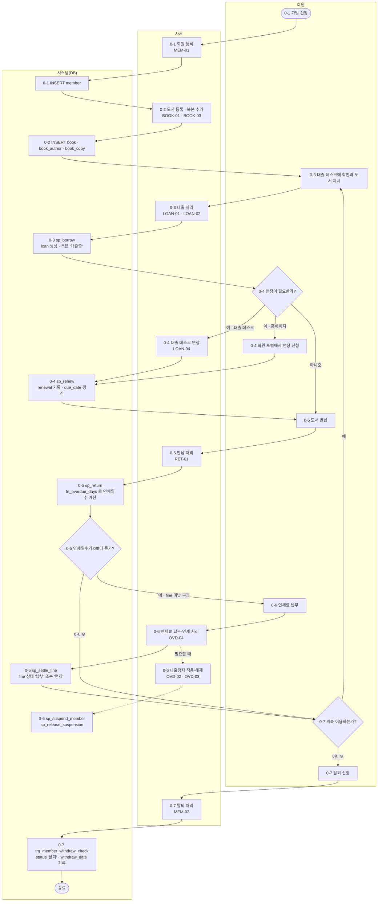

| 단계 | 수행자 | 처리 내용 | 관련 테이블·프로그램 |
|---|---|---|---|
| 0-1 회원 가입 | 회원 → 사서 → 시스템(DB) | 회원이 학번·교번과 연락처로 가입을 신청하고, 사서가 초기 비밀번호를 넣어 회원을 등록한다. 등록 후 회원은 학번으로 회원 포털에 로그인한다 (4.1) | MEM-01 · SYS-02 · `member`, `member_type` |
| 0-2 도서 등록 | 사서 → 시스템(DB) | ISBN 으로 국립중앙도서관 서지정보를 불러와 도서·저자·복본을 등록하고, 필요하면 복본을 추가한다 (4.2) | BOOK-01 · BOOK-03 · `book`, `publisher`, `author`, `book_author`, `book_copy` |
| 0-3 대출 | 회원 → 사서 → 시스템(DB) | 사서가 학번으로 대출 가능 여부를 확인한 뒤 등록번호를 입력하면 `sp_borrow` 가 8가지를 검사하고 대출을 등록한다 (4.3) | LOAN-01 · LOAN-02 · `sp_borrow`, `fn_next_open_day`, `loan`, `book_copy` |
| 0-4 연장 | 회원(홈페이지) 또는 사서 → 시스템(DB) | 회원 포털 또는 대출 데스크에서 연장한다. 두 경로 모두 `sp_renew` 하나로 처리하고 `renewal.channel` 에 '홈페이지'·'사서'를 남긴다 (4.4) | LOAN-04 · `sp_renew`, `renewal`, `loan` |
| 0-5 반납·연체 | 회원 → 사서 → 시스템(DB) | 반납예정일이 지나도록 반납하지 않으면 `sp_borrow`·`sp_renew` 가 `loan` 의 `return_date IS NULL AND due_date < CURDATE()` 로 판단해 대출·연장을 막는다. 화면에는 `v_loan_detail.loan_state` = '연체' 로 표시된다. 반납하면 `sp_return` 이 휴관일을 뺀 연체일수를 계산하고, 0보다 크면 연체료를 '미납'으로 부과한다 (4.5). 분실은 `sp_report_lost` 로 대출을 끝낸다 (4.6) | RET-01 · RET-02 · RET-03 · `sp_borrow`, `sp_renew`, `loan`, `sp_return`, `fn_overdue_days`, `fine`, `v_loan_detail` |
| 0-6 연체료 납부·정지 | 회원 → 사서 → 시스템(DB) | 미납 연체료를 납부 처리한다(면제는 관리자만). 필요하면 사서가 기간을 정해 대출정지를 적용하거나 조기 해제한다 (4.7) | OVD-01 · OVD-02 · OVD-03 · OVD-04 · `sp_settle_fine`, `sp_suspend_member`, `sp_release_suspension`, `fine`, `suspension` |
| 0-7 탈퇴 | 회원 → 사서 → 시스템(DB) | 이용을 그만두면 탈퇴를 신청하고, 사서가 탈퇴 처리하면 트리거가 미반납 도서·미납 연체료를 검사한 뒤 탈퇴일을 기록한다 (4.1) | MEM-03 · `trg_member_withdraw_check`, `member` |

## 4.1 회원 등록·정보 수정·탈퇴

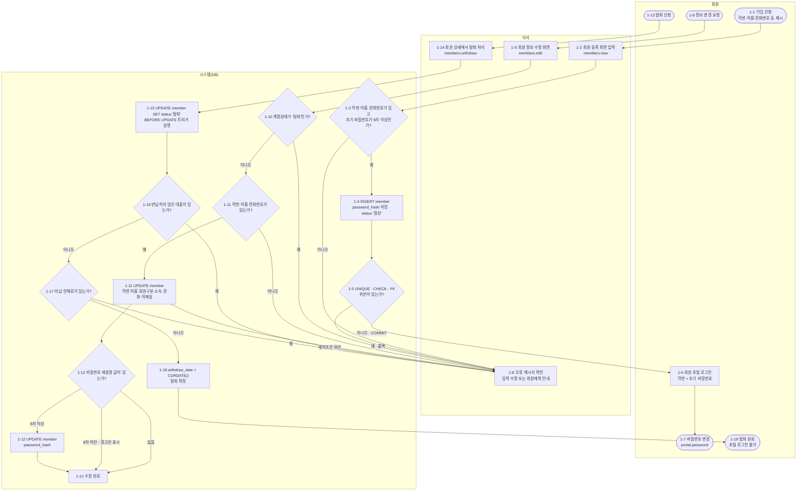

| 단계 | 수행자 | 처리 내용 | 관련 테이블·프로그램 |
|---|---|---|---|
| 1-1 | 회원 | 대출 데스크에서 가입을 신청하고 학번·교번, 이름, 회원구분, 소속, 휴대전화, 이메일을 알린다 | — |
| 1-2 | 사서 | `/members/new` 에서 입력한다. 회원구분 기본값은 `UG`(학부생)이고, 회원 포털용 초기 비밀번호를 정한다 | `members.new` · `member_type`(선택 목록) |
| 1-3 | 시스템(DB) | 앱 검사: 필수값이 없으면 `학번(교번), 이름, 전화번호는 필수입니다.`, 비밀번호가 8자 미만이면 `초기 비밀번호는 8자 이상이어야 합니다.` | `app/members.py` |
| 1-4 | 시스템(DB) | `generate_password_hash` 로 만든 해시를 저장한다. `status` 기본 '정상', `join_date` 기본 CURRENT_DATE, `member_id` 는 AUTO_INCREMENT(테이블 정의 시작값 10001) | `member` |
| 1-5 | 시스템(DB) | 위반 시 롤백하고 메시지로 바꾼다: `uq_member_no` 이미 등록된 학번(교번)입니다. · `uq_member_phone` 이미 등록된 전화번호입니다. · `uq_member_email` 이미 등록된 이메일입니다. · `ck_member_no` 학번(교번)은 영문·숫자 4~20자여야 합니다. · `ck_member_phone` 전화번호 형식이 올바르지 않습니다. (예: 010-1234-5678) · `fk_member_type` 존재하지 않는 회원구분입니다. 성공하면 `{name} 회원을 등록했습니다. (회원번호 {member_id})` 를 띄우고 회원 상세로 이동 | `db.CONSTRAINT_MESSAGES` · `uq_member_no`, `uq_member_phone`, `uq_member_email`, `ck_member_no`, `ck_member_phone`, `fk_member_type` |
| 1-6 | 회원 | `/my/login` 에서 학번(교번)·비밀번호로 로그인한다. 틀리면 `학번(교번) 또는 비밀번호가 올바르지 않습니다.` | `portal.login` · `member.password_hash` (SYS-02) |
| 1-7 | 회원 | `/my/password` 에서 현재 비밀번호 확인, 새 비밀번호 8자 이상, 확인값 일치를 검사한 뒤 `password_hash` 를 바꾼다. 성공 `비밀번호를 변경했습니다.` | `portal.password` · `member` (SYS-02) |
| 1-8 | 회원 | 연락처·소속 등의 변경을 요청한다 | — |
| 1-9 | 사서 | `/members/<id>/edit` 에서 수정한다. 비밀번호 칸은 '비우면 변경하지 않음' | `members.edit` (MEM-02) |
| 1-10 | 시스템(DB) | 탈퇴 회원이면 `탈퇴한 회원의 정보는 수정할 수 없습니다.` 회원 상세 화면도 `status = '정상'` 인 회원에게만 수정·탈퇴 버튼을 보인다 | `member.status` |
| 1-11 | 시스템(DB) | 앱이 먼저 필수값을 검사한다: `학번(교번), 이름, 전화번호는 필수입니다.` 통과하면 `UPDATE member SET member_no, name, type_code, department, phone, email` — 1-5 와 같은 제약조건으로 검사한다 | `app/members.py` · `member` |
| 1-12 | 시스템(DB) | 비밀번호 칸이 비면 그대로 둔다. 8자 미만이면 `비밀번호는 8자 이상이어야 해서 변경하지 않았습니다.`(경고), 8자 이상이면 별도 UPDATE 로 `password_hash` 를 재설정한다. 완료 `회원 정보를 수정했습니다.` | `member.password_hash` |
| 1-13 | 회원 | 탈퇴를 신청한다 | — |
| 1-14 | 사서 | 회원 상세의 '탈퇴 처리' → 확인창 `탈퇴 처리할까요? 되돌릴 수 없습니다.` → POST `/members/<id>/withdraw` | `members.withdraw` (MEM-03) |
| 1-15 | 시스템(DB) | `UPDATE member SET status = '탈퇴' WHERE member_id = %s AND status = '정상'` 을 실행하면 BEFORE UPDATE 트리거가 먼저 검사한다 | `trg_member_withdraw_check` |
| 1-16 | 시스템(DB) | 그 회원의 `loan` 중 `return_date IS NULL` 이 있으면 `반납하지 않은 도서가 있어 탈퇴 처리할 수 없습니다.` | `loan` |
| 1-17 | 시스템(DB) | 그 회원 대출의 `fine.status = '미납'` 이 있으면 `미납 연체료가 있어 탈퇴 처리할 수 없습니다.` | `fine`, `loan` |
| 1-18 | 시스템(DB) | 트리거가 `NEW.withdraw_date = CURDATE()` 를 기록하고 `ck_member_withdraw` 가 상태와 탈퇴일의 짝을 보장한다. 완료 `탈퇴 처리했습니다.` | `member` · `ck_member_withdraw` |
| 1-19 | 회원 | 이후 포털 로그인은 `탈퇴한 회원입니다.` 로 거부되고, 대출은 `sp_borrow` 가 거부한다 (3-7) | `portal.login`, `sp_borrow` |
| 1-E | 사서 | 오류 메시지를 보고 입력을 고치거나, 회원에게 미반납 도서 반납·연체료 납부 후 다시 탈퇴하도록 안내한다 | `db.error_message` |

## 4.2 도서 등록(국립중앙도서관 ISBN 조회)·복본 추가·폐기

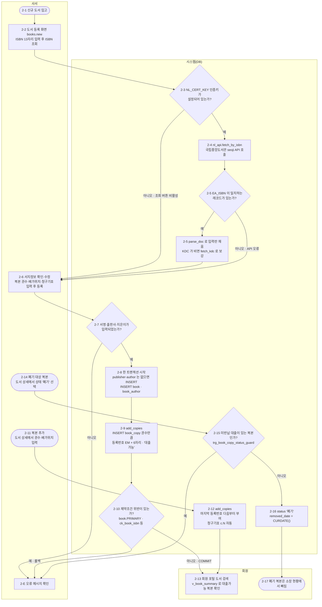

| 단계 | 수행자 | 처리 내용 | 관련 테이블·프로그램 |
|---|---|---|---|
| 2-1 | 사서 | 신규 도서가 들어온다 | — |
| 2-2 | 사서 | `/books/new` 에서 ISBN 을 넣고 'ISBN 조회' → GET `/books/new?lookup=ISBN` (앱이 숫자만 남김) | `books.new` (BOOK-01) |
| 2-3 | 시스템(DB) | `nl_api.cert_key()` 가 환경변수 `NL_CERT_KEY` 를 읽는다. 없으면 조회 버튼이 비활성(툴팁 `NL_CERT_KEY 설정 필요`)이라 사서가 직접 입력한다. 현재 데이터는 키 승인 전이라 `data/books.csv` 로 적재했다 (00 문서 6절) | `app/nl_api.py`, `books/form.html` |
| 2-4 | 시스템(DB) | `https://www.nl.go.kr/seoji/SearchApi.do` 를 `isbn`, `ebook_yn=N` 으로 호출한다. 네트워크·응답 오류는 `NLApiError` 메시지로 flash(error) | `nl_api.call`, `nl_api.fetch_by_isbn` |
| 2-5 | 시스템(DB) | 검색 결과 중 `EA_ISBN` 이 정확히 일치하는 레코드를 고른다. 있으면 서명·저자(지은이·옮긴이·엮은이·그림 구분. 감수·기획·사진·해제·해설은 제외)·출판사·발행연도(`REAL_PUBLISH_DATE` 우선)·정가(`PRE_PRICE`)·KDC 를 채우고, KDC 가 비면 소장자료 검색 API(`fetch_kdc`)로 보강한다. 메시지 `국립중앙도서관에서 서지정보를 불러왔습니다. 확인 후 등록하세요.` · 없으면 `국립중앙도서관에 해당 ISBN 의 서지정보가 없습니다.` | `nl_api.parse_doc`, `nl_api.fetch_kdc`, `nl_api.kdc_main` |
| 2-6 | 사서 | 값을 확인·수정하고 분류(KDC 주류), 복본 권수(0~10), 배가위치(기본 '종합자료실'), 청구기호를 넣어 POST 한다 | `books/form.html` |
| 2-7 | 시스템(DB) | 앱 검사: `서명, 출판사, 지은이는 필수입니다.` 분류 값이 비어 오면 KDC 기호 첫 자리로 주류를 정하고, 그것도 없으면 '000' | `books.new`, `nl_api.kdc_main` |
| 2-8 | 시스템(DB) | `transaction()` 안에서 `save_book`: 출판사명으로 `publisher` 를 찾고 없으면 INSERT, `book` INSERT. `save_authors`: 저자명마다 `author` 를 찾고 없으면 INSERT 한 뒤, `book_author` 에 `author_role`('지은이'·'옮긴이'·'엮은이'·'그림')과 `author_order`(1부터)를 저장한다. 지은이 입력란의 `홍길동 (엮은이)` 표기는 `parse_writer` 가 이름과 역할로 나눈다 (`ck_book_author_role`) | `publisher`, `book`, `author`, `book_author` |
| 2-9 | 시스템(DB) | `add_copies`: 등록번호는 전체 `book_copy` 의 최대 번호 + 1 부터 `EM` + 6자리. 청구기호는 입력값(없으면 `kdc_no`, 그것도 없으면 `category_code`)이고 같은 도서 2권째부터 ` c.2`, ` c.3` 을 붙인다. `status` 기본 '대출가능', `acquired_date` 기본 오늘 | `book_copy` · `ck_book_copy_reg_no` |
| 2-10 | 시스템(DB) | 위반 시 2-8~2-9 전체를 롤백한다: `book.PRIMARY` 이미 등록된 ISBN입니다. · `ck_book_isbn` ISBN은 978 또는 979로 시작하는 13자리 숫자여야 합니다. · `ck_book_pub_year` 발행연도가 올바르지 않습니다. · `uq_book_copy_reg_no` 이미 사용 중인 등록번호입니다. 성공 `'{title}' 도서를 등록했습니다.` 후 도서 상세로 이동 | `db.CONSTRAINT_MESSAGES` |
| 2-11 | 사서 | 도서 상세의 '복본 추가'(권수 1~10, 배가위치) → POST `/books/<isbn>/copies` | `books.add_copy` (BOOK-03) |
| 2-12 | 시스템(DB) | 청구기호는 첫 복본 청구기호의 ` c.` 앞부분을 쓴다. 복본이 없으면(2-6 에서 0권 등록 가능) `kdc_no`, 그것도 없으면 `category_code` 를 쓴다. 이어서 `add_copies` 로 INSERT 한다. 완료 `복본 {count}권을 추가했습니다.` | `book_copy` |
| 2-13 | 회원 | `/my/books` 에서 서명·저자·출판사(LIKE) 또는 ISBN 으로 검색하고, 도서 상세에서 복본별 상태·반납예정일을 본다 (대출자는 숨김) | `portal.books`, `portal.book_detail`, `v_book_summary` (BOOK-05) |
| 2-14 | 사서 | 도서 상세의 상태 변경에서 '폐기'를 고른다. 대출중 복본은 상태 변경 칸이 `-` 로 비어 있다 → POST `/books/copies/<id>/status` | `books.change_copy_status` (BOOK-04) |
| 2-15 | 시스템(DB) | 앱이 상태값을 `COPY_STATUSES_MANUAL`('대출가능', '분실', '폐기')로 제한한다(그 밖은 400). `UPDATE book_copy SET status` 에서 BEFORE UPDATE 트리거가 미반납 대출이 있으면 `대출 중인 복본은 반납(또는 분실 처리) 후 상태를 변경할 수 있습니다.` | `trg_book_copy_status_guard`, `loan` |
| 2-16 | 시스템(DB) | 트리거가 '분실'·'폐기'면 `removed_date = CURDATE()`, '대출가능'으로 되돌리면 NULL 로 바꾸고, `ck_book_copy_removed` 가 짝을 보장한다. 완료 `{reg_no} 복본을 '{status}' 상태로 변경했습니다.` | `book_copy` · `ck_book_copy_removed` |
| 2-17 | 회원 | 폐기 복본은 `v_book_summary.total_copies`(상태 '대출가능'·'대출중'만 셈)와 포털 도서 상세 복본 목록에서 빠진다 | `v_book_summary`, `portal.book_detail` |
| 2-E | 사서 | 오류 메시지를 보고 입력을 고친다 | `db.error_message` |
| 참고 | 사서 | 도서 삭제(`/books/<isbn>/delete`)는 복본에 대출 이력이 있으면 `fk_loan_copy` 위반으로 `대출 이력이 있는 도서는 삭제할 수 없습니다. 복본을 폐기 처리하세요.` → 장서에서 빼는 일은 폐기(상태 변경)로 한다 | `books.delete`, `fk_loan_copy` |

## 4.3 대출

판단 순서는 `sp_borrow` 코드 순서와 같다. 대출 화면의 사전 표시(LOAN-01)는 안내일 뿐이고 최종 판단은 `sp_borrow` 가 한다.

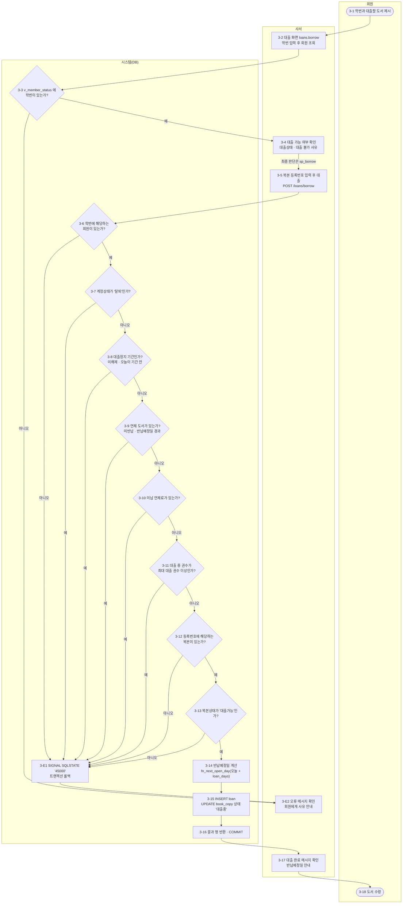

| 단계 | 수행자 | 처리 내용 | 관련 테이블·프로그램 |
|---|---|---|---|
| 3-1 | 회원 | 대출 데스크에 학번·교번과 대출할 책을 낸다 | — |
| 3-2 | 사서 | `/loans/borrow` 에서 학번을 넣고 '회원 조회' → GET `/loans/borrow?member_no=` | `loans.borrow` (LOAN-01) |
| 3-3 | 시스템(DB) | `SELECT * FROM v_member_status WHERE member_no = %s`. 없으면 앱이 `존재하지 않는 학번(교번)입니다.` | `v_member_status` |
| 3-4 | 사서 | 대출상태(`loan_state`: 탈퇴 / 대출정지 / 대출가능)와 사유 목록(탈퇴한 회원 · 대출정지 종료일 · 연체 도서 권수 · 미납 연체료 · 대출 한도 도달)을 본다. 사유가 있어도 대출 버튼은 눌리며, 그때는 `sp_borrow` 가 거부한다. `loan_state` 의 '대출정지'는 `suspend_until IS NOT NULL OR overdue_loans > 0` 이라 미납 연체료만 있는 회원은 '대출가능'으로 보이지만 사유 목록에는 미납이 나온다 | `v_member_status`, `v_loan_detail`(현재 대출 목록), `loans/borrow.html` |
| 3-5 | 사서 | 등록번호(바코드)를 넣고 '대출' → POST. 앱이 등록번호를 대문자로 바꾸고 `call_proc("sp_borrow", member_no, reg_no, session["staff_id"])` 를 호출한다 (4.9) | `loans.borrow`, `db.call_proc` (LOAN-02) |
| 3-6 | 시스템(DB) | `member` 와 `member_type` 을 조인해 `member_no = p_member_no` 인 행을 `FOR UPDATE OF m` 으로 잠그며 읽는다(`max_loan_count`, `loan_days` 확보). 없으면 `존재하지 않는 학번(교번)입니다.` | `member`, `member_type` |
| 3-7 | 시스템(DB) | `v_status = '탈퇴'` 이면 `탈퇴한 회원은 대출할 수 없습니다.` | `member.status` |
| 3-8 | 시스템(DB) | `suspension` 에서 `released_date IS NULL AND CURDATE() BETWEEN start_date AND end_date` 인 `MAX(end_date)` 가 있으면 `CONCAT('대출정지 기간입니다. (', DATE_FORMAT(v_susp_end, '%Y-%m-%d'), '까지)')` | `suspension` |
| 3-9 | 시스템(DB) | 그 회원의 `loan` 중 `return_date IS NULL AND due_date < CURDATE()` 가 있으면 `연체 중인 도서가 있어 대출할 수 없습니다. 연체 도서를 먼저 반납하세요.` | `loan` |
| 3-10 | 시스템(DB) | `fine JOIN loan` 에서 그 회원의 `f.status = '미납'` 이 있으면 `미납 연체료가 있어 대출할 수 없습니다.` | `fine`, `loan` |
| 3-11 | 시스템(DB) | `COUNT(*)`(미반납 대출) `>= v_max_loan` 이면 `CONCAT('대출 한도(', v_max_loan, '권)를 초과합니다. 현재 ', v_active, '권 대출 중입니다.')` | `loan`, `member_type.max_loan_count` |
| 3-12 | 시스템(DB) | `SELECT copy_id, status FROM book_copy WHERE reg_no = p_reg_no FOR UPDATE`. 없으면 `존재하지 않는 등록번호입니다.` | `book_copy` |
| 3-13 | 시스템(DB) | `v_copy_status <> '대출가능'`(대출중·분실·폐기)이면 `CONCAT('대출할 수 없는 복본입니다. (현재 상태: ', v_copy_status, ')')` | `book_copy.status` |
| 3-14 | 시스템(DB) | `fn_next_open_day(CURDATE() + INTERVAL v_loan_days DAY)`: 그날이 `closed_day` 에 있으면 하루씩 미룬다. DB 조회 예: 2026-11-14(토) 학부생 14일 → 2026-11-28(토, 개관일) · 대학원생 30일 → 2026-12-14(월) · `fn_next_open_day('2026-12-25')` → 2026-12-26 | `fn_next_open_day`, `closed_day`, `member_type.loan_days` |
| 3-15 | 시스템(DB) | `INSERT INTO loan (copy_id, member_id, staff_id, loan_date, due_date)` — `loan_date` 는 NOW(). 이어서 `UPDATE book_copy SET status = '대출중'`. 생성 컬럼 `active_copy_id` 의 `uq_loan_active_copy` 가 복본당 미반납 대출 1건을 한 번 더 보장한다 | `loan`, `book_copy` · `uq_loan_active_copy` |
| 3-16 | 시스템(DB) | `loan_id`, `due_date`, `title`, `member_name` 한 행을 돌려주고, `call_proc` 가 결과를 읽은 뒤 COMMIT 한다 | `db.call_proc` |
| 3-17 | 사서 | `'{title}' 대출 완료 · {member_name} · 반납예정일 YYYY-MM-DD` (success) 를 보고 회원에게 반납예정일을 알린다 | `loans.borrow` |
| 3-18 | 회원 | 책을 받는다. 이후 회원 포털 `/my/` 에서 대출 내역을 볼 수 있다 | `portal.index`, `v_loan_detail` (LOAN-03) |
| 3-E1 | 시스템(DB) | 3-6~3-13 중 하나라도 걸리면 SIGNAL 로 중단되고, INSERT·UPDATE 없이 롤백된다 | `db.transaction` |
| 3-E2 | 사서 | `db.error_message` 가 돌려준 메시지를 flash(error) 로 보고 회원에게 사유(연체 도서 반납, 연체료 납부 등)를 안내한다 | `db.error_message` |

판단에 쓰이는 회원구분 정책값 (`member_type`, 2026-11-14 DB 조회):

| type_code | type_name | max_loan_count | loan_days | max_renew | fine_per_day |
|---|---|---|---|---|---|
| UG | 학부생 | 10 | 14 | 2 | 100 |
| UGL | 휴학생 | 5 | 14 | 2 | 100 |
| GR | 대학원생 | 15 | 30 | 2 | 100 |
| FAC | 전임교원 | 50 | 180 | 1 | 100 |
| STF | 직원·비전임교원 | 15 | 30 | 2 | 100 |

## 4.4 연장

회원 포털(홈페이지)과 대출 데스크(사서) 두 경로 모두 `sp_renew` 하나로 처리한다. `sp_borrow` 와 달리 **연체 도서 검사(4-9)가 대출정지 검사(4-10)보다 먼저** 온다.

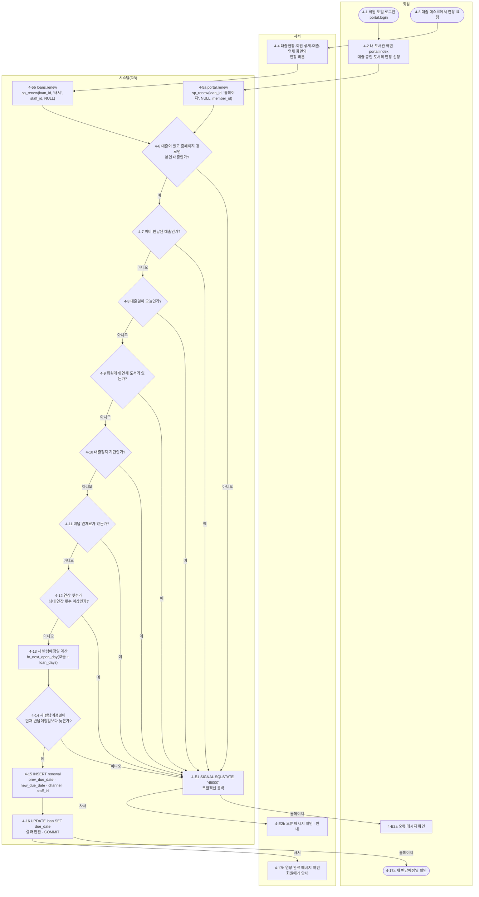

| 단계 | 수행자 | 처리 내용 | 관련 테이블·프로그램 |
|---|---|---|---|
| 4-1 | 회원 | `/my/login` 에 학번·비밀번호로 로그인한다 (탈퇴 회원은 `탈퇴한 회원입니다.`) | `portal.login` (SYS-02) |
| 4-2 | 회원 | `/my/` 의 '대출 중인 도서' 표에서 '연장 신청' → POST `/my/loans/<id>/renew`. 표에는 연장 횟수(`renew_count` / `max_renew`)가 보이고, 버튼은 모든 대출 중 도서에 나오며 판단은 `sp_renew` 가 한다 | `portal.index`, `v_loan_detail` |
| 4-3 | 회원 | 대출 데스크에서 연장을 요청한다 | — |
| 4-4 | 사서 | 미반납 대출 행의 '연장' 버튼(`loan_actions` 매크로: 대출현황 `/loans/`, 회원 상세, 대출 화면, 연체 화면) → POST `/loans/<id>/renew` | `loans.renew`, `_macros.html` |
| 4-5a | 시스템(DB) | `call_proc("sp_renew", loan_id, "홈페이지", None, session["member_id"])` | `portal.renew` |
| 4-5b | 시스템(DB) | `call_proc("sp_renew", loan_id, "사서", session["staff_id"], None)` | `loans.renew` |
| 4-6 | 시스템(DB) | `loan`·`member`·`member_type` 조인으로 대출을 `FOR UPDATE OF l` 로 읽는다(`loan_days`, `max_renew` 확보). 대출이 없거나, 홈페이지 경로인데 `v_member_id <> p_member_id`(남의 대출)이면 `연장할 수 있는 대출이 아닙니다.` | `loan`, `member`, `member_type` |
| 4-7 | 시스템(DB) | `v_return_date IS NOT NULL` 이면 `이미 반납된 대출입니다.` | `loan.return_date` |
| 4-8 | 시스템(DB) | `DATE(v_loan_date) = CURDATE()` 이면 `대출 당일에는 연장할 수 없습니다.` | `loan.loan_date` |
| 4-9 | 시스템(DB) | 그 회원의 대출 중 `return_date IS NULL AND due_date < CURDATE()` 가 하나라도 있으면(연장하려는 책이 아니어도) `연체 중인 도서가 있어 연장할 수 없습니다.` | `loan` |
| 4-10 | 시스템(DB) | `suspension` 에 `released_date IS NULL AND CURDATE() BETWEEN start_date AND end_date` 가 있으면 `대출정지 기간에는 연장할 수 없습니다.` | `suspension` |
| 4-11 | 시스템(DB) | 그 회원의 `fine.status = '미납'` 이 있으면 `미납 연체료가 있어 연장할 수 없습니다.` | `fine`, `loan` |
| 4-12 | 시스템(DB) | `SELECT COUNT(*) FROM renewal WHERE loan_id = p_loan_id` 가 `v_max_renew` 이상이면 `CONCAT('연장 가능 횟수(', v_max_renew, '회)를 모두 사용했습니다.')` | `renewal`, `member_type.max_renew` |
| 4-13 | 시스템(DB) | 연장한 날 + 대출기간: `fn_next_open_day(CURDATE() + INTERVAL v_loan_days DAY)` (원래 반납예정일 기준이 아님 · 00 문서 결정 6) | `fn_next_open_day`, `member_type.loan_days` |
| 4-14 | 시스템(DB) | `v_new_due <= v_due` 이면 `지금 연장해도 반납예정일이 늦어지지 않습니다.` | `loan.due_date` |
| 4-15 | 시스템(DB) | `INSERT INTO renewal (loan_id, prev_due_date, new_due_date, channel, staff_id)` — `staff_id` 는 `IF(p_channel = '사서', p_staff_id, NULL)`. `ck_renewal_channel`, `ck_renewal_staff`, `ck_renewal_due` 가 값을 보장한다 | `renewal` |
| 4-16 | 시스템(DB) | `UPDATE loan SET due_date = v_new_due` 후 `loan_id`, `due_date`, `title`, `renew_count`(= 기존 횟수 + 1)를 돌려주고 COMMIT | `loan` |
| 4-17a | 회원 | `/my/` 로 돌아와 `'{title}' 연장 완료 · 새 반납예정일 YYYY-MM-DD (연장 {renew_count}회째)` 를 본다 | `portal.renew` |
| 4-17b | 사서 | 같은 메시지를 이전 화면에서 보고 회원에게 새 반납예정일을 알린다 | `loans.renew` |
| 4-E1 | 시스템(DB) | 4-6~4-14 중 하나라도 걸리면 SIGNAL 로 중단, 롤백 | `db.transaction` |
| 4-E2a · 4-E2b | 회원 · 사서 | 오류 메시지를 flash(error) 로 본다. 회원 경로는 `/my/`, 사서 경로는 이전 화면으로 돌아간다 | `db.error_message` |

## 4.5 반납 (연체일수 계산·연체료 부과)

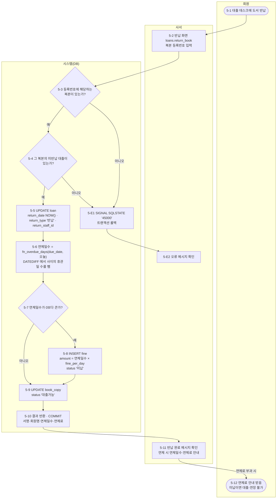

| 단계 | 수행자 | 처리 내용 | 관련 테이블·프로그램 |
|---|---|---|---|
| 5-1 | 회원 | 대출 데스크에 책을 돌려준다 | — |
| 5-2 | 사서 | `/loans/return` 에서 등록번호를 넣고 '반납' → 앱이 대문자로 바꾸고 `call_proc("sp_return", reg_no, session["staff_id"])` | `loans.return_book` (RET-01) |
| 5-3 | 시스템(DB) | `SELECT copy_id FROM book_copy WHERE reg_no = p_reg_no FOR UPDATE`. 없으면 `존재하지 않는 등록번호입니다.` | `book_copy` |
| 5-4 | 시스템(DB) | 그 복본의 `return_date IS NULL` 대출을 `member`·`member_type` 과 조인해 `FOR UPDATE OF l` 로 읽는다(`due_date`, `fine_per_day` 확보). 없으면 `대출 중인 복본이 아닙니다.` | `loan`, `member_type.fine_per_day` |
| 5-5 | 시스템(DB) | `UPDATE loan SET return_date = NOW(), return_type = '반납', return_staff_id = p_staff_id`. `ck_loan_returned` 가 세 컬럼의 짝을, `active_copy_id` 가 NULL 이 되어 그 복본의 다음 대출을 허용한다 | `loan` · `ck_loan_returned`, `uq_loan_active_copy` |
| 5-6 | 시스템(DB) | `fn_overdue_days(v_due, CURDATE())` — 계산식은 아래 표 | `fn_overdue_days`, `closed_day` (RET-02) |
| 5-7 | 시스템(DB) | `v_overdue > 0` 인지 판단 | `sp_return` |
| 5-8 | 시스템(DB) | `v_fine = v_overdue * v_fine_per_day` 로 `INSERT INTO fine (loan_id, overdue_days, amount)`. `status` 기본 '미납', `imposed_date` 기본 오늘. `uq_fine_loan`(대출 1건당 1건), `ck_fine_days`(연체일수 > 0) | `fine` (OVD-04 부과) |
| 5-9 | 시스템(DB) | `UPDATE book_copy SET status = '대출가능'` | `book_copy` |
| 5-10 | 시스템(DB) | `title`, `member_name`, `overdue_days`, `fine_amount` 를 돌려주고 COMMIT | `db.call_proc` |
| 5-11 | 사서 | 연체가 없으면 `'{title}' 반납 완료 · {member_name}` (success), 연체면 뒤에 `연체 {overdue_days}일 · 연체료 {fine_amount}원 부과` 를 붙여 warning 으로 보인다. 화면 아래 '오늘 반납된 도서' 목록이 갱신된다 | `loans.return_book`, `penalty_message`, `v_loan_detail` |
| 5-12 | 회원 | 연체료가 '미납'인 동안 `sp_borrow`(3-10)·`sp_renew`(4-11)가 거부하므로 납부한다 (4.7). 반납 때 대출정지(`suspension`)는 자동으로 만들지 않는다 — `sp_return` 에 정지 처리가 없고, 00 문서 결정 2 가 '반납 후 추가 정지 기간은 두지 않음' | `fine`, `sp_return` |
| 5-E1 · 5-E2 | 시스템(DB) · 사서 | SIGNAL 로 중단·롤백, 사서는 오류 메시지를 본다 | `db.error_message` |

`fn_overdue_days` 계산 규칙 (RET-02)

| 구분 | 내용 |
|---|---|
| 정의 | `fn_overdue_days(p_due_date, p_until)`: `p_until` 이 NULL 이거나 `p_until <= p_due_date` 이면 0. 아니면 `DATEDIFF(p_until, p_due_date)` 에서 `closed_day` 중 `closed_date > p_due_date AND closed_date <= p_until` 인 날 수를 뺀다 |
| 예 1 (DB 조회) | 반납예정 2026-11-07(토) → 반납 2026-11-09(월): DATEDIFF 2 − 휴관일 1(11-08 일요일) = **1일** → 학부생 연체료 100원 |
| 예 2 (DB 조회) | 반납예정 2026-09-23(수) → 반납 2026-09-28(월): DATEDIFF 5 − 휴관일 4(09-24 추석 연휴, 09-25 추석, 09-26 추석 연휴, 09-27 일요일) = **1일** |
| 화면 표시 | `v_loan_detail.overdue_days` = `fn_overdue_days(l.due_date, COALESCE(DATE(l.return_date), CURDATE()))` — 미반납이면 오늘까지, 반납했으면 반납일까지. `loan_state` 는 `return_type = '분실'` → '분실', `return_date IS NOT NULL` → '반납', `due_date < CURDATE()` → '연체', 그 밖 '대출중' |

## 4.6 분실 처리

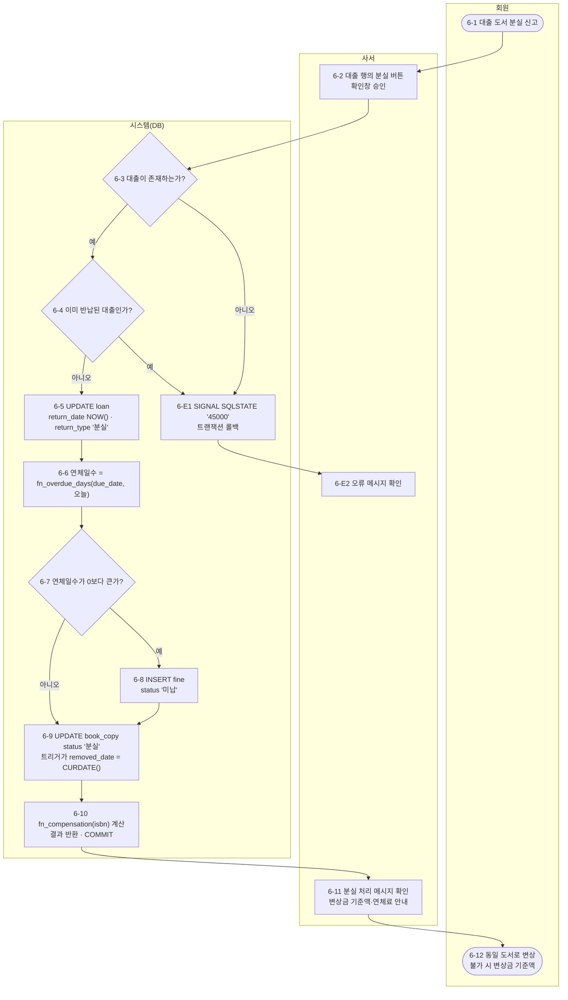

| 단계 | 수행자 | 처리 내용 | 관련 테이블·프로그램 |
|---|---|---|---|
| 6-1 | 회원 | 빌린 책을 잃어버렸다고 알린다 | — |
| 6-2 | 사서 | 미반납 대출 행의 '분실' 버튼(`loan_actions` 매크로) → 확인창 `분실 처리할까요? 대출이 종료되고 복본은 분실 상태가 됩니다.` → POST `/loans/<id>/lost` → `call_proc("sp_report_lost", loan_id, session["staff_id"])` | `loans.report_lost` (RET-03) |
| 6-3 | 시스템(DB) | `loan`·`member`·`member_type` 조인으로 `FOR UPDATE OF l`. 없으면 `존재하지 않는 대출입니다.` | `loan` |
| 6-4 | 시스템(DB) | `v_return_date IS NOT NULL` 이면 `이미 반납된 대출입니다.` | `loan.return_date` |
| 6-5 | 시스템(DB) | `UPDATE loan SET return_date = NOW(), return_type = '분실', return_staff_id = p_staff_id` — 대출을 먼저 끝낸다 | `loan` |
| 6-6 · 6-7 · 6-8 | 시스템(DB) | 반납과 같은 방식으로 반납예정일을 넘긴 날수만큼 연체료를 '미납'으로 부과한다 (5-6~5-8) | `fn_overdue_days`, `fine` |
| 6-9 | 시스템(DB) | `UPDATE book_copy SET status = '분실'`. 6-5 에서 대출이 끝났으므로 `trg_book_copy_status_guard` 검사를 통과하고, 트리거가 `removed_date = CURDATE()` 를 기록한다 | `book_copy`, `trg_book_copy_status_guard` |
| 6-10 | 시스템(DB) | `title`, `member_name`, `overdue_days`, `fine_amount`, `fn_compensation(b.isbn) AS compensation` 을 돌려주고 COMMIT. 기준액 규칙은 아래 표 | `fn_compensation`, `book.price`, `book.pub_year` |
| 6-11 | 사서 | `'{title}' 분실 처리 완료 · {member_name} · 동일 도서로 변상 원칙 (불가 시 변상금 기준액 {compensation}원)` — 분실 처리 메시지는 연체 여부와 관계없이 항상 warning 이다. 기준액이 없으면 괄호 안이 `불가 시 정가 정보 없음` 이 되고, 연체가 있으면 뒤에 ` · 연체 {overdue_days}일 · 연체료 {fine_amount}원 부과` 를 붙인다 | `loans.report_lost` |
| 6-12 | 회원 | 동일 도서로 변상하고, 불가하면 기준액을 안내받는다. 변상 이행 기록은 이번 범위에서 제외 (00 문서 결정 7). 연체료가 생겼으면 4.7 로 납부 | — |
| 6-E1 · 6-E2 | 시스템(DB) · 사서 | SIGNAL 로 중단·롤백, 사서는 오류 메시지를 본다 | `db.error_message` |

| 발행 경과연수 = `GREATEST(0, YEAR(CURDATE()) - CAST(pub_year AS SIGNED))` | `fn_compensation` 기준액 |
|---|---|
| 4년 미만 | `ROUND(price × 1.2)` |
| 10년 미만 | `ROUND(price × 1.5)` |
| 20년 미만 | `ROUND(price × 2.0)` |
| 20년 이상 | `ROUND(price × 3.0)` |
| `price` 또는 `pub_year` 가 NULL | NULL (사서가 결정, 화면 표시 '정가 정보 없음') |

## 4.7 연체 관리 (연체자 조회·대출정지 적용·해제·연체료 납부·면제)

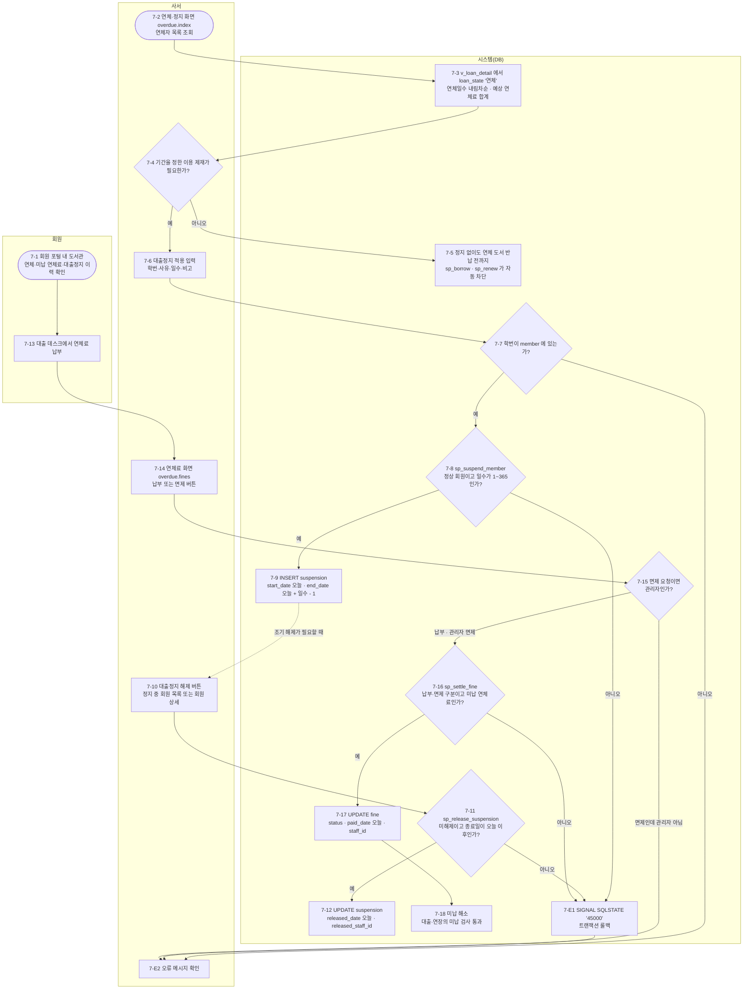

| 단계 | 수행자 | 처리 내용 | 관련 테이블·프로그램 |
|---|---|---|---|
| 7-1 | 회원 | `/my/` 에서 대출상태, 연체 권수, 미납 연체료, 연체료 내역, 대출정지 이력을 본다. 미납이 있으면 `미납 연체료 {n}원이 있습니다. 납부 전까지 대출·연장할 수 없습니다.` 안내가 나온다 | `portal.index`, `v_member_status`, `fine`, `suspension` |
| 7-2 | 사서 | `/overdue/` 화면을 연다 | `overdue.index` (OVD-01) |
| 7-3 | 시스템(DB) | `SELECT * FROM v_loan_detail WHERE loan_state = '연체' ORDER BY overdue_days DESC`, 유효한 대출정지 목록(`released_date IS NULL AND CURDATE() BETWEEN start_date AND end_date`), 지금 반납 시 예상 연체료 `SUM(overdue_days × fine_per_day)` 를 보인다 | `v_loan_detail`, `suspension`, `member_type` |
| 7-4 | 사서 | 기간을 정한 제재(규정 제27조 이용 제한)가 필요한지 판단한다 | — |
| 7-5 | 시스템(DB) | 연체 도서를 가진 회원은 정지를 걸지 않아도 반납 전까지 대출(3-9)·연장(4-9)이 막히고, `v_member_status.loan_state` 가 '대출정지'로 보인다 | `sp_borrow`, `sp_renew`, `v_member_status` |
| 7-6 | 사서 | '대출정지 적용'에 학번, 사유(`장기연체`·`자료훼손`·`규정위반`·`기타`), 일수(기본 7), 비고를 넣어 POST `/overdue/suspend` | `overdue.suspend` (OVD-02) |
| 7-7 | 시스템(DB) | 앱이 `SELECT member_id FROM member WHERE member_no = %s`. 없으면 `존재하지 않는 학번(교번)입니다.`, 일수가 숫자가 아니면 `정지 일수는 숫자로 입력하세요.` | `member` |
| 7-8 | 시스템(DB) | `sp_suspend_member` 가 회원 행을 `FOR UPDATE` 로 읽고 순서대로 검사: `존재하지 않는 회원입니다.` → `탈퇴한 회원입니다.` → `정지 일수는 1~365일이어야 합니다.` 사유는 `ck_suspension_reason`(위반 시 `정지 사유가 올바르지 않습니다.`) | `sp_suspend_member`, `member` |
| 7-9 | 시스템(DB) | `INSERT INTO suspension (member_id, reason, start_date, end_date, memo, staff_id)` — `end_date = CURDATE() + INTERVAL (p_days - 1) DAY` 로 오늘 포함 p_days 일. 완료 `대출정지 적용 · YYYY-MM-DD까지`. 이후 `sp_borrow`(3-8)·`sp_renew`(4-10)가 거부 | `suspension` |
| 7-10 | 사서 | 정지 중 회원 목록 또는 회원 상세의 '해제' → POST `/overdue/suspensions/<id>/release` | `overdue.release` (OVD-03) |
| 7-11 | 시스템(DB) | `sp_release_suspension` 이 `FOR UPDATE` 로 읽고 순서대로 검사: `존재하지 않는 대출정지입니다.` → `이미 해제된 대출정지입니다.` → (`end_date < CURDATE()` 이면) `이미 기간이 끝난 대출정지입니다.` | `sp_release_suspension`, `suspension` |
| 7-12 | 시스템(DB) | `UPDATE suspension SET released_date = CURDATE(), released_staff_id = p_staff_id`. `ck_suspension_release` 가 짝을 보장. 완료 `대출정지를 해제했습니다.` | `suspension` |
| 7-13 | 회원 | 대출 데스크에서 연체료를 낸다 | — |
| 7-14 | 사서 | `/overdue/fines`(기본 '미납' 탭) 또는 회원 상세에서 '납부' → POST `/overdue/fines/<id>/pay`. '면제' 버튼은 관리자에게만 보이고 POST `/overdue/fines/<id>/waive` | `overdue.fines`, `overdue.pay`, `overdue.waive` (OVD-04) |
| 7-15 | 시스템(DB) | 면제 경로는 `admin_required` 가 `session.get("staff_role") != "관리자"` 이면 `관리자만 처리할 수 있습니다.` 로 막는다 | `app/auth.py` |
| 7-16 | 시스템(DB) | `sp_settle_fine` 이 순서대로 검사: `처리 구분은 납부 또는 면제여야 합니다.` → (`FOR UPDATE` 로 읽고) `존재하지 않는 연체료입니다.` → `이미 처리된 연체료입니다.` | `sp_settle_fine`, `fine` |
| 7-17 | 시스템(DB) | `UPDATE fine SET status = p_status, paid_date = CURDATE(), staff_id = p_staff_id`. `ck_fine_paid` 가 상태와 처리일의 짝을 보장. 완료 `연체료 납부를 처리했습니다.` 또는 `연체료를 면제 처리했습니다.` | `fine` |
| 7-18 | 시스템(DB) | 그 회원에게 다른 미납이 없으면 대출(3-10)·연장(4-11)·탈퇴(1-17)의 미납 검사를 통과한다 | `sp_borrow`, `sp_renew`, `trg_member_withdraw_check` |
| 7-E1 · 7-E2 | 시스템(DB) · 사서 | SIGNAL 로 중단·롤백, 사서는 오류 메시지를 본다 | `db.error_message` |

대출을 막는 세 가지 조건 비교

| 구분 | 판단 데이터 | 시작 | 끝 | 막는 처리 |
|---|---|---|---|---|
| 연체 중 | `loan` 의 `return_date IS NULL AND due_date < CURDATE()` | 반납예정일 다음 날 | 연체 도서 반납 또는 분실 처리 | 대출 3-9 · 연장 4-9 |
| 미납 연체료 | `fine.status = '미납'` | 연체 반납(5-8)·분실 처리(6-8) | 납부 또는 면제(7-17) | 대출 3-10 · 연장 4-11 · 탈퇴 1-17 |
| 대출정지 (사서 적용) | `suspension` 의 `released_date IS NULL AND CURDATE() BETWEEN start_date AND end_date` | `sp_suspend_member`(7-9) | `end_date` 경과 또는 조기 해제(7-12) | 대출 3-8 · 연장 4-10 |

## 4.8 휴관일 등록 (반납예정일 재계산)

```mermaid
flowchart TB
  subgraph LM["회원"]
    H10["8-10 회원 포털에서<br/>조정된 반납예정일 확인"]
  end
  subgraph LS["사서"]
    H1(["8-1 임시휴관 등 휴관일 결정"])
    H2["8-2 휴관일 화면 closed_days.index<br/>날짜·사유 입력 후 등록"]
    H9["8-9 등록 결과 확인<br/>조정된 대출 건수"]
    HE["8-E2 오류 메시지 확인"]
  end
  subgraph LD["시스템(DB)"]
    H3{"8-3 관리자 권한인가?<br/>admin_required"}
    H4{"8-4 지난 날짜인가?"}
    H5{"8-5 이미 등록된 휴관일인가?"}
    H6["8-6 INSERT closed_day"]
    H7["8-7 미반납이고 due_date 가 그날인 대출<br/>due_date = fn_next_open_day(due_date)"]
    H8["8-8 SELECT ROW_COUNT() AS moved_loans<br/>COMMIT"]
    H11["8-11 이후 계산에 반영<br/>fn_next_open_day · fn_overdue_days"]
    HX["8-E1 SIGNAL SQLSTATE '45000'<br/>트랜잭션 롤백"]
  end
  H1 --> H2 --> H3
  H3 -->|"아니오"| HE
  H3 -->|"예"| H4
  H4 -->|"예"| HX
  H4 -->|"아니오"| H5
  H5 -->|"예"| HX
  H5 -->|"아니오"| H6 --> H7 --> H8 --> H9
  H8 --> H10
  H8 --> H11
  HX --> HE
```

| 단계 | 수행자 | 처리 내용 | 관련 테이블·프로그램 |
|---|---|---|---|
| 8-1 | 사서(관리자) | 공휴일 외에 임시휴관 등 문을 닫는 날을 정한다 | — |
| 8-2 | 사서(관리자) | `/closed-days/` 의 '휴관일 등록'(관리자에게만 보임)에 날짜와 사유를 넣어 POST `/closed-days/new`. 사유가 비면 앱이 '임시휴관'으로 채운다 | `closed_days.new` (SYS-03) |
| 8-3 | 시스템(DB) | `admin_required`: 관리자가 아니면 `관리자만 처리할 수 있습니다.` | `app/auth.py` |
| 8-4 | 시스템(DB) | `sp_add_closed_day`: `p_date < CURDATE()` 이면 `지난 날짜는 휴관일로 등록할 수 없습니다.` | `sp_add_closed_day` |
| 8-5 | 시스템(DB) | 같은 날이 있으면 `이미 등록된 휴관일입니다.` | `closed_day` |
| 8-6 | 시스템(DB) | `INSERT INTO closed_day (closed_date, reason)` | `closed_day` |
| 8-7 | 시스템(DB) | `UPDATE loan SET due_date = fn_next_open_day(due_date) WHERE return_date IS NULL AND due_date = p_date` — 새 휴관일이 반납예정일인 미반납 대출만 다음 개관일로 옮긴다(연속 휴관일은 모두 건너뜀). `renewal` 기록은 남기지 않는다 | `loan`, `fn_next_open_day` |
| 8-8 | 시스템(DB) | `SELECT ROW_COUNT() AS moved_loans` 로 옮긴 건수를 돌려주고 COMMIT | `sp_add_closed_day` |
| 8-9 | 사서(관리자) | `휴관일을 등록했습니다. 반납예정일이 조정된 대출 {moved_loans}건` 을 본다 | `closed_days.new` |
| 8-10 | 회원 | `/my/` 대출 목록에서 바뀐 반납예정일을 본다 | `portal.index`, `v_loan_detail` |
| 8-11 | 시스템(DB) | 이후 대출(3-14)·연장(4-13)의 반납예정일 계산은 그날을 건너뛰고, 연체일수(5-6)에서 그날을 뺀다 | `fn_next_open_day`, `fn_overdue_days` |
| 8-E1 · 8-E2 | 시스템(DB) · 사서 | SIGNAL 로 중단·롤백, 사서는 오류 메시지를 본다 | `db.error_message` |
| 참고 | 사서(관리자) | 휴관일 삭제 POST `/closed-days/<date>/delete` 는 `closed_date >= CURDATE()` 인 날만 지우고, 이미 옮긴 반납예정일은 되돌리지 않는다: `휴관일을 삭제했습니다. (이미 조정된 반납예정일은 그대로 유지됩니다)` (지운 행이 없으면 `오늘 이전의 휴관일이나 등록되지 않은 날짜는 삭제할 수 없습니다.`) | `closed_days.delete` |

## 4.9 대출 처리 1건의 시퀀스 다이어그램

```mermaid
sequenceDiagram
  actor U as 사서 브라우저
  participant F as Flask loans.borrow
  participant D as db.call_proc
  participant M as MySQL sp_borrow
  U->>F: 1 POST /loans/borrow (member_no, reg_no)
  Note over F: require_login 이 session staff_id 확인
  F->>F: 2 member_no 공백 제거 · reg_no 공백 제거 후 대문자
  F->>D: 3 call_proc(sp_borrow, member_no, reg_no, staff_id)
  D->>D: 4 get_db 연결 (autocommit False) · transaction() 시작
  D->>M: 5 CALL sp_borrow(member_no, reg_no, staff_id)
  M->>M: 6 회원 행 FOR UPDATE · 회원·탈퇴·정지·연체·미납·한도 검사
  M->>M: 7 복본 행 FOR UPDATE · 등록번호·복본상태 검사
  alt 모든 검사 통과
    M->>M: 8 fn_next_open_day 로 due_date 계산
    M->>M: 9 INSERT loan · UPDATE book_copy 상태 대출중
    M-->>D: 10 결과 행 (loan_id, due_date, title, member_name)
    D->>D: 11 fetchone · nextset 소진 · COMMIT
    D-->>F: 12 row 반환
    F->>F: 13 flash 대출 완료 · 회원명 · 반납예정일 (success)
  else 하나라도 실패
    M-->>D: 14 SIGNAL SQLSTATE 45000 (오류 코드 1644, MESSAGE_TEXT)
    D->>D: 15 ROLLBACK 후 예외 다시 발생
    D-->>F: 16 pymysql.MySQLError
    F->>F: 17 error_message(e) 가 MESSAGE_TEXT 반환 · flash (error)
  end
  F-->>U: 18 302 리다이렉트 /loans/borrow?member_no=학번
  U->>F: 19 GET /loans/borrow?member_no=학번
  Note over F: db.query 로 v_member_status · v_loan_detail 다시 조회
  F-->>U: 20 borrow.html 에 flash 메시지와 갱신된 대출 목록 표시
```

| 단계 | 수행자 | 처리 내용 | 관련 테이블·프로그램 |
|---|---|---|---|
| 1 | 사서 | 대출 화면 폼에서 `member_no`(hidden)와 `reg_no` 를 POST. 그 전에 `require_login` 이 사서 로그인을 확인한다 | `loans/borrow.html`, `app/__init__.py` |
| 2~3 | 시스템(DB) | `loans.borrow` 가 입력을 다듬고 `call_proc("sp_borrow", member_no, reg_no, session["staff_id"])` 호출 | `app/loans.py` |
| 4~5 | 시스템(DB) | `get_db()` 는 PyMySQL `DictCursor`, `autocommit=False` 연결. `transaction()` 안에서 `CALL sp_borrow(%s, %s, %s)` 실행 | `app/db.py` |
| 6~7 | 시스템(DB) | 회원 행·복본 행을 잠그고 3-6~3-13 순서로 검사 | `sp_borrow`, `member`, `suspension`, `loan`, `fine`, `book_copy` |
| 8~13 | 시스템(DB) | 3-14~3-16: 반납예정일 계산, 대출 등록, 복본 '대출중', 결과 행 → `cur.fetchone()` 후 `cur.nextset()` 으로 남은 결과를 비우고 COMMIT → flash(success) | `fn_next_open_day`, `loan`, `book_copy` |
| 14~17 | 시스템(DB) | SIGNAL 은 PyMySQL 에서 오류 코드 1644 예외가 된다. `transaction()` 이 ROLLBACK 하고 예외를 다시 던지면 `loans.borrow` 가 `pymysql.MySQLError` 로 잡아 `error_message(e)` 의 원문 메시지를 flash(error) | `db.transaction`, `db.error_message` |
| 18~20 | 사서 | `redirect(url_for("loans.borrow", member_no=member_no))` 로 같은 회원 화면을 다시 열어 flash 메시지와 갱신된 대출 상태를 본다 | `loans.borrow`, `v_member_status`, `v_loan_detail` |

---

# 05. 업무 문서 리스트

> 도서관 대출 업무에서 쓰는 장부·서식·보고서 18종을 정리하고, 각 문서의 기재 항목에서 데이터 모델의 엔티티(테이블 14개)를 도출한 근거를 남긴다 · 작성 기준일 2026-11-14 · 작성: 윤준서 (Claude 활용)

- 대상 업무: 숭실대학교 중앙도서관 대출 규정을 따르는 본 시스템의 회원·도서·대출·반납·연체 업무 (00 문서 §2). 예약은 범위 제외라 예약 관련 문서는 넣지 않았다.
- 기능 ID 는 00 문서 §4 표, 테이블·컬럼명은 `sql/01_schema.sql`, 화면 URL 은 `app/*.py` 의 라우트를 그대로 썼다.
- 예시 값은 2026-11-14 에 초기화된 `library_db` 의 실제 행이다. 샘플 대출 날짜는 DB 초기화 시점 기준 상대값이므로(`scripts/build_seed.py`) 다시 초기화하면 날짜가 달라진다.

## 1. 업무 문서 목록

문서 구분은 다음 세 가지로 나눈다.

| 구분 | 정의 | 데이터 모델에서의 역할 |
|---|---|---|
| 입력 서식 | 업무가 시작될 때 작성·접수하는 양식 | 엔티티 인스턴스 1건을 새로 만드는 원천 (INSERT) |
| 대장·장부 | 같은 형식의 기록을 계속 쌓아 가는 장부 | 장부 1행이 테이블 1행이 되는 엔티티의 원형 |
| 출력 보고서 | 저장된 데이터를 조회·집계해 회원·사서·관리자에게 내보내는 문서 | 대부분 뷰·집계 쿼리로 대응. 통보·공고의 원본 내용(정지 결정, 휴관일)만 엔티티로 저장 |

| 문서 ID | 문서명 | 구분 | 작성·사용 주체 | 발생 주기 | 주요 기재 항목 | 관련 기능 ID | 시스템에서 대응하는 화면 |
|---|---|---|---|---|---|---|---|
| DOC-01 | 회원 가입 신청서 | 입력 서식 | 작성: 회원 · 접수·입력: 사서 | 수시 (가입 신청 시) | 학번·교번, 성명, 신분(회원구분), 소속, 휴대전화, 이메일, 초기 비밀번호 | MEM-01 | `/members/new` 회원 등록 |
| DOC-02 | 회원 명부 | 대장·장부 | 사서 | 상시 (등록·수정 시 갱신) | 학번·교번, 성명, 회원구분, 소속, 전화번호, 이메일, 가입일, 계정상태, 대출상태, 대출·연체 권수, 미납 연체료 | MEM-02, MEM-04 | `/members/` 회원 목록 · `/members/<id>` 회원 상세 · `/members/<id>/edit` 정보 수정 |
| DOC-03 | 회원 탈퇴 신청서 | 입력 서식 | 작성: 회원 · 처리: 사서 | 수시 (탈퇴 신청 시) | 학번·교번, 성명, 탈퇴일, 미반납 도서 유무, 미납 연체료 유무 | MEM-03 | `/members/<id>` 의 '탈퇴 처리' 버튼 → `/members/<id>/withdraw` |
| DOC-04 | 회원구분별 대출 기준표 | 대장·장부 | 관리: 관리자 · 참조: 사서·회원 | 규정 개정 시 | 회원구분, 최대 대출 권수, 대출 기간, 최대 연장 횟수, 1권 1일 연체료 | LOAN-01, LOAN-02, LOAN-04, OVD-04 | 편집 화면 없음 (`sql/03_base_data.sql` 로 입력) · `/members/new` 회원구분 선택 목록, `/members/<id>`, `/loans/borrow` 에 표시 |
| DOC-05 | 서지 정보 (국립중앙도서관 ISBN 서지정보 API) | 입력 서식 | 제공: 국립중앙도서관 · 조회·확인: 사서 | 신규 도서 입수 시 | ISBN, 서명, 저자·역할, 출판사, 발행연도, 정가, KDC 분류기호 | BOOK-01, BOOK-02, BOOK-05 | `/books/new?lookup=ISBN` 도서 등록 · `/books/<isbn>/edit` 수정 · 검색 `/books/`, `/my/books` |
| DOC-06 | 도서 원부 (등록 대장) | 대장·장부 | 사서 | 입수 시 (복본 1권마다 1행) | 등록번호, 입수일, ISBN·서명, 청구기호, 배가위치, 복본상태 | BOOK-01, BOOK-03 | `/books/<isbn>` 도서 상세의 복본 표 · `/books/<isbn>/copies` 복본 추가 |
| DOC-07 | 제적(폐기) 대장 | 대장·장부 | 사서 | 수시 (분실·폐기 처리 시) | 등록번호, 서명, 제적 구분(분실·폐기), 제적일 | BOOK-04, RET-03 | `/books/copies/<id>/status` 복본 상태 변경 · `/books/<isbn>` 에 상태·처리일 표시 (전체 제적 목록 화면은 없음) |
| DOC-08 | 대출 기록부 | 대장·장부 | 사서 (회원은 본인 기록 열람) | 대출 1건마다 | 대출일시, 회원(학번·성명), 등록번호·서명, 반납예정일, 대출 처리 사서, 반납일시, 반납구분, 반납 처리 사서 | LOAN-01, LOAN-02, LOAN-03 | `/loans/borrow` 대출 · `/loans/` 대출 내역 조회 · `/my/` 내 도서관 |
| DOC-09 | 연장 신청 내역 | 대장·장부 | 신청: 회원(홈페이지) 또는 사서(대출 데스크) | 연장 1회마다 | 대출번호, 연장일시, 연장 전·후 반납예정일, 신청경로, 처리 사서 | LOAN-04 | `/my/loans/<id>/renew` 회원 포털 '연장 신청' · `/loans/<id>/renew` 사서 '연장' (연장 이력 행 목록 화면은 없고 횟수만 표시) |
| DOC-10 | 반납 확인 (일일 반납 내역) | 출력 보고서 | 사서 → 회원 | 반납 1건마다 · 일 단위 | 반납시각, 등록번호, 서명, 회원, 반납예정일, 연체일수, 부과 연체료, 반납구분, 처리 사서 | RET-01, RET-02 | `/loans/return` 반납 (처리 결과 메시지, '오늘 반납된 도서' 표) |
| DOC-11 | 분실·훼손 변상 신청서 | 입력 서식 | 신고: 회원 · 처리: 사서 | 수시 (분실·훼손 신고 시) | 대출번호, 회원, 등록번호·서명, 정가·발행연도, 변상금 기준액, 연체분 연체료 | RET-03, BOOK-04 | `/loans/<id>/lost` 대출 목록의 '분실' 버튼 |
| DOC-12 | 연체자 명단 | 출력 보고서 | 사서 | 매일 (개관일) | 회원(학번·성명), 연락처, 서명, 등록번호, 반납예정일, 연체일수 | OVD-01, RET-02 | `/overdue/` 연체·정지 관리 · `/loans/?state=overdue` · 대시보드 `/` 연체 도서 |
| DOC-13 | 연체 독촉 통지 | 출력 보고서 | 사서 → 회원 | 연체 발생 시 | 회원 성명·휴대전화·이메일, 서명, 반납예정일, 연체일수, 1권 1일 연체료 | OVD-01 | 통지 발송 기능 없음 · `/overdue/` 연체자 목록의 연락처·연체일수로 대응, 회원 포털 `/my/` 대출 중인 도서 표에 '연체' 상태와 연체일수 표시 |
| DOC-14 | 연체료 징수부·영수증 | 대장·장부 | 부과: 시스템(반납·분실 처리 시) · 납부 처리: 사서 · 면제: 관리자 | 연체 반납·분실 처리 시 부과, 납부·면제 시 처리 | 부과일, 회원, 서명, 반납예정일→반납일, 연체일수, 금액, 납부상태, 처리일, 처리 사서 | OVD-04, RET-02 | `/overdue/fines` 연체료 관리 (미납·납부·면제·전체 탭) · `/members/<id>`, `/my/` 연체료 표 (영수증 출력 기능 없음) |
| DOC-15 | 대출정지 통보 | 출력 보고서 | 사서 → 회원 | 정지 적용·해제 시 | 회원, 정지사유, 정지 기간(시작일~종료일), 비고, 적용 사서, 조기 해제일·해제 사서 | OVD-02, OVD-03 | `/overdue/` 연체·정지 관리의 '대출정지 적용' 양식 → `/overdue/suspend` · '해제' 버튼(`/overdue/`, `/members/<id>`) → `/overdue/suspensions/<id>/release` · `/members/<id>`, `/my/` 대출정지 이력 |
| DOC-16 | 휴관일 공고 | 출력 보고서 | 작성: 관리자 · 참조: 사서·회원 | 연 1회 (연간 휴관일) + 임시휴관 시 수시 | 휴관일자, 요일, 휴관사유 | SYS-03, RET-02 | `/closed-days` 휴관일 관리 · 대시보드 `/` 다가오는 휴관일 (2주) |
| DOC-17 | 대출 통계 월보 | 출력 보고서 | 사서·관리자 | 월 1회 (화면은 상시 조회) | 월별 대출 건수(최근 6개월) · 누적 기준: 인기 도서 TOP 10, 분류별 대출 건수, 다독 회원 TOP 5, 연체 반납률 | SYS-04 | `/stats/` 통계 · 대시보드 `/` |
| DOC-18 | 사서 계정 관리 대장 | 대장·장부 | 관리자 | 채용·권한 변경 시 | 로그인 ID, 성명, 권한(관리자·사서), 입사일 | SYS-01 | 관리 화면 없음 (`sql/03_base_data.sql` 로 등록) · `/login` 사서 로그인 |

- 시스템에 전용 화면이 없는 문서: DOC-04(정책값은 SQL 로만 변경), DOC-18(사서 계정은 SQL 로만 등록).
- 대장 전체를 보여 주는 목록 화면이 없는 문서: DOC-07(제적 복본은 `/books/<isbn>` 복본 표에서 도서별로만 확인), DOC-09(연장 이력 행은 화면에 없고 `v_loan_detail.renew_count` 횟수만 표시).
- 시스템이 문서 자체를 출력·발송하지 않는 문서: DOC-13 연체 독촉 통지, DOC-14 의 영수증. 데이터는 화면에 있으므로 사서가 그 내용으로 통지·확인한다.

## 2. 주요 문서별 기재 항목 상세

### 2.1 DOC-01 회원 가입 신청서

예시: 회원번호 10001 김민준 (회원 포털 시연 계정, `sql/03_base_data.sql`)

| 항목명 | 예시 값 | 대응 테이블.컬럼 | 기재·검증 규칙 |
|---|---|---|---|
| 회원번호 | 10001 | `member.member_id` | 신청서 칸 아님. 등록 시 자동 부여 (AUTO_INCREMENT 10001부터) |
| 학번·교번 | 20231234 | `member.member_no` | 필수. 회원 포털 로그인 ID. 영문·숫자 4~20자 (`ck_member_no`), 중복 불가 (`uq_member_no`) |
| 성명 | 김민준 | `member.name` | 필수, 30자 이내 |
| 신분 (회원구분) | 학부생 (10권 · 14일 · 연장 2회) | `member.type_code` = 'UG' → `member_type` | 5개 회원구분 중 선택 (`fk_member_type`). 등록 화면의 선택 목록이 이 형식으로 대출 기준을 함께 보여 준다 |
| 소속 (학과·부서) | 컴퓨터학부 | `member.department` | 선택 |
| 휴대전화 | 010-2023-1234 | `member.phone` | 필수. 형식 `^01[0-9]-[0-9]{3,4}-[0-9]{4}$` (`ck_member_phone`), 중복 불가 (`uq_member_phone`) |
| 이메일 | minjun@example.com | `member.email` | 선택, 중복 불가 (`uq_member_email`) |
| 초기 비밀번호 | (8자 이상, 비공개) | `member.password_hash` | 평문은 저장하지 않고 해시(scrypt)로 저장 |
| 가입일 | 2023-03-02 | `member.join_date` | 기본값 오늘 (`CURRENT_DATE`) |
| 계정상태 | 정상 | `member.status` | 기본값 '정상'. '탈퇴' 로의 변경은 DOC-03 |

화면 필수값 검사(`app/members.py`): 학번·교번·이름·전화번호가 비면 "학번(교번), 이름, 전화번호는 필수입니다.", 비밀번호가 8자 미만이면 "초기 비밀번호는 8자 이상이어야 합니다." 를 표시한다.

### 2.2 DOC-04 회원구분별 대출 기준표

기준표의 한 행이 `member_type` 의 한 행이고, 열이 그대로 컬럼이 된다. 현재 값(`sql/03_base_data.sql`, DB 조회 확인):

| 회원구분코드 `type_code` | 회원구분명 `type_name` | 최대 대출 권수 `max_loan_count` | 대출 기간(일) `loan_days` | 최대 연장 횟수 `max_renew` | 1권 1일 연체료(원) `fine_per_day` |
|---|---|---|---|---|---|
| UG | 학부생 | 10 | 14 | 2 | 100 |
| UGL | 휴학생 | 5 | 14 | 2 | 100 |
| GR | 대학원생 | 15 | 30 | 2 | 100 |
| FAC | 전임교원 | 50 | 180 | 1 | 100 |
| STF | 직원·비전임교원 | 15 | 30 | 2 | 100 |

- 연장은 "연장한 날부터 대출기간만큼" 이므로 연장 1회 기간도 `loan_days` 를 쓴다 (별도 컬럼 없음).
- 11.12 회의록의 대출 기간 15일은 공식 규정 14일과 달라 시스템에는 14일을 적용했다 (팀 확인 필요). `member_type.loan_days` 값만 바꾸면 15일로 변경된다 (00 문서 §2).
- 제약: `ck_member_type_max_loan` (1~100), `ck_member_type_days` (1~180), `ck_member_type_renew` (10 이하), `uq_member_type_name`.

### 2.3 DOC-05 서지 정보 (국립중앙도서관 ISBN 서지정보 API)

응답 필드와 테이블의 대응은 `app/nl_api.py` 의 `parse_doc` 기준이다. 현재 DB 의 도서 100종은 API 키 승인 전이라 `data/books.csv` 에서 넣었다 (00 문서 §6).

예시: ISBN 9788932473901 이기적 유전자

| 항목명 | API 응답 필드 | 예시 값 | 대응 테이블.컬럼 | 규칙 |
|---|---|---|---|---|
| ISBN | `EA_ISBN` (숫자만) | 9788932473901 | `book.isbn` | PK. 978 또는 979 로 시작하는 13자리 (`ck_book_isbn`) |
| 서명 | `TITLE` | 이기적 유전자 | `book.title` | 200자 이내 |
| 저자 | `AUTHOR` (';'·'/' 로 나누고 '지음'·'옮김' 등 역할어를 인식) | 리처드 도킨스 (지은이, 1번째) · 홍영남 (옮긴이, 2번째) · 이상임 (옮긴이, 3번째) | `author.author_name`, `book_author.author_role`, `book_author.author_order` | 역할은 지은이·옮긴이·엮은이·그림 (`ck_book_author_role`). 등록 화면은 지은이·옮긴이 두 칸을 받는다 |
| 출판사 | `PUBLISHER` | 을유문화사 | `publisher.publisher_name` → `book.publisher_id` (= 32) | 없는 출판사는 등록 시 자동 추가 |
| 발행연도 | `REAL_PUBLISH_DATE` 앞 4자리 (없으면 `PUBLISH_PREDATE`) | 2018 | `book.pub_year` | 1450~2100 (`ck_book_pub_year`) |
| 정가 | `PRE_PRICE` (숫자만) | 20000 | `book.price` | 변상금 기준액(`fn_compensation`) 계산에 사용 |
| KDC 분류기호 | `KDC` (없으면 소장자료 검색 API 로 보강) | 491.51 | `book.kdc_no` | 청구기호의 앞부분이 된다 |
| 분류 (KDC 주류) | KDC 첫 자리 → `SUBJECT` → `EA_ADD_CODE` 3번째 자리 순으로 결정 | 400 자연과학 | `book.category_code` → `category.category_name` | `ck_category_code` (`'^[0-9]00$'`) |
| 등록일시 | (시스템) | 2026-11-14 15:54:28 | `book.created_at` | 기본값 `CURRENT_TIMESTAMP` |

### 2.4 DOC-06 도서 원부 (등록 대장)

원부는 실물 책 1권 = 1행이다. 예시 도서(이기적 유전자)는 복본 3권 EM000075 · EM000076 · EM000077 로 등록되어 있고, 아래는 EM000076 행이다.

| 항목명 | 예시 값 | 대응 테이블.컬럼 | 규칙 |
|---|---|---|---|
| 등록번호 | EM000076 | `book_copy.reg_no` | 'EM' + 숫자 6자리 (`ck_book_copy_reg_no`), 중복 불가 (`uq_book_copy_reg_no`). 마지막 번호 다음부터 자동 부여 |
| 복본번호 | 76 | `book_copy.copy_id` | 내부 식별자 (원부 칸 아님) |
| 입수일 | 2024-03-02 | `book_copy.acquired_date` | 기본값 오늘 |
| ISBN | 9788932473901 | `book_copy.isbn` → `book.isbn` | `fk_book_copy_book` |
| 서명 · 저자 · 출판사 · 발행연도 · 정가 | 이기적 유전자 · 리처드 도킨스, 홍영남 (옮긴이), 이상임 (옮긴이) · 을유문화사 · 2018 · 20,000원 | `book.title`, `v_book_summary.authors`, `publisher.publisher_name`, `book.pub_year`, `book.price` | 원부에는 권마다 적지만 DB 에는 ISBN 당 한 번만 저장 |
| 청구기호 | 491.51-리96ㅇ c.2 | `book_copy.call_no` | 분류기호-저자기호. 같은 도서 2권째부터 ' c.N' 자동 부여 |
| 배가위치 | 3층 과학기술자료실 | `book_copy.location` | 기본값 '종합자료실' |
| 복본상태 | 대출가능 | `book_copy.status` | 대출가능·대출중·분실·폐기 (`ck_book_copy_status`) |
| 제적일 | (없음) | `book_copy.removed_date` | 분실·폐기일 때만 값이 있다 (`ck_book_copy_removed`). 트리거 `trg_book_copy_status_guard` 가 자동 기록 |

현재 복본 157권의 상태: 대출가능 131 · 대출중 24 · 분실 1 · 폐기 1.

### 2.5 DOC-08 대출 기록부

예시: 대출번호 195 (연체 반납되어 DOC-14 의 연체료 22번이 생긴 건)

| 항목명 | 예시 값 | 대응 테이블.컬럼 | 규칙 |
|---|---|---|---|
| 대출번호 | 195 | `loan.loan_id` | AUTO_INCREMENT |
| 대출일시 | 2026-10-02 10:00:00 | `loan.loan_date` | 기본값 현재 시각 |
| 회원 (학번·성명) | 20214410 장서준 | `loan.member_id` (= 10009) → `member.member_no`, `member.name` | `fk_loan_member` |
| 등록번호 · 서명 | EM000076 · 이기적 유전자 | `loan.copy_id` (= 76) → `book_copy.reg_no` → `book.title` | 미반납 대출은 복본당 1건 (`active_copy_id` 의 `uq_loan_active_copy`) |
| 반납예정일 | 2026-10-16 | `loan.due_date` | `fn_next_open_day(대출일 + loan_days)`. 연장·휴관일 등록 시 갱신 |
| 대출 처리 사서 | 박사서 | `loan.staff_id` (= 2) → `staff.name` | `fk_loan_staff` |
| 반납일시 | 2026-10-24 16:00:00 | `loan.return_date` | 미반납이면 NULL |
| 반납구분 | 반납 | `loan.return_type` | 반납·분실 (`ck_loan_return_type`) |
| 반납 처리 사서 | 박사서 | `loan.return_staff_id` | 반납일시·반납구분과 함께 채워진다 (`ck_loan_returned`) |
| 연장 횟수 | 0 | (계산) `v_loan_detail.renew_count` | 저장하지 않고 `renewal` 행 수로 계산 |
| 대출상태 | 반납 | (계산) `v_loan_detail.loan_state` | 대출중·연체·반납·분실 |
| 연체일수 | 7 | (계산) `v_loan_detail.overdue_days` | `fn_overdue_days`, 휴관일 제외 |

대출 거부 사유는 `sp_borrow` 가 최종 판단한다. 원문 예: '탈퇴한 회원은 대출할 수 없습니다.' · '연체 중인 도서가 있어 대출할 수 없습니다. 연체 도서를 먼저 반납하세요.' · '미납 연체료가 있어 대출할 수 없습니다.' · '존재하지 않는 등록번호입니다.' (대출정지·한도 초과·복본 상태 메시지는 값이 들어가는 CONCAT 문장이다.)

### 2.6 DOC-09 연장 신청 내역

신청경로별 예시 2건을 나란히 적는다.

| 항목명 | 예시 값 (홈페이지 신청) | 예시 값 (사서 처리) | 대응 테이블.컬럼 |
|---|---|---|---|
| 연장번호 | 15 | 14 | `renewal.renewal_id` |
| 대출번호 | 226 (김민준 · 일반언어학 강의) | 222 (강하은 · 엄마를 부탁해) | `renewal.loan_id` |
| 연장일시 | 2026-11-10 12:00:00 | 2026-11-11 13:00:00 | `renewal.renewed_at` |
| 연장 전 반납예정일 | 2026-11-19 | 2026-11-19 | `renewal.prev_due_date` |
| 연장 후 반납예정일 | 2026-11-24 | 2026-11-25 | `renewal.new_due_date` |
| 신청경로 | 홈페이지 | 사서 | `renewal.channel` |
| 처리 사서 | (없음) | 박사서 | `renewal.staff_id` |

- 연장 후 반납예정일 = `fn_next_open_day(연장한 날 + loan_days)`. 예: 2026-11-10 + 14일 = 2026-11-24. 연장 후가 연장 전보다 늦어야 한다 (`ck_renewal_due`).
- 신청경로가 '사서' 일 때만 처리 사서가 있다 (`ck_renewal_staff`). 대출 222 는 홈페이지 1회(연장번호 13) + 사서 1회로 학부생 최대 2회를 모두 썼다.
- 연장 거부 원문(`sp_renew`): '대출 당일에는 연장할 수 없습니다.' · '연체 중인 도서가 있어 연장할 수 없습니다.' · '대출정지 기간에는 연장할 수 없습니다.' · '미납 연체료가 있어 연장할 수 없습니다.' · '지금 연장해도 반납예정일이 늦어지지 않습니다.'
- 현재 연장 이력 15건 (홈페이지 14, 사서 1).

### 2.7 DOC-11 분실·훼손 변상 신청서

예시: 대출번호 155 (샘플 데이터의 유일한 분실 처리 건)

| 항목명 | 예시 값 | 대응 테이블.컬럼 | 규칙 |
|---|---|---|---|
| 대출번호 | 155 | `loan.loan_id` | 미반납 대출만 분실 처리 가능 |
| 회원 | 20211234 권나연 | `loan.member_id` → `member` | |
| 분실 도서 | EM000085 · 백년 허리 | `loan.copy_id` → `book_copy.reg_no`, `book.title` | |
| 반납예정일 | 2026-09-19 | `loan.due_date` | |
| 분실 처리일시 | 2026-09-23 16:00:00 | `loan.return_date` + `loan.return_type` = '분실' | 분실 처리 = 대출 종료 (`sp_report_lost`) |
| 처리 사서 | 박사서 | `loan.return_staff_id` | |
| 복본상태 | 분실 (removed_date 2026-11-14) | `book_copy.status`, `book_copy.removed_date` | 운영 중에는 `sp_report_lost` 실행일을 트리거가 기록. 샘플 데이터는 초기화 때 상태를 일괄 변경해 초기화일(2026-11-14)이 들어가 `loan.return_date`(2026-09-23)와 다르다 |
| 정가 · 발행연도 | 17,500원 · 2015 | `book.price`, `book.pub_year` | |
| 변상금 기준액 | 35,000원 | (계산) `fn_compensation(isbn)` | 정가 × 경과연수 배율 (4년 미만 1.2 · 10년 미만 1.5 · 20년 미만 2.0 · 이상 3.0). 2026 − 2015 = 11년 → 2.0배. 정가·발행연도가 없으면 NULL (사서 결정). 저장하지 않고 처리 결과 메시지로만 안내 |
| 연체분 연체료 | 3일 · 300원 (납부) | `fine.overdue_days`, `fine.amount`, `fine.status` (연체료번호 15) | 분실 처리 시점까지 연체분을 `sp_report_lost` 가 부과 |
| 변상 방법 · 이행 내역 | (기록 없음) | 대응 컬럼 없음 | 동일 도서 변상 원칙. 이행 기록은 이번 범위에서 제외 (00 문서 §3 No.7) |

훼손 도서는 변상 후 복본을 '폐기' 로 바꾼다 (DOC-07). 대출 중인 복본은 `trg_book_copy_status_guard` 가 막는다: '대출 중인 복본은 반납(또는 분실 처리) 후 상태를 변경할 수 있습니다.'

### 2.8 DOC-14 연체료 징수부·영수증

미납 1건과 납부 1건을 나란히 적는다.

| 항목명 | 예시 값 (미납) | 예시 값 (납부) | 대응 테이블.컬럼 | 규칙 |
|---|---|---|---|---|
| 연체료번호 | 22 | 13 | `fine.fine_id` | |
| 대출번호 | 195 | 138 | `fine.loan_id` | 대출 1건당 최대 1건 (`uq_fine_loan`) |
| 회원 | 20214410 장서준 | 20231234 김민준 | `loan.member_id` → `member` | |
| 도서 | 이기적 유전자 (EM000076) | 연금술사 (EM000134) | `loan.copy_id` → `book_copy`, `book` | |
| 반납예정일 → 반납일 | 2026-10-16 → 2026-10-24 | 2026-09-05 → 2026-09-12 | `loan.due_date`, `loan.return_date` | |
| 연체일수 | 7일 | 6일 | `fine.overdue_days` | 휴관일 제외 (`fn_overdue_days`), 1 이상 (`ck_fine_days`) |
| 1권 1일 연체료 | 100원 | 100원 | `member_type.fine_per_day` | |
| 연체료 | 700원 | 600원 | `fine.amount` | 연체일수 × 1일 연체료. 부과 시점에 확정 저장 |
| 부과일 | 2026-10-24 | 2026-09-12 | `fine.imposed_date` | 기본값 오늘 |
| 납부상태 | 미납 | 납부 | `fine.status` | 미납·납부·면제 (`ck_fine_status`) |
| 처리일 (영수일) | (없음) | 2026-09-12 | `fine.paid_date` | 미납일 때만 NULL (`ck_fine_paid`) |
| 수납 사서 | (없음) | 박사서 | `fine.staff_id` | |

- 연체일수 계산 예: 2026-10-17 ~ 2026-10-24 의 8일 중 휴관일 2026-10-18(일요일)을 빼서 7일.
- 부과는 `sp_return`·`sp_report_lost` 가 자동으로 한다. 납부·면제는 `sp_settle_fine` 이며, 면제는 관리자만 할 수 있다 (`admin_required`). 원문: '처리 구분은 납부 또는 면제여야 합니다.' · '이미 처리된 연체료입니다.'
- 미납 연체료가 있으면 대출(`sp_borrow`)·연장(`sp_renew`)·탈퇴(`trg_member_withdraw_check`)가 모두 막힌다 (00 문서 §3 No.3·No.8).
- 현재 연체료 22건: 납부 18건 11,000원 · 면제 3건 2,300원 · 미납 1건 700원.

### 2.9 DOC-15 대출정지 통보

유효한 정지 1건과 조기 해제된 정지 1건을 나란히 적는다.

| 항목명 | 예시 값 (정지 중) | 예시 값 (조기 해제) | 대응 테이블.컬럼 | 규칙 |
|---|---|---|---|---|
| 정지번호 | 1 | 2 | `suspension.suspension_id` | |
| 대상 회원 | 20193321 한지민 | 20201764 정예준 | `suspension.member_id` | 탈퇴 회원에게는 적용 불가 |
| 정지사유 | 자료훼손 | 규정위반 | `suspension.reason` | 장기연체·자료훼손·규정위반·기타 (`ck_suspension_reason`) |
| 정지 기간 | 2026-11-11 ~ 2026-11-24 | 2026-10-05 ~ 2026-10-25 | `suspension.start_date`, `suspension.end_date` | 종료일 ≥ 시작일 (`ck_suspension_period`). 종료일까지 대출 불가 |
| 비고 | 대출 도서 낙서·훼손 (동일 도서 변상 완료) | 열람실 좌석 무단 점유 | `suspension.memo` | 200자 이내 |
| 관련 대출 | (없음) | (없음) | `suspension.loan_id` | 선택 항목. 현재 화면에서는 입력하지 않는다 |
| 적용 사서 | 박사서 | 박사서 | `suspension.staff_id` | |
| 조기 해제일 | (없음) | 2026-10-15 | `suspension.released_date` | 해제 사서와 함께 기록 (`ck_suspension_release`) |
| 해제 사서 | (없음) | 김관리 | `suspension.released_staff_id` | |

- 적용(`sp_suspend_member`): 시작일 = 오늘, 종료일 = 오늘 + (정지 일수 − 1). 화면 기본값 7일. 원문: '정지 일수는 1~365일이어야 합니다.' · '탈퇴한 회원입니다.'
- 해제(`sp_release_suspension`) 원문: '이미 해제된 대출정지입니다.' · '이미 기간이 끝난 대출정지입니다.'
- 유효 정지 = `released_date IS NULL AND CURDATE() BETWEEN start_date AND end_date`. 연체 도서를 가진 회원의 대출·연장 제한은 `suspension` 행을 만들지 않고 `sp_borrow`·`sp_renew` 가 미반납 연체 대출 여부로 직접 판단한다. 화면의 회원 대출상태는 `v_member_status.loan_state`(연체 권수·유효 정지로 계산, 미납 연체료는 반영 안 함)로 표시한다 (00 문서 §3 No.2).

### 2.10 DOC-16 휴관일 공고

예시: 2026-11-14 이후 2026년 휴관일 공고

| 휴관일자 | 요일 | 휴관사유 |
|---|---|---|
| 2026-11-15 | 일 | 일요일 |
| 2026-11-22 | 일 | 일요일 |
| 2026-11-29 | 일 | 일요일 |
| 2026-12-06 | 일 | 일요일 |
| 2026-12-13 | 일 | 일요일 |
| 2026-12-20 | 일 | 일요일 |
| 2026-12-25 | 금 | 성탄절 |
| 2026-12-27 | 일 | 일요일 |

| 항목명 | 예시 값 | 대응 테이블.컬럼 | 규칙 |
|---|---|---|---|
| 휴관일자 | 2026-12-25 | `closed_day.closed_date` | PK, 하루 1행. 지난 날짜는 등록 불가 |
| 요일 | 금 | (계산) 화면에서 날짜로 표시 | 저장하지 않음 |
| 휴관사유 | 성탄절 | `closed_day.reason` | 30자 이내. 화면 입력이 비면 '임시휴관' |
| 반납예정일 조정 건수 | (등록 시 결과) | (계산) `sp_add_closed_day` 결과 `moved_loans` | 저장하지 않음 |

- 등록 원문(`sp_add_closed_day`): '지난 날짜는 휴관일로 등록할 수 없습니다.' · '이미 등록된 휴관일입니다.' 등록·삭제는 관리자만 가능.
- 휴관일 등록 시 그날이 반납예정일인 미반납 대출을 다음 개관일로 옮긴다. 휴관일은 반납예정일 계산(`fn_next_open_day`)과 연체일수 계산(`fn_overdue_days`)에 쓰인다.
- 현재 139건 (2026-01-01 ~ 2027-12-27, 2026년 71건). 일요일과 겹치는 공휴일은 공휴일 이름으로 표시한다.

## 3. 문서 → 엔티티 도출표

### 3.1 도출표

| 문서 | 도출된 엔티티 | 근거 |
|---|---|---|
| DOC-01 회원 가입 신청서 | MEMBER (회원) | 신청서 1장 = 회원 1명. 학번·교번은 업무 식별자지만 수정 화면에서 바뀔 수 있어 대리키 `member_id` 를 PK 로, `member_no` 는 UNIQUE 로 둔다 |
| DOC-01 회원 가입 신청서 | MEMBER_TYPE (회원구분) | '신분' 칸이 대출 권수·기간·연장 횟수·연체료를 결정한다. 이 값을 회원마다 반복 저장하면 이행 종속이 생기므로 신분별 정책을 별도 엔티티로 분리 (00 문서 §3 No.9) |
| DOC-02 회원 명부 | MEMBER (속성 확정) | 명부 열 중 계정상태(정상·탈퇴)만 `member.status` 로 저장. '대출상태'(대출가능·대출정지·탈퇴)는 정지·연체 데이터에서 계산되므로 뷰 `v_member_status.loan_state` 로 계산 (00 문서 §3 No.12) |
| DOC-03 회원 탈퇴 신청서 | MEMBER (`status`, `withdraw_date`) | 탈퇴는 앱에서 되돌릴 수 없어(회원 상세의 확인 문구 '되돌릴 수 없습니다', 탈퇴 회원은 정보 수정 불가 `app/members.py`) 회원 1명에 1회로 보고 별도 엔티티 대신 회원 속성으로 둔다. (트리거는 '정상' 복원 시 `withdraw_date` 를 지우므로 복원 이력은 남지 않는다.) 미반납·미납 확인 칸은 LOAN·FINE 조회로 대체하고 트리거 `trg_member_withdraw_check` 가 검사. 원문: '반납하지 않은 도서가 있어 탈퇴 처리할 수 없습니다.' · '미납 연체료가 있어 탈퇴 처리할 수 없습니다.' |
| DOC-04 회원구분별 대출 기준표 | MEMBER_TYPE | 표 1행 = 회원구분 1개 (5행). 열이 그대로 `max_loan_count`, `loan_days`, `max_renew`, `fine_per_day` 가 된다. 정책이 바뀌면 이 테이블만 수정 |
| DOC-05 서지 정보 | BOOK (도서) | ISBN 1개 = 서지 1건. 같은 책을 여러 권 소장해도 서지는 한 번만 저장 |
| DOC-05 서지 정보 | PUBLISHER (출판사) | 출판사명이 여러 도서에 반복 기재된다. 표기 통일과 중복 제거를 위해 분리 (`uq_publisher_name`), 등록 시 없으면 자동 추가 |
| DOC-05 서지 정보 | AUTHOR (저자), BOOK_AUTHOR (도서저자) | 한 도서에 저자가 여럿(공저·번역)이고 한 저자가 여러 도서를 쓴다 → M:N. 교차 엔티티 BOOK_AUTHOR 로 해소하고 역할·표기순서는 관계의 속성으로 둔다. 동명이인 가능성 때문에 `author_name` 은 UNIQUE 로 두지 않았다. 단 현재 등록·수정 화면은 같은 이름의 기존 저자 행을 재사용하므로(`app/books.py` 의 `save_authors`) 동명이인 구분은 SQL 로만 가능 |
| DOC-05 서지 정보 | CATEGORY (분류) | KDC 분류기호의 주류(000~900) 10개는 고정 코드표. 분류명을 도서마다 반복하지 않도록 분리하고 분류별 통계(DOC-17)의 기준으로 쓴다 |
| DOC-06 도서 원부 | BOOK_COPY (도서복본) | 원부 1행 = 실물 1권, 등록번호로 식별. 같은 ISBN 의 서지 항목이 여러 행에 반복되므로 서지는 BOOK 으로 보내고 원부에는 복본 고유 항목(등록번호·청구기호·배가위치·상태·입수일)만 남긴다. 대출 단위가 복본이므로 필수 엔티티 |
| DOC-07 제적(폐기) 대장 | BOOK_COPY (`status`, `removed_date`) | 제적은 복본의 현재 상태로만 표현: 복본상태 '분실'·'폐기' + 처리일 (`ck_book_copy_removed`). 복본을 '대출가능' 으로 되돌리면 트리거가 `removed_date` 를 지워 제적 이력은 남지 않는다 (이력이 필요하면 별도 엔티티가 필요, 이번 범위 제외). 제적 사유 칸은 대응 컬럼이 없다 |
| DOC-08 대출 기록부 | LOAN (대출) | 기록부 1행 = 대출 1건 = 복본 1권. 회원·복본·처리 사서를 FK 로 참조. 반납 칸은 같은 행에 1:1 로 기록되므로 반납 엔티티를 따로 두지 않고 LOAN 의 `return_date`·`return_type`·`return_staff_id` 로 둔다 |
| DOC-09 연장 신청 내역 | RENEWAL (연장이력) | 대출 1건에 연장이 0~N회 반복되는 반복 그룹 → 별도 엔티티로 분리. 언제·어느 경로로 연장했는지 남기고 연장 횟수는 COUNT 로 계산 (00 문서 §3 No.11) |
| DOC-10 반납 확인 | 신규 엔티티 없음 (LOAN 속성) | 반납 정보는 대출 기록부의 같은 행에 기록된다. 연체일수는 `fn_overdue_days` 계산, 부과 연체료는 FINE |
| DOC-11 분실·훼손 변상 신청서 | LOAN, BOOK_COPY, FINE (기존 엔티티) | 분실 처리는 대출 종료의 한 방식이라 `loan.return_type` = '분실' 로 표현하고 복본은 '분실' 상태. 변상금 기준액은 `fn_compensation` 계산값. 변상 이행 기록은 범위 제외라 엔티티를 만들지 않았다 (향후 과제) |
| DOC-12 연체자 명단 | 신규 엔티티 없음 (뷰 `v_loan_detail`) | 연체는 '미반납 + 반납예정일 경과' 상태이므로 LOAN 에서 계산 (`loan_state` = '연체') |
| DOC-13 연체 독촉 통지 | 신규 엔티티 없음 | 통지 대상·내용은 LOAN·MEMBER 조회 결과. 통지 발송 이력 기능은 범위 밖 |
| DOC-14 연체료 징수부·영수증 | FINE (연체료) | 연체 상태로 반납되거나 분실 처리된 대출에만 생기는 대출 1건당 0..1건 데이터 (`sp_return`·`sp_report_lost` 가 부과). LOAN 에 두면 대부분 NULL 이므로 분리하고, 납부·면제 처리 이력과 처리 사서를 함께 저장. 금액은 부과 시점 정책으로 확정 저장 (00 문서 §3 No.10) |
| DOC-15 대출정지 통보 | SUSPENSION (대출정지) | 한 회원에게 정지가 여러 번 반복되고 해제 이력도 남겨야 하므로 별도 엔티티. 사서가 기간을 정해 거는 제재(규정 제27조)만 저장 |
| DOC-16 휴관일 공고 | CLOSED_DAY (휴관일) | 공고의 날짜 1개 = 1행. 반납예정일 조정과 연체일수 계산이 참조하는 기준 데이터 |
| DOC-17 대출 통계 월보 | 신규 엔티티 없음 | LOAN·BOOK_COPY·BOOK·CATEGORY·MEMBER·MEMBER_TYPE·FINE 집계 (윈도우 함수 `RANK()`). 집계값은 저장하지 않는다 |
| DOC-18 사서 계정 관리 대장 | STAFF (사서) | 대장 1행 = 사서 1명. 권한(관리자·사서)으로 면제·휴관일 관리를 제한하고, 대출·반납·연장·연체료·정지 처리자 기록을 위해 FK 6개(`fk_loan_staff`, `fk_loan_return_staff`, `fk_renewal_staff`, `fk_fine_staff`, `fk_suspension_staff`, `fk_suspension_released`)가 참조 |

### 3.2 도출 관계 요약

엔티티를 직접 만든 주 출처 문서를 그렸다 (DOC-01 → MEMBER_TYPE 은 3.1 의 정규화 근거로 함께 표시).

```mermaid
flowchart LR
  subgraph SD["업무 문서"]
    D01["DOC-01 회원 가입 신청서"]
    D04["DOC-04 회원구분별 대출 기준표"]
    D05["DOC-05 서지 정보"]
    D06["DOC-06 도서 원부"]
    D08["DOC-08 대출 기록부"]
    D09["DOC-09 연장 신청 내역"]
    D14["DOC-14 연체료 징수부·영수증"]
    D15["DOC-15 대출정지 통보"]
    D16["DOC-16 휴관일 공고"]
    D18["DOC-18 사서 계정 관리 대장"]
  end
  subgraph SE["도출 엔티티"]
    T_MEMBER_TYPE["MEMBER_TYPE 회원구분"]
    T_MEMBER["MEMBER 회원"]
    T_STAFF["STAFF 사서"]
    T_CATEGORY["CATEGORY 분류"]
    T_PUBLISHER["PUBLISHER 출판사"]
    T_AUTHOR["AUTHOR 저자"]
    T_BOOK["BOOK 도서"]
    T_BOOK_AUTHOR["BOOK_AUTHOR 도서저자"]
    T_BOOK_COPY["BOOK_COPY 도서복본"]
    T_LOAN["LOAN 대출"]
    T_RENEWAL["RENEWAL 연장이력"]
    T_FINE["FINE 연체료"]
    T_SUSPENSION["SUSPENSION 대출정지"]
    T_CLOSED_DAY["CLOSED_DAY 휴관일"]
  end
  D01 --> T_MEMBER
  D01 --> T_MEMBER_TYPE
  D04 --> T_MEMBER_TYPE
  D05 --> T_BOOK
  D05 --> T_PUBLISHER
  D05 --> T_AUTHOR
  D05 --> T_BOOK_AUTHOR
  D05 --> T_CATEGORY
  D06 --> T_BOOK_COPY
  D08 --> T_LOAN
  D09 --> T_RENEWAL
  D14 --> T_FINE
  D15 --> T_SUSPENSION
  D16 --> T_CLOSED_DAY
  D18 --> T_STAFF
```

### 3.3 문서 항목 중 컬럼으로 저장하지 않는 항목

문서에는 적히지만 다른 데이터에서 계산할 수 있어 저장하지 않는 항목이다. 중복 저장으로 인한 불일치를 막기 위한 결정이다.

| 문서 항목 | 나오는 문서 | 계산 방법 | 구현 위치 |
|---|---|---|---|
| 연장 횟수 | DOC-08, DOC-09 | 대출별 `renewal` 행 수 | `v_loan_detail.renew_count` |
| 대출상태 (대출중·연체·반납·분실) | DOC-08, DOC-12 | `return_type`, `return_date`, `due_date` 와 오늘 비교 | `v_loan_detail.loan_state` |
| 연체일수 (미반납 포함) | DOC-10, DOC-12, DOC-13 | 반납예정일 다음 날 ~ 반납일(미반납이면 오늘), 휴관일 제외. 단, 연체료가 부과된 대출은 부과 시점 연체일수를 `fine.overdue_days` 에 확정 저장한다 (금액 근거 보존, DOC-14). 화면의 미반납·이력 연체일수는 `v_loan_detail.overdue_days` 로 계산 | `fn_overdue_days` → `v_loan_detail.overdue_days` |
| 회원 대출상태 (대출가능·대출정지·탈퇴) | DOC-02 | 계정상태, 유효 정지 여부, 연체 권수, 미납 연체료 (예: 10009 장서준 unpaid_fine 700원 → 대출정지) | `v_member_status.loan_state` |
| 대출 중·연체 권수, 미납 연체료 합계 | DOC-02 | 미반납 대출 COUNT, 미납 `fine.amount` 합 | `v_member_status.active_loans`, `overdue_loans`, `unpaid_fine` |
| 대출정지 종료일 | DOC-02, DOC-15 | 유효 정지의 MAX(`end_date`) | `v_member_status.suspend_until` |
| 소장·대출가능 권수 | DOC-05, DOC-06 | 복본상태별 COUNT (분실·폐기 제외) | `v_book_summary.total_copies`, `available_copies` |
| 변상금 기준액 | DOC-11 | 정가 × 경과연수 배율 | `fn_compensation` |
| 저자 표기 | DOC-06 | 표기순서대로 이름 + 역할 연결 | `v_book_summary.authors` |

반납예정일은 `fn_next_open_day` 로 계산하지만 연장한 날과 휴관일 등록 시점에 따라 값이 정해져 대출일만으로 다시 계산할 수 없으므로 `loan.due_date` 에 저장하고, 연장 전·후 값은 `renewal.prev_due_date`·`new_due_date` 에 남긴다.

## 4. 엔티티별 출처 문서 역추적

| No | 테이블 (엔티티) | 한글명 | 출처 문서 (주 · 보조) | 문서에서 온 주요 컬럼 | 현재 건수 |
|---|---|---|---|---|---|
| 1 | `member_type` | 회원구분 | 주: DOC-04 · 보조: DOC-01 (신분 칸) | `type_code`, `type_name`, `max_loan_count`, `loan_days`, `max_renew`, `fine_per_day` | 5 |
| 2 | `member` | 회원 | 주: DOC-01 · 보조: DOC-02, DOC-03 | `member_no`, `name`, `type_code`, `department`, `phone`, `email`, `password_hash`, `join_date`, `status`, `withdraw_date` | 27 |
| 3 | `staff` | 사서 | 주: DOC-18 · 보조: DOC-08·09·14·15 의 처리 사서 칸 | `login_id`, `password_hash`, `name`, `role`, `hire_date` | 2 |
| 4 | `category` | 분류 | 주: DOC-05 (KDC 주류) · 보조: DOC-17 (분류별 대출) | `category_code`, `category_name` | 10 |
| 5 | `publisher` | 출판사 | 주: DOC-05 | `publisher_name` | 56 |
| 6 | `author` | 저자 | 주: DOC-05 | `author_name` | 155 |
| 7 | `book` | 도서 | 주: DOC-05 · 보조: DOC-06 (원부의 서지 칸) | `isbn`, `title`, `publisher_id`, `category_code`, `kdc_no`, `pub_year`, `price` | 100 |
| 8 | `book_author` | 도서저자 | 주: DOC-05 (저자·역할) | `isbn`, `author_id`, `author_role`, `author_order` | 171 |
| 9 | `book_copy` | 도서복본 | 주: DOC-06 · 보조: DOC-07, DOC-11 | `reg_no`, `isbn`, `call_no`, `location`, `status`, `acquired_date`, `removed_date` | 157 |
| 10 | `loan` | 대출 | 주: DOC-08 · 보조: DOC-10, DOC-11 | `copy_id`, `member_id`, `staff_id`, `loan_date`, `due_date`, `return_date`, `return_type`, `return_staff_id` | 230 |
| 11 | `renewal` | 연장이력 | 주: DOC-09 | `loan_id`, `renewed_at`, `prev_due_date`, `new_due_date`, `channel`, `staff_id` | 15 |
| 12 | `fine` | 연체료 | 주: DOC-14 · 보조: DOC-10, DOC-11 (연체분) | `loan_id`, `overdue_days`, `amount`, `status`, `imposed_date`, `paid_date`, `staff_id` | 22 |
| 13 | `suspension` | 대출정지 | 주: DOC-15 | `member_id`, `loan_id`, `reason`, `start_date`, `end_date`, `memo`, `staff_id`, `released_date`, `released_staff_id` | 3 |
| 14 | `closed_day` | 휴관일 | 주: DOC-16 | `closed_date`, `reason` | 139 |

- 연결 점검: 14개 테이블 모두 주 출처 문서가 1개 이상 있다. 현재 건수는 2026-11-14 `library_db` 조회 값이다.
- 문서 항목에서 오지 않은 컬럼: 대리키(`member_id`, `staff_id`, `publisher_id`, `author_id`, `copy_id`, `loan_id`, `renewal_id`, `fine_id`, `suspension_id`), 시스템 기록 `book.created_at`, 무결성용 생성 컬럼 `loan.active_copy_id` (미반납이면 `copy_id`, 반납 후 NULL → UNIQUE 로 복본당 미반납 대출 1건 보장).
- 엔티티를 새로 만들지 않고 기존 엔티티의 조회·계산으로 대응하는 문서: DOC-10, DOC-12, DOC-13, DOC-17. 기존 엔티티의 속성만 정한 문서: DOC-02, DOC-03, DOC-07, DOC-11.

---

# 06. 개념적 데이터 모델 (ERD)

> 업무 문서와 기능 목록에서 엔티티를 도출하고, 엔티티·관계 정의서와 ERD 로 데이터 구조를 정리한다. 모든 이름·건수는 `sql/01_schema.sql` 과 실제 DB(`library_db`) 조회로 확인했다. 작성 기준일 2026-11-14 · 작성: 윤준서 (Claude 활용)

## 1. 엔티티 도출 과정

### 1.1 도출 근거와 방법

| 구분 | 내용 |
|---|---|
| 업무 문서 | 11.12 회의록과 '추가적인 고려사항' 결정 (00 문서 2·3절), 「숭실대학교 중앙도서관 규정」 대출·연체·변상 조항, Notion 「기능 정리표」 |
| 기능 목록 | 00 문서 4절 기능 ID 24개 (MEM-01~04, BOOK-01~05, LOAN-01~04, RET-01~03, OVD-01~04, SYS-01~04) |
| 방법 | ① 기능 설명에서 관리 대상이 되는 명사(후보)를 뽑는다 → ② 아래 기준으로 엔티티 · 속성 · 파생 정보 · 범위 제외로 나눈다 → ③ 엔티티 사이의 관계를 정하고 M:N 은 교차 엔티티로 해소한다 |

판단 기준은 다음과 같다.

```mermaid
flowchart TD
    A["기능 설명에서 후보 명사 추출"] --> B{"이번 범위의 기능 ID 에 포함되는가?"}
    B -->|"아니오"| X["범위 제외"]
    B -->|"예"| C{"다른 데이터로 계산할 수 있는가?"}
    C -->|"예"| D["파생 정보<br/>뷰·함수로 계산하고 저장하지 않음"]
    C -->|"아니오"| E{"자신만의 식별자를 갖고<br/>독립적으로 등록·관리할 데이터가 여러 건인가?"}
    E -->|"아니오"| F["기존 엔티티의 속성"]
    E -->|"예"| G["엔티티로 선정"]
    G --> H{"두 엔티티 사이가 M:N 인가?"}
    H -->|"예"| I["교차 엔티티로 해소"]
    H -->|"아니오"| J["1:N 또는 1:0..1 관계로 연결"]
```

### 1.2 후보 엔티티 선정 · 제외

| No | 후보 (업무 용어) | 관련 기능 ID | 판단 | 반영 위치 | 이유 |
|---|---|---|---|---|---|
| 1 | 회원 | MEM-01~04, LOAN-02, SYS-02 | 엔티티 | `member` | 대출·대출정지의 주체. 주식별자는 회원번호 `member_id`, 학번·교번 `member_no` 는 대체 식별자(UK)이자 로그인 ID |
| 2 | 회원 신분 · 대출 정책 | MEM-01, LOAN-01, LOAN-04, OVD-04 | 엔티티 | `member_type` | 학부생·대학원생·교원 등 신분별로 권수·기간·연장 횟수가 다름 (00 문서 3절 No 9) |
| 3 | 사서 | SYS-01, LOAN-02, RET-01 | 엔티티 | `staff` | 관리 프로그램 로그인 계정이자 대출·반납·연체료·정지의 처리자 |
| 4 | 관리자 | SYS-01, SYS-03, OVD-04 | 속성 | `staff.role` | 관리자와 사서는 권한만 다르고 속성이 같음 → `role` 값 '관리자'·'사서' |
| 5 | 도서 | BOOK-01, BOOK-02, BOOK-05 | 엔티티 | `book` | ISBN 단위 서지정보 (책의 종류) |
| 6 | 복본 (실물 책) | BOOK-03, BOOK-04, LOAN-02 | 엔티티 | `book_copy` | 대출·분실·폐기는 실물 1권 단위로 일어남 |
| 7 | 저자 | BOOK-01, BOOK-05 | 엔티티 | `author` | 공저·번역 때문에 도서와 M:N |
| 8 | 저자 역할 (지은이·옮긴이) | BOOK-01 | 교차 엔티티 | `book_author` | 도서-저자 M:N 해소. 역할·표기순서는 '도서와 저자의 조합'에 속하는 속성 |
| 9 | 출판사 | BOOK-01 | 엔티티 | `publisher` | 여러 도서가 같은 출판사를 공유 → 이름 중복 저장 방지. 도서 등록 시 없으면 자동 등록 |
| 10 | 분류 (KDC) | BOOK-01, BOOK-05, SYS-04 | 엔티티 | `category` | KDC 주류 10개 코드표. 검색·통계의 기준 |
| 11 | 대출 | LOAN-01~04 | 엔티티 | `loan` | 업무의 중심 사건. 회원 · 복본 · 사서를 잇는다 |
| 12 | 반납 | RET-01 | 속성 | `loan.return_date` · `loan.return_type` · `loan.return_staff_id` | 대출 1건은 반납(또는 분실 처리)으로 최대 한 번 끝남(1:0..1, 현재 미반납 24건) → 별도 엔티티로 나눠도 1:0..1 관계만 생기고, 230건 중 206건이 이미 반납·분실이라 NULL 도 적음 |
| 13 | 연장 | LOAN-04 | 엔티티 | `renewal` | 대출 1건에 여러 번 일어나고, 언제·어느 경로로 했는지 남겨야 함 (00 문서 3절 No 11) |
| 14 | 연장 횟수 | LOAN-04 | 파생 | `v_loan_detail.renew_count` | `renewal` 행 수(COUNT)로 계산. 중복 저장하지 않음 |
| 15 | 연체 | RET-02, OVD-01 | 파생 | `v_loan_detail.loan_state` | 미반납이면서 반납예정일이 오늘보다 앞이면 '연체'. 저장하면 매일 갱신해야 함 |
| 16 | 연체일수 | RET-02 | 파생 | `fn_overdue_days` | 휴관일을 빼고 계산. 연체료를 부과하는 시점의 값만 `fine.overdue_days` 에 확정 저장 |
| 17 | 연체료 | OVD-04 | 엔티티 | `fine` | 금액을 부과 시점에 확정하고 납부·면제 이력을 관리 (00 문서 3절 No 10) |
| 18 | 연체료 납부 · 면제 | OVD-04 | 속성 | `fine.status` · `fine.paid_date` · `fine.staff_id` | 연체료 1건은 `sp_settle_fine` 으로 한 번에 납부 또는 면제됨 (분할 납부 없음) |
| 19 | 대출정지 (회원 '정지') | OVD-02, OVD-03 | 엔티티 | `suspension` | 정지를 회원 상태 컬럼에 두지 않고 사유·기간·적용 사서를 가진 별도 엔티티로 분리 (00 문서 3절 No 2·12) |
| 20 | 대출정지 해제 | OVD-03 | 속성 | `suspension.released_date` · `suspension.released_staff_id` | 정지 1건당 조기 해제는 최대 한 번 |
| 21 | 회원의 대출 가능 여부 | LOAN-01, MEM-04 | 파생 | `v_member_status` (`loan_state` · `unpaid_fine` · `active_loans`/`max_loan_count`) | 대출상태 `loan_state`('대출가능'·'대출정지'·'탈퇴')는 정지·연체·미납 연체료 데이터로, 대출 권수는 `active_loans` 로 따로 계산하고, LOAN-01 화면이 이 값들을 함께 판단한다. 최종 검사는 `sp_borrow` 가 한다 |
| 22 | 연체자 | OVD-01 | 파생 | `v_loan_detail` (`loan_state = '연체'`) | 연체 중인 대출을 조회한 결과 |
| 23 | 휴관일 | SYS-03, RET-02 | 엔티티 | `closed_day` | 법정공휴일·대체공휴일·개교기념일은 규칙으로 계산할 수 없어 날짜 데이터로 관리. 다른 엔티티와 FK 관계는 없지만 SYS-03 으로 독립 등록·관리하는 날짜 목록이라 엔티티로 선정 |
| 24 | 분실 | RET-03 | 속성 | `loan.return_type` = '분실' · `book_copy.status` = '분실' | 대출 종료 방식의 하나 + 복본 상태값 |
| 25 | 폐기 | BOOK-04 | 속성 | `book_copy.status` = '폐기' · `book_copy.removed_date` | 복본의 상태 변화 |
| 26 | 변상금 | RET-03 | 파생 | `fn_compensation` | 기준액은 정가 × 발행 경과연수 배율로 계산. 변상 이행 기록(동일 도서 수령 등)은 범위 제외 (00 문서 3절 No 7) |
| 27 | 회원 탈퇴 | MEM-03 | 속성 | `member.status` = '탈퇴' · `member.withdraw_date` | 회원의 계정 상태 |
| 28 | 로그인 계정 | SYS-01, SYS-02 | 속성 | `member.member_no` · `member.password_hash`, `staff.login_id` · `staff.password_hash` | 사람 1명 = 계정 1개이므로 계정을 따로 두지 않음 |
| 29 | 통계 · 대시보드 | SYS-04 | 파생 | `app/stats.py`, `app/main.py` 조회 SQL | 대출·연체료 데이터의 집계 결과 |
| 30 | 예약 | — | 범위 제외 | — | 기능 정리표에 없음. 회의에서 추가 결정 시 확장 (00 문서 2절) |

결과: 후보 30개 → **엔티티 14개** (교차 엔티티 1개 포함) · 속성 8개 · 파생 정보 7개 · 범위 제외 1개.

### 1.3 '회원 정지'를 대출정지 엔티티로 분리한 근거

- 회원의 계정상태 `member.status` 는 '정상'·'탈퇴' 만 허용한다 (`ck_member_status`). 테스트 `test_60_db_constraints` 는 `UPDATE member SET status = '정지'` 가 이 CHECK 에 걸리는지 확인한다.
- 회원의 대출상태를 '대출정지'로 만드는 이유는 두 가지이고 성격이 다르다. (탈퇴·미납 연체료·대출 한도 초과는 `sp_borrow` 가 따로 검사한다.)
  - 연체 도서 보유 (규정 제24조): 반납하면 즉시 풀린다 → `loan` 에서 계산 (저장 안 함)
  - 사서가 기간을 정한 이용 제재 (규정 제27조): 사유·시작일·종료일·적용 사서·해제 이력이 필요하다 → `suspension` 엔티티
- 두 경우를 합친 '대출정지' 표시는 뷰 `v_member_status` 가 계산한다. 회원 컬럼에 '정지'를 저장하면 정지·연체 데이터와 어긋날 수 있다.

## 2. 엔티티 정의서

### 2.1 엔티티 유형 기준

| 유형 | 기준 | 해당 엔티티 |
|---|---|---|
| 기본 | 업무에 원래 존재하고 다른 엔티티의 관계로 생기지 않는다. 자신의 주식별자를 갖고 주로 부모 역할을 한다 | 회원구분, 회원, 사서, 분류, 출판사, 저자, 도서, 도서복본, 휴관일 |
| 중심 | 기본 엔티티들 사이에서 발생하는 업무의 중심 사건. 데이터가 계속 늘고 행위 엔티티의 부모가 된다 | 대출 |
| 행위 | 업무를 처리할 때마다 생기는 이력·사건 기록 | 연장이력, 연체료, 대출정지 |
| 교차 | M:N 관계를 해소하기 위해 두 엔티티의 식별자를 상속받는다 | 도서저자 |

도서복본은 도서에 속하지만 입수할 때 자체 식별자(복본번호·등록번호)를 받아 독립적으로 생기므로 기본 엔티티로 분류했다.

### 2.2 엔티티 정의서 (14개)

'예상 건수'는 2026-11-14 에 `library_db` 를 `SELECT COUNT(*)` 로 조회한 샘플 데이터 건수이다.

| No | 엔티티명 | 테이블명 | 유형 | 설명 | 주식별자 | 주요 속성 | 예상 건수 |
|---|---|---|---|---|---|---|---|
| 1 | 회원구분 | `member_type` | 기본 | 신분별 대출 정책 (숭실대 중앙도서관 규정). 정책이 바뀌면 이 엔티티 값만 바꾼다 | 회원구분코드 `type_code` | 회원구분명 `type_name` (UK) · 최대 대출 권수 `max_loan_count` · 대출 기간(일) `loan_days` · 최대 연장 횟수 `max_renew` · 1권 1일 연체료(원) `fine_per_day` | 5건 (UG · UGL · GR · FAC · STF). 신분이 추가될 때만 늘어남 |
| 2 | 회원 | `member` | 기본 | 도서를 대출하는 학생·교직원. 학번·교번으로 회원 포털에 로그인. 계정상태는 정상/탈퇴만 저장 | 회원번호 `member_id` | 학번·교번 `member_no` (UK) · 이름 `name` · 회원구분코드 `type_code` (FK) · 소속 `department` · 휴대전화 `phone` (UK) · 이메일 `email` (UK) · 계정상태 `status` · 가입일 `join_date` · 탈퇴일 `withdraw_date` | 27건 (학부생 20 · 휴학생 1 · 대학원생 2 · 전임교원 2 · 직원·비전임교원 2; 정상 26 · 탈퇴 1) |
| 3 | 사서 | `staff` | 기본 | 관리 프로그램 사용자. 대출·반납·연장·연체료·대출정지를 처리 | 사서번호 `staff_id` | 로그인 ID `login_id` (UK) · 이름 `name` · 권한 `role` ('관리자'·'사서') · 입사일 `hire_date` | 2건 (관리자 1 · 사서 1) |
| 4 | 분류 | `category` | 기본 | 한국십진분류법(KDC) 주류 코드표 | 분류코드 `category_code` | 분류명 `category_name` (UK) | 10건 ('000' 총류 ~ '900' 역사). 고정 |
| 5 | 출판사 | `publisher` | 기본 | 도서를 발행한 출판사. 도서 등록 시 없으면 자동 등록 | 출판사번호 `publisher_id` | 출판사명 `publisher_name` (UK) | 56건 |
| 6 | 저자 | `author` | 기본 | 지은이·옮긴이 등. 동명이인이 있을 수 있어 이름은 UNIQUE 가 아님 | 저자번호 `author_id` | 저자명 `author_name` | 155건 |
| 7 | 도서 | `book` | 기본 | ISBN 단위 서지정보 (책의 종류) | ISBN `isbn` | 서명 `title` · 출판사번호 `publisher_id` (FK) · 분류코드 `category_code` (FK) · KDC 분류기호 `kdc_no` · 발행연도 `pub_year` · 정가(원) `price` | 100건 (실제 도서 100종) |
| 8 | 도서저자 | `book_author` | 교차 | 도서-저자 M:N 해소. 도서별 저자의 역할과 표기 순서 | ISBN + 저자번호 (`isbn`, `author_id`) 복합키 | 저자역할 `author_role` ('지은이'·'옮긴이'·'엮은이'·'그림') · 표기순서 `author_order` | 171건 (지은이 106 · 옮긴이 62 · 엮은이 2 · 그림 1) |
| 9 | 도서복본 | `book_copy` | 기본 | 서가에 있는 실물 책 1권. 대출·분실·폐기의 단위 | 복본번호 `copy_id` | 등록번호 `reg_no` (UK, 'EM'+숫자 6자리) · ISBN `isbn` (FK) · 청구기호 `call_no` · 배가위치 `location` · 복본상태 `status` · 입수일 `acquired_date` · 분실·폐기 처리일 `removed_date` | 157건 (대출가능 131 · 대출중 24 · 분실 1 · 폐기 1) |
| 10 | 대출 | `loan` | 중심 | 회원이 복본 1권을 빌린 1건. 반납·분실 처리 시 반납 정보를 기록 | 대출번호 `loan_id` | 복본번호 `copy_id` (FK) · 회원번호 `member_id` (FK) · 대출 처리 사서 `staff_id` (FK) · 대출일시 `loan_date` · 반납예정일 `due_date` · 반납일시 `return_date` · 반납구분 `return_type` · 반납 처리 사서 `return_staff_id` (FK) | 230건 (미반납 24 · 반납 205 · 분실 1). 대출할 때마다 늘어남 |
| 11 | 연장이력 | `renewal` | 행위 | 연장 1회의 기록. 연장 횟수 = 이 엔티티의 행 수 | 연장번호 `renewal_id` | 대출번호 `loan_id` (FK) · 연장일시 `renewed_at` · 연장 전 반납예정일 `prev_due_date` · 연장 후 반납예정일 `new_due_date` · 신청경로 `channel` ('홈페이지'·'사서') · 처리 사서 `staff_id` (FK) | 24건 (홈페이지 23 · 사서 1; 대출 23건에 해당) |
| 12 | 연체료 | `fine` | 행위 | 연체 반납 또는 연체 중 분실 처리 때 부과. 대출 1건당 최대 1건 | 연체료번호 `fine_id` | 대출번호 `loan_id` (FK, UK) · 연체일수 `overdue_days` · 연체료(원) `amount` · 납부상태 `status` ('미납'·'납부'·'면제') · 부과일 `imposed_date` · 처리일 `paid_date` · 납부·면제 처리 사서 `staff_id` (FK) | 29건 (납부 21 · 면제 7 · 미납 1) |
| 13 | 대출정지 | `suspension` | 행위 | 사서가 기간을 정해 적용하는 이용 제재와 해제 이력 | 정지번호 `suspension_id` | 회원번호 `member_id` (FK) · 관련 대출 `loan_id` (FK, 선택) · 정지사유 `reason` · 정지 시작일 `start_date` · 정지 종료일 `end_date` · 비고 `memo` · 적용 사서 `staff_id` (FK) · 조기 해제일 `released_date` · 해제 사서 `released_staff_id` (FK) | 3건 (자료훼손 · 규정위반 · 장기연체 각 1, 그중 조기 해제 1) |
| 14 | 휴관일 | `closed_day` | 기본 | 일요일·법정공휴일·대체공휴일·개교기념일. 반납예정일 조정과 연체일수 계산에 사용 | 휴관일자 `closed_date` | 휴관사유 `reason` | 139건 (2026-01-01 ~ 2027-12-27; 사유 '일요일' 97 · 공휴일·개교기념일 등 42) |

## 3. 관계 정의서

`sql/01_schema.sql` 의 FOREIGN KEY 18개를 모두 관계로 정의했다 (DB 의 `information_schema.KEY_COLUMN_USAGE` 조회 결과도 18개).

표기 기준

- 카디널리티는 '부모 : 자식' 순서. FK 가 NOT NULL 이면 부모 쪽이 1, NULL 을 허용하면 0..1. 자식 쪽은 FK 에 UNIQUE 가 있으면 0..1, 없으면 0..N.
- 참여도의 '자식 필수'는 FK 가 NOT NULL 이라 자식 행이 반드시 부모를 가져야 한다는 뜻이고, '자식 선택'은 FK 가 NULL 일 수 있다는 뜻이다. 부모 쪽은 18개 관계 모두 '선택'이다 (자식이 0건인 부모 행을 DB 가 막지 않는다).
- 식별 관계는 부모의 PK 가 자식 PK 의 일부가 되는 경우이다.
- 참조 동작을 따로 적지 않은 관계는 MySQL 기본값(ON UPDATE · ON DELETE NO ACTION)으로, 자식이 있으면 부모 행의 삭제·키 변경을 거부한다.

| No | 관계명 | 부모 엔티티 | 자식 엔티티 | FK 컬럼 (제약조건명) | 카디널리티 | 참여도 | 식별/비식별 | 설명 |
|---|---|---|---|---|---|---|---|---|
| 1 | 회원 구분 | 회원구분 | 회원 | `member.type_code` (`fk_member_type`) | 1 : 0..N | 부모 선택 · 자식 필수 | 비식별 | 회원은 반드시 한 회원구분에 속하고 그 정책을 따른다. ON UPDATE CASCADE |
| 2 | 도서 발행 | 출판사 | 도서 | `book.publisher_id` (`fk_book_publisher`) | 1 : 0..N | 부모 선택 · 자식 필수 | 비식별 | 도서는 한 출판사에서 발행된다. ON UPDATE CASCADE |
| 3 | 도서 분류 | 분류 | 도서 | `book.category_code` (`fk_book_category`) | 1 : 0..N | 부모 선택 · 자식 필수 | 비식별 | 도서는 KDC 주류 하나에 속한다. ON UPDATE CASCADE |
| 4 | 도서의 저자 구성 | 도서 | 도서저자 | `book_author.isbn` (`fk_book_author_book`) | 1 : 0..N | 부모 선택 · 자식 필수 | 식별 | `isbn` 이 PK(`isbn`, `author_id`)의 일부. ON DELETE CASCADE · ON UPDATE CASCADE. 지은이 입력란에 1명 이상(역할 '지은이'·'엮은이'·'그림')을 입력해야 한다는 검사는 DB 가 아니라 도서 등록·수정 화면이 한다 (`app/books.py` 의 `validate_book`) |
| 5 | 저자의 도서 참여 | 저자 | 도서저자 | `book_author.author_id` (`fk_book_author_auth`) | 1 : 0..N | 부모 선택 · 자식 필수 | 식별 | `author_id` 가 PK 의 일부. 현재 데이터에서 도서당 저자 1~4명, 저자당 도서 1~4종 |
| 6 | 복본 소장 | 도서 | 도서복본 | `book_copy.isbn` (`fk_book_copy_book`) | 1 : 0..N | 부모 선택 · 자식 필수 | 비식별 | 복본은 자체 PK `copy_id` 를 가진다. ON DELETE CASCADE · ON UPDATE CASCADE. 도서 등록 시 복본 0권도 허용. 현재 도서당 복본 1~3권 |
| 7 | 복본 대출 | 도서복본 | 대출 | `loan.copy_id` (`fk_loan_copy`) | 1 : 0..N | 부모 선택 · 자식 필수 | 비식별 | 대출 1건 = 복본 1권. 같은 복본의 미반납 대출은 1건뿐 (`uq_loan_active_copy`). 대출 이력이 있으면 이 FK 때문에 복본·도서를 삭제할 수 없음 |
| 8 | 회원 대출 | 회원 | 대출 | `loan.member_id` (`fk_loan_member`) | 1 : 0..N | 부모 선택 · 자식 필수 | 비식별 | 동시 대출 권수 상한 `max_loan_count` 는 `sp_borrow` 가 검사 |
| 9 | 대출 처리 | 사서 | 대출 | `loan.staff_id` (`fk_loan_staff`) | 1 : 0..N | 부모 선택 · 자식 필수 | 비식별 | 대출을 처리한 사서 (`sp_borrow` 의 `p_staff_id`) |
| 10 | 반납 처리 | 사서 | 대출 | `loan.return_staff_id` (`fk_loan_return_staff`) | 0..1 : 0..N | 부모 선택 · 자식 선택 | 비식별 | 반납 전에는 NULL. `ck_loan_returned` 로 `return_date` · `return_type` 과 함께 채워짐 (`sp_return`, `sp_report_lost`) |
| 11 | 대출 연장 | 대출 | 연장이력 | `renewal.loan_id` (`fk_renewal_loan`) | 1 : 0..N | 부모 선택 · 자식 필수 | 비식별 | 연장 횟수 상한 `max_renew` (전임교원 1회, 그 외 2회)는 `sp_renew` 가 검사. 현재 대출당 최대 2건 |
| 12 | 연장 처리 | 사서 | 연장이력 | `renewal.staff_id` (`fk_renewal_staff`) | 0..1 : 0..N | 부모 선택 · 자식 선택 | 비식별 | 신청경로가 '사서' 일 때만 값이 있고 '홈페이지' 신청은 NULL (`ck_renewal_staff`) |
| 13 | 연체료 부과 | 대출 | 연체료 | `fine.loan_id` (`fk_fine_loan`, UNIQUE `uq_fine_loan`) | 1 : 0..1 | 부모 선택 · 자식 필수 | 비식별 | UNIQUE 로 대출 1건당 연체료 최대 1건. 연체 반납(`sp_return`)·연체 중 분실(`sp_report_lost`) 때 생성 |
| 14 | 연체료 처리 | 사서 | 연체료 | `fine.staff_id` (`fk_fine_staff`) | 0..1 : 0..N | 부모 선택 · 자식 선택 | 비식별 | 미납 상태에서는 NULL (DB 제약이 아니라 `sp_return` · `sp_report_lost` 가 비워 두고 `sp_settle_fine` 이 납부·면제 처리 사서를 기록). 면제는 관리자만 (화면 권한 검사) |
| 15 | 회원 대출정지 | 회원 | 대출정지 | `suspension.member_id` (`fk_suspension_member`) | 1 : 0..N | 부모 선택 · 자식 필수 | 비식별 | 한 회원이 여러 번 정지될 수 있다 (이력) |
| 16 | 정지 관련 대출 | 대출 | 대출정지 | `suspension.loan_id` (`fk_suspension_loan`) | 0..1 : 0..N | 부모 선택 · 자식 선택 | 비식별 | 정지를 특정 대출(장기연체 등)과 연결할 때 쓰는 선택 관계. `sp_suspend_member` 에는 이 값을 받는 매개변수가 없어 현재 3건 모두 NULL |
| 17 | 정지 적용 | 사서 | 대출정지 | `suspension.staff_id` (`fk_suspension_staff`) | 1 : 0..N | 부모 선택 · 자식 필수 | 비식별 | 정지를 적용한 사서 (`sp_suspend_member`) |
| 18 | 정지 해제 | 사서 | 대출정지 | `suspension.released_staff_id` (`fk_suspension_released`) | 0..1 : 0..N | 부모 선택 · 자식 선택 | 비식별 | 조기 해제한 경우에만 `released_date` 와 함께 기록 (`ck_suspension_release`, `sp_release_suspension`) |

요약: 관계 18개 = 식별 2개 (No 4·5) + 비식별 16개. 자식 필수 13개 · 자식 선택 5개. 사서가 부모인 관계가 6개(No 9·10·12·14·17·18)이다. 휴관일(`closed_day`)은 FK 관계가 없는 독립 엔티티로, 함수·프로시저가 날짜 값으로 참조한다 (5.5 참고).

## 4. ERD

표기: Mermaid erDiagram 의 crow's foot 표기. `||` 정확히 1, `|o` 0 또는 1, `o{` 0 이상, `o|` 0 또는 1. 실선(`--`)은 식별 관계, 점선(`..`)은 비식별 관계이다. 엔티티 안에는 PK · FK · UK 와 핵심 속성만 넣었다 (생성 컬럼 `loan.active_copy_id` 와 그 UNIQUE `uq_loan_active_copy` 는 물리 모델 구현이라 생략, 5.7 참고. 전체 컬럼은 11 테이블 기술서).

```mermaid
erDiagram
    MEMBER_TYPE ||..o{ MEMBER : "구분한다"
    PUBLISHER ||..o{ BOOK : "발행한다"
    CATEGORY ||..o{ BOOK : "분류한다"
    BOOK ||--o{ BOOK_AUTHOR : "저자로 구성된다"
    AUTHOR ||--o{ BOOK_AUTHOR : "참여한다"
    BOOK ||..o{ BOOK_COPY : "소장한다"
    BOOK_COPY ||..o{ LOAN : "대출된다"
    MEMBER ||..o{ LOAN : "대출한다"
    STAFF ||..o{ LOAN : "대출 처리"
    STAFF |o..o{ LOAN : "반납 처리"
    LOAN ||..o{ RENEWAL : "연장된다"
    STAFF |o..o{ RENEWAL : "연장 처리"
    LOAN ||..o| FINE : "연체료가 부과된다"
    STAFF |o..o{ FINE : "납부·면제 처리"
    MEMBER ||..o{ SUSPENSION : "정지된다"
    LOAN |o..o{ SUSPENSION : "정지 근거"
    STAFF ||..o{ SUSPENSION : "정지 적용"
    STAFF |o..o{ SUSPENSION : "정지 해제"

    MEMBER_TYPE {
        string type_code PK "회원구분코드"
        string type_name UK "회원구분명"
        int max_loan_count "최대 대출 권수"
        int loan_days "대출 기간(일)"
        int max_renew "최대 연장 횟수"
        int fine_per_day "1권 1일 연체료(원)"
    }
    MEMBER {
        int member_id PK "회원번호"
        string member_no UK "학번·교번"
        string phone UK "휴대전화"
        string email UK "이메일"
        string name "이름"
        string type_code FK "회원구분코드"
        string status "계정상태"
    }
    STAFF {
        int staff_id PK "사서번호"
        string login_id UK "로그인 ID"
        string name "이름"
        string role "권한"
    }
    CATEGORY {
        string category_code PK "분류코드"
        string category_name UK "분류명"
    }
    PUBLISHER {
        int publisher_id PK "출판사번호"
        string publisher_name UK "출판사명"
    }
    AUTHOR {
        int author_id PK "저자번호"
        string author_name "저자명"
    }
    BOOK {
        string isbn PK "ISBN-13"
        string title "서명"
        int publisher_id FK "출판사번호"
        string category_code FK "분류코드"
        int pub_year "발행연도"
        int price "정가(원)"
    }
    BOOK_AUTHOR {
        string isbn PK, FK "ISBN"
        int author_id PK, FK "저자번호"
        string author_role "저자역할"
        int author_order "표기순서"
    }
    BOOK_COPY {
        int copy_id PK "복본번호"
        string reg_no UK "등록번호"
        string isbn FK "ISBN"
        string status "복본상태"
    }
    LOAN {
        int loan_id PK "대출번호"
        int copy_id FK "복본번호"
        int member_id FK "회원번호"
        int staff_id FK "대출 처리 사서"
        datetime loan_date "대출일시"
        date due_date "반납예정일"
        datetime return_date "반납일시"
        string return_type "반납구분"
        int return_staff_id FK "반납 처리 사서"
    }
    RENEWAL {
        int renewal_id PK "연장번호"
        int loan_id FK "대출번호"
        datetime renewed_at "연장일시"
        date new_due_date "연장 후 반납예정일"
        string channel "신청경로"
        int staff_id FK "처리 사서"
    }
    FINE {
        int fine_id PK "연체료번호"
        int loan_id FK, UK "대출번호"
        int overdue_days "연체일수"
        int amount "연체료(원)"
        string status "납부상태"
        int staff_id FK "납부·면제 처리 사서"
    }
    SUSPENSION {
        int suspension_id PK "정지번호"
        int member_id FK "회원번호"
        int loan_id FK "관련 대출"
        string reason "정지사유"
        date start_date "정지 시작일"
        date end_date "정지 종료일"
        int staff_id FK "적용 사서"
        date released_date "조기 해제일"
        int released_staff_id FK "해제 사서"
    }
    CLOSED_DAY {
        date closed_date PK "휴관일자"
        string reason "휴관사유"
    }
```

ERD 를 읽는 방법

- 자료 영역: `CATEGORY` · `PUBLISHER` → `BOOK` → `BOOK_COPY`, 그리고 `BOOK` - `BOOK_AUTHOR` - `AUTHOR` (M:N 해소).
- 사람 영역: `MEMBER_TYPE` → `MEMBER`, 그리고 처리자인 `STAFF`.
- 대출 영역: `MEMBER` 와 `BOOK_COPY` 가 만나는 `LOAN` 이 중심이고, 그 아래에 `RENEWAL` (0..N), `FINE` (0..1), `SUSPENSION` (선택 연결)이 붙는다.
- `STAFF` 는 `LOAN` 과 2개, `SUSPENSION` 과 2개, `RENEWAL` · `FINE` 과 각 1개의 관계를 갖는다.
- `CLOSED_DAY` 는 관계선이 없다.

## 5. 주요 설계 판단

### 5.1 도서와 도서복본의 분리

- 같은 ISBN 의 책을 여러 권 소장한다. 현재 도서 100종 · 복본 157권이며, 복본 수는 1권 57종 · 2권 29종 · 3권 14종이다.
- 서지정보(서명·출판사·발행연도·정가)는 종류 단위로 한 번만 저장하고, 대출·상태·배가위치·청구기호처럼 실물마다 다른 값은 `book_copy` 에 둔다. 한 테이블에 두면 서지정보가 복본 수만큼 중복된다.
- 복본은 등록번호 `reg_no` ('EM' + 숫자 6자리, `ck_book_copy_reg_no`)로 구별하고, 대출 처리(`sp_borrow`)와 반납 처리(`sp_return`)는 이 등록번호를 입력받는다.
- 상태는 복본 단위로 관리한다 (`ck_book_copy_status`: '대출가능'·'대출중'·'분실'·'폐기'). 대출 중인 복본을 다른 상태로 바꾸려 하면 트리거 `trg_book_copy_status_guard` 가 다음 메시지로 막는다: '대출 중인 복본은 반납(또는 분실 처리) 후 상태를 변경할 수 있습니다.'
- 도서별 소장 복본 수·대출가능 복본 수는 저장하지 않고 뷰 `v_book_summary` 의 `total_copies` · `available_copies` 로 계산한다.
- 도서를 삭제하면 `fk_book_copy_book` 의 ON DELETE CASCADE 로 복본이 함께 지워지지만, 대출 이력이 있는 복본은 `fk_loan_copy` 가 삭제를 막는다. 그래서 대출 이력이 있는 도서는 삭제되지 않고 복본 폐기로 처리한다 (`test_32_book_with_history_cannot_be_deleted`).

### 5.2 도서-저자 M:N 관계의 해소

- 한 도서에 지은이·옮긴이가 여러 명이고, 한 저자가 여러 도서를 쓴다. 현재 도서당 저자 1~4명, 저자당 도서 1~4종이다.
- 교차 엔티티 `book_author` 의 PK 는 (`isbn`, `author_id`) 이며 두 FK 가 모두 PK 에 포함된 **식별 관계**이다.
- 역할 `author_role` 과 표기순서 `author_order` 는 '어떤 도서에서의 어떤 저자'에 속하므로 교차 엔티티의 속성이다. 같은 사람이 어떤 책에서는 지은이, 다른 책에서는 옮긴이가 될 수 있다.
- 저자명은 동명이인 때문에 UNIQUE 가 아니다. 목록 화면의 저자 표기는 `v_book_summary.authors` 가 `author_order` 순으로 만든다. 예: 「넛지」 → '리처드 탈러, 캐스 선스타인, 안진환 (옮긴이)'.

### 5.3 회원구분의 분리

신분별 대출 정책을 회원마다 저장하지 않고 `member_type` 한 곳에서 관리한다. 현재 값 (DB 조회):

| `type_code` | `type_name` | `max_loan_count` | `loan_days` | `max_renew` | `fine_per_day` |
|---|---|---|---|---|---|
| UG | 학부생 | 10 | 14 | 2 | 100 |
| UGL | 휴학생 | 5 | 14 | 2 | 100 |
| GR | 대학원생 | 15 | 30 | 2 | 100 |
| FAC | 전임교원 | 50 | 180 | 1 | 100 |
| STF | 직원·비전임교원 | 15 | 30 | 2 | 100 |

- `sp_borrow` · `sp_renew` · `sp_return` · `sp_report_lost` 는 회원의 `type_code` 로 `member_type` 을 조인해 권수·기간·연장 횟수·연체료를 읽는다. 정책이 바뀌면 행 하나만 수정하면 된다. 예를 들어 회의록의 대출 기간 15일을 적용하려면 `member_type.loan_days` 값만 바꾸면 된다 (00 문서 2절, 팀 확인 필요 항목).
- 연장은 '연장한 날부터 대출기간만큼' 이므로 연장 일수를 따로 두지 않고 `loan_days` 를 그대로 쓴다.
- `fk_member_type` 은 ON UPDATE CASCADE 라 회원구분코드를 바꾸면 회원에게 전파되고, 회원이 있는 회원구분은 삭제할 수 없다.

### 5.4 연체료 · 연장이력 · 대출정지의 분리

세 가지 모두 대출 또는 회원에 컬럼으로 붙일 수 있었지만 별도 행위 엔티티로 나눴다.

| 엔티티 | 대출·회원에 컬럼으로 둘 때의 문제 | 분리한 구조 |
|---|---|---|
| 연체료 `fine` | 연체가 아닌 대출이 대부분이라 NULL 이 많다. 현재 대출 230건 중 연체료가 있는 대출은 29건이고 201건(약 87%)은 없다. 납부·면제 처리일과 처리 사서도 함께 비어 있게 된다 | 대출 1건당 0..1건 (`uq_fine_loan`). 금액 `amount` 는 부과 시점의 `fine_per_day` 로 확정 저장하므로 나중에 정책이 바뀌어도 과거 금액이 변하지 않는다 |
| 연장이력 `renewal` | 연장 횟수만 저장하면 언제·어느 경로로·누가 연장했는지 알 수 없고, 횟수 컬럼은 이력과 중복된다 | 연장 1회 = 1행. 연장 전·후 반납예정일과 신청경로를 남기고, 횟수는 `v_loan_detail.renew_count` 가 COUNT 로 계산 |
| 대출정지 `suspension` | 회원에 '정지' 상태를 저장하면 정지 기간이 끝나도 누군가 값을 되돌려야 하고, 연체로 인한 대출 불가와 섞인다 | 정지 1건 = 1행 (사유·시작일·종료일·적용 사서·해제 이력). 유효한 정지는 `released_date IS NULL AND CURDATE() BETWEEN start_date AND end_date` 로 판단 |

회원의 대출상태는 다음과 같이 뷰에서 계산한다 (`v_member_status`).

```sql
       CASE WHEN x.status = '탈퇴' THEN '탈퇴'
            WHEN x.suspend_until IS NOT NULL OR x.overdue_loans > 0 OR x.unpaid_fine > 0 THEN '대출정지'
            ELSE '대출가능' END AS loan_state
```

'대출정지' 의 세 조건(유효한 정지 · 연체 도서 · 미납 연체료)은 프로시저가 대출·연장을 거부하는 조건과 같다. 예를 들어 미납 회원은 대출상태가 '대출정지' 로 보이고, 실제로 `sp_borrow` 는 '미납 연체료가 있어 대출할 수 없습니다.' 로, `sp_renew` 는 '미납 연체료가 있어 연장할 수 없습니다.' 로 거부한다. 금액은 `unpaid_fine` 으로 따로 보여 준다.

### 5.5 휴관일 엔티티

- 반납예정일이 휴관일이면 다음 개관일로 미루고 (00 문서 3절 No 5), 연체일수에서 휴관일을 뺀다 (규정). 함수는 요일을 계산하지 않고 `closed_day` 만 조회하므로 일요일도 날짜 데이터로 저장한다 (2026~2027 일요일 104일: 사유 '일요일' 97 + 공휴일과 겹친 7). 법정공휴일·대체공휴일·선거일·개교기념일(10/10)은 계산 규칙이 없으므로 역시 날짜로 저장한다. 공휴일이 아닌 토요일은 개관일이므로 저장하지 않는다 (공휴일과 겹친 토요일은 저장됨. 예: 2026-06-06 현충일).
- 사용처: `fn_next_open_day` (휴관일이면 하루씩 넘김), `fn_overdue_days` (기간 안의 휴관일 수를 뺌), `sp_add_closed_day` (휴관일을 등록하면 그날이 반납예정일인 미반납 대출을 다음 개관일로 다시 계산).
- 다른 엔티티와 FK 로 연결하지 않았다. 반납예정일 `due_date` 는 `fn_next_open_day` 로 개관일이 되도록 계산되고(`sp_borrow` · `sp_renew`), 휴관일을 새로 등록하면 `sp_add_closed_day` 가 그날이 반납예정일인 미반납 대출을 다시 계산하므로(현재 230건 중 휴관일인 것 0건) `closed_day` 를 참조하는 FK 가 될 수 없고, 관계는 '날짜 값 비교'라는 규칙으로 함수 안에서 처리된다.
- 검증: `test_21_overdue_days_exclude_closed_days`, `test_23_new_closed_day_moves_due_dates` (`docs/_test_output.txt` 의 25개 테스트 실행에서 두 테스트 모두 통과).

### 5.6 사서와의 다중 관계 (역할별 FK)

사서는 한 대출에서도 처리 단계마다 다른 사람이 될 수 있으므로 역할마다 FK 를 따로 두었다. 컬럼명에 역할을 붙여 같은 `staff` 를 가리키는 FK 를 구별한다.

| 역할 | FK 컬럼 | NULL | 값이 채워지는 시점 | 관련 제약 |
|---|---|---|---|---|
| 대출 처리 | `loan.staff_id` | 불가 | 대출 (`sp_borrow`) | — |
| 반납 처리 | `loan.return_staff_id` | 허용 | 반납 (`sp_return`) 또는 분실 처리 (`sp_report_lost`) | `ck_loan_returned` |
| 연장 처리 | `renewal.staff_id` | 허용 | 대출 데스크 연장 (`sp_renew`, 신청경로 '사서') | `ck_renewal_staff` |
| 연체료 납부·면제 처리 | `fine.staff_id` | 허용 | 납부·면제 (`sp_settle_fine`) | — |
| 정지 적용 | `suspension.staff_id` | 불가 | 정지 적용 (`sp_suspend_member`) | — |
| 정지 해제 | `suspension.released_staff_id` | 허용 | 조기 해제 (`sp_release_suspension`) | `ck_suspension_release` |

```mermaid
flowchart LR
    A["대출 sp_borrow<br/>loan.staff_id"] --> B["연장 sp_renew<br/>사서 경로일 때 renewal.staff_id"]
    A --> C["반납 sp_return 또는 분실 sp_report_lost<br/>loan.return_staff_id"]
    B --> C
    C --> D{"연체일수가 0보다 큰가?"}
    D -->|"예"| E["fine 생성<br/>staff_id 는 NULL"]
    E --> F["납부·면제 sp_settle_fine<br/>fine.staff_id"]
    D -->|"아니오"| G["대출 종료"]
    S1["정지 적용 sp_suspend_member<br/>suspension.staff_id"] --> S2["조기 해제 sp_release_suspension<br/>suspension.released_staff_id"]
```

- 처리자를 하나의 '처리이력' 엔티티로 모으는 방법도 있지만, 단계마다 시점과 함께 기록되는 값(반납일시, 신청경로, 처리일, 해제일)이 달라 각 엔티티에 두는 편이 단순하다. 뷰 `v_loan_detail` 은 `staff` 를 두 번 조인해 대출 사서(`staff_name`)와 반납 사서(`return_staff_name`)를 함께 보여 준다.
- `loan.return_staff_id`(`ck_loan_returned`), `renewal.staff_id`(`ck_renewal_staff`), `suspension.released_staff_id`(`ck_suspension_release`)는 CHECK 로 짝 컬럼과 함께 채워지도록 강제했다. `fine.staff_id` 에는 CHECK 가 없고, `sp_settle_fine` 이 `status` · `paid_date` 와 함께 채운다. `suspension.loan_id` 는 처리 단계와 무관한 선택 FK 로, 현재 앱·프로시저가 채우지 않는다.

### 5.7 반납을 대출에 통합하고 '복본당 미반납 대출 1건' 보장

- 반납은 대출 1건에 최대 한 번 일어나므로(1:0..1) 별도 엔티티로 나누지 않고 `loan` 의 `return_date` · `return_type` ('반납'·'분실') · `return_staff_id` 로 두었다. 세 컬럼은 `ck_loan_returned` 로 함께 NULL 이거나 함께 값이 있어야 한다.
- 같은 복본을 동시에 두 사람에게 대출하는 일을 DB 가 막도록 생성 컬럼과 UNIQUE 를 썼다 (`sql/01_schema.sql`).

```sql
  active_copy_id   INT UNSIGNED GENERATED ALWAYS AS (IF(return_date IS NULL, copy_id, NULL)) STORED
                   COMMENT '미반납 복본 (생성 컬럼)',
  CONSTRAINT uq_loan_active_copy  UNIQUE (active_copy_id),
```

- 반납 전에는 `active_copy_id` = `copy_id`, 반납 후에는 NULL 이 되고 UNIQUE 는 NULL 을 중복으로 보지 않는다. 그래서 복본 1권에 과거 대출은 여러 건 있어도 미반납 대출은 1건뿐이다 (`test_60_db_constraints` 가 `uq_loan_active_copy` 위반을 확인). 개념 모델의 '복본 1 : 대출 0..N' 은 그대로이고, 이 규칙은 물리 모델에서 구현한다.

## 6. ERDCloud 작성 방법 (DDL Import)

팀 모델링 도구는 ERDCloud 이고, ERD 는 손으로 그리지 않고 실제 DDL(`sql/01_schema.sql`)을 가져와(Import) 만든다 (00 문서 1절, README). 그래야 ERD 와 DB 가 어긋나지 않는다. ERDCloud 는 `CREATE TABLE` 문을 Import 하면 엔티티를 만든다.

### 6.1 절차

1. **Import 할 DDL 준비** — `sql/01_schema.sql` 에서 테이블 정의 14개만 가져온다. 파일 앞부분의 `DROP DATABASE` · `CREATE DATABASE` · `USE` · `DROP USER` · `CREATE USER` · `GRANT` 는 DB·계정 설정이라 ERD 와 관계가 없으므로 넣지 않는다. 프로젝트 루트에서 `sed -n '/^CREATE TABLE/,/^) /p' sql/01_schema.sql` 을 실행하면 `CREATE TABLE` 부터 테이블 COMMENT 로 끝나는 줄까지 14개 블록만 화면에 출력된다 (출력 결과를 복사해 붙여 넣는다).
2. **ERDCloud 에서 새 ERD 생성** — https://www.erdcloud.com 에 로그인해 프로젝트용 ERD 를 새로 만든다.
3. **Import 실행** — ERDCloud 의 Import(가져오기) 기능에 1번에서 복사한 DDL 을 붙여 넣고 실행한다. 테이블 14개가 엔티티로 생긴다. FK 관계선이 모두 그려졌는지는 7번에서 확인한다.
4. **Import 오류가 날 때** — 원본 `sql/01_schema.sql` 은 고치지 않는다. 붙여 넣는 사본에서만 오류가 난 구문(생성 컬럼 `active_copy_id`, CHECK 제약, `DEFAULT (CURRENT_DATE)` 같은 식 기본값 등 도구가 해석하지 못할 수 있는 구문)을 지우고 다시 Import 한다. 생성 컬럼 `active_copy_id` 를 지울 때는 이를 참조하는 `CONSTRAINT uq_loan_active_copy  UNIQUE (active_copy_id),` 줄도 함께 지운다. 이 구문들은 PK·FK 와 무관하므로 엔티티·관계 구조는 바뀌지 않는다. 지운 내용은 11 테이블 기술서와 `_generated_physical_lists.md` 에 남아 있다.
5. **배치 정리** — 4절 'ERD 를 읽는 방법'의 영역별로 모아 배치한다: 왼쪽 자료 영역(`category`·`publisher`·`author`·`book`·`book_author`·`book_copy`), 가운데 대출 영역(`loan` 과 그 아래 `renewal`·`fine`·`suspension`), 오른쪽 사람 영역(`member_type`·`member`·`staff`), 한쪽에 독립 엔티티 `closed_day`.
6. **논리 이름 확인** — ERDCloud 의 논리/물리 보기를 전환해 확인하고, 논리 보기에서 엔티티·속성의 한글명이 비어 있으면 2절 엔티티 정의서와 11 테이블 기술서의 한글명(DDL COMMENT 에서 뒤에 붙은 설명을 뺀 이름. 예: '회원번호 (내부 식별자)' → 회원번호, '대출 기간(일) - 연장 1회 기간과 같음' → 대출 기간(일))을 입력하고, COMMENT 가 설명까지 논리명으로 들어왔으면 2절 이름으로 고친다.
7. **관계선 확인 · 보완** — 6.2 체크리스트로 확인한다. 빠진 관계선은 왼쪽 도구 모음의 관계 도구로 부모 엔티티를 먼저 누르고 자식 엔티티를 누른 뒤 Identifying Relationship(식별) 또는 Non-Identifying Relationship(비식별)을 골라 추가한다.
8. **내보내기** — 하단 Export 에서 보고서용 이미지(Download PNG)를 받는다. Export 의 SQL Preview(MySQL 선택)로 생성 SQL 을 열어 테이블 14개와 FK 18개가 모두 있는지 `sql/01_schema.sql` 과 대조한다.

### 6.2 Import 후 체크리스트

| 확인 항목 | 기대값 (이 문서 기준) |
|---|---|
| 엔티티 수 | 14개 (2절) |
| 관계선 수 | 18개 (3절). `staff`-`loan` 2개, `staff`-`suspension` 2개가 각각 따로 그려졌는지 확인 |
| 식별 관계 | `book`-`book_author`, `author`-`book_author` 2개만 식별 |
| 비식별 관계 | 나머지 16개 |
| 부모 쪽 0..1 (NULL 허용 FK) | `loan.return_staff_id`, `renewal.staff_id`, `fine.staff_id`, `suspension.loan_id`, `suspension.released_staff_id` 5개 |
| 1:0..1 관계 | `loan`-`fine` (`fine.loan_id` UNIQUE) |
| 복합 PK | `book_author` (`isbn`, `author_id`) |
| 관계 없는 엔티티 | `closed_day` |

ERDCloud 화면의 표시가 이 문서와 다르면 DDL 과 DB 조회 결과로 만든 이 문서(2~4절)를 기준으로 ERDCloud 쪽을 고친다.

---

# 07. 논리적 데이터 모델 (릴레이션 스키마 · 정규화)

> 06 개념적 데이터 모델의 엔티티·관계를 릴레이션 스키마로 바꾸고, 함수적 종속성 분석과 정규화(비정규형 → BCNF)로 14개 릴레이션을 검증한다. 이름·건수는 `sql/01_schema.sql`, `sql/02_programs.sql`, `app/*.py` 와 실제 DB(`library_db`) 조회로 확인했다. 작성 기준일 2026-11-14 · 작성: 윤준서 (Claude 활용)

## 1. 개념 모델 → 논리 모델 변환 규칙

06 문서의 엔티티 14개와 관계 18개를 아래 규칙으로 릴레이션 14개와 외래키 18개로 바꿨다. 외래키 수는 DB 의 `information_schema.REFERENTIAL_CONSTRAINTS` 조회 결과(18개)와 같다.

### 1.1 변환 규칙

| No | 규칙 | 개념 모델 | 논리 모델로 바꾸는 방법 | 이 시스템 적용 |
|---|---|---|---|---|
| R1 | 엔티티 → 릴레이션 | 엔티티 14개 | 엔티티 1개 = 릴레이션 1개, 주식별자 = 기본키(PK) | `member_type` ~ `closed_day` 14개 |
| R2 | 기본키 선택 | 자연 식별자 · 대리 식별자 | 표준이거나 고정된 코드·값이면 자연키를 PK 로 쓴다. 바뀔 수 있거나 길거나 복합이면 AUTO_INCREMENT 대리키를 PK 로 두고 자연키는 UNIQUE 로 남긴다 | 자연키 PK 4개 (`type_code`, `category_code`, `isbn`, `closed_date`) · 대리키 PK 9개 · 복합 PK 1개 (`book_author`) |
| R3 | 속성 → 속성 | 단일값 속성 | 10 도메인 정의서의 도메인(타입·길이·허용값)을 지정. 다중값 속성은 별도 릴레이션으로 뺀다 (4.2) | 저자 → `book_author`, 연장 기록 → `renewal` |
| R4 | 1:N 관계 → FK | 부모 1 : 자식 0..N | 자식(N 쪽) 릴레이션에 부모의 PK 를 FK 로 넣는다 | 15개 (1.2) |
| R5 | M:N 관계 → 교차 릴레이션 | 도서 M : 저자 N | 양쪽 PK 를 FK 로 받아 그 조합을 PK 로 하는 교차 릴레이션을 만든다. 관계에 붙는 속성은 교차 릴레이션에 둔다 | `book_author` (PK `isbn` + `author_id`, 관계 속성 `author_role` · `author_order`) |
| R6 | 1:0..1 관계 → UNIQUE FK | 대출 1 : 연체료 0..1 | 자식에 FK 를 두고 UNIQUE 를 건다. 부모에 합치지 않는다 | `fine.loan_id` + `uq_fine_loan`. 대출 230건 중 201건은 연체료가 없어 `loan` 에 합치면 연체료 컬럼 6개(`overdue_days` ~ `staff_id`)가 대부분 NULL 이 된다 |
| R7 | 부모 쪽 선택 참여 → NULL 허용 FK | 부모 0..1 | FK 를 NULL 허용으로 두고, 짝이 되는 컬럼과 함께 채워지도록 CHECK 를 건다 | `loan.return_staff_id` (`ck_loan_returned`), `renewal.staff_id` (`ck_renewal_staff`), `fine.staff_id`, `suspension.loan_id`, `suspension.released_staff_id` (`ck_suspension_release`) |
| R8 | 다중 관계 → 역할별 FK | 같은 두 엔티티 사이의 관계 2개 이상 | 역할마다 FK 컬럼을 따로 두고 컬럼명에 역할을 붙인다 | `staff` 를 참조하는 FK 6개: `loan.staff_id` · `loan.return_staff_id` · `renewal.staff_id` · `fine.staff_id` · `suspension.staff_id` · `suspension.released_staff_id` |
| R9 | 1:1 관계 → 통합 | 대출 1 : 반납 1 | 한 릴레이션에 합친다 | 반납 → `loan.return_date` · `return_type` · `return_staff_id` |
| R10 | 파생 속성 → 저장하지 않음 | 연장 횟수, 연체 여부, 회원 대출상태, 복본 수 | 뷰·함수로 계산한다 (저장하는 예외는 6절) | `v_loan_detail.renew_count` · `loan_state` · `overdue_days`, `v_member_status.loan_state`, `v_book_summary.total_copies` · `available_copies` |
| R11 | 관계가 없는 엔티티 | 휴관일 | FK 없는 독립 릴레이션. 함수·프로시저가 날짜 값으로 비교한다 | `closed_day` ← `fn_next_open_day`, `fn_overdue_days`, `sp_add_closed_day` |

```mermaid
flowchart TD
    A["06 문서의 관계 1개"] --> B{"관계의 카디널리티는?"}
    B -->|"M:N"| C["교차 릴레이션 생성<br/>양쪽 PK 를 FK 이자 복합 PK 로"]
    B -->|"1:1"| D["한 릴레이션에 통합<br/>대출과 반납"]
    B -->|"1:0..1"| E["자식에 FK + UNIQUE<br/>fine.loan_id"]
    B -->|"1:N"| F["N 쪽 릴레이션에 FK"]
    F --> G{"부모 쪽 참여가 선택인가?"}
    G -->|"예"| H["NULL 허용 FK<br/>CHECK 로 짝 컬럼과 함께 채움"]
    G -->|"아니오"| I["NOT NULL FK"]
    F --> J{"같은 부모와의 관계가 2개 이상인가?"}
    J -->|"예"| K["역할별 FK 컬럼<br/>staff_id · return_staff_id 등"]
    J -->|"아니오"| L["FK 1개"]
```

### 1.2 관계 18개의 변환 결과

| 변환 유형 | FK 수 | FK 제약조건 |
|---|---|---|
| 1:N, 자식 필수 (NOT NULL FK) | 10 | `fk_member_type`, `fk_book_publisher`, `fk_book_category`, `fk_book_copy_book`, `fk_loan_copy`, `fk_loan_member`, `fk_loan_staff`, `fk_renewal_loan`, `fk_suspension_member`, `fk_suspension_staff` |
| 1:N, 부모 선택 (NULL 허용 FK) | 5 | `fk_loan_return_staff`, `fk_renewal_staff`, `fk_fine_staff`, `fk_suspension_loan`, `fk_suspension_released` |
| M:N 해소 (교차 릴레이션의 식별 FK) | 2 | `fk_book_author_book`, `fk_book_author_auth` |
| 1:0..1 (UNIQUE FK) | 1 | `fk_fine_loan` (+ `uq_fine_loan`) |
| 합계 | 18 | |

## 2. 릴레이션 스키마 (14개)

### 2.1 표기법

| 표기 | 뜻 |
|---|---|
| **속성** | 기본키(PK)를 이루는 속성 |
| *속성→릴레이션* | 외래키(FK)와 참조하는 릴레이션 |
| ***속성→릴레이션*** | 기본키이면서 외래키 (식별 관계) |
| [UK] | UNIQUE 제약 (대체키) |
| 속성? | NULL 허용 |
| [생성] | 생성 컬럼 (`GENERATED ALWAYS AS (...) STORED`) |

### 2.2 스키마

사람 · 정책

1. `member_type`(**type_code**, type_name [UK], max_loan_count, loan_days, max_renew, fine_per_day)
2. `member`(**member_id**, member_no [UK], password_hash, name, *type_code→member_type*, department?, phone [UK], email? [UK], status, join_date, withdraw_date?)
3. `staff`(**staff_id**, login_id [UK], password_hash, name, role, hire_date)

자료

4. `category`(**category_code**, category_name [UK])
5. `publisher`(**publisher_id**, publisher_name [UK])
6. `author`(**author_id**, author_name)
7. `book`(**isbn**, title, *publisher_id→publisher*, *category_code→category*, kdc_no?, pub_year?, price?, created_at)
8. `book_author`(***isbn→book***, ***author_id→author***, author_role, author_order)
9. `book_copy`(**copy_id**, reg_no [UK], *isbn→book*, call_no, location, status, acquired_date, removed_date?)

대출 · 이력

10. `loan`(**loan_id**, *copy_id→book_copy*, *member_id→member*, *staff_id→staff*, loan_date, due_date, return_date?, return_type?, *return_staff_id?→staff*, active_copy_id? [UK] [생성])
11. `renewal`(**renewal_id**, *loan_id→loan*, renewed_at, prev_due_date, new_due_date, channel, *staff_id?→staff*)
12. `fine`(**fine_id**, *loan_id→loan* [UK], overdue_days, amount, status, imposed_date, paid_date?, *staff_id?→staff*)
13. `suspension`(**suspension_id**, *member_id→member*, *loan_id?→loan*, reason, start_date, end_date, memo?, *staff_id→staff*, released_date?, *released_staff_id?→staff*)

일정

14. `closed_day`(**closed_date**, reason)

### 2.3 릴레이션 요약

속성 수는 `information_schema.COLUMNS` 조회 결과이다 (전체 86개). 컬럼별 타입·기본값·CHECK 는 11 테이블 기술서에 있다.

| No | 릴레이션 | 한글명 | 속성 수 | 기본키 | 대체키 (UNIQUE) | 외래키 → 참조 |
|---|---|---|---|---|---|---|
| 1 | `member_type` | 회원구분 | 6 | `type_code` | `type_name` | — |
| 2 | `member` | 회원 | 11 | `member_id` | `member_no` · `phone` · `email` | `type_code` → `member_type` |
| 3 | `staff` | 사서 | 6 | `staff_id` | `login_id` | — |
| 4 | `category` | 분류 | 2 | `category_code` | `category_name` | — |
| 5 | `publisher` | 출판사 | 2 | `publisher_id` | `publisher_name` | — |
| 6 | `author` | 저자 | 2 | `author_id` | — | — |
| 7 | `book` | 도서 | 8 | `isbn` | — | `publisher_id` → `publisher` · `category_code` → `category` |
| 8 | `book_author` | 도서저자 | 4 | (`isbn`, `author_id`) | — | `isbn` → `book` · `author_id` → `author` |
| 9 | `book_copy` | 도서복본 | 8 | `copy_id` | `reg_no` | `isbn` → `book` |
| 10 | `loan` | 대출 | 10 | `loan_id` | `active_copy_id` | `copy_id` → `book_copy` · `member_id` → `member` · `staff_id` → `staff` · `return_staff_id` → `staff` |
| 11 | `renewal` | 연장이력 | 7 | `renewal_id` | — | `loan_id` → `loan` · `staff_id` → `staff` |
| 12 | `fine` | 연체료 | 8 | `fine_id` | `loan_id` | `loan_id` → `loan` · `staff_id` → `staff` |
| 13 | `suspension` | 대출정지 | 10 | `suspension_id` | — | `member_id` → `member` · `loan_id` → `loan` · `staff_id` → `staff` · `released_staff_id` → `staff` |
| 14 | `closed_day` | 휴관일 | 2 | `closed_date` | — | — |
| | 합계 | | 86 | 14 | 10 | 18 |

## 3. 함수적 종속성

### 3.1 표기와 기준

- `X → Y` 는 "X 값이 같은 두 행은 Y 값도 반드시 같다"는 뜻이다. 자명한 종속(Y 가 X 의 부분집합)은 적지 않았다.
- 현재 데이터에서 우연히 성립하는 것이 아니라 **모든 허용 상태에서 성립하는 종속**만 적었다. 근거는 PK·UNIQUE·CHECK·생성 컬럼(DB 가 강제) 또는 업무 규칙(앱이 지킴)이다.
- `E1`~`E4` 는 결정자가 후보키가 아닌 종속이다. 4.5 와 6.5 · 6.8 에서 다룬다.

### 3.2 릴레이션별 함수적 종속

| 릴레이션 | 함수적 종속 | 보장 방법 |
|---|---|---|
| `member_type` | `type_code` → `type_name`, `max_loan_count`, `loan_days`, `max_renew`, `fine_per_day` | PK |
| | `type_name` → `type_code` | UNIQUE `uq_member_type_name` |
| `member` | `member_id` → `member_no`, `password_hash`, `name`, `type_code`, `department`, `phone`, `email`, `status`, `join_date`, `withdraw_date` | PK |
| | `member_no` → `member_id` | UNIQUE `uq_member_no` |
| | `phone` → `member_id` | UNIQUE `uq_member_phone` |
| | `email` → `member_id` (email 이 NULL 이 아닌 행) | UNIQUE `uq_member_email` |
| | `E2` `withdraw_date` → `status` (탈퇴일이 있으면 '탈퇴', 없으면 '정상') | CHECK `ck_member_withdraw` |
| `staff` | `staff_id` → `login_id`, `password_hash`, `name`, `role`, `hire_date` | PK |
| | `login_id` → `staff_id` | UNIQUE `uq_staff_login` |
| `category` | `category_code` → `category_name` · `category_name` → `category_code` | PK · UNIQUE `uq_category_name` |
| `publisher` | `publisher_id` → `publisher_name` · `publisher_name` → `publisher_id` | PK · UNIQUE `uq_publisher_name` |
| `author` | `author_id` → `author_name` | PK |
| `book` | `isbn` → `title`, `publisher_id`, `category_code`, `kdc_no`, `pub_year`, `price`, `created_at` | PK |
| | `E1` `kdc_no` → `category_code` (KDC 주류 = 분류기호 첫 자리 + '00', kdc_no 가 있는 행) | DB 제약 없음. 앱 `nl_api.kdc_main` 이 기본값을 만든다 |
| `book_author` | (`isbn`, `author_id`) → `author_role`, `author_order` | PK |
| | (`isbn`, `author_order`) → `author_id` | 앱 `save_authors` 가 도서별로 1부터 차례로 부여. DB 에 UNIQUE 없음 (현재 171행 모두 서로 다름) |
| `book_copy` | `copy_id` → `reg_no`, `isbn`, `call_no`, `location`, `status`, `acquired_date`, `removed_date` | PK |
| | `reg_no` → `copy_id` | UNIQUE `uq_book_copy_reg_no` |
| `loan` | `loan_id` → `copy_id`, `member_id`, `staff_id`, `loan_date`, `due_date`, `return_date`, `return_type`, `return_staff_id`, `active_copy_id` | PK |
| | (`copy_id`, `loan_date`) → `loan_id` (한 복본을 같은 시각에 두 번 대출할 수 없음) | 업무 규칙. DB 에 UNIQUE 없음 (현재 230건 모두 서로 다름) |
| | `active_copy_id` → `loan_id` (NULL 이 아닌 행) | UNIQUE `uq_loan_active_copy` |
| | `E4` (`copy_id`, `return_date`) → `active_copy_id` | 생성 컬럼 `IF(return_date IS NULL, copy_id, NULL)` |
| `renewal` | `renewal_id` → `loan_id`, `renewed_at`, `prev_due_date`, `new_due_date`, `channel`, `staff_id` | PK |
| | (`loan_id`, `renewed_at`) → `renewal_id` | 업무 규칙. DB 에 UNIQUE 없음 (현재 24건 모두 서로 다름) |
| | `E3` `staff_id` → `channel` (처리 사서가 있으면 '사서', 없으면 '홈페이지') | CHECK `ck_renewal_staff` |
| `fine` | `fine_id` → `loan_id`, `overdue_days`, `amount`, `status`, `imposed_date`, `paid_date`, `staff_id` | PK |
| | `loan_id` → `fine_id` | UNIQUE `uq_fine_loan` |
| `suspension` | `suspension_id` → `member_id`, `loan_id`, `reason`, `start_date`, `end_date`, `memo`, `staff_id`, `released_date`, `released_staff_id` | PK |
| `closed_day` | `closed_date` → `reason` | PK |

### 3.3 성립하지 않는 종속 (결정자로 쓰지 않은 이유)

| 종속 | 성립하지 않는 이유 |
|---|---|
| `member.name` → `member_id` | 동명이인이 있을 수 있다. `idx_member_name` 은 검색용 일반 인덱스이다 |
| `author.author_name` → `author_id` | DB 는 동명이인을 허용한다 (UNIQUE 아님). 다만 앱의 도서 등록은 같은 이름의 기존 저자를 재사용하므로(`get_or_create`) 현재 155명의 이름은 모두 다르다 |
| `author_id` → `author_role` | 역할은 도서마다 다르다. 예: 김영하는 「위대한 개츠비」의 옮긴이, 「살인자의 기억법」의 지은이 |
| `loan.copy_id` → `member_id` | 같은 복본을 여러 회원이 차례로 빌린다. 예: EM000032 의 대출 기록은 4건 |
| `loan.loan_date` → `loan_id` | 같은 시각에 여러 건이 대출된다. 예: 2026-10-02 10:00 에 6건 |
| `fine.overdue_days` → `amount` | 금액은 부과 시점 회원구분의 `fine_per_day` 에 따른다. 현재는 5개 회원구분이 모두 100원이라 데이터상 우연히 성립할 뿐이다 (6.1) |
| `book_copy.removed_date` → `status` | 처리일이 있으면 '분실' 또는 '폐기' 중 하나라 하나로 정해지지 않는다 (`ck_book_copy_removed`) |
| `fine.paid_date` → `status` | 처리일이 있으면 '납부' 또는 '면제' 중 하나 (`ck_fine_paid`) |

### 3.4 릴레이션 사이의 파생 관계

한 릴레이션 안의 종속은 아니지만, 다른 릴레이션의 값으로 계산할 수 있는 컬럼이다. 저장 여부는 6절에서 정했다.

| 컬럼 | 계산 근거 | 결정 |
|---|---|---|
| 연장 횟수 | `renewal` 의 행 수 | 저장 안 함 (6.3) |
| 회원 대출상태 '대출정지' | 유효한 `suspension` 또는 연체 중인 `loan` | 저장 안 함 (6.4) |
| `loan.due_date` | `loan_date` + `member_type.loan_days` → `fn_next_open_day`, 연장 후에는 마지막 `renewal.new_due_date` | 현재값 저장 (6.2) |
| `fine.overdue_days`, `fine.amount` | `fn_overdue_days(due_date, 반납일)` × 부과 시점 `fine_per_day` | 부과 시점 값 저장 (6.1) |
| `book_copy.status` = '대출중' | 그 복본의 미반납 `loan` 이 있는가 | 저장 (6.8) |

## 4. 정규화 과정

### 4.1 예시 데이터와 비정규형 '대출 기록 대장'

05 업무 문서 리스트의 DOC-05 서지 정보 · DOC-08 대출 기록부 · DOC-09 연장 신청 내역을 회원별로 한 장에 적는 수기 '대출 기록 대장'을 가정하고, 여기서 정규화를 시작한다. 값은 2026-11-14 에 `library_db` 를 조회한 실제 데이터이다 (회원 3명의 대출 6건). 샘플 데이터의 날짜는 DB 초기화 시점 기준 상대값이므로 다시 초기화하면 날짜가 달라진다.

비정규형 릴레이션 (중괄호 = 반복 그룹·다중값)

- 대출기록대장(학번, 이름, 회원구분, 대출한도, 대출기간, {등록번호, ISBN, 서명, {저자}, 출판사, 대출일시, 반납예정일, 반납일시, 연장횟수, {연장기록}})

회원 1행 안에 대출 기록이 반복되므로, 빈칸은 바로 위 회원의 계속 줄이다.

| 학번 | 이름 | 회원구분 | 대출한도 | 대출기간 | 등록번호 | ISBN | 서명 | 저자 | 출판사 | 대출일시 | 반납예정일 | 반납일시 | 연장 횟수 | 연장 기록 |
|---|---|---|---|---|---|---|---|---|---|---|---|---|---|---|
| 20231234 | 김민준 | UG 학부생 | 10권 | 14일 | EM000109 | 9788937416194 | 일반언어학 강의 | 페르디낭 드 소쉬르(지은이), 샤를 바이(엮은이), 알베르 세슈에(엮은이), 최승언(옮긴이) | 12 민음사 | 2026-11-05 10:00 | 2026-11-24 | 미반납 | 1 | 2026-11-10 12:00 홈페이지 (11-19 → 11-24) |
| | | | | | EM000006 | 9791162242742 | 리팩터링 2판 | 마틴 파울러(지은이), 개앞맵시(이복연)(옮긴이), 남기혁(옮긴이) | 3 한빛미디어 | 2026-11-09 10:00 | 2026-11-23 | 미반납 | 0 | |
| 20232245 | 강하은 | UG 학부생 | 10권 | 14일 | EM000032 | 9788934939603 | 정의란 무엇인가 | 마이클 샌델(지은이), 이창신(옮긴이) | 10 김영사 | 2026-10-01 10:00 | 2026-10-15 | 2026-10-27 16:00 | 0 | |
| | | | | | EM000133 | 9788936433673 | 엄마를 부탁해 | 신경숙(지은이) | 23 창비 | 2026-10-31 10:00 | 2026-11-25 | 미반납 | 2 | 2026-11-05 12:00 홈페이지 (11-14 → 11-19); 2026-11-11 13:00 사서 박사서 (11-19 → 11-25) |
| 20257001 | 노현우 | GR 대학원생 | 15권 | 30일 | EM000031 | 9788934939603 | 정의란 무엇인가 | 마이클 샌델(지은이), 이창신(옮긴이) | 10 김영사 | 2026-07-02 10:00 | 2026-08-06 | 2026-08-05 16:00 | 1 | 2026-07-07 12:00 홈페이지 (08-01 → 08-06) |
| | | | | | EM000115 | 9788937463105 | 노르웨이의 숲 | 무라카미 하루키(지은이), 양억관(옮긴이) | 12 민음사 | 2026-11-03 10:00 | 2026-12-03 | 미반납 | 0 | |

이 대장의 문제 (이상 현상)

| 이상 | 대장에서 생기는 예 |
|---|---|
| 반복 그룹 | 회원 1명의 대출 건수만큼 칸이 늘어나 고정된 열 구조의 릴레이션이 될 수 없다. 저자·연장 기록은 한 칸에 값이 여러 개다 |
| 갱신 이상 | 학부생 대출기간을 회의록의 15일로 바꾸려면 학부생 회원의 모든 행을 고쳐야 한다 (실제 DB 의 학부생 20명). 하나라도 빠지면 같은 학부생인데 기간이 다르게 남는다. 「정의란 무엇인가」의 서명·저자·출판사도 강하은·노현우 두 행에 반복된다 |
| 삽입 이상 | 아직 아무도 빌리지 않은 도서는 대출 행이 없으므로 서지정보를 적을 곳이 없다 |
| 삭제 이상 | 노현우의 기록을 지우면 「노르웨이의 숲」의 서지정보도 대장에서 사라진다 |

### 4.2 제1정규형 (1NF) — 반복 그룹·다중값 제거

처리 내용

1. 반복 그룹 '대출 기록'을 펼쳐 **대출 1건 = 1행**으로 만든다. 회원 속성은 행마다 반복된다.
2. 다중값 '저자'는 도서(ISBN)에 대한 사실이므로 ISBN 과 함께 별도 릴레이션 `도서저자_1` 로 뺀다.
3. 다중값 '연장 기록'은 대출 1건에 대한 사실이므로 대출의 식별자(등록번호, 대출일시)와 함께 `연장기록_1` 로 뺀다.
4. 복합값을 원자값으로 나눈다: 'UG 학부생' → 회원구분코드 · 회원구분명, '12 민음사' → 출판사번호 · 출판사명, '10권' → 10.

기본키는 (등록번호, 대출일시)이다. 같은 복본은 반납 후 다시 대출되므로 등록번호만으로는 행이 정해지지 않고 (EM000032 의 대출 기록 4건), 같은 시각에 여러 건이 대출되므로 대출일시만으로도 안 된다 (2026-10-02 10:00 에 6건).

1NF 릴레이션

- 대출기록_1(**등록번호, 대출일시**, 학번, 이름, 회원구분코드, 회원구분명, 대출한도, 대출기간, ISBN, 서명, 출판사번호, 출판사명, 반납예정일, 반납일시, 연장횟수)
- 도서저자_1(**ISBN, 저자명**, 저자역할, 표기순서)
- 연장기록_1(**등록번호, 대출일시, 연장일시**, 연장전반납예정일, 연장후반납예정일, 신청경로, 처리사서)

대출기록_1

| 등록번호 | 대출일시 | 학번 | 이름 | 회원구분코드 | 회원구분명 | 대출한도 | 대출기간 | ISBN | 서명 | 출판사번호 | 출판사명 | 반납예정일 | 반납일시 | 연장횟수 |
|---|---|---|---|---|---|---|---|---|---|---|---|---|---|---|
| EM000109 | 2026-11-05 10:00 | 20231234 | 김민준 | UG | 학부생 | 10 | 14 | 9788937416194 | 일반언어학 강의 | 12 | 민음사 | 2026-11-24 | NULL | 1 |
| EM000006 | 2026-11-09 10:00 | 20231234 | 김민준 | UG | 학부생 | 10 | 14 | 9791162242742 | 리팩터링 2판 | 3 | 한빛미디어 | 2026-11-23 | NULL | 0 |
| EM000032 | 2026-10-01 10:00 | 20232245 | 강하은 | UG | 학부생 | 10 | 14 | 9788934939603 | 정의란 무엇인가 | 10 | 김영사 | 2026-10-15 | 2026-10-27 16:00 | 0 |
| EM000133 | 2026-10-31 10:00 | 20232245 | 강하은 | UG | 학부생 | 10 | 14 | 9788936433673 | 엄마를 부탁해 | 23 | 창비 | 2026-11-25 | NULL | 2 |
| EM000031 | 2026-07-02 10:00 | 20257001 | 노현우 | GR | 대학원생 | 15 | 30 | 9788934939603 | 정의란 무엇인가 | 10 | 김영사 | 2026-08-06 | 2026-08-05 16:00 | 1 |
| EM000115 | 2026-11-03 10:00 | 20257001 | 노현우 | GR | 대학원생 | 15 | 30 | 9788937463105 | 노르웨이의 숲 | 12 | 민음사 | 2026-12-03 | NULL | 0 |

도서저자_1 (대장에서 두 번 적힌 「정의란 무엇인가」의 저자는 한 번만 남는다)

| ISBN | 저자명 | 저자역할 | 표기순서 |
|---|---|---|---|
| 9788937416194 | 페르디낭 드 소쉬르 | 지은이 | 1 |
| 9788937416194 | 샤를 바이 | 엮은이 | 2 |
| 9788937416194 | 알베르 세슈에 | 엮은이 | 3 |
| 9788937416194 | 최승언 | 옮긴이 | 4 |
| 9791162242742 | 마틴 파울러 | 지은이 | 1 |
| 9791162242742 | 개앞맵시(이복연) | 옮긴이 | 2 |
| 9791162242742 | 남기혁 | 옮긴이 | 3 |
| 9788934939603 | 마이클 샌델 | 지은이 | 1 |
| 9788934939603 | 이창신 | 옮긴이 | 2 |
| 9788936433673 | 신경숙 | 지은이 | 1 |
| 9788937463105 | 무라카미 하루키 | 지은이 | 1 |
| 9788937463105 | 양억관 | 옮긴이 | 2 |

연장기록_1

| 등록번호 | 대출일시 | 연장일시 | 연장전반납예정일 | 연장후반납예정일 | 신청경로 | 처리사서 |
|---|---|---|---|---|---|---|
| EM000109 | 2026-11-05 10:00 | 2026-11-10 12:00 | 2026-11-19 | 2026-11-24 | 홈페이지 | NULL |
| EM000133 | 2026-10-31 10:00 | 2026-11-05 12:00 | 2026-11-14 | 2026-11-19 | 홈페이지 | NULL |
| EM000133 | 2026-10-31 10:00 | 2026-11-11 13:00 | 2026-11-19 | 2026-11-25 | 사서 | 박사서 |
| EM000031 | 2026-07-02 10:00 | 2026-07-07 12:00 | 2026-08-01 | 2026-08-06 | 홈페이지 | NULL |

남은 문제: 대출기록_1 에서 학부생의 10·14 가 4행, 「정의란 무엇인가」·김영사가 2행, 민음사가 2행에 반복된다.

### 4.3 제2정규형 (2NF) — 부분 함수 종속 제거

대출기록_1 의 함수적 종속

| No | 종속 | 종류 |
|---|---|---|
| FD1 | (등록번호, 대출일시) → 학번, 반납예정일, 반납일시, 연장횟수 | 완전 함수 종속 |
| FD2 | 등록번호 → ISBN, 서명, 출판사번호, 출판사명 | **부분 함수 종속** (키의 일부에만 종속) |
| FD3 | 학번 → 이름, 회원구분코드 | 이행 종속의 시작 (4.4) |
| FD4 | 회원구분코드 → 회원구분명, 대출한도, 대출기간 | 이행 종속 (4.4) |
| FD5 | ISBN → 서명, 출판사번호 | 이행 종속 (4.4) |
| FD6 | 출판사번호 → 출판사명 | 이행 종속 (4.4) |

FD2 가 2NF 위반이다. 복본 EM000031 의 서명은 언제 빌리든 「정의란 무엇인가」이므로, 서명은 키 (등록번호, 대출일시) 전체가 아니라 등록번호에만 종속된다. 부분 종속인 속성을 등록번호를 키로 하는 릴레이션으로 뺀다.

도서저자_1 과 연장기록_1 은 이미 2NF 이다. 도서저자_1 에서 저자명만으로는 역할이 정해지지 않고 (3.3 김영하 예), 연장기록_1 에서 (등록번호, 대출일시)만으로는 연장 전·후 반납예정일이 정해지지 않는다 (EM000133 대출은 연장 2건).

2NF 릴레이션

- 복본_2(**등록번호**, ISBN, 서명, 출판사번호, 출판사명)
- 대출_2(**등록번호, 대출일시**, 학번, 이름, 회원구분코드, 회원구분명, 대출한도, 대출기간, 반납예정일, 반납일시, 연장횟수)
- 도서저자_1, 연장기록_1 (변경 없음)

복본_2

| 등록번호 | ISBN | 서명 | 출판사번호 | 출판사명 |
|---|---|---|---|---|
| EM000109 | 9788937416194 | 일반언어학 강의 | 12 | 민음사 |
| EM000006 | 9791162242742 | 리팩터링 2판 | 3 | 한빛미디어 |
| EM000032 | 9788934939603 | 정의란 무엇인가 | 10 | 김영사 |
| EM000133 | 9788936433673 | 엄마를 부탁해 | 23 | 창비 |
| EM000031 | 9788934939603 | 정의란 무엇인가 | 10 | 김영사 |
| EM000115 | 9788937463105 | 노르웨이의 숲 | 12 | 민음사 |

대출_2

| 등록번호 | 대출일시 | 학번 | 이름 | 회원구분코드 | 회원구분명 | 대출한도 | 대출기간 | 반납예정일 | 반납일시 | 연장횟수 |
|---|---|---|---|---|---|---|---|---|---|---|
| EM000109 | 2026-11-05 10:00 | 20231234 | 김민준 | UG | 학부생 | 10 | 14 | 2026-11-24 | NULL | 1 |
| EM000006 | 2026-11-09 10:00 | 20231234 | 김민준 | UG | 학부생 | 10 | 14 | 2026-11-23 | NULL | 0 |
| EM000032 | 2026-10-01 10:00 | 20232245 | 강하은 | UG | 학부생 | 10 | 14 | 2026-10-15 | 2026-10-27 16:00 | 0 |
| EM000133 | 2026-10-31 10:00 | 20232245 | 강하은 | UG | 학부생 | 10 | 14 | 2026-11-25 | NULL | 2 |
| EM000031 | 2026-07-02 10:00 | 20257001 | 노현우 | GR | 대학원생 | 15 | 30 | 2026-08-06 | 2026-08-05 16:00 | 1 |
| EM000115 | 2026-11-03 10:00 | 20257001 | 노현우 | GR | 대학원생 | 15 | 30 | 2026-12-03 | NULL | 0 |

남은 문제: 복본_2 에서 「정의란 무엇인가」·김영사가 복본 수만큼 반복되고, 대출_2 에서 회원 정보와 학부생 정책값이 대출 건수만큼 반복된다.

### 4.4 제3정규형 (3NF) — 이행 함수 종속 제거

이행 종속 X → Y → Z 는 Y 가 키가 아니고 Y → X 가 성립하지 않을 때 생긴다. 아래 네 가지를 차례로 분리한다.

#### ① 회원 → 회원구분 → 대출한도 · 대출기간

- 대출_2: (등록번호, 대출일시) → 학번 → 이름, 회원구분코드 이고, 학번 → 회원구분코드 → 회원구분명, 대출한도, 대출기간 이다.
- 학번 → (등록번호, 대출일시) 는 성립하지 않고 (한 회원이 여러 건 대출), 회원구분코드 → 학번 도 성립하지 않는다 (학부생은 20명). 따라서 두 단계의 이행 종속이다.
- 분리 결과: 대출이 학번을, 회원이 회원구분코드를 참조한다. 학부생 대출기간을 15일로 바꾸는 일은 회원구분 1행 수정으로 끝난다 (00 문서 2절의 `member_type.loan_days`).

- 회원구분(**회원구분코드**, 회원구분명, 대출한도, 대출기간)
- 회원(**학번**, 이름, *회원구분코드→회원구분*)
- 대출_3(**등록번호, 대출일시**, *학번→회원*, 반납예정일, 반납일시, 연장횟수)

| 회원구분코드 | 회원구분명 | 대출한도 | 대출기간 |
|---|---|---|---|
| UG | 학부생 | 10 | 14 |
| GR | 대학원생 | 15 | 30 |

| 학번 | 이름 | 회원구분코드 |
|---|---|---|
| 20231234 | 김민준 | UG |
| 20232245 | 강하은 | UG |
| 20257001 | 노현우 | GR |

#### ② 복본 → ISBN → 서명 · 출판사

- 복본_2: 등록번호 → ISBN → 서명, 출판사번호, 출판사명. ISBN → 등록번호 는 성립하지 않는다 (「정의란 무엇인가」의 복본은 EM000031 ~ EM000033 3권).
- 분리 결과: 복본은 ISBN 만 참조하고, 서지정보는 도서에 한 번만 저장된다.

- 복본(**등록번호**, *ISBN→도서*)
- 도서_3(**ISBN**, 서명, 출판사번호, 출판사명)

| 등록번호 | ISBN |
|---|---|
| EM000109 | 9788937416194 |
| EM000006 | 9791162242742 |
| EM000032 | 9788934939603 |
| EM000133 | 9788936433673 |
| EM000031 | 9788934939603 |
| EM000115 | 9788937463105 |

#### ③ ISBN → 출판사번호 → 출판사명

- 도서_3: ISBN → 출판사번호 → 출판사명. 출판사번호 → ISBN 은 성립하지 않는다 (민음사는 「일반언어학 강의」와 「노르웨이의 숲」을 냈고, 실제 DB 에는 민음사 도서가 7종).
- 분리 결과: 출판사명은 출판사에 한 번만 저장된다.

- 도서(**ISBN**, 서명, *출판사번호→출판사*)
- 출판사(**출판사번호**, 출판사명)

| ISBN | 서명 | 출판사번호 |
|---|---|---|
| 9788937416194 | 일반언어학 강의 | 12 |
| 9791162242742 | 리팩터링 2판 | 3 |
| 9788934939603 | 정의란 무엇인가 | 10 |
| 9788936433673 | 엄마를 부탁해 | 23 |
| 9788937463105 | 노르웨이의 숲 | 12 |

| 출판사번호 | 출판사명 |
|---|---|
| 3 | 한빛미디어 |
| 10 | 김영사 |
| 12 | 민음사 |
| 23 | 창비 |

#### ④ 대출 → 연장 이력 분리

- 대출 1건에 0~2회 일어나는 연장 사건은 1NF 에서 이미 연장기록_1 로 떼어 냈지만, 대출_3 에는 대장의 요약값 '연장횟수'가 남아 있다.
- 연장횟수는 대출_3 안의 이행 종속이 아니라 다른 릴레이션(연장기록_1)의 행 수로 계산되는 파생 속성이다. 예: EM000133 (2026-10-31 대출)의 연장횟수 2 = 연장기록_1 의 해당 행 2개. 그래도 같은 사실을 두 곳에 두면 연장 행만 추가하고 횟수를 고치지 않는 갱신 이상이 생기므로, 3NF 정리에서 함께 없앤다.
- 결과: 연장에 관한 사실은 연장이력에만 있고 대출은 연장 정보를 갖지 않는다. 반납예정일은 '현재 유효한 반납예정일'로 대출에 남긴다 (6.2).

- 대출(**등록번호, 대출일시**, *학번→회원*, 반납예정일, 반납일시)
- 연장이력(***등록번호, 대출일시→대출***, **연장일시**, 연장전반납예정일, 연장후반납예정일, 신청경로, 처리사서?)

| 등록번호 | 대출일시 | 학번 | 반납예정일 | 반납일시 |
|---|---|---|---|---|
| EM000109 | 2026-11-05 10:00 | 20231234 | 2026-11-24 | NULL |
| EM000006 | 2026-11-09 10:00 | 20231234 | 2026-11-23 | NULL |
| EM000032 | 2026-10-01 10:00 | 20232245 | 2026-10-15 | 2026-10-27 16:00 |
| EM000133 | 2026-10-31 10:00 | 20232245 | 2026-11-25 | NULL |
| EM000031 | 2026-07-02 10:00 | 20257001 | 2026-08-06 | 2026-08-05 16:00 |
| EM000115 | 2026-11-03 10:00 | 20257001 | 2026-12-03 | NULL |

3NF 결과: 회원구분 · 회원 · 출판사 · 도서 · 도서저자_1 · 복본 · 대출 · 연장이력 8개 릴레이션.

### 4.5 BCNF 확인

BCNF 는 "모든 비자명 함수적 종속의 결정자가 후보키"인 상태이다. 3NF 인데 BCNF 가 아니려면 서로 겹치는 복합 후보키가 있어야 한다는 성질을 이용해, 겹치는 복합 후보키가 있는 릴레이션은 결정자를 직접 검사했다.

| 3NF 결과 릴레이션 | 후보키 | 결정자 검사 | 판정 |
|---|---|---|---|
| 회원구분 | {회원구분코드}, {회원구분명} | 두 결정자 모두 후보키 | BCNF |
| 회원 | {학번} | 학번만 결정자 | BCNF |
| 출판사 | {출판사번호}, {출판사명} | 두 결정자 모두 후보키 | BCNF |
| 도서 | {ISBN} | ISBN 만 결정자 | BCNF |
| 도서저자_1 | {ISBN, 저자명}, {ISBN, 표기순서} | 후보키 2개가 ISBN 을 공유한다. 저자명 → 저자역할 (김영하 예), 표기순서 → 저자명 은 성립하지 않으므로 키가 아닌 결정자가 없다 | BCNF |
| 복본 | {등록번호} | 등록번호만 결정자 | BCNF |
| 대출 | {등록번호, 대출일시} | 복합 후보키가 1개뿐 | BCNF |
| 연장이력 | {등록번호, 대출일시, 연장일시} | 복합 후보키가 1개뿐 | BCNF |

실제 14개 테이블에서 결정자가 후보키가 아닌 종속 (3.2 의 E1~E4)

정의를 엄격히 적용하면 아래 4개 종속 때문에 해당 릴레이션은 3NF 조건도 만족하지 않는다 (결정자가 후보키가 아니고 종속자는 키 속성이 아니다). 모두 기본 사실이 아니라 다른 컬럼에서 정해지는 표시·파생 컬럼을 의도적으로 둔 결과이다. E2~E4 는 DB 가 일치를 강제하므로 어긋나는 갱신은 거부되고, E1 은 앱만 맞춰 준다.

| ID | 릴레이션 | 종속 | 일치를 지키는 장치 | 설명 |
|---|---|---|---|---|
| E1 | `book` | `kdc_no` → `category_code` | 없음 (앱이 기본값 생성) | 6.8 |
| E2 | `member` | `withdraw_date` → `status` | `ck_member_withdraw`, `trg_member_withdraw_check` | 6.8 |
| E3 | `renewal` | `staff_id` → `channel` | `ck_renewal_staff` | 6.8 |
| E4 | `loan` | (`copy_id`, `return_date`) → `active_copy_id` | 생성 컬럼 (직접 쓸 수 없음) | 6.5 |

### 4.6 정규화 결과와 실제 테이블의 대응

```mermaid
flowchart LR
    U["대출 기록 대장<br/>비정규형"] -->|"1NF"| R1["대출기록_1"]
    U -->|"1NF 저자 분리"| R2["도서저자_1"]
    U -->|"1NF 연장 기록 분리"| R3["연장기록_1"]
    R1 -->|"2NF"| L2["대출_2"]
    R1 -->|"2NF"| C2["복본_2"]
    L2 -->|"3NF ①"| M3["회원"]
    L2 -->|"3NF ①"| T3["회원구분"]
    L2 -->|"3NF ④"| L3["대출"]
    C2 -->|"3NF ②"| C3["복본"]
    C2 -->|"3NF ②"| B3["도서_3"]
    B3 -->|"3NF ③"| B4["도서"]
    B3 -->|"3NF ③"| P3["출판사"]
    R3 -->|"3NF ④"| N3["연장이력"]
    R2 --> A3["도서저자_1"]
```

정규화 결과를 실제 테이블로 옮기면서 대리키를 넣고, 다른 업무 문서의 속성을 더했다.

| 정규화 결과 | 실제 테이블 | 키 변경 · 추가 |
|---|---|---|
| 회원구분(회원구분코드, 회원구분명, 대출한도, 대출기간) | `member_type` | `type_code` 자연키 그대로. DOC-04 회원구분별 대출 기준표의 최대 연장 횟수 `max_renew` · 1권 1일 연체료 `fine_per_day` 추가 |
| 회원(학번, 이름, 회원구분코드) | `member` | 대리키 `member_id` 를 PK 로, 학번은 `member_no` UNIQUE (6.6) |
| 출판사(출판사번호, 출판사명) | `publisher` | `publisher_id` (AUTO_INCREMENT), `publisher_name` UNIQUE |
| 도서(ISBN, 서명, 출판사번호) | `book` | `isbn` 그대로. DOC-05 의 `category_code` · `kdc_no` · `pub_year` · `price` 추가 |
| 도서저자_1(ISBN, 저자명, 저자역할, 표기순서) | `author` + `book_author` | 같은 사람이 여러 도서에 나오고 (김영하 2종, 한강 4종) 동명이인을 이름으로 구별할 수 없으므로 `author`(`author_id`, `author_name`)를 분리하고 `book_author` 의 PK 를 (`isbn`, `author_id`) 로 |
| 복본(등록번호, ISBN) | `book_copy` | 대리키 `copy_id`, 등록번호는 `reg_no` UNIQUE. DOC-06 의 청구기호·배가위치·상태 추가 |
| 대출(등록번호, 대출일시, 학번, 반납예정일, 반납일시) | `loan` | 대리키 `loan_id`. 등록번호 → FK `copy_id`, 학번 → FK `member_id`. DOC-08 의 반납구분·대출/반납 처리 사서 추가 |
| 연장이력(등록번호, 대출일시, 연장일시, …) | `renewal` | 대리키 `renewal_id`. 대출 참조는 복합키 대신 `loan_id` 하나로 |
| 처리 사서 (이름) | `staff` | 이름 대신 `staff_id` 로 참조 |
| (대장 밖의 업무 문서) | `category`, `fine`, `suspension`, `closed_day` | DOC-05 서지 정보의 KDC 분류기호, DOC-14 연체료 징수부·영수증, DOC-15 대출정지 통보, DOC-16 휴관일 공고에서 도출. 5절에서 같은 기준으로 검증 |

## 5. 정규화 검증표

후보키의 '(논리)'는 업무상 유일하지만 DB 에 UNIQUE 를 선언하지 않은 키이다. NULL 을 허용하는 UNIQUE 컬럼(`member.email`, `loan.active_copy_id`)은 후보키에서 뺐다.

| 릴레이션 | 후보키 | 정규형 | 근거 |
|---|---|---|---|
| `member_type` | {`type_code`}, {`type_name`} | BCNF | 정책값 4개가 회원구분코드에만 종속. 결정자 2개 모두 후보키 (4.4 ①) |
| `member` | {`member_id`}, {`member_no`}, {`phone`} | BCNF (E2 제외) | 회원구분 정책값을 `member_type` 으로 분리 (4.4 ①). 후보키가 모두 단일 속성 |
| `staff` | {`staff_id`}, {`login_id`} | BCNF | 결정자 2개 모두 후보키. 이름은 결정자 아님 |
| `category` | {`category_code`}, {`category_name`} | BCNF | 속성 2개, 서로 후보키 |
| `publisher` | {`publisher_id`}, {`publisher_name`} | BCNF | 출판사명을 도서에서 분리 (4.4 ③) |
| `author` | {`author_id`} | BCNF | `author_name` 은 결정자가 아님 (3.3) |
| `book` | {`isbn`} | BCNF (E1 제외) | 서지 속성이 ISBN 에만 종속, 출판사명 분리 (4.4 ②③) |
| `book_author` | {`isbn`, `author_id`}, {`isbn`, `author_order`} (논리) | BCNF | 겹치는 복합 후보키가 있는 유일한 테이블. 키가 아닌 결정자 없음 (4.5) |
| `book_copy` | {`copy_id`}, {`reg_no`} | BCNF | 복본마다 다른 값(청구기호·배가위치·상태·입수일)만 가짐. 서지정보 분리 (4.3, 4.4 ②) |
| `loan` | {`loan_id`}, {`copy_id`, `loan_date`} (논리) | BCNF (E4 제외) | 회원·도서 속성 없이 FK 만 가짐. 연장횟수 저장 안 함 (4.4 ④) |
| `renewal` | {`renewal_id`}, {`loan_id`, `renewed_at`} (논리) | BCNF (E3 제외) | 연장 1회 = 1행. 대출 속성 없이 `loan_id` 만 참조 |
| `fine` | {`fine_id`}, {`loan_id`} | BCNF | `uq_fine_loan` 으로 `loan_id` 도 후보키. 금액·연체일수는 부과 시점 값 (6.1) |
| `suspension` | {`suspension_id`} | BCNF | 정지 1건의 사실만 가짐. 회원·사서 속성은 FK 로만 참조 |
| `closed_day` | {`closed_date`} | BCNF | 속성 2개 |

'BCNF (Ex 제외)' 는 4.5 의 예외 종속을 뺀 기본 속성 기준으로 BCNF 라는 뜻이다. 예외는 6절에서 의도적인 결정으로 설명한다.

## 6. 의도적 설계 결정 (정규화와 성능 · 이력의 균형)

| No | 결정 | 정규화만 따르면 | 실제 선택 | 핵심 이유 |
|---|---|---|---|---|
| 6.1 | `fine.amount` 저장 | 연체일수 × 연체료 단가로 계산 | 부과 시점 금액 저장 | 정책이 바뀌어도 과거 부과액 유지 |
| 6.2 | `loan.due_date` 현재값 + `renewal` 이력 | 대출일·연장 이력으로 계산 | 현재값 저장 + 변경 이력 | 연체 판단 성능, 휴관일 재계산 반영 |
| 6.3 | 연장 횟수 | (저장하면 중복) | 저장 안 함, COUNT | 이력과 횟수의 불일치 제거 |
| 6.4 | 회원 '정지' | (저장하면 중복) | 저장 안 함, 뷰에서 계산 | 정지·연체 데이터와의 불일치 제거 |
| 6.5 | `loan.active_copy_id` | 파생 컬럼이라 두지 않음 | 생성 컬럼 + UNIQUE | 복본당 미반납 대출 1건을 DB 가 강제 |
| 6.6 | `member_id` + `member_no` | 학번을 PK 로 | 대리키 PK + 학번 UNIQUE | 학번 변경이 자식 테이블에 영향 없음 |
| 6.7 | `member_type.loan_days` 하나 | — | 대출·연장 기간을 한 컬럼으로 | 숭실대 규정상 두 값이 항상 같음 |
| 6.8 | 표시 컬럼 (E1~E3, 복본 '대출중') | 두지 않음 | 저장 + 제약·프로시저로 일치 | 조회·조건 검사를 단순하게 |

### 6.1 연체료 금액 `fine.amount` 저장 — 부과 당시 정책 보존

- 계산할 수 있는 값이다: 금액 = 연체일수 × 회원구분의 `fine_per_day`. 그러나 `fine_per_day` 는 정책값이라 바뀔 수 있고, 회원의 회원구분도 회원 정보 수정(MEM-02, `UPDATE member SET ... type_code = %s`)으로 바뀐다. 계산으로 두면 이미 납부·면제한 연체료의 금액이 나중에 달라진다.
- 그래서 반납·분실 처리 시점에 금액을 확정해 저장한다 (00 문서 3절 No 10). `sp_return` 과 `sp_report_lost` 가 같은 식으로 부과한다.

```sql
  SET v_overdue = fn_overdue_days(v_due, CURDATE());
  IF v_overdue > 0 THEN
    SET v_fine = v_overdue * v_fine_per_day;
    INSERT INTO fine (loan_id, overdue_days, amount) VALUES (v_loan_id, v_overdue, v_fine);
  END IF;
```

- 연체일수 `overdue_days` 도 부과 근거로 함께 저장한다. 부과 뒤 금액을 바꾸는 SQL 은 없다 (`sp_settle_fine` 은 `status` · `paid_date` · `staff_id` 만 갱신).
- 확인 (2026-11-14 DB 조회): 연체료 29건 모두 `amount` = `overdue_days` × 현재 `fine_per_day`.

### 6.2 반납예정일 `loan.due_date` 현재값 저장 + `renewal` 이력

- 반납예정일은 처음에는 `fn_next_open_day(대출일 + loan_days)`, 연장 후에는 마지막 연장의 `new_due_date` 이므로 계산할 수 있어 보인다. 그래도 현재값을 저장한다.
  - 연체 판단 `due_date < CURDATE()` 를 `sp_borrow`, `sp_renew`, `v_member_status`, `v_loan_detail` 이 매번 쓴다. 저장값이면 컬럼 비교 한 번이고 인덱스(`idx_loan_due_date`)도 쓸 수 있지만, 계산이면 `member_type` · `renewal` · `closed_day` 를 매번 조인해야 한다.
  - `loan_days` 정책이 바뀌어도 이미 대출된 건의 반납예정일은 그대로여야 한다.
  - 휴관일을 새로 등록하면 `sp_add_closed_day` 가 `UPDATE loan SET due_date = fn_next_open_day(due_date)` 로 그날이 반납예정일인 미반납 대출을 옮기는데, 이때 연장 행은 만들지 않는다. 즉 `due_date` 는 연장 이력에서 항상 계산되는 값이 아니라 '지금 유효한 반납예정일'이라는 독립된 사실이다.
- 변경 이력은 `renewal` 이 갖는다: 연장 1회마다 `prev_due_date` → `new_due_date` 를 남긴다. `sp_renew` 는 한 번의 호출 안에서 `INSERT INTO renewal` 과 `UPDATE loan SET due_date = v_new_due` 를 함께 실행하고, 앱은 프로시저 호출을 한 트랜잭션으로 커밋한다 (`app/db.py` 의 `call_proc`).
- 예: 강하은의 「엄마를 부탁해」(2026-10-31 대출) — 11-05 연장 11-14 → 11-19, 11-11 연장 11-19 → 11-25, `loan.due_date` = 2026-11-25.
- 확인 (DB 조회): 연장 이력이 있는 대출 23건 모두 `loan.due_date` = 마지막 `new_due_date`.

### 6.3 연장 횟수는 저장하지 않고 COUNT

- 연장 횟수는 `renewal` 의 행 수이므로 `loan` 에 컬럼으로 두지 않는다 (4.4 ④, 00 문서 3절 No 11). 화면은 `v_loan_detail.renew_count` 를 쓴다.

```sql
       (SELECT COUNT(*) FROM renewal r WHERE r.loan_id = l.loan_id) AS renew_count,
```

- 한도 검사도 같은 방식이다. `sp_renew` 는 `SELECT COUNT(*) INTO v_count FROM renewal WHERE loan_id = p_loan_id;` 로 센 뒤 `max_renew` 이상이면 `CONCAT('연장 가능 횟수(', v_max_renew, '회)를 모두 사용했습니다.')` 로 거부한다.
- 비용: 대출 1건의 연장 행은 최대 2개(`max_renew` 최댓값 2, 전임교원 1)이고 `idx_renewal_loan` 인덱스가 있어 COUNT 부담이 작다.

### 6.4 회원에 '정지'를 저장하지 않음 (계산)

- `member.status` 는 계정 상태 '정상' · '탈퇴' 만 허용한다 (`ck_member_status`). 테스트 `test_60_db_constraints` 가 `UPDATE member SET status = '정지'` 가 이 CHECK 에 걸리는지 확인한다.
- 대출할 수 없는 상태는 (1) 유효한 대출정지(`suspension`), (2) 연체 중인 미반납 대출(`loan`), (3) 미납 연체료(`fine`)에서 정해진다. 이를 회원 컬럼에 저장하면 정지 종료일이 지나거나 연체 도서를 반납했을 때 누군가 값을 되돌려야 하고, 놓치면 원천 데이터와 어긋난다. 그래서 뷰 `v_member_status` 가 계산한다.

```sql
       CASE WHEN x.status = '탈퇴' THEN '탈퇴'
            WHEN x.suspend_until IS NOT NULL OR x.overdue_loans > 0 OR x.unpaid_fine > 0 THEN '대출정지'
            ELSE '대출가능' END AS loan_state
```

- 실제 차단은 프로시저가 원천 데이터로 다시 검사한다. 예: `sp_borrow` 는 '연체 중인 도서가 있어 대출할 수 없습니다. 연체 도서를 먼저 반납하세요.', `sp_renew` 는 '대출정지 기간에는 연장할 수 없습니다.' 로 거부한다.

### 6.5 `loan.active_copy_id` 생성 컬럼

```sql
  active_copy_id   INT UNSIGNED GENERATED ALWAYS AS (IF(return_date IS NULL, copy_id, NULL)) STORED
                   COMMENT '미반납 복본 (생성 컬럼)',
  CONSTRAINT uq_loan_active_copy  UNIQUE (active_copy_id),
```

- 정규화 관점에서는 `copy_id` 와 `return_date` 로 정해지는 파생 컬럼이다 (E4).
- 두는 이유: '한 복본의 미반납 대출은 1건'이라는 규칙을 DB 선언으로 강제하기 위해서이다. MySQL 에는 조건부 UNIQUE 인덱스(미반납 행에만 적용)가 없으므로, 미반납이면 `copy_id`, 반납 후면 NULL 이 되는 생성 컬럼에 UNIQUE 를 건다. UNIQUE 는 NULL 을 중복으로 보지 않으므로 과거 대출은 여러 건이어도 된다.
- 갱신 이상이 없다: `GENERATED ALWAYS` 라 직접 쓸 수 없고, `return_date` 가 바뀌면 DBMS 가 다시 계산한다.
- 검증: `test_60_db_constraints` 가 같은 복본의 이중 대출 INSERT 가 `uq_loan_active_copy` 위반으로 거부되는지 확인한다. 앱은 이 오류를 '이미 대출 중인 복본입니다.' 로 보여 준다 (`app/db.py`).

### 6.6 `member_id` (대리키) + `member_no` (자연키, UNIQUE)

- 학번·교번 `member_no` 는 회원 포털 로그인 ID이고 대출 처리의 입력값이다 (`sp_borrow(p_member_no, ...)` 가 `WHERE m.member_no = p_member_no` 로 `member_id` 를 찾는다). 형식은 `ck_member_no` (영문·숫자 4~20자).
- 그래도 PK 는 대리키 `member_id` (INT UNSIGNED AUTO_INCREMENT, 10001 부터)로 두었다.
  - 회원 정보 수정(MEM-02)은 학번을 바꿀 수 있다 (`app/members.py` 의 `UPDATE member SET member_no = %s, ...`). `loan` · `suspension` 은 `member_id` 를 참조하므로 학번이 바뀌어도 자식 행을 고칠 필요가 없다.
  - FK 컬럼이 4바이트 정수라 VARCHAR(20) 학번보다 조인·인덱스가 가볍다.
- 같은 원칙을 다른 테이블에도 적용했다.

| 테이블 | PK | 자연키 (UNIQUE) | PK 를 자연키로 하지 않은 이유 |
|---|---|---|---|
| `member` | `member_id` | `member_no`, `phone` | 학번·전화번호는 바뀔 수 있음 |
| `staff` | `staff_id` | `login_id` | 로그인 계정 값을 처리 이력 FK 6개에 복제하지 않음 |
| `publisher` | `publisher_id` | `publisher_name` | 이름(최대 50자)을 FK 로 복제하지 않음 |
| `book_copy` | `copy_id` | `reg_no` | 등록번호 체계와 분리, 대출 FK 를 정수로 |
| `loan` | `loan_id` | (`copy_id`, `loan_date`) 논리 | 복합키를 `renewal` · `fine` · `suspension` 에 복제하지 않음 |
| `author`, `renewal`, `fine`, `suspension` | `*_id` | — (`fine.loan_id` 는 UNIQUE) | 자연 식별자가 없거나 복합 |

자연키를 PK 로 둔 4개(`member_type.type_code`, `category.category_code`, `book.isbn`, `closed_day.closed_date`)는 표준이거나 의미가 고정된 값이다. 이 중 FK 로 참조되는 코드에는 ON UPDATE CASCADE 를 걸었다 (7절).

### 6.7 `member_type.loan_days` 하나로 대출 · 연장 기간

- 숭실대학교 중앙도서관은 "연장한 날부터 대출기간만큼" 연장한다 (00 문서 2절, 3절 No 6). 연장 1회 기간이 항상 대출 기간과 같으므로 연장 일수 컬럼을 따로 두지 않았다. 따로 두면 두 컬럼이 늘 같은 값인 중복이 되고, 대출 기간을 15일로 바꿀 때 한쪽만 바꾸는 실수가 생길 수 있다.
- DDL 주석: `loan_days ... COMMENT '대출 기간(일) - 연장 1회 기간과 같음'`. 두 프로시저가 같은 컬럼을 쓴다.

| 프로시저 | 반납예정일 계산 |
|---|---|
| `sp_borrow` | `fn_next_open_day(CURDATE() + INTERVAL v_loan_days DAY)` |
| `sp_renew` | `SET v_new_due = fn_next_open_day(CURDATE() + INTERVAL v_loan_days DAY);` |

- 예: 노현우(대학원생, `loan_days` 30)의 「정의란 무엇인가」는 2026-07-07 연장 → 2026-08-06. 강하은(학부생, 14)의 「엄마를 부탁해」는 2026-11-11 연장 → 2026-11-25.
- 연장한 날 기준이라 일찍 연장하면 새 반납예정일이 지금보다 늦지 않을 수 있다. 이때 `sp_renew` 는 '지금 연장해도 반납예정일이 늦어지지 않습니다.' 로 거부한다.

### 6.8 제약으로 일치를 강제하는 표시 컬럼

| 컬럼 | 다른 값에서 정해지는 방식 | 저장하는 이유 | 일치 보장 |
|---|---|---|---|
| `member.status` (E2) | `withdraw_date` 가 있으면 '탈퇴' | 계정 상태를 조건으로 바로 쓴다 (`sp_borrow` 의 탈퇴 검사, `v_member_status`, 트리거) | `ck_member_withdraw` · `trg_member_withdraw_check` 가 탈퇴 시 탈퇴일을 자동 기록 |
| `renewal.channel` (E3) | `staff_id` 가 있으면 '사서' | 신청경로를 값으로 남긴다. 회의록의 '홈페이지·모바일 앱'처럼 경로가 늘어나면 NULL 여부로는 구분할 수 없다 | `ck_renewal_staff` |
| `book.category_code` (E1) | `kdc_no` 의 첫 자리 + '00' | `kdc_no` 는 NULL 일 수 있지만 분류는 필수(검색·통계가 `category` 와 조인). 현재 `kdc_no` 가 없는 도서 1종(「백종원이 추천하는 집밥 메뉴 52」)은 `category_code` '500' | DB 제약 없음. 앱 `nl_api.kdc_main` 이 기본값을 만들고, 화면에서 고른 값이 우선. 현재 `kdc_no` 가 있는 99종 모두 일치. 개선 과제: 도서 등록·수정 시 두 값의 일치 검사 추가 검토 |
| `book_copy.status` = '대출중' | 그 복본의 미반납 `loan` 이 있는가 | 대출 가능 여부와 복본 수를 `loan` 조인 없이 판단 (`sp_borrow` 의 복본 상태 검사, `v_book_summary.available_copies`) | `sp_borrow` · `sp_return` · `sp_report_lost` 가 대출 행과 같은 프로시저 호출 안에서 변경. `trg_book_copy_status_guard` 가 대출 중인 복본의 상태 변경을 거부. 화면의 수동 변경 목록(`COPY_STATUSES_MANUAL`)에 '대출중' 없음. 현재 '대출중' 24권 = 미반납 대출 24건 |

## 7. 참조 무결성 규칙

### 7.1 FK 18개의 참조 동작

DDL 에 참조 동작을 적지 않은 FK 는 MySQL 기본값 NO ACTION 이다 (InnoDB 에서는 RESTRICT 와 같이 즉시 검사해 거부). 아래 값은 `information_schema.REFERENTIAL_CONSTRAINTS` 의 `UPDATE_RULE` · `DELETE_RULE` 조회 결과와 같다.

| No | 제약조건 | 자식 컬럼 → 부모 키 | FK NULL | ON UPDATE | ON DELETE | 이유 |
|---|---|---|---|---|---|---|
| 1 | `fk_member_type` | `member.type_code` → `member_type.type_code` | 불가 | CASCADE | NO ACTION | 자연키 코드를 바꾸면 회원에게 전파. 회원이 있는 회원구분을 지우면 그 회원의 대출 정책이 사라지므로 거부 |
| 2 | `fk_book_publisher` | `book.publisher_id` → `publisher.publisher_id` | 불가 | CASCADE | NO ACTION | 도서가 있는 출판사는 삭제 거부. `publisher_id` 는 대리키라 CASCADE 가 실제로 동작할 일은 드묾 |
| 3 | `fk_book_category` | `book.category_code` → `category.category_code` | 불가 | CASCADE | NO ACTION | KDC 주류 코드표(10건). 도서가 있는 분류는 삭제 거부 |
| 4 | `fk_book_author_book` | `book_author.isbn` → `book.isbn` | 불가 (PK) | CASCADE | CASCADE | 교차 행은 도서 없이는 의미가 없어 도서와 함께 삭제. ISBN 정정 시 전파 |
| 5 | `fk_book_author_auth` | `book_author.author_id` → `author.author_id` | 불가 (PK) | NO ACTION | NO ACTION | 도서에 참여 중인 저자는 삭제 거부 |
| 6 | `fk_book_copy_book` | `book_copy.isbn` → `book.isbn` | 불가 | CASCADE | CASCADE | 도서를 지우면 복본도 지움. 단 대출 이력이 있는 복본은 7번이 막아 문장 전체가 거부됨 (7.2) |
| 7 | `fk_loan_copy` | `loan.copy_id` → `book_copy.copy_id` | 불가 | NO ACTION | NO ACTION | 대출 이력 보존. 이력이 있는 복본은 삭제 대신 '폐기' (BOOK-04) |
| 8 | `fk_loan_member` | `loan.member_id` → `member.member_id` | 불가 | NO ACTION | NO ACTION | 회원은 삭제하지 않고 '탈퇴'로 처리 (MEM-03) → 대출 이력 유지 |
| 9 | `fk_loan_staff` | `loan.staff_id` → `staff.staff_id` | 불가 | NO ACTION | NO ACTION | 대출 처리자 기록 보존 |
| 10 | `fk_loan_return_staff` | `loan.return_staff_id` → `staff.staff_id` | 허용 | NO ACTION | NO ACTION | 반납 전 NULL. `ck_loan_returned` 로 반납일시·반납구분과 함께 채워지므로 SET NULL 을 쓰지 않음 |
| 11 | `fk_renewal_loan` | `renewal.loan_id` → `loan.loan_id` | 불가 | NO ACTION | NO ACTION | 연장 이력은 대출과 함께 영구 보존 |
| 12 | `fk_renewal_staff` | `renewal.staff_id` → `staff.staff_id` | 허용 | NO ACTION | NO ACTION | 홈페이지 연장은 NULL (`ck_renewal_staff`) |
| 13 | `fk_fine_loan` | `fine.loan_id` → `loan.loan_id` | 불가 (UNIQUE) | NO ACTION | NO ACTION | 대출 1건당 연체료 0..1건. 부과·납부 기록 보존 |
| 14 | `fk_fine_staff` | `fine.staff_id` → `staff.staff_id` | 허용 | NO ACTION | NO ACTION | 미납 동안 NULL, `sp_settle_fine` 이 처리 사서 기록 |
| 15 | `fk_suspension_member` | `suspension.member_id` → `member.member_id` | 불가 | NO ACTION | NO ACTION | 정지 이력 보존 |
| 16 | `fk_suspension_loan` | `suspension.loan_id` → `loan.loan_id` | 허용 | NO ACTION | NO ACTION | 관련 대출이 있을 때만 연결하는 선택 관계 (현재 3건 모두 NULL) |
| 17 | `fk_suspension_staff` | `suspension.staff_id` → `staff.staff_id` | 불가 | NO ACTION | NO ACTION | 정지를 적용한 사서 기록 |
| 18 | `fk_suspension_released` | `suspension.released_staff_id` → `staff.staff_id` | 허용 | NO ACTION | NO ACTION | 조기 해제 때만 `released_date` 와 함께 기록 (`ck_suspension_release`) |

요약: ON UPDATE CASCADE 5개 (1~4, 6), ON DELETE CASCADE 2개 (4, 6), 나머지는 NO ACTION. 18개 모두 부모의 PK 를 참조한다.

규칙을 정한 기준

- **이력 테이블과 처리자는 지우지 않는다.** 앱에는 `member` · `staff` · `loan` · `renewal` · `fine` · `suspension` 을 DELETE 하는 SQL 이 없다 (`app/*.py` 의 DELETE 는 `book_author`, `book`, `closed_day` 3곳뿐). 회원은 탈퇴, 복본은 폐기·분실로 상태만 바꾸므로 이들을 참조하는 FK 는 NO ACTION 이다.
- **종속 데이터만 연쇄 삭제한다.** CASCADE 삭제는 도서에 딸린 `book_author` · `book_copy` 두 곳뿐이다.
- **자연키 코드는 연쇄 갱신한다.** 코드 값을 PK 로 쓰는 부모(`member_type`, `category`, `book`)의 키 변경이 자식에 전파되도록 ON UPDATE CASCADE 를 걸었다. 앱의 도서 수정(BOOK-02)은 ISBN 을 바꾸지 않으므로, 이 설정은 DB 에서 직접 정정할 때를 위한 것이다.
- **ON DELETE SET NULL 은 쓰지 않는다.** NULL 허용 FK 의 NULL 은 '아직 그 단계가 일어나지 않음' 또는 '사서가 처리하지 않음(홈페이지 연장)'이라는 뜻이라, 부모 삭제로 NULL 이 되면 의미가 바뀐다.

### 7.2 도서 삭제 시 연쇄 동작

```mermaid
flowchart LR
    B["DELETE FROM book"] -->|"ON DELETE CASCADE"| BA["book_author 행 삭제"]
    B -->|"ON DELETE CASCADE"| BC["book_copy 행 삭제"]
    BC --> Q{"그 복본을 참조하는 loan 이 있는가?"}
    Q -->|"예"| X["fk_loan_copy NO ACTION<br/>DELETE 문 전체 거부"]
    Q -->|"아니오"| D["도서 · 저자 구성 · 복본 삭제 완료"]
```

- 대출 이력이 있는 도서를 삭제하면 `fk_loan_copy` 위반으로 문장 전체가 롤백된다. 앱은 이 오류를 '대출 이력이 있는 도서는 삭제할 수 없습니다. 복본을 폐기 처리하세요.' 로 보여 주고 (`app/db.py` 의 `CONSTRAINT_MESSAGES`), 테스트 `test_32_book_with_history_cannot_be_deleted` 가 이를 확인한다 (`docs/_test_output.txt` 에서 25개 테스트 모두 통과).

### 7.3 입력 · 수정 시 검사

- 자식 행을 넣거나 FK 값을 바꿀 때 부모 행이 없으면 MySQL 오류 1452 로 거부되고, 앱은 '참조하는 데이터가 존재하지 않습니다.' 로 보여 준다. 회원구분은 따로 '존재하지 않는 회원구분입니다.' (`fk_member_type`) 로 안내한다.
- 참조 동작이 NO ACTION 인 FK 에서 자식이 있는 부모 행을 지우거나 키를 바꾸면 오류 1451 로 거부되고, 앱은 '다른 데이터에서 참조 중이라 삭제할 수 없습니다.' 로 보여 준다.

---

# 08. 물리적 데이터 모델 (DDL · 제약조건 · 인덱스)

> 논리 모델을 MySQL 에 구현한 물리 설계(DDL, 데이터 타입, 제약조건, 인덱스, 함수·뷰·트리거·프로시저, 트랜잭션·동시성, 보안, 설치·백업)를 실제 코드(`sql/`, `app/`)와 DB(`library_db`) 조회·EXPLAIN 결과로 기술한다. 작성 기준일 2026-11-14 · 작성: 윤준서 (Claude 활용)

## 1. 물리 설계 개요

### 1.1 대상 DBMS 와 서버 설정

아래 값은 개발 PC 의 DB 에서 직접 조회했다 (2026-11-14, `init_db.sh` 로 초기화한 상태).

| 항목 | 값 | 확인 방법 |
|---|---|---|
| DBMS 버전 | MySQL `26.10.0` (개발 PC, Homebrew) | `SELECT VERSION();` |
| 지원 대상 | MySQL 8.0.19 이상 (발표 PC 는 Windows MySQL Server 8.x) | 1.3 사용 기능표 |
| 스토리지 엔진 | InnoDB — 14개 테이블 모두 | `information_schema.TABLES.ENGINE`, `@@default_storage_engine` = InnoDB |
| 문자셋 · 콜레이션 | `utf8mb4` / `utf8mb4_0900_ai_ci` — DB 기본값이며 14개 테이블 모두 같음 | `CREATE DATABASE library_db DEFAULT CHARACTER SET utf8mb4 DEFAULT COLLATE utf8mb4_0900_ai_ci`, `information_schema.SCHEMATA` |
| 행 형식 | DYNAMIC | `@@innodb_default_row_format` = dynamic |
| 트랜잭션 격리 수준 | REPEATABLE-READ (서버 기본값, 앱에서 바꾸지 않음) | `@@transaction_isolation` |
| 잠금 대기 제한 | 50초 | `@@innodb_lock_wait_timeout` = 50 |
| sql_mode | ONLY_FULL_GROUP_BY, STRICT_TRANS_TABLES, NO_ZERO_IN_DATE, NO_ZERO_DATE, ERROR_FOR_DIVISION_BY_ZERO, NO_ENGINE_SUBSTITUTION | `@@sql_mode` — STRICT 모드라 길이 초과(1406)·NOT NULL 위반(1048)은 경고가 아니라 오류가 된다 |
| 테이블명 대소문자 | `lower_case_table_names` = 2 (macOS). 모든 객체 이름이 소문자라 Windows(기본값 1)로 옮겨도 이름이 같다 | `@@lower_case_table_names` |

- **utf8mb4** 는 한글(3바이트)과 4바이트 문자까지 모두 저장한다. `VARCHAR(n)` 의 n 은 바이트가 아니라 문자 수라 `title VARCHAR(200)` 에 한글 200자가 들어간다.
- **utf8mb4_0900_ai_ci** 는 대소문자·악센트를 구분하지 않는 비교다. 영문 서명 검색이 대소문자를 가리지 않는 장점이 있고, CHECK 의 REGEXP 도 대소문자를 가리지 않게 되는 부작용이 있다 (6.8).

### 1.2 물리 객체 구성

| 구분 | 수 | 내용 |
|---|---|---|
| 테이블 | 14 | `member_type` `member` `staff` `category` `publisher` `author` `book` `book_author` `book_copy` `loan` `renewal` `fine` `suspension` `closed_day` |
| 컬럼 | 86 | NOT NULL 68 · NULL 허용 18 · 저장 생성 컬럼 1 (`loan.active_copy_id`) |
| 제약조건 | 70 | PRIMARY KEY 14 · UNIQUE 10 · FOREIGN KEY 18 · CHECK 28 (6장) |
| 인덱스 | 46 | PK 14 · UNIQUE 10 · FK 자동 생성 12 · 보조(`idx_`) 10 (7장) |
| 함수 | 3 | `fn_next_open_day`, `fn_overdue_days`, `fn_compensation` |
| 뷰 | 3 | `v_book_summary`, `v_loan_detail`, `v_member_status` |
| 트리거 | 2 | `trg_member_withdraw_check`, `trg_book_copy_status_guard` |
| 프로시저 | 8 | `sp_borrow`, `sp_return`, `sp_renew`, `sp_report_lost`, `sp_suspend_member`, `sp_release_suspension`, `sp_settle_fine`, `sp_add_closed_day` |
| 이벤트 | 0 | 정기 작업 없음. 연체 여부는 저장하지 않고 뷰가 조회 시점에 계산 |
| DB 계정 | 2 | `'library'@'localhost'`, `'library'@'%'` (같은 권한. `%` 는 다른 PC 의 웹 서버용, 10장) |

### 1.3 사용한 MySQL 기능과 최소 버전

| 기능 | 사용 위치 | 최소 버전 |
|---|---|---|
| CHECK 제약 (실제 검사) | `ck_` 28개 | 8.0.16 (그 전 버전은 구문만 받고 검사하지 않는다) |
| 식 기본값 `DEFAULT (CURRENT_DATE)` | `member.join_date`, `staff.hire_date`, `book_copy.acquired_date`, `fine.imposed_date` | 8.0.13 |
| ICU 정규식 `REGEXP` (`regexp_like`) | `ck_member_no` 등 5개 | 8.0.4 |
| 저장 생성 컬럼 `GENERATED ALWAYS AS (…) STORED` | `loan.active_copy_id` | 5.7.6 |
| 잠금 읽기 `FOR UPDATE OF 별칭` | `sp_borrow`, `sp_return`, `sp_renew`, `sp_report_lost` | 8.0.1 |
| 재귀 CTE `WITH RECURSIVE` | `sql/03_base_data.sql` 일요일 휴관일 생성 | 8.0.1 |
| 윈도우 함수 `RANK() OVER` | `app/stats.py` 인기 도서·다독 회원 | 8.0.2 |
| `INSERT … AS new ON DUPLICATE KEY UPDATE` (행 별칭) | `sql/03_base_data.sql` 공휴일 등록 | 8.0.19 |

가장 높은 요구 버전이 8.0.19 이므로 설치 대상은 **MySQL 8.0.19 이상**이다.

### 1.4 무결성을 지키는 계층

업무 규칙을 한 곳에만 두지 않고, 위 계층이 놓친 것을 아래 계층이 다시 막도록 배치했다. 회원·도서 등록처럼 앱이 직접 DML 을 실행하는 경로도 트리거·제약조건을 반드시 거친다.

```mermaid
flowchart TD
    A["화면 입력 app/*.py<br/>필수값·비밀번호 길이 등 1차 검사"] --> B["저장 프로시저 sp_<br/>대출·반납·연장 업무 규칙, SIGNAL 45000"]
    A --> C["직접 DML<br/>회원·도서·복본 등록·수정·상태 변경"]
    B --> D["트리거 trg_<br/>다른 테이블을 봐야 하는 규칙"]
    C --> D
    D --> E["CHECK · UNIQUE · FK · NOT NULL<br/>행 단위 최종 검사"]
    E --> F{"위반이 있는가?"}
    F -->|"예"| G["오류 발생<br/>app/db.py 가 롤백 후 한국어 메시지로 변환"]
    F -->|"아니오"| H["COMMIT"]
```

## 2. 명명 규칙

### 2.1 객체 이름 규칙

모든 이름은 영문 소문자 **snake_case** 이다.

| 대상 | 규칙 | 예 | 개수 |
|---|---|---|---|
| 데이터베이스 | snake_case | `library_db` | 1 |
| 테이블 | 단수형 영문 명사. 교차 테이블은 두 테이블 이름을 잇는다 | `member`, `book_copy`, `book_author` | 14 |
| 컬럼 | 09 용어 사전 표준 단어의 영문 약어 조합 | `member_no`, `due_date`, `fine_per_day` | 86 |
| 기본키 | `pk_<테이블>` | `pk_loan`, `pk_book_author` | 14 |
| 외래키 | `fk_<자식 테이블>_<참조 대상 또는 역할>` | `fk_loan_member`, `fk_loan_return_staff` | 18 |
| 고유 | `uq_<테이블>_<컬럼 핵심어>` (테이블명과 겹치는 부분·`_id` 는 줄임) | `uq_member_no`, `uq_fine_loan`, `uq_loan_active_copy` | 10 |
| 검사 | `ck_<테이블>_<컬럼 또는 규칙 의미>` | `ck_book_isbn`, `ck_loan_returned` | 28 |
| 보조 인덱스 | `idx_<테이블>_<컬럼…>` | `idx_loan_member_return` | 10 |
| 뷰 | `v_<대상>` | `v_loan_detail` | 3 |
| 함수 | `fn_<돌려주는 값>` | `fn_overdue_days` | 3 |
| 프로시저 | `sp_<동사>[_<대상>]` | `sp_borrow`, `sp_report_lost` | 8 |
| 트리거 | `trg_<테이블>_<의미>` | `trg_book_copy_status_guard` | 2 |
| 프로시저 변수 | 매개변수 `p_`, 지역 변수 `v_` | `p_member_no`, `v_due` | — |

축약·역할 이름을 쓴 예외: `fk_member_type` (member → member_type, 중복되는 member 생략), `fk_book_author_auth` (author → auth), `fk_suspension_released` (해제 사서 `released_staff_id`), `ck_member_type_days` (`loan_days`), `idx_suspension_member_end` (`end_date`).

### 2.2 MySQL 이 이름을 바꾸거나 만드는 경우

- **기본키 이름**: MySQL 은 PRIMARY KEY 의 이름을 항상 `PRIMARY` 로 저장한다. DDL 의 `pk_member` 등은 DDL 을 읽는 사람을 위한 이름이고, `information_schema`·`SHOW CREATE TABLE`·오류 메시지에는 `PRIMARY` 로 나온다 (6.10 목록, `app/db.py` 의 `"book.PRIMARY"` 매핑).
- **FK 지원 인덱스**: FK 컬럼을 맨 앞에 가진 인덱스가 없으면 InnoDB 가 FK 제약조건명과 같은 이름의 인덱스를 자동으로 만든다. 그래서 인덱스 목록에 `fk_member_type`, `fk_loan_copy` 등 12개가 인덱스로도 나온다 (7.1).
- **CHECK 식 정규화**: 저장할 때 `REGEXP` 는 `regexp_like(…)`, `DATE(loan_date)` 는 `cast(loan_date as date)` 로 바뀐다 (6.10 목록).

### 2.3 표준 단어 (09 용어 사전)

- 컬럼명은 09 용어 사전 §9.1 의 표준 단어 65개를 조합해 만들었다. 예: `max_loan_count` = 최대(`max`) + 대출(`loan`) + 수(`count`), `prev_due_date` = 이전(`prev`) + 반납예정(`due`) + 일자(`date`). `scripts/gen_docs.py` 가 실제 DB 의 모든 컬럼명이 표준 단어로만 이루어졌는지 검사한다 (09 문서 머리말).
- 접미어: `_id` 시스템이 부여하는 내부 번호(대리키), `_no` 업무에서 쓰는 번호(학번 `member_no`, 등록번호 `reg_no`, 청구기호 `call_no`, KDC 분류기호 `kdc_no`), `_code` 코드, `_name` 명칭, `_date` 일자, `_at` 일시, `_days` 일수, `_count` 개수.
- 예외: `loan.loan_date`·`loan.return_date` 는 DATETIME 이지만 `_date` 접미어를 쓴다. 09 §9.2 에 '대출 + 일자'·'반납 + 일자'(도메인 '일시')로 등록되어 있다. 같은 DATETIME 인 `renewal.renewed_at`, `book.created_at` 은 `_at` 이다.

## 3. 데이터 타입 결정 기준

| No | 데이터 성격 | 선택 타입 | 적용 컬럼 | 결정 근거 |
|---|---|---|---|---|
| 1 | 내부 식별자(대리키)와 이를 참조하는 FK | `INT UNSIGNED` (+ `AUTO_INCREMENT`) | `member_id` `staff_id` `publisher_id` `author_id` `copy_id` `loan_id` `renewal_id` `fine_id` `suspension_id` 와 이를 참조하는 FK, 생성 컬럼 — 24개 (10 도메인 'ID번호') | 4바이트, 0 이상 4,294,967,295 이하. 음수가 없으므로 UNSIGNED. FK 컬럼은 부모와 타입·부호가 같아야 하므로 모두 `INT UNSIGNED`. `member` 는 `AUTO_INCREMENT = 10001` 로 회원번호가 10001 부터 시작 |
| 2 | 길이가 고정된 업무 코드 | `CHAR(n)` | `isbn CHAR(13)` 3개, `category_code CHAR(3)` 2개 | ISBN-13 은 항상 13자, KDC 주류 코드는 항상 3자. 숫자로 보여도 계산하지 않고 '000'(총류)처럼 앞자리 0 이 있으므로 문자형. 형식은 CHECK REGEXP 로 강제 |
| 3 | 길이가 변하는 업무 번호·코드 | `VARCHAR(n)` | `member_no(20)`, `login_id(20)`, `reg_no(10)`, `call_no(40)`, `kdc_no(20)`, `type_code(10)`, `phone(13)` | 교번은 `F2008011` 처럼 영문이 섞여 문자형. `phone` 13 = `010-0000-0000` 하이픈 포함 길이 |
| 4 | 이름 · 명칭 · 자유 입력 | `VARCHAR(n)` | `name(30)`, `author_name`·`publisher_name`·`department(50)`, `title(200)`, `email(100)`, `memo(200)`, `category_name`·`location`·`closed_day.reason(30)`, `type_name(20)` | 10 도메인 정의서의 길이 그대로. utf8mb4 에서 n 은 문자 수 |
| 5 | 상태 · 구분 값 | `VARCHAR(10)` + `CHECK (… IN (…))` | `member.status`, `staff.role`, `book_author.author_role`, `book_copy.status`, `loan.return_type`, `renewal.channel`, `fine.status`, `suspension.reason` — 8개 | 한글 값('대출가능', '미납' 등)을 그대로 저장해 화면에서 변환 없이 쓴다. ENUM 대신 SQL 표준인 CHECK 를 썼고, 위반 시 오류 3819 메시지에 제약조건 이름이 들어가 `app/db.py` 가 이름으로 안내 문구를 고른다 (예: `ck_suspension_reason` → `정지 사유가 올바르지 않습니다.`) |
| 6 | 작은 정수 (정책값 · 순서) | `TINYINT UNSIGNED` | `max_loan_count`, `loan_days`, `max_renew`, `author_order` — 4개 | 0 이상 255 이하. 가장 큰 정책값(전임교원 50권·180일)도 범위 안. 업무 범위는 CHECK 로 더 좁힘 |
| 7 | 중간 정수 | `SMALLINT UNSIGNED` | `book.pub_year`, `fine.overdue_days` — 2개 | 0 이상 65,535 이하. YEAR 타입(1901 이상 2155 이하) 대신 SMALLINT + `ck_book_pub_year`(1450 이상 2100 이하)로 1901년 이전 발행 도서도 표현 |
| 8 | 금액 (원) | `INT UNSIGNED` | `member_type.fine_per_day`, `book.price`, `fine.amount` — 3개 | 원 단위 정수라 소수가 없어 DECIMAL 이 필요 없다. `fn_compensation` 도 ROUND 후 INT 로 돌려준다 |
| 9 | 날짜 | `DATE` | `due_date`, `join_date`, `withdraw_date`, `hire_date`, `acquired_date`, `removed_date`, `prev_due_date`, `new_due_date`, `imposed_date`, `paid_date`, `start_date`, `end_date`, `released_date`, `closed_date` — 14개 | 반납예정일·휴관일·정지 기간 등 규칙이 '일' 단위. `DATEDIFF`·`INTERVAL` 계산이 단순 |
| 10 | 일시 | `DATETIME` | `loan.loan_date`, `loan.return_date`, `renewal.renewed_at`, `book.created_at` — 4개 | 처리 시각까지 기록. TIMESTAMP 와 달리 시간대 변환 없이 저장한 값 그대로이고 2038년 이후도 표현 |
| 11 | 비밀번호 해시 | `VARCHAR(255)` | `member.password_hash`, `staff.password_hash` | 현재 scrypt 해시 문자열은 162자 (DB 조회, 29건 모두). 알고리즘·매개변수가 바뀌어 길어져도 수용 |
| 12 | 생성 컬럼 | `INT UNSIGNED GENERATED ALWAYS AS (…) STORED` | `loan.active_copy_id` | `copy_id` 와 같은 타입. 6.5 |
| 13 | 기본값 | 상수, `DEFAULT CURRENT_TIMESTAMP`, `DEFAULT (CURRENT_DATE)` | 상수: `member.status`('정상'), `staff.role`('사서'), `book_copy.status`('대출가능'), `book_copy.location`('종합자료실'), `fine.status`('미납'), `book_author.author_role`('지은이'), `book_author.author_order`(1) · 일시: `loan_date`, `renewed_at`, `created_at` · 날짜: `join_date`, `hire_date`, `acquired_date`, `imposed_date` | INSERT 에서 생략하면 처리 시점 값이 들어간다. 예: `sp_return` 은 `INSERT INTO fine (loan_id, overdue_days, amount)` 만 지정하고 `status`('미납')·`imposed_date`(오늘)는 기본값 |

타입별 컬럼 수 (`information_schema.COLUMNS` 조회): `INT UNSIGNED` 27 · `VARCHAR` 30 · `DATE` 14 · `CHAR` 5 · `DATETIME` 4 · `TINYINT UNSIGNED` 4 · `SMALLINT UNSIGNED` 2 = 86.

**utf8mb4 와 인덱스 키 길이.** EXPLAIN 의 `key_len` 은 문자 컬럼을 문자당 4바이트로 계산한다. `idx_member_name`(VARCHAR(30)) 122 = 30 × 4 + 2(길이 정보), `idx_book_title`(VARCHAR(200)) 802, `uq_member_no`(VARCHAR(20)) 82, ISBN(CHAR(13)) 52 = 13 × 4. InnoDB DYNAMIC 행 형식의 인덱스 키 한도(3072바이트) 안이다.

## 4. 테이블 목록

### 4.1 테이블 · 현재 건수 · 예상 연간 증가

현재 건수는 2026-11-14 에 각 테이블을 `COUNT(*)` 로 조회한 값이다 (같은 날 `init_db.sh` 로 초기화한 상태. `information_schema.TABLES.TABLE_ROWS` 는 추정치라 쓰지 않았다).

| No | 테이블 | 한글명 | 컬럼 수 | 성격 | 현재 건수 | 예상 연간 증가 | 근거 |
|---|---|---|---|---|---|---|---|
| 1 | `member_type` | 회원구분 | 6 | 코드 · 정책 | 5 | 거의 없음 | 신분 5종 (학부생·휴학생·대학원생·전임교원·직원·비전임교원). 정책이 바뀌면 값만 UPDATE |
| 2 | `member` | 회원 | 11 | 기본 | 27 | 신규 가입 인원만큼 | 탈퇴해도 행은 남는다 (`status` = '탈퇴'). 샘플 데이터에는 가입 추세가 없어 수치는 산정하지 않음 |
| 3 | `staff` | 사서 | 6 | 기본 | 2 | 거의 없음 | 직원 채용 시 |
| 4 | `category` | 분류 | 2 | 코드 | 10 | 없음 | KDC 주류 10개 고정 |
| 5 | `publisher` | 출판사 | 2 | 기본 | 56 | 새 출판사의 도서를 등록할 때만 | `books.py` 가 이름으로 찾고 없을 때만 INSERT |
| 6 | `author` | 저자 | 2 | 기본 | 155 | 새 저자의 도서를 등록할 때만 | `books.py` `save_authors` 가 이름으로 찾고 없을 때만 INSERT |
| 7 | `book` | 도서 | 8 | 기본 | 100 | 구입 종수만큼 | 실제 도서 100종 (`data/books.csv`) |
| 8 | `book_author` | 도서저자 | 4 | 교차 | 171 | 도서 1종당 평균 1.71건 | 171 / 100 (현재 비율) |
| 9 | `book_copy` | 도서복본 | 8 | 기본 | 157 | 도서 1종당 평균 1.57권 | 157 / 100. 분실·폐기 복본도 행은 남는다 |
| 10 | `loan` | 대출 | 10 | 이력 | 230 | 약 420건 | 230건이 최근 200일(대출일시 2026-05-01 ~ 2026-11-14)에 분포 → 230 × 365 / 200 |
| 11 | `renewal` | 연장이력 | 7 | 이력 | 15 | 약 27건 | 15 × 365 / 200 (대출의 약 7%) |
| 12 | `fine` | 연체료 | 8 | 이력 | 22 | 약 40건 | 22 × 365 / 200 (대출의 약 10%) |
| 13 | `suspension` | 대출정지 | 10 | 이력 | 3 | 사서가 정지를 적용한 건수만큼 | 샘플 3건은 시연용으로 고정 생성(진행 중·조기 해제·기간 만료 각 1건)이라 발생률 산정 불가 |
| 14 | `closed_day` | 휴관일 | 2 | 달력 | 139 | 약 70건 (연 1회 일괄 등록) | 2026년 71건, 2027년 68건 등록 |

- 이력 테이블의 연간 증가는 **샘플 데이터의 발생률을 1년으로 환산한 값**이다. 샘플은 `scripts/build_seed.py` 가 목표 230건으로 만든 것이라 실제 이용량이 아니다. 운영 규모에서는 회원 수 × 1인당 연간 대출 권수로 다시 추정해야 한다. 이 규모에서는 저장 공간·인덱스 크기가 문제가 되지 않는다.
- 현재 상태 (DB 조회): 미반납 대출 24건(그중 연체 5건), 반납구분 반납 205 · 분실 1, 복본 상태 대출가능 131 · 대출중 24 · 분실 1 · 폐기 1, 연체료 미납 1 · 납부 18 · 면제 3, 연장 신청경로 홈페이지 14 · 사서 1, 회원 정상 26 · 탈퇴 1.

### 4.2 물리 ERD

전체 86개 컬럼과 키를 표시했다. 따옴표 안은 실제 타입이며, NULL 허용 컬럼에만 NULL 을 적었다. 실선은 식별 관계(자식 PK 에 부모 키 포함), 점선은 비식별 관계이고 관계 이름은 06 개념적 데이터 모델과 같다.

```mermaid
erDiagram
    MEMBER_TYPE ||..o{ MEMBER : "구분한다"
    PUBLISHER ||..o{ BOOK : "발행한다"
    CATEGORY ||..o{ BOOK : "분류한다"
    BOOK ||--o{ BOOK_AUTHOR : "저자로 구성된다"
    AUTHOR ||--o{ BOOK_AUTHOR : "참여한다"
    BOOK ||..o{ BOOK_COPY : "소장한다"
    BOOK_COPY ||..o{ LOAN : "대출된다"
    MEMBER ||..o{ LOAN : "대출한다"
    STAFF ||..o{ LOAN : "대출 처리"
    STAFF |o..o{ LOAN : "반납 처리"
    LOAN ||..o{ RENEWAL : "연장된다"
    STAFF |o..o{ RENEWAL : "연장 처리"
    LOAN ||..o| FINE : "연체료가 부과된다"
    STAFF |o..o{ FINE : "납부·면제 처리"
    MEMBER ||..o{ SUSPENSION : "정지된다"
    LOAN |o..o{ SUSPENSION : "정지 근거"
    STAFF ||..o{ SUSPENSION : "정지 적용"
    STAFF |o..o{ SUSPENSION : "정지 해제"

    MEMBER_TYPE {
        string type_code PK "VARCHAR(10)"
        string type_name UK "VARCHAR(20)"
        int max_loan_count "TINYINT UNSIGNED"
        int loan_days "TINYINT UNSIGNED"
        int max_renew "TINYINT UNSIGNED"
        int fine_per_day "INT UNSIGNED"
    }
    MEMBER {
        int member_id PK "INT UNSIGNED AUTO_INCREMENT"
        string member_no UK "VARCHAR(20)"
        string password_hash "VARCHAR(255)"
        string name "VARCHAR(30)"
        string type_code FK "VARCHAR(10)"
        string department "VARCHAR(50) NULL"
        string phone UK "VARCHAR(13)"
        string email UK "VARCHAR(100) NULL"
        string status "VARCHAR(10) 기본값 정상"
        date join_date "DATE"
        date withdraw_date "DATE NULL"
    }
    STAFF {
        int staff_id PK "INT UNSIGNED AUTO_INCREMENT"
        string login_id UK "VARCHAR(20)"
        string password_hash "VARCHAR(255)"
        string name "VARCHAR(30)"
        string role "VARCHAR(10) 기본값 사서"
        date hire_date "DATE"
    }
    CATEGORY {
        string category_code PK "CHAR(3)"
        string category_name UK "VARCHAR(30)"
    }
    PUBLISHER {
        int publisher_id PK "INT UNSIGNED AUTO_INCREMENT"
        string publisher_name UK "VARCHAR(50)"
    }
    AUTHOR {
        int author_id PK "INT UNSIGNED AUTO_INCREMENT"
        string author_name "VARCHAR(50)"
    }
    BOOK {
        string isbn PK "CHAR(13)"
        string title "VARCHAR(200)"
        int publisher_id FK "INT UNSIGNED"
        string category_code FK "CHAR(3)"
        string kdc_no "VARCHAR(20) NULL"
        int pub_year "SMALLINT UNSIGNED NULL"
        int price "INT UNSIGNED NULL"
        datetime created_at "DATETIME"
    }
    BOOK_AUTHOR {
        string isbn PK, FK "CHAR(13)"
        int author_id PK, FK "INT UNSIGNED"
        string author_role "VARCHAR(10) 기본값 지은이"
        int author_order "TINYINT UNSIGNED"
    }
    BOOK_COPY {
        int copy_id PK "INT UNSIGNED AUTO_INCREMENT"
        string reg_no UK "VARCHAR(10)"
        string isbn FK "CHAR(13)"
        string call_no "VARCHAR(40)"
        string location "VARCHAR(30)"
        string status "VARCHAR(10) 기본값 대출가능"
        date acquired_date "DATE"
        date removed_date "DATE NULL"
    }
    LOAN {
        int loan_id PK "INT UNSIGNED AUTO_INCREMENT"
        int copy_id FK "INT UNSIGNED"
        int member_id FK "INT UNSIGNED"
        int staff_id FK "INT UNSIGNED"
        datetime loan_date "DATETIME"
        date due_date "DATE"
        datetime return_date "DATETIME NULL"
        string return_type "VARCHAR(10) NULL"
        int return_staff_id FK "INT UNSIGNED NULL"
        int active_copy_id UK "INT UNSIGNED 생성 컬럼 STORED NULL"
    }
    RENEWAL {
        int renewal_id PK "INT UNSIGNED AUTO_INCREMENT"
        int loan_id FK "INT UNSIGNED"
        datetime renewed_at "DATETIME"
        date prev_due_date "DATE"
        date new_due_date "DATE"
        string channel "VARCHAR(10)"
        int staff_id FK "INT UNSIGNED NULL"
    }
    FINE {
        int fine_id PK "INT UNSIGNED AUTO_INCREMENT"
        int loan_id FK, UK "INT UNSIGNED"
        int overdue_days "SMALLINT UNSIGNED"
        int amount "INT UNSIGNED"
        string status "VARCHAR(10) 기본값 미납"
        date imposed_date "DATE"
        date paid_date "DATE NULL"
        int staff_id FK "INT UNSIGNED NULL"
    }
    SUSPENSION {
        int suspension_id PK "INT UNSIGNED AUTO_INCREMENT"
        int member_id FK "INT UNSIGNED"
        int loan_id FK "INT UNSIGNED NULL"
        string reason "VARCHAR(10)"
        date start_date "DATE"
        date end_date "DATE"
        string memo "VARCHAR(200) NULL"
        int staff_id FK "INT UNSIGNED"
        date released_date "DATE NULL"
        int released_staff_id FK "INT UNSIGNED NULL"
    }
    CLOSED_DAY {
        date closed_date PK "DATE"
        string reason "VARCHAR(30)"
    }
```

## 5. 전체 DDL

아래는 `sql/01_schema.sql` 전체(301줄)이다. 데이터베이스 재생성 → 앱 전용 계정 생성·권한 부여 → 테이블 14개 순서이며, 부모 테이블이 자식보다 먼저 나오도록 배치해 FK 가 생성 즉시 만들어진다 (`member_type` → `member`, `publisher`·`category` → `book` → `book_author`·`book_copy` → `loan` → `renewal`·`fine`·`suspension`).

```sql
-- =====================================================================
-- 도서관 대출·반납·연체 관리 시스템 : 물리적 데이터 모델 (DDL)  v2
-- DBMS : MySQL 8.0.19 이상 (CHECK 제약, 생성 컬럼, FOR UPDATE OF, INSERT 행 별칭 사용)
-- 실행 : mysql -u root --default-character-set=utf8mb4 < sql/01_schema.sql
-- 테이블 14개
--   회원구분 member_type · 회원 member · 사서 staff
--   분류 category · 출판사 publisher · 저자 author · 도서 book · 도서저자 book_author · 도서복본 book_copy
--   대출 loan · 연장이력 renewal · 연체료 fine · 대출정지 suspension · 휴관일 closed_day
-- =====================================================================

DROP DATABASE IF EXISTS library_db;
CREATE DATABASE library_db
  DEFAULT CHARACTER SET utf8mb4
  DEFAULT COLLATE utf8mb4_0900_ai_ci;
USE library_db;

-- 응용프로그램 전용 계정 (DML + 프로시저 실행 권한만 부여)
--   DB 서버와 응용프로그램(웹 서버)을 다른 PC 에 두므로 원격 접속('%')을 허용한다.
--   'localhost' 는 DB 서버 PC 안에서 접속할 때(소켓·named pipe) 쓰인다.
--   접속을 특정 대역으로 좁히려면 : RENAME USER 'library'@'%' TO 'library'@'192.168.0.%';
DROP USER IF EXISTS 'library'@'localhost', 'library'@'127.0.0.1', 'library'@'%';
CREATE USER 'library'@'localhost' IDENTIFIED BY 'library1234';
CREATE USER 'library'@'%'         IDENTIFIED BY 'library1234';
GRANT SELECT, INSERT, UPDATE, DELETE, EXECUTE ON library_db.* TO 'library'@'localhost';
GRANT SELECT, INSERT, UPDATE, DELETE, EXECUTE ON library_db.* TO 'library'@'%';


-- ---------------------------------------------------------------------
-- 1. 회원구분 : 신분별 대출 정책 (숭실대학교 중앙도서관 대출 규정 기준)
--    연장 시 "연장한 날부터 대출기간만큼" 늘어나므로 연장 일수는 loan_days 를 그대로 쓴다.
-- ---------------------------------------------------------------------
CREATE TABLE member_type (
  type_code       VARCHAR(10)      NOT NULL COMMENT '회원구분코드',
  type_name       VARCHAR(20)      NOT NULL COMMENT '회원구분명',
  max_loan_count  TINYINT UNSIGNED NOT NULL COMMENT '최대 대출 권수',
  loan_days       TINYINT UNSIGNED NOT NULL COMMENT '대출 기간(일) - 연장 1회 기간과 같음',
  max_renew       TINYINT UNSIGNED NOT NULL COMMENT '최대 연장 횟수',
  fine_per_day    INT UNSIGNED     NOT NULL COMMENT '1권 1일 연체료(원)',
  CONSTRAINT pk_member_type          PRIMARY KEY (type_code),
  CONSTRAINT uq_member_type_name     UNIQUE (type_name),
  CONSTRAINT ck_member_type_max_loan CHECK (max_loan_count BETWEEN 1 AND 100),
  CONSTRAINT ck_member_type_days     CHECK (loan_days BETWEEN 1 AND 180),
  CONSTRAINT ck_member_type_renew    CHECK (max_renew <= 10)
) COMMENT = '회원구분';


-- ---------------------------------------------------------------------
-- 2. 회원 : 학번/교번(member_no)으로 회원 포털에 로그인
--    status 는 계정 상태(정상/탈퇴)만 저장. 대출정지 여부는 suspension 에서 계산한다.
-- ---------------------------------------------------------------------
CREATE TABLE member (
  member_id      INT UNSIGNED NOT NULL AUTO_INCREMENT COMMENT '회원번호 (내부 식별자)',
  member_no      VARCHAR(20)  NOT NULL COMMENT '학번·교번 (로그인 ID)',
  password_hash  VARCHAR(255) NOT NULL COMMENT '비밀번호 해시',
  name           VARCHAR(30)  NOT NULL COMMENT '이름',
  type_code      VARCHAR(10)  NOT NULL COMMENT '회원구분코드',
  department     VARCHAR(50)      NULL COMMENT '소속 (학과·부서)',
  phone          VARCHAR(13)  NOT NULL COMMENT '휴대전화 (010-0000-0000)',
  email          VARCHAR(100)     NULL COMMENT '이메일',
  status         VARCHAR(10)  NOT NULL DEFAULT '정상' COMMENT '계정상태',
  join_date      DATE         NOT NULL DEFAULT (CURRENT_DATE) COMMENT '가입일',
  withdraw_date  DATE             NULL COMMENT '탈퇴일',
  CONSTRAINT pk_member           PRIMARY KEY (member_id),
  CONSTRAINT uq_member_no        UNIQUE (member_no),
  CONSTRAINT uq_member_phone     UNIQUE (phone),
  CONSTRAINT uq_member_email     UNIQUE (email),
  CONSTRAINT fk_member_type      FOREIGN KEY (type_code)
    REFERENCES member_type (type_code) ON UPDATE CASCADE,
  CONSTRAINT ck_member_status    CHECK (status IN ('정상', '탈퇴')),
  CONSTRAINT ck_member_withdraw  CHECK ((status = '탈퇴') = (withdraw_date IS NOT NULL)),
  CONSTRAINT ck_member_no        CHECK (member_no REGEXP '^[0-9A-Za-z]{4,20}$'),
  CONSTRAINT ck_member_phone     CHECK (phone REGEXP '^01[0-9]-[0-9]{3,4}-[0-9]{4}$'),
  INDEX idx_member_name (name)
) AUTO_INCREMENT = 10001 COMMENT = '회원';


-- ---------------------------------------------------------------------
-- 3. 사서 : 관리 프로그램 로그인 계정, 대출·반납 처리자
-- ---------------------------------------------------------------------
CREATE TABLE staff (
  staff_id       INT UNSIGNED NOT NULL AUTO_INCREMENT COMMENT '사서번호',
  login_id       VARCHAR(20)  NOT NULL COMMENT '로그인 ID',
  password_hash  VARCHAR(255) NOT NULL COMMENT '비밀번호 해시',
  name           VARCHAR(30)  NOT NULL COMMENT '이름',
  role           VARCHAR(10)  NOT NULL DEFAULT '사서' COMMENT '권한',
  hire_date      DATE         NOT NULL DEFAULT (CURRENT_DATE) COMMENT '입사일',
  CONSTRAINT pk_staff       PRIMARY KEY (staff_id),
  CONSTRAINT uq_staff_login UNIQUE (login_id),
  CONSTRAINT ck_staff_role  CHECK (role IN ('관리자', '사서'))
) COMMENT = '사서';


-- ---------------------------------------------------------------------
-- 4. 분류 (한국십진분류법 KDC 주류 10개)
-- ---------------------------------------------------------------------
CREATE TABLE category (
  category_code  CHAR(3)     NOT NULL COMMENT '분류코드 (KDC 주류)',
  category_name  VARCHAR(30) NOT NULL COMMENT '분류명',
  CONSTRAINT pk_category      PRIMARY KEY (category_code),
  CONSTRAINT uq_category_name UNIQUE (category_name),
  CONSTRAINT ck_category_code CHECK (category_code REGEXP '^[0-9]00$')
) COMMENT = '분류';


-- ---------------------------------------------------------------------
-- 5. 출판사
-- ---------------------------------------------------------------------
CREATE TABLE publisher (
  publisher_id    INT UNSIGNED NOT NULL AUTO_INCREMENT COMMENT '출판사번호',
  publisher_name  VARCHAR(50)  NOT NULL COMMENT '출판사명',
  CONSTRAINT pk_publisher      PRIMARY KEY (publisher_id),
  CONSTRAINT uq_publisher_name UNIQUE (publisher_name)
) COMMENT = '출판사';


-- ---------------------------------------------------------------------
-- 6. 저자
-- ---------------------------------------------------------------------
CREATE TABLE author (
  author_id    INT UNSIGNED NOT NULL AUTO_INCREMENT COMMENT '저자번호',
  author_name  VARCHAR(50)  NOT NULL COMMENT '저자명',
  CONSTRAINT pk_author PRIMARY KEY (author_id),
  INDEX idx_author_name (author_name)
) COMMENT = '저자';


-- ---------------------------------------------------------------------
-- 7. 도서 (서지정보 : ISBN 단위, 국립중앙도서관 API 에서 수집)
-- ---------------------------------------------------------------------
CREATE TABLE book (
  isbn           CHAR(13)          NOT NULL COMMENT 'ISBN-13',
  title          VARCHAR(200)      NOT NULL COMMENT '서명',
  publisher_id   INT UNSIGNED      NOT NULL COMMENT '출판사번호',
  category_code  CHAR(3)           NOT NULL COMMENT '분류코드 (KDC 주류)',
  kdc_no         VARCHAR(20)           NULL COMMENT 'KDC 분류기호 (예: 813.7)',
  pub_year       SMALLINT UNSIGNED     NULL COMMENT '발행연도',
  price          INT UNSIGNED          NULL COMMENT '정가(원)',
  created_at     DATETIME          NOT NULL DEFAULT CURRENT_TIMESTAMP COMMENT '등록일시',
  CONSTRAINT pk_book           PRIMARY KEY (isbn),
  CONSTRAINT fk_book_publisher FOREIGN KEY (publisher_id)
    REFERENCES publisher (publisher_id) ON UPDATE CASCADE,
  CONSTRAINT fk_book_category  FOREIGN KEY (category_code)
    REFERENCES category (category_code) ON UPDATE CASCADE,
  CONSTRAINT ck_book_isbn      CHECK (isbn REGEXP '^97[89][0-9]{10}$'),
  CONSTRAINT ck_book_pub_year  CHECK (pub_year BETWEEN 1450 AND 2100),
  INDEX idx_book_title (title)
) COMMENT = '도서';


-- ---------------------------------------------------------------------
-- 8. 도서저자 : 도서-저자 M:N 관계 해소 (공저·번역)
-- ---------------------------------------------------------------------
CREATE TABLE book_author (
  isbn          CHAR(13)         NOT NULL COMMENT 'ISBN',
  author_id     INT UNSIGNED     NOT NULL COMMENT '저자번호',
  author_role   VARCHAR(10)      NOT NULL DEFAULT '지은이' COMMENT '저자역할',
  author_order  TINYINT UNSIGNED NOT NULL DEFAULT 1 COMMENT '표기순서',
  CONSTRAINT pk_book_author      PRIMARY KEY (isbn, author_id),
  CONSTRAINT fk_book_author_book FOREIGN KEY (isbn)
    REFERENCES book (isbn) ON DELETE CASCADE ON UPDATE CASCADE,
  CONSTRAINT fk_book_author_auth FOREIGN KEY (author_id)
    REFERENCES author (author_id),
  CONSTRAINT ck_book_author_role CHECK (author_role IN ('지은이', '옮긴이', '엮은이', '그림'))
) COMMENT = '도서저자';


-- ---------------------------------------------------------------------
-- 9. 도서복본 : 서가에 있는 실물 책 1권 (등록번호 단위)
-- ---------------------------------------------------------------------
CREATE TABLE book_copy (
  copy_id        INT UNSIGNED NOT NULL AUTO_INCREMENT COMMENT '복본번호',
  reg_no         VARCHAR(10)  NOT NULL COMMENT '등록번호 (바코드)',
  isbn           CHAR(13)     NOT NULL COMMENT 'ISBN',
  call_no        VARCHAR(40)  NOT NULL COMMENT '청구기호',
  location       VARCHAR(30)  NOT NULL DEFAULT '종합자료실' COMMENT '배가위치',
  status         VARCHAR(10)  NOT NULL DEFAULT '대출가능' COMMENT '복본상태',
  acquired_date  DATE         NOT NULL DEFAULT (CURRENT_DATE) COMMENT '입수일',
  removed_date   DATE             NULL COMMENT '분실·폐기 처리일',
  CONSTRAINT pk_book_copy         PRIMARY KEY (copy_id),
  CONSTRAINT uq_book_copy_reg_no  UNIQUE (reg_no),
  CONSTRAINT fk_book_copy_book    FOREIGN KEY (isbn)
    REFERENCES book (isbn) ON DELETE CASCADE ON UPDATE CASCADE,
  CONSTRAINT ck_book_copy_status  CHECK (status IN ('대출가능', '대출중', '분실', '폐기')),
  CONSTRAINT ck_book_copy_removed CHECK ((status IN ('분실', '폐기')) = (removed_date IS NOT NULL)),
  CONSTRAINT ck_book_copy_reg_no  CHECK (reg_no REGEXP '^EM[0-9]{6}$'),
  INDEX idx_book_copy_isbn_status (isbn, status)
) COMMENT = '도서복본';


-- ---------------------------------------------------------------------
-- 10. 대출 : 대출 1건 = 복본 1권. 반납(또는 분실 처리) 시 return_date 기록
-- ---------------------------------------------------------------------
CREATE TABLE loan (
  loan_id          INT UNSIGNED NOT NULL AUTO_INCREMENT COMMENT '대출번호',
  copy_id          INT UNSIGNED NOT NULL COMMENT '복본번호',
  member_id        INT UNSIGNED NOT NULL COMMENT '회원번호',
  staff_id         INT UNSIGNED NOT NULL COMMENT '대출 처리 사서',
  loan_date        DATETIME     NOT NULL DEFAULT CURRENT_TIMESTAMP COMMENT '대출일시',
  due_date         DATE         NOT NULL COMMENT '반납예정일 (연장 시 갱신)',
  return_date      DATETIME         NULL COMMENT '반납일시',
  return_type      VARCHAR(10)      NULL COMMENT '반납구분 (반납/분실)',
  return_staff_id  INT UNSIGNED     NULL COMMENT '반납 처리 사서',
  -- 반납 전이면 copy_id, 반납 후면 NULL → UNIQUE 로 "복본당 미반납 대출 1건" 보장
  active_copy_id   INT UNSIGNED GENERATED ALWAYS AS (IF(return_date IS NULL, copy_id, NULL)) STORED
                   COMMENT '미반납 복본 (생성 컬럼)',
  CONSTRAINT pk_loan              PRIMARY KEY (loan_id),
  CONSTRAINT uq_loan_active_copy  UNIQUE (active_copy_id),
  CONSTRAINT fk_loan_copy         FOREIGN KEY (copy_id)   REFERENCES book_copy (copy_id),
  CONSTRAINT fk_loan_member       FOREIGN KEY (member_id) REFERENCES member (member_id),
  CONSTRAINT fk_loan_staff        FOREIGN KEY (staff_id)  REFERENCES staff (staff_id),
  CONSTRAINT fk_loan_return_staff FOREIGN KEY (return_staff_id) REFERENCES staff (staff_id),
  CONSTRAINT ck_loan_due_date     CHECK (due_date >= DATE(loan_date)),
  CONSTRAINT ck_loan_return_date  CHECK (return_date IS NULL OR return_date >= loan_date),
  CONSTRAINT ck_loan_return_type  CHECK (return_type IN ('반납', '분실')),
  CONSTRAINT ck_loan_returned     CHECK ((return_date IS NULL) = (return_type IS NULL)
                                     AND (return_date IS NULL) = (return_staff_id IS NULL)),
  INDEX idx_loan_member_return (member_id, return_date),
  INDEX idx_loan_due_date (due_date),
  INDEX idx_loan_loan_date (loan_date)
) COMMENT = '대출';


-- ---------------------------------------------------------------------
-- 11. 연장이력 : 연장 1회 = 1행. 연장 횟수는 COUNT 로 계산 (중복 저장 안 함)
-- ---------------------------------------------------------------------
CREATE TABLE renewal (
  renewal_id     INT UNSIGNED NOT NULL AUTO_INCREMENT COMMENT '연장번호',
  loan_id        INT UNSIGNED NOT NULL COMMENT '대출번호',
  renewed_at     DATETIME     NOT NULL DEFAULT CURRENT_TIMESTAMP COMMENT '연장일시',
  prev_due_date  DATE         NOT NULL COMMENT '연장 전 반납예정일',
  new_due_date   DATE         NOT NULL COMMENT '연장 후 반납예정일',
  channel        VARCHAR(10)  NOT NULL COMMENT '신청경로',
  staff_id       INT UNSIGNED     NULL COMMENT '처리 사서 (홈페이지 신청은 NULL)',
  CONSTRAINT pk_renewal         PRIMARY KEY (renewal_id),
  CONSTRAINT fk_renewal_loan    FOREIGN KEY (loan_id)  REFERENCES loan (loan_id),
  CONSTRAINT fk_renewal_staff   FOREIGN KEY (staff_id) REFERENCES staff (staff_id),
  CONSTRAINT ck_renewal_due     CHECK (new_due_date > prev_due_date),
  CONSTRAINT ck_renewal_channel CHECK (channel IN ('홈페이지', '사서')),
  CONSTRAINT ck_renewal_staff   CHECK ((channel = '사서') = (staff_id IS NOT NULL)),
  INDEX idx_renewal_loan (loan_id)
) COMMENT = '연장이력';


-- ---------------------------------------------------------------------
-- 12. 연체료 : 연체 반납 시 대출 1건당 최대 1건 (1:0..1)
--     금액 = 연체일수(휴관일 제외) × 1권 1일 연체료
-- ---------------------------------------------------------------------
CREATE TABLE fine (
  fine_id       INT UNSIGNED      NOT NULL AUTO_INCREMENT COMMENT '연체료번호',
  loan_id       INT UNSIGNED      NOT NULL COMMENT '대출번호',
  overdue_days  SMALLINT UNSIGNED NOT NULL COMMENT '연체일수 (휴관일 제외)',
  amount        INT UNSIGNED      NOT NULL COMMENT '연체료(원) - 부과 시점 정책으로 확정',
  status        VARCHAR(10)       NOT NULL DEFAULT '미납' COMMENT '납부상태',
  imposed_date  DATE              NOT NULL DEFAULT (CURRENT_DATE) COMMENT '부과일',
  paid_date     DATE                  NULL COMMENT '처리일 (납부/면제)',
  staff_id      INT UNSIGNED          NULL COMMENT '납부·면제 처리 사서',
  CONSTRAINT pk_fine        PRIMARY KEY (fine_id),
  CONSTRAINT uq_fine_loan   UNIQUE (loan_id),
  CONSTRAINT fk_fine_loan   FOREIGN KEY (loan_id)  REFERENCES loan (loan_id),
  CONSTRAINT fk_fine_staff  FOREIGN KEY (staff_id) REFERENCES staff (staff_id),
  CONSTRAINT ck_fine_status CHECK (status IN ('미납', '납부', '면제')),
  CONSTRAINT ck_fine_days   CHECK (overdue_days > 0),
  CONSTRAINT ck_fine_paid   CHECK ((status = '미납') = (paid_date IS NULL)),
  INDEX idx_fine_status (status)
) COMMENT = '연체료';


-- ---------------------------------------------------------------------
-- 13. 대출정지 : 사서가 기간을 정해 적용하는 이용 제재 (규정 제27조) 와 해제 이력
--     ※ 연체 중인 회원의 대출·연장 금지(규정 제24조)는 이 테이블이 아니라 미반납 연체 대출로 판단한다.
--     유효 정지 = released_date IS NULL AND CURDATE() BETWEEN start_date AND end_date
-- ---------------------------------------------------------------------
CREATE TABLE suspension (
  suspension_id      INT UNSIGNED NOT NULL AUTO_INCREMENT COMMENT '정지번호',
  member_id          INT UNSIGNED NOT NULL COMMENT '회원번호',
  loan_id            INT UNSIGNED     NULL COMMENT '관련 대출 (선택)',
  reason             VARCHAR(10)  NOT NULL COMMENT '정지사유',
  start_date         DATE         NOT NULL COMMENT '정지 시작일',
  end_date           DATE         NOT NULL COMMENT '정지 종료일 (이 날까지 대출 불가)',
  memo               VARCHAR(200)     NULL COMMENT '비고',
  staff_id           INT UNSIGNED NOT NULL COMMENT '적용 사서',
  released_date      DATE             NULL COMMENT '조기 해제일',
  released_staff_id  INT UNSIGNED     NULL COMMENT '해제 사서',
  CONSTRAINT pk_suspension          PRIMARY KEY (suspension_id),
  CONSTRAINT fk_suspension_member   FOREIGN KEY (member_id) REFERENCES member (member_id),
  CONSTRAINT fk_suspension_loan     FOREIGN KEY (loan_id)   REFERENCES loan (loan_id),
  CONSTRAINT fk_suspension_staff    FOREIGN KEY (staff_id)  REFERENCES staff (staff_id),
  CONSTRAINT fk_suspension_released FOREIGN KEY (released_staff_id) REFERENCES staff (staff_id),
  CONSTRAINT ck_suspension_reason   CHECK (reason IN ('장기연체', '자료훼손', '규정위반', '기타')),
  CONSTRAINT ck_suspension_period   CHECK (end_date >= start_date),
  CONSTRAINT ck_suspension_release  CHECK ((released_date IS NULL) = (released_staff_id IS NULL)),
  INDEX idx_suspension_member_end (member_id, end_date)
) COMMENT = '대출정지';


-- ---------------------------------------------------------------------
-- 14. 휴관일 : 일요일·법정공휴일·개교기념일 등 (규정 제18조)
--     반납예정일이 휴관일이면 다음 개관일로 미루고, 연체일수에서 휴관일을 뺀다.
-- ---------------------------------------------------------------------
CREATE TABLE closed_day (
  closed_date  DATE        NOT NULL COMMENT '휴관일자',
  reason       VARCHAR(30) NOT NULL COMMENT '휴관사유',
  CONSTRAINT pk_closed_day PRIMARY KEY (closed_date)
) COMMENT = '휴관일';
```

## 6. 제약조건 설계

### 6.1 유형별 개수와 설계 의도

`information_schema.TABLE_CONSTRAINTS` 조회 결과 70개다.

| 유형 | 개수 | 설계 의도 |
|---|---|---|
| PRIMARY KEY | 14 | 테이블마다 1개. 대리키 9개(`INT UNSIGNED AUTO_INCREMENT`), 업무에서 이미 유일한 자연키 4개(`member_type.type_code`, `category.category_code`, `book.isbn`, `closed_day.closed_date`), 복합키 1개(`book_author` 의 `isbn` + `author_id`) |
| UNIQUE | 10 | 업무 식별자·명칭의 중복 방지 8개(`uq_member_type_name`, `uq_member_no`, `uq_member_phone`, `uq_member_email`, `uq_staff_login`, `uq_category_name`, `uq_publisher_name`, `uq_book_copy_reg_no`), 1:0..1 관계 강제 1개(`uq_fine_loan`), 일부 행에만 걸리는 유일성 1개(`uq_loan_active_copy`) |
| FOREIGN KEY | 18 | 모든 관계를 DB 가 검사. 참조 동작은 6.3 |
| CHECK | 28 | 값 목록 8 · 형식(REGEXP) 5 · 범위 5 · 컬럼 간 순서 4 · 짝 검사 6 (6.6) |
| NOT NULL | 68개 컬럼 | 제약조건 목록에는 나오지 않지만 필수 속성을 강제. NULL 허용 18개는 '아직 일어나지 않음'(`loan` 의 반납 3컬럼, `member.withdraw_date`, `book_copy.removed_date`, `fine.paid_date`·`fine.staff_id`, `suspension.released_date`·`released_staff_id`), '해당 없음'(홈페이지 연장의 `renewal.staff_id`, 반납 후의 `loan.active_copy_id`), '선택 입력'(`member.department`·`email`, `book.kdc_no`·`pub_year`·`price`, `suspension.loan_id`·`memo`) |

### 6.2 기본키

- 사건·사람·자료처럼 행이 계속 늘고 다른 테이블이 많이 참조하는 대상은 대리키를 쓴다. 학번(`member_no`)·등록번호(`reg_no`)·로그인 ID(`login_id`)는 업무 식별자이므로 UNIQUE 로 따로 보장한다. 학번이 바뀌어도(`members.py` `edit` 에서 수정 가능) 대출 이력의 FK 는 `member_id` 를 가리키므로 영향이 없다.
- ISBN·KDC 주류 코드·회원구분 코드·휴관일자는 그 자체로 유일하고 형식이 정해진 값이라 자연키로 썼다. 대신 값 정정에 대비해 이를 참조하는 FK 에 `ON UPDATE CASCADE` 를 걸었다 (6.3).
- `book_author` 의 PK (`isbn`, `author_id`) 는 같은 도서에 같은 저자가 두 번 연결되는 것을 막는다. `books.py` 의 `save_authors` 도 `seen` 집합으로 같은 저자를 건너뛴다.

### 6.3 외래키 참조 동작

`information_schema.REFERENTIAL_CONSTRAINTS` 조회 결과다.

| 참조 동작 | 외래키 | 의도 |
|---|---|---|
| ON UPDATE CASCADE · ON DELETE CASCADE | `fk_book_author_book`, `fk_book_copy_book` | 도서(ISBN)를 정정하면 저자 연결·복본에 전파되고, 도서를 지우면 저자 연결·복본도 함께 지워진다. 단 복본에 대출 이력이 있으면 `fk_loan_copy`(NO ACTION)가 막아 DELETE 전체가 실패한다 → `books.py` `delete` 가 `대출 이력이 있는 도서는 삭제할 수 없습니다. 복본을 폐기 처리하세요.` 를 보여 준다 (`test_32_book_with_history_cannot_be_deleted`) |
| ON UPDATE CASCADE (삭제는 NO ACTION) | `fk_member_type`, `fk_book_publisher`, `fk_book_category` | 코드 값 정정은 자식으로 전파하고, 자식이 있는 코드·출판사는 지울 수 없다 |
| NO ACTION (기본값) | 나머지 13개 (`fk_book_author_auth`, `fk_loan_copy`, `fk_loan_member`, `fk_loan_staff`, `fk_loan_return_staff`, `fk_renewal_loan`, `fk_renewal_staff`, `fk_fine_loan`, `fk_fine_staff`, `fk_suspension_member`, `fk_suspension_loan`, `fk_suspension_staff`, `fk_suspension_released`) | 대출·연장·연체료·정지 이력이 가리키는 회원·복본·사서·대출은 지울 수 없다. 그래서 회원은 삭제 대신 탈퇴(`status`), 복본은 삭제 대신 '폐기'(`status`)로 처리한다. InnoDB 의 NO ACTION 은 RESTRICT 와 같이 즉시 검사한다 |

### 6.4 UNIQUE

- `uq_member_email`: `email` 은 NULL 을 허용하고, UNIQUE 는 NULL 을 서로 같은 값으로 보지 않으므로 이메일이 없는 회원이 여러 명이어도 된다 (현재 NULL 1명, 회원번호 10020).
- `uq_fine_loan`: `fine.loan_id` 를 UNIQUE 로 두어 '대출 1건당 연체료 0 또는 1건'(00 문서 결정 10)을 DB 가 보장한다.
- `author.author_name` 은 동명이인이 있을 수 있어 UNIQUE 가 아닌 일반 인덱스(`idx_author_name`)다. 반대로 출판사명은 `uq_publisher_name` 으로 유일하다.

### 6.5 생성 컬럼 + UNIQUE : `uq_loan_active_copy`

'같은 복본에 미반납 대출은 1건만'은 `loan` 의 일부 행(미반납)에만 걸리는 유일성이다. MySQL 은 조건이 붙은 부분 인덱스(예: `WHERE return_date IS NULL`)를 지원하지 않으므로, 반납 전에만 값이 있는 생성 컬럼을 만들고 그 컬럼에 UNIQUE 를 걸었다.

```sql
  -- 반납 전이면 copy_id, 반납 후면 NULL → UNIQUE 로 "복본당 미반납 대출 1건" 보장
  active_copy_id   INT UNSIGNED GENERATED ALWAYS AS (IF(return_date IS NULL, copy_id, NULL)) STORED
                   COMMENT '미반납 복본 (생성 컬럼)',
  CONSTRAINT uq_loan_active_copy  UNIQUE (active_copy_id),
```

| 대출 상태 | `return_date` | `active_copy_id` | UNIQUE 검사 결과 |
|---|---|---|---|
| 미반납 (대출중·연체) | NULL | `copy_id` 와 같은 값 | 같은 복본의 미반납 대출이 이미 있으면 오류 1062 |
| 반납 · 분실 처리 | 값 있음 | NULL | NULL 끼리는 중복이 아니므로 과거 이력은 몇 건이든 허용 |

- 반납·분실 처리 UPDATE 로 `return_date` 가 채워지면 `active_copy_id` 가 자동으로 NULL 이 되어 그 복본의 다음 대출이 가능해진다. `GENERATED ALWAYS` 라 앱이 값을 직접 넣을 수 없다.
- `sp_borrow` 의 복본 상태 검사와 별개로 동작하므로, 프로시저를 거치지 않는 INSERT 도 막는다. `test_60_db_constraints` 가 이미 대출 중인 복본으로 `INSERT INTO loan` 을 시도해 `IntegrityError` 에 `uq_loan_active_copy` 가 담기는 것을 확인한다. 화면에는 `app/db.py` 가 `이미 대출 중인 복본입니다.` 로 바꿔 보여 준다.
- 현재 DB: `loan` 230건 중 `active_copy_id` 가 NULL 이 아닌 행 24건(= 미반납 24건), 서로 다른 값 24개.

### 6.6 CHECK 분류

| 분류 | 개수 | 제약조건 | 목적 |
|---|---|---|---|
| 값 목록 (IN) | 8 | `ck_member_status`, `ck_staff_role`, `ck_book_author_role`, `ck_book_copy_status`, `ck_loan_return_type`, `ck_renewal_channel`, `ck_fine_status`, `ck_suspension_reason` | 10 도메인 정의서의 허용값 |
| 형식 (REGEXP) | 5 | `ck_member_no`, `ck_member_phone`, `ck_category_code`, `ck_book_isbn`, `ck_book_copy_reg_no` | 6.8 |
| 범위 | 5 | `ck_member_type_max_loan`(1 이상 100 이하), `ck_member_type_days`(1 이상 180 이하), `ck_member_type_renew`(10 이하), `ck_book_pub_year`(1450 이상 2100 이하), `ck_fine_days`(0 초과) | 정책값·연도·연체일수의 업무 범위 |
| 컬럼 간 순서 | 4 | `ck_loan_due_date`(반납예정일 ≥ 대출일), `ck_loan_return_date`(반납일시 ≥ 대출일시), `ck_renewal_due`(연장 후 > 연장 전), `ck_suspension_period`(종료일 ≥ 시작일) | 날짜의 앞뒤 관계 |
| 짝 검사 | 6 | `ck_loan_returned`, `ck_member_withdraw`, `ck_book_copy_removed`, `ck_fine_paid`, `ck_renewal_staff`, `ck_suspension_release` | 6.7 |

CHECK 를 설계할 때 고려한 MySQL 규칙:

- **결과가 NULL(UNKNOWN)이면 통과로 본다.** `ck_loan_return_type` 의 `return_type IN ('반납', '분실')` 은 `return_type` 이 NULL 이면 통과하므로 '미반납인데 반납구분만 있는' 행이나 그 반대를 막지 못한다. 이것을 짝 검사(`ck_loan_returned`)가 보완한다. `ck_book_pub_year` 도 `pub_year` 가 NULL 이면 통과해 발행연도 미상을 허용한다.
- **CHECK 에는 서브쿼리와 `CURDATE()` 같은 비결정적 함수를 쓸 수 없다.** 그래서 다른 테이블을 봐야 하는 '대출 중 탈퇴 금지'·'대출 중 복본 폐기 금지'는 트리거로, 오늘 날짜가 기준인 '지난 날짜는 휴관일 등록 불가'는 `sp_add_closed_day` 에서 검사한다.
- 짝 검사의 `(조건A) = (조건B)` 는 양쪽이 `IS NULL`·`IS NOT NULL` 이거나 NOT NULL 컬럼 비교라 항상 TRUE 또는 FALSE 가 나온다 (UNKNOWN 이 되지 않음).

### 6.7 짝 검사 CHECK 6개

'한 사건이 일어나면 함께 기록되어야 하는 컬럼'을 묶어, 둘 다 비어 있거나 둘 다 채워진 상태만 허용한다.

| 제약조건 | 식 (`sql/01_schema.sql`) | 보장하는 것 | 값을 채우는 주체 |
|---|---|---|---|
| `ck_loan_returned` | `(return_date IS NULL) = (return_type IS NULL) AND (return_date IS NULL) = (return_staff_id IS NULL)` | 반납일시·반납구분·반납 처리 사서는 셋 다 NULL(미반납)이거나 셋 다 값이 있음(반납·분실) | `sp_return`, `sp_report_lost` 가 한 UPDATE 로 세 컬럼을 함께 기록 |
| `ck_member_withdraw` | `(status = '탈퇴') = (withdraw_date IS NOT NULL)` | 탈퇴 회원만 탈퇴일을 가짐 | `trg_member_withdraw_check` 가 탈퇴 시 `CURDATE()`, 정상 복구 시 NULL 로 설정 |
| `ck_book_copy_removed` | `(status IN ('분실', '폐기')) = (removed_date IS NOT NULL)` | 분실·폐기 복본만 처리일을 가짐 | `trg_book_copy_status_guard` 가 상태 변경 시 설정·해제 |
| `ck_fine_paid` | `(status = '미납') = (paid_date IS NULL)` | 미납이면 처리일 없음, 납부·면제면 처리일 있음 | `sp_settle_fine` |
| `ck_renewal_staff` | `(channel = '사서') = (staff_id IS NOT NULL)` | 사서 경로 연장만 처리 사서를 가지고, 홈페이지 연장은 NULL | `sp_renew` 의 `IF(p_channel = '사서', p_staff_id, NULL)` |
| `ck_suspension_release` | `(released_date IS NULL) = (released_staff_id IS NULL)` | 조기 해제일과 해제 사서는 함께 기록 | `sp_release_suspension` |

- 앱은 탈퇴·폐기 때 `status` 만 바꾼다 (`UPDATE member SET status = '탈퇴' …`, `UPDATE book_copy SET status = %s …`). BEFORE UPDATE 트리거가 `NEW.withdraw_date`·`NEW.removed_date` 를 채운 뒤의 행에 CHECK 가 적용되므로 통과한다. `test_41_withdraw_rules`(탈퇴일 기록)와 `test_31_discard_guard`(처리일 기록·해제)가 이를 확인한다.
- `test_60_db_constraints` 는 `UPDATE loan SET return_type = '반납' WHERE return_date IS NULL LIMIT 1` 이 `ck_loan_returned` 위반으로 거부되는 것을 확인한다.
- `fine.staff_id`(처리 사서)는 `ck_fine_paid` 에 포함되지 않는다. 납부·면제 시 사서 기록은 `sp_settle_fine` 이 맡는다.

### 6.8 CHECK 의 REGEXP

| 제약조건 | 패턴 | 의미 | 예 | 위반 시 화면 메시지 (`app/db.py`) |
|---|---|---|---|---|
| `ck_member_no` | `^[0-9A-Za-z]{4,20}$` | 영문·숫자 4자 이상 20자 이하 | `20231234`, `F2008011` | `학번(교번)은 영문·숫자 4~20자여야 합니다.` |
| `ck_member_phone` | `^01[0-9]-[0-9]{3,4}-[0-9]{4}$` | 하이픈이 있는 휴대전화 형식 | `010-2023-1234` | `전화번호 형식이 올바르지 않습니다. (예: 010-1234-5678)` |
| `ck_category_code` | `^[0-9]00$` | KDC 주류 '000' 부터 '900' 까지 | `800` | (매핑 없음 → `입력값이 제약조건을 위반했습니다.`) |
| `ck_book_isbn` | `^97[89][0-9]{10}$` | 978 또는 979 로 시작하는 13자리 숫자 | `9788936434120` | `ISBN은 978 또는 979로 시작하는 13자리 숫자여야 합니다.` |
| `ck_book_copy_reg_no` | `^EM[0-9]{6}$` | 'EM' + 숫자 6자리 | `EM000124` | (매핑 없음 → `입력값이 제약조건을 위반했습니다.`) |

- MySQL 은 `REGEXP` 를 `regexp_like()` 로 바꿔 저장한다 (6.10 목록). `test_60_db_constraints` 가 ISBN `1234567890123` 이 `ck_book_isbn` 으로 거부되는 것을 확인한다.
- 한계 1: 형식만 검사하고 ISBN-13 의 체크 숫자(마지막 자리)는 검증하지 않는다.
- 한계 2: 비교가 컬럼 콜레이션 `utf8mb4_0900_ai_ci` 를 따라 **대소문자를 구분하지 않는다**. 실제로 `SELECT 'em000001' REGEXP '^EM[0-9]{6}$'` 는 1, `REGEXP_LIKE('em000001', '^EM[0-9]{6}$', 'c')`(대소문자 구분)는 0 이었다. 소문자 등록번호도 `ck_book_copy_reg_no` 를 통과하므로, 앱이 입력을 대문자로 바꾼다 (`loans.py`: `request.form.get("reg_no", "").strip().upper()`, `books.py` `add_copies`: `f"EM{next_no + i:06d}"` 로 생성). DB 에서까지 강제하려면 `'c'` 옵션을 쓴 `REGEXP_LIKE` 로 바꾸면 된다 (미적용).

### 6.9 제약조건 위반 → 화면 메시지

`app/db.py` 의 `error_message()` 가 PyMySQL 예외를 다음 순서로 바꾼다: ① 오류 1644(프로시저·트리거의 `SIGNAL SQLSTATE '45000'`)는 `MESSAGE_TEXT` 를 그대로 표시 → ② 오류 문구에 제약조건 이름이 있으면 `CONSTRAINT_MESSAGES` 의 문구 → ③ 오류 코드별 `ERROR_MESSAGES` → ④ 그 밖에는 오류를 앱 로그에 남기고(`current_app.logger.warning`) 화면에는 `처리 중 오류가 발생했습니다. (오류 코드 {code})` 만 보여 준다 (DB 내부 오류 문구를 사용자에게 노출하지 않음).

| 제약조건 이름 | 화면 메시지 |
|---|---|
| `uq_member_no` | `이미 등록된 학번(교번)입니다.` |
| `uq_member_phone` | `이미 등록된 전화번호입니다.` |
| `uq_member_email` | `이미 등록된 이메일입니다.` |
| `ck_member_no` | `학번(교번)은 영문·숫자 4~20자여야 합니다.` |
| `ck_member_phone` | `전화번호 형식이 올바르지 않습니다. (예: 010-1234-5678)` |
| `book.PRIMARY` | `이미 등록된 ISBN입니다.` |
| `ck_book_isbn` | `ISBN은 978 또는 979로 시작하는 13자리 숫자여야 합니다.` |
| `ck_book_pub_year` | `발행연도가 올바르지 않습니다.` |
| `uq_book_copy_reg_no` | `이미 사용 중인 등록번호입니다.` |
| `uq_loan_active_copy` | `이미 대출 중인 복본입니다.` |
| `ck_suspension_reason` | `정지 사유가 올바르지 않습니다.` |
| `fk_loan_copy` | `대출 이력이 있는 도서는 삭제할 수 없습니다. 복본을 폐기 처리하세요.` |
| `fk_member_type` | `존재하지 않는 회원구분입니다.` |

| 오류 코드 | 의미 | 화면 메시지 |
|---|---|---|
| 1048 | NOT NULL 컬럼에 NULL | `필수 항목이 비어 있습니다.` |
| 1062 | UNIQUE·PK 중복 | `중복된 값입니다.` |
| 1406 | 길이 초과 | `입력값이 너무 깁니다.` |
| 1451 | 자식이 참조 중인 부모 삭제 | `다른 데이터에서 참조 중이라 삭제할 수 없습니다.` |
| 1452 | 없는 부모를 참조 | `참조하는 데이터가 존재하지 않습니다.` |
| 3819 | CHECK 위반 | `입력값이 제약조건을 위반했습니다.` |

### 6.10 제약조건 전체 목록

`docs/_generated_physical_lists.md`(`scripts/gen_docs.py` 가 DB 메타데이터에서 생성)의 '제약조건 전체 목록' 표를 그대로 옮겼다. CHECK 의 '내용'은 MySQL 이 정규화해 저장한 식이다 (2.2). PK 는 MySQL 이 이름을 `PRIMARY` 로 저장한다.

| 테이블 | 제약조건명 | 유형 | 컬럼 | 내용 |
|---|---|---|---|---|
| `member_type` | `PRIMARY` | PRIMARY KEY | type_code |  |
| `member_type` | `uq_member_type_name` | UNIQUE | type_name |  |
| `member_type` | `ck_member_type_days` | CHECK |  | `(loan_days between 1 and 180)` |
| `member_type` | `ck_member_type_max_loan` | CHECK |  | `(max_loan_count between 1 and 100)` |
| `member_type` | `ck_member_type_renew` | CHECK |  | `(max_renew <= 10)` |
| `member` | `PRIMARY` | PRIMARY KEY | member_id |  |
| `member` | `uq_member_email` | UNIQUE | email |  |
| `member` | `uq_member_no` | UNIQUE | member_no |  |
| `member` | `uq_member_phone` | UNIQUE | phone |  |
| `member` | `fk_member_type` | FOREIGN KEY | type_code | → member_type(type_code) |
| `member` | `ck_member_no` | CHECK |  | `regexp_like(member_no,'^[0-9A-Za-z]{4,20}$')` |
| `member` | `ck_member_phone` | CHECK |  | `regexp_like(phone,'^01[0-9]-[0-9]{3,4}-[0-9]{4}$')` |
| `member` | `ck_member_status` | CHECK |  | `(status in ('정상','탈퇴'))` |
| `member` | `ck_member_withdraw` | CHECK |  | `((status = '탈퇴') = (withdraw_date is not null))` |
| `staff` | `PRIMARY` | PRIMARY KEY | staff_id |  |
| `staff` | `uq_staff_login` | UNIQUE | login_id |  |
| `staff` | `ck_staff_role` | CHECK |  | `(role in ('관리자','사서'))` |
| `category` | `PRIMARY` | PRIMARY KEY | category_code |  |
| `category` | `uq_category_name` | UNIQUE | category_name |  |
| `category` | `ck_category_code` | CHECK |  | `regexp_like(category_code,'^[0-9]00$')` |
| `publisher` | `PRIMARY` | PRIMARY KEY | publisher_id |  |
| `publisher` | `uq_publisher_name` | UNIQUE | publisher_name |  |
| `author` | `PRIMARY` | PRIMARY KEY | author_id |  |
| `book` | `PRIMARY` | PRIMARY KEY | isbn |  |
| `book` | `fk_book_category` | FOREIGN KEY | category_code | → category(category_code) |
| `book` | `fk_book_publisher` | FOREIGN KEY | publisher_id | → publisher(publisher_id) |
| `book` | `ck_book_isbn` | CHECK |  | `regexp_like(isbn,'^97[89][0-9]{10}$')` |
| `book` | `ck_book_pub_year` | CHECK |  | `(pub_year between 1450 and 2100)` |
| `book_author` | `PRIMARY` | PRIMARY KEY | isbn,author_id |  |
| `book_author` | `fk_book_author_auth` | FOREIGN KEY | author_id | → author(author_id) |
| `book_author` | `fk_book_author_book` | FOREIGN KEY | isbn | → book(isbn) |
| `book_author` | `ck_book_author_role` | CHECK |  | `(author_role in ('지은이','옮긴이','엮은이','그림'))` |
| `book_copy` | `PRIMARY` | PRIMARY KEY | copy_id |  |
| `book_copy` | `uq_book_copy_reg_no` | UNIQUE | reg_no |  |
| `book_copy` | `fk_book_copy_book` | FOREIGN KEY | isbn | → book(isbn) |
| `book_copy` | `ck_book_copy_reg_no` | CHECK |  | `regexp_like(reg_no,'^EM[0-9]{6}$')` |
| `book_copy` | `ck_book_copy_removed` | CHECK |  | `((status in ('분실','폐기')) = (removed_date is not null))` |
| `book_copy` | `ck_book_copy_status` | CHECK |  | `(status in ('대출가능','대출중','분실','폐기'))` |
| `loan` | `PRIMARY` | PRIMARY KEY | loan_id |  |
| `loan` | `uq_loan_active_copy` | UNIQUE | active_copy_id |  |
| `loan` | `fk_loan_copy` | FOREIGN KEY | copy_id | → book_copy(copy_id) |
| `loan` | `fk_loan_member` | FOREIGN KEY | member_id | → member(member_id) |
| `loan` | `fk_loan_return_staff` | FOREIGN KEY | return_staff_id | → staff(staff_id) |
| `loan` | `fk_loan_staff` | FOREIGN KEY | staff_id | → staff(staff_id) |
| `loan` | `ck_loan_due_date` | CHECK |  | `(due_date >= cast(loan_date as date))` |
| `loan` | `ck_loan_return_date` | CHECK |  | `((return_date is null) or (return_date >= loan_date))` |
| `loan` | `ck_loan_return_type` | CHECK |  | `(return_type in ('반납','분실'))` |
| `loan` | `ck_loan_returned` | CHECK |  | `(((return_date is null) = (return_type is null)) and ((return_date is null) = (return_staff_id is null)))` |
| `renewal` | `PRIMARY` | PRIMARY KEY | renewal_id |  |
| `renewal` | `fk_renewal_loan` | FOREIGN KEY | loan_id | → loan(loan_id) |
| `renewal` | `fk_renewal_staff` | FOREIGN KEY | staff_id | → staff(staff_id) |
| `renewal` | `ck_renewal_channel` | CHECK |  | `(channel in ('홈페이지','사서'))` |
| `renewal` | `ck_renewal_due` | CHECK |  | `(new_due_date > prev_due_date)` |
| `renewal` | `ck_renewal_staff` | CHECK |  | `((channel = '사서') = (staff_id is not null))` |
| `fine` | `PRIMARY` | PRIMARY KEY | fine_id |  |
| `fine` | `uq_fine_loan` | UNIQUE | loan_id |  |
| `fine` | `fk_fine_loan` | FOREIGN KEY | loan_id | → loan(loan_id) |
| `fine` | `fk_fine_staff` | FOREIGN KEY | staff_id | → staff(staff_id) |
| `fine` | `ck_fine_days` | CHECK |  | `(overdue_days > 0)` |
| `fine` | `ck_fine_paid` | CHECK |  | `((status = '미납') = (paid_date is null))` |
| `fine` | `ck_fine_status` | CHECK |  | `(status in ('미납','납부','면제'))` |
| `suspension` | `PRIMARY` | PRIMARY KEY | suspension_id |  |
| `suspension` | `fk_suspension_loan` | FOREIGN KEY | loan_id | → loan(loan_id) |
| `suspension` | `fk_suspension_member` | FOREIGN KEY | member_id | → member(member_id) |
| `suspension` | `fk_suspension_released` | FOREIGN KEY | released_staff_id | → staff(staff_id) |
| `suspension` | `fk_suspension_staff` | FOREIGN KEY | staff_id | → staff(staff_id) |
| `suspension` | `ck_suspension_period` | CHECK |  | `(end_date >= start_date)` |
| `suspension` | `ck_suspension_reason` | CHECK |  | `(reason in ('장기연체','자료훼손','규정위반','기타'))` |
| `suspension` | `ck_suspension_release` | CHECK |  | `((released_date is null) = (released_staff_id is null))` |
| `closed_day` | `PRIMARY` | PRIMARY KEY | closed_date |  |

제약조건 수: PRIMARY KEY 14개, UNIQUE 10개, CHECK 28개, FOREIGN KEY 18개

## 7. 인덱스 설계

### 7.1 인덱스 구성

인덱스는 46개다 (`information_schema.STATISTICS` 조회): PK 14 + UNIQUE 10 + FK 지원용 자동 생성 12 + 보조 인덱스(`idx_`) 10.

FK 18개 중 12개는 InnoDB 가 FK 이름으로 인덱스를 자동 생성했고, 나머지 6개는 그 컬럼을 맨 앞에 가진 인덱스가 이미 있어 그것을 쓴다. 보조 인덱스를 설계할 때 FK 컬럼을 맨 앞에 두어 FK 검사용 인덱스를 따로 만들지 않도록 했다.

| 외래키 (컬럼) | 함께 쓰는 인덱스 |
|---|---|
| `fk_loan_member` (`member_id`) | `idx_loan_member_return` (`member_id`, `return_date`) |
| `fk_book_copy_book` (`isbn`) | `idx_book_copy_isbn_status` (`isbn`, `status`) |
| `fk_book_author_book` (`isbn`) | `PRIMARY` (`isbn`, `author_id`) |
| `fk_renewal_loan` (`loan_id`) | `idx_renewal_loan` (`loan_id`) |
| `fk_fine_loan` (`loan_id`) | `uq_fine_loan` (`loan_id`) |
| `fk_suspension_member` (`member_id`) | `idx_suspension_member_end` (`member_id`, `end_date`) |

자동 생성 FK 인덱스 12개: `fk_member_type`, `fk_book_category`, `fk_book_publisher`, `fk_book_author_auth`, `fk_loan_copy`, `fk_loan_staff`, `fk_loan_return_staff`, `fk_renewal_staff`, `fk_fine_staff`, `fk_suspension_loan`, `fk_suspension_staff`, `fk_suspension_released`.

### 7.2 EXPLAIN 실행 방법

- 이 서버의 기본 EXPLAIN 형식은 TREE(`@@explain_format`)라 `EXPLAIN FORMAT=TRADITIONAL` 로 실행해 `type`·`key`·`rows` 를 확인했다 (2026-11-14, 초기화 직후 데이터).
- 앱 쿼리의 `%s` 자리에는 실제 데이터 값을 넣었다 (학번 `20211388`, 회원번호 10003, 등록번호 `EM000124`, ISBN `9788936434120` 등). 프로시저·트리거 안의 쿼리는 같은 WHERE 절의 SELECT 로, `sp_add_closed_day` 의 UPDATE 는 `EXPLAIN UPDATE`(실행하지 않고 계획만 출력)로 확인했다.
- `type` 은 좋은 순서로 `const`(유일 인덱스로 1행) · `eq_ref`(조인마다 1행) · `ref`(비유일 인덱스 동등 조건) · `range`(범위) · `index`(인덱스 전체 스캔) · `ALL`(테이블 전체 스캔)이다. `rows` 는 옵티마이저의 추정 행 수다.
- 데이터가 작아(대출 230건) `rows` 가 작고, 몇 행뿐인 테이블은 옵티마이저가 인덱스보다 전체 스캔을 고르기도 한다. `ALL` 이 나왔다고 곧 설계 결함은 아니다.
- `v_book_summary`·`v_loan_detail` 은 SELECT 목록에 스칼라 서브쿼리가 있어 바깥 쿼리와 병합되지 않고 파생 테이블로 만들어진다 (`select_type` = DERIVED). `v_member_status` 는 뷰 자체는 병합되지만, 안쪽의 서브쿼리 4개를 가진 파생 테이블 `x` 가 같은 이유로 만들어진다. 바깥 WHERE 조건은 파생 테이블 안으로 밀려 들어가 인덱스를 쓰지만, 바깥 `ORDER BY` 는 파생 결과에 대한 `Using filesort` 가 된다.

### 7.3 보조 인덱스 ① `idx_loan_member_return` (`loan`: `member_id`, `return_date`)

대상 쿼리 — 대출 업무의 거의 모든 검사가 '이 회원의 미반납 대출'이다.

```sql
-- sp_borrow : 대출 한도 검사
SELECT COUNT(*) INTO v_active FROM loan WHERE member_id = v_member_id AND return_date IS NULL;
-- sp_borrow · sp_renew : 연체 도서 보유 검사
IF EXISTS (SELECT 1 FROM loan WHERE member_id = v_member_id AND return_date IS NULL AND due_date < CURDATE()) THEN
-- trg_member_withdraw_check : 미반납 도서 검사
IF EXISTS (SELECT 1 FROM loan WHERE member_id = OLD.member_id AND return_date IS NULL) THEN
-- v_member_status : 회원마다 실행되는 서브쿼리
(SELECT COUNT(*) FROM loan l
  WHERE l.member_id = m.member_id AND l.return_date IS NULL) AS active_loans,
```

```python
# app/members.py detail · app/portal.py index · app/loans.py borrow
"SELECT * FROM v_loan_detail WHERE member_id = %s AND return_date IS NULL ORDER BY due_date"
```

선정 근거: 동등 조건 `member_id = ?` 와 `return_date IS NULL` 을 한 번에 찾도록 `member_id` 를 앞에 두었다. `IS NULL` 도 인덱스의 동등 탐색(`ref`)이 가능하다. `fk_loan_member` 의 FK 인덱스 역할도 겸한다.

| 쿼리 (값) | type | key | rows | Extra 요약 |
|---|---|---|---|---|
| `sp_borrow` 한도 COUNT (회원 10003) | ref (`const,const`) | `idx_loan_member_return` | 2 | Using where; Using index (인덱스만 읽음) |
| 연체 도서 보유 EXISTS (회원 10003) | ref | `idx_loan_member_return` | 2 | Using index condition |
| 탈퇴 트리거 검사 (회원 10022) | ref | `idx_loan_member_return` | 3 | Using where; Using index |
| `v_loan_detail` 회원별 미반납 (10003) | ref (파생 테이블 안 `l`) | `idx_loan_member_return` | 2 | Using index condition |
| `v_loan_detail` 회원별 반납 이력 (10001, `return_date IS NOT NULL ORDER BY return_date DESC LIMIT 20`) | range | `idx_loan_member_return` | 7 | Using index condition |
| `v_member_status` 의 `active_loans`·`overdue_loans` 서브쿼리 | ref (`m.member_id,const`) | `idx_loan_member_return` | 1 | DEPENDENT SUBQUERY |

### 7.4 보조 인덱스 ② `idx_loan_due_date` (`loan`: `due_date`)

```sql
-- app/main.py 대시보드 '반납 예정 임박'
SELECT * FROM v_loan_detail
 WHERE return_date IS NULL AND due_date BETWEEN CURDATE() AND CURDATE() + INTERVAL 2 DAY
-- sp_add_closed_day : 휴관일로 지정된 날이 반납예정일인 대출을 다음 개관일로
UPDATE loan SET due_date = fn_next_open_day(due_date)
 WHERE return_date IS NULL AND due_date = p_date;
-- app/closed_days.py : 휴관일 다음 날이 반납예정일인 대출 수
(SELECT COUNT(*) FROM loan l WHERE l.return_date IS NULL
    AND l.due_date = c.closed_date + INTERVAL 1 DAY) AS next_day_due
```

선정 근거: 특정 날짜·짧은 기간의 반납예정 대출을 찾는 조회(SYS-03 휴관일 재계산, SYS-04 대시보드).

| 쿼리 | type | key | rows | Extra 요약 |
|---|---|---|---|---|
| 대시보드 반납 예정 임박 | range (파생 테이블 안 `l`) | `idx_loan_due_date` | 1 | Using index condition; Using where |
| `sp_add_closed_day` UPDATE (`EXPLAIN UPDATE`, 날짜 2026-11-16) | range | `idx_loan_due_date` | 1 | Using where; Using temporary |
| 휴관일 다음 날 반납예정 COUNT | ref (`func`) | `idx_loan_due_date` | 1 | DEPENDENT SUBQUERY |

한계: 대시보드의 연체 건수 `(SELECT COUNT(*) FROM loan WHERE return_date IS NULL AND due_date < CURDATE()) AS overdue_loans` 는 `possible_keys` 에 `idx_loan_due_date` 가 있지만 `key` 가 NULL, `type` = ALL, `rows` = 230 이다. 전체 230건 중 211건의 반납예정일이 오늘 이전(이미 반납된 이력 포함)이라 범위 탐색보다 전체 스캔이 싸다고 판단한 것이다. 미반납 조건이 인덱스 앞에 없기 때문이며, 데이터가 커지면 (`return_date`, `due_date`) 복합 인덱스를 검토할 수 있다 (미적용).

### 7.5 보조 인덱스 ③ `idx_loan_loan_date` (`loan`: `loan_date`)

```sql
-- app/stats.py 월별 대출 (최근 6개월)
SELECT DATE_FORMAT(loan_date, '%Y-%m') AS ym, COUNT(*) AS cnt
  FROM loan
 WHERE loan_date >= DATE_FORMAT(CURDATE() - INTERVAL 5 MONTH, '%Y-%m-01')
 GROUP BY ym
```

선정 근거: 기간별 통계(SYS-04)는 대출일시 범위로 자른다.

| 쿼리 | type | key | rows | Extra 요약 |
|---|---|---|---|---|
| 월별 대출 통계 | range | `idx_loan_loan_date` | 198 | Using where; Using index; Using temporary |
| 대시보드 오늘 대출 `WHERE DATE(loan_date) = CURDATE()` | index | `idx_loan_loan_date` | 230 | possible_keys NULL — 인덱스 전체 스캔 |
| (비교) `WHERE loan_date >= CURDATE() AND loan_date < CURDATE() + INTERVAL 1 DAY` | range | `idx_loan_loan_date` | 1 | Using where; Using index |

한계: `app/main.py` 의 `(SELECT COUNT(*) FROM loan WHERE DATE(loan_date) = CURDATE()) AS loans_today` 처럼 컬럼을 함수로 감싸면 인덱스로 시작 위치를 찾지 못한다. 위 비교처럼 범위 조건으로 쓰면 `range` 1행이 된다 (미적용). `DATE(return_date) = CURDATE()`(대시보드 오늘 반납, `loans.py` 반납 화면)도 같은 형태이고 `return_date` 를 맨 앞에 둔 인덱스는 없다.

### 7.6 보조 인덱스 ④ `idx_book_copy_isbn_status` (`book_copy`: `isbn`, `status`)

```sql
-- v_book_summary : 도서마다 실행되는 복본 수 서브쿼리
(SELECT COUNT(*) FROM book_copy bc
  WHERE bc.isbn = b.isbn AND bc.status IN ('대출가능', '대출중')) AS total_copies,
(SELECT COUNT(*) FROM book_copy bc
  WHERE bc.isbn = b.isbn AND bc.status = '대출가능') AS available_copies
-- app/portal.py book_detail
WHERE bc.isbn = %s AND bc.status IN ('대출가능', '대출중')
-- app/books.py detail
WHERE bc.isbn = %s
```

선정 근거: 도서 목록(BOOK-05)은 도서 1종마다 복본 수를 두 번 센다. (`isbn`, `status`) 로 두 컬럼을 모두 인덱스에서 읽어 테이블을 보지 않고 센다(커버링). `fk_book_copy_book` 의 FK 인덱스 역할도 겸한다.

| 쿼리 | type | key (key_len) | rows | Extra 요약 |
|---|---|---|---|---|
| `available_copies` 서브쿼리 | ref (`b.isbn,const`) | `idx_book_copy_isbn_status` (94 = isbn 52 + status 42) | 1 | Using index |
| `total_copies` 서브쿼리 (IN 목록) | ref (`b.isbn`) | `idx_book_copy_isbn_status` (52) | 1 | Using where; Using index |
| 회원 포털 도서 상세 | range | `idx_book_copy_isbn_status` (94) | 2 | Using index condition; Using filesort |
| 사서 도서 상세 | ref (`const`) | `idx_book_copy_isbn_status` (52) | 1 | Using index condition; Using filesort |

### 7.7 보조 인덱스 ⑤ `idx_renewal_loan` (`renewal`: `loan_id`)

```sql
-- v_loan_detail : 대출 행마다 실행
(SELECT COUNT(*) FROM renewal r WHERE r.loan_id = l.loan_id) AS renew_count,
-- sp_renew : 연장 횟수 검사
SELECT COUNT(*) INTO v_count FROM renewal WHERE loan_id = p_loan_id;
```

선정 근거: 연장 횟수를 저장하지 않고 `renewal` 행 수로 계산하기로 했으므로(00 문서 결정 11), 대출 목록을 볼 때마다 대출 행 수만큼 COUNT 가 실행된다. 인덱스만 읽고 센다. `fk_renewal_loan` 의 FK 인덱스 역할도 겸한다.

| 쿼리 | type | key | rows | Extra 요약 |
|---|---|---|---|---|
| `v_loan_detail` 의 `renew_count` | ref (`l.loan_id`) | `idx_renewal_loan` | 1 | Using index |
| `sp_renew` COUNT (대출 28) | ref (`const`) | `idx_renewal_loan` | 1 | Using index |

### 7.8 보조 인덱스 ⑥ `idx_fine_status` (`fine`: `status`)

```sql
-- app/main.py 대시보드 미납 총액
(SELECT COALESCE(SUM(amount), 0) FROM fine WHERE status = '미납') AS unpaid_total,
-- sp_borrow · sp_renew · trg_member_withdraw_check · v_member_status : 미납 연체료 검사
SELECT 1 FROM fine f JOIN loan l ON l.loan_id = f.loan_id
 WHERE l.member_id = v_member_id AND f.status = '미납'
-- app/overdue.py fines (연체료 화면, 기본값 '미납')
WHERE (%s = '' OR f.status = %s)
```

선정 근거: '미납 연체료가 있으면 대출·연장·탈퇴 불가'(00 문서 결정 3·8)가 세 업무의 공통 검사다. 미납은 소수(현재 29건 중 1건)라 선택도가 높다.

| 쿼리 | type | key | rows | Extra 요약 |
|---|---|---|---|---|
| 대시보드 미납 총액 | ref (`const`) | `idx_fine_status` | 1 | — |
| 미납 연체료 검사 (회원 10009) | `f` ref → `l` eq_ref | `idx_fine_status` → `PRIMARY` | 1 → 1 | 미납 연체료를 먼저 좁히고 대출 PK 로 회원 확인 |
| 연체료 화면 (상태 '미납') | ref (`const`) | `idx_fine_status` | 1 | Using filesort (부과일 정렬) |

### 7.9 보조 인덱스 ⑦ `idx_suspension_member_end` (`suspension`: `member_id`, `end_date`)

```sql
-- sp_borrow : 유효한 대출정지 검사 (v_member_status 의 suspend_until, sp_renew 도 같은 조건)
SELECT MAX(end_date) INTO v_susp_end FROM suspension
 WHERE member_id = v_member_id AND released_date IS NULL AND CURDATE() BETWEEN start_date AND end_date;
```

선정 근거: '이 회원의 오늘 유효한 정지'는 `member_id` 동등 + `end_date >= 오늘` 범위다. 동등 조건 컬럼을 앞, 범위 조건 컬럼을 뒤에 두었다. `fk_suspension_member` 의 FK 인덱스 역할도 겸한다.

| 쿼리 | type | key (key_len) | rows | Extra 요약 |
|---|---|---|---|---|
| `sp_borrow` 정지 검사 (회원 10011) | range | `idx_suspension_member_end` (7 = member_id 4 + end_date 3, 두 컬럼 모두 사용) | 1 | Using index condition; Using where |
| `v_member_status` 의 `suspend_until` | range | `idx_suspension_member_end` | 1 | DEPENDENT SUBQUERY |

한계: `app/overdue.py` 의 정지 회원 목록(`WHERE s.released_date IS NULL AND CURDATE() BETWEEN s.start_date AND s.end_date`, 회원 조건 없음)은 `type` = ALL, `rows` = 3 이다. 3행 테이블이라 전체 스캔이 맞는 선택이다.

### 7.10 보조 인덱스 ⑧ `idx_author_name` (`author`: `author_name`)

```sql
-- app/books.py save_authors : 도서 등록·수정 때 저자마다 실행 (없으면 INSERT)
SELECT author_id FROM author WHERE author_name = %s ORDER BY author_id LIMIT 1
```

선정 근거: 저자명은 동명이인이 있어 UNIQUE 로 만들 수 없지만 이름 동등 조회가 도서 등록(BOOK-01)·수정(BOOK-02)마다 저자 수만큼 일어난다.

| 쿼리 | type | key | rows | Extra 요약 |
|---|---|---|---|---|
| 저자명 동등 조회 ('박응용') | ref (`const`) | `idx_author_name` | 1 | Using index — 보조 인덱스에 PK `author_id` 가 붙어 있어 커버링, `ORDER BY author_id` 도 정렬 없이 처리 |

출판사는 같은 방식의 `SELECT publisher_id FROM publisher WHERE publisher_name = %s` 가 `uq_publisher_name` 으로 `const` 1행이다.

### 7.11 보조 인덱스 ⑨ `idx_member_name` (`member`: `name`)

```sql
-- app/members.py list_members (MEM-04 회원 조회), like = f"%{q}%"
SELECT * FROM v_member_status
 WHERE (%s = '' OR name LIKE %s OR member_no LIKE %s OR phone LIKE %s OR department LIKE %s)
   AND (%s = '' OR loan_state = %s)
 ORDER BY member_id
```

선정 근거: 사서가 회원을 이름으로 찾는 업무(MEM-04).

| 쿼리 | type | key | rows | Extra 요약 |
|---|---|---|---|---|
| 현재 화면 쿼리 (검색어 '김') | ALL (파생 테이블 안 `m`) | NULL | 27 | Using where — 인덱스 미사용 |
| (비교) `WHERE name LIKE '김%'` | range | `idx_member_name` | 1 | Using where; Using index |
| (비교) `WHERE name = '김민준'` | ref | `idx_member_name` | 1 | Using index |

결론: **현재 화면 쿼리는 이 인덱스를 쓰지 못한다.** 검색어 앞에 `%` 가 붙고 여러 컬럼이 OR 로 묶여 있기 때문이다. 앞부분 일치·정확 일치로 검색하면 `range`·`ref` 가 된다 (7.14).

### 7.12 보조 인덱스 ⑩ `idx_book_title` (`book`: `title`)

```sql
-- app/books.py list_books (BOOK-05 도서 검색), like = f"%{q}%"
SELECT * FROM v_book_summary
 WHERE (%s = '' OR title LIKE %s OR authors LIKE %s OR publisher_name LIKE %s OR isbn = %s)
   AND (%s = '' OR category_code = %s)
 ORDER BY title
-- app/portal.py books (회원 포털 검색)
SELECT * FROM v_book_summary
 WHERE title LIKE %s OR authors LIKE %s OR publisher_name LIKE %s OR isbn = %s
 ORDER BY title LIMIT 100
```

선정 근거: 서명 검색과 서명순 정렬(BOOK-05).

| 쿼리 | type | key | rows | Extra 요약 |
|---|---|---|---|---|
| 현재 화면 쿼리 (검색어 '데이터') | ALL (`<derived2>`, 뷰 결과) | NULL | 100 | Using where; Using filesort — 뷰 안에서는 `fk_book_category`·PK 로 조인 |
| (비교) `SELECT isbn, title FROM book WHERE title LIKE '%데이터%'` | index | `idx_book_title` | 100 | possible_keys NULL — 인덱스 전체를 훑을 뿐 탐색이 아님 |
| (비교) `SELECT * FROM book WHERE title LIKE '%데이터%'` | ALL | NULL | 100 | Using where |
| (비교) `SELECT isbn, title FROM book WHERE title LIKE '데이터%'` | range | `idx_book_title` | 1 | Using where; Using index |

결론: **현재 화면 쿼리는 이 인덱스를 쓰지 못한다.** 검색은 `LIKE '%검색어%'` 이고, 정렬은 뷰(파생 테이블) 결과에 대해 filesort 로 처리된다. 같은 뷰의 복본 수 서브쿼리는 ④ `idx_book_copy_isbn_status` 를 쓴다.

### 7.13 PK · UNIQUE · FK 인덱스가 맡는 핵심 조회

| 쿼리 (출처) | type | key | rows |
|---|---|---|---|
| `sp_borrow` 회원 조회 `WHERE m.member_no = p_member_no` (+ `member_type` PK 조인) | const | `uq_member_no` · `PRIMARY` | 1 |
| `portal.py` login `WHERE member_no = %s` | const | `uq_member_no` | 1 |
| `loans.py` borrow `SELECT * FROM v_member_status WHERE member_no = %s` | const (파생 테이블 안) | `uq_member_no` | 1 |
| `sp_borrow`·`sp_return` 복본 조회 `WHERE reg_no = p_reg_no` | const | `uq_book_copy_reg_no` | 1 |
| `auth.py` login `WHERE login_id = %s` | const | `uq_staff_login` | 1 |
| `books.py` 출판사 조회 `WHERE publisher_name = %s` | const | `uq_publisher_name` | 1 |
| `sp_renew`·`sp_report_lost` 대출 조회 `WHERE l.loan_id = p_loan_id` | const | `PRIMARY` | 1 |
| `sp_return` 미반납 대출 `WHERE l.copy_id = v_copy_id AND l.return_date IS NULL` | ref | `fk_loan_copy` | 1 |
| `trg_book_copy_status_guard` `WHERE copy_id = OLD.copy_id AND return_date IS NULL` | ref | `fk_loan_copy` | 1 |
| `fn_next_open_day` `WHERE closed_date = v_date` | const | `PRIMARY` (`closed_day`) | 1 |
| `fn_overdue_days` `WHERE closed_date > p_due_date AND closed_date <= p_until` (2026-10-01 부터 2026-11-14 까지) | range | `PRIMARY` (`closed_day`) | 10 |

- `sp_return` 의 미반납 대출 조회는 `uq_loan_active_copy` 가 아니라 `fk_loan_copy` 로 찾고 `return_date IS NULL` 을 걸러 낸다. 옵티마이저는 `copy_id = ? AND return_date IS NULL` 을 생성 컬럼 식으로 바꿔 주지 않는다. `WHERE active_copy_id = 124` 로 쓰면 `const`(`uq_loan_active_copy`) 이지만, 복본 1권의 대출 이력이 몇 건 되지 않아 현재 방식도 1행 추정이다.
- `fn_next_open_day`·`fn_overdue_days` 는 대출·반납·연장과 `v_loan_detail` 의 행마다 호출되므로 `closed_day` 의 PK(날짜)가 사실상 가장 자주 쓰이는 인덱스다.

### 7.14 인덱스를 쓰지 못하는 쿼리 (한계)

| 쿼리 형태 | 위치 | EXPLAIN | 이유 | 대안 (모두 미적용) |
|---|---|---|---|---|
| `LIKE '%검색어%'` | `books.py` list_books, `portal.py` books, `members.py` list_members, `loans.py` list_loans, `overdue.py` fines | ALL, 또는 index(전체 스캔) | B-tree 인덱스는 값의 앞부분부터 정렬되어 있어 앞이 와일드카드면 탐색 시작 위치를 정할 수 없다 | 앞부분 일치 `LIKE '검색어%'`(range 확인), 또는 FULLTEXT 인덱스 + ngram 파서와 `MATCH … AGAINST` |
| 컬럼을 함수로 감쌈 `DATE(col) = CURDATE()` | `main.py` loans_today·returns_today, `loans.py` return_book | index 230행 / 뷰 전체 | 함수 결과는 인덱스에 없다 | 범위 조건으로 재작성 (range 1행 확인) |
| `YEAR(c.closed_date) = %s` | `closed_days.py` index | index (`PRIMARY`) 139행 | 같은 이유 | `closed_date BETWEEN '2026-01-01' AND '2026-12-31'` 형태 |
| 계산 컬럼 조건 `loan_state = '연체'` | `overdue.py` index, `main.py` overdue, `loans.py` list_loans(state=overdue) | 파생 테이블 전체(추정 459행) + filesort | 뷰의 CASE 로 계산되는 값 | `return_date IS NULL AND due_date < CURDATE()` 를 직접 조건으로 |
| 대부분의 행이 해당하는 범위 `due_date < CURDATE()` | `main.py` overdue_loans | ALL 230행 | 211/230 행이 조건을 만족 | (`return_date`, `due_date`) 복합 인덱스 |
| 아주 작은 테이블 | `suspension`(3행), `staff`(2행) 조인 | ALL, hash join | 전체 스캔이 더 싸다 | 불필요 |
| 뷰 바깥 `ORDER BY` | `v_book_summary ORDER BY title` 등 | Using filesort | 뷰가 파생 테이블로 만들어짐 | 현재 규모(100종, 230건)에서는 문제 없음 |

현재 데이터 규모에서는 모든 화면이 위 계획으로도 충분히 빠르다. 위 대안은 데이터가 늘었을 때 적용할 후보로 남긴다.

### 7.15 인덱스 전체 목록

`docs/_generated_physical_lists.md` 의 '인덱스 전체 목록' 표에 구분 열을 덧붙였다.

| 테이블 | 인덱스명 | 컬럼 | 고유 | 구분 |
|---|---|---|---|---|
| `member_type` | `PRIMARY` | type_code | Y | PK |
| `member_type` | `uq_member_type_name` | type_name | Y | UNIQUE |
| `member` | `fk_member_type` | type_code | N | FK 자동 |
| `member` | `idx_member_name` | name | N | 보조 |
| `member` | `PRIMARY` | member_id | Y | PK |
| `member` | `uq_member_email` | email | Y | UNIQUE |
| `member` | `uq_member_no` | member_no | Y | UNIQUE |
| `member` | `uq_member_phone` | phone | Y | UNIQUE |
| `staff` | `PRIMARY` | staff_id | Y | PK |
| `staff` | `uq_staff_login` | login_id | Y | UNIQUE |
| `category` | `PRIMARY` | category_code | Y | PK |
| `category` | `uq_category_name` | category_name | Y | UNIQUE |
| `publisher` | `PRIMARY` | publisher_id | Y | PK |
| `publisher` | `uq_publisher_name` | publisher_name | Y | UNIQUE |
| `author` | `idx_author_name` | author_name | N | 보조 |
| `author` | `PRIMARY` | author_id | Y | PK |
| `book` | `fk_book_category` | category_code | N | FK 자동 |
| `book` | `fk_book_publisher` | publisher_id | N | FK 자동 |
| `book` | `idx_book_title` | title | N | 보조 |
| `book` | `PRIMARY` | isbn | Y | PK |
| `book_author` | `fk_book_author_auth` | author_id | N | FK 자동 |
| `book_author` | `PRIMARY` | isbn,author_id | Y | PK |
| `book_copy` | `idx_book_copy_isbn_status` | isbn,status | N | 보조 |
| `book_copy` | `PRIMARY` | copy_id | Y | PK |
| `book_copy` | `uq_book_copy_reg_no` | reg_no | Y | UNIQUE |
| `loan` | `fk_loan_copy` | copy_id | N | FK 자동 |
| `loan` | `fk_loan_return_staff` | return_staff_id | N | FK 자동 |
| `loan` | `fk_loan_staff` | staff_id | N | FK 자동 |
| `loan` | `idx_loan_due_date` | due_date | N | 보조 |
| `loan` | `idx_loan_loan_date` | loan_date | N | 보조 |
| `loan` | `idx_loan_member_return` | member_id,return_date | N | 보조 |
| `loan` | `PRIMARY` | loan_id | Y | PK |
| `loan` | `uq_loan_active_copy` | active_copy_id | Y | UNIQUE |
| `renewal` | `fk_renewal_staff` | staff_id | N | FK 자동 |
| `renewal` | `idx_renewal_loan` | loan_id | N | 보조 |
| `renewal` | `PRIMARY` | renewal_id | Y | PK |
| `fine` | `fk_fine_staff` | staff_id | N | FK 자동 |
| `fine` | `idx_fine_status` | status | N | 보조 |
| `fine` | `PRIMARY` | fine_id | Y | PK |
| `fine` | `uq_fine_loan` | loan_id | Y | UNIQUE |
| `suspension` | `fk_suspension_loan` | loan_id | N | FK 자동 |
| `suspension` | `fk_suspension_released` | released_staff_id | N | FK 자동 |
| `suspension` | `fk_suspension_staff` | staff_id | N | FK 자동 |
| `suspension` | `idx_suspension_member_end` | member_id,end_date | N | 보조 |
| `suspension` | `PRIMARY` | suspension_id | Y | PK |
| `closed_day` | `PRIMARY` | closed_date | Y | PK |

## 8. 함수 · 뷰 · 트리거 · 프로시저

### 8.1 개요

모두 `sql/02_programs.sql` 에 있다. `information_schema` 조회 결과 16개 모두 DEFINER 가 `root@localhost`, SQL SECURITY 가 DEFINER 이다. 프로시저·트리거의 업무 오류는 `SIGNAL SQLSTATE '45000' SET MESSAGE_TEXT = '…'` 로 내고, 앱에서는 오류 코드 1644 로 받아 메시지를 그대로 보여 준다 (6.9).

| 종류 | 이름 | 목적 | 호출하는 곳 | 기능 ID |
|---|---|---|---|---|
| 함수 | `fn_next_open_day` | 휴관일이면 다음 개관일 | `sp_borrow`, `sp_renew`, `sp_add_closed_day`, `sql/05_sample_loans.sql` | LOAN-02, LOAN-04, SYS-03 |
| 함수 | `fn_overdue_days` | 연체일수 (휴관일 제외) | `v_loan_detail`, `sp_return`, `sp_report_lost`, `sql/05_sample_loans.sql` | RET-02 |
| 함수 | `fn_compensation` | 분실 변상금 기준액 | `sp_report_lost` | RET-03 |
| 뷰 | `v_book_summary` | 도서 + 저자 표기 + 복본 수 | `books.py`, `portal.py` | BOOK-05 |
| 뷰 | `v_loan_detail` | 대출 + 대출상태·연체일수·연장횟수 | `loans.py`, `members.py`, `portal.py`, `overdue.py`, `main.py` | LOAN-03, OVD-01, SYS-04 |
| 뷰 | `v_member_status` | 회원 + 정책 + 대출 현황·대출상태 | `members.py`, `loans.py`, `portal.py` | MEM-04, LOAN-01 |
| 트리거 | `trg_member_withdraw_check` | 미반납·미납 회원 탈퇴 차단, 탈퇴일 기록 | `UPDATE member` (`members.py` withdraw) | MEM-03 |
| 트리거 | `trg_book_copy_status_guard` | 대출 중 복본 상태 변경 차단, 처리일 기록 | `UPDATE book_copy` (`books.py` change_copy_status, 대출·반납·분실 프로시저) | BOOK-04 |
| 프로시저 | `sp_borrow` | 대출 처리 | `loans.py` borrow | LOAN-01, LOAN-02 |
| 프로시저 | `sp_return` | 반납 처리 + 연체료 부과 | `loans.py` return_book | RET-01, RET-02, OVD-04 |
| 프로시저 | `sp_renew` | 연장 (홈페이지·사서) | `portal.py` renew, `loans.py` renew | LOAN-04 |
| 프로시저 | `sp_report_lost` | 분실 처리 | `loans.py` report_lost | RET-03 |
| 프로시저 | `sp_suspend_member` | 대출정지 적용 | `overdue.py` suspend | OVD-02 |
| 프로시저 | `sp_release_suspension` | 대출정지 해제 | `overdue.py` release | OVD-03 |
| 프로시저 | `sp_settle_fine` | 연체료 납부·면제 | `overdue.py` pay, waive | OVD-04 |
| 프로시저 | `sp_add_closed_day` | 휴관일 등록 + 반납예정일 재계산 | `closed_days.py` new | SYS-03 |

### 8.2 함수 `fn_next_open_day`

| 항목 | 내용 |
|---|---|
| 목적 | 주어진 날이 휴관일이면 다음 개관일을 돌려준다 (반납예정일이 휴관일이면 다음 개관일, 00 문서 결정 5) |
| 입력 | `p_date DATE` |
| 출력 | `DATE` |
| 선언 | `READS SQL DATA` |
| 오류 메시지 | 없음 |

```sql
  DECLARE v_date DATE DEFAULT p_date;
  WHILE EXISTS (SELECT 1 FROM closed_day WHERE closed_date = v_date) DO
    SET v_date = v_date + INTERVAL 1 DAY;
  END WHILE;
  RETURN v_date;
```

- 연속 휴관(예: 추석 연휴 + 일요일)도 개관일이 나올 때까지 하루씩 넘긴다. 반복마다 `closed_day` PK 로 1행을 찾는다 (7.13).
- 휴관일은 2026-01-01 부터 2027-12-27 까지 등록되어 있다. 그 뒤의 날짜는 휴관일 데이터가 없으므로 모두 개관일로 계산된다 → 매년 휴관일을 등록해야 한다.

### 8.3 함수 `fn_overdue_days`

| 항목 | 내용 |
|---|---|
| 목적 | 반납예정일 다음 날부터 기준일까지의 연체일수 (휴관일 제외, 숭실대 규정) |
| 입력 | `p_due_date DATE`(반납예정일), `p_until DATE`(기준일: 반납일 또는 오늘) |
| 출력 | `INT` (연체가 아니면 0) |
| 선언 | `READS SQL DATA` |
| 오류 메시지 | 없음 |

```sql
  IF p_until IS NULL OR p_until <= p_due_date THEN
    RETURN 0;
  END IF;
  RETURN DATEDIFF(p_until, p_due_date)
       - (SELECT COUNT(*) FROM closed_day WHERE closed_date > p_due_date AND closed_date <= p_until);
```

- 기간은 반납예정일 다음 날부터 기준일까지(`closed_date > p_due_date AND closed_date <= p_until`)이고, 그 사이 휴관일 수를 뺀다. `test_21_overdue_days_exclude_closed_days` 가 '토요일 반납예정 → 월요일 반납'이 일요일을 빼고 1일인 것을 확인한다.
- `v_loan_detail` 은 `fn_overdue_days(l.due_date, COALESCE(DATE(l.return_date), CURDATE()))` 로 미반납이면 오늘까지, 반납했으면 반납일까지 계산한다.

### 8.4 함수 `fn_compensation`

| 항목 | 내용 |
|---|---|
| 목적 | 분실·훼손 변상금 기준액 = 정가 × 발행 경과연수별 배율 (숭실대 규정 제26조) |
| 입력 | `p_isbn CHAR(13)` |
| 출력 | `INT` — 정가나 발행연도를 모르면 NULL (사서가 결정) |
| 선언 | `READS SQL DATA` |
| 오류 메시지 | 없음 |

```sql
  -- pub_year 가 UNSIGNED 라 그대로 빼면 미래 연도에서 범위 오류가 나므로 SIGNED 로 변환
  SELECT price, GREATEST(0, YEAR(CURDATE()) - CAST(pub_year AS SIGNED)) INTO v_price, v_age FROM book WHERE isbn = p_isbn;
  IF v_price IS NULL OR v_age IS NULL THEN
    RETURN NULL;
  END IF;
  RETURN ROUND(v_price * CASE WHEN v_age < 4 THEN 1.2
                              WHEN v_age < 10 THEN 1.5
                              WHEN v_age < 20 THEN 2.0
                              ELSE 3.0 END);
```

- 경과연수는 올해 연도 − 발행연도의 연 단위 차이다. `pub_year` 가 `SMALLINT UNSIGNED` 라 UNSIGNED 끼리 빼면 결과가 음수일 때(발행연도가 올해보다 뒤) 범위 오류가 나므로 `CAST(… AS SIGNED)` 로 바꾸고, `GREATEST(0, …)` 로 0 미만을 0(배율 1.2)으로 맞춘다. 발행연도가 NULL 이면 식 전체가 NULL 이 되어 NULL 을 돌려준다.
- `sp_report_lost` 결과의 `compensation` 이 NULL 이면 `loans.py` 가 `정가 정보 없음` 으로 표시한다.

### 8.5 뷰 `v_book_summary`

| 항목 | 내용 |
|---|---|
| 목적 | 도서 목록·상세에 필요한 서지정보 + 저자 표기 + 복본 수를 한 행으로 |
| 출력 컬럼 | `isbn`, `title`, `pub_year`, `price`, `kdc_no`, `category_code`, `category_name`, `publisher_id`, `publisher_name`, `authors`, `total_copies`, `available_copies` |
| 계산 컬럼 | `authors`: 표기순서대로 '이름 (역할)' 을 쉼표로 연결 (지은이는 역할 생략) · `total_copies`: 분실·폐기를 뺀 이용 가능 복본 수 · `available_copies`: '대출가능' 복본 수 |
| 사용 | `books.py` list_books·detail·edit, `portal.py` books·book_detail |

```sql
       (SELECT GROUP_CONCAT(CONCAT(a.author_name,
                                   IF(ba.author_role = '지은이', '', CONCAT(' (', ba.author_role, ')')))
                            ORDER BY ba.author_order SEPARATOR ', ')
          FROM book_author ba JOIN author a ON a.author_id = ba.author_id
         WHERE ba.isbn = b.isbn) AS authors,
       (SELECT COUNT(*) FROM book_copy bc
         WHERE bc.isbn = b.isbn AND bc.status IN ('대출가능', '대출중')) AS total_copies,
```

### 8.6 뷰 `v_loan_detail`

| 항목 | 내용 |
|---|---|
| 목적 | 대출 1건을 회원·복본·도서·처리 사서와 함께 보여 주고, 저장하지 않는 값(대출상태·연체일수·연장횟수)을 계산 |
| 출력 컬럼 | `loan_id`, `member_id`, `member_no`, `member_name`, `phone`, `copy_id`, `reg_no`, `call_no`, `isbn`, `title`, `loan_date`, `due_date`, `return_date`, `return_type`, `renew_count`, `loan_state`, `overdue_days`, `staff_name`, `return_staff_name` |
| 사용 | 대출 현황(`loans.py`), 회원 상세(`members.py`), 회원 포털(`portal.py`), 연체자 조회(`overdue.py`), 대시보드(`main.py`) |

```sql
       (SELECT COUNT(*) FROM renewal r WHERE r.loan_id = l.loan_id) AS renew_count,
       CASE WHEN l.return_type = '분실'      THEN '분실'
            WHEN l.return_date IS NOT NULL   THEN '반납'
            WHEN l.due_date < CURDATE()      THEN '연체'
            ELSE '대출중' END AS loan_state,
       fn_overdue_days(l.due_date, COALESCE(DATE(l.return_date), CURDATE())) AS overdue_days,
```

- 연체는 날짜가 지나면 저절로 바뀌는 상태라 저장하지 않고 조회 시점의 `CURDATE()` 로 계산한다. 그래서 매일 상태를 갱신하는 이벤트가 필요 없다.
- `staff` 를 두 번 조인한다: 대출 사서(`JOIN staff s`), 반납 사서(`LEFT JOIN staff rs`, 미반납이면 NULL).

### 8.7 뷰 `v_member_status`

| 항목 | 내용 |
|---|---|
| 목적 | 회원별 대출 정책과 현재 대출 현황, 대출 가능 여부(대출상태)를 계산 |
| 출력 컬럼 | `member_id`, `member_no`, `name`, `type_code`, `type_name`, `department`, `phone`, `email`, `status`, `join_date`, `withdraw_date`, `max_loan_count`, `loan_days`, `max_renew`, `fine_per_day`, `active_loans`, `overdue_loans`, `unpaid_fine`, `suspend_until`, `loan_state` |
| 사용 | 회원 조회(`members.py`), 대출 가능 여부 검사 화면(`loans.py` borrow), 회원 포털(`portal.py`) |

```sql
       CASE WHEN x.status = '탈퇴' THEN '탈퇴'
            WHEN x.suspend_until IS NOT NULL OR x.overdue_loans > 0 OR x.unpaid_fine > 0 THEN '대출정지'
            ELSE '대출가능' END AS loan_state
```

- 회원 '정지' 를 컬럼에 저장하지 않고 정지·연체 데이터로 계산한다 (00 문서 결정 12). `password_hash` 는 출력 컬럼에 없다.
- '대출정지' 의 세 조건(유효한 정지 · 연체 도서 · 미납 연체료)은 `sp_borrow`·`sp_renew` 가 대출·연장을 거부하는 조건과 같다. 그래서 화면의 대출상태와 실제 대출 가능 여부가 어긋나지 않는다 (11.19 수정: 이전에는 미납 연체료가 빠져 미납 회원이 '대출가능' 으로 보였다. `test_42` 가 확인). 사유별 금액·권수는 `unpaid_fine`·`overdue_loans`·`suspend_until` 로 따로 보여 준다(`loans/borrow.html`, `portal/index.html`). 대출 한도 도달은 대출상태에 넣지 않는다 (반납하면 바로 풀리는 수량 조건이므로 화면 안내와 `sp_borrow` 가 처리).

### 8.8 트리거 `trg_member_withdraw_check`

| 항목 | 내용 |
|---|---|
| 시점 · 대상 | `BEFORE UPDATE ON member FOR EACH ROW` |
| 목적 | 반납하지 않은 도서나 미납 연체료가 있으면 탈퇴를 거부하고, 탈퇴일을 자동 기록 (00 문서 결정 8) |
| 동작 | '정상' → '탈퇴' 이면 검사 후 `NEW.withdraw_date = CURDATE()` · '탈퇴' → '정상' 이면 `NEW.withdraw_date = NULL` |

```sql
  IF NEW.status = '탈퇴' AND OLD.status <> '탈퇴' THEN
    IF EXISTS (SELECT 1 FROM loan WHERE member_id = OLD.member_id AND return_date IS NULL) THEN
      SIGNAL SQLSTATE '45000' SET MESSAGE_TEXT = '반납하지 않은 도서가 있어 탈퇴 처리할 수 없습니다.';
    END IF;
```

오류 메시지 (검사 순서):

1. `반납하지 않은 도서가 있어 탈퇴 처리할 수 없습니다.`
2. `미납 연체료가 있어 탈퇴 처리할 수 없습니다.`

### 8.9 트리거 `trg_book_copy_status_guard`

| 항목 | 내용 |
|---|---|
| 시점 · 대상 | `BEFORE UPDATE ON book_copy FOR EACH ROW` |
| 목적 | 대출 중인 복본은 분실·폐기·대출가능으로 바꿀 수 없게 막고, 분실·폐기일을 자동 기록 (00 문서 결정 8) |
| 동작 | 상태가 바뀔 때만 실행. 새 상태가 '대출가능'·'분실'·'폐기' 인데 미반납 대출이 있으면 거부. '분실'·'폐기' 면 `NEW.removed_date = CURDATE()`, 그 밖에는 NULL |

```sql
  IF NEW.status <> OLD.status THEN
    IF NEW.status IN ('대출가능', '분실', '폐기')
       AND EXISTS (SELECT 1 FROM loan WHERE copy_id = OLD.copy_id AND return_date IS NULL) THEN
      SIGNAL SQLSTATE '45000' SET MESSAGE_TEXT = '대출 중인 복본은 반납(또는 분실 처리) 후 상태를 변경할 수 있습니다.';
    END IF;
```

오류 메시지:

1. `대출 중인 복본은 반납(또는 분실 처리) 후 상태를 변경할 수 있습니다.`

- 프로시저도 이 트리거를 거친다. `sp_borrow` 는 대출을 INSERT 한 뒤 '대출중'(검사 대상 아님)으로, `sp_return`·`sp_report_lost` 는 대출을 먼저 종료(UPDATE `return_date`)한 뒤 '대출가능'·'분실'로 바꾸므로 통과한다.

### 8.10 프로시저 `sp_borrow`

| 항목 | 내용 |
|---|---|
| 목적 | 대출 가능 여부 검사 → 대출 등록 → 복본 상태 '대출중' |
| 입력 | `p_member_no VARCHAR(20)`(학번·교번), `p_reg_no VARCHAR(10)`(등록번호), `p_staff_id INT UNSIGNED`(처리 사서, 앱은 세션 `staff_id`) |
| 출력 (결과 행) | `loan_id`, `due_date`, `title`, `member_name` |
| 잠금 | `member` 행 `FOR UPDATE OF m` → `book_copy` 행 `FOR UPDATE` |
| 검사 순서 | 회원 존재 → 탈퇴 → 대출정지 → 연체 도서 → 미납 연체료 → 대출 한도 → 복본 존재 → 복본 상태 |

```sql
  INSERT INTO loan (copy_id, member_id, staff_id, loan_date, due_date)
  VALUES (v_copy_id, v_member_id, p_staff_id, NOW(), fn_next_open_day(CURDATE() + INTERVAL v_loan_days DAY));
  SET v_loan_id = LAST_INSERT_ID();

  UPDATE book_copy SET status = '대출중' WHERE copy_id = v_copy_id;
```

오류 메시지 (검사 순서, 먼저 걸린 하나만 표시):

1. `존재하지 않는 학번(교번)입니다.`
2. `탈퇴한 회원은 대출할 수 없습니다.`
3. `CONCAT('대출정지 기간입니다. (', DATE_FORMAT(v_susp_end, '%Y-%m-%d'), '까지)')` → 예: `대출정지 기간입니다. (2026-11-24까지)`
4. `연체 중인 도서가 있어 대출할 수 없습니다. 연체 도서를 먼저 반납하세요.`
5. `미납 연체료가 있어 대출할 수 없습니다.`
6. `CONCAT('대출 한도(', v_max_loan, '권)를 초과합니다. 현재 ', v_active, '권 대출 중입니다.')` → 예: `대출 한도(10권)를 초과합니다. 현재 10권 대출 중입니다.`
7. `존재하지 않는 등록번호입니다.`
8. `CONCAT('대출할 수 없는 복본입니다. (현재 상태: ', v_copy_status, ')')` → 예: `대출할 수 없는 복본입니다. (현재 상태: 대출중)`

### 8.11 프로시저 `sp_return`

| 항목 | 내용 |
|---|---|
| 목적 | 반납 기록 → 연체일수 자동 계산(휴관일 제외) → 연체료 부과 → 복본 '대출가능' |
| 입력 | `p_reg_no VARCHAR(10)`, `p_staff_id INT UNSIGNED` |
| 출력 (결과 행) | `title`, `member_name`, `overdue_days`, `fine_amount` |
| 잠금 | `book_copy` 행 `FOR UPDATE` → `loan` 행 `FOR UPDATE OF l` |

```sql
  UPDATE loan SET return_date = NOW(), return_type = '반납', return_staff_id = p_staff_id
   WHERE loan_id = v_loan_id;

  SET v_overdue = fn_overdue_days(v_due, CURDATE());
  IF v_overdue > 0 THEN
    SET v_fine = v_overdue * v_fine_per_day;
    INSERT INTO fine (loan_id, overdue_days, amount) VALUES (v_loan_id, v_overdue, v_fine);
  END IF;
```

- 금액은 반납 시점의 `member_type.fine_per_day` 로 확정해 `fine.amount` 에 저장한다 (00 문서 결정 10). 정책이 나중에 바뀌어도 이미 부과된 금액은 그대로다.

오류 메시지:

1. `존재하지 않는 등록번호입니다.`
2. `대출 중인 복본이 아닙니다.`

### 8.12 프로시저 `sp_renew`

| 항목 | 내용 |
|---|---|
| 목적 | 대출 연장. 새 반납예정일 = 연장한 날 + 대출기간 (휴관일이면 다음 개관일, 00 문서 결정 6). 연장 이력 기록 |
| 입력 | `p_loan_id INT UNSIGNED`, `p_channel VARCHAR(10)`('홈페이지' 또는 '사서'), `p_staff_id INT UNSIGNED`(사서 경로), `p_member_id INT UNSIGNED`(홈페이지 경로의 본인 확인) |
| 출력 (결과 행) | `loan_id`, `due_date`(새 반납예정일), `title`, `renew_count`(이번 연장 포함 횟수) |
| 잠금 | `loan` 행 `FOR UPDATE OF l` |
| 호출 | 회원 포털 `call_proc("sp_renew", loan_id, "홈페이지", None, session["member_id"])`, 사서 화면 `call_proc("sp_renew", loan_id, "사서", session["staff_id"], None)` |

```sql
  SET v_new_due = fn_next_open_day(CURDATE() + INTERVAL v_loan_days DAY);
  IF v_new_due <= v_due THEN
    SIGNAL SQLSTATE '45000' SET MESSAGE_TEXT = '지금 연장해도 반납예정일이 늦어지지 않습니다.';
  END IF;

  INSERT INTO renewal (loan_id, prev_due_date, new_due_date, channel, staff_id)
  VALUES (p_loan_id, v_due, v_new_due, p_channel, IF(p_channel = '사서', p_staff_id, NULL));
  UPDATE loan SET due_date = v_new_due WHERE loan_id = p_loan_id;
```

오류 메시지 (검사 순서):

1. `연장할 수 있는 대출이 아닙니다.` (대출이 없거나, 홈페이지 경로인데 본인 대출이 아님)
2. `이미 반납된 대출입니다.`
3. `대출 당일에는 연장할 수 없습니다.`
4. `연체 중인 도서가 있어 연장할 수 없습니다.`
5. `대출정지 기간에는 연장할 수 없습니다.`
6. `미납 연체료가 있어 연장할 수 없습니다.`
7. `CONCAT('연장 가능 횟수(', v_max_renew, '회)를 모두 사용했습니다.')` → 예: `연장 가능 횟수(2회)를 모두 사용했습니다.`
8. `지금 연장해도 반납예정일이 늦어지지 않습니다.`

### 8.13 프로시저 `sp_report_lost`

| 항목 | 내용 |
|---|---|
| 목적 | 대출 중 분실 처리: 대출 종료(반납구분 '분실') → 연체분 연체료 부과 → 복본 '분실' → 변상금 기준액 안내 (00 문서 결정 7) |
| 입력 | `p_loan_id INT UNSIGNED`, `p_staff_id INT UNSIGNED` |
| 출력 (결과 행) | `title`, `member_name`, `overdue_days`, `fine_amount`, `compensation`(`fn_compensation(b.isbn)`) |
| 잠금 | `loan` 행 `FOR UPDATE OF l` |

```sql
  UPDATE loan SET return_date = NOW(), return_type = '분실', return_staff_id = p_staff_id
   WHERE loan_id = v_loan_id;
  ...
  UPDATE book_copy SET status = '분실' WHERE copy_id = v_copy_id;
```

오류 메시지:

1. `존재하지 않는 대출입니다.`
2. `이미 반납된 대출입니다.`

### 8.14 프로시저 `sp_suspend_member`

| 항목 | 내용 |
|---|---|
| 목적 | 사서가 기간을 정해 대출정지 적용 (숭실대 규정 제27조, 00 문서 결정 2) |
| 입력 | `p_member_id INT UNSIGNED`, `p_reason VARCHAR(10)`, `p_days INT`, `p_memo VARCHAR(200)`, `p_staff_id INT UNSIGNED` |
| 출력 (결과 행) | `suspension_id`, `start_date`, `end_date` |
| 잠금 | `member` 행 `FOR UPDATE` |

```sql
  INSERT INTO suspension (member_id, reason, start_date, end_date, memo, staff_id)
  VALUES (p_member_id, p_reason, CURDATE(), CURDATE() + INTERVAL (p_days - 1) DAY, p_memo, p_staff_id);
```

- 오늘을 포함해 `p_days` 일간이다 (`end_date` = 오늘 + `p_days` - 1). `test_50_suspend_and_release` 가 7일 정지의 시작일·종료일 차이가 6일인 것을 확인한다.
- 사유가 허용값이 아니면 프로시저가 아니라 `ck_suspension_reason` 이 막고, 화면에는 `정지 사유가 올바르지 않습니다.` 가 나온다.

오류 메시지:

1. `존재하지 않는 회원입니다.`
2. `탈퇴한 회원입니다.`
3. `정지 일수는 1~365일이어야 합니다.`

### 8.15 프로시저 `sp_release_suspension`

| 항목 | 내용 |
|---|---|
| 목적 | 진행 중이거나 예정된 대출정지를 조기 해제 |
| 입력 | `p_suspension_id INT UNSIGNED`, `p_staff_id INT UNSIGNED` |
| 출력 | 결과 행 없음 |
| 잠금 | `suspension` 행 `FOR UPDATE` |

```sql
  UPDATE suspension SET released_date = CURDATE(), released_staff_id = p_staff_id
   WHERE suspension_id = p_suspension_id;
```

오류 메시지:

1. `존재하지 않는 대출정지입니다.`
2. `이미 해제된 대출정지입니다.`
3. `이미 기간이 끝난 대출정지입니다.`

### 8.16 프로시저 `sp_settle_fine`

| 항목 | 내용 |
|---|---|
| 목적 | 연체료 미납 → 납부 또는 면제 |
| 입력 | `p_fine_id INT UNSIGNED`, `p_status VARCHAR(10)`('납부' 또는 '면제'), `p_staff_id INT UNSIGNED` |
| 출력 | 결과 행 없음 |
| 잠금 | `fine` 행 `FOR UPDATE` |
| 권한 | 면제는 관리자만: 프로시저가 아니라 앱의 `@admin_required`(`overdue.py` waive)가 검사 (`test_22_waive_requires_admin`) |

```sql
  UPDATE fine SET status = p_status, paid_date = CURDATE(), staff_id = p_staff_id WHERE fine_id = p_fine_id;
```

오류 메시지:

1. `처리 구분은 납부 또는 면제여야 합니다.`
2. `존재하지 않는 연체료입니다.`
3. `이미 처리된 연체료입니다.`

### 8.17 프로시저 `sp_add_closed_day`

| 항목 | 내용 |
|---|---|
| 목적 | 휴관일 등록 + 그날이 반납예정일인 미반납 대출을 다음 개관일로 재계산 (SYS-03) |
| 입력 | `p_date DATE`, `p_reason VARCHAR(30)` (앱은 비어 있으면 '임시휴관') |
| 출력 (결과 행) | `moved_loans` (`ROW_COUNT()`, 반납예정일이 바뀐 대출 수) |
| 잠금 | 잠금 읽기 없음. 같은 날짜의 동시 등록은 `closed_day` PK 가 막는다 |
| 권한 | 관리자만: 앱의 `@admin_required`(`closed_days.py` new) |

```sql
  INSERT INTO closed_day (closed_date, reason) VALUES (p_date, p_reason);
  UPDATE loan SET due_date = fn_next_open_day(due_date)
   WHERE return_date IS NULL AND due_date = p_date;

  SELECT ROW_COUNT() AS moved_loans;
```

- 휴관일 삭제(`closed_days.py` delete)는 프로시저 없이 `DELETE FROM closed_day WHERE closed_date = %s AND closed_date >= CURDATE()` 로 처리하고, 이미 조정된 반납예정일은 되돌리지 않는다 (화면 안내 문구).

오류 메시지:

1. `지난 날짜는 휴관일로 등록할 수 없습니다.`
2. `이미 등록된 휴관일입니다.`

## 9. 트랜잭션과 동시성

### 9.1 트랜잭션 경계: `app/db.py`

```python
@contextmanager
def transaction():
    """여러 SQL을 하나의 트랜잭션으로 묶는다. 예외 발생 시 롤백."""
    db = get_db()
    try:
        with db.cursor() as cur:
            yield cur
        db.commit()
    except Exception:
        db.rollback()
        raise


def call_proc(name, *args):
    """저장 프로시저를 호출하고 첫 번째 결과 행을 반환한다."""
    placeholders = ", ".join(["%s"] * len(args))
    with transaction() as cur:
        cur.execute(f"CALL {name}({placeholders})", args)
        row = cur.fetchone()
        while cur.nextset():
            pass
    return row
```

- 연결은 `autocommit=False` 로 연다 (`get_db`). 따라서 COMMIT 또는 ROLLBACK 전까지의 SQL 은 하나의 트랜잭션이다.
- 프로시저 안에는 `START TRANSACTION`·`COMMIT` 이 없다. 트랜잭션 경계는 앱의 `transaction()` 이 정한다. 프로시저가 `SIGNAL` 하거나 제약조건 위반이 나면 PyMySQL 이 예외를 올리고 `transaction()` 이 ROLLBACK 하므로, 그때까지 실행된 INSERT·UPDATE 도 모두 취소된다. 예: `sp_return` 에서 `UPDATE loan` 뒤 `INSERT INTO fine` 이 실패하면 반납 기록도 남지 않는다.
- `while cur.nextset()` 으로 프로시저가 돌려준 결과 집합을 끝까지 읽은 뒤 COMMIT 한다.
- 여러 SQL 을 묶는 직접 DML 도 같은 함수를 쓴다. 도서 등록(`books.py` new)은 출판사·도서·저자·도서저자·복본 INSERT 를 한 `transaction()` 안에서 실행해, 중간에 하나라도 실패하면(예: ISBN 형식 위반) 아무것도 남지 않는다.

### 9.2 프로시저별 행 잠금

| 프로시저 | 잠그는 행 (순서) | 막는 경합 |
|---|---|---|
| `sp_borrow` | `member` (`FOR UPDATE OF m`) → `book_copy` (`FOR UPDATE`) | 같은 회원의 동시 대출(한도 초과), 같은 복본의 동시 대출 |
| `sp_return` | `book_copy` (`FOR UPDATE`) → `loan` (`FOR UPDATE OF l`) | 같은 복본의 이중 반납 |
| `sp_renew` | `loan` (`FOR UPDATE OF l`) | 같은 대출의 동시 연장(연장 횟수 초과) |
| `sp_report_lost` | `loan` (`FOR UPDATE OF l`) | 분실 처리와 반납의 경합 |
| `sp_suspend_member` | `member` (`FOR UPDATE`) | 정지 적용과 탈퇴 처리의 경합 |
| `sp_release_suspension` | `suspension` (`FOR UPDATE`) | 이중 해제 |
| `sp_settle_fine` | `fine` (`FOR UPDATE`) | 이중 납부, 납부와 면제의 경합 |
| `sp_add_closed_day` | 없음 | 같은 날짜 동시 등록은 `closed_day` PK 가 오류 1062(`중복된 값입니다.`)로 막음 |

- `SELECT … FOR UPDATE` 는 읽은 행에 배타 잠금을 걸어, 다른 트랜잭션이 같은 행을 잠그거나 고치려면 앞 트랜잭션이 COMMIT·ROLLBACK 할 때까지 기다리게 한다. 잠금 읽기는 REPEATABLE READ 에서도 스냅숏이 아니라 최신 커밋 값을 읽으므로, 기다린 쪽은 앞 트랜잭션이 바꾼 복본 상태('대출중')를 보고 거부된다.
- `sp_borrow` 의 주석: `-- 같은 회원·같은 복본에 대한 동시 처리를 막기 위해 행 잠금`.

### 9.3 `FOR UPDATE OF m` 을 쓴 이유

`sp_borrow` 의 회원 조회는 `member` 와 `member_type` 을 조인한다.

```sql
  SELECT m.member_id, m.status, t.max_loan_count, t.loan_days
    INTO v_member_id, v_status, v_max_loan, v_loan_days
    FROM member m JOIN member_type t ON t.type_code = m.type_code
   WHERE m.member_no = p_member_no
     FOR UPDATE OF m;
```

`OF` 없이 `FOR UPDATE` 만 쓰면 조인한 `member_type` 행(예: 'UG' 학부생)에도 배타 잠금이 걸린다. 그러면 같은 회원구분의 **다른 회원** 대출까지 모두 한 줄로 기다리게 된다. `OF m` 으로 `member` 행만 잠가 같은 회원의 처리만 직렬화한다. `sp_return`·`sp_renew`·`sp_report_lost` 의 `FOR UPDATE OF l` 도 같은 이유로 `loan` 행만 잠그고 `member`·`member_type` 은 잠그지 않는다.

### 9.4 같은 복본을 두 사서가 동시에 대출할 때

```mermaid
sequenceDiagram
    participant A as 사서 A 화면
    participant DB as MySQL InnoDB
    participant B as 사서 B 화면
    A->>DB: CALL sp_borrow 학번 20231234, 등록번호 EM000001
    DB-->>A: member 행 잠금, book_copy EM000001 FOR UPDATE 잠금 획득
    B->>DB: CALL sp_borrow 학번 20221057, 등록번호 EM000001
    Note over DB,B: 다른 회원이라 member 행 잠금은 바로 얻지만 같은 복본 행에서 대기
    A->>DB: INSERT loan, UPDATE book_copy 상태 대출중
    A->>DB: COMMIT, app/db.py transaction
    DB-->>B: 복본 잠금 획득, 최신 상태 대출중을 읽음
    DB-->>B: SIGNAL 대출할 수 없는 복본입니다. 현재 상태 대출중
    B->>DB: ROLLBACK
```

### 9.5 최후 방어선: `uq_loan_active_copy`

행 잠금은 프로시저를 거칠 때만 동작한다. 앞으로 다른 경로(직접 INSERT, 새 기능, 잘못된 스크립트)가 생겨 잠금 없이 같은 복본의 대출을 두 번 넣더라도, 두 번째 INSERT 는 `uq_loan_active_copy` 위반(오류 1062)으로 실패한다. 즉 '복본당 미반납 대출 1건'은 애플리케이션이나 프로시저의 정확성과 무관하게 DB 가 보장한다 (6.5, `test_60_db_constraints`). 같은 방식으로 '대출 1건당 연체료 1건'은 `uq_fine_loan` 이, 반납 3컬럼의 일관성은 `ck_loan_returned` 가 마지막에 지킨다.

### 9.6 한계

- **교착 상태 가능성**: 두 사서가 같은 대출을 동시에 '반납'(`sp_return`: 복본 → 대출 순서로 잠금)과 '분실 처리'(`sp_report_lost`: 대출 잠금 후 마지막에 복본 UPDATE)하면 서로 상대가 가진 행을 기다리는 교착 상태가 될 수 있다. InnoDB 는 이를 감지해 한쪽을 롤백한다(오류 1213). 다른 한쪽은 정상 처리되므로 데이터는 일관되지만, 1213·1205(잠금 대기 50초 초과)는 `ERROR_MESSAGES` 에 없어 화면에는 `처리 중 오류가 발생했습니다. (오류 코드 1213)` 처럼 코드만 나오며, 롤백된 쪽의 처리는 반영되지 않는다.
- 일반 조회(`query()`)도 같은 연결을 쓰므로 한 요청 안에서 앞선 SELECT 와 프로시저 호출이 하나의 트랜잭션으로 묶인다 (예: `overdue.py` suspend 는 회원 조회 후 `sp_suspend_member` 호출). 읽기만 하는 요청의 트랜잭션은 요청이 끝날 때 연결을 닫으며(`close_db`) 정리된다.

## 10. 보안

### 10.1 앱 전용 DB 계정과 최소 권한

`sql/01_schema.sql` 원문:

```sql
-- 응용프로그램 전용 계정 (DML + 프로시저 실행 권한만 부여)
--   DB 서버와 응용프로그램(웹 서버)을 다른 PC 에 두므로 원격 접속('%')을 허용한다.
--   'localhost' 는 DB 서버 PC 안에서 접속할 때(소켓·named pipe) 쓰인다.
--   접속을 특정 대역으로 좁히려면 : RENAME USER 'library'@'%' TO 'library'@'192.168.0.%';
DROP USER IF EXISTS 'library'@'localhost', 'library'@'127.0.0.1', 'library'@'%';
CREATE USER 'library'@'localhost' IDENTIFIED BY 'library1234';
CREATE USER 'library'@'%'         IDENTIFIED BY 'library1234';
GRANT SELECT, INSERT, UPDATE, DELETE, EXECUTE ON library_db.* TO 'library'@'localhost';
GRANT SELECT, INSERT, UPDATE, DELETE, EXECUTE ON library_db.* TO 'library'@'%';
```

`SHOW GRANTS FOR 'library'@'%';` 실행 결과 (DB 서버 delboy-metal, `localhost` 도 같음):

```sql
GRANT USAGE ON *.* TO `library`@`%`
GRANT SELECT, INSERT, UPDATE, DELETE, EXECUTE ON `library_db`.* TO `library`@`%`
```

- 앱(`config.py`: `DB_USER` 기본값 `library`)은 데이터 조회·변경과 프로시저·함수 실행만 할 수 있다. CREATE·DROP·ALTER·INDEX·TRIGGER·CREATE ROUTINE·GRANT 권한이 없어, 앱이 뚫리더라도 테이블 구조를 바꾸거나 지울 수 없다. `test_61_app_account_has_no_ddl_privilege` 가 `library` 계정의 `DROP TABLE closed_day` 가 거부되는 것을 확인한다.
- 권한 범위는 `library_db.*` 뿐이다(`*.*` 는 USAGE = 접속만). 웹 서버가 다른 PC(발표 노트북)이므로 호스트는 `'%'`(어디서든)로 열었다. 대신 DB 서버의 MySQL 은 Tailscale 주소 `100.77.2.39` 에서만 접속을 받으므로(`--bind-address`, 13장) 같은 tailnet 의 기기만 이 계정으로 접속할 수 있다. 더 좁히려면 `RENAME USER 'library'@'%' TO 'library'@'100.113.213.25';` 처럼 웹 서버 IP 로 고정한다. 앱 접속 주소는 환경변수 `DB_HOST` (발표 구성 `100.77.2.39`, 기본값 `127.0.0.1`).
- 실제 시연 확인 (`sql/demo_app_account.sql`, 앱 계정으로 원격 접속): `DROP TABLE` · `CREATE TABLE` · `ALTER TABLE` · `DROP TRIGGER` → 1142, `DROP PROCEDURE` → 1370, `CREATE USER` → 1227, `GRANT` · `DROP DATABASE` → 1044, `mysql.user` 조회 → 1142. 관리자가 `REVOKE EXECUTE` 하면 웹의 대출·반납이 즉시 '프로시저 실행(EXECUTE) 권한이 없습니다' 로 막히고 조회 화면은 계속 열린다 (`sql/demo_control.sql` 4-2).
- 함수·프로시저·뷰·트리거는 DEFINER `root@localhost`, SQL SECURITY DEFINER 로 만들어져 있어 앱 계정은 EXECUTE 권한만으로 프로시저를 실행한다. 다만 앱 계정에는 테이블 DML 권한도 있으므로(회원·도서 등록은 직접 DML) 프로시저가 유일한 쓰기 경로는 아니다. 그래서 반드시 지켜야 하는 규칙은 트리거·CHECK·UNIQUE·FK 에 두었다 (1.4).

### 10.2 비밀번호 해시 (scrypt)

- 회원·사서 비밀번호는 평문이 아니라 Werkzeug 의 `generate_password_hash()` 결과만 `password_hash` 에 저장한다 (`members.py` new·edit, `portal.py` password). 설치된 Werkzeug 3.1.9 의 기본 방식은 `scrypt` (매개변수 `scrypt:32768:8:1`, 솔트 16자)이고, 저장 형식은 `scrypt:32768:8:1$<솔트>$<해시>` 다. DB 의 29개 해시(회원 27, 사서 2)가 모두 이 형식이며 길이는 162자다.
- 로그인은 `check_password_hash()` 로 비교한다 (`auth.py` login, `portal.py` login·password). 아이디가 없을 때와 비밀번호가 틀릴 때 같은 메시지(`아이디 또는 비밀번호가 올바르지 않습니다.`, `학번(교번) 또는 비밀번호가 올바르지 않습니다.`)를 보여 어느 쪽이 틀렸는지 알려 주지 않는다.
- 비밀번호는 8자 이상이어야 한다 (회원 등록·수정, 포털 비밀번호 변경). `sql/03_base_data.sql` 의 해시는 시연용 비밀번호(README 의 계정 표)를 미리 계산한 값이다.

### 10.3 파라미터 바인딩 (SQL 주입 방지)

- 모든 사용자 입력은 SQL 문자열에 이어 붙이지 않고 `%s` 자리표시자 + 인자 튜플로 `cur.execute(sql, args)` 에 넘긴다. PyMySQL 이 값을 이스케이프해 보낸다. 예: `query_one("SELECT * FROM v_member_status WHERE member_no = %s", (member_no,))`.
- f-string 으로 SQL 을 만드는 곳은 두 군데이며 둘 다 사용자 입력이 SQL 구조에 들어가지 않는다.
  - `loans.py` list_loans 의 `WHERE {where}`: `where = LOAN_FILTERS.get(state, LOAN_FILTERS["active"])` 로 코드에 고정된 4개 조건 중 하나만 들어간다. 검색어는 `%s` 로 바인딩한다.
  - `db.py` call_proc 의 `CALL {name}({placeholders})`: `name` 은 코드에 적힌 프로시저 이름, 값은 `%s` 로 바인딩한다.
- 검색어의 `%`·`_` 는 이스케이프하지 않아 LIKE 와일드카드로 동작한다. 주입이 아니라 검색 결과가 넓어지는 정도의 영향이다.

### 10.4 회원 포털 본인 확인 (`sp_renew` 의 `p_member_id`)

```python
# app/portal.py renew
row = call_proc("sp_renew", loan_id, "홈페이지", None, session["member_id"])
```

```sql
  IF v_loan_id IS NULL OR (p_channel = '홈페이지' AND v_member_id <> p_member_id) THEN
    SIGNAL SQLSTATE '45000' SET MESSAGE_TEXT = '연장할 수 있는 대출이 아닙니다.';
  END IF;
```

- 회원번호는 폼이 아니라 로그인 세션(`session["member_id"]`)에서 넘긴다. URL 의 대출번호를 남의 것으로 바꿔도 프로시저가 대출의 `member_id` 와 비교해 거부한다 (`test_12_member_cannot_renew_others_loan`).
- 없는 대출과 남의 대출에 같은 메시지를 내 대출번호가 존재하는지 알려 주지 않는다.
- 포털 조회는 모두 세션 회원번호를 조건으로 쓴다 (`WHERE member_id = %s`). 도서 상세(`portal.py` book_detail)는 복본 상태·반납예정일만 보여 주고 빌린 사람은 조회하지 않는다. `test_70_access_control` 이 포털 화면에 다른 회원 학번이 나오지 않는 것을 확인한다.
- 사서 경로인데 `p_staff_id` 가 NULL 이면 `renewal` INSERT 가 `ck_renewal_staff` 위반으로 거부된다 (CHECK 가 최후 방어).
- 한계: `p_member_id` 가 NULL 이면 `v_member_id <> NULL` 이 NULL 이 되어 IF 조건이 참이 아니므로 본인 확인을 통과한다. 포털 화면은 로그인한 회원만 들어올 수 있어(10.5) 항상 값이 있지만, 프로시저 단독으로도 막으려면 `NOT (v_member_id <=> p_member_id)` 로 바꾸는 것이 안전하다 (미적용).

### 10.5 화면 접근 제어

- `app/__init__.py` 의 `before_request` `require_login`: 로그인 화면·정적 파일(`PUBLIC_ENDPOINTS = {None, "static", "auth.login", "portal.login"}`)을 빼면, `/my`(포털) 화면은 회원 세션, 나머지는 사서 세션이 없으면 로그인 화면으로 보낸다. 회원 세션으로는 사서 화면에 들어갈 수 없다 (`test_70_access_control`).
- 관리자 전용 기능은 `@admin_required`(`auth.py`)로 막는다: 연체료 면제(`overdue.py` waive), 휴관일 등록·삭제(`closed_days.py` new·delete).
- 요청 위조(CSRF) 방어: `app/__init__.py` 의 `check_same_origin` 이 모든 POST 요청의 `Origin`(없으면 `Referer`) 호스트가 이 사이트와 다르면 403 으로 거부한다. `config.py` 는 세션 쿠키를 `SESSION_COOKIE_HTTPONLY = True`, `SESSION_COOKIE_SAMESITE = "Lax"` 로 둔다.
- 로그인 후 이동 주소(`next`)는 `auth.py` `safe_next` 가 같은 사이트의 경로(`/` 로 시작하고 `//`·스킴·호스트·제어 문자·역슬래시가 없는 값)만 허용한다 (오픈 리다이렉트 방지). 두 항목은 `test_72_csrf_and_open_redirect` 로 검증하도록 작성되어 있다.

### 10.6 시연용 값 (운영 시 변경 대상)

다음 값은 시연·개발 편의를 위한 기본값이다: DB 계정 비밀번호 `library1234`(`01_schema.sql`, `config.py` 의 `DB_PASSWORD` 기본값), Flask `SECRET_KEY` 기본값 `library-dev-secret`(`config.py`), 시연 계정 비밀번호(README). `config.py` 는 환경 변수(`DB_PASSWORD`, `SECRET_KEY` 등)가 있으면 그 값을 쓰므로, 실제 운영 시에는 환경 변수로 바꾸고 `CREATE USER … IDENTIFIED BY` 의 비밀번호도 바꿔야 한다.

## 11. 설치 · 초기화 절차

### 11.1 실행 순서

```mermaid
flowchart LR
    S1["01_schema.sql<br/>DB 재생성 · 계정 · 테이블 14"] --> S2["02_programs.sql<br/>함수 3 · 뷰 3 · 트리거 2 · 프로시저 8"]
    S2 --> S3["03_base_data.sql<br/>회원구분 · 사서 · 분류 · 휴관일 · 회원"]
    S3 --> S4["04_books.sql<br/>출판사 · 저자 · 도서 · 도서저자 · 복본"]
    S4 --> S5["05_sample_loans.sql<br/>대출 · 연장 · 연체료 · 대출정지"]
    S5 --> V{"확인 쿼리 결과가 맞는가?"}
    V -->|"예"| R["run.py 실행<br/>http://127.0.0.1:5000"]
    V -->|"아니오"| S1
```

| 순서 | 파일 | 내용 | 순서가 필요한 이유 |
|---|---|---|---|
| 1 | `sql/01_schema.sql` | `DROP DATABASE IF EXISTS library_db` 후 재생성, 앱 계정·권한, 테이블 14개 | 모든 객체의 기반 |
| 2 | `sql/02_programs.sql` | 함수 3, 뷰 3, 트리거 2, 프로시저 8 (`DELIMITER $$` 사용) | 05 가 `fn_next_open_day`·`fn_overdue_days` 와 트리거를 쓴다 |
| 3 | `sql/03_base_data.sql` | 회원구분 5, 사서 2, 분류 10, 휴관일 139, 회원 27 | 04 의 도서가 분류를, 05 의 대출이 회원·사서·휴관일을 참조 |
| 4 | `sql/04_books.sql` | 출판사 56, 저자 155, 도서 100, 도서저자 171, 복본 157 (`build_seed.py` 생성) | 05 의 대출이 복본을 참조 |
| 5 | `sql/05_sample_loans.sql` | 대출 230 (현재 DB 기준 연장 15, 연체료 22, 대출정지 3), 복본 상태 동기화 (임시 `fn_seed_open_day`·`sp_seed_loans` 를 만들어 실행 후 삭제) | 마지막 |

`DELIMITER` 는 mysql 명령줄 클라이언트·MySQL Workbench 가 처리하는 구문이므로 02 는 이 도구로 실행한다.

### 11.2 macOS (개발 PC)

`scripts/init_db.sh` 원문:

```bash
#!/usr/bin/env bash
# DB 초기화 : 스키마 → 함수·뷰·트리거·프로시저 → 기초 데이터 → 도서 → 대출 이력
# 사용법 : ./scripts/init_db.sh            (root 비밀번호 없음)
#          MYSQL_PWD=비밀번호 ./scripts/init_db.sh
set -euo pipefail
cd "$(dirname "$0")/.."

for f in sql/01_schema.sql sql/02_programs.sql sql/03_base_data.sql sql/04_books.sql sql/05_sample_loans.sql; do
  echo ">> $f"
  mysql -u "${MYSQL_USER:-root}" --default-character-set=utf8mb4 < "$f"
done
echo "완료: library_db 초기화"
```

README 의 실행 순서:

```bash
brew install mysql && brew services start mysql
python3 -m venv .venv && .venv/bin/pip install -r requirements.txt
./scripts/init_db.sh                      # DB 생성 + 데이터
.venv/bin/python run.py                   # http://127.0.0.1:5000
```

`set -euo pipefail` 이라 한 파일이라도 오류가 나면 거기서 멈춘다.

### 11.3 Windows (발표 PC)

1. MySQL 8.4 LTS 를 Windows MSI 설치 파일로 설치하고 MySQL Configurator 에서 root 비밀번호를 정한다 (MySQL Installer 는 8.0 전용이고 8.0 은 2026-04 지원 종료. 8.0.19 이상이면 동작한다).
2. Python 3 을 설치한다 (설치 화면에서 "Add python.exe to PATH" 체크, README).
3. **명령 프롬프트(cmd)** 에서 프로젝트 폴더로 이동한 뒤 README 의 명령을 실행한다.

```bat
scripts\init_db.bat
python -m venv .venv
.venv\Scripts\pip install -r requirements.txt
.venv\Scripts\python run.py
```

`scripts/init_db.bat` 원문:

```bat
@echo off
rem DB 초기화 (Windows) : 스키마 -> 함수·뷰·트리거·프로시저 -> 기초 데이터 -> 도서 -> 대출 이력
rem 사용법 : scripts\init_db.bat            (프로젝트 폴더에서 실행, root 비밀번호를 한 번 입력)
rem mysql.exe 를 찾지 못하면 아래 MYSQL 경로를 설치 위치에 맞게 고친다.
chcp 65001 > nul
setlocal
cd /d "%~dp0.."

set "MYSQL=mysql"
where mysql > nul 2> nul
if errorlevel 1 (
  for /d %%d in ("C:\Program Files\MySQL\MySQL Server *") do set "MYSQL=%%d\bin\mysql.exe"
)

if not defined MYSQL_PWD set /p "MYSQL_PWD=MySQL root 비밀번호: "

for %%f in (01_schema 02_programs 03_base_data 04_books 05_sample_loans) do (
  echo ^>^> sql\%%f.sql
  "%MYSQL%" -u root --default-character-set=utf8mb4 < "sql\%%f.sql"
  if errorlevel 1 (
    echo 실패: sql\%%f.sql
    exit /b 1
  )
)
echo 완료: library_db 초기화
endlocal
```

- `init_db.sh` 와 같은 01 → 05 순서로 실행하고, 한 파일이라도 실패하면 `exit /b 1` 로 멈춘다.
- root 비밀번호는 한 번만 입력받아 `MYSQL_PWD` 환경 변수로 다섯 번의 mysql 실행에 넘긴다.
- PATH 에 `mysql` 이 없으면 `C:\Program Files\MySQL\MySQL Server *\bin\mysql.exe` 를 찾는다. `chcp 65001` 로 콘솔을 UTF-8 코드 페이지로 바꾼다.
- SQL 파일이 UTF-8 이므로 `--default-character-set=utf8mb4` 를 빼지 않는다. PowerShell 에서는 `<` 리디렉션을 쓸 수 없으므로 배치 파일을 cmd 에서 실행한다.
- MySQL Workbench 에서 `sql/` 의 다섯 파일을 01 → 05 순서로 열어 실행해도 된다 (README).

### 11.4 설치 확인 쿼리

```sql
SELECT VERSION();                                            -- 8.0.19 이상
SELECT COUNT(*) FROM information_schema.TABLES
 WHERE TABLE_SCHEMA = 'library_db' AND TABLE_TYPE = 'BASE TABLE';   -- 14
SELECT COUNT(*) FROM information_schema.TABLES
 WHERE TABLE_SCHEMA = 'library_db' AND TABLE_TYPE = 'VIEW';         -- 3
SELECT ROUTINE_TYPE, COUNT(*) FROM information_schema.ROUTINES
 WHERE ROUTINE_SCHEMA = 'library_db' GROUP BY ROUTINE_TYPE;          -- FUNCTION 3, PROCEDURE 8
SHOW TRIGGERS FROM library_db;                                       -- 2행
SELECT COUNT(*) FROM loan;                                           -- 230
SHOW GRANTS FOR 'library'@'%';
```

### 11.5 주의 사항

- `01_schema.sql` 은 `DROP DATABASE IF EXISTS library_db` 로 시작하므로 **다시 실행하면 모든 데이터가 초기화된다**. 지켜야 할 데이터가 있으면 먼저 12장대로 백업한다.
- 대출 날짜는 초기화한 날을 기준으로 '며칠 전'으로 만들어진다 (`build_seed.py`). 발표 직전에 다시 초기화하면 연체·반납 예정 상황이 그대로 재현된다 (README).
- 통합 테스트(`.venv/bin/python -m unittest -v tests.test_scenarios`)는 시작할 때와 끝날 때 `init_db.sh` 를 실행해 DB 를 초기화한다.
- 계정 생성·GRANT 가 있으므로 root(또는 CREATE USER·GRANT 권한이 있는 계정)로 실행한다.
- 개발 PC 는 바이너리 로그가 켜져 있고(`log_bin` = 1, `log_bin_trust_function_creators` = 0), 함수 3개는 `READS SQL DATA` 로 선언되어 있어 이 설정에서도 생성된다.

### 11.6 Docker Compose 로 한 PC 재현 (11.19 추가)

MySQL · Python 을 설치하지 않고 Docker 만으로 전체 시스템을 띄운다. 설정은 `docker-compose.yml` · `Dockerfile`.

```bash
docker compose up -d --build        # db(MySQL 8.4) + web(Flask) → http://127.0.0.1:5000
docker compose down -v              # 데이터까지 지우기 (다음 up 에서 다시 초기화)
```

| 항목 | 내용 | 이유 |
|---|---|---|
| 초기화 | `sql/01 ~ 05` 다섯 파일만 `/docker-entrypoint-initdb.d/` 에 넣는다. 공식 이미지가 데이터 볼륨이 비어 있을 때 이름 순서로 실행 | 폴더 전체를 넣으면 시연용 `demo_*.sql` 까지 실행된다 |
| 문자셋 | 모든 SQL 파일 첫 문장이 `SET NAMES utf8mb4;` | 컨테이너 안 `mysql` 클라이언트는 문자셋을 locale(POSIX)에서 자동으로 골라 한글을 UTF-8 로 읽지 않는다. 처음 시험할 때 `book_copy.status` 의 한글 기본값이 컬럼 길이를 넘어 `ERROR 1067 Invalid default value` 로 멈췄다. `init_db.sh` 는 `--default-character-set=utf8mb4` 를 붙여 문제가 없었지만, 파일 안에 적어 두면 어떤 클라이언트로 실행해도 같다 |
| 시간대 | `TZ=Asia/Seoul`, `--default-time-zone=+09:00` | 컨테이너 기본은 UTC (13.2 와 같은 이유) |
| 준비 판단 | healthcheck: 앱 계정으로 TCP 접속해 `library_db.loan` 조회. web 은 db 가 healthy 가 된 뒤 시작 | 초기화하는 동안 MySQL 은 네트워크를 닫고 돌기 때문에, TCP 로 조회되면 01 ~ 05 가 모두 끝난 것 |
| 포트 | `127.0.0.1:${DB_PORT:-3306}` · `127.0.0.1:${APP_PORT:-5000}` | 이 PC 에서만 접속. 포트가 겹치면 환경변수로 바꾼다 |
| 접속 계정 | web 은 `library` 계정으로 `db:3306` 에 접속 (`'library'@'%'`) | 발표 구성과 같은 계정 · 권한 |

확인 결과 (2026-11-19, WSL2 의 Docker 29.1 + Compose 2.40, `DB_PORT=3307 APP_PORT=5057`):

- `docker compose down -v` 후 `up -d --build --wait` 까지 29초 (이미지가 있는 상태). 웹 시작 줄: ` * DB 서버 연결 OK : db:3306 (호스트 library-db, MySQL 8.4.13, 접속 계정 library@172.18.0.3, …)`
- `@@time_zone` = `+09:00`, 한글 이름·테이블 설명 정상, `v_member_status` 시연 회원 상태가 13 문서 1.3 과 같음
- `init_db.sh` 로 만든 DB 와 비교: `member` · `book_copy` · `loan` · `fine` · `suspension` · `closed_day` 의 `CHECKSUM TABLE` 같음, `book` 은 등록 시각(`created_at`)만 다르고 100행 같음
- 이 DB 로 통합 테스트 28개 모두 통과, `sql/demo_app_account.sql` 의 거부 결과도 10.1 과 같음 (오류 1142 × 5 · 1370 · 1227 · 1044 × 2, 트리거 1644)

## 12. 백업 · 복구

### 12.1 백업

macOS 터미널:

```bash
mysqldump -u root -p --default-character-set=utf8mb4 \
  --single-transaction --routines --triggers --events \
  --databases library_db > library_db_20261114.sql
```

Windows 명령 프롬프트 (한 줄):

```bat
mysqldump -u root -p --default-character-set=utf8mb4 --single-transaction --routines --triggers --events --databases library_db > library_db_20261114.sql
```

| 옵션 | 의미 |
|---|---|
| `--single-transaction` | InnoDB 의 일관된 스냅숏으로 덤프한다. 테이블을 잠그지 않아 덤프 중에도 대출·반납을 처리할 수 있다 |
| `--routines` | 함수 3·프로시저 8 을 포함한다 (기본값은 제외) |
| `--triggers` | 트리거 2 를 포함한다 (기본값이 포함이지만 명시) |
| `--events` | 이벤트를 포함한다 (현재 0개, 앞으로 추가될 때 대비) |
| `--databases library_db` | `CREATE DATABASE`·`USE` 문이 덤프에 들어가 빈 서버에도 그대로 복구된다 |
| `--default-character-set=utf8mb4` | 한글 데이터를 그대로 보존 |

뷰는 별도 옵션 없이 덤프된다. 개발 PC 의 `mysqldump` 도 `Ver 26.10.0` 으로 설치되어 있다.

### 12.2 복구

```bash
mysql -u root -p --default-character-set=utf8mb4 < library_db_20261114.sql
```

- **앱 계정은 덤프에 들어가지 않는다** (계정·권한은 `library_db` 가 아니라 시스템 DB 에 있다). 새 서버에 복구할 때는 `sql/01_schema.sql` 의 계정 부분(`DROP USER IF EXISTS …` 부터 `GRANT … TO 'library'@'%';` 까지, 10.1 원문)을 root 로 따로 실행한다.
- 덤프 안의 함수·프로시저·뷰·트리거에는 `DEFINER=root@localhost` 가 기록되어 있으므로 root 로 복구한다.
- 덤프를 복구하면 기존 `library_db` 의 같은 테이블은 덤프 내용으로 바뀐다.

### 12.3 복구 확인

11.4 의 확인 쿼리를 그대로 실행하고, 백업 직전에 기록해 둔 테이블별 `COUNT(*)`(4.1 표 형식)와 비교한다.

### 12.4 재초기화와 백업 복구의 차이

| 방법 | 결과 | 쓰는 때 |
|---|---|---|
| `init_db.sh`(Windows 는 `init_db.bat`) 재실행 | 시연용 초기 상태(대출 230건, 날짜는 실행일 기준)로 돌아가고, 그 뒤 처리한 내용은 모두 사라진다 | 발표 리허설·테스트 전 |
| `mysqldump` 백업 → 복구 | 백업한 시점의 데이터 그대로. 날짜도 그때의 값이라 복구한 날 기준으로는 연체 상황이 달라진다 | 실제로 처리한 대출·반납 기록을 보존해야 할 때 |

개발 PC 는 바이너리 로그가 켜져 있어(`log_bin` = 1) `mysqlbinlog` 로 백업 이후의 변경을 다시 적용하는 시점 복구도 가능하지만, 이번 범위에서는 사용하지 않는다.

## 13. DB 서버 분리 배치 (11.19 추가)

발표 기준 "데이터베이스(백엔드 서버)와 클라이언트(웹/앱 프론트엔드)를 논리적·물리적으로 분리" 에 따라 DB 를 별도 PC 에 설치했다. 결정 이유는 00 문서 7장.

### 13.1 배치

| 구분 | 발표 노트북 (클라이언트) | DB 서버 PC |
|---|---|---|
| 이름 · OS | `delboy` · Windows 11 | `delboy-metal` · Ubuntu 24.04 (x86_64, 8코어, RAM 15GB) |
| 실행하는 것 | 브라우저, 웹 서버 Flask (`run.py`, `DB_HOST=100.77.2.39`) | MySQL 8.4.13 Docker 컨테이너 `library-mysql` |
| Tailscale 주소 | 100.113.213.25 | 100.77.2.39 |
| DB 계정 | 앱 전용 `library` (DML·EXECUTE) | 관리자 `root` (비밀번호는 DB 서버의 `~/.library-db/root_password`, 권한 600) |

### 13.2 설치 (`deploy/db-server/`)

```bash
# DB 서버 PC 에서 (Docker 설치되어 있음)
BIND_IP=100.77.2.39 deploy/db-server/start.sh     # 컨테이너 생성·시작, root 비밀번호 무작위 생성
deploy/db-server/init.sh                          # sql/01~05 실행 (컨테이너 안 mysql 클라이언트, DEFINER root@localhost)
sudo cp deploy/db-server/library-mysql.service /etc/systemd/system/
sudo systemctl daemon-reload && sudo systemctl enable --now library-mysql   # 재부팅 시 자동 시작
```

`start.sh` 의 `docker run` 옵션과 이유:

| 옵션 | 이유 |
|---|---|
| `mysql:8.4` | MySQL LTS. 이 시스템이 쓰는 기능(CHECK · 생성 컬럼 · `FOR UPDATE OF` · 행 별칭 · `RANK()`)을 모두 지원 (1.3) |
| `--network host` + `--bind-address=100.77.2.39` | 포트 포워딩(docker-proxy)을 거치면 MySQL 이 접속자를 `172.17.0.1`(Docker 내부)로 본다. host 네트워크로 바꿔 `USER()`·`PROCESSLIST` 에 웹 서버 PC 의 실제 IP 가 찍히게 했다. 수신 주소는 Tailscale 주소 하나뿐이라 공유기 LAN(192.168.0.x)이나 인터넷에서는 3306 에 닿지 않는다 |
| `--default-time-zone=+09:00`, `TZ=Asia/Seoul` | DB 서버 PC 의 시간대가 UTC 다. 그대로면 한국 시각 오전 9시 전에 `CURDATE()` 가 전날이어서 반납예정일·연체일수가 하루 어긋난다 |
| `--skip-name-resolve` | 접속할 때마다 IP 를 이름으로 바꾸는 DNS 조회를 하지 않는다 (지연 방지, 계정 호스트는 IP·`%` 로만 판단) |
| `--mysqlx=OFF` | 쓰지 않는 X 프로토콜(33060) 포트를 열지 않는다 |
| `-v library-mysql-data:/var/lib/mysql` | 컨테이너를 다시 만들어도 데이터 유지 |
| `MYSQL_ROOT_PASSWORD_FILE`, `MYSQL_ROOT_HOST=%` | 비밀번호를 명령줄·`docker inspect` 에 남기지 않는다. 관리자가 노트북의 MySQL Workbench 에서 시연용 SQL 을 실행할 수 있게 root 원격 접속 허용 (tailnet 안에서만) |
| `--restart unless-stopped` + systemd | 부팅 직후에는 Tailscale 주소가 없어 바인드에 실패할 수 있다. systemd 단위가 주소가 생길 때까지 기다린 뒤 컨테이너를 켠다 |

### 13.3 확인 결과 (2026-11-19, 발표 노트북은 교내 Wi-Fi)

```sql
SELECT @@hostname, @@version, @@bind_address, @@time_zone, NOW();
-- delboy-metal | 8.4.13 | 100.77.2.39 | +09:00 | 2026-11-19 12:35:11
SELECT user, host, db, command FROM information_schema.PROCESSLIST WHERE user = 'library';
-- library | 100.113.213.25:52807 | library_db | Sleep      ← 웹 서버(발표 노트북)의 연결
```

- 통합 테스트 28개를 발표 노트북에서 `DB_HOST=100.77.2.39` 로 실행 → `Ran 28 tests … OK`.
- `ss -ltn` (DB 서버): `100.77.2.39:3306` 하나만 LISTEN.
- 응답 시간: 요청마다 새로 연결할 때 페이지당 0.5~1초 → 연결 풀(`app/db.py`, 8개) 적용 후 0.04~0.11초.

### 13.4 연결 풀과 권한 변경

- 요청이 끝나면 연결을 닫지 않고 `ROLLBACK` 후 풀에 넣는다. 조회만 한 요청의 읽기 스냅샷(REPEATABLE READ)도 이때 끝나므로 다음 요청은 최신 데이터를 본다.
- 풀에서 꺼낼 때 `USE library_db`(`select_db`)를 한 번 보낸다. 끊긴 연결(서버 재시작, `wait_timeout`)은 여기서 걸러 새로 연결하고, MySQL 은 DB 수준 권한 변경을 `USE` 시점에 반영하므로 `REVOKE EXECUTE` 가 실행 중인 웹 서버에도 바로 적용된다.

### 13.5 장애 대비

| 상황 | 화면 | 조치 |
|---|---|---|
| Tailscale 끊김 · DB 서버 꺼짐 | `run.py` 시작 시 'DB 서버 연결 실패' 한 줄, 화면은 503 'DB 서버에 연결할 수 없습니다' + 점검 순서 (`db_error.html`) | `tailscale status` → DB 서버에서 `docker ps` / `systemctl status library-mysql` |
| 교내 네트워크 전체 불가 | 같음 | 휴대폰 핫스팟으로 노트북 연결 후 재시도. 그래도 안 되면 노트북의 한 PC 구성으로 (README '1. 한 PC 에서 실행': `docker compose up -d` 또는 로컬 MySQL) |

---

# 09. 용어 사전

> 표준 단어를 먼저 정하고, 모든 테이블·컬럼명은 표준 단어의 조합으로 만든다. `scripts/gen_docs.py` 가 실제 DB 의 모든 컬럼명이 표준 단어로만 이루어졌는지 검사한다.

## 9.1 표준 단어

| No | 표준 단어 | 영문 약어 | 영문명 | 정의 |
|---|---|---|---|---|
| 1 | ISBN | `isbn` | International Standard Book Number | 국제표준도서번호 13자리 |
| 2 | KDC | `kdc` | Korean Decimal Classification | 한국십진분류법 |
| 3 | 가입 | `join` | Join | 회원으로 등록함 |
| 4 | 구분 | `type` | Type | 같은 성격의 대상을 나누는 기준 |
| 5 | 금액 | `amount` | Amount | 원 단위 금액 |
| 6 | 당 | `per` | Per | 단위 기준 |
| 7 | 대출 | `loan` | Loan | 회원이 도서복본을 일정 기간 빌려 가는 행위 |
| 8 | 대출정지 | `suspension` | Suspension | 일정 기간 대출 자격을 정지함 |
| 9 | 도서 | `book` | Book | ISBN 으로 구별되는 서지(책의 종류) |
| 10 | 등록 | `created` | Created | 데이터가 처음 등록됨 |
| 11 | 등록 | `reg` | Registration | 도서관 자산으로 등록함 |
| 12 | 로그인 | `login` | Login | 시스템 접속 인증 |
| 13 | 명 | `name` | Name | 대상을 부르는 이름 |
| 14 | 반납 | `return` | Return | 대출한 책을 돌려줌 |
| 15 | 반납예정 | `due` | Due | 반납해야 하는 날 |
| 16 | 발행 | `pub` | Publication | 출판 |
| 17 | 배가위치 | `location` | Location | 복본이 꽂혀 있는 자료실·서가 |
| 18 | 번호 | `id` | Identifier | 시스템이 부여하는 내부 식별 번호 |
| 19 | 번호 | `no` | Number | 업무에서 사용하는 식별 번호 (학번, 등록번호 등) |
| 20 | 복본 | `copy` | Copy | 같은 도서의 실물 책 1권 |
| 21 | 부과 | `imposed` | Imposed | 의무를 지움 |
| 22 | 분류 | `category` | Category | 한국십진분류법(KDC) 주류 |
| 23 | 비고 | `memo` | Memo | 참고 메모 |
| 24 | 비밀번호 | `password` | Password | 로그인 인증용 비밀 문자열 |
| 25 | 사서 | `staff` | Staff | 도서관 관리 프로그램을 사용하는 직원 |
| 26 | 사유 | `reason` | Reason | 어떤 일이 일어난 이유 |
| 27 | 상태 | `status` | Status | 대상의 현재 상태값 |
| 28 | 서명 | `title` | Title | 도서의 제목 |
| 29 | 소속 | `department` | Department | 회원이 속한 학과·부서 |
| 30 | 수 | `count` | Count | 개수 |
| 31 | 순서 | `order` | Order | 표기 순서 |
| 32 | 시작 | `start` | Start | 기간의 처음 |
| 33 | 신규 | `new` | New | 변경 후 값 |
| 34 | 신청경로 | `channel` | Channel | 요청이 들어온 경로 (홈페이지/사서) |
| 35 | 역할 | `role` | Role | 권한 또는 맡은 역할 |
| 36 | 연도 | `year` | Year | 해 |
| 37 | 연장 | `renew` | Renew | 반납예정일을 뒤로 늦추는 행위 |
| 38 | 연장 | `renewal` | Renewal | 연장 1회의 기록 |
| 39 | 연장 | `renewed` | Renewed | 연장 처리됨 |
| 40 | 연체 | `overdue` | Overdue | 반납예정일이 지났는데 반납하지 않음 |
| 41 | 연체료 | `fine` | Fine | 반납예정일을 넘겨 반납했을 때 부과하는 금액 |
| 42 | 이메일 | `email` | Email | 전자우편 주소 |
| 43 | 이전 | `prev` | Previous | 변경 전 값 |
| 44 | 일 | `day` | Day | 하루 |
| 45 | 일수 | `days` | Days | 날짜의 수 |
| 46 | 일시 | `at` | At | 날짜와 시각 |
| 47 | 일자 | `date` | Date | 연·월·일 |
| 48 | 입사 | `hire` | Hire | 직원으로 채용됨 |
| 49 | 입수 | `acquired` | Acquired | 도서관에 들어옴 |
| 50 | 저자 | `author` | Author | 도서의 지은이·옮긴이 등 |
| 51 | 전화번호 | `phone` | Phone | 휴대전화 번호 |
| 52 | 정가 | `price` | Price | 도서에 표시된 가격(원) |
| 53 | 제적 | `removed` | Removed | 분실·폐기로 장서에서 빠짐 |
| 54 | 종료 | `end` | End | 기간의 끝 |
| 55 | 진행중 | `active` | Active | 아직 끝나지 않은 상태 |
| 56 | 처리 | `paid` | Paid | 납부 또는 면제로 종결됨 |
| 57 | 청구 | `call` | Call | 서가에서 책을 찾기 위한 청구기호의 '청구' |
| 58 | 최대 | `max` | Maximum | 허용되는 가장 큰 값 |
| 59 | 출판사 | `publisher` | Publisher | 도서를 발행한 회사 |
| 60 | 코드 | `code` | Code | 대상을 짧게 식별하기 위해 정한 부호 |
| 61 | 탈퇴 | `withdraw` | Withdraw | 회원 자격을 해지함 |
| 62 | 해시 | `hash` | Hash | 단방향 암호화한 값 |
| 63 | 해제 | `released` | Released | 정지를 풀어 줌 |
| 64 | 회원 | `member` | Member | 도서관에 가입해 도서를 대출하는 학생·교직원 |
| 65 | 휴관 | `closed` | Closed | 도서관이 문을 닫음 |

## 9.2 표준 용어 (속성)

| No | 표준 용어 (속성명) | 영문 컬럼명 | 구성 단어 | 도메인 | 사용 테이블 |
|---|---|---|---|---|---|
| 1 | 1권 1일 연체료(원) | `fine_per_day` | 연체료 + 당 + 일 | 금액 | `member_type` |
| 2 | ISBN | `isbn` | ISBN | ISBN | `book_author`, `book_copy` |
| 3 | ISBN-13 | `isbn` | ISBN | ISBN | `book` |
| 4 | KDC 분류기호 | `kdc_no` | KDC + 번호 | KDC기호 | `book` |
| 5 | 가입일 | `join_date` | 가입 + 일자 | 일자 | `member` |
| 6 | 계정상태 | `status` | 상태 | 계정상태 | `member` |
| 7 | 관련 대출 | `loan_id` | 대출 + 번호 | ID번호 | `suspension` |
| 8 | 권한 | `role` | 역할 | 사서권한 | `staff` |
| 9 | 납부·면제 처리 사서 | `staff_id` | 사서 + 번호 | ID번호 | `fine` |
| 10 | 납부상태 | `status` | 상태 | 납부상태 | `fine` |
| 11 | 대출 기간(일) | `loan_days` | 대출 + 일수 | 일수 | `member_type` |
| 12 | 대출 처리 사서 | `staff_id` | 사서 + 번호 | ID번호 | `loan` |
| 13 | 대출번호 | `loan_id` | 대출 + 번호 | ID번호 | `loan`, `renewal`, `fine` |
| 14 | 대출일시 | `loan_date` | 대출 + 일자 | 일시 | `loan` |
| 15 | 등록번호 | `reg_no` | 등록 + 번호 | 등록번호 | `book_copy` |
| 16 | 등록일시 | `created_at` | 등록 + 일시 | 일시 | `book` |
| 17 | 로그인 ID | `login_id` | 로그인 + 번호 | 로그인ID | `staff` |
| 18 | 미반납 복본 | `active_copy_id` | 진행중 + 복본 + 번호 | ID번호 | `loan` |
| 19 | 반납 처리 사서 | `return_staff_id` | 반납 + 사서 + 번호 | ID번호 | `loan` |
| 20 | 반납구분 | `return_type` | 반납 + 구분 | 반납구분 | `loan` |
| 21 | 반납예정일 | `due_date` | 반납예정 + 일자 | 일자 | `loan` |
| 22 | 반납일시 | `return_date` | 반납 + 일자 | 일시 | `loan` |
| 23 | 발행연도 | `pub_year` | 발행 + 연도 | 연도 | `book` |
| 24 | 배가위치 | `location` | 배가위치 | 짧은명칭 | `book_copy` |
| 25 | 복본번호 | `copy_id` | 복본 + 번호 | ID번호 | `book_copy`, `loan` |
| 26 | 복본상태 | `status` | 상태 | 복본상태 | `book_copy` |
| 27 | 부과일 | `imposed_date` | 부과 + 일자 | 일자 | `fine` |
| 28 | 분류명 | `category_name` | 분류 + 명 | 짧은명칭 | `category` |
| 29 | 분류코드 | `category_code` | 분류 + 코드 | 분류코드 | `category`, `book` |
| 30 | 분실·폐기 처리일 | `removed_date` | 제적 + 일자 | 일자 | `book_copy` |
| 31 | 비고 | `memo` | 비고 | 비고 | `suspension` |
| 32 | 비밀번호 해시 | `password_hash` | 비밀번호 + 해시 | 비밀번호해시 | `member`, `staff` |
| 33 | 사서번호 | `staff_id` | 사서 + 번호 | ID번호 | `staff` |
| 34 | 서명 | `title` | 서명 | 서명 | `book` |
| 35 | 소속 | `department` | 소속 | 명칭 | `member` |
| 36 | 신청경로 | `channel` | 신청경로 | 신청경로 | `renewal` |
| 37 | 연장 전 반납예정일 | `prev_due_date` | 이전 + 반납예정 + 일자 | 일자 | `renewal` |
| 38 | 연장 후 반납예정일 | `new_due_date` | 신규 + 반납예정 + 일자 | 일자 | `renewal` |
| 39 | 연장번호 | `renewal_id` | 연장 + 번호 | ID번호 | `renewal` |
| 40 | 연장일시 | `renewed_at` | 연장 + 일시 | 일시 | `renewal` |
| 41 | 연체료(원) | `amount` | 금액 | 금액 | `fine` |
| 42 | 연체료번호 | `fine_id` | 연체료 + 번호 | ID번호 | `fine` |
| 43 | 연체일수 | `overdue_days` | 연체 + 일수 | 연체일수 | `fine` |
| 44 | 이름 | `name` | 명 | 이름 | `member`, `staff` |
| 45 | 이메일 | `email` | 이메일 | 이메일 | `member` |
| 46 | 입사일 | `hire_date` | 입사 + 일자 | 일자 | `staff` |
| 47 | 입수일 | `acquired_date` | 입수 + 일자 | 일자 | `book_copy` |
| 48 | 저자명 | `author_name` | 저자 + 명 | 명칭 | `author` |
| 49 | 저자번호 | `author_id` | 저자 + 번호 | ID번호 | `author`, `book_author` |
| 50 | 저자역할 | `author_role` | 저자 + 역할 | 저자역할 | `book_author` |
| 51 | 적용 사서 | `staff_id` | 사서 + 번호 | ID번호 | `suspension` |
| 52 | 정가(원) | `price` | 정가 | 금액 | `book` |
| 53 | 정지 시작일 | `start_date` | 시작 + 일자 | 일자 | `suspension` |
| 54 | 정지 종료일 | `end_date` | 종료 + 일자 | 일자 | `suspension` |
| 55 | 정지번호 | `suspension_id` | 대출정지 + 번호 | ID번호 | `suspension` |
| 56 | 정지사유 | `reason` | 사유 | 정지사유 | `suspension` |
| 57 | 조기 해제일 | `released_date` | 해제 + 일자 | 일자 | `suspension` |
| 58 | 처리 사서 | `staff_id` | 사서 + 번호 | ID번호 | `renewal` |
| 59 | 처리일 | `paid_date` | 처리 + 일자 | 일자 | `fine` |
| 60 | 청구기호 | `call_no` | 청구 + 번호 | 청구기호 | `book_copy` |
| 61 | 최대 대출 권수 | `max_loan_count` | 최대 + 대출 + 수 | 권수 | `member_type` |
| 62 | 최대 연장 횟수 | `max_renew` | 최대 + 연장 | 횟수 | `member_type` |
| 63 | 출판사명 | `publisher_name` | 출판사 + 명 | 명칭 | `publisher` |
| 64 | 출판사번호 | `publisher_id` | 출판사 + 번호 | ID번호 | `publisher`, `book` |
| 65 | 탈퇴일 | `withdraw_date` | 탈퇴 + 일자 | 일자 | `member` |
| 66 | 표기순서 | `author_order` | 저자 + 순서 | 순서 | `book_author` |
| 67 | 학번·교번 | `member_no` | 회원 + 번호 | 학번 | `member` |
| 68 | 해제 사서 | `released_staff_id` | 해제 + 사서 + 번호 | ID번호 | `suspension` |
| 69 | 회원구분명 | `type_name` | 구분 + 명 | 구분명 | `member_type` |
| 70 | 회원구분코드 | `type_code` | 구분 + 코드 | 코드 | `member_type`, `member` |
| 71 | 회원번호 | `member_id` | 회원 + 번호 | ID번호 | `member`, `loan`, `suspension` |
| 72 | 휴관사유 | `reason` | 사유 | 짧은명칭 | `closed_day` |
| 73 | 휴관일자 | `closed_date` | 휴관 + 일자 | 일자 | `closed_day` |
| 74 | 휴대전화 | `phone` | 전화번호 | 전화번호 | `member` |

## 9.3 업무 용어

| No | 용어 | 정의 |
|---|---|---|
| 1 | 도서 | ISBN 으로 구별되는 책의 종류(서지). 같은 도서를 여러 권 소장할 수 있다. |
| 2 | 도서복본 | 같은 도서의 실물 책 1권. 등록번호(바코드)로 구별한다. |
| 3 | 등록번호 | 도서관이 복본마다 붙이는 고유 번호 (예: EM000001). |
| 4 | 청구기호 | 서가에서 책을 찾기 위한 기호. 분류기호 + 저자기호 (+ 복본기호 c.2). |
| 5 | 대출 | 회원이 복본을 정해진 기간 동안 빌려 가는 것. |
| 6 | 반납예정일 | 대출일 + 대출기간. 휴관일이면 다음 개관일로 미뤄진다. |
| 7 | 연장 | 반납예정일을 '연장한 날 + 대출기간'으로 다시 정하는 것. 회원구분별 최대 횟수까지, 대출 당일·연체·정지·미납 시 불가. |
| 8 | 연체 | 반납예정일이 지났는데 반납하지 않은 상태. 연체 도서가 있으면 추가 대출·연장이 막힌다. |
| 9 | 연체일수 | 반납예정일 다음 날부터 반납일까지의 일수에서 휴관일을 뺀 값. |
| 10 | 연체료 | 연체일수 × 1권 1일 연체료(100원). 반납(또는 분실 처리)할 때 확정되어 부과된다. |
| 11 | 대출정지 | 사서가 기간을 정해 적용하는 대출 제재(장기연체·자료훼손·규정위반 등). 연체 중 대출 불가는 이와 별개로 자동 적용된다. |
| 12 | 휴관일 | 도서관이 문을 닫는 날 (공휴일·개교기념일 등). |
| 13 | 분실 처리 | 대출 중인 책을 회원이 잃어버린 경우 대출을 종료하고 복본을 '분실'로 바꾸는 것. |
| 14 | 폐기 | 훼손·노후 등으로 복본을 장서에서 제외하는 것. |
| 15 | 회원 포털 | 회원이 학번으로 로그인해 본인 대출 내역 조회·연장 신청을 하는 화면. |
| 16 | KDC | 한국십진분류법. 000 총류 ~ 900 역사의 10개 주류로 나눈다. |

---

# 10. 도메인 정의서

> 같은 의미의 컬럼은 같은 도메인(데이터 타입·길이·허용값)을 쓴다. '적용 컬럼'은 `scripts/gen_docs.py` 가 실제 DB 컬럼과 대조해 생성했다.

| No | 도메인명 | 데이터 타입 | 허용값·형식 | 설명 | 적용 컬럼 수 | 적용 컬럼 |
|---|---|---|---|---|---|---|
| 1 | ID번호 | INT UNSIGNED | 1 이상 정수, AUTO_INCREMENT | 내부 식별자 (대리키) | 24 | `member.member_id`, `staff.staff_id`, `publisher.publisher_id`, `author.author_id`, `book.publisher_id`, `book_author.author_id`, `book_copy.copy_id`, `loan.loan_id`, `loan.copy_id`, `loan.member_id`, `loan.staff_id`, `loan.return_staff_id`, `loan.active_copy_id`, `renewal.renewal_id`, `renewal.loan_id`, `renewal.staff_id`, `fine.fine_id`, `fine.loan_id`, `fine.staff_id`, `suspension.suspension_id`, `suspension.member_id`, `suspension.loan_id`, `suspension.staff_id`, `suspension.released_staff_id` |
| 2 | 코드 | VARCHAR(10) | 영문 대문자 코드 | 구분 코드 | 2 | `member_type.type_code`, `member.type_code` |
| 3 | 분류코드 | CHAR(3) | '000' ~ '900' (100 단위) | KDC 주류 코드 | 2 | `category.category_code`, `book.category_code` |
| 4 | KDC기호 | VARCHAR(20) | 예: 813.7, 005.133 | KDC 상세 분류기호 | 1 | `book.kdc_no` |
| 5 | ISBN | CHAR(13) | 978 또는 979 로 시작하는 숫자 13자리 | 국제표준도서번호 | 3 | `book.isbn`, `book_author.isbn`, `book_copy.isbn` |
| 6 | 등록번호 | VARCHAR(10) | 'EM' + 숫자 6자리 | 복본 바코드 번호 | 1 | `book_copy.reg_no` |
| 7 | 학번 | VARCHAR(20) | 영문·숫자 4~20자 | 학번·교번 (회원 로그인 ID) | 1 | `member.member_no` |
| 8 | 로그인ID | VARCHAR(20) | 영문·숫자 | 사서 로그인 ID | 1 | `staff.login_id` |
| 9 | 비밀번호해시 | VARCHAR(255) | scrypt 해시 문자열 | 평문 비밀번호는 저장하지 않음 | 2 | `member.password_hash`, `staff.password_hash` |
| 10 | 이름 | VARCHAR(30) | 1~30자 | 사람 이름 | 2 | `member.name`, `staff.name` |
| 11 | 명칭 | VARCHAR(50) | 1~50자 | 출판사·저자·소속 등의 명칭 | 3 | `member.department`, `publisher.publisher_name`, `author.author_name` |
| 12 | 짧은명칭 | VARCHAR(30) | 1~30자 | 분류명·배가위치·휴관사유 등 | 3 | `category.category_name`, `book_copy.location`, `closed_day.reason` |
| 13 | 구분명 | VARCHAR(20) | 1~20자 | 회원구분명 | 1 | `member_type.type_name` |
| 14 | 서명 | VARCHAR(200) | 1~200자 | 도서 제목 | 1 | `book.title` |
| 15 | 청구기호 | VARCHAR(40) | 분류기호-저자기호 (예: 813.7-한12ㅅ) | 서가 위치 기호 | 1 | `book_copy.call_no` |
| 16 | 전화번호 | VARCHAR(13) | 010-0000-0000 형식 | 휴대전화 | 1 | `member.phone` |
| 17 | 이메일 | VARCHAR(100) | 이메일 형식 | 전자우편 | 1 | `member.email` |
| 18 | 비고 | VARCHAR(200) | 자유 입력 | 메모 | 1 | `suspension.memo` |
| 19 | 권수 | TINYINT UNSIGNED | 1 ~ 100 | 대출 가능 권수 | 1 | `member_type.max_loan_count` |
| 20 | 일수 | TINYINT UNSIGNED | 1 ~ 180 | 기간(일) | 1 | `member_type.loan_days` |
| 21 | 횟수 | TINYINT UNSIGNED | 0 ~ 10 | 연장 횟수 등 | 1 | `member_type.max_renew` |
| 22 | 연체일수 | SMALLINT UNSIGNED | 1 이상 | 반납예정일 다음 날부터 반납일까지 일수 | 1 | `fine.overdue_days` |
| 23 | 금액 | INT UNSIGNED | 0 이상 (원) | 금액 | 3 | `member_type.fine_per_day`, `book.price`, `fine.amount` |
| 24 | 연도 | SMALLINT UNSIGNED | 1450 ~ 2100 | 발행연도 | 1 | `book.pub_year` |
| 25 | 순서 | TINYINT UNSIGNED | 1 이상 | 표기 순서 | 1 | `book_author.author_order` |
| 26 | 일자 | DATE | YYYY-MM-DD | 날짜 | 14 | `member.join_date`, `member.withdraw_date`, `staff.hire_date`, `book_copy.acquired_date`, `book_copy.removed_date`, `loan.due_date`, `renewal.prev_due_date`, `renewal.new_due_date`, `fine.imposed_date`, `fine.paid_date`, `suspension.start_date`, `suspension.end_date`, `suspension.released_date`, `closed_day.closed_date` |
| 27 | 일시 | DATETIME | YYYY-MM-DD HH:MM:SS | 날짜와 시각 | 4 | `book.created_at`, `loan.loan_date`, `loan.return_date`, `renewal.renewed_at` |
| 28 | 계정상태 | VARCHAR(10) | '정상', '탈퇴' | 회원 계정 상태 | 1 | `member.status` |
| 29 | 사서권한 | VARCHAR(10) | '관리자', '사서' | 사서 권한 | 1 | `staff.role` |
| 30 | 저자역할 | VARCHAR(10) | '지은이', '옮긴이', '엮은이', '그림' | 도서에서 저자의 역할 | 1 | `book_author.author_role` |
| 31 | 복본상태 | VARCHAR(10) | '대출가능', '대출중', '분실', '폐기' | 도서복본 상태 | 1 | `book_copy.status` |
| 32 | 반납구분 | VARCHAR(10) | '반납', '분실' | 대출 종료 방식 | 1 | `loan.return_type` |
| 33 | 신청경로 | VARCHAR(10) | '홈페이지', '사서' | 연장 신청 경로 | 1 | `renewal.channel` |
| 34 | 납부상태 | VARCHAR(10) | '미납', '납부', '면제' | 연체료 처리 상태 | 1 | `fine.status` |
| 35 | 정지사유 | VARCHAR(10) | '장기연체', '자료훼손', '규정위반', '기타' | 대출정지 사유 | 1 | `suspension.reason` |

---

# 11. 테이블 기술서

> 이 문서는 `scripts/gen_docs.py` 가 실제 DB(information_schema)에서 생성했다. 컬럼 설명은 DDL 의 COMMENT, 제약조건·인덱스는 DB 에 정의된 그대로이다.

| No | 테이블명 | 한글명 | 컬럼 수 | 설명 |
|---|---|---|---|---|
| 1 | `member_type` | 회원구분 | 6 | 학부생·대학원생·교직원 등 신분별 대출 정책 (숭실대학교 중앙도서관 대출 규정). 정책이 바뀌면 이 테이블만 수정한다. |
| 2 | `member` | 회원 | 11 | 도서관 회원. 학번·교번으로 회원 포털에 로그인한다. 대출정지 여부는 저장하지 않고 `suspension` 에서 계산한다. |
| 3 | `staff` | 사서 | 6 | 관리 프로그램을 사용하는 사서 계정. |
| 4 | `category` | 분류 | 2 | 한국십진분류법(KDC) 주류 10개. |
| 5 | `publisher` | 출판사 | 2 | 출판사. 도서 등록 시 없으면 자동 등록된다. |
| 6 | `author` | 저자 | 2 | 저자. 동명이인이 있을 수 있어 이름은 UNIQUE 가 아니다. |
| 7 | `book` | 도서 | 8 | ISBN 단위 서지정보. 실제 도서 100종(data/books.csv, 출처 검증) — 국립중앙도서관 API 키 발급 후 API 로 갱신. |
| 8 | `book_author` | 도서저자 | 4 | 도서와 저자의 M:N 관계를 해소하는 교차 테이블 (공저·번역). |
| 9 | `book_copy` | 도서복본 | 8 | 같은 도서의 실물 책 1권. 대출은 복본 단위로 이루어진다. |
| 10 | `loan` | 대출 | 10 | 대출 1건. 반납·분실 처리 시 return_date 가 기록된다. |
| 11 | `renewal` | 연장이력 | 7 | 연장 1회의 이력. 연장 횟수는 이 테이블의 행 수로 계산한다. |
| 12 | `fine` | 연체료 | 8 | 연체 반납 시 부과되는 연체료 (대출 1건당 최대 1건). 연체일수는 휴관일을 뺀다. |
| 13 | `suspension` | 대출정지 | 10 | 사서가 기간을 정해 적용하는 대출정지(이용 제재)와 해제 이력. 연체 중 대출 금지는 미반납 연체 대출로 판단한다. |
| 14 | `closed_day` | 휴관일 | 2 | 휴관일(일요일·법정공휴일 등). 반납예정일이 휴관일이면 다음 개관일로 미루고, 연체일수에서 뺀다. |

## 11.1 회원구분 (`MEMBER_TYPE`)

학부생·대학원생·교직원 등 신분별 대출 정책 (숭실대학교 중앙도서관 대출 규정). 정책이 바뀌면 이 테이블만 수정한다.

| No | 컬럼명 | 속성명 | 데이터 타입 | NULL | 키 | 기본값 | 도메인 | 설명·제약 |
|---|---|---|---|---|---|---|---|---|
| 1 | `type_code` | 회원구분코드 | VARCHAR(10) | N | PK |  | 코드 |  |
| 2 | `type_name` | 회원구분명 | VARCHAR(20) | N | UK |  | 구분명 |  |
| 3 | `max_loan_count` | 최대 대출 권수 | TINYINT UNSIGNED | N |  |  | 권수 | `ck_member_type_max_loan` |
| 4 | `loan_days` | 대출 기간(일) | TINYINT UNSIGNED | N |  |  | 일수 | 연장 1회 기간과 같음 / `ck_member_type_days` |
| 5 | `max_renew` | 최대 연장 횟수 | TINYINT UNSIGNED | N |  |  | 횟수 | `ck_member_type_renew` |
| 6 | `fine_per_day` | 1권 1일 연체료(원) | INT UNSIGNED | N |  |  | 금액 |  |

**제약조건**

| 제약조건명 | 유형 | 대상 컬럼 | 내용 |
|---|---|---|---|
| `PRIMARY` | PRIMARY KEY | type_code |  |
| `uq_member_type_name` | UNIQUE | type_name |  |
| `ck_member_type_days` | CHECK | loan_days | `(loan_days between 1 and 180)` |
| `ck_member_type_max_loan` | CHECK | max_loan_count | `(max_loan_count between 1 and 100)` |
| `ck_member_type_renew` | CHECK | max_renew | `(max_renew <= 10)` |

**인덱스**

| 인덱스명 | 컬럼 | 고유 |
|---|---|---|
| `PRIMARY` | type_code | Y |
| `uq_member_type_name` | type_name | Y |

## 11.2 회원 (`MEMBER`)

도서관 회원. 학번·교번으로 회원 포털에 로그인한다. 대출정지 여부는 저장하지 않고 `suspension` 에서 계산한다.

| No | 컬럼명 | 속성명 | 데이터 타입 | NULL | 키 | 기본값 | 도메인 | 설명·제약 |
|---|---|---|---|---|---|---|---|---|
| 1 | `member_id` | 회원번호 | INT UNSIGNED | N | PK | AUTO_INCREMENT | ID번호 | 내부 식별자 |
| 2 | `member_no` | 학번·교번 | VARCHAR(20) | N | UK |  | 학번 | 로그인 ID / `ck_member_no` |
| 3 | `password_hash` | 비밀번호 해시 | VARCHAR(255) | N |  |  | 비밀번호해시 |  |
| 4 | `name` | 이름 | VARCHAR(30) | N |  |  | 이름 |  |
| 5 | `type_code` | 회원구분코드 | VARCHAR(10) | N | FK |  | 코드 |  |
| 6 | `department` | 소속 | VARCHAR(50) | Y |  |  | 명칭 | 학과·부서 |
| 7 | `phone` | 휴대전화 | VARCHAR(13) | N | UK |  | 전화번호 | 010-0000-0000 / `ck_member_phone` |
| 8 | `email` | 이메일 | VARCHAR(100) | Y | UK |  | 이메일 |  |
| 9 | `status` | 계정상태 | VARCHAR(10) | N |  | 정상 | 계정상태 | `ck_member_status`, `ck_member_withdraw` |
| 10 | `join_date` | 가입일 | DATE | N |  | CURRENT_DATE | 일자 |  |
| 11 | `withdraw_date` | 탈퇴일 | DATE | Y |  |  | 일자 | `ck_member_withdraw` |

**제약조건**

| 제약조건명 | 유형 | 대상 컬럼 | 내용 |
|---|---|---|---|
| `PRIMARY` | PRIMARY KEY | member_id |  |
| `uq_member_email` | UNIQUE | email |  |
| `uq_member_no` | UNIQUE | member_no |  |
| `uq_member_phone` | UNIQUE | phone |  |
| `fk_member_type` | FOREIGN KEY | type_code | → `member_type(type_code)` ON UPDATE CASCADE / ON DELETE NO ACTION |
| `ck_member_no` | CHECK | member_no | `regexp_like(member_no,'^[0-9A-Za-z]{4,20}$')` |
| `ck_member_phone` | CHECK | phone | `regexp_like(phone,'^01[0-9]-[0-9]{3,4}-[0-9]{4}$')` |
| `ck_member_status` | CHECK | status | `(status in ('정상','탈퇴'))` |
| `ck_member_withdraw` | CHECK | status, withdraw_date | `((status = '탈퇴') = (withdraw_date is not null))` |

**인덱스**

| 인덱스명 | 컬럼 | 고유 |
|---|---|---|
| `fk_member_type` | type_code | N |
| `idx_member_name` | name | N |
| `PRIMARY` | member_id | Y |
| `uq_member_email` | email | Y |
| `uq_member_no` | member_no | Y |
| `uq_member_phone` | phone | Y |

## 11.3 사서 (`STAFF`)

관리 프로그램을 사용하는 사서 계정.

| No | 컬럼명 | 속성명 | 데이터 타입 | NULL | 키 | 기본값 | 도메인 | 설명·제약 |
|---|---|---|---|---|---|---|---|---|
| 1 | `staff_id` | 사서번호 | INT UNSIGNED | N | PK | AUTO_INCREMENT | ID번호 |  |
| 2 | `login_id` | 로그인 ID | VARCHAR(20) | N | UK |  | 로그인ID |  |
| 3 | `password_hash` | 비밀번호 해시 | VARCHAR(255) | N |  |  | 비밀번호해시 |  |
| 4 | `name` | 이름 | VARCHAR(30) | N |  |  | 이름 |  |
| 5 | `role` | 권한 | VARCHAR(10) | N |  | 사서 | 사서권한 | `ck_staff_role` |
| 6 | `hire_date` | 입사일 | DATE | N |  | CURRENT_DATE | 일자 |  |

**제약조건**

| 제약조건명 | 유형 | 대상 컬럼 | 내용 |
|---|---|---|---|
| `PRIMARY` | PRIMARY KEY | staff_id |  |
| `uq_staff_login` | UNIQUE | login_id |  |
| `ck_staff_role` | CHECK | role | `(role in ('관리자','사서'))` |

**인덱스**

| 인덱스명 | 컬럼 | 고유 |
|---|---|---|
| `PRIMARY` | staff_id | Y |
| `uq_staff_login` | login_id | Y |

## 11.4 분류 (`CATEGORY`)

한국십진분류법(KDC) 주류 10개.

| No | 컬럼명 | 속성명 | 데이터 타입 | NULL | 키 | 기본값 | 도메인 | 설명·제약 |
|---|---|---|---|---|---|---|---|---|
| 1 | `category_code` | 분류코드 | CHAR(3) | N | PK |  | 분류코드 | KDC 주류 / `ck_category_code` |
| 2 | `category_name` | 분류명 | VARCHAR(30) | N | UK |  | 짧은명칭 |  |

**제약조건**

| 제약조건명 | 유형 | 대상 컬럼 | 내용 |
|---|---|---|---|
| `PRIMARY` | PRIMARY KEY | category_code |  |
| `uq_category_name` | UNIQUE | category_name |  |
| `ck_category_code` | CHECK | category_code | `regexp_like(category_code,'^[0-9]00$')` |

**인덱스**

| 인덱스명 | 컬럼 | 고유 |
|---|---|---|
| `PRIMARY` | category_code | Y |
| `uq_category_name` | category_name | Y |

## 11.5 출판사 (`PUBLISHER`)

출판사. 도서 등록 시 없으면 자동 등록된다.

| No | 컬럼명 | 속성명 | 데이터 타입 | NULL | 키 | 기본값 | 도메인 | 설명·제약 |
|---|---|---|---|---|---|---|---|---|
| 1 | `publisher_id` | 출판사번호 | INT UNSIGNED | N | PK | AUTO_INCREMENT | ID번호 |  |
| 2 | `publisher_name` | 출판사명 | VARCHAR(50) | N | UK |  | 명칭 |  |

**제약조건**

| 제약조건명 | 유형 | 대상 컬럼 | 내용 |
|---|---|---|---|
| `PRIMARY` | PRIMARY KEY | publisher_id |  |
| `uq_publisher_name` | UNIQUE | publisher_name |  |

**인덱스**

| 인덱스명 | 컬럼 | 고유 |
|---|---|---|
| `PRIMARY` | publisher_id | Y |
| `uq_publisher_name` | publisher_name | Y |

## 11.6 저자 (`AUTHOR`)

저자. 동명이인이 있을 수 있어 이름은 UNIQUE 가 아니다.

| No | 컬럼명 | 속성명 | 데이터 타입 | NULL | 키 | 기본값 | 도메인 | 설명·제약 |
|---|---|---|---|---|---|---|---|---|
| 1 | `author_id` | 저자번호 | INT UNSIGNED | N | PK | AUTO_INCREMENT | ID번호 |  |
| 2 | `author_name` | 저자명 | VARCHAR(50) | N |  |  | 명칭 |  |

**제약조건**

| 제약조건명 | 유형 | 대상 컬럼 | 내용 |
|---|---|---|---|
| `PRIMARY` | PRIMARY KEY | author_id |  |

**인덱스**

| 인덱스명 | 컬럼 | 고유 |
|---|---|---|
| `idx_author_name` | author_name | N |
| `PRIMARY` | author_id | Y |

## 11.7 도서 (`BOOK`)

ISBN 단위 서지정보. 실제 도서 100종(data/books.csv, 출처 검증) — 국립중앙도서관 API 키 발급 후 API 로 갱신.

| No | 컬럼명 | 속성명 | 데이터 타입 | NULL | 키 | 기본값 | 도메인 | 설명·제약 |
|---|---|---|---|---|---|---|---|---|
| 1 | `isbn` | ISBN-13 | CHAR(13) | N | PK |  | ISBN | `ck_book_isbn` |
| 2 | `title` | 서명 | VARCHAR(200) | N |  |  | 서명 |  |
| 3 | `publisher_id` | 출판사번호 | INT UNSIGNED | N | FK |  | ID번호 |  |
| 4 | `category_code` | 분류코드 | CHAR(3) | N | FK |  | 분류코드 | KDC 주류 |
| 5 | `kdc_no` | KDC 분류기호 | VARCHAR(20) | Y |  |  | KDC기호 | 예: 813.7 |
| 6 | `pub_year` | 발행연도 | SMALLINT UNSIGNED | Y |  |  | 연도 | `ck_book_pub_year` |
| 7 | `price` | 정가(원) | INT UNSIGNED | Y |  |  | 금액 |  |
| 8 | `created_at` | 등록일시 | DATETIME | N |  | CURRENT_TIMESTAMP | 일시 |  |

**제약조건**

| 제약조건명 | 유형 | 대상 컬럼 | 내용 |
|---|---|---|---|
| `PRIMARY` | PRIMARY KEY | isbn |  |
| `fk_book_category` | FOREIGN KEY | category_code | → `category(category_code)` ON UPDATE CASCADE / ON DELETE NO ACTION |
| `fk_book_publisher` | FOREIGN KEY | publisher_id | → `publisher(publisher_id)` ON UPDATE CASCADE / ON DELETE NO ACTION |
| `ck_book_isbn` | CHECK | isbn | `regexp_like(isbn,'^97[89][0-9]{10}$')` |
| `ck_book_pub_year` | CHECK | pub_year | `(pub_year between 1450 and 2100)` |

**인덱스**

| 인덱스명 | 컬럼 | 고유 |
|---|---|---|
| `fk_book_category` | category_code | N |
| `fk_book_publisher` | publisher_id | N |
| `idx_book_title` | title | N |
| `PRIMARY` | isbn | Y |

## 11.8 도서저자 (`BOOK_AUTHOR`)

도서와 저자의 M:N 관계를 해소하는 교차 테이블 (공저·번역).

| No | 컬럼명 | 속성명 | 데이터 타입 | NULL | 키 | 기본값 | 도메인 | 설명·제약 |
|---|---|---|---|---|---|---|---|---|
| 1 | `isbn` | ISBN | CHAR(13) | N | PK, FK |  | ISBN |  |
| 2 | `author_id` | 저자번호 | INT UNSIGNED | N | PK, FK |  | ID번호 |  |
| 3 | `author_role` | 저자역할 | VARCHAR(10) | N |  | 지은이 | 저자역할 | `ck_book_author_role` |
| 4 | `author_order` | 표기순서 | TINYINT UNSIGNED | N |  | 1 | 순서 |  |

**제약조건**

| 제약조건명 | 유형 | 대상 컬럼 | 내용 |
|---|---|---|---|
| `PRIMARY` | PRIMARY KEY | isbn,author_id |  |
| `fk_book_author_auth` | FOREIGN KEY | author_id | → `author(author_id)` ON UPDATE NO ACTION / ON DELETE NO ACTION |
| `fk_book_author_book` | FOREIGN KEY | isbn | → `book(isbn)` ON UPDATE CASCADE / ON DELETE CASCADE |
| `ck_book_author_role` | CHECK | author_role | `(author_role in ('지은이','옮긴이','엮은이','그림'))` |

**인덱스**

| 인덱스명 | 컬럼 | 고유 |
|---|---|---|
| `fk_book_author_auth` | author_id | N |
| `PRIMARY` | isbn,author_id | Y |

## 11.9 도서복본 (`BOOK_COPY`)

같은 도서의 실물 책 1권. 대출은 복본 단위로 이루어진다.

| No | 컬럼명 | 속성명 | 데이터 타입 | NULL | 키 | 기본값 | 도메인 | 설명·제약 |
|---|---|---|---|---|---|---|---|---|
| 1 | `copy_id` | 복본번호 | INT UNSIGNED | N | PK | AUTO_INCREMENT | ID번호 |  |
| 2 | `reg_no` | 등록번호 | VARCHAR(10) | N | UK |  | 등록번호 | 바코드 / `ck_book_copy_reg_no` |
| 3 | `isbn` | ISBN | CHAR(13) | N | FK |  | ISBN |  |
| 4 | `call_no` | 청구기호 | VARCHAR(40) | N |  |  | 청구기호 |  |
| 5 | `location` | 배가위치 | VARCHAR(30) | N |  | 종합자료실 | 짧은명칭 |  |
| 6 | `status` | 복본상태 | VARCHAR(10) | N |  | 대출가능 | 복본상태 | `ck_book_copy_removed`, `ck_book_copy_status` |
| 7 | `acquired_date` | 입수일 | DATE | N |  | CURRENT_DATE | 일자 |  |
| 8 | `removed_date` | 분실·폐기 처리일 | DATE | Y |  |  | 일자 | `ck_book_copy_removed` |

**제약조건**

| 제약조건명 | 유형 | 대상 컬럼 | 내용 |
|---|---|---|---|
| `PRIMARY` | PRIMARY KEY | copy_id |  |
| `uq_book_copy_reg_no` | UNIQUE | reg_no |  |
| `fk_book_copy_book` | FOREIGN KEY | isbn | → `book(isbn)` ON UPDATE CASCADE / ON DELETE CASCADE |
| `ck_book_copy_reg_no` | CHECK | reg_no | `regexp_like(reg_no,'^EM[0-9]{6}$')` |
| `ck_book_copy_removed` | CHECK | status, removed_date | `((status in ('분실','폐기')) = (removed_date is not null))` |
| `ck_book_copy_status` | CHECK | status | `(status in ('대출가능','대출중','분실','폐기'))` |

**인덱스**

| 인덱스명 | 컬럼 | 고유 |
|---|---|---|
| `idx_book_copy_isbn_status` | isbn,status | N |
| `PRIMARY` | copy_id | Y |
| `uq_book_copy_reg_no` | reg_no | Y |

## 11.10 대출 (`LOAN`)

대출 1건. 반납·분실 처리 시 return_date 가 기록된다.

| No | 컬럼명 | 속성명 | 데이터 타입 | NULL | 키 | 기본값 | 도메인 | 설명·제약 |
|---|---|---|---|---|---|---|---|---|
| 1 | `loan_id` | 대출번호 | INT UNSIGNED | N | PK | AUTO_INCREMENT | ID번호 |  |
| 2 | `copy_id` | 복본번호 | INT UNSIGNED | N | FK |  | ID번호 |  |
| 3 | `member_id` | 회원번호 | INT UNSIGNED | N | FK |  | ID번호 |  |
| 4 | `staff_id` | 대출 처리 사서 | INT UNSIGNED | N | FK |  | ID번호 |  |
| 5 | `loan_date` | 대출일시 | DATETIME | N |  | CURRENT_TIMESTAMP | 일시 | `ck_loan_due_date`, `ck_loan_return_date` |
| 6 | `due_date` | 반납예정일 | DATE | N |  |  | 일자 | 연장 시 갱신 / `ck_loan_due_date` |
| 7 | `return_date` | 반납일시 | DATETIME | Y |  |  | 일시 | `ck_loan_return_date`, `ck_loan_returned` |
| 8 | `return_type` | 반납구분 | VARCHAR(10) | Y |  |  | 반납구분 | 반납/분실 / `ck_loan_return_type`, `ck_loan_returned` |
| 9 | `return_staff_id` | 반납 처리 사서 | INT UNSIGNED | Y | FK |  | ID번호 | `ck_loan_returned` |
| 10 | `active_copy_id` | 미반납 복본 | INT UNSIGNED | Y | UK | 생성 컬럼 | ID번호 | 생성 컬럼 / 식: if((return_date is null),copy_id,NULL) |

**제약조건**

| 제약조건명 | 유형 | 대상 컬럼 | 내용 |
|---|---|---|---|
| `PRIMARY` | PRIMARY KEY | loan_id |  |
| `uq_loan_active_copy` | UNIQUE | active_copy_id |  |
| `fk_loan_copy` | FOREIGN KEY | copy_id | → `book_copy(copy_id)` ON UPDATE NO ACTION / ON DELETE NO ACTION |
| `fk_loan_member` | FOREIGN KEY | member_id | → `member(member_id)` ON UPDATE NO ACTION / ON DELETE NO ACTION |
| `fk_loan_return_staff` | FOREIGN KEY | return_staff_id | → `staff(staff_id)` ON UPDATE NO ACTION / ON DELETE NO ACTION |
| `fk_loan_staff` | FOREIGN KEY | staff_id | → `staff(staff_id)` ON UPDATE NO ACTION / ON DELETE NO ACTION |
| `ck_loan_due_date` | CHECK | loan_date, due_date | `(due_date >= cast(loan_date as date))` |
| `ck_loan_return_date` | CHECK | loan_date, return_date | `((return_date is null) or (return_date >= loan_date))` |
| `ck_loan_return_type` | CHECK | return_type | `(return_type in ('반납','분실'))` |
| `ck_loan_returned` | CHECK | return_date, return_type, return_staff_id | `(((return_date is null) = (return_type is null)) and ((return_date is null) = (return_staff_id is null)))` |

**인덱스**

| 인덱스명 | 컬럼 | 고유 |
|---|---|---|
| `fk_loan_copy` | copy_id | N |
| `fk_loan_return_staff` | return_staff_id | N |
| `fk_loan_staff` | staff_id | N |
| `idx_loan_due_date` | due_date | N |
| `idx_loan_loan_date` | loan_date | N |
| `idx_loan_member_return` | member_id,return_date | N |
| `PRIMARY` | loan_id | Y |
| `uq_loan_active_copy` | active_copy_id | Y |

## 11.11 연장이력 (`RENEWAL`)

연장 1회의 이력. 연장 횟수는 이 테이블의 행 수로 계산한다.

| No | 컬럼명 | 속성명 | 데이터 타입 | NULL | 키 | 기본값 | 도메인 | 설명·제약 |
|---|---|---|---|---|---|---|---|---|
| 1 | `renewal_id` | 연장번호 | INT UNSIGNED | N | PK | AUTO_INCREMENT | ID번호 |  |
| 2 | `loan_id` | 대출번호 | INT UNSIGNED | N | FK |  | ID번호 |  |
| 3 | `renewed_at` | 연장일시 | DATETIME | N |  | CURRENT_TIMESTAMP | 일시 |  |
| 4 | `prev_due_date` | 연장 전 반납예정일 | DATE | N |  |  | 일자 | `ck_renewal_due` |
| 5 | `new_due_date` | 연장 후 반납예정일 | DATE | N |  |  | 일자 | `ck_renewal_due` |
| 6 | `channel` | 신청경로 | VARCHAR(10) | N |  |  | 신청경로 | `ck_renewal_channel`, `ck_renewal_staff` |
| 7 | `staff_id` | 처리 사서 | INT UNSIGNED | Y | FK |  | ID번호 | 홈페이지 신청은 NULL / `ck_renewal_staff` |

**제약조건**

| 제약조건명 | 유형 | 대상 컬럼 | 내용 |
|---|---|---|---|
| `PRIMARY` | PRIMARY KEY | renewal_id |  |
| `fk_renewal_loan` | FOREIGN KEY | loan_id | → `loan(loan_id)` ON UPDATE NO ACTION / ON DELETE NO ACTION |
| `fk_renewal_staff` | FOREIGN KEY | staff_id | → `staff(staff_id)` ON UPDATE NO ACTION / ON DELETE NO ACTION |
| `ck_renewal_channel` | CHECK | channel | `(channel in ('홈페이지','사서'))` |
| `ck_renewal_due` | CHECK | prev_due_date, new_due_date | `(new_due_date > prev_due_date)` |
| `ck_renewal_staff` | CHECK | channel, staff_id | `((channel = '사서') = (staff_id is not null))` |

**인덱스**

| 인덱스명 | 컬럼 | 고유 |
|---|---|---|
| `fk_renewal_staff` | staff_id | N |
| `idx_renewal_loan` | loan_id | N |
| `PRIMARY` | renewal_id | Y |

## 11.12 연체료 (`FINE`)

연체 반납 시 부과되는 연체료 (대출 1건당 최대 1건). 연체일수는 휴관일을 뺀다.

| No | 컬럼명 | 속성명 | 데이터 타입 | NULL | 키 | 기본값 | 도메인 | 설명·제약 |
|---|---|---|---|---|---|---|---|---|
| 1 | `fine_id` | 연체료번호 | INT UNSIGNED | N | PK | AUTO_INCREMENT | ID번호 |  |
| 2 | `loan_id` | 대출번호 | INT UNSIGNED | N | UK, FK |  | ID번호 |  |
| 3 | `overdue_days` | 연체일수 | SMALLINT UNSIGNED | N |  |  | 연체일수 | 휴관일 제외 / `ck_fine_days` |
| 4 | `amount` | 연체료(원) | INT UNSIGNED | N |  |  | 금액 | 부과 시점 정책으로 확정 |
| 5 | `status` | 납부상태 | VARCHAR(10) | N |  | 미납 | 납부상태 | `ck_fine_paid`, `ck_fine_status` |
| 6 | `imposed_date` | 부과일 | DATE | N |  | CURRENT_DATE | 일자 |  |
| 7 | `paid_date` | 처리일 | DATE | Y |  |  | 일자 | 납부/면제 / `ck_fine_paid` |
| 8 | `staff_id` | 납부·면제 처리 사서 | INT UNSIGNED | Y | FK |  | ID번호 |  |

**제약조건**

| 제약조건명 | 유형 | 대상 컬럼 | 내용 |
|---|---|---|---|
| `PRIMARY` | PRIMARY KEY | fine_id |  |
| `uq_fine_loan` | UNIQUE | loan_id |  |
| `fk_fine_loan` | FOREIGN KEY | loan_id | → `loan(loan_id)` ON UPDATE NO ACTION / ON DELETE NO ACTION |
| `fk_fine_staff` | FOREIGN KEY | staff_id | → `staff(staff_id)` ON UPDATE NO ACTION / ON DELETE NO ACTION |
| `ck_fine_days` | CHECK | overdue_days | `(overdue_days > 0)` |
| `ck_fine_paid` | CHECK | status, paid_date | `((status = '미납') = (paid_date is null))` |
| `ck_fine_status` | CHECK | status | `(status in ('미납','납부','면제'))` |

**인덱스**

| 인덱스명 | 컬럼 | 고유 |
|---|---|---|
| `fk_fine_staff` | staff_id | N |
| `idx_fine_status` | status | N |
| `PRIMARY` | fine_id | Y |
| `uq_fine_loan` | loan_id | Y |

## 11.13 대출정지 (`SUSPENSION`)

사서가 기간을 정해 적용하는 대출정지(이용 제재)와 해제 이력. 연체 중 대출 금지는 미반납 연체 대출로 판단한다.

| No | 컬럼명 | 속성명 | 데이터 타입 | NULL | 키 | 기본값 | 도메인 | 설명·제약 |
|---|---|---|---|---|---|---|---|---|
| 1 | `suspension_id` | 정지번호 | INT UNSIGNED | N | PK | AUTO_INCREMENT | ID번호 |  |
| 2 | `member_id` | 회원번호 | INT UNSIGNED | N | FK |  | ID번호 |  |
| 3 | `loan_id` | 관련 대출 | INT UNSIGNED | Y | FK |  | ID번호 | 선택 |
| 4 | `reason` | 정지사유 | VARCHAR(10) | N |  |  | 정지사유 | `ck_suspension_reason` |
| 5 | `start_date` | 정지 시작일 | DATE | N |  |  | 일자 | `ck_suspension_period` |
| 6 | `end_date` | 정지 종료일 | DATE | N |  |  | 일자 | 이 날까지 대출 불가 / `ck_suspension_period` |
| 7 | `memo` | 비고 | VARCHAR(200) | Y |  |  | 비고 |  |
| 8 | `staff_id` | 적용 사서 | INT UNSIGNED | N | FK |  | ID번호 |  |
| 9 | `released_date` | 조기 해제일 | DATE | Y |  |  | 일자 | `ck_suspension_release` |
| 10 | `released_staff_id` | 해제 사서 | INT UNSIGNED | Y | FK |  | ID번호 | `ck_suspension_release` |

**제약조건**

| 제약조건명 | 유형 | 대상 컬럼 | 내용 |
|---|---|---|---|
| `PRIMARY` | PRIMARY KEY | suspension_id |  |
| `fk_suspension_loan` | FOREIGN KEY | loan_id | → `loan(loan_id)` ON UPDATE NO ACTION / ON DELETE NO ACTION |
| `fk_suspension_member` | FOREIGN KEY | member_id | → `member(member_id)` ON UPDATE NO ACTION / ON DELETE NO ACTION |
| `fk_suspension_released` | FOREIGN KEY | released_staff_id | → `staff(staff_id)` ON UPDATE NO ACTION / ON DELETE NO ACTION |
| `fk_suspension_staff` | FOREIGN KEY | staff_id | → `staff(staff_id)` ON UPDATE NO ACTION / ON DELETE NO ACTION |
| `ck_suspension_period` | CHECK | start_date, end_date | `(end_date >= start_date)` |
| `ck_suspension_reason` | CHECK | reason | `(reason in ('장기연체','자료훼손','규정위반','기타'))` |
| `ck_suspension_release` | CHECK | released_date, released_staff_id | `((released_date is null) = (released_staff_id is null))` |

**인덱스**

| 인덱스명 | 컬럼 | 고유 |
|---|---|---|
| `fk_suspension_loan` | loan_id | N |
| `fk_suspension_released` | released_staff_id | N |
| `fk_suspension_staff` | staff_id | N |
| `idx_suspension_member_end` | member_id,end_date | N |
| `PRIMARY` | suspension_id | Y |

## 11.14 휴관일 (`CLOSED_DAY`)

휴관일(일요일·법정공휴일 등). 반납예정일이 휴관일이면 다음 개관일로 미루고, 연체일수에서 뺀다.

| No | 컬럼명 | 속성명 | 데이터 타입 | NULL | 키 | 기본값 | 도메인 | 설명·제약 |
|---|---|---|---|---|---|---|---|---|
| 1 | `closed_date` | 휴관일자 | DATE | N | PK |  | 일자 |  |
| 2 | `reason` | 휴관사유 | VARCHAR(30) | N |  |  | 짧은명칭 |  |

**제약조건**

| 제약조건명 | 유형 | 대상 컬럼 | 내용 |
|---|---|---|---|
| `PRIMARY` | PRIMARY KEY | closed_date |  |

**인덱스**

| 인덱스명 | 컬럼 | 고유 |
|---|---|---|
| `PRIMARY` | closed_date | Y |

---

# 12. 회의록

> 10.29 · 11.05 · 11.12 팀 회의 기록을 정식 회의록 양식으로 정리하고, 11.12 결정 사항의 이행 결과와 다음 회의(11.19) 확인 안건을 정리한 문서 · 작성 기준일 2026-11-14

## 1. 개요

### 1.1 작성 기준

| 항목 | 내용 |
|---|---|
| 근거 자료 | Notion 팀 페이지의 회의 기록 원문 (회의록 · 기능 정리표 · 역할 분담 · 작업 트래커 마감일) |
| 작성 원칙 | 원문에 있는 내용만 옮긴다. 원문에 없는 발언·논의는 쓰지 않으며, 원문에 없는 칸은 '기록 없음' 으로 둔다 |
| 정리 | 윤준서 (Claude 활용), 2026-11-14 |
| 정기 회의 | 매주 목요일 12:00 · 강의실 (호실은 기록 없음) |
| 최종 마감 | 11/25(수) 자정 — 소프트웨어 · DB · 최종보고서 · PPT · 노션 링크 |
| 2~4장과 5~7장의 구분 | 2~4장은 회의 기록이다. 5~7장은 회의 기록이 아니라 윤준서 작업분(본 문서 세트와 코드)에서 11.12 결정을 어떻게 반영했는지와, 팀이 확인해야 할 사항을 정리한 것이다 |

### 1.2 회의 목록

| No | 회의명 | 일시 | 장소 | 참석 | 결정 사항 (요약) |
|---|---|---|---|---|---|
| 1 | 10.29 정기 회의 | 2026-10-29(목) 12:00 | 강의실 | 3명 | 개발 언어 파이썬, DBMS MySQL |
| 2 | 11.05 정기 회의 | 2026-11-05(목) 12:00 | 강의실 | 3명 | 기능 영역 5개 확정, 역할 A~E 분담 |
| 3 | 11.12 정기 회의 | 2026-11-12(목) 12:00 | 강의실 | 4명 | 각자 Claude 로 전체 작업 후 택1 · 숭실대학교 도서관과 동일한 규정 · 실제 도서 100개 · BOOK_COPY 개별 관리 · 연장·연체료 납부 기능 구현 |
| 4 | 11.19 정기 회의 (예정) | 2026-11-19(목) 12:00 | 강의실 | — | 7장 안건 |

### 1.3 참석 현황

| 팀원 | 10.29 | 11.05 | 11.12 |
|---|---|---|---|
| 임채선 | 명단에 없음 | 명단에 없음 | 참석 |
| 함성준 | 참석 | 참석 | 참석 |
| 너세리투 | 참석 | 참석 | 명단에 없음 |
| 강권영 | 명단에 없음 | 참석 | 참석 |
| 윤준서 | 참석 | 명단에 없음 | 참석 |

'명단에 없음' 은 원문 참석자 명단에 이름이 없다는 뜻이다. 불참 사유는 기록 없음.

## 2. 회의록 ① 10.29 정기 회의

| 항목 | 내용 |
|---|---|
| 회의명 | 10.29 정기 회의 |
| 일시 | 2026-10-29(목) 12:00 (종료 시각 기록 없음) |
| 장소 | 강의실 |
| 참석자 | 윤준서, 너세리투, 함성준 (3명) |
| 참석 명단에 없는 팀원 | 임채선, 강권영 |
| 원 기록 작성자 | 기록 없음 |
| 안건 | 기록 없음 (결정 사항으로 확인되는 주제: 개발 언어·DBMS 선정) |
| 논의 내용 | 기록 없음 |

### 2.1 결정 사항

| No | 결정 내용 (원문) |
|---|---|
| 1 | 개발 언어 - 파이썬 |
| 2 | DBMS - MySQL |

### 2.2 후속 조치

| 할 일 | 담당 | 기한 |
|---|---|---|
| 기록 없음 | 기록 없음 | 기록 없음 |

참고 (회의 기록 아님, 반영 현황): Python 3 · Flask 3 · PyMySQL (`requirements.txt`: Flask>=3.0, PyMySQL>=1.1, cryptography>=42), MySQL 8.0.19 이상 (`sql/01_schema.sql` 머리말).

## 3. 회의록 ② 11.05 정기 회의

| 항목 | 내용 |
|---|---|
| 회의명 | 11.05 정기 회의 |
| 일시 | 2026-11-05(목) 12:00 (종료 시각 기록 없음) |
| 장소 | 강의실 |
| 참석자 | 강권영, 너세리투, 함성준 (3명) |
| 참석 명단에 없는 팀원 | 임채선, 윤준서 |
| 원 기록 작성자 | 기록 없음 |
| 안건 | 기록 없음 (결정 사항으로 확인되는 주제: 기능 영역 확정, 역할 분담) |
| 논의 내용 | 기록 없음 (발언 기록 없음. 결과물로 기능 정리표와 역할 분담표가 남아 있음) |

### 3.1 결정 사항

| No | 결정 내용 (원문) | 결과물 |
|---|---|---|
| 1 | 기능 영역 5개 확정 | Notion 「기능 정리표」 (3.2) |
| 2 | 역할 A~E분담 | Notion 「역할 분담」 (3.3) |

### 3.2 기능 정리표 (Notion 원문)

기능 정리표의 운영 규칙 (원문): "이 표가 기능의 기준. 단위 업무 기술서 · 업무 흐름도 · ERD · 화면 설계는 전부 여기 기준으로 작성하고, 기능을 추가/삭제할 땐 회의에서 정한 뒤 이 표부터 고친다."

| 기능 영역 | 세부 기능 (원문) | 사용자 (원문) | 기능 ID (00 문서 4장 대응, 회의 기록 아님) |
|---|---|---|---|
| 회원 관리 | 회원 등록, 정보 수정, 탈퇴 처리, 회원 조회 | 사서 | MEM-01 · MEM-02 · MEM-03 · MEM-04 |
| 도서 관리 | 도서 등록, 정보 수정, 폐기 처리, 도서 검색 | 사서 (회원은 검색만) | BOOK-01 · BOOK-02 · BOOK-04 · BOOK-05 |
| 대출 관리 | 대출 가능 여부 검사, 대출 처리, 대출 내역 조회 | 사서 (회원은 본인 내역 조회만) | LOAN-01 · LOAN-02 · LOAN-03 |
| 반납 관리 | 반납 처리, 연체일수 자동 계산 | 사서 | RET-01 · RET-02 |
| 연체 관리 | 연체자 조회, 대출 정지 적용·해제 | 사서 | OVD-01 · OVD-02 · OVD-03 |

### 3.3 역할 분담 (Notion 원문)

원문에는 'A~E' 와 팀원의 대응이 적혀 있지 않다. 아래는 원문에 적힌 순서다.

| 팀원 | 보고서 산출물 | 구현 범위 |
|---|---|---|
| 임채선 | 프로젝트 개요서, 업무 기능도, PPT 취합·디자인 | PM, 개발 보조, UI/테스트 |
| 함성준 | 단위 업무 기술서, 업무 흐름도, 시연 시나리오 | 최종 발표, 노션 구축 |
| 너세리투 | 업무 문서 리스트, 개념적·논리적 데이터 모델(ERD, 스키마, 정규화) | DDL 검토 |
| 강권영 | 용어 사전, 도메인 정의서, 테이블 기술서 | 더미 데이터 구축 |
| 윤준서 | 물리적 데이터 모델(DDL, 인덱스) | DB 통합, 핵심 기능·쿼리 개발 |

### 3.4 후속 조치

작업 트래커 원문에는 번호와 마감일만 있다 (01~06 → 11/12, 07~11 → 11/19, 테스트 데이터 → 11/19, 시연 시나리오 → 11/22, 12 최종 결과 보고서(취합)·응용프로그램·발표 PPT → 11/24). 아래 표의 번호별 문서명은 본 문서 세트 번호(docs/01~11)에 맞춘 것이고, 담당은 3.3 역할 분담을 대응시킨 것이다 (회의 기록 아님). 11.05 회의에서 기한을 정했는지는 기록 없음.

| No | 할 일 (작업 트래커 항목) | 담당 (역할 분담 기준) | 기한 (작업 트래커) |
|---|---|---|---|
| 1 | 01 프로젝트 개요서 · 02 업무 기능도 | 임채선 | 11/12(목) |
| 2 | 03 단위 업무 기술서 · 04 업무 흐름도 | 함성준 | 11/12(목) |
| 3 | 05 업무 문서 리스트 · 06 개념적 데이터 모델 (ERD) | 너세리투 | 11/12(목) |
| 4 | 07 논리적 데이터 모델 (스키마·정규화) | 너세리투 | 11/19(목) |
| 5 | 08 물리적 데이터 모델 (DDL·인덱스) | 윤준서 | 11/19(목) |
| 6 | 09 용어 사전 · 10 도메인 정의서 · 11 테이블 기술서 | 강권영 | 11/19(목) |
| 7 | 테스트 데이터 구축 | 강권영 (더미 데이터 구축) | 11/19(목) |
| 8 | 시연 시나리오 | 함성준 | 11/22(일) |
| 9 | 응용프로그램 | 윤준서 (DB 통합, 핵심 기능·쿼리 개발) | 11/24(화) |
| 10 | 발표 PPT | 임채선 (PPT 취합·디자인) | 11/24(화) |
| 11 | 12 최종 결과 보고서 (취합) | 회의 기록의 역할 분담에 명시 없음 (01 프로젝트 개요서 9.1 은 작업 트래커 기준 함성준으로 적음 → 7장 No.10 에서 확인) | 11/24(화) |
| 12 | 최종 제출 (소프트웨어 · DB · 최종보고서 · PPT · 노션 링크) | 기록 없음 (팀 공통 최종 마감) | 11/25(수) 자정 |

## 4. 회의록 ③ 11.12 정기 회의

| 항목 | 내용 |
|---|---|
| 회의명 | 11.12 정기 회의 |
| 일시 | 2026-11-12(목) 12:00 (종료 시각 기록 없음) |
| 장소 | 강의실 |
| 참석자 | 윤준서, 강권영, 함성준, 임채선 (4명) |
| 참석 명단에 없는 팀원 | 너세리투 |
| 원 기록 작성자 | 기록 없음 |

### 4.1 안건 (원문 단락 기준)

1. (필독) 중요 결정사항 — 프로젝트 진행 방식 (명칭은 정리자가 붙임)
2. 도서 관리 방식 · 대출 권수 및 기간 · 연체 시 대출 정지 기준
3. 실제 도서 데이터
4. 도서 복본 관리
5. 연장 기능, 연체료 납부 기능
6. 추가 고려사항 (각자 생각해보고 의견 공유)

### 4.2 논의 내용

발언자별 논의 내용은 기록 없음. 원문에 남아 있는 진행 상황 공유와 미결 질문은 다음과 같다.

- 실제 도서 데이터: "국립중앙도서관 API 요청함 → 하루 뒤 승인 예정."
- 추가 고려사항: 아래 12개 질문을 "각자 생각해보고 의견 공유" 하기로 했다. 회의에서 결론을 낸 기록은 없다 (미결).

| No | 추가 고려사항 (원문) |
|---|---|
| 1 | 회원 계정 필수 여부 |
| 2 | 대출 정지 기간 기준 (연체일수만큼 vs 반납할 때까지) |
| 3 | 연체료 미납 시 대출 차단 여부 |
| 4 | 연체 중인 책 연장 가능 여부 |
| 5 | 반납예정일이 주말·휴관일이면? |
| 6 | 연장 시 원래 날짜+15일 vs 연장일+15일 |
| 7 | 분실·파손 처리 (복본 상태 '분실') |
| 8 | 대출 중 회원 탈퇴 · 대출 중 책 폐기 차단 여부 |
| 9 | 학생·교직원 대출 권수 차이 (회원 구분 속성) |
| 10 | 연체료 저장 위치 (LOAN 컬럼 vs FINE 테이블) |
| 11 | 연장 기록 (횟수만 vs 이력) |
| 12 | 상태값 목록 (도서복본: 대출 가능·대출 중·폐기·분실, 회원: 정상·정지·탈퇴) |

### 4.3 결정 사항

| No | 안건 | 결정 내용 (원문) |
|---|---|---|
| 11.12-1 | 진행 방식 | 각자 토요일까지 클로드를 돌려서 전체 프로젝트 작업 이후 가장 결과물이 좋은 작업물을 택1 하여 해당 프로젝트로 진행 |
| 11.12-2 | 진행 방식 | 각자 완성한 프로젝트는 노션에 올리고 모두가 리뷰해서 결정 |
| 11.12-3 | 진행 방식 | 가장 중요한 것은 결과물에 대한 이해이므로 빠른 작업 이후 공부하는 시간 확보 |
| 11.12-4 | 진행 방식 | 노션은 일단 유지 후 토요일에 프로젝트가 선택되면 태스크별로 분배 |
| 11.12-5 | 규정 기준 | 도서 관리 방식·대출 권수 및 기간·연체 시 대출 정지 기준: 숭실대학교 도서관과 동일하게 |
| 11.12-6 | 대출 규정 | 1인당 10권, 대출 기간 15일 |
| 11.12-7 | 연장 | 홈페이지 또는 모바일 앱을 통해 2회까지 |
| 11.12-8 | 연체 페널티 | 연체 시 도서 대출 자격 정지 및 매일 100원의 연체료 |
| 11.12-9 | 실제 도서 데이터 | 더미가 아닌 실제 도서관 API 로 실제 도서 목록. 100개. ISBN, 제목, 저자, 출판사, 출판연도 등 |
| 11.12-10 | 도서 복본 관리 | 현재 ERD 처럼 동일 도서의 각 실물 책을 BOOK_COPY 로 개별 관리 |
| 11.12-11 | 연장·연체료 납부 | 연장 기능, 연체료 납부 기능: 실제 프로그램에 구현 예정 |

11.12-1 ~ 11.12-4 의 진행 절차는 다음과 같다 (원문 내용을 정리자가 순서대로 배치).

```mermaid
flowchart LR
  A["11.12(목) 회의<br/>진행 방식 결정"] --> B["팀원 각자 Claude 로<br/>전체 프로젝트 작업"]
  B --> C["완성한 프로젝트를<br/>노션에 업로드"]
  C --> D["모두가 리뷰"]
  D --> E{"가장 결과물이 좋은<br/>작업물 택1<br/>11.14(토)"}
  E --> F["선택된 프로젝트로 진행<br/>태스크별 분배"]
  B --> G["빠른 작업 이후<br/>결과물 이해를 위한 공부 시간 확보"]
  A --> H["작업 트래커 마감<br/>11/19 · 11/22 · 11/24"]
  H --> I["최종 마감<br/>11/25(수) 자정"]
```

### 4.4 후속 조치

| No | 할 일 | 담당 | 기한 | 근거 |
|---|---|---|---|---|
| 1 | Claude 로 전체 프로젝트 작업 | 팀원 각자 | 토요일 (11/14) | 11.12-1 |
| 2 | 완성한 프로젝트를 노션에 업로드 | 팀원 각자 | 기록 없음 (리뷰·선택이 토요일이므로 그 전) | 11.12-2 |
| 3 | 업로드된 작업물 리뷰 후 택1 | 전원 | 토요일 (11/14) | 11.12-2, 11.12-4 |
| 4 | 선택된 프로젝트 기준으로 태스크별 분배 | 기록 없음 | 프로젝트 선택 후 | 11.12-4 |
| 5 | 결과물 공부 시간 확보 | 전원 | 기록 없음 | 11.12-3 |
| 6 | 추가 고려사항 12개 의견 공유 | 팀원 각자 | 기록 없음 | 4.2 |
| 7 | 국립중앙도서관 API 승인 확인 | 기록 없음 (요청자 기록 없음) | 기록 없음 (원문 '하루 뒤 승인 예정' · 요청일 기록 없음) | 4.2 |
| 8 | 07 논리적 데이터 모델 · 08 물리적 데이터 모델 · 09 용어 사전 · 10 도메인 정의서 · 11 테이블 기술서 | 너세리투 (07) · 윤준서 (08) · 강권영 (09~11) | 11/19(목) | 작업 트래커 |
| 9 | 테스트 데이터 | 강권영 | 11/19(목) | 작업 트래커 |
| 10 | 시연 시나리오 | 함성준 | 11/22(일) | 작업 트래커 |
| 11 | 12 최종 결과 보고서 (취합) · 응용프로그램 · 발표 PPT | 취합: 회의 기록에 명시 없음 · 응용프로그램: 윤준서 · PPT: 임채선 | 11/24(화) | 작업 트래커 |

작업 트래커상 01~06 의 마감은 11/12 로, 이 회의 당일이다. 담당은 11.05 역할 분담 기준이며, 11.12-4 에 따라 프로젝트 선택 후 다시 나눌 수 있다.

## 5. 11.12 결정 사항 이행 결과 (윤준서 작업분, 11.14)

이 장은 회의 기록이 아니다. 11.12-1 에 따라 윤준서가 Claude 를 활용해 만든 작업분(`docs/`, `sql/`, `app/`, `scripts/`, `tests/`)에서 각 결정과 추가 고려사항을 어떻게 정하고 구현했는지 정리했다. 결정 내용은 00 설계 결정 사항 문서 3장을 따른다. 팀 합의를 거친 내용이 아니므로 7장 안건으로 확인한다. 데이터 건수는 2026-11-14 `library_db` 조회 값이다.

판정 표기: **반영** = 회의 결정대로 구현 · **변경 반영** = 숭실대 공식 규정에 맞춰 회의 결정과 다르게 구현 (팀 확인 필요) · **부분 반영** = 일부만 구현 · **진행 중** = 팀 절차가 남음.

### 5.1 11.12 결정 사항 이행

| No | 결정 | 판정 | 이행 내용 | 구현 위치 · 검증 |
|---|---|---|---|---|
| 11.12-1 · 2 | 각자 Claude 작업 후 노션 업로드·리뷰·택1 | 진행 중 | 본 문서 세트와 코드가 윤준서 작업분이다. 노션 업로드·리뷰·택1 결과는 이 문서 작성 시점에 기록 없음 | 전체 산출물 · 7장 No.9 |
| 11.12-3 | 결과물 이해·공부 시간 확보 | 진행 중 | 결정 근거와 구현 위치를 문서마다 함께 적어 학습 자료로 쓸 수 있게 했다 | 00 문서 (결정·근거), 각 문서의 구현 위치 표기 |
| 11.12-4 | 프로젝트 선택 후 태스크별 분배 | 진행 중 | 기록 없음 (이 문서 작성 시점) | 7장 No.9 |
| 11.12-5 | 숭실대학교 도서관과 동일하게 | 반영 | 숭실대 중앙도서관 공식 안내와 「숭실대학교 중앙도서관 규정」을 확인해 정책값과 업무 규칙에 반영 (6장) | `member_type` (`sql/03_base_data.sql`), `sql/02_programs.sql` 머리말 규칙 |
| 11.12-6 | 1인당 10권 | 변경 반영 | 학부생 10권은 같다. 숭실대 신분별 기준에 따라 휴학생 5 · 대학원생 15 · 전임교원 50 · 직원·비전임교원 15권을 함께 둔다 | `member_type.max_loan_count`, `sp_borrow` 한도 검사 · `test_05_borrow_limit` |
| 11.12-6 | 대출 기간 15일 | 변경 반영 | 공식 규정에 따라 학부생·휴학생 **14일** (대학원생·직원·비전임교원 30일, 전임교원 180일). 반납예정일 = `fn_next_open_day(CURDATE() + INTERVAL v_loan_days DAY)` | `member_type.loan_days`, `sp_borrow` · `test_04_borrow_success_sets_due_date_on_open_day` (계산식·휴관일 보정, 대학원생 30일 기준) · `test_10_renew_from_member_portal` (학부생 14일, 연장 기준) |
| 11.12-7 | 홈페이지 또는 모바일 앱으로 2회 | 부분 반영 | 연장 2회 (전임교원 1회). 홈페이지 경로는 웹 회원 포털로 구현, 사서 데스크 연장도 둔다. 별도 모바일 앱은 만들지 않았다 | `member_type.max_renew`, `sp_renew`, `renewal.channel` ('홈페이지'·'사서'), `/my/loans/<id>/renew`, `/loans/<id>/renew` · `test_10_renew_from_member_portal`, `test_11_renew_rules` |
| 11.12-8 | 연체 시 대출 자격 정지 | 반영 | 연체 도서를 가진 동안 대출·연장 불가. 반납하면 연체 차단은 풀리지만, 반납 때 부과된 연체료가 미납이면 납부·면제 전까지 계속 대출·연장 불가 (`test_20_overdue_return_creates_fine_then_pay_unblocks`). 회원 대출상태는 '대출정지' 로 계산. 사서가 기간을 정해 거는 대출정지도 둔다 | `sp_borrow` · `sp_renew` 연체 검사, `v_member_status.loan_state`, `suspension` · `sp_suspend_member` · `sp_release_suspension` · `test_01_borrow_blocked_for_overdue_member`, `test_50_suspend_and_release` |
| 11.12-8 | 매일 100원의 연체료 | 변경 반영 | 1권 1일 100원, 휴관일 제외 (회의록 '매일' → 공식 규정에 따라 휴관일 제외). 반납·분실 처리 때 연체일수 × `fine_per_day` 를 `fine` 에 확정 저장 | `member_type.fine_per_day` = 100 (5개 회원구분 모두), `fn_overdue_days`, `sp_return`, `sp_report_lost` · `test_20_overdue_return_creates_fine_then_pay_unblocks`, `test_21_overdue_days_exclude_closed_days` |
| 11.12-9 | 실제 도서관 API 로 실제 도서 100개 | 부분 반영 | 실제 도서 100종 (ISBN·서명·저자·출판사·발행연도·정가 100종, KDC 분류기호 99종 · 1종은 주류 분류만 있음). 국립중앙도서관 API 키 승인 전이라 행마다 출처 URL 을 남겨 조사했다 (`source` 열: 국립중앙도서관 페이지 65건, 알라딘 31건, 언론사 페이지 4건). API 클라이언트와 갱신 스크립트는 구현 완료 | `data/books.csv`, `book` 100건, `app/nl_api.py`, `scripts/import_books.py --refresh`, 도서 등록 ISBN 조회 `/books/new?lookup=ISBN` (BOOK-01) |
| 11.12-10 | BOOK_COPY 로 실물 책 개별 관리 | 반영 | 실물 1권 = `book_copy` 1행, 등록번호 `reg_no` (EM + 6자리, UNIQUE). 복본 157권 (1권 57종 · 2권 29종 · 3권 14종, EM000001 ~ EM000157). 복본당 미반납 대출 1건은 생성 컬럼 `active_copy_id` + `uq_loan_active_copy` 로 보장 | `book_copy`, `loan.active_copy_id` · `test_60_db_constraints` |
| 11.12-11 | 연장 기능 구현 | 반영 | LOAN-04 대출 연장 (회원 홈페이지·사서) | `sp_renew`, `renewal` (24건: 홈페이지 23 · 사서 1) |
| 11.12-11 | 연체료 납부 기능 구현 | 반영 | OVD-04 연체료 부과·납부·면제. 반납 시 자동 부과, 납부는 사서, 면제는 관리자만 | `fine`, `sp_settle_fine`, `/overdue/fines`, `/overdue/fines/<id>/pay`, `/overdue/fines/<id>/waive` (`admin_required`) · `test_20_overdue_return_creates_fine_then_pay_unblocks`, `test_22_waive_requires_admin` |

### 5.2 추가 고려사항 12개의 결정과 구현

| No | 고려사항 (원문 요약) | 결정 (00 문서 3장) | 구현 위치 | 검증 테스트 |
|---|---|---|---|---|
| 1 | 회원 계정 필수 여부 | 회원도 로그인한다. 학번·교번 `member_no` 가 로그인 ID, 비밀번호는 해시 저장. 회원 포털에서 도서 검색·본인 대출 내역 조회·연장 신청 | `member.member_no` · `member.password_hash`, `app/portal.py` (`/my/login`, `/my/`, `/my/books`, `/my/password`), SYS-02 | `test_70_access_control`, `test_10_renew_from_member_portal` |
| 2 | 대출 정지 기간 기준 | 반납할 때까지만 (연체 도서를 가진 동안 대출·연장 불가). 반납 후 추가 정지 기간 없음. 별도로 사서가 기간을 정해 거는 대출정지 (사유: 장기연체·자료훼손·규정위반·기타) | `v_member_status.overdue_loans` · `loan_state`, `suspension`, `sp_suspend_member` (1~365일), `sp_release_suspension` | `test_01_borrow_blocked_for_overdue_member`, `test_50_suspend_and_release` |
| 3 | 연체료 미납 시 대출 차단 | 미납 연체료가 있으면 대출·연장 불가 (팀 정책) | `sp_borrow`: '미납 연체료가 있어 대출할 수 없습니다.' · `sp_renew`: '미납 연체료가 있어 연장할 수 없습니다.' | `test_02_borrow_blocked_for_unpaid_fine`, `test_20_overdue_return_creates_fine_then_pay_unblocks` |
| 4 | 연체 중인 책 연장 | 불가. 본인의 다른 책이 연체여도 불가 | `sp_renew`: '연체 중인 도서가 있어 연장할 수 없습니다.' | `test_11_renew_rules` |
| 5 | 반납예정일이 주말·휴관일 | 휴관일(일요일·공휴일·개교기념일)이면 다음 개관일로 자동 조정. 토요일은 개관 (팀 정책) | `fn_next_open_day`, `closed_day` (139일, 사유 기준 '일요일' 97 · 공휴일·개교기념일 등 42, 2026-01-01 ~ 2027-12-27), 휴관일 추가 시 `sp_add_closed_day` 가 해당일 반납예정 대출 재계산 (SYS-03) | `test_04_borrow_success_sets_due_date_on_open_day`, `test_21_overdue_days_exclude_closed_days`, `test_23_new_closed_day_moves_due_dates` |
| 6 | 연장 시 원래 날짜+15일 vs 연장일+15일 | 연장한 날 + 대출기간 (숭실대 공식). 대출 당일 연장 불가. 늦어지지 않으면 거부 | `sp_renew`: `fn_next_open_day(CURDATE() + INTERVAL v_loan_days DAY)` · '대출 당일에는 연장할 수 없습니다.' · '지금 연장해도 반납예정일이 늦어지지 않습니다.' | `test_10_renew_from_member_portal`, `test_11_renew_rules` |
| 7 | 분실·파손 처리 | 복본 상태에 '분실'·'폐기'. 대출 중 분실은 분실 처리로 대출 종료 + 연체분 연체료 + 변상금 기준액 안내 (정가·발행연도를 모르면 사서가 결정). 파손 도서는 변상 후 '폐기'. 변상 이행 기록은 범위 제외 | `sp_report_lost` (`loan.return_type` = '분실', `book_copy.status` = '분실'), `fn_compensation` (정가 × 1.2 / 1.5 / 2.0 / 3.0), `book_copy.removed_date`, RET-03 | `test_30_report_lost` |
| 8 | 대출 중 회원 탈퇴 · 대출 중 책 폐기 | 둘 다 DB 트리거로 차단. 미납 연체료가 있어도 탈퇴 불가 | `trg_member_withdraw_check`: '반납하지 않은 도서가 있어 탈퇴 처리할 수 없습니다.' · '미납 연체료가 있어 탈퇴 처리할 수 없습니다.' / `trg_book_copy_status_guard`: '대출 중인 복본은 반납(또는 분실 처리) 후 상태를 변경할 수 있습니다.' | `test_41_withdraw_rules`, `test_31_discard_guard` |
| 9 | 학생·교직원 대출 권수 차이 | 다르다. 회원구분 테이블로 신분별 정책 관리 | `member_type` 5행 (UG 학부생 · UGL 휴학생 · GR 대학원생 · FAC 전임교원 · STF 직원·비전임교원), `member.type_code` → `fk_member_type` | `test_05_borrow_limit`, `test_11_renew_rules` (전임교원 1회) |
| 10 | 연체료 저장 위치 | FINE 테이블 분리 (대출 1건당 0..1건). 금액은 부과 시점에 확정 저장 | `fine` (`uq_fine_loan`, `status` 미납·납부·면제, `ck_fine_paid`) | `test_20_overdue_return_creates_fine_then_pay_unblocks` |
| 11 | 연장 기록 (횟수만 vs 이력) | 연장 이력 테이블. 횟수는 COUNT 로 계산 (중복 저장 안 함) | `renewal` (`prev_due_date`, `new_due_date`, `channel`, `staff_id`), `v_loan_detail.renew_count` | `test_10_renew_from_member_portal` |
| 12 | 상태값 목록 | 도서복본: 대출가능 / 대출중 / 분실 / 폐기. 회원: 정상 / 탈퇴 (계정 상태) + 대출상태는 계산값 (대출가능 / 대출정지 / 탈퇴). 회원 '정지' 는 저장하지 않음. 대출상태는 연체·대출정지만 반영하고 미납 연체료는 따로 표시한다 (미납 회원의 대출 거부는 `sp_borrow`) | `ck_book_copy_status`, `ck_member_status`, `v_member_status.loan_state` | `test_60_db_constraints` |

회의 원문과 표기가 다른 점: 원문의 '대출 가능·대출 중' 은 코드에서 띄어쓰기 없이 '대출가능'·'대출중' 이다. 원문의 회원 상태 '정지' 는 컬럼 값이 아니라 `v_member_status` 의 계산값 '대출정지' 로 바뀌었다.

### 5.3 검증 결과

`tests/test_scenarios.py` 통합 테스트 25개를 실행한 결과가 `docs/_test_output.txt` 에 있다: "Ran 25 tests" · "OK". 위 표의 테스트 이름은 모두 이 25개에 들어 있다.

## 6. 숭실대 공식 규정 확인 결과

11.12-5 ("숭실대학교 도서관과 동일하게") 에 따라 00 문서 2장에서 공식 안내와 규정 원문을 확인한 결과(2026-11-14)를 옮긴다. 회의 결정과 다른 항목은 7장에서 팀이 확인한다.

| 항목 | 11.12 회의록 | 숭실대 공식 규정 | 본 시스템 적용 | 판정 |
|---|---|---|---|---|
| 대출 권수 | 1인당 10권 | 학부생 10권, 휴학생 5권, 대학원생 15권, 전임교원 50권, 직원·비전임교원 15권 | 신분별 적용 (`member_type.max_loan_count`) | 학부생 기준 일치 · 신분별 차등은 회의록에 없음 |
| 대출 기간 | **15일** | 학부생·휴학생 **14일**, 대학원생·직원 30일, 전임교원 180일 | 14일 (학부생·휴학생) | **차이** → 7장 No.1 |
| 연장 횟수 | 2회까지 | 2회 (전임교원 1회) | 2회 (전임교원 1회) (`member_type.max_renew`) | 일치 · 전임교원 1회는 회의록에 없음 |
| 연장 기간 계산 | 질문으로 남음 (고려사항 6) | 연장한 날부터 대출기간만큼 연장 | 연장한 날 + 대출기간 (`sp_renew`) | 공식 규정 적용 |
| 연장 제한 | 고려사항 4 (연체 중인 책 연장 가능 여부) | 대출 당일 연장 불가 · 연체·제재 중 연장 불가 | 동일 + 미납 연체료가 있어도 불가 (팀 정책) | 공식 규정 적용 + 팀 정책 |
| 연체 시 정지 | 대출 자격 정지 (기간 기준은 고려사항 2 로 남음) | 연체자는 추가 대출·예약·연장 불가 (제24조). 고정 정지 기간 규정 없음 | 반납할 때까지 대출·연장 불가 + 사서 수동 대출정지 (제27조 이용 제한) | 공식 규정 적용 |
| 연체료 | 매일 100원 | 1권 1일 100원, 휴관일 제외 | 1권 1일 100원, 휴관일 제외 (`fn_overdue_days`) | 일치 · 휴관일 제외는 회의록에 없음 |
| 분실·훼손 | 고려사항 7 | 동일 도서 또는 상위판 변상. 불가 시 정가 × (4년 미만 1.2 / 10년 미만 1.5 / 20년 미만 2 / 이상 3) (제26조) | 분실 처리 + 변상금 기준액 계산 (`fn_compensation`) · 변상 이행 기록 제외 | 계산은 공식 규정 적용 · 이행 기록 범위 제외 |
| 휴관일 | 고려사항 5 | 법정공휴일·개교기념일 (제18조), 대출실은 일요일 휴무. 반납예정일이 휴관일일 때의 처리는 규정에 없음 | 다음 개관일로 조정 (`fn_next_open_day`) | 규정 없음 → 팀 정책 |
| 예약 | 기록 없음 | 있음 (전 복본 대출 중일 때) | 범위 제외 (기능 정리표에 없음) | 범위 제외 → 7장 No.3 |

출처 (00 문서 2장): https://oasis.ssu.ac.kr/library-services/circulation (대출/연장·예약·반납/연체/변상 탭), https://oasis.ssu.ac.kr/library-services/user01 ~ user05, https://rule.ssu.ac.kr/lmxsrv/law/lawFullContent.do?SEQ=163&SEQ_HISTORY=1160

## 7. 다음 회의(11.19) 확인 필요 안건

일시: 2026-11-19(목) 12:00 · 장소: 강의실. 아래 '현재 상태' 는 윤준서 작업분 기준이다.

| No | 안건 | 현재 상태 | 회의에서 정할 것 | 바꿀 경우 수정 위치 |
|---|---|---|---|---|
| 1 | 대출 기간 15일 (회의록) ↔ 14일 (숭실대 공식) | 학부생·휴학생 `loan_days` = 14 | 14일 유지 또는 15일로 변경. 연장 1회 기간도 `loan_days` 를 그대로 쓰므로 함께 바뀐다 | `sql/03_base_data.sql` 의 `member_type` 값 (UG·UGL) · `scripts/build_seed.py` 의 `MEMBERS` 대출기간 → `sql/05_sample_loans.sql` 재생성 · `tests/test_scenarios.py` `test_10_renew_from_member_portal` 의 기대값 `INTERVAL 14 DAY` · README 대출 규정 표 · 14일을 적은 문서 (00·01·03·04·05 등) |
| 2 | 대출 권수: 1인당 10권 (회의록) ↔ 신분별 차등 | 회원구분 5개, 학부생 10권 | 신분별 차등 유지 여부 (고려사항 9 와 연결) | `sql/03_base_data.sql` `member_type` 행 · `scripts/build_seed.py` `MEMBERS` 최대권수 → `sql/05_sample_loans.sql` 재생성 · README 대출 규정 표 |
| 3 | 예약 기능 범위 제외 | 구현 안 함 (기능 정리표에 없음) | 범위 제외 유지 또는 추가. 추가하면 11.05 규칙대로 기능 정리표부터 고친다 | 기능 정리표 · 예약 테이블·프로시저·화면 신규 (설계 없음) |
| 4 | 회원 로그인 채택 (고려사항 1) | 회원 포털 `/my` 구현 (샘플 회원 비밀번호 member1234), 웹 포털이 '홈페이지' 연장 경로 | 회원 로그인 채택 여부 · 모바일 앱 없이 웹 포털로 대신하는 것 승인 | 채택하지 않으면 SYS-02 와 회원 포털(`app/portal.py`) 제거. 이때 BOOK-05 회원 검색(`/my/books`)과 LOAN-03 회원 본인 조회(`/my/`)도 없어지므로 기능 정리표의 '회원은 검색만 / 본인 내역 조회만'을 다른 방식으로 충족해야 함. LOAN-04 는 사서 경로만 남음 |
| 5 | 국립중앙도서관 API 키 적용 | 11.12 에 "하루 뒤 승인 예정". 11.14 작업분은 키 없이 조사한 100종 사용 | 승인 여부 확인, 키 공유 방법, 데이터 갱신 담당 | `NL_CERT_KEY` 설정 → `scripts/import_books.py --refresh` → `scripts/build_seed.py` → `scripts/init_db.sh` |
| 6 | 변상 이행 기록 | 범위 제외 (변상금 기준액 계산·안내까지만, 00 문서 3장 No 7) | 이번 범위에 넣을지 향후 과제로 둘지 | 넣으면 변상 내역 저장 구조 신규 설계 필요 (현재 테이블 없음) |
| 7 | 규정에 없는 팀 정책 2건 승인 + 규정 해석 1건 확인 | 팀 정책: 미납 연체료 시 대출·연장 불가 · 반납예정일이 휴관일이면 다음 개관일 (`sql/02_programs.sql` 머리말 '우리 팀 정책'). 규정 해석: 연체 정지는 반납할 때까지(제24조) + 사서 수동 정지(제27조) | 각 정책 승인 여부 (고려사항 2·3·5) | `sp_borrow`, `sp_renew`, `fn_next_open_day`, `suspension` |
| 8 | 기능 정리표 갱신 | 11.12 결정분(연장 LOAN-04, 연체료 OVD-04) 과 작업분에서 추가한 기능(BOOK-03 복본 추가, RET-03 분실 처리, SYS-01~04) 이 Notion 기능 정리표에 없음 (2026-11-14 Notion 페이지 확인 기준) | 추가 기능 채택 여부를 정하고 11.05 규칙대로 기능 정리표부터 수정 | Notion 「기능 정리표」 · 00 문서 4장 |
| 9 | 프로젝트 택1 결과 확정 및 역할 재분배 | 11.12-4 의 "토요일에 프로젝트가 선택되면 태스크별로 분배" 결과는 이 문서 작성 시점에 기록 없음 | 선정 결과 기록 · 남은 작업 재분배 (11/19: 07~11 · 테스트 데이터, 11/22: 시연 시나리오, 11/24: 12 취합 · 응용프로그램 · PPT) · 결과물 이해를 위한 공부 분담 (11.12-3) | 작업 트래커 · 01 문서 9장 |
| 10 | '12' 번호와 최종 결과 보고서 취합 담당 | 작업 트래커의 12 는 '최종 결과 보고서 (취합)', 본 문서 세트의 12 는 '회의록'. 취합 담당은 회의 기록에 없음 | 번호 체계 정리, 취합 담당 확정 | 작업 트래커 · 01 문서 12장 산출물 목록 |
| 11 | 추가 고려사항 12개 의견 공유 (11.12 후속 조치) | 팀원 의견 공유 기록 없음. 작업분은 5.2 표대로 결정 | 5.2 표를 기준안으로 채택할지, 항목별로 바꿀지 | 00 문서 3장과 각 구현 위치 (5.2 표) |

## 8. 회의록 템플릿 (11.19 회의부터 사용)

작성 규칙

- 원문에 있는 발언·결정만 적는다. 쓸 내용이 없는 칸은 '기록 없음' 으로 둔다.
- 기능이 바뀌는 결정은 기능 ID (MEM-01 … SYS-04) 를 적고, 11.05 규칙대로 기능 정리표부터 고친다.
- 후속 조치는 담당·기한을 반드시 적고, 다음 회의 첫 안건에서 상태를 확인한다.
- 11.19 회의는 7장 표의 안건을 안건 칸에 옮겨 쓴다.

### 8.1 기본 정보

| 항목 | 내용 |
|---|---|
| 회의명 | MM.DD 정기 회의 |
| 일시 | 2026-MM-DD(목) 12:00 ~ 종료 시각 |
| 장소 | 강의실 (호실) |
| 참석자 | |
| 불참자 (사유) | |
| 작성자 | |
| 관련 문서 | Notion 페이지 · docs 문서 번호 |

### 8.2 지난 회의 후속 조치 점검

| No | 할 일 | 담당 | 기한 | 상태 (완료 · 진행 중 · 미착수) | 비고 |
|---|---|---|---|---|---|
| 1 | | | | | |

### 8.3 안건

| No | 안건 | 제안자 | 관련 기능 ID · 문서 |
|---|---|---|---|
| 1 | | | |

### 8.4 논의 내용

| 안건 No | 논의 내용 (발언자) | 미결 사항 |
|---|---|---|
| 1 | | |

### 8.5 결정 사항

| No | 결정 내용 | 관련 기능 ID | 기능 정리표 수정 필요 (예 · 아니오) | 영향 받는 문서·코드 |
|---|---|---|---|---|
| MM.DD-1 | | | | |

### 8.6 후속 조치

| No | 할 일 | 담당 | 기한 | 근거 (결정 No) |
|---|---|---|---|---|
| 1 | | | | |

### 8.7 다음 회의

| 일시 | 장소 | 예정 안건 |
|---|---|---|
| 2026-MM-DD(목) 12:00 | 강의실 | |

---

# 13. 시연 시나리오 · 테스트 데이터 · 테스트 결과

> 발표 시연의 준비 절차(DB 서버 분리 구성 포함), 발표용 5분 시연 순서와 전체 시나리오(리허설용 약 10분), 시연용 데이터 제어 SQL, 테스트 데이터 구축 방법과 건수, 자동 테스트 28개의 결과, 발표 예상 질문과 답변을 정리한다. 작성 기준일 2026-11-14 · 작성: 윤준서 (Claude 활용)

이 문서의 기준은 다음과 같다.

- 학번·등록번호·대출번호(`loan_id`)는 `sql/03_base_data.sql`·`sql/04_books.sql`·`sql/05_sample_loans.sql` 에 고정되어 있어 언제 초기화해도 같다.
- 날짜·연체일수·연체료·대출정지 종료일은 **DB 를 초기화한 날 기준 상대값**이다. 이 문서의 값은 2026-11-14(토)에 `scripts/init_db.sh` 로 초기화한 `library_db` 를 직접 조회한 값이다. 다른 날 초기화하면 1.3 의 확인 쿼리로 그날 값을 다시 본다.
- 화면 메시지는 `sql/02_programs.sql` 의 `SIGNAL ... MESSAGE_TEXT` 와 `app/*.py` 의 `flash(...)` 문자열 원문이다.

## 1. 시연 PC 준비 체크리스트

### 1.1 설치·실행 점검

| No | 항목 | 방법 | 확인 기준 |
|---|---|---|---|
| 1 | DB 서버 실행 확인 | DB 서버 `delboy-metal` 의 MySQL 8.4 컨테이너 (재부팅 시 systemd 가 자동 시작). 노트북에서 `tailscale status` 로 delboy-metal 이 보이는지, `tailscale ping 100.77.2.39` 로 응답이 오는지 확인 | `ssh delboy@100.77.2.39 'docker ps'` 에 `library-mysql … Up`. 비상용으로 노트북에 한 PC 구성을 준비해 둔다 (README '1. 한 PC 에서 실행': Docker `docker compose up -d` 또는 직접 설치한 MySQL) |
| 2 | Python 가상환경·패키지 | `python3 -m venv .venv` → `.venv/bin/pip install -r requirements.txt` (Windows: `.venv\Scripts\pip install -r requirements.txt`) | Flask>=3.0 · PyMySQL>=1.1 · cryptography>=42 설치 완료. 설치에는 인터넷이 필요하므로 **발표 전에** 끝낸다 |
| 3 | 시연 당일 데이터 재생성 | 노트북에서 `ssh delboy@100.77.2.39 '~/library-system/deploy/db-server/init.sh'` (DB 서버에서 sql/01~05 실행). 비상 로컬 DB 는 `scripts\init_db.bat` | 마지막 줄 `완료: library_db 초기화`. 01~05 를 순서대로 실행하며 `01_schema.sql` 이 DB 를 지우고 다시 만든다 |
| 4 | 초기화하는 요일 | 가능하면 개관일(월~토, 공휴일·개교기념일 아님)에 초기화 | 이서연(20221057)의 '오늘 대출'은 휴관일에 초기화해도 오늘 날짜로 들어가므로(시드 생성기가 `loan_ago = 0` 을 예외 처리) 10단계(대출 당일 연장 불가)는 항상 시연된다. 다른 대출은 휴관일이면 직전 개관일로 앞당겨진다 |
| 5 | DB 날짜·시각 | `SELECT NOW(), @@time_zone;` | 연체·대출정지·대출 당일 판단이 모두 DB 서버의 MySQL `CURDATE()` 기준. DB 서버 PC 는 UTC 지만 MySQL 은 `+09:00` 으로 실행되므로 한국 날짜가 나와야 한다 |
| 6 | 시연 데이터 상태 | 1.3 의 SQL 실행 | 1.3 의 기대값과 일치 |
| 7 | 웹 서버 실행 | `set DB_HOST=100.77.2.39` 후 `.venv\Scripts\python run.py` (폰으로 회원 포털을 보이려면 `set APP_HOST=0.0.0.0` 도) | 시작 줄 ` * DB 서버 연결 OK : 100.77.2.39:3306 (호스트 delboy-metal, MySQL 8.4.13, …)`. 사서 화면 맨 아래 '시스템 구성' 줄에 DB 서버 delboy-metal 과 'DB 가 본 접속 계정 library@<노트북 IP>' 표시. 5000 포트를 다른 프로그램이 쓰고 있으면 실행되지 않으므로 미리 확인 |
| 8 | 브라우저 창 2개 | 사서 창 `http://127.0.0.1:5000/login` → admin · 회원 창 `http://127.0.0.1:5000/my/login` → 20231234 | 같은 브라우저의 창 2개여도 된다. 세션에 사서 키(`staff_id`)와 회원 키(`member_id`)를 따로 저장하고 로그아웃도 자기 키만 지운다 (`app/auth.py`, `app/portal.py`) |
| 9 | 사서 창은 admin 으로 | 휴관일 등록(17단계)·연체료 면제는 관리자만 가능 (`admin_required`) | 상단에 '김관리 (관리자)' 표시 |
| 10 | SQL 창 (MySQL Workbench) | 연결 2개를 만들어 둔다: ① Hostname 100.77.2.39 · root (비밀번호는 DB 서버의 `~/.library-db/root_password`) → `sql/demo_control.sql` 열기 ② 같은 주소 · library / library1234 → `sql/demo_app_account.sql` 열기 | 두 연결 모두 접속 성공, `demo_control.sql` 0절의 `@@hostname` 이 delboy-metal |
| 11 | 네트워크 리허설 | 발표 장소(교내 Wi-Fi)에서 전 단계 실행, 휴대폰 핫스팟으로도 한 번 | DB 서버까지는 Tailscale 이 필요하다 (11.19 교내 Wi-Fi 측정: 왕복 10~70ms, 페이지 0.04~0.11초). 화면은 외부 URL 이 없다 (CDN·웹폰트 미사용). DB 서버에 닿지 못하면 화면에 'DB 서버에 연결할 수 없습니다' 와 점검 순서가 나온다 → 핫스팟 → 그래도 안 되면 로컬 DB 로 `DB_HOST=127.0.0.1` |
| 12 | 테스트는 시연 전에만 | `tests/test_scenarios.py` 는 시작·종료 시 DB 를 초기화한다 | 시연 도중 실행 금지. 리허설·시연 뒤에는 3번 명령으로 원상 복구 |

발표 노트북 준비 명령 (`README.md`, 프로젝트 폴더의 명령 프롬프트, Tailscale 로그인 상태):

```
ssh delboy@100.77.2.39 "~/library-system/deploy/db-server/init.sh"
python -m venv .venv
.venv\Scripts\pip install -r requirements.txt
set DB_HOST=100.77.2.39
.venv\Scripts\python run.py
```

비상용 한 PC 구성으로 바꿀 때는 노트북에서 `docker compose up -d` (DB 와 웹 서버가 모두 컨테이너로 뜨고 http://127.0.0.1:5000) 를 실행하거나, 직접 설치한 MySQL 을 `scripts\init_db.bat` 으로 초기화하고 `DB_HOST` 없이 `run.py` 를 다시 실행한다.

### 1.2 계정

| 용도 | 아이디 | 비밀번호 | 비고 |
|---|---|---|---|
| 사서 (관리자) | admin | admin1234 | `staff_id` 1 김관리. 시연은 이 계정으로 진행 |
| 사서 | lib01 | lib1234 | `staff_id` 2 박사서. 샘플 대출 이력의 처리 사서 |
| 회원 포털 | 학번·교번 (예: 20231234) | member1234 | 회원 27명 공통. 탈퇴 회원(20193579)은 "탈퇴한 회원입니다." 로 로그인 거부 |
| 앱 → DB | library | library1234 | `library_db` 에 SELECT · INSERT · UPDATE · DELETE · EXECUTE 만 부여 (DDL 불가). 호스트 `%` (웹 서버가 다른 PC) |
| DB 관리자 | root | DB 서버의 `~/.library-db/root_password` | 시연용 SQL(`sql/demo_control.sql`) 실행용. DB 서버가 Tailscale 주소에서만 접속을 받으므로 tailnet 안에서만 접속 가능 |

### 1.3 시연 직전 상태 확인 쿼리

```sql
-- 시연에 쓰는 회원의 대출상태 (v_member_status 가 조회 시점에 계산)
SELECT member_no, name, active_loans, overdue_loans, unpaid_fine, suspend_until, loan_state
  FROM v_member_status
 WHERE member_no IN ('20231234','20221057','20211388','20241102','20232245','20214410','20193321','20257001')
 ORDER BY member_id;

-- 시연에 쓰는 미반납 대출
SELECT member_no, member_name, loan_id, reg_no, title, DATE(loan_date) AS loan_day, due_date,
       renew_count, loan_state, overdue_days
  FROM v_loan_detail
 WHERE return_date IS NULL
   AND member_no IN ('20211388','20221057','20231234','20232245','20241102')
 ORDER BY member_no, loan_id;
```

2026-11-14 초기화 직후 조회 결과:

| 학번 | 이름 | 대출 중 | 연체 | 미납 연체료 | 대출정지 종료일 | 대출상태 |
|---|---|---|---|---|---|---|
| 20231234 | 김민준 | 2 | 0 | 0 | - | 대출가능 |
| 20221057 | 이서연 | 1 | 0 | 0 | - | 대출가능 |
| 20211388 | 박지훈 | 2 | 2 | 0 | - | 대출정지 |
| 20241102 | 최수아 | 1 | 1 | 0 | - | 대출정지 |
| 20232245 | 강하은 | 1 | 0 | 0 | - | 대출가능 |
| 20214410 | 장서준 | 0 | 0 | 700 | - | 대출정지 |
| 20193321 | 한지민 | 0 | 0 | 0 | 2026-11-24 | 대출정지 |
| 20257001 | 노현우 | 3 | 0 | 0 | - | 대출가능 |

| 학번 | loan_id | 등록번호 | 서명 | 대출일 | 반납예정일 | 연장 | 상태 |
|---|---|---|---|---|---|---|---|
| 20211388 | 217 | EM000128 | 아버지의 해방일지 | 2026-10-21 | 2026-11-04 | 0 | 연체 9일 |
| 20211388 | 220 | EM000007 | 모던 자바스크립트 Deep Dive | 2026-10-24 | 2026-11-07 | 0 | 연체 6일 |
| 20221057 | 230 | EM000134 | 연금술사 | 2026-11-14 | 2026-11-28 | 0 | 대출중 |
| 20231234 | 226 | EM000109 | 일반언어학 강의 | 2026-11-05 | 2026-11-24 | 1 | 대출중 |
| 20231234 | 228 | EM000006 | 리팩터링 2판 | 2026-11-09 | 2026-11-23 | 0 | 대출중 |
| 20232245 | 222 | EM000133 | 엄마를 부탁해 | 2026-10-31 | 2026-11-25 | 2 | 대출중 |
| 20241102 | 215 | EM000111 | 1984 | 2026-10-20 | 2026-11-03 | 0 | 연체 10일 |

시연에서 새로 대출·폐기할 복본은 모두 '대출가능' 상태다: EM000003 (SQL 첫걸음), EM000005 (데이터베이스 개론 (제3판)), EM000011 (밑바닥부터 시작하는 딥러닝, 같은 도서 3권 중 1권).

## 2. 시연 시나리오

### 2.0 발표용 시연 순서 (약 5~6분)

발표는 15분이고 기획 → 설계 → 구현 → 검증 스토리가 먼저이므로, 시연은 아래 6개 장면만 보여 준다. 단계 번호는 2.2 전체 시나리오의 번호다. 화면은 사서 창 · 회원 창(가능하면 폰) · MySQL Workbench 세 개를 띄워 둔다.

| 순서 | 시간 | 장면 | 보여 주는 것 | 화면 / SQL |
|---|---|---|---|---|
| A | 30초 | 분리된 구성 | 사서 화면 맨 아래 '브라우저 → 웹 서버 delboy → DB 서버 delboy-metal', Workbench 에서 `demo_control.sql` 0절 → `PROCESSLIST` 에 노트북 IP | 물리적 분리 (발표 기준) |
| B | 2분 | 연체 회원 대출 흐름 (3~8단계) | 대출 거부 → 반납 시 연체료 자동 부과(휴관일 제외) → 미납이라 거부 → 납부 → 대출 성공 | `sp_borrow`·`sp_return`·`fn_overdue_days`·`sp_settle_fine` |
| C | 40초 | 회원 포털 연장 (9단계) | 회원 창(폰)에서 연장 → 새 반납예정일 = 연장한 날 + 14일 | `sp_renew` 본인 확인 |
| D | 1분 | SQL 로 상태 바꾸기 | `demo_control.sql` 2-1: 김민준 대출을 SQL 로 연체로 → 사서 창 새로고침하면 '대출정지' → 되돌리기 | 데이터가 하나(DB 서버)라 즉시 반영 |
| E | 1분 | DB 가 막는 예외 | 3-1 이중 대출(UNIQUE 생성 컬럼), 3-6 대출 중 폐기(트리거), 3-8 연체 회원 대출(프로시저) | 규칙이 앱이 아니라 DB 에 있다 |
| F | 1분 | 권한 검증 | 4-2 `REVOKE EXECUTE` → 사서 창 대출 시 '프로시저 실행(EXECUTE) 권한이 없습니다', 조회는 정상 → `GRANT` 로 복구. 시간이 되면 `demo_app_account.sql` 의 `DROP TABLE` 거부 | 앱 전용 계정 최소 권한 |

시연용 SQL 파일:

| 파일 | 접속 | 절 |
|---|---|---|
| `sql/demo_control.sql` | root @ 100.77.2.39 | 0 분리 확인 · 1 시연 회원 상태 · 2 상태 변경 3개(연체 만들기, 대출 한도 변경, 대출정지) · 3 예외 10개(UNIQUE·CHECK 3·FK·트리거 2·프로시저 3) · 4 권한(SHOW GRANTS, REVOKE/GRANT EXECUTE, 사서 역할) · 5 끝난 뒤 확인. 상태를 바꾸는 절마다 '되돌리기' 가 있다 |
| `sql/demo_app_account.sql` | library @ 100.77.2.39 | 되는 것(SELECT·뷰·CALL) / 안 되는 것(DROP·CREATE·ALTER TABLE, DROP TRIGGER·PROCEDURE, CREATE USER, GRANT, mysql.user 조회, DROP DATABASE) |

11.19 실제 실행 결과 (노트북 → DB 서버 원격 접속): `demo_control.sql` 의 예외 10개가 각각 1062 · 3819 · 3819 · 3819 · 1452 · 1644 × 5 로 거부되고, 5절 결과가 1절과 같아 원래 상태로 돌아왔다. `REVOKE EXECUTE` 직후 실행 중인 웹 서버의 대출이 바로 막히고 `GRANT` 후 바로 풀렸다. `demo_app_account.sql` 은 1142 × 5 · 1370 · 1227 · 1044 × 2 로 거부되었다.

### 2.0.1 전체 시나리오 (리허설용 약 10분)

2.1~2.4 는 전체 기능을 확인하는 리허설용 시나리오다. 날짜는 2026-11-14 초기화 기준이므로 다른 날 초기화하면 날짜만 그날 기준으로 바뀐다 (1.3 확인 쿼리).

### 2.1 흐름과 시간 배분

```mermaid
flowchart LR
  S0["준비<br/>init_db.sh · run.py<br/>창 2개 로그인"] --> S1["1~2 로그인 · 대시보드<br/>1분"]
  S1 --> S2["3~8 연체 회원 최수아<br/>대출 거부 → 반납 → 미납 거부<br/>→ 납부 → 대출 성공<br/>3분"]
  S2 --> S3["9~11 연장 규칙<br/>포털 연장 · 당일 · 2회 소진<br/>1분 30초"]
  S3 --> S4["12 대출정지 회원<br/>30초"]
  S4 --> S5["13~16 분실 · 폐기 · 트리거 · 탈퇴 거부<br/>2분"]
  S5 --> S6["17~18 휴관일 등록 → 재계산<br/>1분"]
  S6 --> S7["19 통계<br/>1분"]
```

### 2.2 단계별 시나리오

사서 창은 admin 으로, 회원 창은 20231234 로 로그인한 상태에서 시작한다. 메시지는 화면 위쪽의 알림 상자(flash)에 표시된다.

| 순서 | 화면(URL) | 입력 | 기대 결과(화면 메시지 원문) | 설명 포인트(동작하는 DB 객체) |
|---|---|---|---|---|
| 1 | 사서 창 `/login` · 회원 창 `/my/login` | admin / admin1234 · 20231234 / member1234 | 사서 창 상단 '김관리 (관리자)', 회원 창 제목 '김민준님의 도서관' | SYS-01·SYS-02. `staff`·`member` 의 `password_hash` (werkzeug scrypt 해시)로 확인. 회원은 학번(`member_no`)이 로그인 ID |
| 2 | 사서 창 `/` 대시보드 | 없음 | 제목 '2026년 11월 14일' · '오늘 대출 1건 · 반납 0건', 타일: 소장 도서 100종 155권 · 회원 26명 · 대출 중 24권 · 연체 중 5권 · 대출정지 회원 1명 · 미납 연체료 700원. '반납 예정 (오늘 ~ 2일 후)' 에 쇼코의 미소 (윤지우, 2026-11-16) | SYS-04. 모든 숫자는 저장값이 아니라 조회 시점 계산 (`loan.due_date < CURDATE()`, `suspension` 유효 기간, `fine.status = '미납'`). 155권 = 157권 중 분실·폐기 제외 |
| 3 | `/loans/borrow` | 학번 20241102 → 회원 조회 | 최수아 20241102 · 학부생, 대출상태 '대출정지', 연체 1권, "대출 불가: 연체 도서 1권 반납 필요" | LOAN-01. `v_member_status` 가 미반납·반납예정일 경과 대출 수(`overdue_loans`)로 대출상태를 계산. 회원 '정지'는 저장하지 않는다 |
| 4 | 같은 화면 | 등록번호 EM000005 → 대출 | "연체 중인 도서가 있어 대출할 수 없습니다. 연체 도서를 먼저 반납하세요." | LOAN-02. `sp_borrow` 의 `SIGNAL SQLSTATE '45000'` 메시지를 `app/db.py` 의 `error_message` 가 그대로 표시. 화면 안내와 별개로 프로시저가 최종 검사 (규정 제24조) |
| 5 | `/loans/return` | EM000111 → 반납 | "'1984' 반납 완료 · 최수아 · 연체 10일 · 연체료 1,000원 부과" | RET-01·RET-02·OVD-04. `sp_return` → `fn_overdue_days('2026-11-03', CURDATE())` = 11일 − 휴관일 1일(11-08 일요일) = 10일 × `fine_per_day` 100원 → `fine` INSERT (미납, 금액 확정 저장) → `book_copy` '대출가능' |
| 6 | `/loans/borrow?member_no=20241102` | EM000005 → 대출 | 화면 안내 "대출 불가: 미납 연체료 1,000원 납부 필요" → 대출 시 "미납 연체료가 있어 대출할 수 없습니다." | 연체 도서가 없어져 대출상태는 '대출가능'으로 바뀐다 (`v_member_status.loan_state` 는 정지·연체만 반영). 미납 차단은 `sp_borrow` 의 `fine.status = '미납'` 검사가 담당 (팀 정책, 00 문서 결정 3) |
| 7 | `/overdue/fines?q=20241102` | 미납 탭의 1984 · 1,000원 행 → 납부 | "연체료 납부를 처리했습니다." | OVD-04. `sp_settle_fine(fine_id, '납부', 1)` → `status`·`paid_date`·`staff_id` 기록 (`ck_fine_paid`: 미납 ⇔ `paid_date` NULL). 면제 버튼은 관리자에게만 보인다 |
| 8 | `/loans/borrow?member_no=20241102` | EM000005 → 대출 | "'데이터베이스 개론 (제3판)' 대출 완료 · 최수아 · 반납예정일 2026-11-28" | `sp_borrow`: 회원·복본 행 `FOR UPDATE` 잠금 → `loan` INSERT (`due_date = fn_next_open_day(CURDATE() + INTERVAL 14 DAY)`) → `book_copy` '대출중'. 학부생 14일은 `member_type.loan_days` |
| 9 | 회원 창 `/my/` | '리팩터링 2판' 행의 연장 신청 | "'리팩터링 2판' 연장 완료 · 새 반납예정일 2026-11-28 (연장 1회째)" | LOAN-04. `sp_renew(228, '홈페이지', NULL, 10001)` — 본인 대출인지 프로시저가 확인. 연장한 날(11-14) + 14일 = 11-28 (원래 반납예정일 11-23 + 14일이 아님, 00 문서 결정 6). `renewal` 행 추가 (`channel` 홈페이지, `staff_id` NULL) |
| 10 | 사서 창 `/loans/?q=20221057` | 이서연 '연금술사'(EM000134) 행의 연장 | "대출 당일에는 연장할 수 없습니다." | `sp_renew`: `DATE(loan_date) = CURDATE()` 검사. 사서 경로는 `channel` '사서' |
| 11 | `/loans/?q=20232245` | 강하은 '엄마를 부탁해'(EM000133, 연장 2) 행의 연장 | "연장 가능 횟수(2회)를 모두 사용했습니다." | 연장 횟수는 저장하지 않고 `renewal` COUNT 로 계산 (`v_loan_detail.renew_count`). 한도는 `member_type.max_renew` (학부생 2회, 전임교원 1회) |
| 12 | `/loans/borrow?member_no=20193321` | 회원 조회 → EM000003 → 대출 | 화면 안내 "대출 불가: 2026-11-24까지 대출정지" → 대출 시 "대출정지 기간입니다. (2026-11-24까지)" | OVD-02. `suspension` (자료훼손, `released_date IS NULL AND CURDATE() BETWEEN start_date AND end_date`). 종료일이 지나면 저장값을 바꾸지 않아도 자동으로 풀린다 |
| 13 | `/loans/?q=20211388` | 박지훈 '모던 자바스크립트 Deep Dive'(EM000007) 행의 분실 → 확인창 '분실 처리할까요? 대출이 종료되고 복본은 분실 상태가 됩니다.' 확인 | "'모던 자바스크립트 Deep Dive' 분실 처리 완료 · 박지훈 · 동일 도서로 변상 원칙 (불가 시 변상금 기준액 67,500원) · 연체 6일 · 연체료 600원 부과" | RET-03. `sp_report_lost`: `loan.return_type` '분실' → 연체분 `fine` → `book_copy` '분실' (`trg_book_copy_status_guard` 가 `removed_date` 기록). `fn_compensation` = 정가 45,000원 × 1.5 (2020년 발행, 경과 6년 → 10년 미만, 규정 제26조) |
| 14 | `/books/9788968484636` (밑바닥부터 시작하는 딥러닝) | EM000011 행 상태 '폐기' 선택 → 변경 → 확인창 '폐기 처리할까요?' 확인 | "EM000011 복본을 '폐기' 상태로 변경했습니다." 소장 현황 '이용 가능 복본' 3권 → 2권 | BOOK-04. 앱은 `UPDATE book_copy SET status` 만 실행하고 `trg_book_copy_status_guard` 가 `removed_date = CURDATE()` 기록 (`ck_book_copy_removed`). `v_book_summary` 는 분실·폐기 복본을 빼고 집계 |
| 15 (선택) | MySQL 클라이언트 | `UPDATE book_copy SET status = '폐기' WHERE reg_no = 'EM000005';` (8단계에서 대출된 복본) | 오류 1644 (SQLSTATE 45000) "대출 중인 복본은 반납(또는 분실 처리) 후 상태를 변경할 수 있습니다." | 화면은 대출중 복본의 상태 변경 칸을 '-' 로 비워 둔다. 화면을 거치지 않는 UPDATE 도 트리거가 DB 에서 막는다 (00 문서 결정 8) |
| 16 | `/members/10022` (노현우) | 탈퇴 처리 → 확인창 '탈퇴 처리할까요? 되돌릴 수 없습니다.' 확인 | "반납하지 않은 도서가 있어 탈퇴 처리할 수 없습니다." (선택: `/members/10009` 장서준 → "미납 연체료가 있어 탈퇴 처리할 수 없습니다.") | MEM-03. 앱은 `UPDATE member SET status = '탈퇴'` 만 실행하고 `trg_member_withdraw_check` 가 미반납·미납을 검사해 거부. 통과하면 `withdraw_date` 를 자동 기록 (`ck_member_withdraw`) |
| 17 | `/closed-days/` | 날짜 2026-11-28, 사유 임시휴관 → 등록 | "휴관일을 등록했습니다. 반납예정일이 조정된 대출 3건" | SYS-03. `sp_add_closed_day`: `closed_day` INSERT 후 반납예정일이 그날인 미반납 대출을 `fn_next_open_day` 로 재계산 → 11-28(임시휴관)·11-29(일요일)를 건너뛰어 2026-11-30. 3건 = 이서연 연금술사, 8단계 최수아 대출, 9단계 김민준 연장 |
| 18 | 회원 창 `/my/` 새로고침 | 없음 | '리팩터링 2판' 반납예정일 2026-11-30 | 회원 포털도 같은 `v_loan_detail` 을 읽으므로 즉시 반영된다 |
| 19 | 사서 창 `/stats/` | 없음 | 누적 반납 208건 · 연체 반납 31건 · 연체 반납률 14.9%, 인기 도서 TOP 10 1위 '정의란 무엇인가' 13회, 다독 회원 1위 최영수 16권 | SYS-04. `RANK() OVER (ORDER BY COUNT(*) DESC)` 윈도우 함수, 분류별 `LEFT JOIN` 집계. 초기값 206건·29건·14.1% 에 5단계 반납·13단계 분실이 더해진 값 |

### 2.3 핵심 구간 (3~8단계) 처리 순서

```mermaid
sequenceDiagram
  actor L as 사서 (admin)
  participant A as Flask 앱
  participant D as MySQL library_db
  L->>A: 대출 요청 20241102 + EM000005
  A->>D: CALL sp_borrow
  D-->>A: SIGNAL 45000 연체 중인 도서가 있어 대출할 수 없습니다.
  A-->>L: 프로시저 메시지를 그대로 표시
  L->>A: 반납 요청 EM000111
  A->>D: CALL sp_return
  D->>D: fn_overdue_days 10일 → fine INSERT 1,000원 미납
  D-->>A: overdue_days 10, fine_amount 1000
  A-->>L: 반납 완료 · 연체 10일 · 연체료 1,000원 부과
  L->>A: 대출 재요청
  A->>D: CALL sp_borrow
  D-->>A: SIGNAL 45000 미납 연체료가 있어 대출할 수 없습니다.
  L->>A: 연체료 납부
  A->>D: CALL sp_settle_fine 납부
  L->>A: 대출 재요청
  A->>D: CALL sp_borrow
  D->>D: loan INSERT, due_date = fn_next_open_day(오늘 + 14일)
  D-->>A: 반납예정일 2026-11-28
  A-->>L: 대출 완료
```

### 2.4 진행 시 주의

- 순서를 바꾸면 결과가 달라지는 단계가 있다. 17단계의 '3건'은 8·9단계를 먼저 했을 때의 값이고, 19단계 통계는 5·13단계를 했을 때의 값이다.
- 날짜는 2026-11-14 초기화 기준이다. 다른 날 초기화하면 8·9단계 반납예정일은 그날의 `fn_next_open_day(CURDATE() + 14일)`, 5단계 연체일수는 `fn_overdue_days` 결과로 바뀐다. 17단계에는 '오늘 대출·연장한 책의 반납예정일'(8·9단계 메시지의 날짜)을 입력하면 같은 시연이 된다.
- 6단계에서 회원 대출상태가 '대출가능'인데도 대출이 거부되는 점을 질문받을 수 있다. 대출상태는 정지·연체만 보는 `v_member_status.loan_state`, 미납 차단은 `sp_borrow` 가 따로 검사한다고 답한다.
- 15단계는 화면 시연이 아니므로 시간이 부족하면 생략한다.
- 시연이 끝나면 `./scripts/init_db.sh` 로 처음 상태로 되돌린다.

## 3. 테스트 데이터 구축

### 3.1 데이터 출처

| 구분 | 내용 |
|---|---|
| 도서 | **실제 도서 100종** (`data/books.csv`). 열: `isbn`, `title`, `authors`(이름:역할;…), `publisher`, `pub_year`, `price`, `kdc_no`, `category_code`, `source` |
| 출처 URL (`source` 열) | 국립중앙도서관 65종 (통합검색 결과 페이지 60, ISBN 서지정보 페이지 5) · 알라딘 상품 페이지 31종 · 언론 기사 4종 (머니투데이 2, 경향신문 1, 서울신문 1). 한 행에 출처 URL 1개 |
| 수집·검증 방법 | 국립중앙도서관 API 인증키 승인 전이라 알라딘·교보문고·국립중앙도서관 페이지로 ISBN 을 조사하고, 다른 에이전트가 독립 재검증한 목록을 사용 (00 문서 6장) |
| 값 채움 | 정가·발행연도 100종 모두 있음 (발행연도 1995~2025). KDC 분류기호는 99종에 있고 1종(백종원이 추천하는 집밥 메뉴 52)은 없어 분류코드 500 만 지정 |
| 분류 분포 (KDC 주류) | 800 문학 22 · 000 총류 15 · 300 사회과학 15 · 100 철학 10 · 400 자연과학 10 · 900 역사 8 · 500 기술과학 7 · 600 예술 5 · 700 언어 5 · 200 종교 3 |
| API 로 갱신 | 키가 나오면 `scripts/import_books.py --refresh` 가 같은 ISBN 을 국립중앙도서관 ISBN 서지정보 API 데이터로 갱신 (출처 열은 '국립중앙도서관 ISBN 서지정보 API'). 이후 `build_seed.py` → `init_db.sh` |
| 회원·사서·정책값 | `sql/03_base_data.sql` 에 직접 작성: 회원구분 5종 (숭실대 대출 안내 기준), 회원 27명, 사서 2명, KDC 주류 10개, 휴관일 |
| 휴관일 | 2026-01-04 부터 2027-12-26 까지의 일요일 + 법정공휴일·대체공휴일·전국동시지방선거(2026-06-03)·개교기념일(10/10)·성탄절. 일요일과 겹치는 공휴일은 공휴일 이름으로 저장 (`ON DUPLICATE KEY UPDATE`) |

### 3.2 생성 절차

```mermaid
flowchart LR
  N["국립중앙도서관 API<br/>import_books.py --refresh<br/>키 승인 후"] -.-> A["data/books.csv<br/>실제 도서 100종"]
  A --> B["scripts/build_seed.py<br/>고정 시드 2026"]
  B --> C["sql/04_books.sql<br/>출판사 · 저자 · 도서 · 도서저자 · 복본"]
  B --> D["sql/05_sample_loans.sql<br/>대출 · 연장 · 연체료 · 정지"]
  S["sql/01_schema.sql<br/>sql/02_programs.sql<br/>sql/03_base_data.sql"] --> I["scripts/init_db.sh<br/>01 → 05 순서 실행"]
  C --> I
  D --> I
  I --> DB[("library_db<br/>날짜는 CURDATE 기준으로 계산")]
```

`build_seed.py` 는 SQL 파일만 만들고 DB 에 접속하지 않는다. 실제 날짜 계산은 `init_db.sh` 가 05 파일을 실행할 때 DB 함수가 한다.

### 3.3 생성 규칙 (`scripts/build_seed.py`)

도서·복본 (`04_books.sql`)

| 규칙 | 내용 |
|---|---|
| 출판사·저자 번호 | CSV 에 처음 나오는 순서대로 1부터 부여 (출판사 56, 저자 155). `book_author.author_order` 는 `authors` 열의 순서 |
| 복본 수 | `copies_for(순번)`: 도서 순번이 7의 배수면 3권, 아니고 3의 배수면 2권, 나머지 1권 → 1권 57종 · 2권 29종 · 3권 14종 = 157권 |
| 등록번호 | 'EM' + `copy_id` 6자리 (EM000001 ~ EM000157). `ck_book_copy_reg_no` (`^EM[0-9]{6}$`) 와 일치 |
| 청구기호 | KDC 분류기호(없으면 분류코드) + '-' + 간이 저자기호 (저자명 첫 글자 + 둘째 글자 문자코드로 만든 두 자리 수 + 서명 첫 글자의 초성). 2번째 복본부터 ' c.2', ' c.3' |
| 배가위치 | KDC 주류별: 000·400·500 → 3층 과학기술자료실, 100·200·300·900 → 2층 인문사회자료실, 600·700·800 → 4층 어문예술자료실 |
| 입수일 | 발행연도 2024년 이전 → 2024-03-02, 2024~2025년 → 그 해 03-02, 2026년 이후 → 2026-03-02 |

대출 이력 (`05_sample_loans.sql`)

| 규칙 | 내용 |
|---|---|
| 상대 날짜 | 대출·연장·반납 시점을 날짜가 아니라 '오늘로부터 며칠 전' 정수(`loan_ago`, `return_ago`, `renew1_ago`, `renew2_ago`)로 저장. 초기화할 때 `CURDATE()` 기준으로 날짜를 만든다 → 언제 초기화해도 연체·반납 임박·당일 대출 상황이 재현된다. 대출정지 기간(`CURDATE()` 기준 ± 일수)과 `03_base_data.sql` 의 탈퇴 회원 탈퇴일(`CURDATE() - INTERVAL 90 DAY`)도 상대값 |
| 휴관일 보정 | 임시 함수 `fn_seed_open_day` 가 대출일·연장일·반납일이 휴관일이면 **그 전** 개관일로 앞당긴다 (휴관일에는 대출·반납 업무가 없으므로). 반납예정일은 실제 함수 `fn_next_open_day(대출일 + loan_days)`, 연장 후 반납예정일은 `fn_next_open_day(연장일 + loan_days)`. 예: 장서준의 '40일 전'(2026-10-05 대체공휴일) 대출은 10-04 일요일 · 10-03 개천절을 건너 2026-10-02 로 저장됐다 |
| 연장 생성 조건 | 연장일이 대출 다음 날 이후 · 반납예정일 이전 · 새 반납예정일이 기존보다 늦을 때만 `renewal` 생성 (`sp_renew` 규칙과 같음). 1차는 '홈페이지', 2차는 '사서'(lib01) |
| 연체료 생성 | 반납된 대출은 `fn_overdue_days(반납예정일, 반납일)` 이 0보다 크면 `fine` 생성 (금액 = 연체일수 × `fine_per_day`). 상태는 계획값(납부·면제·미납)대로, 납부 처리자는 lib01, 면제 처리자는 admin |
| 구간 겹침 방지 | `Planner` 클래스가 모든 대출을 배치 전에 검사. 같은 복본은 앞 대출 반납과 다음 대출 사이에 최소 `GAP` = 6일 (휴관일 보정으로 날짜가 앞당겨져도 겹치지 않도록), 분실된 복본은 이후 사용하지 않음. 같은 회원의 동시 대출 권수는 회원구분 최대 권수 이하. 위반하면 `assert` 로 생성 중단 |
| 규칙 위반 방지 | 회원마다 '대출·연장을 시작할 수 없는 기간'을 기록한다: 연체 중(반납예정일 ~ 반납일), 미납 연체료가 있는 동안(반납일 ~ 오늘), 대출정지 기간. 이 기간(휴관일 보정 여유 `BUFFER` = 5일 포함)에 시작하는 대출·연장은 만들지 않는다. 그래서 샘플 이력에도 '연체 중 대출', '정지 중 대출', '미납 중 연장'이 한 건도 없다 |
| 오늘 대출 | `loan_ago = 0` 인 시나리오 대출(이서연)은 휴관일에 초기화해도 오늘 날짜로 넣는다 (대출 당일 연장 불가 시연용) |
| 고정 시나리오 | 시연용 현재 상태를 먼저 배치 (아래 목록) |
| 무작위 이력 | `random.Random(2026)` 고정 시드로 전체 230건이 될 때까지 (최대 20,000회 시도) 추가. 대출일 = (대출기간 + 8)일 전 ~ 200일 전, 15% 는 연체 반납 (대출기간 + 4~12일 보유), 나머지는 3 ~ (대출기간 − 1)일 보유, 연체가 아닌 대출의 15% 는 대출 2~5일 뒤 연장, 50% 는 인기 복본(도서 순번 % 4 = 1) 중에서 선택, 연체료는 85% 납부 · 15% 면제. 전임교원(10024·10025)과 탈퇴 회원(10020)은 무작위 이력에서 제외 |
| 결정성 | `loan_id` 는 오래된 대출부터 1~230 순서로 부여. 같은 `books.csv` 로 다시 실행하면 같은 SQL 이 나온다 → 학번·등록번호·`loan_id` 가 고정 |
| 마무리 | 임시 테이블·프로시저·함수를 삭제하고, `book_copy` 상태를 대출 데이터와 맞춘다 (미반납 → 대출중, 분실 반납 → 분실). 대출 이력이 없는 대출가능 복본 중 `copy_id` 가 가장 큰 1권(EM000157 한국사신론)을 폐기. 대출정지 3건 (진행 중 1, 조기 해제 1, 기간 만료 1) |

고정 시나리오 (일수는 초기화 날로부터 며칠 전)

- 10001 김민준: 5일 전 대출 1권, 9일 전 대출 1권(4일 전 연장) — 포털 연장 시연
- 10002 이서연: 오늘 대출 1권 — 대출 당일 연장 불가
- 10003 박지훈: 24일·20일 전 대출 — 연체 2권
- 10004 최수아: 25일 전 대출 — 연체 1권 (대출 거부 → 반납 시 연체료)
- 10006 강하은: 13일 전 대출, 9일·3일 전 연장 — 연장 2회 소진
- 10008 윤지우: 12일 전 대출 — 반납 예정 임박
- 10009 장서준: 40일 전 대출, 20일 전 연체 반납, 연체료 미납
- 10011 한지민: 대출정지 진행 중 (3일 전 ~ 10일 후, 자료훼손)
- 10012 오태양: 60일 전 대출 — 장기 연체
- 10015 권나연: 70일 전 대출, 50일 전 분실 처리 (연체료 납부)
- 10020 문성훈: 150·125·100일 전 대출, 각 10일 뒤 반납 — 탈퇴 전 이력
- 10022 노현우(대학원생): 3·11·22일 전 대출 / 10023 유가은(대학원생): 38일 전 대출 — 연체
- 10024 이정훈(전임교원): 15·40·75·100·130일 전 대출 + 170일 전 대출(150일 전 연장 1회) / 10025 박미경: 8·33·61일 전
- 10026 최영수: 12일 전 / 10027 정다은: 26일 전
- 대출정지 이력: 10005 정예준 (규정위반, 조기 해제), 10013 서유진 (장기연체, 기간 만료)

### 3.4 테이블별 건수 (2026-11-14 초기화 직후 DB 조회)

| No | 테이블 | 한글명 | 건수 | 구성 |
|---|---|---|---|---|
| 1 | `member_type` | 회원구분 | 5 | UG 학부생 10권·14일·2회 · UGL 휴학생 5권·14일·2회 · GR 대학원생 15권·30일·2회 · FAC 전임교원 50권·180일·1회 · STF 직원·비전임교원 15권·30일·2회. 연체료 모두 1일 100원 |
| 2 | `member` | 회원 | 27 | 학부생 20 (탈퇴 1) · 휴학생 1 · 대학원생 2 · 전임교원 2 · 직원·비전임교원 2 |
| 3 | `staff` | 사서 | 2 | admin (관리자) · lib01 (사서) |
| 4 | `category` | 분류 | 10 | KDC 주류 000~900 |
| 5 | `publisher` | 출판사 | 56 | |
| 6 | `author` | 저자 | 155 | |
| 7 | `book` | 도서 | 100 | 실제 도서 |
| 8 | `book_author` | 도서저자 | 171 | 지은이 106 · 옮긴이 62 · 엮은이 2 · 그림 1 |
| 9 | `book_copy` | 도서복본 | 157 | 대출가능 131 · 대출중 24 · 분실 1 · 폐기 1 |
| 10 | `loan` | 대출 | 230 | 미반납 24 (그중 연체 5) · 반납 205 · 분실 1. 대출일 2026-05-01 ~ 2026-11-14 |
| 11 | `renewal` | 연장이력 | 15 | 홈페이지 14 · 사서 1 |
| 12 | `fine` | 연체료 | 22 | 납부 18건 11,000원 · 면제 3건 2,300원 · 미납 1건 700원 |
| 13 | `suspension` | 대출정지 | 3 | 진행 중 1 (한지민) · 조기 해제 1 (정예준) · 기간 만료 1 (서유진) |
| 14 | `closed_day` | 휴관일 | 139 | 2026년 71 · 2027년 68. 사유 '일요일' 97 · 공휴일 등 42 |

확인 쿼리:

```sql
SELECT 'member_type' AS t, COUNT(*) AS n FROM member_type UNION ALL
SELECT 'member', COUNT(*) FROM member UNION ALL
SELECT 'staff', COUNT(*) FROM staff UNION ALL
SELECT 'category', COUNT(*) FROM category UNION ALL
SELECT 'publisher', COUNT(*) FROM publisher UNION ALL
SELECT 'author', COUNT(*) FROM author UNION ALL
SELECT 'book', COUNT(*) FROM book UNION ALL
SELECT 'book_author', COUNT(*) FROM book_author UNION ALL
SELECT 'book_copy', COUNT(*) FROM book_copy UNION ALL
SELECT 'loan', COUNT(*) FROM loan UNION ALL
SELECT 'renewal', COUNT(*) FROM renewal UNION ALL
SELECT 'fine', COUNT(*) FROM fine UNION ALL
SELECT 'suspension', COUNT(*) FROM suspension UNION ALL
SELECT 'closed_day', COUNT(*) FROM closed_day;
```

### 3.5 시연·테스트용 회원

현재 상태는 2026-11-14 초기화 직후 `v_member_status`·`v_loan_detail` 조회 결과다.

| 학번 | 이름 | 회원구분 | 현재 상태 | 시연 용도 |
|---|---|---|---|---|
| 20231234 | 김민준 | 학부생 | 대출가능 · 2권 대출 중 (일반언어학 강의 연장 1회, 리팩터링 2판) | 회원 포털 시연 계정, 9·18단계 · test_05·10·12·70 |
| 20221057 | 이서연 | 학부생 | 대출가능 · 오늘 대출 1권 (연금술사 EM000134) | 10단계 대출 당일 연장 불가 · test_11 |
| 20211388 | 박지훈 | 학부생 | 대출정지 · 연체 2권 (9일, 6일) | 13단계 분실 처리 · test_11 (연체 중 연장 불가)·test_30 |
| 20241102 | 최수아 | 학부생 | 대출정지 · 연체 1권 (1984 EM000111, 10일) | 3~8단계 · test_01·20 |
| 20232245 | 강하은 | 학부생 | 대출가능 · 1권, 연장 2회 사용 (엄마를 부탁해 EM000133) | 11단계 · test_11 |
| 20221543 | 윤지우 | 학부생 | 대출가능 · 1권, 반납예정 2026-11-16 | 2단계 대시보드 '반납 예정' |
| 20214410 | 장서준 | 학부생 | 대출정지 · 미납 연체료 700원 (이기적 유전자 7일 연체 반납) | 16단계(선택) 미납 탈퇴 거부 · test_02·41·42 |
| 20193321 | 한지민 | 학부생 | 대출정지 · 자료훼손 2026-11-11 ~ 2026-11-24 | 12단계 · test_03 |
| 20233678 | 오태양 | 학부생 | 대출정지 · 장기 연체 36일 (침묵의 봄 EM000093) | 연체자 목록 1위 · test_22 |
| 20211234 | 권나연 | 학부생 | 대출가능 · 분실 처리 이력 (백년 허리 EM000085, 연체료 300원 납부) | 분실 이력 예시 |
| 20193579 | 문성훈 | 학부생 | 탈퇴 (탈퇴일 2026-08-16) | test_03 (탈퇴 회원 대출 거부) |
| 20201764 | 정예준 | 학부생 | 대출가능 · 정지 이력 (규정위반, 2026-10-15 조기 해제) | 정지 해제 이력 예시 |
| 20221999 | 서유진 | 학부생 | 대출가능 · 장기 연체 반납 이력(31일) 뒤 정지 이력 (장기연체, 기간 만료) | test_06 |
| 20243150 | 신동현 | 학부생 | 대출가능 · 대출 중 없음 | test_50 (정지 적용·해제) |
| 20224680 | 홍예린 | 학부생 | 대출가능 · 대출 중 없음 | test_41 (탈퇴 성공 후 포털 로그인 거부) |
| 20257001 | 노현우 | 대학원생 | 대출가능 · 30일 대출 3권 | 16단계 탈퇴 거부 · test_04·12·41 |
| 20247012 | 유가은 | 대학원생 | 대출정지 · 연체 7일 (교감완역 난중일기 EM000147) | 대학원생 연체 예시 |
| F2008011 | 이정훈 | 전임교원 | 대출가능 · 180일 대출 6권, 소년이 온다 연장 1회 (최대) | test_11 (연장 1회 한도) |

## 4. 테스트 결과

### 4.1 실행 방법

```bash
.venv/bin/python -m unittest -v tests.test_scenarios
```

- `tests/test_scenarios.py` 는 시작(`setUpClass`)과 종료(`tearDownClass`) 때 `scripts/init_db.sh` 로 DB 를 초기화하므로, 테스트 후 DB 는 시연 시작 상태로 돌아간다.
- 화면 검증은 Flask `test_client()` 로 실제 URL 에 요청하고 응답 HTML 에서 flash 알림 상자의 문구를 뽑아 비교한다 (`flashes()` 헬퍼). 사서 요청은 기본 lib01(사서), 관리자 검증만 admin 을 쓴다.
- DB 검증은 앱 계정 `library` 로 직접 접속해 조회한다 (`test_60`·`test_61` 은 이 계정으로 규칙 위반 SQL 을 직접 실행).
- `DB_HOST` 를 주면 그 DB 서버를 대상으로 테스트한다. 원격 DB 서버는 초기화 명령을 `MYSQL_BIN` 으로 지정한다 (README '테스트'). 11.19 에 로컬 MySQL 8.4 와 DB 서버 delboy-metal(교내 Wi-Fi → Tailscale) 양쪽에서 28개 모두 통과했다. 아래 4.3 원문은 DB 서버 대상 실행 결과다.

### 4.2 결과 표

| 테스트 ID | 검증 내용 | 관련 규칙·DB 객체 | 결과 |
|---|---|---|---|
| test_01_borrow_blocked_for_overdue_member | 연체 회원 20241102 대출 시 "연체 중인 도서가 있어 대출할 수 없습니다" | LOAN-02 · 규정 제24조 · `sp_borrow` | ok |
| test_02_borrow_blocked_for_unpaid_fine | 미납 연체료 회원 20214410 대출 시 "미납 연체료" 메시지 | 00 결정 3 · `sp_borrow` | ok |
| test_03_borrow_blocked_for_suspended_and_withdrawn | 대출정지 회원 20193321 → "대출정지 기간입니다. (YYYY-MM-DD까지)" 형식, 탈퇴 회원 20193579 → "탈퇴한 회원" | OVD-02 · `sp_borrow` · `suspension` | ok |
| test_04_borrow_success_sets_due_date_on_open_day | 대학원생 20257001 대출 성공 (등록번호 소문자 입력도 대문자로 처리), 반납예정일 = `fn_next_open_day(CURDATE() + 30일)` 이고 휴관일이 아님, 복본 '대출중' | LOAN-02 · `sp_borrow` · `fn_next_open_day` · `member_type.loan_days` | ok |
| test_05_borrow_limit | 20231234 를 학부생 한도 10권까지 대출한 뒤 11번째에 "대출 한도(10권)를 초과합니다" | `sp_borrow` · `member_type.max_loan_count` | ok |
| test_06_borrow_blocked_for_unavailable_copies | 대출중·분실 복본 → "현재 상태: 대출중" / "현재 상태: 분실", 없는 등록번호 EM999999 → "존재하지 않는 등록번호" | `sp_borrow` · `book_copy.status` | ok |
| test_10_renew_from_member_portal | 회원 포털에서 20231234 연장 → "연장 완료", 새 반납예정일 = `fn_next_open_day(CURDATE() + 14일)`, `renewal` 행 (`channel` 홈페이지, `prev_due_date` = 기존 반납예정일, `staff_id` NULL) | LOAN-04 · 00 결정 6·11 · `sp_renew` · `renewal` | ok |
| test_11_renew_rules | 당일 대출(20221057) → "대출 당일에는 연장할 수 없습니다", 2회 사용(20232245) → "연장 가능 횟수(2회)", 연체 회원(20211388) → "연체 중인 도서가 있어 연장할 수 없습니다", 전임교원 1회 사용(F2008011) → "연장 가능 횟수(1회)" | 00 문서 2장 연장 규정 (대출 당일 불가, 연체 시 불가, 전임교원 1회) · 00 결정 4 · `sp_renew` · `member_type.max_renew` | ok |
| test_12_member_cannot_renew_others_loan | 20231234 가 포털에서 20257001 의 대출을 연장 → "연장할 수 있는 대출이 아닙니다" | `sp_renew` 의 `p_member_id` 본인 확인 | ok |
| test_20_overdue_return_creates_fine_then_pay_unblocks | 20241102 연체 반납 → "연체 N일"·"연체료 (N×100)원 부과" (N = `fn_overdue_days`), `fine` (연체일수·금액·미납) 생성, 복본 '대출가능' → 대출 시 "미납 연체료" 거부 → 납부 "납부를 처리했습니다" → "대출 완료" | RET-01·RET-02·OVD-04 · `sp_return` · `fn_overdue_days` · `sp_settle_fine` · `sp_borrow` | ok |
| test_21_overdue_days_exclude_closed_days | 앞뒤가 개관일인 일요일 S 에 대해 `fn_next_open_day(S)` = 월요일, `fn_overdue_days(토요일, 월요일)` = 1 (일요일 제외) | RET-02 · 00 결정 5 · `fn_next_open_day` · `fn_overdue_days` · `closed_day` | ok |
| test_22_waive_requires_admin | 장기 연체(20233678) 반납으로 생긴 연체료를 사서(lib01)가 면제 → "관리자만", 관리자 면제 → "면제 처리", 이후 납부 → "이미 처리된" | OVD-04 · `admin_required` · `sp_settle_fine` | ok |
| test_23_new_closed_day_moves_due_dates | 가장 가까운 미래 반납예정일을 사서가 휴관일 등록 → "관리자만", 관리자 등록 → "휴관일을 등록했습니다", 해당 대출 반납예정일이 뒤로 밀리고 휴관일이 아님, 2020-01-01 등록 → "지난 날짜" | SYS-03 · `sp_add_closed_day` · `fn_next_open_day` | ok |
| test_30_report_lost | 연체 중인 20211388 대출 분실 처리 → "분실 처리 완료"·"변상금 기준액", `return_type`·복본 상태 '분실', `removed_date` 기록, 연체료 생성 | RET-03 · `sp_report_lost` · `fn_compensation` · `trg_book_copy_status_guard` | ok |
| test_31_discard_guard | 대출중 복본을 폐기 요청(화면 우회 POST) → "반납(또는 분실 처리) 후", 대출가능 복본 폐기 → `removed_date` 기록, 다시 '대출가능' → `removed_date` NULL | BOOK-04 · 00 결정 8 · `trg_book_copy_status_guard` · `ck_book_copy_removed` | ok |
| test_32_book_with_history_cannot_be_deleted | 대출 이력이 있는 도서 삭제 → "대출 이력이 있는 도서는 삭제할 수 없습니다" | `fk_loan_copy` (도서 삭제 → 복본 CASCADE → 대출이 참조 중이라 거부) | ok |
| test_33_book_form_keeps_author_roles_and_rejects_bad_input | 발행연도 2999 → "발행연도가 올바르지 않습니다", 지은이 "홍길동, 김철수 (엮은이)" 로 등록하면 역할이 지은이·엮은이로 저장되고 수정 화면·수정 저장 후에도 엮은이 유지, 복본 수가 숫자가 아니어도 오류 없이 처리 | BOOK-01·BOOK-02 · `book_author.author_role` · `ck_book_author_role` | ok |
| test_40_member_register_validation | 전화번호 01099990000 → "전화번호 형식", 학번 중복 20231234 → "이미 등록된 학번", 비밀번호 5자 → "8자 이상", 정상 입력 → "회원을 등록했습니다", 새 회원 포털 로그인 → `/my/` | MEM-01 · `ck_member_phone` · `uq_member_no` · SYS-02 | ok |
| test_41_withdraw_rules | 대출 중인 10022 → "반납하지 않은 도서", 미납 10009 → "미납 연체료", 10019 → "탈퇴 처리했습니다" 후 `status` 탈퇴·`withdraw_date` 기록, 탈퇴 회원 20224680 포털 로그인 → "탈퇴한 회원" | MEM-03 · 00 결정 8 · `trg_member_withdraw_check` · `ck_member_withdraw` | ok |
| test_42_member_state_matches_borrow_rules | 미납 연체료만 있는 20214410 의 `loan_state` 가 '대출정지', 회원 목록 '대출정지' 필터에 나오고 '대출가능' 필터에는 없음 | `v_member_status` (11.19 수정: 정지·연체·미납 = `sp_borrow` 거부 조건) | ok |
| test_50_suspend_and_release | 20243150 규정위반 7일 정지 → "대출정지 적용", 대출 → "대출정지 기간", 기간 = 오늘 포함 7일 (`DATEDIFF` 6), 해제 → "해제했습니다", 재해제 → "이미 해제된", 대출 → "대출 완료" | OVD-02·OVD-03 · `sp_suspend_member` · `sp_release_suspension` · `sp_borrow` | ok |
| test_60_db_constraints | 같은 복본 이중 대출 INSERT → `uq_loan_active_copy`, ISBN '1234567890123' → `ck_book_isbn`, 미반납 대출에 반납구분만 설정 → `ck_loan_returned`, 회원 상태 '정지' → `ck_member_status` | 무결성 제약 · 00 결정 12 · `active_copy_id` 생성 컬럼 | ok |
| test_61_app_account_has_no_ddl_privilege | 앱 계정 `library` 로 `DROP TABLE closed_day` → 권한 오류 | 앱 전용 계정 권한 (SELECT·INSERT·UPDATE·DELETE·EXECUTE) | ok |
| test_70_access_control | 비로그인 `/loans/` → `/login?next=/loans/?`, 비로그인 `/my/` → `/my/login?next=/my/?`, 회원 세션으로 `/members/` → 사서 로그인으로 이동, 포털 `/my/` 에 다른 회원 학번(20257001) 없음 | SYS-01·SYS-02 · `require_login` (`app/__init__.py`) | ok |
| test_71_pages_with_suspension_and_overdue_render | 대출정지 이력이 있는 회원(10011) 상세 화면과 포털 정상 표시, 연체만 있는 회원(20211388) 포털에 "연체 중인 도서가" 안내가 나오고 "-까지 대출이 정지" 문구는 없음, 휴관일 화면 `?year=abc` 도 정상 | MEM-04 · LOAN-03 · `v_member_status` · SYS-03 | ok |
| test_72_csrf_and_open_redirect | 다른 사이트 Origin 으로 보낸 POST → 403, 로그인 `next` 에 `//외부`·`%09//외부`·`https://외부` 를 넣어도 `/` 로 이동 | 보안 (`check_same_origin`, `safe_next`) | ok |
| test_80_system_info_shows_db_server | 사서 화면 맨 아래 'DB 서버' 와 DB 가 본 접속 계정 `library@<웹 서버 IP>` 표시, 회원 포털에는 표시 안 함 | `db.server_info()` (`SELECT @@hostname, @@version, USER()`) · 00 문서 7장 | ok |
| test_81_db_server_unreachable_shows_guide | 아무도 받지 않는 포트(127.0.0.1:1)로 설정한 앱에 로그인 → 503 'DB 서버에 연결할 수 없습니다' 와 점검 순서, 오류 로그 기록 | `app/__init__.py` `database_unavailable`, `db_error.html` | ok |

### 4.3 실행 결과 원문 (`docs/_test_output.txt`)

```text
test_01_borrow_blocked_for_overdue_member (tests.test_scenarios.LibraryScenarioTest.test_01_borrow_blocked_for_overdue_member) ... ok
test_02_borrow_blocked_for_unpaid_fine (tests.test_scenarios.LibraryScenarioTest.test_02_borrow_blocked_for_unpaid_fine) ... ok
test_03_borrow_blocked_for_suspended_and_withdrawn (tests.test_scenarios.LibraryScenarioTest.test_03_borrow_blocked_for_suspended_and_withdrawn) ... ok
test_04_borrow_success_sets_due_date_on_open_day (tests.test_scenarios.LibraryScenarioTest.test_04_borrow_success_sets_due_date_on_open_day) ... ok
test_05_borrow_limit (tests.test_scenarios.LibraryScenarioTest.test_05_borrow_limit) ... ok
test_06_borrow_blocked_for_unavailable_copies (tests.test_scenarios.LibraryScenarioTest.test_06_borrow_blocked_for_unavailable_copies) ... ok
test_10_renew_from_member_portal (tests.test_scenarios.LibraryScenarioTest.test_10_renew_from_member_portal) ... ok
test_11_renew_rules (tests.test_scenarios.LibraryScenarioTest.test_11_renew_rules) ... ok
test_12_member_cannot_renew_others_loan (tests.test_scenarios.LibraryScenarioTest.test_12_member_cannot_renew_others_loan) ... ok
test_20_overdue_return_creates_fine_then_pay_unblocks (tests.test_scenarios.LibraryScenarioTest.test_20_overdue_return_creates_fine_then_pay_unblocks) ... ok
test_21_overdue_days_exclude_closed_days (tests.test_scenarios.LibraryScenarioTest.test_21_overdue_days_exclude_closed_days) ... ok
test_22_waive_requires_admin (tests.test_scenarios.LibraryScenarioTest.test_22_waive_requires_admin) ... ok
test_23_new_closed_day_moves_due_dates (tests.test_scenarios.LibraryScenarioTest.test_23_new_closed_day_moves_due_dates) ... ok
test_30_report_lost (tests.test_scenarios.LibraryScenarioTest.test_30_report_lost) ... ok
test_31_discard_guard (tests.test_scenarios.LibraryScenarioTest.test_31_discard_guard) ... ok
test_32_book_with_history_cannot_be_deleted (tests.test_scenarios.LibraryScenarioTest.test_32_book_with_history_cannot_be_deleted) ... ok
test_33_book_form_keeps_author_roles_and_rejects_bad_input (tests.test_scenarios.LibraryScenarioTest.test_33_book_form_keeps_author_roles_and_rejects_bad_input) ... ok
test_40_member_register_validation (tests.test_scenarios.LibraryScenarioTest.test_40_member_register_validation) ... ok
test_41_withdraw_rules (tests.test_scenarios.LibraryScenarioTest.test_41_withdraw_rules) ... ok
test_42_member_state_matches_borrow_rules (tests.test_scenarios.LibraryScenarioTest.test_42_member_state_matches_borrow_rules) ... ok
test_50_suspend_and_release (tests.test_scenarios.LibraryScenarioTest.test_50_suspend_and_release) ... ok
test_60_db_constraints (tests.test_scenarios.LibraryScenarioTest.test_60_db_constraints) ... ok
test_61_app_account_has_no_ddl_privilege (tests.test_scenarios.LibraryScenarioTest.test_61_app_account_has_no_ddl_privilege) ... ok
test_70_access_control (tests.test_scenarios.LibraryScenarioTest.test_70_access_control) ... ok
test_71_pages_with_suspension_and_overdue_render (tests.test_scenarios.LibraryScenarioTest.test_71_pages_with_suspension_and_overdue_render) ... ok
test_72_csrf_and_open_redirect (tests.test_scenarios.LibraryScenarioTest.test_72_csrf_and_open_redirect) ... ok
test_80_system_info_shows_db_server (tests.test_scenarios.LibraryScenarioTest.test_80_system_info_shows_db_server) ... ok
test_81_db_server_unreachable_shows_guide (tests.test_scenarios.LibraryScenarioTest.test_81_db_server_unreachable_shows_guide) ... ok

----------------------------------------------------------------------
Ran 28 tests in 104.091s

OK
```

결과: **28개 모두 통과** (실패 0, 오류 0). 기능 영역별로 대출 6 · 연장 3 · 반납·연체료·휴관일 4 · 분실·폐기·삭제·도서 등록 4 · 회원 3 · 대출정지 1 · DB 제약·권한 2 · 접근 권한·화면·보안 3 · DB 서버 분리 2 개다.

## 5. 발표 예상 질문과 답변

### Q1. 업무 규칙을 왜 응용프로그램이 아니라 저장 프로시저에 두었나?

- **여러 화면이 같은 규칙을 쓴다.** 연장은 회원 포털(`/my/loans/228/renew` 형식)과 사서 화면(`/loans/228/renew` 형식) 두 경로가 모두 `sp_renew` 를 호출하고 `p_channel`('홈페이지'/'사서')만 다르다. 회원 경로는 `p_member_id` 로 본인 대출인지 프로시저가 확인한다 (test_12).
- **검사와 기록이 한 트랜잭션이다.** `sp_borrow` 는 회원 행과 복본 행을 `FOR UPDATE` 로 잠근 뒤 정지·연체·미납·한도·복본 상태를 검사하고 곧바로 `loan` INSERT 와 `book_copy` UPDATE 를 한다. 검사와 기록 사이에 다른 요청이 끼어들 수 없다.
- **오류 메시지가 한 곳에 있다.** 규칙 위반은 `SIGNAL SQLSTATE '45000'` 으로 알리고, `app/db.py` 의 `error_message` 가 오류 코드 1644 이면 `MESSAGE_TEXT` 를 그대로 화면에 보여 준다. 대출 화면의 '대출 불가' 안내는 `v_member_status` 로 미리 보여 주는 것이고 최종 판단은 프로시저다 (사유가 떠 있어도 대출 버튼은 눌리고, `sp_borrow` 가 거부한다).
- 한계: 앱 계정 `library` 에 DML 권한이 있어 프로시저를 거치지 않는 SQL 도 실행할 수 있다. 그래서 반드시 지켜야 하는 불변식(복본당 미반납 대출 1건, 상태값 도메인, 대출 중 복본 폐기·대출 중 회원 탈퇴 금지)은 제약조건과 트리거로 한 번 더 막았다 (test_31·41·60).

### Q2. 회원의 '대출정지' 상태를 왜 `member` 테이블에 저장하지 않나?

대출정지는 세 원인에서 생긴다. 사서가 기간을 정해 거는 `suspension`(규정 제27조), 반납예정일이 지난 미반납 대출(규정 제24조), 미납 연체료(팀 정책, 00 문서 결정 3)다. 앞의 둘은 날짜가 지나면 저절로 바뀌고 (정지 종료일이 지나면 해제, 반납예정일이 지나면 연체), 미납은 납부·면제하는 순간 풀린다. 세 조건은 `sp_borrow`·`sp_renew` 가 거부하는 조건과 같다 (test_42). 이를 컬럼에 저장하면 매일 상태를 갱신하는 작업과 반납·해제 때마다 동기화가 필요하고, 하나라도 빠지면 데이터가 어긋난다 (00 문서 결정 12). 그래서 `member.status` 에는 계정 상태(정상/탈퇴)만 저장하고 (`ck_member_status`), 대출상태(대출가능/대출정지/탈퇴)는 `v_member_status.loan_state` 가 조회할 때 계산한다. test_60 에서 `UPDATE member SET status = '정지'` 가 `ck_member_status` 로 거부되는 것을 확인했다. 시연 12단계의 한지민은 정지 종료일 2026-11-24 이 지나면 아무 UPDATE 없이 대출가능이 된다.

### Q3. 도서(`book`)와 도서복본(`book_copy`)을 왜 나눴나?

`book` 은 ISBN 단위 서지정보(서명·출판사·저자·발행연도·정가·KDC), `book_copy` 는 등록번호(바코드) 단위 실물(청구기호·배가위치·상태·입수일·분실·폐기일)이다. 같은 책을 여러 권 소장하고 (샘플 100종 157권), 대출·분실·폐기는 실물 1권 단위로 일어난다. 하나로 합치면 서지정보가 복본 수만큼 반복되어 ISBN 에 종속된 속성이 중복되고 갱신 이상이 생긴다. 그래서 `loan.copy_id` 는 복본을 참조하고, 도서별 이용 가능·대출가능 권수는 `v_book_summary` 가 계산한다. 시연 13단계에서 EM000007 이 분실돼도 같은 도서의 EM000008 은 계속 대출할 수 있다.

### Q4. 휴관일은 어떻게 계산하나?

- `closed_day` 테이블에 2026~2027년 휴관일 139일(일요일, 법정공휴일·대체공휴일, 개교기념일 10/10 등)을 저장한다. 토요일은 개관이다.
- 반납예정일 = `fn_next_open_day(대출일 + 대출기간)`: 그날이 휴관일이면 하루씩 넘겨 다음 개관일을 돌려준다. 반납예정일이 휴관일일 때의 처리는 숭실대 규정에 없어 팀 정책으로 정했다 (00 문서 결정 5).
- 연체일수 = `fn_overdue_days(반납예정일, 기준일)` = `DATEDIFF` − (반납예정일 다음 날 ~ 기준일 사이 휴관일 수). 규정의 '휴관일 제외'를 그대로 옮겼다. 예: 최수아 반납예정일 2026-11-03, 11-14 반납 → 11일 − 11-08(일) = 10일 → 1,000원.
- 휴관일을 새로 등록하면 `sp_add_closed_day` 가 그날이 반납예정일인 미반납 대출을 다시 계산한다 (시연 17단계: 11-28 → 11-29 일요일도 넘겨 11-30). test_21·23 에서 검증했다.

### Q5. 회의록은 대출기간 15일인데 왜 14일인가?

11.12 회의에서 "숭실대학교 도서관과 동일하게" 하기로 했고, 숭실대 공식 안내와 규정의 학부생·휴학생 대출기간은 14일이다 (대학원생·직원 30일, 전임교원 180일). 회의록의 15일과 달라 공식 규정 값인 14일을 적용했고, 팀 확인이 필요한 항목으로 00 문서에 표시해 두었다. 대출기간은 코드가 아니라 `member_type.loan_days` 값이므로 그 값만 바꾸면 15일이 되고, 연장 기간도 같은 값을 쓴다. 이미 대출된 건의 반납예정일은 대출 시점에 `loan.due_date` 로 저장되어 있어 바뀌지 않는다.

### Q6. 국립중앙도서관 API 는 어떻게 쓰나?

`app/nl_api.py` 가 국립중앙도서관 ISBN 서지정보 API(`https://www.nl.go.kr/seoji/SearchApi.do`)를 호출하고, KDC 분류기호가 비어 있으면 소장자료 검색 API 로 보강한다. 인증키는 환경변수 `NL_CERT_KEY` 로 넣는다. 도서 등록 화면(`/books/new`)의 'ISBN 조회' 버튼이 서지정보를 입력란에 채워 주고 사서가 확인 후 등록한다 (BOOK-01). 키 승인 전이라 샘플 100종은 국립중앙도서관·알라딘 등 페이지로 조사해 출처 URL 과 함께 `data/books.csv` 에 저장했고, 키가 나오면 `scripts/import_books.py --refresh` 로 같은 ISBN 을 API 데이터로 갱신한다. 시연은 API 없이 동작한다.

### Q7. 두 사서가 같은 책을 동시에 대출 처리하면?

두 겹으로 막는다.

1. `sp_borrow` 가 회원 행(`FOR UPDATE OF m`)과 복본 행(`book_copy ... FOR UPDATE`)을 잠그고 상태를 검사한다. 먼저 잠근 트랜잭션이 복본을 '대출중'으로 바꾸고 커밋할 때까지 다른 트랜잭션은 기다리고, 그 뒤 "대출할 수 없는 복본입니다. (현재 상태: 대출중)" 을 받는다. 회원 행도 잠그므로 같은 회원의 동시 대출로 한도를 넘는 일도 없다.
2. 프로시저를 거치지 않더라도 `loan` 의 생성 컬럼 `active_copy_id`(미반납이면 `copy_id`, 반납 후 NULL)에 UNIQUE 제약 `uq_loan_active_copy` 가 있어 복본당 미반납 대출은 1건만 존재할 수 있다. test_60 에서 이중 대출 INSERT 가 이 제약으로 거부되는 것을 확인했다.

앱은 `app/db.py` 의 `transaction()` 으로 커밋하고 예외가 나면 롤백한다.

### Q8. 연장하면 반납예정일은 어떻게 정해지고, 연장 횟수는 왜 저장하지 않나?

숭실대 방식대로 "연장한 날부터 대출기간만큼" 늘린다: `fn_next_open_day(CURDATE() + loan_days)`. 시연 9단계에서 '리팩터링 2판'의 반납예정일 2026-11-23 은 11-14 연장으로 2026-11-28 이 된다 (11-23 + 14일 = 12-07 이 아니다, 00 문서 결정 6). 너무 일찍 연장하면 오히려 짧아질 수 있으므로 새 날짜가 기존보다 늦지 않으면 "지금 연장해도 반납예정일이 늦어지지 않습니다." 로 거부한다. 연장 1회는 `renewal` 1행(연장 전·후 반납예정일, 신청경로, 처리 사서)으로 남기고, 횟수는 `COUNT` 로 계산한다 (`v_loan_detail.renew_count`). 횟수를 따로 저장하면 이력과 어긋날 수 있어서다 (00 문서 결정 11).

### Q9. 연체료를 왜 별도 테이블(`fine`)로 두었고, 미납이면 왜 대출을 막나?

대부분의 대출은 연체가 없어 `loan` 에 연체료 컬럼을 두면 NULL 이 대부분이다 (샘플 230건 중 연체료 29건). `fine` 은 대출 1건당 0..1건(`uq_fine_loan`)이고, 금액은 부과 시점에 확정 저장해 나중에 `member_type.fine_per_day` 가 바뀌어도 과거 금액이 유지된다. 미납·납부·면제 상태와 처리일·처리 사서를 남기며, 면제는 관리자만 할 수 있다 (`admin_required`, test_22) (00 문서 결정 10). 미납 연체료가 있으면 대출·연장을 막는 것은 숭실대의 "연체 및 기타 제재사항이 있는 경우 연장 불가"를 대출에도 적용한 팀 정책이다 (00 문서 결정 3).

### Q10. 탈퇴와 폐기는 왜 프로시저가 아니라 트리거로 막나?

탈퇴(`/members/10022/withdraw` 형식)와 복본 상태 변경(`/books/copies/11/status` 형식)은 앱이 일반 `UPDATE` 로 처리한다. 어떤 경로의 UPDATE 든 검사되도록 `BEFORE UPDATE` 트리거를 걸었다. `trg_member_withdraw_check` 는 미반납 도서나 미납 연체료가 있으면 거부하고, 통과하면 `withdraw_date` 를 자동 기록한다. `trg_book_copy_status_guard` 는 미반납 대출이 있는 복본을 대출가능·분실·폐기로 바꾸지 못하게 하고, 분실·폐기면 `removed_date` 를 기록한다. 화면도 대출중 복본에는 상태 변경 칸을 숨기지만, test_31 처럼 화면을 거치지 않고 요청해도 트리거가 막는다. 대출 이력이 있는 도서 삭제는 외래키 `fk_loan_copy` 가 막는다 (test_32).

### Q11. DB 서버와 클라이언트는 어떻게 분리했나? 정말 다른 PC 인가?

DB 는 집에 있는 Ubuntu 서버 `delboy-metal` 의 Docker 컨테이너(MySQL 8.4)에서 돌고, 발표 노트북은 브라우저와 웹 서버(Flask)만 실행한다. 웹 서버는 `DB_HOST=100.77.2.39` 로 Tailscale 을 거쳐 접속한다. 확인 방법은 세 가지다. ① 사서 화면 맨 아래 줄: 'DB 서버 100.77.2.39:3306 · 호스트 delboy-metal', 'DB 가 본 접속 계정 library@100.113.213.25'(노트북 IP). ② DB 에서 `SELECT @@hostname` = delboy-metal, `information_schema.PROCESSLIST` 의 host 가 노트북 IP. ③ Tailscale 을 끊으면 화면이 'DB 서버에 연결할 수 없습니다' 로 바뀐다. 논리적으로도 화면·응용·데이터 3계층이고, 업무 규칙은 DB 프로시저·트리거에 있어 앱 계정의 EXECUTE 를 빼면 대출이 바로 막힌다 (`demo_control.sql` 4-2).

### Q12. 왜 Tailscale 을 썼나? 포트포워딩이나 학교 서버는?

공유기 포트포워딩으로 3306 을 인터넷에 열면 누구나 접속을 시도할 수 있다. Tailscale 은 팀 기기끼리만 WireGuard 로 암호화된 사설망을 만들어 주고, 교내 Wi-Fi 처럼 서로 직접 접속이 막힌 네트워크에서도 동작한다. MySQL 은 `--bind-address=100.77.2.39` 로 Tailscale 주소에서만 접속을 받으므로 같은 집 공유기(192.168.0.x)에서도 3306 에 닿지 않는다 (`ss -ltn` 으로 확인). 학교 서버는 쓸 수 있는 것이 없었다.

### Q13. DB 가 원격이면 느리지 않나? 네트워크가 끊기면?

처음에는 요청마다 새로 연결해 교내 Wi-Fi 에서 페이지당 0.5~1초가 걸렸다 (연결 한 번에 네트워크 왕복이 여러 번). `app/db.py` 에 연결 풀(8개)을 넣어 요청이 끝난 연결을 다시 쓰게 했고 0.04~0.11초로 줄었다. 끊긴 연결은 풀에서 꺼낼 때 `USE library_db` 로 걸러 새로 연결한다. 네트워크가 끊기면 오류 화면 대신 원인과 점검 순서가 나오고(503), 핫스팟 → 노트북 로컬 MySQL(`DB_HOST=127.0.0.1`) 순서로 대비했다.

### Q14. DB 서버 PC 가 UTC 인데 날짜 계산은 괜찮나?

MySQL 을 `--default-time-zone=+09:00` 으로 실행해 `CURDATE()`·`NOW()` 가 한국 시각이다. 그대로 두면 오전 9시 전에는 `CURDATE()` 가 전날이 되어 반납예정일·연체일수·'대출 당일 연장 불가' 판단이 하루 어긋난다. 연체·정지 판단은 모두 DB 의 `CURDATE()` 기준이라 DB 서버 시간대 하나만 맞추면 된다.

### Q15. 다른 PC 에서도 재현할 수 있나?

된다. 코드는 그대로이고 DB 주소(`DB_HOST`)만 다르다. Docker 가 있으면 `git clone` 후 `docker compose up -d --build` 한 줄로 MySQL 8.4 컨테이너가 `sql/01 ~ 05` 를 실행해 같은 데이터를 만들고, Flask 웹 서버 컨테이너가 앱 계정으로 접속한다 (README '1. 한 PC 에서 실행', 08 문서 11.6). Docker 가 없으면 MySQL 8.4 와 Python 을 설치하고 `init_db` → `run.py` 순서로 실행한다. Docker 구성에서도 통합 테스트 28개가 모두 통과했고, `init_db.sh` 로 만든 DB 와 데이터가 같다 (도서 등록 시각만 다름). 대출 날짜는 초기화한 날 기준이라 언제 재현해도 연체·반납예정 상황이 같게 나온다.

---

# 부록. 설계 결정 사항 (모든 문서의 기준)

> 이 문서는 보고서 01~13 이 공통으로 따르는 **사실의 원천**이다. 규칙·용어·기능 ID 는 여기와 실제 코드(`sql/`, `app/`)를 기준으로 한다.
> 작성 기준일: 2026-11-14 · 작성: 윤준서 (Claude 활용)

## 1. 프로젝트 기본 정보

| 항목 | 내용 |
|---|---|
| 프로젝트명 | 도서관 대출·반납·연체 관리 시스템 |
| 과목 | 데이터베이스 팀 프로젝트 (자율 주제 3번: 도서관 대출·반납·연체 관리 시스템) |
| 팀원·역할 | 임채선(개요서·업무 기능도·PPT, PM·UI/테스트) · 함성준(단위 업무 기술서·업무 흐름도·시연 시나리오, 발표·노션) · 너세리투(업무 문서 리스트·개념적/논리적 모델, DDL 검토) · 강권영(용어 사전·도메인 정의서·테이블 기술서, 더미 데이터) · 윤준서(물리적 모델, DB 통합·핵심 기능·쿼리) |
| 일정 | 매주 목요일 12:00 회의 · 최종 마감 11/25(수) 자정 (소프트웨어·DB·최종보고서·PPT·노션 링크) |
| 개발 언어 | Python 3 (Flask 3, PyMySQL) — 10.29 회의 결정 |
| DBMS | MySQL 8.0.19 이상 (CHECK 제약·생성 컬럼·`FOR UPDATE OF`·행 별칭 구문 사용, 개발: MySQL 26.10 Homebrew) — 10.29 회의 결정 |
| 모델링 도구 | ERDCloud (DDL Import 로 ERD 생성), 문서 내 ERD 는 Mermaid |
| 화면 | 웹 (사서용 관리 프로그램 + 회원 포털 `/my`) · 외부 CDN 없이 동작 (시연 PC 오프라인 대비) |
| 시스템 구성 | **DB 서버와 클라이언트를 다른 PC 로 분리** (발표 기준) — DB 서버: Ubuntu 서버 `delboy-metal` 의 MySQL 8.4 (Docker 컨테이너) · 웹 서버(Flask)+브라우저: 발표 노트북 · 둘 사이는 Tailscale(WireGuard 암호화 VPN). 7장 |
| 컨테이너 · 네트워크 | Docker (`mysql:8.4` 공식 이미지, `deploy/db-server/`) · Tailscale (교내 Wi-Fi 에서도 집 서버에 접속) |

## 2. 회의 결정 ↔ 숭실대학교 중앙도서관 실제 규정 대조

11.12 회의에서 "숭실대학교 도서관과 동일하게" 하기로 정했다. 공식 안내(oasis.ssu.ac.kr, 2026-11-14 확인)와 「숭실대학교 중앙도서관 규정」(4-4-12) 원문을 확인한 결과는 다음과 같다.

| 항목 | 11.12 회의록 | 숭실대 공식 규정 | 본 시스템 적용 |
|---|---|---|---|
| 대출 권수 | 1인당 10권 | 학부생 10권, 휴학생 5권, 대학원생 15권, 전임교원 50권, 직원·비전임교원 15권 | **신분별 적용** (`member_type`) |
| 대출 기간 | 15일 | 학부생·휴학생 **14일**, 대학원생·직원 30일, 전임교원 180일 | **14일 (학부생)** ⚠️ 회의록 15일과 다름 → 팀 확인 필요. `member_type.loan_days` 값 하나만 바꾸면 15일로 변경 가능 |
| 연장 | 홈페이지·모바일 앱으로 2회 | 2회 (전임교원 1회). **연장한 날부터 대출기간만큼** 연장. 대출 당일 연장 불가. 연체·제재 중 연장 불가 | 동일하게 구현 (회원 포털 `홈페이지` + 대출 데스크 `사서`) |
| 연체 페널티 | 대출 자격 정지 + 매일 100원 | 연체자는 추가 대출·예약·연장 불가 (제24조). 연체료 **1권 1일 100원, 휴관일 제외** | 연체 도서가 있으면 대출·연장 불가 + 연체료 100원/권/일 (휴관일 제외) |
| 분실·훼손 | (논의 중) | 동일 도서 또는 상위판 변상. 불가 시 정가 × (4년 미만 1.2 / 10년 미만 1.5 / 20년 미만 2 / 이상 3) (제26조) | 분실 처리 시 대출 종료 + 복본 '분실' + 변상금 기준액 계산 (`fn_compensation`) |
| 휴관일 | (논의 중) | 법정공휴일·개교기념일 (제18조), 대출실은 일요일 휴무. 반납예정일이 휴관일일 때의 처리는 규정에 없음 | 휴관일 테이블 관리. 반납예정일이 휴관일이면 **다음 개관일**로 (팀 정책) |
| 예약 | — | 있음 (전 복본 대출 중일 때) | **범위 제외** (기능 정리표에 없음 → 회의에서 추가 결정 시 확장) |

출처: https://oasis.ssu.ac.kr/library-services/circulation (대출/연장·예약·반납/연체/변상 탭), https://oasis.ssu.ac.kr/library-services/user01 ~ user05, https://rule.ssu.ac.kr/lmxsrv/law/lawFullContent.do?SEQ=163&SEQ_HISTORY=1160

## 3. 11.12 회의 '추가적인 고려사항'에 대한 결정

| No | 질문 | 결정 | 근거 |
|---|---|---|---|
| 1 | 회원 계정 필수 여부 | **회원도 로그인한다.** 학번·교번(`member_no`)이 로그인 ID, 비밀번호는 해시로 저장. 회원 포털에서 도서 검색·본인 대출 내역 조회·연장 신청 | 연장을 "홈페이지·앱으로" 하는 학교 방식. 기능 정리표의 "회원은 검색만 / 본인 내역 조회만" 충족 |
| 2 | 대출 정지 기간 기준 | **반납할 때까지만** (연체 도서를 가진 동안 대출·연장 불가). 반납 후 추가 정지 기간은 두지 않음. 별도로 사서가 기간을 정해 거는 대출정지(`suspension`)를 둠 | 숭실대 규정 제24조 (연체자 추가대출·연장 불가). 고정 정지 기간 규정 없음. 제27조(이용 제한)를 수동 정지로 반영 |
| 3 | 연체료 미납 시 처리 | **미납 연체료가 있으면 대출·연장 불가** | 숭실대 "연체 및 기타 제재사항이 있는 경우 연장 불가". 팀 정책으로 대출에도 적용 |
| 4 | 연체 중인 책 연장 | **불가** (본인의 다른 책이 연체여도 불가) | 규정 제24조 |
| 5 | 반납예정일이 주말·휴관일 | 휴관일(일요일·공휴일·개교기념일)이면 **다음 개관일**로 자동 조정 (`fn_next_open_day`). 토요일은 개관 | 규정에 명시 없음 → 팀 정책. 연체일수에서 휴관일을 빼는 규정과 일관 |
| 6 | 연장 시 반납예정일 계산 | **연장한 날 + 대출기간** (원래 반납예정일 + 15일이 아님) | 숭실대 공식: "[연장] 선택한 날부터 대출기간만큼 연장" |
| 7 | 분실·파손 처리 | 복본 상태에 '분실'·'폐기' 포함. 대출 중 분실은 '분실 처리'로 대출 종료 + 변상금 기준액 안내(정가·발행연도를 모르면 사서가 결정). 파손 도서는 변상 후 '폐기'. 변상 이행 기록(동일 도서 수령 등)은 이번 범위에서 제외 → 향후 과제 | 규정 제26조 |
| 8 | 대출 중 회원 탈퇴 / 대출 중 책 폐기 | **둘 다 막는다.** 트리거로 DB 에서 차단 (미납 연체료가 있어도 탈퇴 불가) | 숭실대: 미반납 시 학사 제재. 데이터 무결성 |
| 9 | 학생·교직원 대출 권수 차이 | **다르다.** `member_type`(회원구분) 테이블로 신분별 정책 관리 | 숭실대 공식 신분별 표 |
| 10 | 연체료 저장 위치 | **FINE 테이블 분리** (대출 1건당 0..1건). 금액은 부과 시점에 확정 저장 | 연체가 아닌 대출이 대부분이라 LOAN 에 두면 NULL 이 많음. 납부·면제 이력 관리 |
| 11 | 연장 기록 | **연장 이력 테이블(RENEWAL)** 로 언제·어느 경로로 연장했는지 남김. 연장 횟수는 COUNT 로 계산 (중복 저장 안 함) | 이력 추적 + 정규화 |
| 12 | 상태값 | 도서복본: **대출가능 / 대출중 / 분실 / 폐기**. 회원: **정상 / 탈퇴** (계정 상태) + 대출상태는 계산값(**대출가능 / 대출정지 / 탈퇴**) | 회원 '정지'를 컬럼에 저장하면 정지·연체 데이터와 중복되어 불일치 위험 → 뷰에서 계산 |

## 4. 기능 목록 (기능 ID) — Notion 「기능 정리표」 기준 + 11.12 회의 추가분

| 영역 | 기능 ID | 기능 | 사용자 | 구현 (화면 → DB) |
|---|---|---|---|---|
| 회원 관리 | MEM-01 | 회원 등록 | 사서 | `/members/new` → INSERT member |
| | MEM-02 | 회원 정보 수정 (비밀번호 재설정 포함) | 사서 | `/members/<id>/edit` → UPDATE member |
| | MEM-03 | 탈퇴 처리 | 사서 | `/members/<id>/withdraw` → UPDATE + `trg_member_withdraw_check` |
| | MEM-04 | 회원 조회 | 사서 | `/members/`, `/members/<id>` → `v_member_status` |
| 도서 관리 | BOOK-01 | 도서 등록 (국립중앙도서관 API 조회) | 사서 | `/books/new?lookup=ISBN` → INSERT book·book_author·book_copy |
| | BOOK-02 | 도서 정보 수정 | 사서 | `/books/<isbn>/edit` |
| | BOOK-03 | 복본 추가 | 사서 | `/books/<isbn>/copies` |
| | BOOK-04 | 폐기 처리 (복본 상태 변경) | 사서 | `/books/copies/<id>/status` → `trg_book_copy_status_guard` |
| | BOOK-05 | 도서 검색 | 사서·**회원** | `/books/`, `/my/books` → `v_book_summary` |
| 대출 관리 | LOAN-01 | 대출 가능 여부 검사 | 사서 | `/loans/borrow?member_no=` → `v_member_status` (+ `sp_borrow` 가 최종 검사) |
| | LOAN-02 | 대출 처리 | 사서 | `/loans/borrow` → `sp_borrow` |
| | LOAN-03 | 대출 내역 조회 | 사서·**회원(본인)** | `/loans/`, `/my/` → `v_loan_detail` |
| | LOAN-04 | 대출 연장 *(11.12 추가)* | **회원(홈페이지)**·사서 | `/my/loans/<id>/renew`, `/loans/<id>/renew` → `sp_renew` |
| 반납 관리 | RET-01 | 반납 처리 | 사서 | `/loans/return` → `sp_return` |
| | RET-02 | 연체일수 자동 계산 (휴관일 제외) | 시스템 | `fn_overdue_days`, `v_loan_detail.overdue_days` |
| | RET-03 | 분실 처리 | 사서 | `/loans/<id>/lost` → `sp_report_lost` |
| 연체 관리 | OVD-01 | 연체자 조회 | 사서 | `/overdue/` |
| | OVD-02 | 대출정지 적용 | 사서 | `/overdue/suspend` → `sp_suspend_member` |
| | OVD-03 | 대출정지 해제 | 사서 | `/overdue/suspensions/<id>/release` → `sp_release_suspension` |
| | OVD-04 | 연체료 부과·납부·면제 *(11.12 추가)* | 사서 (면제는 관리자) | `sp_return` 자동 부과, `/overdue/fines` → `sp_settle_fine` |
| 공통 | SYS-01 | 사서 로그인·권한 (관리자/사서) | 사서 | `/login` |
| | SYS-02 | 회원 로그인·비밀번호 변경 | 회원 | `/my/login`, `/my/password` |
| | SYS-03 | 휴관일 관리 (등록 시 해당일 반납예정 대출 재계산) | 관리자 | `/closed-days` → `sp_add_closed_day` |
| | SYS-04 | 대시보드·통계 | 사서 | `/`, `/stats/` |

## 5. 데이터베이스 구성 (요약)

- 테이블 14개: `member_type` 회원구분, `member` 회원, `staff` 사서, `category` 분류, `publisher` 출판사, `author` 저자, `book` 도서, `book_author` 도서저자, `book_copy` 도서복본, `loan` 대출, `renewal` 연장이력, `fine` 연체료, `suspension` 대출정지, `closed_day` 휴관일
- 함수 3: `fn_next_open_day`, `fn_overdue_days`, `fn_compensation`
- 뷰 3: `v_book_summary`, `v_loan_detail`, `v_member_status`
- 트리거 2: `trg_member_withdraw_check`, `trg_book_copy_status_guard`
- 프로시저 8: `sp_borrow`, `sp_return`, `sp_renew`, `sp_report_lost`, `sp_suspend_member`, `sp_release_suspension`, `sp_settle_fine`, `sp_add_closed_day`
- 앱 전용 DB 계정 `library` : SELECT·INSERT·UPDATE·DELETE·EXECUTE 만 (DDL 불가). 웹 서버가 다른 PC 이므로 `'library'@'%'` (원격 접속 허용, 대신 DB 서버는 Tailscale 주소에서만 접속을 받음)

## 6. 데이터

- 도서: **실제 도서 100종** (ISBN·서명·저자·출판사·발행연도·정가·KDC). 국립중앙도서관 API 키 승인 전이라, 알라딘·교보문고·국립중앙도서관 페이지로 ISBN 을 조사하고 다른 에이전트가 독립 재검증한 목록(`data/books.csv`)을 사용. 키가 나오면 `scripts/import_books.py --refresh` 로 국립중앙도서관 데이터로 갱신
- 복본: 도서 순번에 따라 1~3권, 등록번호 `EM000001`~
- 회원 27명 (학부생 20, 휴학생 1, 대학원생 2, 전임교원 2, 직원·비전임 2), 사서 2명
- 대출 이력 약 230건 (최근 200일), 연장·연체료·대출정지 이력 포함. 날짜는 DB 초기화 시점 기준 상대값
- 휴관일: 2026~2027 일요일·법정공휴일·대체공휴일·개교기념일(10/10)

## 7. 시스템 구성 — DB 서버와 클라이언트 분리 (11.19 추가)

발표 기준 "데이터베이스(백엔드 서버)와 클라이언트(웹/앱 프론트엔드)는 반드시 논리적·물리적으로 분리된 아키텍처" 에 맞춰 DB 서버를 별도 PC 로 옮겼다.

```
[발표 노트북]                                         [DB 서버 PC : delboy-metal, Ubuntu 24.04]
 브라우저 (사서 창 · 회원 창)                             Docker 컨테이너 library-mysql (mysql:8.4)
   │ HTTP                                                  library_db : 테이블 14 · 뷰 3 · 함수 3
   ▼                                                                   트리거 2 · 프로시저 8
 웹 서버 Flask (run.py, :5000) ── Tailscale(WireGuard) ──▶ 100.77.2.39:3306 (Tailscale 주소에서만 수신)
   계정 library (DML·EXECUTE 만)        TCP 3306
```

| 결정 | 내용 | 이유 |
|---|---|---|
| 논리적 분리 | 화면(Jinja2 템플릿) · 응용(Flask 블루프린트) · 데이터(MySQL 의 테이블·뷰·프로시저·트리거) 3계층. 업무 규칙은 DB 프로시저·트리거에 있고 웹 서버는 앱 전용 계정으로 호출만 한다 | 앱 계정의 EXECUTE 를 빼면(`REVOKE`) 대출·반납이 바로 막히는 것으로 시연에서 확인 가능 (`sql/demo_control.sql` 4-2) |
| 물리적 분리 | DB 서버 = `delboy-metal`(별도 PC), 웹 서버+브라우저 = 발표 노트북. 웹 서버는 환경변수 `DB_HOST=100.77.2.39` 로 접속 | 화면 아래 '시스템 구성' 줄과 DB 의 `USER()`·`PROCESSLIST` 에 웹 서버 PC 의 IP 가 찍혀 분리를 눈으로 확인 |
| 네트워크 | Tailscale. DB 포트는 Tailscale 주소(100.77.2.39)에만 열고, 공인 IP·공유기 포트포워딩은 쓰지 않는다 | 교내 Wi-Fi 에서도 집에 있는 서버에 접속. 트래픽은 WireGuard 로 암호화. 같은 tailnet 기기만 접속 가능 |
| 컨테이너 | Docker `mysql:8.4` 공식 이미지, 데이터는 볼륨 `library-mysql-data`. `--network host` + `--bind-address=100.77.2.39` | 설치 한 줄로 같은 DB 서버 재현. host 네트워크라 MySQL 이 접속한 PC 의 실제 IP 를 본다 |
| 시간대 | `--default-time-zone=+09:00` | DB 서버 PC 가 UTC 라 그대로 두면 오전 9시 전에 `CURDATE()` 가 전날이 되어 연체·반납예정일 계산이 하루 어긋난다 |
| 연결 재사용 | `db.py` 가 요청이 끝난 연결을 풀(8개)에 보관했다가 다시 쓴다. 꺼낼 때 `USE library_db` 로 끊긴 연결을 걸러 내고 권한 변경을 반영 | 원격 DB 는 새 연결에 네트워크 왕복이 여러 번 든다. 교내 Wi-Fi 측정: 페이지당 0.5~1초 → 0.04~0.11초 |
| 재부팅 | systemd `library-mysql.service` 가 Tailscale 주소가 생긴 뒤 컨테이너를 켠다 | 부팅 직후 Tailscale 주소가 없으면 MySQL 이 그 주소에 바인드하지 못한다 |
| 장애 대비 | DB 서버에 닿지 못하면 오류 화면 대신 점검 순서 화면(503). 비상시 노트북의 한 PC 구성(Docker Compose 또는 로컬 MySQL)으로 전환 | "발표 중 실행 장애는 팀 책임" (발표 기준) |
| 재현성 (11.19 추가) | `docker compose up -d --build` 한 줄로 한 PC 에 DB(MySQL 8.4)·웹 서버(Flask) 컨테이너를 띄운다. DB 컨테이너는 처음 뜰 때 `sql/01 ~ 05` 를 그대로 실행한다. 코드는 두 구성이 같고 `DB_HOST` 만 다르다 | 평가자·팀원이 MySQL·Python 설치 없이 같은 환경을 재현. 같은 테스트 28개가 Docker 구성에서도 통과 |
